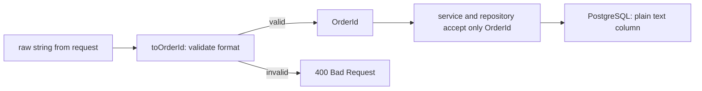

## 9.6 Mapped types and key remapping

### 9.6.1 Transforming every property of a type

#### Concept

A **mapped type** builds a new object type by walking over a set of keys and computing a property for each: `{ [K in Keys]: SomeTypeUsing<K> }`. It is a `for` loop over keys, run by the compiler. **Key remapping** (`as`) lets the loop rename keys or drop them.

#### Why does it exist?

Many backend types are systematic variations of one shape: the update DTO is the entity with every field optional; the read model is the entity with every field `readonly`; a handler registry has one function per event type. Writing each by hand duplicates the shape. A mapped type states the rule once.

#### How it works

```ts
interface Order { id: string; status: 'pending' | 'paid'; totalCents: number; note?: string }

// The loop: for each key K of Order, keep the same type, add readonly.
type ReadonlyOrder = { readonly [K in keyof Order]: Order[K] };

// Modifiers can be added (+, the default) or removed (-).
type Mutable<T> = { -readonly [K in keyof T]: T[K] };     // strip readonly
type Complete<T> = { [K in keyof T]-?: T[K] };             // strip optional: note becomes required
type Patch<T> = { [K in keyof T]?: T[K] };                 // what Partial<T> is

// Key remapping with `as`: rename keys...
type Getters<T> = { [K in keyof T as `get${Capitalize<string & K>}`]: () => T[K] };
type OrderGetters = Getters<Pick<Order, 'status' | 'totalCents'>>;
// { getStatus: () => 'pending' | 'paid'; getTotalCents: () => number }

// ...or filter them out by mapping to never.
type KeysOfType<T, V> = { [K in keyof T]-?: T[K] extends V ? K : never }[keyof T];
type NumericOrderField = KeysOfType<Order, number>;        // 'totalCents'
```

The `KeysOfType` trick is worth reading twice: it maps each key to itself or `never`, then indexes the result with `[keyof T]` to collect the surviving keys as a union.

#### Practical example — an exhaustive handler registry

Mapping over a **union** of events, with `as` to use each event's `type` as the key, produces an object type that demands exactly one handler per event:

```ts
type DomainEvent =
  | { type: 'order.created'; orderId: string; totalCents: number }
  | { type: 'order.paid'; orderId: string; paymentId: string }
  | { type: 'order.cancelled'; orderId: string; reason: string };

type HandlerMap = {
  [E in DomainEvent as E['type']]: (event: E) => Promise<void>;
};

const handlers: HandlerMap = {
  'order.created': async (e) => console.log('reserve stock for', e.orderId),
  'order.paid': async (e) => console.log('send receipt for', e.paymentId),
  'order.cancelled': async (e) => console.log('release stock:', e.reason),
};
// Add an event to the union and `handlers` stops compiling until it has a handler.

async function dispatch(event: DomainEvent): Promise<void> {
  const handler = handlers[event.type] as (e: DomainEvent) => Promise<void>; // the one contained cast
  await handler(event);
}
```

This is the same exhaustiveness guarantee as `assertNever` (9.2.2), in data form, which suits a consumer that routes many event types.

#### Common mistakes

- Writing a mapped type when `Partial`, `Readonly`, `Pick` or `Record` already does it (9.8).
- Forgetting `-?` in `KeysOfType`, so optional properties contribute `undefined` to the result.

## 9.7 Template literal types

### 9.7.1 String patterns in the type system

#### Concept

A **template literal type** uses JavaScript's template string syntax at the type level: `` `order.${'created' | 'paid'}` `` is the union `'order.created' | 'order.paid'`. Combined with `infer`, it can also take strings apart. TypeScript provides four intrinsic helpers: `Uppercase`, `Lowercase`, `Capitalize` and `Uncapitalize`.

#### How it works

```ts
type Aggregate = 'order' | 'payment' | 'refund';
type Action = 'created' | 'updated';
type EventName = `${Aggregate}.${Action}`;   // 6 members: 'order.created' | 'order.updated' | ...

// Typed cache keys: the pattern is enforced wherever a key is built.
type CacheKey = `cart:${string}` | `session:${string}` | `rate:${string}:${number}`;
function cacheGet(key: CacheKey): void { /* ... */ }
cacheGet('cart:cus_1');                      // OK
// cacheGet('carts:cus_1');                  // error: not assignable to CacheKey

// Taking strings apart with infer: route parameters from a path pattern.
type RouteParams<P extends string> =
  P extends `${string}:${infer Name}/${infer Rest}` ? Name | RouteParams<Rest>
  : P extends `${string}:${infer Name}` ? Name
  : never;

type P1 = RouteParams<'/customers/:customerId/orders/:orderId'>; // 'customerId' | 'orderId'

function buildPath<P extends string>(pattern: P, params: Record<RouteParams<P>, string>): string {
  return pattern.replace(/:(\w+)/g, (_, name: string) =>
    encodeURIComponent((params as Record<string, string>)[name]));
}
console.log(buildPath('/customers/:customerId/orders/:orderId', { customerId: 'cus_1', orderId: 'ord_7' }));
// buildPath('/customers/:customerId', {});  // error: property 'customerId' is missing
```

#### Edge cases & failure modes

- **Combinatorial explosion.** A template of three unions with 20 members each is 8,000 members; TypeScript refuses unions larger than 100,000 and gets slow long before that.
- **Runtime strings are still unchecked.** A key read from a request is `string` until you validate it; the pattern type protects only strings built in your code.

#### How a Senior Backend Engineer thinks about this

Template literal types are excellent at **boundaries inside your own code**: event names, cache keys, metric names. A recursive type that parses a SQL string is a party trick that makes the editor slow and errors unreadable. Seniors use the simple forms freely and the `infer` forms sparingly, in shared helpers.

## 9.8 The built-in utility types and writing your own

### 9.8.1 The standard toolbox

#### Concept

TypeScript ships a set of generic **utility types** built from the mechanisms above. Knowing them saves writing them, and makes your types readable to anyone who knows TypeScript.

#### How it works

| Utility | What it does | Backend use |
|---|---|---|
| `Partial<T>` | Every property optional | Patch inputs: `Partial<Pick<Order, 'note' \| 'shippingAddress'>>` |
| `Required<T>` | Every property required | A fully resolved config after defaults are applied |
| `Readonly<T>` | Every property `readonly` (shallow) | Values handed to callers who must not mutate them |
| `Pick<T, K>` | Keep only keys `K` | Response shapes: `Pick<User, 'id' \| 'email'>` |
| `Omit<T, K>` | Drop keys `K` | `Omit<User, 'passwordHash'>`, with a caveat below |
| `Record<K, V>` | Object with keys `K`, values `V` | Exhaustive lookups: `Record<OrderStatus, string>` |
| `Exclude<T, U>` | Remove union members assignable to `U` | `Exclude<OrderStatus, 'cancelled'>` |
| `Extract<T, U>` | Keep union members assignable to `U` | `Extract<DomainEvent, { type: 'order.paid' }>` |
| `NonNullable<T>` | Remove `null` and `undefined` | After a guard or a default |
| `ReturnType<F>`, `Parameters<F>` | A function's result or argument tuple | Typing wrappers and mocks around existing functions |
| `Awaited<T>` | The resolved type of a promise | `Awaited<ReturnType<Service['method']>>` |
| `InstanceType<C>` | The instance type of a class constructor | Factories that take a class |
| `NoInfer<T>` | Block inference from this position (5.4) | 9.3.1 |

#### Edge cases & failure modes — the `Omit` caveats

```ts
interface User { id: string; email: string; passwordHash: string }

// 1. Omit does not check that the key exists. A typo silently omits nothing.
type PublicUser = Omit<User, 'passwordhash'>;   // compiles; passwordHash is still there

// A stricter version rejects unknown keys.
type StrictOmit<T, K extends keyof T> = Omit<T, K>;
// type Bad = StrictOmit<User, 'passwordhash'>; // error: not assignable to keyof User

// 2. Omit on a union collapses it to the common keys. Use a distributive version.
type DistributiveOmit<T, K extends PropertyKey> = T extends unknown ? Omit<T, K> : never;
```

The first caveat matters for security: `Omit<User, 'passwordhash'>` as a response type does not remove the hash, and a type is not a filter anyway. What actually protects the response is mapping to an explicit response object or DTO (6.2), never a type alone.

#### How it works — writing your own

Two custom utilities appear in many backends. Keep them in one `types/` file and give them names a reader can guess:

```ts
// Make some keys optional, keep the rest as they are (for "create" inputs with server defaults).
type PartialBy<T, K extends keyof T> = Omit<T, K> & Partial<Pick<T, K>>;

interface Product { id: string; sku: string; name: string; priceCents: number; active: boolean }
type CreateProductInput = PartialBy<Omit<Product, 'id'>, 'active'>; // active optional, id gone

// Deep read-only for configuration and cached reference data.
type DeepReadonly<T> =
  T extends (...args: never[]) => unknown ? T
  : T extends readonly (infer E)[] ? ReadonlyArray<DeepReadonly<E>>
  : T extends object ? { readonly [K in keyof T]: DeepReadonly<T[K]> }
  : T;
```

#### Interview questions

1. **What is the difference between `Exclude` and `Omit`?** `Exclude` removes members from a union type; `Omit` removes properties from an object type.
2. **Why can `Omit<User, 'passwordhash'>` be dangerous?** `Omit` does not require the key to exist, so a typo removes nothing; and a type never removes data at runtime anyway.
3. **How would you type the resolved result of an existing async function without rewriting it?** `Awaited<ReturnType<typeof fn>>`.

## 9.9 `satisfies` and const assertions

### 9.9.1 Checking a value without widening it

#### Concept

`as const` (a **const assertion**) tells TypeScript to infer the narrowest type for a value: literals stay literals, arrays become read-only tuples, objects become deeply `readonly`. The `satisfies` operator (TypeScript 4.9) **checks** a value against a type **without changing** the value's inferred type. Together they let a configuration object be both validated and precise.

#### Why does it exist?

A type annotation checks, but it also widens: after `const policies: Record<string, RetryPolicy> = {...}`, TypeScript forgets which keys exist, so `policies.stripe` is allowed even if there is no `stripe` entry, and a typo becomes a runtime `undefined`. Without an annotation, the keys are precise but nothing checks the values. `satisfies` gives both.

#### How it works

```ts
interface RetryPolicy { maxAttempts: number; baseDelayMs: number; retryOn: readonly number[] }

// Annotation: checked, but widened. Keys are just `string`.
const annotated: Record<string, RetryPolicy> = {
  cardProvider: { maxAttempts: 3, baseDelayMs: 200, retryOn: [502, 503, 504] },
};
annotated.cardProviderr;   // compiles: any string key is allowed, value is RetryPolicy (actually undefined)

// satisfies: checked AND precise. Keys are exactly the ones written.
const RETRY_POLICIES = {
  cardProvider: { maxAttempts: 3, baseDelayMs: 200, retryOn: [502, 503, 504] },
  smsProvider: { maxAttempts: 5, baseDelayMs: 1000, retryOn: [429, 503] },
} as const satisfies Record<string, RetryPolicy>;

type ProviderName = keyof typeof RETRY_POLICIES;   // 'cardProvider' | 'smsProvider'
// RETRY_POLICIES.cardProviderr;                   // error: property does not exist
// A policy with maxAttempts: '3' would be an error at its exact line.
const attempts = RETRY_POLICIES.smsProvider.maxAttempts;  // 5 (the literal type, thanks to as const)
```

`as const satisfies T` is the common combination for configuration tables, route tables, permission maps and error-code catalogues: `as const` keeps literals and makes it read-only, `satisfies` makes sure every entry has the right shape.

#### Common mistakes

- Using `as` instead of `satisfies`. `{ maxAttempts: '3' } as RetryPolicy` is a cast and may hide the error; `satisfies` reports it.
- Expecting `as const` to freeze at runtime. It is compile-time only; use `Object.freeze` if runtime immutability matters.

## 9.10 Branded types for IDs and money

### 9.10.1 Adding names to structural types

#### Concept

A **branded type** (also called a nominal or opaque type) is a primitive with an invisible tag attached at the type level, so that two values with the same runtime shape become incompatible types: an `OrderId` cannot be passed where a `CustomerId` is expected, though both are strings at runtime. It fixes the structural-typing hole from 9.1.2.

#### Why does it exist?

Backends are full of interchangeable primitives: order ids, customer ids and payment ids are all `string`; amounts in cents and amounts in paise and quantities are all `number`. Part 0 (0.5.3) and Part 1 (1.1.1) established integer cents; branding takes the next step and stops the compiler from adding cents of one currency to cents of another, or a quantity to a price.

#### Mental model

Imagine luggage tags. Two black suitcases look identical; the tag decides which flight each goes on. The tag adds nothing to the suitcase's contents (no runtime cost) but the airline's system refuses to load a bag tagged for Mumbai onto the Delhi flight.

#### How it works

```ts
declare const brand: unique symbol;                   // exists only in the type system
type Brand<T, B extends string> = T & { readonly [brand]: B };

type OrderId = Brand<string, 'OrderId'>;
type CustomerId = Brand<string, 'CustomerId'>;

// The only way to make one is a "smart constructor" that validates.
function toOrderId(raw: string): OrderId {
  if (!/^ord_[a-z0-9]{6,}$/.test(raw)) throw new Error(`invalid order id: ${raw}`);
  return raw as OrderId;                              // the single, audited cast
}
function toCustomerId(raw: string): CustomerId {
  if (!/^cus_[a-z0-9]{6,}$/.test(raw)) throw new Error(`invalid customer id: ${raw}`);
  return raw as CustomerId;
}

declare function refundOrder(orderId: OrderId, customerId: CustomerId, amountCents: number): Promise<void>;

const orderId = toOrderId('ord_8f3k2m');
const customerId = toCustomerId('cus_x91b7q');
void refundOrder(orderId, customerId, 4999);          // OK
// void refundOrder(customerId, orderId, 4999);       // error: CustomerId is not assignable to OrderId
// void refundOrder('ord_8f3k2m', customerId, 4999);  // error: a plain string is not an OrderId
console.log(orderId.toUpperCase());                   // still a string for every read operation
```

**Money.** Branding the currency into the type makes cross-currency arithmetic a compile error:

```ts
type Currency = 'INR' | 'USD' | 'EUR';
type Money<C extends Currency> = { readonly minor: number; readonly currency: C }; // minor units: paise, cents

function money<C extends Currency>(minor: number, currency: C): Money<C> {
  if (!Number.isSafeInteger(minor)) throw new Error(`minor units must be an integer, got ${minor}`);
  return { minor, currency };
}

function add<C extends Currency>(a: Money<C>, b: Money<NoInfer<C>>): Money<C> {
  return money(a.minor + b.minor, a.currency);
}

const subtotal = money(49900, 'INR');
const shipping = money(4000, 'INR');
const total = add(subtotal, shipping);        // Money<'INR'>
// add(subtotal, money(500, 'USD'));          // error: Money<'USD'> is not assignable to Money<'INR'>
console.log(total);                           // { minor: 53900, currency: 'INR' }
```

Here the currency is a real field (it must be stored and sent anyway), and the type parameter makes the compiler compare it. The runtime check still matters for amounts arriving from outside; the generic catches the bugs in your own code. Part 80 — Frontend–Backend Contracts (80.7) covers how money and ids should travel over the wire.



#### Production scenario

Brands pay for themselves at layer boundaries: the controller or DTO turns raw strings into branded ids once, and every service and repository signature below it takes the branded type. When an engineer later reorders parameters or passes the wrong id, the compiler catches it in every file at once. The runtime cost is zero; the code change is one smart constructor per id type.

#### Edge cases & failure modes

- **Casts defeat brands.** `'anything' as OrderId` compiles. Keep the cast inside the smart constructor and forbid `as` on brands in review, or with a lint rule.
- **Serialisation strips brands.** JSON and the database know nothing about them; values read back are plain strings until re-parsed. Brand at the boundary where data enters (DTO, repository mapping), not halfway through.
- **Over-branding.** Branding every string (names, notes, addresses) makes code noisy for little gain. Brand ids, money and units, where a mix-up costs money or leaks data.

#### How a Senior Backend Engineer thinks about this

Seniors brand the values whose confusion is expensive and invisible: identifiers that cross tenants or aggregates, money, and units (cents versus paise, milliseconds versus seconds). They make the smart constructor the only door, keep it next to the validation regex, and treat a stray `as OrderId` in a pull request like a stray `any`.

#### Practical exercise

An orders service has `transferCredit(fromCustomerId: string, toCustomerId: string, amountCents: number)`. A bug once swapped the two ids. Make the swap impossible to compile while still allowing a transfer between any two customers, and make it impossible to pass a raw `number` as the amount.

Acceptance criteria: passing a raw string or raw number fails to compile; the amount must be a positive integer, checked once at creation.

#### Worked answer to the exercise

```ts
declare const brand: unique symbol;
type Brand<T, B extends string> = T & { readonly [brand]: B };

type CustomerId = Brand<string, 'CustomerId'>;
type PositiveCents = Brand<number, 'PositiveCents'>;

const toCustomerId = (raw: string): CustomerId => {
  if (!/^cus_[a-z0-9]{6,}$/.test(raw)) throw new Error(`invalid customer id: ${raw}`);
  return raw as CustomerId;
};
const toPositiveCents = (n: number): PositiveCents => {
  if (!Number.isSafeInteger(n) || n <= 0) throw new Error(`amount must be a positive integer, got ${n}`);
  return n as PositiveCents;
};

// Named fields make the direction explicit; the brands make the values typed.
interface CreditTransfer { from: CustomerId; to: CustomerId; amount: PositiveCents }

function transferCredit({ from, to, amount }: CreditTransfer): string {
  if (from === to) throw new Error('cannot transfer to the same customer');
  return `move ${amount} cents from ${from} to ${to}`;
}

const asha = toCustomerId('cus_asha01');
const ravi = toCustomerId('cus_ravi02');
console.log(transferCredit({ from: asha, to: ravi, amount: toPositiveCents(2500) }));
// transferCredit({ from: 'cus_asha01', to: ravi, amount: toPositiveCents(2500) }); // error: string is not CustomerId
// transferCredit({ from: asha, to: ravi, amount: 2500 });                           // error: number is not PositiveCents
try { toPositiveCents(25.5); } catch (e) { console.log((e as Error).message); }
```

```text
move 2500 cents from cus_asha01 to cus_ravi02
amount must be a positive integer, got 25.5
```

Why it is right: both ids are the same brand, because a transfer genuinely goes between two customers; a brand cannot tell "from" and "to" apart, so the fix for the swap is the **named-field object**, which makes the direction visible at every call site (1.4.3's options-object advice, now with a reason). The brands then make sure only validated values are passed: a raw string or number fails to compile, and the `PositiveCents` constructor checks integer and positive once, so `transferCredit` does not repeat the check.

The trap most learners fall into is inventing `FromCustomerId` and `ToCustomerId` brands. They compile, but a customer id is not "a from id"; every caller must now cast between them, which defeats the purpose. Use brands for **what a value is**, and parameter names for **what role it plays**.

## 9.11 Function overloads versus unions

### 9.11.1 When the return type depends on the input

#### Concept

**Overloads** declare several call signatures for one function, followed by one implementation. The caller sees only the overload signatures; the compiler picks the first one that matches. A **union parameter** is a single signature that accepts several input types.

#### How it works

```ts
interface Order { id: string; totalCents: number }

// Overloads: the return type differs by input, and callers get the precise one.
function findOrders(id: string): Promise<Order | null>;
function findOrders(ids: readonly string[]): Promise<Order[]>;
async function findOrders(idOrIds: string | readonly string[]): Promise<Order | null | Order[]> {
  const ids = typeof idOrIds === 'string' ? [idOrIds] : idOrIds;
  const rows: Order[] = ids.map((id) => ({ id, totalCents: 1000 }));   // stand-in for a query
  return typeof idOrIds === 'string' ? rows[0] ?? null : rows;
}

async function demo(): Promise<void> {
  const one = await findOrders('ord_1');            // Order | null
  const many = await findOrders(['ord_1', 'ord_2']); // Order[]
  console.log(one?.id, many.length);
}
void demo();

// Union: same return type for every input. One signature is simpler and enough.
function formatAmount(amount: number | bigint, currency: 'INR' | 'USD'): string {
  return `${currency} ${amount.toString()}`;
}
```

| Use | When |
|---|---|
| A union parameter | The return type is the same whatever the input |
| Overloads | The return type (or allowed parameter combinations) depend on which input form was given |
| Two separately named functions | The behaviours really differ (`findOrder` and `findOrdersByIds` are often clearer than one overloaded name) |

#### Edge cases & failure modes

- **The implementation signature is invisible to callers** and is not checked against each overload's return type precisely; it is easy to return an array when the single-id overload promised one order. Test each overload.
- **Order matters.** Overloads are tried top to bottom; put the most specific first.
- **A union argument does not match any overload.** With `declare const x: string | string[]`, `findOrders(x)` fails, because neither overload accepts the union. Add a third overload or use a single union signature.

#### Interview questions

1. **When would you use overloads instead of a union parameter?** When the return type depends on the form of the input; otherwise a union is simpler.
2. **Why can a caller not pass a `string | string[]` to the overloaded `findOrders`?** Each overload is checked separately and neither accepts the union.
3. **What is a branded type and what does it cost at runtime?** A primitive intersected with a phantom tag so equal shapes become incompatible types; it costs nothing at runtime.
4. **What does `satisfies` do that an annotation does not?** It checks the value against a type but keeps the value's own, narrower inferred type.
