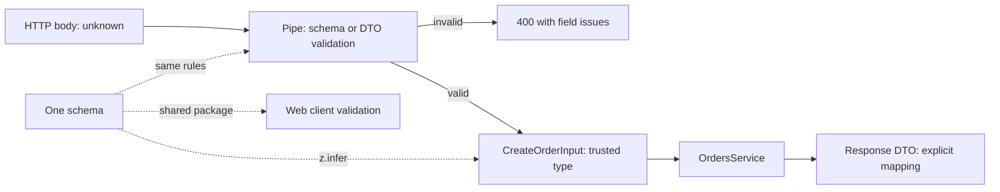
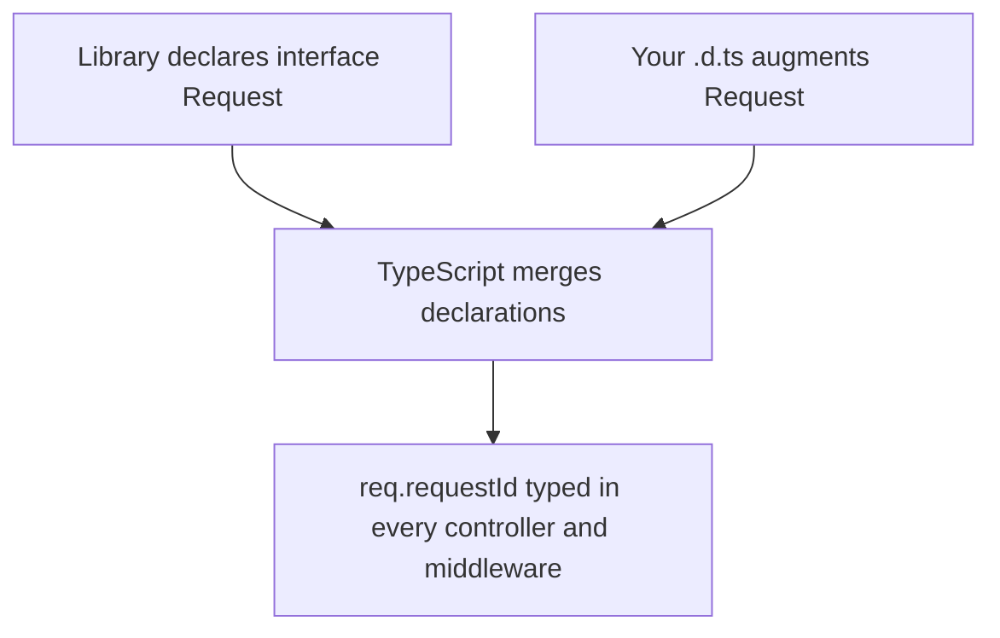

## 9.12 Type-safe API contracts end to end

### 9.12.1 One definition for the check and the type

#### Concept

TypeScript types disappear at runtime (1.2.1), so they cannot check a request body. A **validator** checks it at runtime. The engineering problem is keeping the two in step: the type that the service code trusts must describe exactly what the validator lets through. An end-to-end contract has **one source of truth** from which both the runtime check and the compile-time type are produced.

#### Why does it exist?

When the DTO class, the interface the service uses and the validation rules are written separately, they drift. Someone adds `giftMessage` to the interface but not to the validator, so the field is stripped (or worse, unvalidated) and the service reads `undefined`. Someone changes `quantity` to allow `0` in the validator but the service still divides by it. Each copy is a chance to disagree.

#### How it works

Two approaches are common in NestJS codebases. Both are legitimate; mixing them in one service is what hurts.

**Approach 1: class-validator DTO classes** (the NestJS default, used in 6.2 and 6.5). The class is the type, and decorators are the runtime rules.

```ts
import { Type } from 'class-transformer';
import {
  ArrayMaxSize, ArrayMinSize, IsInt, IsOptional, IsString, Matches, Max, MaxLength, Min, ValidateNested,
} from 'class-validator';

export class OrderItemDto {
  @IsString() @MaxLength(64)
  sku!: string;                                // ! : assigned by class-transformer, not a constructor

  @IsInt() @Min(1) @Max(99)
  quantity!: number;
}

export class CreateOrderDto {
  @Matches(/^cus_[a-z0-9]{6,}$/)
  customerId!: string;

  @ValidateNested({ each: true }) @Type(() => OrderItemDto)
  @ArrayMinSize(1) @ArrayMaxSize(50)
  items!: OrderItemDto[];

  @IsOptional() @IsString() @MaxLength(32)
  couponCode?: string;
}
```

The decorators and the TypeScript type sit on the same line, which keeps them close, but nothing forces them to agree: `@IsInt() quantity!: string` compiles. The global `ValidationPipe` with `whitelist: true` and `transform: true` (6.5) turns the raw body into a `CreateOrderDto` instance. `@nestjs/swagger` can read these classes to generate an OpenAPI description, which is how Part 80 — Frontend–Backend Contracts (80.2) produces typed clients for the frontend.

**Approach 2: a schema library such as zod.** The schema is the runtime rule, and the type is **inferred** from it, so they cannot disagree.

```ts
import { z } from 'zod';
import { BadRequestException, Body, Controller, PipeTransform, Post } from '@nestjs/common';

export const CreateOrderSchema = z.object({
  customerId: z.string().regex(/^cus_[a-z0-9]{6,}$/),
  items: z.array(z.object({
    sku: z.string().max(64),
    quantity: z.number().int().min(1).max(99),
  })).min(1).max(50),
  couponCode: z.string().max(32).optional(),
});
export type CreateOrderInput = z.infer<typeof CreateOrderSchema>;
// { customerId: string; items: { sku: string; quantity: number }[]; couponCode?: string | undefined }

export class ZodBody<T> implements PipeTransform<unknown, T> {
  constructor(private readonly schema: z.ZodType<T>) {}
  transform(value: unknown): T {
    const result = this.schema.safeParse(value);     // never throws; returns success or issues
    if (!result.success) {
      throw new BadRequestException({ code: 'validation_failed', issues: result.error.issues });
    }
    return result.data;                              // typed T, unknown keys stripped by z.object
  }
}

@Controller('orders')
export class OrdersController {
  @Post()
  create(@Body(new ZodBody(CreateOrderSchema)) input: CreateOrderInput) {
    return { accepted: input.items.length };          // input is fully typed and validated
  }
}
```

The schema can live in a shared package used by the web app too (Part 80, 80.3), so the browser and the API validate with the same rules.



#### Decision table

| Question | class-validator DTOs | zod schemas |
|---|---|---|
| Type and rules can drift? | Yes, decorators and types are separate | No, the type is inferred from the schema |
| NestJS integration | Built in (`ValidationPipe`), first-class with `@nestjs/swagger` | A small custom pipe; OpenAPI needs an extra library |
| Share with a frontend | Awkward (decorators, classes, `reflect-metadata`) | Natural: plain objects, runs in the browser |
| Composition (pick, extend, discriminated unions) | Inheritance and mapped-type helpers | `.pick`, `.extend`, `z.discriminatedUnion`, branded ids with `.brand()` |
| Team familiarity in a NestJS codebase | Usually high | Varies |

The senior answer is boring: follow what the codebase already does, and if you are starting fresh with a web client in the same repository, a shared schema library usually wins on drift. Whichever you choose, the rule from 9.1 stands: **everything entering the process is `unknown` until a validator has produced a typed value.**

#### Practical exercise

This code has a drifting contract. Find the two drift bugs, then rewrite it so the type is inferred from a single zod schema.

```ts
interface UpdateShippingInput {
  orderId: string;
  address: { line1: string; city: string; postcode: string; giftMessage?: string };
}

function isUpdateShippingInput(v: any): v is UpdateShippingInput {
  return typeof v.orderId === 'string' && typeof v.address?.line1 === 'string'
    && typeof v.address?.city === 'string';
}
```

Acceptance criteria: the two bugs named; one schema; the type derived with `z.infer`; a sample invalid body produces readable issues.

#### Worked answer to the exercise

The drift bugs: the guard never checks `postcode`, so a body without it passes and the type lies that it is a string; and `giftMessage` is never checked, so a number or a 5 MB string passes. (The `any` parameter also means the guard itself is unchecked.)

```ts
import { z } from 'zod';

const UpdateShippingSchema = z.object({
  orderId: z.string().regex(/^ord_[a-z0-9]{6,}$/),
  address: z.object({
    line1: z.string().min(1).max(120),
    city: z.string().min(1).max(60),
    postcode: z.string().regex(/^[A-Za-z0-9 -]{3,10}$/),
    giftMessage: z.string().max(200).optional(),
  }),
});
type UpdateShippingInput = z.infer<typeof UpdateShippingSchema>;

function parseUpdateShipping(body: unknown): UpdateShippingInput {
  const result = UpdateShippingSchema.safeParse(body);
  if (!result.success) {
    const issues = result.error.issues.map((i) => `${i.path.join('.')}: ${i.message}`);
    throw new Error(issues.join('; '));
  }
  return result.data;
}

try {
  parseUpdateShipping({ orderId: 'ord_k2j9x0', address: { line1: '12 MG Road', city: 'Pune', giftMessage: 42 } });
} catch (e) {
  console.log((e as Error).message);
}
console.log(parseUpdateShipping({
  orderId: 'ord_k2j9x0', address: { line1: '12 MG Road', city: 'Pune', postcode: '411001' }, admin: true,
}));
```

```text
address.postcode: Invalid input: expected string, received undefined; address.giftMessage: Invalid input: expected string, received number
{
  orderId: 'ord_k2j9x0',
  address: { line1: '12 MG Road', city: 'Pune', postcode: '411001' }
}
```

Why it is right: the schema is the only definition; `UpdateShippingInput` is computed from it, so a field added to one is in the other by construction. Every field has a runtime rule, including limits (`max(200)`), which a hand-written guard rarely bothers with. The second call shows that `z.object` strips unknown keys (`admin: true` is gone), the mass-assignment protection that `whitelist: true` gives class-validator (Part 44). Issue messages come with a path, ready to map to form fields (80.6). The exact message wording depends on the zod version; the output above is from zod 4.

The trap most learners fall into is fixing the guard by adding `postcode` and stopping there. The guard is now right today and will drift again next month. The second trap is `z.infer` on the schema while the controller still declares the parameter as the old interface: two definitions again.

## 9.13 Typing NestJS: repositories, configuration and events

### 9.13.1 Three places where types usually leak

#### Concept

NestJS gives you dependency injection, decorators and a module system; it does not make your configuration, repositories or in-process events type-safe by itself. Three small patterns close the most common leaks: a narrow generic repository, typed configuration, and a typed event facade.

#### NestJS example — a generic base repository (kept small)

```ts
import { FindOptionsWhere, ObjectLiteral, Repository } from 'typeorm';

export abstract class BaseRepository<T extends ObjectLiteral & { id: string }> {
  constructor(protected readonly repo: Repository<T>) {}

  findById(id: T['id']): Promise<T | null> {
    // TypeORM cannot prove that { id } matches FindOptionsWhere<T> for every T,
    // so the generic layer needs one cast. Concrete repositories need none.
    return this.repo.findOneBy({ id } as FindOptionsWhere<T>);
  }

  async existsById(id: T['id']): Promise<boolean> {
    return (await this.repo.countBy({ id } as FindOptionsWhere<T>)) > 0;
  }
}
```

Keep the base to the handful of methods that are genuinely identical for every entity. Everything with business meaning (`findOpenOrdersForCustomer`, `lockForUpdate`) belongs in the concrete repository, written against the concrete entity, where TypeORM's types work without casts. Part 25 — ORM Engineering: TypeORM, Sequelize and Raw SQL discusses how far to take repository abstractions; the type-level lesson is that every extra generic layer adds casts.

#### NestJS example — typed configuration

```ts
import { Injectable, Module } from '@nestjs/common';
import { ConfigModule, ConfigService } from '@nestjs/config';
import { z } from 'zod';

const EnvSchema = z.object({
  DATABASE_URL: z.string().min(1),
  PORT: z.coerce.number().int().min(1).max(65535).default(3000),
  PAYMENTS_TIMEOUT_MS: z.coerce.number().int().positive().default(5000),
});
export type Env = z.infer<typeof EnvSchema>;

@Module({
  imports: [ConfigModule.forRoot({ validate: (raw) => EnvSchema.parse(raw) })], // fail at startup, not at 3 a.m.
})
export class AppConfigModule {}

@Injectable()
export class PaymentsClient {
  // `true` as the second parameter says "validated: get() never returns undefined".
  constructor(private readonly config: ConfigService<Env, true>) {}

  timeoutMs(): number {
    return this.config.get('PAYMENTS_TIMEOUT_MS', { infer: true }); // number, and a typo is a compile error
  }
}
```

Without this, `config.get('PAYMENTS_TIMEOUT_MS')` returns `any`, and a missing variable becomes `undefined`, which `setTimeout` treats as "fire immediately". The `validate` function turns that into a startup crash with a clear message, and `ConfigService<Env, true>` makes every read typed. 6.5.1 introduced validating configuration; this is the typed version.

#### NestJS example — typed in-process events

`@nestjs/event-emitter` wraps EventEmitter2, whose `emit(event, ...values: any[])` accepts any payload for any name. A thin facade adds the checking:

```ts
import { Injectable } from '@nestjs/common';
import { EventEmitter2 } from '@nestjs/event-emitter';

export interface EventPayloads {
  'order.paid': { orderId: string; paymentId: string; amountMinor: number };
  'order.cancelled': { orderId: string; reason: string };
}
export type EventName = keyof EventPayloads;

@Injectable()
export class DomainEvents {
  constructor(private readonly emitter: EventEmitter2) {}

  emit<N extends EventName>(name: N, payload: EventPayloads[N]): void {
    this.emitter.emit(name, payload);
  }
}

// A listener names its payload with the same map, so a renamed field breaks both sides at once:
//   @OnEvent('order.paid')
//   async onPaid(payload: EventPayloads['order.paid']) { ... }
```

The decorator string in `@OnEvent('order.paid')` is still not checked against the parameter type; a lint rule or a review convention covers that gap. For events that cross process boundaries (Kafka, RabbitMQ), the payload must also be validated on the consumer side, because the producer may be a different version (Part 28).

#### Common mistakes

- `ConfigService` without type parameters, so every value is `any`.
- A deep generic repository hierarchy where every method needs a cast.
- Typing event payloads on the producer and receiving `any` on the consumer.

#### Interview questions

1. **How do you make `ConfigService.get` return typed values?** Declare the variables as a type, validate them at startup with `ConfigModule.forRoot({ validate })`, and inject `ConfigService<Env, true>` so `get(key, { infer: true })` returns the declared type.
2. **Why does a generic base repository usually need a cast?** TypeORM's `FindOptionsWhere<T>` cannot be proven to accept `{ id }` for an arbitrary `T`; keep the base small so the cast lives in one place.
3. **What does a typed event facade give you that `@OnEvent` does not?** The producer's payload is checked against the event name; the listener's decorator string is still unchecked, so share the payload map and review the names.

## 9.14 Declaration files and augmenting third-party types

### 9.14.1 `.d.ts`, `declare module` and module augmentation

#### Concept

A **declaration file** (`.d.ts`) contains only types: no runtime code. It describes JavaScript that exists elsewhere. Packages ship them (the `types` field in `package.json`), the community publishes them for untyped packages as `@types/*` (DefinitelyTyped), and `tsc` emits them for your own libraries with `declaration: true`. `declare module` lets you describe a module that has no types, and **module augmentation** lets you add to a type that a library already declares.

#### How it works

**Typing an untyped package.** A small internal JavaScript SMS client with no types:

```ts
// src/types/legacy-sms-client.d.ts
declare module 'legacy-sms-client' {
  export interface SendResult { messageId: string; accepted: boolean }
  export function send(to: string, body: string, options?: { senderId?: string }): Promise<SendResult>;
}
```

Now `import { send } from 'legacy-sms-client'` is typed. You are making promises the compiler cannot verify, so keep the declaration minimal (only what you use) and wrap the package in one adapter class with a test against the real library.

**Augmenting Express's request.** A middleware adds a request id and the authenticated user to every request. Instead of `(req as any).requestId` everywhere, augment the interface once:

```ts
// src/types/express-request.d.ts
import 'express-serve-static-core';

declare module 'express-serve-static-core' {
  interface Request {
    requestId?: string;                       // set by RequestIdMiddleware (6.6)
    actor?: { id: string; roles: ReadonlyArray<'customer' | 'support' | 'admin'> };
  }
}
```

Interfaces **merge**: two declarations of the same interface in the same module combine into one. That is why augmentation must target an `interface` (types made with `type` cannot be reopened), and why the file must be a module (the `import` line makes it one) so that `declare module` augments rather than replaces. If you use Passport, augment its `Express.User` interface instead, because `req.user` is declared there.

**Global augmentation.** `process.env` can be described the same way, inside `declare global { namespace NodeJS { interface ProcessEnv { ... } } }`. Declare the variables as optional (`DATABASE_URL?: string`): a declaration cannot make a variable exist, and pretending it always does is how `undefined` reaches production. The validated `ConfigService` in 9.13 is the better tool.



#### Edge cases & failure modes

- **The augmentation file is not included.** It must be in the `include` set of `tsconfig.json`; otherwise the editor shows types that `tsc` in CI does not, or the other way round.
- **A `.d.ts` without any `import` or `export`** is a global script, and `declare module 'x'` in it declares a whole new module instead of augmenting the existing one.
- **`skipLibCheck: true`** (common and usually right, 9.16) also skips checking your own `.d.ts` files, so mistakes in them surface only where they are used.
- **`@types` version drift.** `@types/express` for a different major version than `express` gives types for an API you are not running.

#### How a Senior Backend Engineer thinks about this

A declaration is an unverified claim about code you did not write, so seniors keep them small, close to an adapter that is tested against the real library, and few in number. They prefer augmenting a library's own extension points (`Express.User`, `express-serve-static-core`) over copying and editing its types, and they never use a declaration to make the type system believe something the runtime does not guarantee, such as a required environment variable.

#### Interview questions

1. **What is in a `.d.ts` file and where do they come from?** Type declarations only; shipped with packages, published as `@types/*`, or emitted by `tsc --declaration`.
2. **How do you add a property to Express's `Request` type?** Module augmentation of `express-serve-static-core` (or Passport's `Express.User` for `req.user`) in a `.d.ts` that is a module and is included by `tsconfig`.
3. **Why can you augment an `interface` but not a `type` alias?** Interfaces support declaration merging; type aliases are closed once declared.
4. **What is the risk of typing `process.env.DATABASE_URL` as `string`?** The declaration is not checked at runtime; a missing variable is `undefined` while the type says otherwise. Validate configuration at startup.
