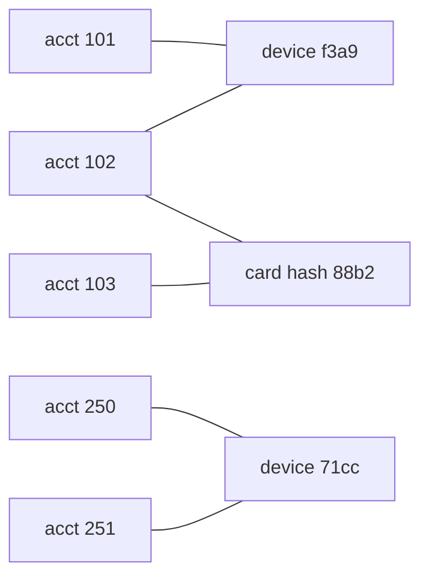
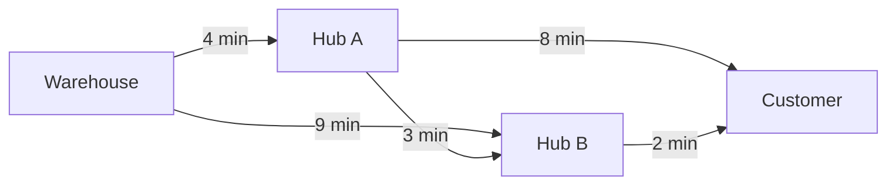
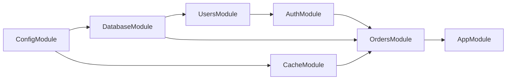

## 9.12 Graph algorithms

#### Concept

A graph is a set of nodes connected by edges. Edges can be directed (A follows B) or undirected (A and B are friends), weighted (this road takes 4 minutes) or unweighted. That is the entire definition, and it covers more of your backend than you might expect: social connections, "customers who bought X also bought Y", role inheritance, module imports, job dependencies, delivery networks, payment flows between accounts, and fraud rings of accounts sharing a device.

The four operations you will actually run on backend graphs are: traversal (BFS and DFS, covered in the previous sections), connected components (which nodes belong to the same cluster), cycle detection (is this dependency graph valid), and shortest path (fewest hops or lowest cost).

#### Why does it exist?

Because relational tables store relationships as rows, and some questions cannot be answered by a fixed number of joins. "Everyone within 3 hops" is three joins; "everyone connected at all" is an unbounded number of joins. Graph algorithms are the tools for questions where the number of steps is not known in advance. Without them you either write recursive CTEs by hand for every question, or you load the data into memory and improvise, usually with `O(n²)` results.

#### Mental model

Imagine a city map. Intersections are nodes, streets are edges, and the minutes it takes to drive each street are weights. "Which neighborhoods are cut off by the flood?" is connected components. "Can I drive in a loop without repeating a street?" is cycle detection. "Fastest route from the depot to the customer" is shortest path. "Everything within a ten-minute walk" is BFS with a cap. The same map answers all four; only the question changes.

#### How it works

**Representation.** Three choices, and the database is usually the source of truth for all of them:

| Representation | Structure | Memory | Best for |
|---|---|---|---|
| Edge list | `edges(from_id, to_id, weight)` table or array of tuples | O(E) | Storage in PostgreSQL; input to union-find |
| Adjacency list | `Map<nodeId, Array<{ to, weight }>>` | O(V + E) | Traversal (BFS, DFS, Dijkstra); sparse graphs, which is nearly all real graphs |
| Adjacency matrix | `weight[i][j]` two-dimensional array | O(V²) | Tiny dense graphs (a few hundred nodes); Floyd-Warshall |

In PostgreSQL the graph is an edge table with indexes on both `from_id` and `to_id`. Traversal uses recursive CTEs (see the recursion and BFS sections). For heavy traversal workloads a dedicated graph database exists, but most product graphs (millions of nodes, tens of millions of edges) are served well from PostgreSQL plus in-memory algorithms in a worker.

**Connected components.** Two approaches:

1. Flood fill: BFS or DFS from every unvisited node; each search marks one component. `O(V + E)`.
2. Union-find (disjoint set union): process edges one at a time, merging the sets of the two endpoints. With path compression and union by size, each operation is effectively `O(1)` (technically inverse Ackermann). It works on an edge *stream* and never needs the adjacency list, which makes it the right tool for large graphs read from a database cursor.

```ts
// graph/union-find.ts
export class UnionFind {
  private readonly parent = new Map<string, string>();
  private readonly size = new Map<string, number>();

  find(x: string): string {                       // returns the representative of x's set
    let root = x;
    while (this.parent.get(root) !== undefined && this.parent.get(root) !== root) root = this.parent.get(root)!;
    if (this.parent.get(root) === undefined) { this.parent.set(root, root); this.size.set(root, 1); }
    let cur = x;                                   // path compression: point every node on the path at the root
    while (cur !== root) { const next = this.parent.get(cur)!; this.parent.set(cur, root); cur = next; }
    return root;
  }

  union(a: string, b: string): boolean {           // returns false if a and b were already connected
    let ra = this.find(a);
    let rb = this.find(b);
    if (ra === rb) return false;
    if (this.size.get(ra)! < this.size.get(rb)!) [ra, rb] = [rb, ra];   // union by size: attach smaller under larger
    this.parent.set(rb, ra);
    this.size.set(ra, this.size.get(ra)! + this.size.get(rb)!);
    return true;
  }

  componentSize(x: string): number { return this.size.get(this.find(x))!; }
}
```

**Cycle detection.** Directed graphs: DFS with three colors (previous section). Undirected graphs: union-find; if an edge connects two nodes already in the same set, it closes a cycle.

**Shortest path.** A decision table, because picking the wrong one is the most common graph mistake:

| Graph | Algorithm | Complexity | Backend use |
|---|---|---|---|
| Unweighted | BFS | O(V + E) | Degrees of separation, level-order |
| Non-negative weights | Dijkstra | O((V + E) log V) with a binary heap | ETA, cheapest route, lowest-latency path |
| Negative weights, no negative cycles | Bellman-Ford | O(V * E) | Currency arbitrage detection, cost graphs with credits |
| All pairs, small V | Floyd-Warshall | O(V³) | Precomputing a distance matrix for a few hundred zones |
| Non-negative weights with a good heuristic | A* | Often far less than Dijkstra in practice | Road routing with straight-line distance as the heuristic |

#### Practical example

A fraud team wants "rings": groups of accounts linked by shared attributes (device fingerprint, card hash, shipping address). Model it as a graph where each account is connected to every attribute value it has used; accounts in the same connected component share a chain of attributes. The nightly job streams 12 million `account_attribute` rows from PostgreSQL through union-find, then writes each account's component id and size back. Accounts in components larger than 50 get flagged for review. Wall time: about 40 seconds for 5 million accounts, in a worker, with memory around 1.5 GB for the two maps.



Accounts 101, 102 and 103 form one component through the shared device and card; 250 and 251 form another.

#### NestJS example

A worker that computes components with union-find over a streamed edge set and persists the result:

```ts
// fraud/fraud-cluster.job.ts
import { Injectable, Logger } from '@nestjs/common';
import { InjectDataSource } from '@nestjs/typeorm';
import { DataSource } from 'typeorm';
import { UnionFind } from '../graph/union-find';

@Injectable()
export class FraudClusterJob {
  private readonly logger = new Logger(FraudClusterJob.name);
  constructor(@InjectDataSource() private readonly db: DataSource) {}

  async run(): Promise<void> {
    const uf = new UnionFind();
    let lastId = 0;
    for (;;) {                                                  // keyset batches keep memory per batch bounded
      const rows: Array<{ id: number; account_id: string; attr_key: string }> = await this.db.query(
        `SELECT id, account_id, attribute_type || ':' || attribute_value AS attr_key
         FROM account_attributes WHERE id > $1 ORDER BY id LIMIT 50000`, [lastId]);
      if (rows.length === 0) break;
      for (const r of rows) uf.union(r.account_id, r.attr_key);  // effectively O(1) per edge
      lastId = rows[rows.length - 1].id;
    }

    const accounts: Array<{ id: string }> = await this.db.query(`SELECT id FROM accounts`);
    const values = accounts.map((a) => [a.id, uf.find(a.id), uf.componentSize(a.id)] as const);
    await this.db.transaction(async (tx) => {
      await tx.query(`CREATE TEMP TABLE cluster_tmp (account_id text, cluster_id text, cluster_size int) ON COMMIT DROP`);
      for (let i = 0; i < values.length; i += 5000) {          // batched multi-row inserts
        const chunk = values.slice(i, i + 5000);
        const params = chunk.flat();
        const placeholders = chunk.map((_, k) => `($${k * 3 + 1}, $${k * 3 + 2}, $${k * 3 + 3})`).join(',');
        await tx.query(`INSERT INTO cluster_tmp VALUES ${placeholders}`, params);
      }
      await tx.query(`UPDATE accounts a SET cluster_id = t.cluster_id, cluster_size = t.cluster_size
                      FROM cluster_tmp t WHERE t.account_id = a.id`);
    });
    this.logger.log(`clustered ${accounts.length} accounts`);
  }
}
```

Component size in the union-find counts attribute nodes too; subtract them or track account counts separately if the threshold must count accounts only.

#### PostgreSQL example

One-hop neighborhood queries stay in SQL and need the right indexes; the full component computation lives in the worker:

```sql
CREATE INDEX CONCURRENTLY account_attributes_attr_idx ON account_attributes (attribute_type, attribute_value);
CREATE INDEX CONCURRENTLY account_attributes_account_idx ON account_attributes (account_id);

-- Accounts sharing any attribute with account $1 (one hop)
SELECT DISTINCT b.account_id
FROM account_attributes a
JOIN account_attributes b
  ON b.attribute_type = a.attribute_type AND b.attribute_value = a.attribute_value
WHERE a.account_id = $1 AND b.account_id <> $1;
```

```text
HashAggregate  (actual time=0.402..0.410 rows=7 loops=1)
  ->  Nested Loop  (actual time=0.031..0.371 rows=9 loops=1)
        ->  Index Scan using account_attributes_account_idx on account_attributes a  (rows=4 loops=1)
        ->  Index Scan using account_attributes_attr_idx on account_attributes b  (rows=2 loops=4)
```

Two hops is another join; beyond that, the recursive CTE with a depth cap. Full components over millions of nodes via recursive CTE are possible but slow and memory-hungry; that is the job's work.

#### Production scenario

A marketplace recommendation feature ("customers also bought") is a bipartite graph of 20 million orders and 2 million products. The nightly job builds product-product co-purchase edges with a `GROUP BY` in PostgreSQL (`O(orders * items²)` bounded by small basket sizes), keeps the top 20 neighbors per product by count, and writes a 40-million-row `product_neighbors` table. The request path is a single indexed lookup: `O(log n)`, ~1 ms. The graph algorithm ran once, offline; the API never sees a graph.

#### Failure scenario

At 23:50 the fraud clustering job is killed by Kubernetes for exceeding its 2 GB memory limit. A marketing campaign gave every new user the same default "shipping address" placeholder, so 800,000 accounts all link to one attribute node. That is not a memory problem for union-find, but the follow-on step that materialized the members of each component into an array to write "related accounts" per account built an 800,000-element array 800,000 times. The job was rewritten to store only the component id per account and let the reviewers query members on demand, and attribute values with more than 1,000 accounts were excluded as non-discriminative (the graph equivalent of a stop word).

#### Edge cases & failure modes

- **Hub nodes.** One attribute or one user connecting everything collapses components into one giant blob. Exclude high-degree nodes.
- **Direction mistakes.** Treating a directed "follows" edge as undirected changes every answer.
- **Graph size versus memory.** Adjacency lists for 100 million edges need several gigabytes in Node; use union-find over a stream, or process in the database, or shard by component.
- **Stale graphs.** In-memory graphs loaded at startup drift from the database; schedule refreshes and version them.
- **Negative weights.** Dijkstra silently gives wrong answers; Bellman-Ford or a modeling fix.
- **Disconnected targets.** Shortest-path code must handle "no path" without infinite loops or `Infinity` leaking into responses.

#### How a Senior Backend Engineer thinks about this

The senior separates the request path from the graph computation. The request path does `O(log n)` lookups into precomputed results; the graph algorithm runs in a worker on a schedule or on events. They store the graph in PostgreSQL as an edge table with both indexes, and reach for a graph database only when traversal queries dominate the workload and recursive CTEs have measurably run out of steam.

They also model carefully: is the edge directed, is it weighted, can weights be negative, can the graph have cycles, what is the maximum degree? Those five answers pick the algorithm.

To a product manager: "Finding all the accounts connected to a fraud ring is a nightly job that takes a minute. Showing the ring for one account is instant because we store the answer."

#### Common mistakes

- Running graph traversal in the request path over a live table.
- Loading whole graphs into memory without knowing the edge count.
- Recursive CTEs for full-graph computation.
- Ignoring hub nodes.
- Choosing Dijkstra for unweighted graphs (BFS is simpler and faster) or BFS for weighted ones (wrong answers).

#### Interview questions

1. **"Find groups of accounts linked by shared devices or cards, across 5 million accounts. Approach, complexity, memory?"** Expected: union-find over a streamed edge list, near-linear time, `O(V)` memory; exclude hub attributes. Follow-up: how do you serve the results at request time?
2. **"When do you use union-find versus BFS for components?"** Expected: union-find for edge streams and incremental updates; BFS when you already have adjacency and need the members immediately.
3. **"Pick the shortest-path algorithm for: a social graph, a delivery network, a currency-exchange graph."** Expected: BFS, Dijkstra, Bellman-Ford (negative cycles mean arbitrage).
4. **"How would you store a graph in PostgreSQL and what indexes does it need?"** Expected: edge table with indexes on both endpoint columns; composite for weighted lookups.
5. **"What is a hub node problem and how do you handle it?"** Expected: degree explosion; cap, exclude, or treat specially.

#### Practical exercise

Generate 2 million accounts and 6 million attribute links with a few planted rings and one hub attribute. Implement the clustering job with union-find, exclude hub attributes above a degree threshold, and write component ids back.

Acceptance criteria:

- Planted rings are recovered exactly; the hub attribute does not merge unrelated accounts.
- Peak memory of the worker stays under 1 GB (measure it).
- A one-hop neighborhood query for any account runs under 5 ms with the indexes shown.

## 9.13 Dijkstra's algorithm

#### Concept

Dijkstra's algorithm finds the lowest-cost path from one start node to every other node in a graph whose edge weights are non-negative. It repeatedly takes the closest not-yet-finalized node, finalizes its distance, and relaxes its neighbors (updates their tentative distances if going through the current node is cheaper). A priority queue keeps "closest node" cheap to find.

For a backend engineer the canonical uses are ETA and dispatch: how long from this restaurant to this customer, which of these 40 drivers can reach the pickup soonest, what is the cheapest sequence of shipping legs.

#### Why does it exist?

BFS finds the fewest hops, but real edges have different costs: a highway segment and an alley are both one hop. Trying every path is exponential. Dijkstra exploits a simple fact: if all weights are non-negative, the nearest unfinalized node cannot get any closer via nodes that are farther away, so its distance is final. That single observation turns an exponential search into `O((V + E) log V)`.

#### Mental model

Imagine water flooding out from the depot along the roads at one meter per minute. The moment the water first reaches an intersection is the fastest time to get there, because water tries every road at once. Dijkstra simulates that flood: the priority queue holds "when will the water reach this intersection, based on what we know so far", and you always process the intersection the water reaches next.

#### How it works

1. Set `dist[start] = 0` and every other distance to infinity. Put `(0, start)` in a min-heap.
2. Pop the smallest `(d, node)`. If `d` is greater than `dist[node]`, this entry is stale (the node was reached more cheaply after this entry was pushed); skip it.
3. For each edge `node -> next` with weight `w`: if `dist[node] + w < dist[next]`, set `dist[next]` to the new value, record `prev[next] = node`, and push `(dist[next], next)`.
4. Repeat until the heap is empty, or stop early when the target is popped (its distance is final at that moment).
5. Rebuild the path by following `prev` from the target back to the start.

The "push duplicates, skip stale" trick (lazy deletion) is what lets you use a plain binary heap without a decrease-key operation. Complexity `O((V + E) log V)`; memory `O(V + E)` for the graph and `O(E)` in the heap in the worst case.

```ts
// graph/min-heap.ts
export class MinHeap<T> {
  private readonly items: T[] = [];
  constructor(private readonly priority: (item: T) => number) {}

  get size(): number { return this.items.length; }

  push(item: T): void {                          // O(log n): append, then sift up
    this.items.push(item);
    let i = this.items.length - 1;
    while (i > 0) {
      const parent = (i - 1) >> 1;
      if (this.priority(this.items[parent]) <= this.priority(this.items[i])) break;
      [this.items[parent], this.items[i]] = [this.items[i], this.items[parent]];
      i = parent;
    }
  }

  pop(): T | undefined {                         // O(log n): take root, move last to root, sift down
    if (this.items.length === 0) return undefined;
    const top = this.items[0];
    const last = this.items.pop()!;
    if (this.items.length > 0) {
      this.items[0] = last;
      let i = 0;
      for (;;) {
        const l = 2 * i + 1, r = l + 1;
        let smallest = i;
        if (l < this.items.length && this.priority(this.items[l]) < this.priority(this.items[smallest])) smallest = l;
        if (r < this.items.length && this.priority(this.items[r]) < this.priority(this.items[smallest])) smallest = r;
        if (smallest === i) break;
        [this.items[i], this.items[smallest]] = [this.items[smallest], this.items[i]];
        i = smallest;
      }
    }
    return top;
  }
}
```

```ts
// graph/dijkstra.ts
import { MinHeap } from './min-heap';

export interface Edge { to: string; weight: number; }
export type Graph = Map<string, Edge[]>;

export interface PathResult { seconds: number; path: string[]; }

export function dijkstra(graph: Graph, start: string, target: string): PathResult | null {
  const dist = new Map<string, number>([[start, 0]]);
  const prev = new Map<string, string>();
  const heap = new MinHeap<{ node: string; d: number }>((e) => e.d);
  heap.push({ node: start, d: 0 });

  while (heap.size > 0) {
    const { node, d } = heap.pop()!;
    if (d > (dist.get(node) ?? Infinity)) continue;      // stale entry: a cheaper one was processed already
    if (node === target) break;                          // target finalized: early exit
    for (const { to, weight } of graph.get(node) ?? []) {
      if (weight < 0) throw new Error(`negative edge ${node} -> ${to}`);   // Dijkstra's precondition
      const nd = d + weight;
      if (nd < (dist.get(to) ?? Infinity)) {
        dist.set(to, nd);
        prev.set(to, node);
        heap.push({ node: to, d: nd });
      }
    }
  }
  if (!dist.has(target)) return null;                    // unreachable
  const path: string[] = [];
  for (let cur: string | undefined = target; cur !== undefined; cur = prev.get(cur)) path.push(cur);
  return { seconds: dist.get(target)!, path: path.reverse() };
}
```



From the warehouse: pop W (0). Relax A to 4, B to 9. Pop A (4): relax B to 7 (via A, cheaper than 9), C to 12. Pop B (7): relax C to 9. Pop C (9): target finalized. Path W -> A -> B -> C, 9 minutes, not the "direct" W -> A -> C at 12.

#### Practical example

A food-delivery dispatcher must pick, among 40 available riders, the one who can reach a restaurant soonest. Running Dijkstra 40 times (once per rider) is wasteful. Reverse the graph and run Dijkstra **once** from the restaurant: it yields the travel time from every zone *to* the restaurant, so ranking the 40 riders is 40 map lookups. On a city graph of 8,000 zones and 30,000 edges, one run takes about 5 ms in Node.

For real road-level routing (millions of nodes), production systems call a routing engine (OSRM, Valhalla, a maps API) that precomputes contraction hierarchies and answers in microseconds; Dijkstra over a zone graph is for your own coarse ETAs, dispatch ranking and surge zones, where you control the graph and the latency budget.

#### NestJS example

```ts
// eta/eta.service.ts
import { Injectable, Logger, OnModuleInit } from '@nestjs/common';
import { Cron, CronExpression } from '@nestjs/schedule';
import { InjectDataSource } from '@nestjs/typeorm';
import { DataSource } from 'typeorm';
import { dijkstra, Graph, PathResult } from '../graph/dijkstra';

@Injectable()
export class EtaService implements OnModuleInit {
  private readonly logger = new Logger(EtaService.name);
  private graph: Graph = new Map();          // replaced atomically on refresh; requests keep their reference
  private reversed: Graph = new Map();

  constructor(@InjectDataSource() private readonly db: DataSource) {}

  async onModuleInit(): Promise<void> { await this.reload(); }

  @Cron(CronExpression.EVERY_5_MINUTES)     // travel times change with traffic; reload the whole graph
  async reload(): Promise<void> {
    const rows: Array<{ from_zone: string; to_zone: string; travel_seconds: number }> =
      await this.db.query(`SELECT from_zone, to_zone, travel_seconds FROM zone_edges WHERE travel_seconds >= 0`);
    const g: Graph = new Map();
    const r: Graph = new Map();
    for (const e of rows) {
      (g.get(e.from_zone) ?? g.set(e.from_zone, []).get(e.from_zone)!).push({ to: e.to_zone, weight: e.travel_seconds });
      (r.get(e.to_zone) ?? r.set(e.to_zone, []).get(e.to_zone)!).push({ to: e.from_zone, weight: e.travel_seconds });
    }
    this.graph = g; this.reversed = r;
    this.logger.log(`zone graph reloaded: ${g.size} zones, ${rows.length} edges`);
  }

  estimate(fromZone: string, toZone: string): PathResult | null {
    return dijkstra(this.graph, fromZone, toZone);          // ~5 ms on 8k zones
  }

  // Travel time from EVERY zone to `toZone` in one run (reversed graph), for ranking candidate riders
  rankRiders(riderZones: Array<{ riderId: string; zone: string }>, toZone: string): Array<{ riderId: string; seconds: number }> {
    const times = new Map<string, number>();
    for (const rider of riderZones) {
      if (!times.has(rider.zone)) {
        const res = dijkstra(this.reversed, toZone, rider.zone);
        times.set(rider.zone, res ? res.seconds : Infinity);
      }
    }
    return riderZones
      .map((r) => ({ riderId: r.riderId, seconds: times.get(r.zone)! }))
      .filter((r) => Number.isFinite(r.seconds))
      .sort((a, b) => a.seconds - b.seconds);
  }
}
```

`rankRiders` as written runs Dijkstra once per distinct rider zone with early exit; a variant that runs once without a target and returns the full `dist` map is the pure single-source version, and is better when riders span many zones.

#### PostgreSQL example

The graph lives in an edge table. Recursive CTEs can enumerate paths but they explode combinatorially on real graphs, so shortest path in SQL is either a small bounded problem or a job for the `pgRouting` extension, which provides `pgr_dijkstra` over an edge table:

```sql
CREATE TABLE zone_edges (
  id bigserial PRIMARY KEY,
  from_zone text NOT NULL,
  to_zone   text NOT NULL,
  travel_seconds int NOT NULL CHECK (travel_seconds >= 0),   -- Dijkstra precondition enforced at the source
  updated_at timestamptz NOT NULL DEFAULT now()
);
CREATE INDEX zone_edges_from_idx ON zone_edges (from_zone);
CREATE INDEX zone_edges_to_idx   ON zone_edges (to_zone);

-- With pgRouting installed (CREATE EXTENSION pgrouting), integer node ids are required:
-- SELECT * FROM pgr_dijkstra('SELECT id, source, target, cost FROM zone_edges_int', 1, 42);
```

The `CHECK (travel_seconds >= 0)` is the important line: it makes the algorithm's precondition a database invariant rather than a comment.

#### Production scenario

A ride-hailing service estimates pickup times for 500 requests per second. Each request ranks about 30 nearby drivers. With a reversed single-source Dijkstra per request on a 6,000-zone graph (3 ms), that is 1.5 CPU-seconds per second: two cores. Caching the single-source result per pickup zone in Redis for 30 seconds (drivers move, but zone-to-zone times change slowly) cuts it to a few runs per second per zone. The graph reload every five minutes replaces the `Map` reference atomically; in-flight requests finish on the old graph, which is fine for ETAs.

#### Failure scenario

At 18:30 in a monsoon, ETAs go wrong in one direction only: rides into the flooded district show 3 minutes, rides out show 50. A traffic feed updated `zone_edges` with the same `travel_seconds` for both directions, but a bug in the feed adapter wrote the outbound rows with negative values (a sign error in "delay minus baseline"). The `CHECK` constraint did not exist yet, the service's reload query did not filter, and Dijkstra with negative edges finalized nodes too early. The constraint, the `WHERE travel_seconds >= 0` filter and the throw in the algorithm were all added the next day; three layers, because a wrong ETA costs money on every ride.

#### Edge cases & failure modes

- **Negative weights.** Wrong results, no error. Enforce non-negativity at the source.
- **Unreachable target.** Return `null`, never `Infinity` in an API response.
- **Graph reload during requests.** Swap references atomically; never mutate the live graph.
- **Heap growth.** Lazy deletion can push `O(E)` entries; fine for tens of thousands of edges, watch it for millions.
- **Float weights.** Use integers (seconds, meters, cents) to avoid comparison surprises.
- **Same-node start and target.** Distance 0, path `[start]`.
- **Per-request graph construction.** Building the adjacency list per request is `O(E)` every time; build once, reuse.

#### How a Senior Backend Engineer thinks about this

The senior asks "how big is the graph and how often does it change?" before choosing where Dijkstra runs. Thousands of nodes changing every few minutes: in-process, reload on a schedule. Millions of nodes: a routing engine. They look for single-source reuse (rank many targets from one run), cache by source, and bound the search (early exit, a maximum distance cutoff) so a pathological query cannot walk the whole graph.

To a product manager: "We estimate ride times on a simplified map of a few thousand zones, refreshed every five minutes from traffic data. For turn-by-turn directions we use a routing provider; for 'which driver is closest' our own map is faster and cheaper."

#### Common mistakes

- Running Dijkstra once per candidate instead of once from the target on the reversed graph.
- Allowing negative weights through the data pipeline.
- Rebuilding the graph on every request.
- Using an array sorted on every insert as the priority queue (`O(n)` per operation) instead of a heap.
- Skipping the stale-entry check with lazy deletion, which corrupts distances.

#### Interview questions

1. **"Implement Dijkstra with a binary heap and explain the stale-entry trick."** Expected: lazy deletion; skip popped entries whose distance exceeds the recorded best. Follow-up: complexity, and why not a Fibonacci heap in practice?
2. **"Why does Dijkstra fail with negative edges, and what would you use instead?"** Expected: early finalization assumption breaks; Bellman-Ford, or fix the model.
3. **"Rank 40 drivers by travel time to a pickup point efficiently."** Expected: one run from the pickup on the reversed graph.
4. **"How would you serve ETAs at 500 RPS on a 6,000-node graph?"** Expected: in-memory graph with scheduled reload, single-source cache per pickup zone, early exit.
5. **"When would you not use your own Dijkstra for routing?"** Expected: road-level graphs with millions of nodes; use a routing engine with contraction hierarchies.

#### Practical exercise

Build a 5,000-zone graph with 20,000 random edges in PostgreSQL. Implement `MinHeap`, `dijkstra` and `EtaService`. Benchmark 1,000 random `estimate` calls and 100 `rankRiders` calls with 40 riders each. Then inject a negative edge and show that all three guards (constraint, filter, throw) catch it.

Acceptance criteria:

- Median `estimate` under 10 ms; `rankRiders` under 15 ms.
- A property test compares `dijkstra` against a brute-force Bellman-Ford on small random graphs and finds no mismatch.
- The negative-edge insert fails at the constraint; if the constraint is dropped, the reload filters it; if both are bypassed, the algorithm throws.

## 9.14 Topological sorting

#### Concept

A topological order of a directed graph is a sequence of its nodes in which every edge points forward: if A must happen before B, A appears before B. It exists only if the graph has no cycles (a directed acyclic graph, DAG). Topological sorting is how you turn "these things depend on those things" into "do them in this order".

Backend systems are full of DAGs: job pipelines ("load orders after extracting customers"), database migrations ("add the column before the index"), module initialization ("the database module before the modules that use it"), build pipelines ("test after build, deploy after test"), package dependency trees.

#### Why does it exist?

Because dependencies are declared locally ("B needs A") and execution needs a global order. Without topological sorting you hard-code orders that break when someone adds a dependency, or you run things in declaration order and hope. Its second gift is cycle detection: if the sort cannot place every node, the dependencies are contradictory, and you find out before running anything.

#### Mental model

Imagine getting dressed. Socks before shoes, shirt before jacket, but socks and shirt in either order. There is no single correct order, only correct orders, and there are many. Topological sort produces one. If someone declares "shoes before socks" and "socks before shoes", no order exists, and the sort tells you so instead of leaving you standing in the hallway.

#### How it works

**Kahn's algorithm** (the one to use in backends, because it is iterative, detects cycles, and makes tie-breaking explicit):

1. Compute the in-degree (number of incoming edges) of every node.
2. Put every node with in-degree 0 into a ready set. If you want a deterministic or prioritized order, make the ready set a min-heap keyed by priority.
3. Take a node from the ready set, append it to the output, and decrement the in-degree of each of its successors. Any successor that reaches 0 becomes ready.
4. Repeat until the ready set is empty.
5. If the output has fewer nodes than the graph, the remaining nodes are on or downstream of a cycle. Report them.

Complexity `O(V + E)`, or `O((V + E) log V)` with a heap.

**DFS-based** sort: run DFS, record nodes in post-order (when they turn black), reverse the list. Detects cycles via gray nodes. Same complexity; less natural for "run everything that is ready now in parallel".

```ts
// scheduling/topological-sort.ts
import { MinHeap } from '../graph/min-heap';

export interface Task { id: string; dependsOn: string[]; priority: number; } // lower priority number runs first

export interface TopoResult { order: string[]; cyclic: string[]; }

export function topologicalOrder(tasks: Task[]): TopoResult {
  const byId = new Map(tasks.map((t) => [t.id, t]));
  const inDegree = new Map<string, number>(tasks.map((t) => [t.id, 0]));
  const successors = new Map<string, string[]>(tasks.map((t) => [t.id, []]));

  for (const t of tasks) {
    for (const dep of t.dependsOn) {
      if (!byId.has(dep)) throw new Error(`task ${t.id} depends on unknown task ${dep}`);
      successors.get(dep)!.push(t.id);
      inDegree.set(t.id, inDegree.get(t.id)! + 1);
    }
  }

  const ready = new MinHeap<Task>((t) => t.priority);        // among ready tasks, highest priority first
  for (const t of tasks) if (inDegree.get(t.id) === 0) ready.push(t);

  const order: string[] = [];
  while (ready.size > 0) {
    const t = ready.pop()!;
    order.push(t.id);
    for (const s of successors.get(t.id)!) {
      const d = inDegree.get(s)! - 1;
      inDegree.set(s, d);
      if (d === 0) ready.push(byId.get(s)!);
    }
  }
  const cyclic = tasks.filter((t) => inDegree.get(t.id)! > 0).map((t) => t.id);
  return { order, cyclic };
}
```

Where you meet it:

- **Job DAGs.** A nightly pipeline: `extract_customers`, `extract_orders` (independent), `build_customer_orders` (needs both), `revenue_report` and `churn_report` (need the join). Kahn's ready set at each step is exactly the set of jobs that can run in parallel right now. The job scheduler worked example later in this part builds on this.
- **Database migrations.** TypeORM runs migrations in timestamp order; the timestamp is an implicit topological order that assumes nobody creates a dependency backward in time. Two branches merged out of order can violate it: branch A's migration (timestamp 10:00) adds a column, branch B's migration (timestamp 09:30, written earlier but merged later) creates an index on that column. On a fresh database B runs first and fails. The only reliable defense is CI running all migrations from an empty database on every merge.
- **NestJS module initialization.** Nest builds a graph from `imports`, resolves providers in dependency order, and calls lifecycle hooks (`onModuleInit`, `onApplicationBootstrap`) module by module, ordering modules by their distance from the root so that dependencies initialize before dependents. A circular import between modules breaks the graph; Nest reports something like `Nest cannot create the AuthModule instance. The module at index [0] of the AuthModule "imports" array is undefined. Potential causes: A circular dependency between modules. Use forwardRef() to avoid it.` `forwardRef()` tells Nest to resolve the reference lazily, which is the framework's way of admitting the graph has a cycle and asking you to promise it will work out.
- **Build pipelines.** GitHub Actions `needs:` declares a DAG; the runner topologically sorts it and executes independent jobs concurrently.



One valid initialization order: Config, Db, Cache, Users, Auth, Orders, App. Config and nothing else is ready first; then Db and Cache are both ready (either order); and so on.

#### Practical example

An ETL pipeline definition, stored as rows in a `pipeline_steps` table with a `depends_on` array column, is loaded and sorted before execution. The planner rejects the definition if `cyclic` is non-empty and returns the offending step ids to the person who edited it. Execution then walks the order, dispatching every step whose dependencies have completed. The order also serves as the display order in the operations UI, so humans see the pipeline in a sensible sequence.

#### NestJS example

A planner service and a GitHub Actions pipeline showing the same DAG in two forms:

```ts
// pipelines/pipeline-planner.service.ts
import { BadRequestException, Injectable } from '@nestjs/common';
import { InjectRepository } from '@nestjs/typeorm';
import { Repository } from 'typeorm';
import { PipelineStep } from './pipeline-step.entity';
import { topologicalOrder } from '../scheduling/topological-sort';

@Injectable()
export class PipelinePlannerService {
  constructor(@InjectRepository(PipelineStep) private readonly steps: Repository<PipelineStep>) {}

  async plan(pipelineId: string): Promise<string[]> {
    const steps = await this.steps.find({ where: { pipelineId } });
    const { order, cyclic } = topologicalOrder(
      steps.map((s) => ({ id: s.id, dependsOn: s.dependsOn, priority: s.priority })),
    );
    if (cyclic.length > 0) {
      throw new BadRequestException(`Pipeline ${pipelineId} has a dependency cycle involving: ${cyclic.join(', ')}`);
    }
    return order;
  }
}
```

```yaml
# .github/workflows/ci.yml: a DAG the runner topologically sorts
jobs:
  build:
    runs-on: ubuntu-latest
    steps:
      - uses: actions/checkout@v4
      - run: npm ci && npm run build
  unit-tests:
    needs: build
    runs-on: ubuntu-latest
    steps:
      - run: npm test
  migration-check:
    needs: build
    runs-on: ubuntu-latest
    services:
      postgres:
        image: postgres:16
        env: { POSTGRES_PASSWORD: test }
        ports: ['5432:5432']
    steps:
      - run: npm run typeorm migration:run   # from an empty database: catches out-of-order migrations
  deploy-staging:
    needs: [unit-tests, migration-check]      # runs only when both parents succeed
    runs-on: ubuntu-latest
    steps:
      - run: ./scripts/deploy.sh staging
```

`unit-tests` and `migration-check` are both ready after `build` and run in parallel; `deploy-staging` waits for both. That is Kahn's algorithm executed by the CI runner.

#### PostgreSQL example

Migration ordering as the database sees it: TypeORM records applied migrations and applies pending ones in ascending timestamp order.

```sql
SELECT id, "timestamp", name FROM migrations ORDER BY "timestamp";
```

```text
 id |   timestamp   |                  name
----+---------------+-----------------------------------------
 41 | 1717400000000 | AddFulfilmentStatusToOrders1717400000000
 42 | 1717398000000 | IndexOrdersFulfilmentStatus1717398000000   <- applied AFTER 41 on this DB
```

Here migration 42 has an earlier timestamp than 41 but was applied later, because it was merged later and this database had already run 41. On a fresh database, 42 runs first and fails with `column "fulfilment_status" does not exist`. The dependency edge (41 before 42) exists in reality but not in the timestamps. Fix the timestamp in the branch before merging, and keep the fresh-database migration job in CI.

#### Production scenario

A data platform runs 340 nightly jobs with 900 dependency edges. The scheduler computes the topological order once per run (well under a millisecond), then keeps the in-degree map live: when a job completes, it decrements its successors and enqueues those that reach zero, with a priority heap so revenue-critical reports go first when workers are scarce. Independent branches run on 20 workers in parallel; the critical path (the longest chain of dependent jobs) is what determines when the last report lands, and it is the number the platform team optimizes.

#### Failure scenario

At 01:00 the nightly pipeline starts and nothing runs. No errors, no logs, 20 idle workers. An engineer had added `refresh_dimensions` as a dependency of `extract_customers`, and `refresh_dimensions` already depended (through two other jobs) on `extract_customers`. The DAG became cyclic; every job had in-degree greater than zero after the sort; the scheduler's ready set was empty from the start. The planner's `cyclic` check had been removed months earlier "because it never triggered". It was restored, wired to fail the deploy of a pipeline definition, and the scheduler now alerts if the ready set is empty while unfinished jobs remain.

#### Edge cases & failure modes

- **Cycles.** No order exists; detect and name the nodes.
- **Unknown dependencies.** A task depends on an id that does not exist; fail early.
- **Non-determinism.** Multiple valid orders; without a tie-break rule, two runs differ, which confuses debugging. Use priority then id.
- **Dynamic graphs.** Dependencies added while the pipeline runs; version the definition per run.
- **Partial failure.** A failed job should block its successors but not unrelated branches; track state per node, not globally.
- **Migration timestamps as a proxy for order.** Breaks on out-of-order merges; only a fresh-database run catches it.
- **`forwardRef` everywhere.** A NestJS module graph with many forward references is a design smell: the modules are one module in denial.

#### How a Senior Backend Engineer thinks about this

The senior treats any "depends on" field as a DAG and validates it at write time, not run time. They ask what the critical path is, because parallelism cannot shorten it. They keep tie-breaking explicit so runs are reproducible. For migrations they trust CI, not timestamps. For NestJS they treat a circular module dependency as a signal to move shared providers into a lower module rather than reaching for `forwardRef`.

To a product manager: "The pipeline is a set of steps that depend on each other. We compute the order automatically and run independent steps at the same time. The total time is set by the longest chain, which right now is extract -> join -> revenue report; making any other step faster won't shorten the night."

#### Common mistakes

- Running jobs in declaration order.
- Dropping the cycle check.
- Not distinguishing "blocked by a failed dependency" from "not yet ready".
- Relying on migration timestamps without a fresh-database CI check.
- Using DFS post-order when the scheduler needs a live ready set.

#### Interview questions

1. **"Implement Kahn's algorithm and explain how it detects cycles."** Expected: in-degree map, ready queue, leftovers with in-degree above zero are cyclic. Follow-up: how would you add priorities?
2. **"How does NestJS decide the order in which modules initialize, and what does `forwardRef` do?"** Expected: dependency graph from imports; lifecycle hooks ordered by module distance; `forwardRef` defers resolution to tolerate a cycle.
3. **"Why can migrations that pass on every developer machine fail in production or CI?"** Expected: timestamp order versus real dependency order after out-of-order merges; fresh-database runs expose it.
4. **"What is the critical path of a DAG and why does it matter for a scheduler?"** Expected: longest dependency chain; bounds total time regardless of workers.
5. **"How do you handle a job failure in a DAG scheduler?"** Expected: mark successors blocked, let independent branches continue, support retry and resume from the failed node.

#### Practical exercise

Model a 12-step pipeline as rows with `depends_on` arrays, including two independent branches and a shared final step. Implement `topologicalOrder` with priorities, a planner endpoint that rejects cycles with the offending ids, and a simulation that runs steps with 3 fake workers and records the wall time. Then add a cycle and a bad dependency and confirm the responses.

Acceptance criteria:

- The order respects every edge (verify with an assertion over all edges).
- The same input produces the same order on every run.
- The simulation's wall time equals the critical path length when workers are not the bottleneck.
- Cyclic and unknown-dependency definitions return 400 with specific ids.
