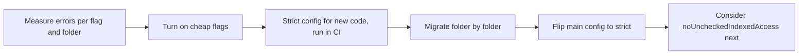

## 9.15 `tsconfig` strictness, flag by flag, and migrating to strict

### 9.15.1 What each flag catches

#### Concept

`strict: true` is a bundle of checks, not one check. Knowing what each flag catches tells you which real bugs your project is currently allowed to ship, and gives you an order for turning them on in an older codebase. Recent TypeScript versions (the 7.x compiler used to test this Part, for example) turn `strict` on when `tsconfig.json` does not mention it; older versions defaulted to off, and many existing NestJS projects set some of these flags to `false` explicitly. Always write the setting out so nobody has to guess.

#### How it works

The flags inside `strict`:

| Flag | What it catches | Backend example |
|---|---|---|
| `noImplicitAny` | Parameters and values whose type silently becomes `any` | `function applyCoupon(order, code)` with no types |
| `strictNullChecks` | Using a value that may be `null` or `undefined` | `repo.findOneBy(...)` returns `Order \| null`; reading `.status` without a check |
| `strictFunctionTypes` | Callback parameters of the wrong (narrower) type (9.3.3) | A handler for `OrderPaid` registered for every event |
| `strictBindCallApply` | Wrong arguments to `.bind`, `.call`, `.apply` | `handler.call(ctx, 'wrong', 'args')` |
| `strictPropertyInitialization` | Class fields that are never assigned | An entity field with no initialiser; DTO fields use `!` because class-transformer assigns them |
| `noImplicitThis` | `this` with an implicit `any` type | A `function` callback that reads `this.repo` (1.8.2) |
| `useUnknownInCatchVariables` | `catch (e)` treated as `any` | `e.message` on something that was thrown as a string |
| `alwaysStrict` | Emits `"use strict"` and parses in strict mode | Silent assignment to undeclared variables |
| `strictBuiltinIteratorReturn` (5.6) | Iterator results typed as `any` | Rarely seen in application code |

Flags outside `strict` that are worth turning on in a backend:

| Flag | What it catches | Cost |
|---|---|---|
| `noUncheckedIndexedAccess` | `rows[0]` and `map[key]` may be `undefined` | Many extra `??` defaults and checks in existing code; high value for request maps and query results |
| `exactOptionalPropertyTypes` | Distinguishes "missing" from "present but `undefined`" | Matters for PATCH semantics: "not sent" versus "set to empty" |
| `noImplicitOverride` | Overriding a base-class method without `override` | Cheap; catches renamed base methods |
| `noImplicitReturns`, `noFallthroughCasesInSwitch` | Paths that forget to return, `case`s that fall through | Cheap |
| `verbatimModuleSyntax` or `isolatedModules` | Imports that only work with whole-program compilation | Required by SWC, esbuild and Node's type stripping |
| `erasableSyntaxOnly` (5.8) | Enums, namespaces, parameter properties: syntax that is not just erasable types | Conflicts with NestJS's constructor style (1.8.4); only for code run by type stripping |

#### Failure scenario

A payments service ran with `strictNullChecks: false` since its first commit. `findOneBy` returned `null` for an unknown provider reference in a webhook, the code read `payment.orderId`, and the resulting `TypeError` was caught by a generic handler that returned `200` to the provider "so it stops retrying". Several hundred refund confirmations were dropped over a weekend before reconciliation caught them. With `strictNullChecks`, the line `payment.orderId` would have been a compile error demanding a decision: what should happen when the payment is unknown?

### 9.15.2 Migrating an existing codebase to strict

#### How it works

Turning `strict` on in a 200,000-line codebase can produce thousands of errors. A big-bang fix stalls feature work and invites careless `!` and `as any`. A ratchet works better:

1. **Measure.** Run `npx tsc --noEmit --strict` once and count errors per flag and per folder. Most come from `strictNullChecks` and `noImplicitAny`.
2. **Stop the bleeding.** Turn on the cheap flags that produce few errors (`noImplicitReturns`, `noImplicitOverride`, `useUnknownInCatchVariables`) and fix them in a day.
3. **Make new code strict.** Add a second config, `tsconfig.strict.json`, that extends the main one with `"strict": true` and whose `include` lists the folders already migrated plus every new module. Run both in CI.
4. **Migrate folder by folder**, starting with the leaves (utilities, domain logic) and ending with the most connected code (controllers and shared services). Each pull request moves one folder into the strict `include` list.
5. **Fix, do not silence.** For each `null` error, decide the behaviour (throw a `NotFoundException`, return a default, change the type). Use `// @ts-expect-error` with a ticket number only for genuine blockers; unlike `@ts-ignore`, it fails the build once the error disappears, so it cannot linger silently.
6. **Flip the main config** when the strict config covers everything, and delete the second one.



#### Practical exercise

This function compiles with `strict: false`. Turn on `strict` and `noUncheckedIndexedAccess`, list each error, and fix each one by deciding the behaviour rather than silencing it.

```ts
async function applyLoyaltyDiscount(repo, customerId, orderIds: string[]) {
  const customer = await repo.findCustomer(customerId);   // returns Customer | null
  const first = orderIds[0];
  const tierPercent = { silver: 5, gold: 10 }[customer.tier];
  try {
    return await repo.discountOrder(first, tierPercent);
  } catch (e) {
    throw new Error('discount failed: ' + e.message);
  }
}
```

Acceptance criteria: no `any`, no `!`, no `as`; each fix encodes a business decision.

#### Worked answer to the exercise

The errors: `repo` and `customerId` are implicitly `any` (`noImplicitAny`), and `e` is `unknown` (`useUnknownInCatchVariables`). Give `repo` a real type and three more appear: `customer` is possibly `null` (`strictNullChecks`); `orderIds[0]` is `string | undefined` (`noUncheckedIndexedAccess`) and no longer fits `discountOrder(orderId: string, ...)`; and looking up a `string` tier in the two-key table is unsafe: depending on the compiler version it is reported as an implicit `any` or typed `number | undefined`, which does not fit `percent: number`.

```ts
type LoyaltyTier = 'standard' | 'silver' | 'gold';
interface Customer { id: string; tier: LoyaltyTier }
interface LoyaltyRepo {
  findCustomer(id: string): Promise<Customer | null>;
  discountOrder(orderId: string, percent: number): Promise<{ orderId: string; newTotalCents: number }>;
}

const TIER_DISCOUNT_PERCENT: Record<LoyaltyTier, number> = { standard: 0, silver: 5, gold: 10 };

class NotFoundError extends Error {}

async function applyLoyaltyDiscount(repo: LoyaltyRepo, customerId: string, orderIds: readonly string[]) {
  const customer = await repo.findCustomer(customerId);
  if (!customer) throw new NotFoundError(`customer ${customerId} not found`);   // decision: 404

  const [first] = orderIds;
  if (first === undefined) throw new Error('at least one order id is required'); // decision: 400

  const percent = TIER_DISCOUNT_PERCENT[customer.tier];  // Record over the union: always a number
  if (percent === 0) return null;                         // decision: standard tier gets no discount

  try {
    return await repo.discountOrder(first, percent);
  } catch (e) {
    const reason = e instanceof Error ? e.message : String(e);
    throw new Error(`discount failed for ${first}: ${reason}`, { cause: e });    // keep the original
  }
}
```

Why it is right: each compiler error became an explicit decision. A missing customer is a not-found error, an empty list is a client error, and the tier table is a `Record` over a closed union so every tier has an entry and a new tier cannot be forgotten. The `catch` narrows `unknown` honestly and keeps the original error as `cause` for the logs. None of the fixes uses `!` or `as`, so the compiler is still checking every line.

The trap most learners fall into is `customer!.tier` and `orderIds[0]!`: the build goes green and the original crashes return, now with a type system that claims they cannot happen. The second trap is `{ silver: 5, gold: 10 }[customer.tier] ?? 0`, which compiles but hides the fact that `'standard'` was never handled; the `Record<LoyaltyTier, number>` makes that choice visible.

## 9.16 Performance of the type checker

### 9.16.1 When `tsc` and the editor get slow

#### Concept

Type checking costs CPU and memory. In a large monorepo, a full `tsc` can take minutes and the editor can lag seconds behind your typing. Most of that time usually comes from a few expensive types or configuration mistakes, not from the size of the code itself.

#### How it works

**Measure first.**

```bash
npx tsc --noEmit --extendedDiagnostics    # files, lines, memory, and time spent in each phase
npx tsc --noEmit --generateTrace ./trace  # a trace of which types and files cost the most
npx @typescript/analyze-trace ./trace     # summarises the hot spots in that trace
```

**The usual fixes, roughly in order of payoff:**

1. **`skipLibCheck: true`.** Skips re-checking every `.d.ts` in `node_modules`. Almost every application uses it.
2. **`incremental: true`** (or project references with `composite: true` and `tsc -b`), so unchanged parts are not re-checked. In a monorepo, references also let each package be checked on its own.
3. **Narrow `include`.** A `tsconfig` that accidentally includes `dist/`, coverage output or generated files checks them all.
4. **Prefer `interface ... extends` over large intersections** of object types; the TypeScript team's performance guidance notes that interfaces are cached and compared faster than intersections.
5. **Annotate the return types of exported functions** in shared packages, so the checker does not re-infer large types for every consumer (`isolatedDeclarations`, added in 5.5, enforces this for libraries).
6. **Tame expensive types:** huge unions (thousands of members from template literal combinations), deep recursive conditional types, and generated types for very large schemas.

TypeScript 7, the compiler re-implemented in Go, was announced by Microsoft as roughly ten times faster on large codebases; whichever version you run, the fixes above still matter because an expensive type is expensive in any compiler.

#### Common mistakes

- Blaming the project size before measuring; one recursive utility type can dominate the whole check.
- Disabling type checking in CI to make builds faster. Run it in parallel with tests instead.

## 9.17 When not to be clever

### 9.17.1 Simple types that a colleague can read

#### Concept

Every technique in this Part has a cost: readers must understand it, error messages get longer, and the checker gets slower. The senior skill is choosing the **least clever type that prevents the bug**. Most application code needs interfaces, unions, generics with one parameter, and the built-in utilities. Conditional, mapped and template literal types belong mainly in a few shared files.

#### How it works — a test before writing a clever type

1. **What bug does this prevent?** Name a real one ("a handler for the wrong event", "cross-currency addition"). If you cannot, do not write it.
2. **Could a plain type do 90 percent of it?** An explicit union of five events beats a type that computes them from a naming convention.
3. **Can a colleague read the error message?** Paste a deliberate mistake and look at what the compiler prints. If the message is 40 lines, callers will reach for `as any`.
4. **Is it contained?** Clever types are acceptable inside one infrastructure module with a simple public API (the typed cache in 9.3, the event bus in 9.5). They are not acceptable in every DTO.

#### Decision table — union versus enum versus const object

| | String literal union | `enum` | `const` object with `as const` |
|---|---|---|---|
| Example | `type Status = 'pending' \| 'paid'` | `enum Status { Pending = 'pending' }` | `const STATUS = { pending: 'pending' } as const` |
| Runtime value to iterate or validate | No (pair it with a `const` array, 1.2.1) | Yes | Yes |
| Plain string literals accepted | Yes | No, must write `Status.Pending` | Yes, via the derived union |
| Erasable syntax (type stripping, `erasableSyntaxOnly`) | Yes | No | Yes |
| Exhaustiveness checking | Yes | Yes | Yes, via the derived union |
| Typical use | Most domain states | Existing codebases and libraries that use them | A runtime list plus a type, for validation and display |

The default in new code: a `const` array or object with `as const`, and the union type derived from it (9.4). It gives a runtime list for validators and a type for the compiler, with one source of truth. Enums are not wrong, and a codebase that uses them consistently should keep doing so; numeric enums deserve care because their values are opaque in logs and databases.

#### Decision table — `interface` versus `type`

| Need | Use |
|---|---|
| The shape of an object, a DTO, a public contract | `interface` (clearer errors, `extends`, can be augmented, 9.14) |
| A union, intersection, tuple, function type, mapped or conditional type | `type` (interfaces cannot express these) |
| Extending a library's type from outside | `interface` (declaration merging) |
| Consistency with the existing codebase | Whatever it already does |

#### How a Senior Backend Engineer thinks about this

Seniors judge a type by what it prevents and what it costs the next reader. They will happily write a 15-line mapped type for an event bus used by forty handlers, and refuse a 5-line conditional type in a controller where an interface would do. They watch for the warning signs of over-engineering: `as any` appearing next to a clever type, type errors nobody on the team can explain, and checker time creeping up. Their review comment is usually some version of "what bug does this stop, and could a plain interface stop it?"

#### Common mistakes

- Encoding business rules in the type system that belong in runtime validation (a regex-parsing template type instead of a validator).
- Generics with four parameters where two concrete functions would be clearer.
- Mixing enums, unions and const objects for the same kind of thing in one codebase.

#### Interview questions

1. **When would you choose a union of string literals over an `enum`?** For most domain states: literals work with plain strings, are erasable syntax, and pair with a `const` array for runtime validation; keep enums where the codebase already standardises on them.
2. **`interface` or `type` for a DTO?** Usually `interface` (or a class, for class-validator); use `type` for unions, mapped and conditional types.
3. **How do you keep a request type and its validation from drifting?** Infer the type from the schema (`z.infer`) or validate with the class that is the type, and treat all input as `unknown` until validated.
4. **Walk me through migrating a large codebase to `strict`.** Measure errors per flag and folder, enable cheap flags, add a strict config for new and migrated folders in CI, migrate leaves first, fix with decisions rather than `!`, flip the main config.
5. **The type checker takes four minutes in CI. What do you do?** Measure with `--extendedDiagnostics` and `--generateTrace`, check `include` and `skipLibCheck`, use incremental builds or project references, and find the few expensive types.
6. **How do you stop an order id being passed as a customer id?** Branded types created only by validating smart constructors at the boundary, so the compiler rejects the swap everywhere below it.

## Senior Checklist — Part 9

- [ ] I understand the concept
- [ ] I can explain it simply
- [ ] I can implement it
- [ ] I understand its failure modes
- [ ] I understand its scaling limitations
- [ ] I understand its security implications
- [ ] I understand its operational implications
- [ ] I can choose between alternatives
- [ ] I can explain the tradeoffs
- [ ] I can answer senior-level interview questions
- [ ] I explain assignability, `unknown` and `never` as sets of values, and I can read a long type error by finding the value that does not fit
- [ ] I use control-flow narrowing, discriminated unions and `assertNever`, and I write type guards that check everything they claim
- [ ] I design generics that are inferred at the call site and never appear only in a return type
- [ ] I derive types with `keyof`, indexed access and `typeof` instead of writing them twice
- [ ] I can read and write conditional, mapped and template literal types, and I keep them in shared infrastructure
- [ ] I use `satisfies` and `as const` for configuration tables, and branded types for ids and money
- [ ] My request types are inferred from, or identical to, their runtime validation
- [ ] My NestJS configuration is validated at startup and read through a typed `ConfigService`
- [ ] I can augment a third-party type safely and know the limits of a `.d.ts`
- [ ] I can explain each strict flag and plan a strict migration as a ratchet
- [ ] I can measure and fix slow type checking

## Part 9 — Key Takeaways

- A type is a set of values; assignability is "subset of", `unknown` is everything and `never` is nothing.
- TypeScript is structural, so equal shapes are interchangeable; brand ids, money and units where a mix-up is expensive.
- Narrow with checks, not casts; make unions exhaustive with `assertNever` or a `Record` over the discriminant.
- A type guard is an unchecked promise; for external data, use a validator that produces the type.
- A generic that appears only in the return type is a disguised `as`.
- Derive types from one source of truth with `keyof`, `typeof`, indexed access and `as const`.
- Conditional, mapped and template literal types are powerful; contain them behind simple public APIs.
- `as const satisfies T` gives configuration that is both checked and precise.
- Everything entering the process is `unknown` until validated; infer the type from the schema so the two cannot drift.
- Type `ConfigService` and validate environment variables at startup; a missing value should crash the deploy, not the 3 a.m. request.
- Turn on `strict` and migrate with a ratchet, fixing each error with a decision, never with `!` or `as any`.
- Choose the least clever type that prevents a real bug.
