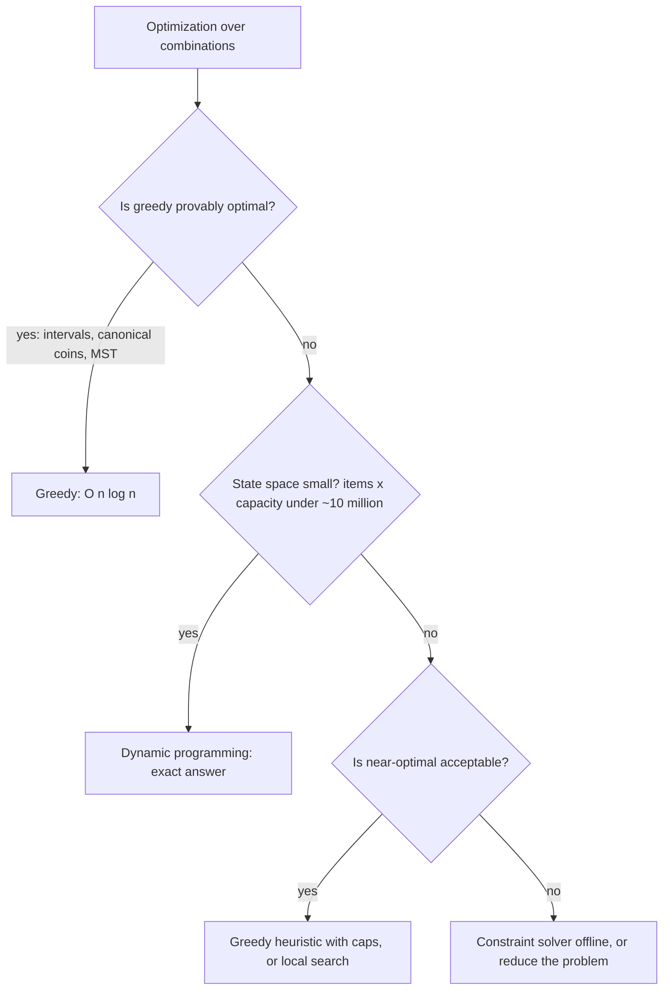

## 9.15 Greedy algorithms

#### Concept

A greedy algorithm builds a solution one step at a time, always taking the choice that looks best right now, and never going back to reconsider. Sort the options by some score, walk the list, take what fits. That is the whole strategy.

Greedy is fast (usually one sort plus one pass: `O(n log n)`) and simple to explain, and for a specific set of problems it is provably optimal: interval scheduling, minimum spanning trees, Huffman coding, Dijkstra itself, coin change with well-behaved denominations, fractional knapsack. For everything else it is a heuristic: often good, sometimes badly wrong, and you must know which case you are in.

#### Why does it exist?

Because most allocation and scheduling problems in a backend do not need the optimal answer; they need a good answer in milliseconds. Batching deliveries, assigning drivers to shifts, splitting a payment across invoices, choosing which warehouse ships which line: the exact optimum is often NP-hard, and a greedy pass gets within a few percent at `O(n log n)`. The skill is recognizing the small set of problems where greedy is *exactly* right, the larger set where it is *good enough*, and the dangerous set where it is *wrong* and a product rule or dynamic programming is required.

#### Mental model

Imagine filling a shopping bag at a market with a fixed budget, always buying the cheapest item you have not bought yet. You will get the maximum *number* of items: greedy is optimal for that goal. Now suppose the goal is the maximum *weight* of groceries for the budget. Buying by "weight per rupee" gets you close, but the last item might not fit and a different combination might have packed the bag better. Greedy was a good heuristic, not an optimum. Now suppose you must pay exactly 6 with coins of 1, 3 and 4. Greedy takes 4, then 1, then 1: three coins. The optimum is 3 and 3: two coins. Greedy was wrong, and it gave no hint that it was.

#### How it works

Greedy is correct when the problem has two properties: the **greedy-choice property** (a locally best choice is part of some globally optimal solution) and **optimal substructure** (after making that choice, what remains is a smaller instance of the same problem). Proving these is the textbook's job; the engineer's job is to remember which everyday problems have them.

Problems where greedy is optimal:

| Problem | Greedy rule | Backend shape |
|---|---|---|
| Interval scheduling (max non-overlapping intervals) | Sort by end time, take each interval that starts after the last taken ends | Choose the maximum number of non-conflicting bookings for one resource (one meeting room, one delivery van) |
| Interval partitioning (min resources to cover all intervals) | Sort by start; assign each to a free resource, else open a new one; min-heap of end times | Minimum number of drivers to cover all shifts; minimum meeting rooms |
| Coin change with canonical denominations | Take the largest denomination that fits | Splitting a gift-card balance into fixed denominations; making change in a POS |
| Fractional knapsack | Sort by value per unit, take in order | Filling a truck by value density when partial loads are allowed |
| Minimum spanning tree (Kruskal) | Sort edges by weight, add if it connects two components (union-find) | Cheapest network linking warehouses |
| Shortest path, non-negative weights (Dijkstra) | Always finalize the nearest node | ETA |

Problems where greedy is a heuristic (good, not optimal):

- **Delivery batching and routing.** Nearest-neighbor routing is typically 20–25% longer than optimal; 2-opt improvement passes recover most of that.
- **Bin packing** (fit items into the fewest boxes). First-fit-decreasing (sort items by size descending, place each in the first box with room) uses at most about 11/9 of the optimal number of boxes plus one. Optimal bin packing is NP-hard.
- **Load balancing across workers** by "assign to the least loaded" is within a factor of 4/3 of optimal.

Problems where greedy is wrong:

- **0/1 knapsack.** Taking items by value density can miss the optimal set entirely.
- **Coin change with non-canonical denominations** (the 1, 3, 4 example).
- **Shortest path with negative edges.**
- **Weighted interval scheduling** (intervals with different values): earliest-end greedy ignores value; needs dynamic programming.

Two implementations you will reuse. Interval partitioning for shift coverage:

```ts
// scheduling/shift-coverage.ts
import { MinHeap } from '../graph/min-heap';

export interface Shift { id: string; startsAt: number; endsAt: number; } // epoch ms

// Minimum number of drivers needed so every shift has a driver; returns assignments. O(n log n).
export function assignDrivers(shifts: Shift[]): Map<string, number> {
  const sorted = [...shifts].sort((a, b) => a.startsAt - b.startsAt);
  const freeAt = new MinHeap<{ driver: number; freeAt: number }>((d) => d.freeAt); // driver who frees up soonest
  const assignment = new Map<string, number>();
  let driverCount = 0;

  for (const shift of sorted) {
    let driver: number;
    const soonest = freeAt.size > 0 ? freeAt.pop()! : undefined;
    if (soonest && soonest.freeAt <= shift.startsAt) {
      driver = soonest.driver;                     // reuse: they are free before this shift starts
    } else {
      if (soonest) freeAt.push(soonest);           // not free yet: put them back
      driver = driverCount;                         // open a new driver
      driverCount += 1;
    }
    assignment.set(shift.id, driver);
    freeAt.push({ driver, freeAt: shift.endsAt });
  }
  return assignment;                                // driverCount === max overlap at any instant
}
```

Delivery batching by proximity and time window, a greedy heuristic with explicit caps:

```ts
// dispatch/delivery-batcher.ts
export interface Order { id: string; geohash6: string; readyAt: number; dueAt: number; }
export interface Batch { orders: Order[]; dueAt: number; }

// Groups orders sharing a coarse geohash whose windows overlap, greedily by earliest due time. O(n log n).
export function batchOrders(orders: Order[], maxPerBatch = 4, maxSpanMs = 15 * 60_000): Batch[] {
  const byCell = new Map<string, Order[]>();
  for (const o of orders) (byCell.get(o.geohash6) ?? byCell.set(o.geohash6, []).get(o.geohash6)!).push(o);

  const batches: Batch[] = [];
  for (const cell of byCell.values()) {
    cell.sort((a, b) => a.dueAt - b.dueAt);          // most urgent first
    let current: Order[] = [];
    for (const o of cell) {
      const fits = current.length < maxPerBatch && (current.length === 0 || o.dueAt - current[0].readyAt <= maxSpanMs);
      if (!fits) { batches.push({ orders: current, dueAt: current[0].dueAt }); current = []; }
      current.push(o);
    }
    if (current.length > 0) batches.push({ orders: current, dueAt: current[0].dueAt });
  }
  return batches;
}
```

Neither function is optimal for total rider distance; both are predictable, explainable and fast, which is what a dispatcher running every 30 seconds needs.

#### Practical example

A restaurant-delivery platform batches orders every 30 seconds per city zone. Optimal batching (minimizing total distance under time windows) is a vehicle-routing problem that a solver takes seconds to minutes on. The greedy batcher above runs in under 5 ms for 2,000 pending orders and produces batches about 8% longer in distance than the solver's, measured offline. Product accepted the 8% for the 30-second cadence and the ability to explain any batch to a rider ("these three orders are in the same area and due within 15 minutes").

#### NestJS example

Exposing the coverage calculation behind a validated DTO, with the greedy result and its guarantee stated in the response:

```ts
// scheduling/shift-planning.controller.ts
import { Body, Controller, Post } from '@nestjs/common';
import { ArrayMaxSize, IsArray, IsInt, IsString, Min, ValidateNested } from 'class-validator';
import { Type } from 'class-transformer';
import { assignDrivers } from './shift-coverage';

class ShiftDto {
  @IsString() id!: string;
  @IsInt() @Min(0) startsAt!: number;
  @IsInt() @Min(0) endsAt!: number;
}

class PlanShiftsDto {
  @IsArray() @ArrayMaxSize(5000) @ValidateNested({ each: true }) @Type(() => ShiftDto)
  shifts!: ShiftDto[];
}

@Controller('shift-plans')
export class ShiftPlanningController {
  @Post()
  plan(@Body() dto: PlanShiftsDto): { driversNeeded: number; assignments: Record<string, number> } {
    const invalid = dto.shifts.filter((s) => s.endsAt <= s.startsAt);
    if (invalid.length > 0) throw new Error(`shifts with non-positive duration: ${invalid.map((s) => s.id).join(', ')}`);
    const assignment = assignDrivers(dto.shifts);
    const driversNeeded = new Set(assignment.values()).size;   // equals the maximum concurrent shifts: optimal
    return { driversNeeded, assignments: Object.fromEntries(assignment) };
  }
}
```

(Replace the thrown `Error` with a proper `BadRequestException` in real code; the point is the `ArrayMaxSize` cap on `n` and the optimality note.)

#### PostgreSQL example

Greedy scheduling decisions must be enforced at write time, not just computed at plan time. PostgreSQL's exclusion constraints stop two shifts for the same driver from overlapping, regardless of which service wrote them:

```sql
CREATE EXTENSION IF NOT EXISTS btree_gist;

CREATE TABLE driver_shifts (
  id uuid PRIMARY KEY DEFAULT gen_random_uuid(),
  driver_id uuid NOT NULL,
  during tstzrange NOT NULL,
  EXCLUDE USING gist (driver_id WITH =, during WITH &&)   -- no overlapping ranges per driver
);

-- Interval scheduling in SQL: candidate shifts sorted by end time for the greedy pass
SELECT id, lower(during) AS starts_at, upper(during) AS ends_at
FROM open_shifts
WHERE during && tstzrange($1, $2)
ORDER BY upper(during);
```

An insert that overlaps fails with `conflicting key value violates exclusion constraint`, which is the database telling you that a greedy assignment made elsewhere was stale.

Coin-change-style allocation also has a natural SQL form when the business rule is greedy by definition. Applying a payment to the oldest open invoices first (FIFO) is greedy, and it is *correct* because accounting says so:

```sql
-- Allocate $1 cents to open invoices, oldest first
WITH ordered AS (
  SELECT id, balance_cents,
         sum(balance_cents) OVER (ORDER BY issued_at, id) AS running_total
  FROM invoices WHERE customer_id = $2 AND balance_cents > 0
)
SELECT id,
       least(balance_cents, greatest(0, $1 - (running_total - balance_cents))) AS applied_cents
FROM ordered
WHERE running_total - balance_cents < $1;
```

#### TypeORM example

Allocating a payment greedily inside a transaction with row locks, so two concurrent payments cannot both apply to the same invoice balance:

```ts
async allocatePayment(customerId: string, amountCents: number): Promise<void> {
  await this.dataSource.transaction(async (tx) => {
    const invoices = await tx
      .createQueryBuilder(Invoice, 'i')
      .setLock('pessimistic_write')                       // SELECT ... FOR UPDATE
      .where('i.customer_id = :customerId AND i.balance_cents > 0', { customerId })
      .orderBy('i.issued_at', 'ASC').addOrderBy('i.id', 'ASC')   // greedy rule: oldest first
      .getMany();

    let remaining = amountCents;
    for (const inv of invoices) {
      if (remaining === 0) break;
      const applied = Math.min(remaining, inv.balanceCents);
      await tx.update(Invoice, { id: inv.id }, { balanceCents: inv.balanceCents - applied });
      await tx.insert(PaymentAllocation, { invoiceId: inv.id, amountCents: applied });
      remaining -= applied;
    }
    if (remaining > 0) await tx.insert(CustomerCredit, { customerId, amountCents: remaining });
  });
}
```

#### Sequelize example

```ts
await sequelize.transaction(async (t) => {
  const invoices = await Invoice.findAll({
    where: { customerId, balanceCents: { [Op.gt]: 0 } },
    order: [['issuedAt', 'ASC'], ['id', 'ASC']],
    lock: t.LOCK.UPDATE,
    transaction: t,
  });
  let remaining = amountCents;
  for (const inv of invoices) {
    if (remaining === 0) break;
    const applied = Math.min(remaining, inv.balanceCents);
    await inv.decrement('balanceCents', { by: applied, transaction: t });
    await PaymentAllocation.create({ invoiceId: inv.id, amountCents: applied }, { transaction: t });
    remaining -= applied;
  }
});
```

#### Production scenario

A logistics platform assigns 12,000 daily shifts to a pool of drivers in 40 cities. Interval partitioning per city runs in about 20 ms total and yields the minimum driver count per city (provably, because it equals the maximum overlap). The planners then apply constraints greedy cannot see (driver preferences, maximum hours per week, licenses), which turns the problem into one for a constraint solver that runs for 3 minutes overnight. The greedy result is the lower bound the planners use to sanity-check the solver: if the solver needs 15% more drivers than greedy, something in the constraints is too tight.

#### Failure scenario

At 16:45 the finance team notices customers are being under-refunded. A "split refund across original payment methods" feature used greedy allocation by largest-balance-first across gift cards with fixed denominations, and a rounding rule that dropped remainders under a cent. For a refund of 6.00 across cards of 4.00 and 3.00 denominations, greedy took 4.00 and then could not place the remaining 2.00 on a 3.00 card without a partial, which the gift-card provider disallowed, so it silently refunded 4.00. The 1, 3, 4 coin problem, in production, with money. The fix used a small dynamic program over the denominations (next section) and an explicit "cannot split exactly" error path that routes the remainder to store credit.

#### Edge cases & failure modes

- **Non-canonical denominations.** Greedy coin change fails; verify the denomination set or use DP.
- **Ties.** Two intervals with the same end time; deterministic tie-breaking (by id) keeps the plan reproducible.
- **Stale inputs.** Greedy decisions based on a snapshot conflict with concurrent writes; enforce with constraints and locks.
- **Caps.** Every greedy batcher needs maximum batch size, maximum span, maximum distance; without caps the "best local choice" builds one giant batch.
- **Unbounded input.** `O(n log n)` is fine until `n` is unbounded; cap the DTO.
- **Metric mismatch.** Greedy by "nearest" optimizes distance; the business wants "on time". Choose the sort key to match the goal.
- **Fairness.** Greedy "assign to the best driver" starves everyone else; add rotation or fairness constraints.

#### How a Senior Backend Engineer thinks about this

The senior asks three questions: Is greedy provably optimal here (interval problems, canonical coins, MST, Dijkstra)? If not, how far from optimal is it, measured offline against a solver on real data? And what caps and constraints stop the greedy choice from doing something absurd on unusual input?

They prefer greedy when the answer is needed in milliseconds, must be explainable to a human, and "within a few percent" is acceptable. They refuse greedy for money-splitting and any problem with exact-fit requirements unless the denominations are canonical, because the failure is silent.

To a product manager: "Batching by 'closest orders first' gets us 92% of the perfect answer instantly, and every rider can see why they got their batch. The perfect answer takes minutes to compute and is impossible to explain."

#### Common mistakes

- Assuming greedy is optimal because it "makes sense".
- Greedy allocation of money without checking exact-fit feasibility.
- Sorting by the wrong key (distance when the goal is lateness).
- No caps on batch size or span.
- Computing an assignment greedily and writing it without locks or constraints.

#### Interview questions

1. **"Minimum number of drivers to cover a set of shifts. Algorithm, complexity, and why it is optimal."** Expected: sort by start, heap of end times, `O(n log n)`; the count equals the maximum overlap, which any solution needs. Follow-up: how would you add a maximum-hours-per-driver rule?
2. **"Give a backend case where greedy is provably wrong and how you would detect it."** Expected: non-canonical denominations in refund splitting; verify with DP or an exact-fit check.
3. **"Nearest-neighbor delivery routing: how bad is it and how do you improve cheaply?"** Expected: around 25% worse; 2-opt passes.
4. **"When is greedy the right choice over an optimal solver in production?"** Expected: latency budget, explainability, "good enough" measured offline.
5. **"How do you enforce a greedy schedule against concurrent writers?"** Expected: exclusion constraints, row locks, idempotent assignment writes.

#### Practical exercise

Implement `assignDrivers` and `batchOrders`, then write a brute-force checker for `assignDrivers` on small random inputs proving the count equals the maximum overlap. Implement greedy coin change and test it with denominations `[1, 5, 10, 25]` and `[1, 3, 4]` against a brute-force optimum.

Acceptance criteria:

- `assignDrivers` matches brute force on 1,000 random cases.
- The greedy coin test *fails* for `[1, 3, 4]` with amount 6 and the test documents it as expected behavior.
- `batchOrders` respects all caps on adversarial input (2,000 orders in one cell).

## 9.16 Dynamic programming

#### Concept

Dynamic programming (DP) solves a problem by breaking it into overlapping subproblems, solving each subproblem once, and remembering the answer. Two mechanics: **memoization** (top-down: write the recursive solution, cache results by input) and **tabulation** (bottom-up: fill a table from the smallest subproblems upward). Both turn exponential brute force into polynomial time when the problem has optimal substructure and overlapping subproblems.

DP appears in a backend less often than searching or sorting, but where it appears the alternative is either an exponential brute force that times out or a greedy shortcut that gives wrong answers. Cart promotion optimization, shipping box selection, fuzzy text matching, diffing, and certain scheduling and pricing problems are DP-shaped.

#### Why does it exist?

Because "try every combination" is exponential and greedy is sometimes wrong. With 20 applicable coupons, "try every subset" is a million combinations; with 30 it is a billion; the request times out. DP notices that the best result for the first `k` coupons within budget `b` does not depend on how you got there, only on `k` and `b`, so there are only `k * b` distinct subproblems to solve, not `2^k` paths.

#### Mental model

Imagine climbing a staircase where you can take one or two steps at a time and want to count the ways to reach the top. Brute force explores every sequence of steps: exponential. But the number of ways to reach step 10 is just (ways to reach step 9) + (ways to reach step 8), and those two numbers do not care how you reached them. Write each step's count on the step itself as you go, and you climb once. That note on each step is the DP table. Every DP problem is "what is the smallest set of facts about the past that the future needs", and those facts become the table's dimensions.

#### How it works

1. Define the state: what parameters identify a subproblem? (Item index and remaining capacity; position in string A and position in string B.)
2. Define the recurrence: how does the answer for a state depend on smaller states?
3. Define the base cases.
4. Choose memoization (natural for sparse state spaces, recursion-shaped problems) or tabulation (iterative, cache-friendly, no stack risk, easy to optimize memory by keeping only the last row).
5. Complexity is the number of states times the work per state.



**0/1 knapsack** for cart promotions: each eligible promotion has a "weight" (the marketing cost it consumes from a per-order budget, or the loyalty points it burns) and a "value" (discount to the customer); choose the subset with maximum value within the budget, each promotion at most once.

```ts
// promotions/knapsack.ts
export interface Candidate { id: string; cost: number; value: number; } // cost and value in integer cents

// Maximum total value with total cost <= budget, each candidate used at most once.
// Time O(n * budget), memory O(budget) using a single row. Returns chosen ids.
export function bestSubset(candidates: Candidate[], budget: number): { value: number; chosen: string[] } {
  const n = candidates.length;
  const best = new Array<number>(budget + 1).fill(0);           // best[b] = max value using cost <= b
  const take = candidates.map(() => new Uint8Array(budget + 1));  // take[i][b] = did we take item i at budget b

  for (let i = 0; i < n; i += 1) {
    const { cost, value } = candidates[i];
    for (let b = budget; b >= cost; b -= 1) {                    // descending so each item is used at most once
      const withItem = best[b - cost] + value;
      if (withItem > best[b]) { best[b] = withItem; take[i][b] = 1; }
    }
  }

  const chosen: string[] = [];                                    // walk back through the decisions
  let b = budget;
  for (let i = n - 1; i >= 0; i -= 1) {
    if (take[i][b] === 1) { chosen.push(candidates[i].id); b -= candidates[i].cost; }
  }
  return { value: best[budget], chosen: chosen.reverse() };
}
```

With 25 promotions and a budget expressed in whole rupees up to 2,000, that is 50,000 cell updates: microseconds. Note the integer arithmetic: money in cents, never floats, and a budget with a bounded, discretized range, because the table has `budget + 1` columns.

**Shipping box selection.** True 3D bin packing is NP-hard; production systems use a volume-and-dimension heuristic. The DP-shaped piece is "can this subset of items reach a total volume within a box's capacity" (subset sum), and, more usefully, "the smallest box in which the items fit" by trying boxes from smallest to largest with a fast feasibility check. For splitting a shipment into the fewest boxes, first-fit-decreasing (greedy) is the standard, and DP over subsets is only feasible for very small item counts (`2^n` states, so `n` up to about 20).

**Edit distance** (Levenshtein) counts the minimum insertions, deletions and substitutions to turn one string into another. `O(n * m)` time, `O(min(n, m))` memory with two rows. It is the re-ranking step of fuzzy product search:

```ts
// search/levenshtein.ts
export function levenshtein(a: string, b: string, maxDistance = Infinity): number {
  if (a.length < b.length) [a, b] = [b, a];                        // keep the shorter string as columns
  let prev = Array.from({ length: b.length + 1 }, (_, j) => j);   // distance from "" to b[0..j]
  let curr = new Array<number>(b.length + 1);

  for (let i = 1; i <= a.length; i += 1) {
    curr[0] = i;
    let rowMin = i;
    for (let j = 1; j <= b.length; j += 1) {
      const cost = a.charCodeAt(i - 1) === b.charCodeAt(j - 1) ? 0 : 1;
      curr[j] = Math.min(prev[j] + 1, curr[j - 1] + 1, prev[j - 1] + cost);  // delete, insert, substitute
      if (curr[j] < rowMin) rowMin = curr[j];
    }
    if (rowMin > maxDistance) return maxDistance + 1;              // early exit: cannot get back under the bound
    [prev, curr] = [curr, prev];
  }
  return prev[b.length];
}
```

The `maxDistance` early exit matters: for typo tolerance you only care whether the distance is at most 2, and most candidates blow past that in the first few rows.

**Why DP appears rarely but matters.** Most backend work is I/O-bound and the "algorithm" is a query plan. DP shows up in the CPU-bound corners: pricing and promotion engines, packing and allocation, text similarity, diffing (version comparison of documents), and some scheduling. It appears in interviews far more than in code, but the *shape* recognition matters daily: when a PR says "we try all combinations of coupons", a senior sees `2^n` and asks what `n` can be.

#### Practical example

A checkout applies at most one promotion per "exclusivity group" (one shipping promo, one product promo, one payment-method promo) and each promotion has a marketing cost charged to a campaign budget. The naive implementation enumerated all subsets of applicable promotions (typically 8–12, occasionally 25 during festivals) and ran fine until a festival day produced 28 applicable promotions for some carts: 268 million subsets, and the checkout timed out. The knapsack with a group constraint (one item per group, which is the "multiple-choice knapsack" variant with one extra loop) ran in under a millisecond.

#### NestJS example

```ts
// promotions/promotion-optimizer.service.ts
import { Injectable } from '@nestjs/common';
import { bestSubset, Candidate } from './knapsack';

export interface ApplicablePromotion { id: string; discountCents: number; marketingCostCents: number; }

@Injectable()
export class PromotionOptimizerService {
  private static readonly MAX_CANDIDATES = 60;      // n * budget bounded: 60 * 20000 = 1.2M cells, ~2 ms
  private static readonly BUDGET_UNIT_CENTS = 100;  // discretize the budget to whole currency units

  choose(applicable: ApplicablePromotion[], campaignBudgetCents: number): { discountCents: number; promotionIds: string[] } {
    if (applicable.length > PromotionOptimizerService.MAX_CANDIDATES) {
      // Keep the table bounded: pre-trim by discount, then solve exactly over the survivors
      applicable = [...applicable].sort((a, b) => b.discountCents - a.discountCents)
        .slice(0, PromotionOptimizerService.MAX_CANDIDATES);
    }
    const unit = PromotionOptimizerService.BUDGET_UNIT_CENTS;
    const candidates: Candidate[] = applicable.map((p) => ({
      id: p.id,
      cost: Math.ceil(p.marketingCostCents / unit),    // round cost UP so the budget is never exceeded
      value: p.discountCents,
    }));
    const budget = Math.floor(campaignBudgetCents / unit);
    const result = bestSubset(candidates, budget);
    return { discountCents: result.value, promotionIds: result.chosen };
  }
}
```

The two constants are the engineering: they bound the state space so the worst case is known (~2 ms), and the rounding direction guarantees the budget constraint holds after discretization.

#### PostgreSQL example

Fuzzy product search is a two-stage pipeline: the database shortlists candidates with a trigram index (covered in the search worked example later in this part), and edit distance re-ranks the shortlist. PostgreSQL's `fuzzystrmatch` extension provides `levenshtein` in SQL, so for small shortlists the whole thing can stay in the database:

```sql
CREATE EXTENSION IF NOT EXISTS pg_trgm;
CREATE EXTENSION IF NOT EXISTS fuzzystrmatch;
CREATE INDEX CONCURRENTLY products_name_trgm_idx ON products USING gin (name gin_trgm_ops);

-- Stage 1: trigram similarity shortlist via the GIN index (fast, approximate)
-- Stage 2: exact edit distance on the shortlist (DP, O(n*m) per row, only ~100 rows)
SELECT id, name, levenshtein_less_equal(lower(name), lower($1), 3) AS distance
FROM products
WHERE name % $1                                  -- pg_trgm similarity operator, uses the GIN index
ORDER BY distance, similarity(name, $1) DESC
LIMIT 10;
```

`levenshtein_less_equal(a, b, k)` is the bounded version with the same early exit as the TypeScript above. Never run `levenshtein` over the whole table in the `WHERE` clause: that is `O(rows * n * m)` with no index, seconds on a million products.

#### Production scenario

A product search endpoint handles 300 RPS. Stage 1 (trigram shortlist of up to 200 candidates) costs about 3 ms; stage 2 (Levenshtein re-rank of 200 names of about 40 characters, in Node) costs 200 × 40 × 40 = 320,000 cell updates, about 1 ms. Doing stage 2 for all 2 million products would be 3.2 billion updates per query: the difference between 4 ms and 30 seconds is not the DP, it is bounding what the DP runs over.

#### Failure scenario

At 19:10 on the first evening of a festival sale, checkout p99 climbs from 400 ms to 25 seconds and the service's event loop lag alarm fires. The promotion engine's "find the best combination" was a recursive subset enumeration with a memo keyed by the *set of chosen ids*, which is not a smaller state space at all: `2^n` keys. At `n = 26` it was 67 million map entries and 4 GB of heap before the pod was OOMKilled. The memoization was decorative. The rewrite keyed the state by `(index, remainingBudget)`, which is what DP means: a state space that is polynomial because it forgets the path.

#### Edge cases & failure modes

- **Wrong state definition.** Memoizing on something that grows exponentially (the chosen set) gives no speedup and eats memory.
- **Unbounded table dimensions.** Budget in cents up to 10 million makes a 10-million-column row per item; discretize.
- **Floating point.** Use integers; DP over floats accumulates rounding and makes "equal" comparisons unreliable.
- **Reconstruction memory.** Keeping `take[i][b]` for path reconstruction is `O(n * budget)` bytes; use `Uint8Array` and bound `n`.
- **Recursion depth in memoized versions.** Top-down DP over strings of 20,000 characters overflows the stack; use tabulation.
- **NP-hard core problems.** Bin packing, general vehicle routing and multi-dimensional knapsack are exponential in the worst case; DP is only feasible for small instances, otherwise heuristics or a solver.
- **Adversarial input sizes.** A user-controlled `n` (number of coupons, length of search string) needs a cap before it reaches the DP.

#### How a Senior Backend Engineer thinks about this

The senior recognizes the shapes: "best subset under a constraint" (knapsack), "similarity between two sequences" (edit distance), "count or optimize over paths with a small memory of the past" (staircase, scheduling). They then bound the state space explicitly, in constants with comments, so the worst case is a known number of milliseconds. They keep DP out of the request path unless `states * work` is under a few million, and they push string similarity into the database's indexed operators with the DP only as a re-rank.

To a product manager: "Finding the best combination of coupons by trying every combination gets slower every time we add a coupon type, and at 30 types it takes longer than the customer will wait. We can compute the exact best answer in a millisecond with a different method, as long as the campaign budget is counted in whole rupees."

#### Common mistakes

- Brute-force subset enumeration with a comment saying "n is small".
- Memoization keyed by the wrong thing.
- Running Levenshtein against every row instead of a shortlist.
- DP over money as floats.
- Not bounding `n` or the capacity dimension.

#### Interview questions

1. **"Choose the best set of non-stackable promotions within a marketing budget. Approach and complexity?"** Expected: 0/1 knapsack, `O(n * budget)` with a discretized budget; mention the one-per-group variant. Follow-up: how do you bound the worst case?
2. **"Why does memoizing a subset-enumeration on the chosen set not help?"** Expected: the number of distinct keys is still `2^n`; the state must be smaller than the path.
3. **"Fuzzy product search over 2 million names: where does edit distance run and on how many rows?"** Expected: trigram index shortlist in PostgreSQL; edit distance only on the shortlist.
4. **"Memoization versus tabulation: pick one for edit distance on 10,000-character strings and say why."** Expected: tabulation (no recursion depth), two-row memory.
5. **"When is DP the wrong tool even though the problem is an optimization?"** Expected: state space too large (NP-hard cores), near-optimal acceptable, or greedy provably optimal.

#### Practical exercise

Implement `bestSubset` and `levenshtein`, plus a brute-force knapsack for `n` up to 15 as a test oracle. Build the promotion optimizer with its bounds and measure worst-case time at the caps. Then build the two-stage fuzzy search against a 500,000-row `products` table with `pg_trgm` and measure p50/p99 for 20 typo queries.

Acceptance criteria:

- `bestSubset` matches brute force on 1,000 random cases with `n <= 15`.
- The optimizer's worst case at `MAX_CANDIDATES` and the largest budget completes under 5 ms.
- Fuzzy search p99 under 15 ms, with `EXPLAIN` showing the GIN index and the shortlist size logged per query.
