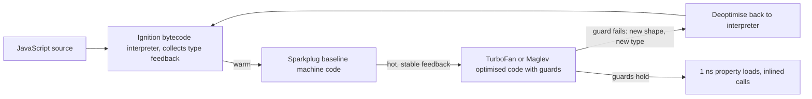

## 9.14 V8: JIT, hidden classes, inline caches and deoptimisation

#### Concept

**V8** is the JavaScript engine inside Node.js. It takes your TypeScript-compiled JavaScript and executes it through a pipeline of increasingly aggressive compilers:

1. The **parser** turns source into an abstract syntax tree.
2. **Ignition**, a bytecode interpreter, runs the code immediately and, while doing so, records **type feedback**: which kinds of values each operation actually saw.
3. **Sparkplug**, a baseline compiler, turns bytecode into machine code with no optimisation, for a quick speed-up on warm code.
4. **Maglev** (newer versions) and **TurboFan** are the **JIT (just-in-time) optimising compilers**. When a function is hot (called often, or looping long), they compile it into fast machine code *specialised for the types the feedback has seen*, guarded by checks. If a guard fails, the code **deoptimises**: it bails out to the interpreter and the function may be recompiled later with broader assumptions.

Two mechanisms make the specialised code fast:

- **Hidden classes** (V8 calls them *maps*): JavaScript objects have no declared layout, so V8 invents one. Every object created the same way (same properties, added in the same order) shares a hidden class that says "property `sku` is at offset 8, `qty` at offset 16". A property read becomes "check the hidden class, load from offset 16", which is what a C struct access costs.
- **Inline caches** (ICs): each property-access site (`line.qty` at line 42) remembers which hidden classes it has seen. One class: **monomorphic**, a single compare and a load, about a nanosecond. Two to four: **polymorphic**, a short chain of compares. More: **megamorphic**, a hash-table lookup on every access, 10–30× slower and impossible to inline.

"Monomorphic code is faster" therefore means: functions that always see objects of the same shape get straight-line machine code; functions that see many shapes get generic slow paths.

#### Why does it exist?

JavaScript is dynamically typed, and dynamic languages are slow if executed naively: every `a + b` must ask "what are a and b?" every time. V8's answer is to guess from what it has seen, compile for the guess, and verify with a cheap guard. This is why JavaScript is fast enough to run a 20,000-request-per-second API on one core, and also why the same code can suddenly become 10× slower when a single call site starts seeing a new kind of object.

#### Mental model

Imagine a waiter at a restaurant with regulars. Table 4 is always the same couple ordering the same dish; the waiter stops asking, brings the dish, and glances to confirm it is them (monomorphic call site with a guard). If four different regulars rotate through table 4, the waiter keeps a short list and checks which one it is (polymorphic). If a different stranger sits there every night, the waiter must ask from scratch every time (megamorphic). And if one night the couple orders something completely different, the waiter's shortcut was wrong; he apologises, goes back to asking (deoptimisation), and only rebuilds the shortcut once the new pattern is stable.

#### How it works



Hidden class transitions in a pricing loop, step by step:

1. `const line = { sku: 'A1', qty: 2 }` creates an object with hidden class C0 (empty), transitions to C1 (`sku`), then C2 (`sku`, `qty`). Every object literal written the same way ends in C2.
2. `line.discount = 0.1` on some lines transitions those to C3 (`sku`, `qty`, `discount`). The call site `line.discount` inside the loop now sees C2 *and* C3: polymorphic. If some lines get `discount` before `qty`, that is another class C3'. Four or more and the site goes megamorphic.
3. `delete line.discount` is worse: V8 gives up on a fixed layout and switches the object to **dictionary mode** (a hash map). Every access on it is a hash lookup forever.
4. Arrays have **elements kinds**: `[1, 2, 3]` is `PACKED_SMI_ELEMENTS` (small integers); push `1.5` and it becomes `PACKED_DOUBLE_ELEMENTS`; push a string or `null` and it becomes `PACKED_ELEMENTS` (generic). Leaving a hole (`arr[10] = x` on a length-3 array) makes it `HOLEY_*`. Transitions only go towards the more generic kind, and generic kinds mean slower loops.
5. Numbers: integers that fit in 31 bits are **Smis** stored inline; anything else is a **HeapNumber**, a boxed allocation. A field that is sometimes `0` and sometimes `0.5` makes its accesses polymorphic across representations.
6. When optimised code deoptimises, `--trace-deopt` prints why. After a few deopts of the same function, V8 marks it "never optimise", and it runs in the interpreter for the life of the process.

```bash
node --trace-deopt dist/main.js 2>&1 | grep -A2 priceLine | head
# [bailout (kind: deopt-eager, reason: wrong map): begin. deoptimizing priceLine, opt id 12, bytecode offset 45
#   ;;; deoptimize at <pricing.service.js:57:23>, wrong map
# (abbreviated; the real output includes addresses and frame details)
```

`wrong map` is "I compiled for hidden class C2 and saw C3". `not a Smi` and `not a heap number` are the numeric equivalents.

#### Practical example

A 5-million-line CSV export runs a `priceLine(line)` function on every row: read six properties, do arithmetic, write three. Monomorphic: ~30 ns per line, 150 ms total for the pricing step. Megamorphic (because rows come from three code paths that build the object in different orders, and one path deletes a temporary field): ~400 ns per line, 2 s. In a request handler this is invisible; in the export job it is the difference between "done" and "hit the 30-minute job timeout" once the row count grows.

For everyday NestJS CRUD, none of this matters: a request does a few thousand property accesses and waits milliseconds for I/O. V8's rules matter in **hot loops over many objects**: exports, batch pricing, feed ranking, in-memory joins, CSV parsing, big JSON transforms. Learn the rules, apply them there, and profile before applying them anywhere else.

#### NestJS example

Shape-stable objects for a hot path: a class whose constructor assigns every field, in the same order, always, with `null` rather than "absent" for optional values.

```ts
// pricing/priced-line.ts
export class PricedLine {
  // Every instance gets every field, in this order: one hidden class for the whole loop
  constructor(
    public readonly sku: string,
    public readonly qty: number,
    public readonly unitCents: number,
    public readonly discountBps: number,      // 0 when no discount, never undefined
    public totalCents = 0,
    public taxCents = 0,
  ) {}
}

// pricing/pricing.service.ts
import { Injectable } from '@nestjs/common';
import { PricedLine } from './priced-line';

export interface RawLine { sku: string; qty: number; unit_cents: number; discount_bps: number | null }

@Injectable()
export class PricingService {
  toPriced(raw: RawLine): PricedLine {
    // normalise at the boundary: DB nulls become 0 here, so the hot loop never sees null
    return new PricedLine(raw.sku, raw.qty, raw.unit_cents, raw.discount_bps ?? 0);
  }

  priceAll(lines: PricedLine[], taxBps: number): number {
    let grand = 0;
    for (let i = 0; i < lines.length; i++) {             // plain loop: fastest, easiest for V8 to optimise
      const l = lines[i];
      const gross = l.qty * l.unitCents;
      const discount = Math.floor((gross * l.discountBps) / 10_000);
      l.totalCents = gross - discount;                    // Smi arithmetic throughout
      l.taxCents = Math.floor((l.totalCents * taxBps) / 10_000);
      grand += l.totalCents + l.taxCents;
    }
    return grand;
  }
}
```

Three habits are visible: normalise at the boundary, assign all fields in the constructor, never `delete`. And when a hot loop crosses ~50 ms of CPU, the right answer is a worker thread (9.20) regardless of how monomorphic it is.

Profile before believing any of this applies to you:

```bash
node --cpu-prof --cpu-prof-dir=./profiles dist/jobs/export.js
# open the .cpuprofile in Chrome DevTools > Performance, or use `npx speedscope profiles/*.cpuprofile`
```

#### PostgreSQL example

PostgreSQL has a JIT too, with the same trade-off: compilation costs time up front and only pays off on long-running work. It compiles expression evaluation and tuple deforming with LLVM when the estimated cost exceeds `jit_above_cost` (100,000 by default).

```sql
SHOW jit;                      -- on by default since PG 12
SHOW jit_above_cost;           -- 100000

EXPLAIN (ANALYZE, BUFFERS)
SELECT customer_id, sum(total_cents * (1 - discount_bps / 10000.0))
FROM order_lines WHERE created_at > now() - interval '90 days'
GROUP BY customer_id;
--  ...
--  JIT:
--    Functions: 9
--    Options: Inlining true, Optimization true, Expressions true, Deforming true
--    Timing: Generation 1.8 ms, Inlining 12.4 ms, Optimization 61.2 ms, Emission 38.7 ms, Total 114.1 ms
--  Execution Time: 1840.2 ms

-- OLTP queries that run in 2 ms lose badly if a bad estimate triggers a 100 ms JIT compile:
ALTER ROLE orders_api SET jit = off;          -- common on OLTP roles; keep it on for the reporting role
```

The lesson transfers exactly: a JIT is a bet that the work is long enough to pay for the compile. For a 5-second analytical query, 114 ms of JIT is a win; for a 2 ms lookup that got a wrong cost estimate, it is a 50× regression that shows up as a mysterious p99 spike.

#### TypeORM example

Result objects from TypeORM are shape-stable *per query*: `getRawMany()` builds every row with the same keys in the same order, and entities come from the same class constructor. Shapes diverge when the *same* processing function receives rows from *different* queries with different `select` lists. Keep one query per hot path, or map to a class at the boundary as above.

```ts
// one select list for the export, always the same columns in the same order
const stream = await this.dataSource
  .createQueryBuilder()
  .select(['ol.sku AS sku', 'ol.qty AS qty', 'ol.unit_cents AS unit_cents', 'ol.discount_bps AS discount_bps'])
  .from('order_lines', 'ol')
  .where('ol.order_id >= :from AND ol.order_id < :to', { from, to })
  .stream();
// map each raw row with pricing.toPriced() before the hot loop
```

#### Production scenario

A marketplace's "seller settlement" job prices 40 million order lines nightly. Written as `rows.map(r => ({ ...r, total: ... }))` over rows from four different repositories, the job ran 38 minutes, with `--cpu-prof` showing 70% of the time in a megamorphic `total` computation and in spread-copying objects. Rewritten with a single `PricedLine` class and a `for` loop, it ran in 9 minutes; moved into four worker threads, in 3 minutes. The order of those two changes matters: parallelising megamorphic code four ways still costs four cores for 10 minutes.

#### Failure scenario

At 05:40 the on-call was paged: the nightly settlement job had exceeded its 30-minute deadline for the first time. Nothing in the query plans had changed. A refactor two days earlier had added, in the per-line function, `delete line.internalFlag` to avoid leaking an internal field into the output. That one line switched 40 million objects to dictionary mode and made every subsequent property access a hash lookup. Runtime went from 9 to 41 minutes. The fix was to never put `internalFlag` on the hot object in the first place (map to `PricedLine` at the boundary), and the postmortem added a runtime budget alert at 15 minutes so a 4× regression pages someone at a sensible hour.

#### Edge cases & failure modes

- Generic utility functions (`get(obj, path)`, generic serialisers, `class-transformer`) are megamorphic by nature; that is fine, just do not put them inside a hot loop.
- Passing objects with optional fields (`discount?: number`) creates shape families; prefer `null` defaults set in one place.
- `Object.assign`/spread in a loop creates new objects per iteration; allocation, not shape, becomes the cost.
- Functions too large to inline or with `try/catch` around hot code used to be deopt hazards; modern V8 handles both, so profile rather than folklore.
- Mixed `int`/`double` in the same field or array forces HeapNumber boxing.
- `arguments`, `eval`, `with` still block optimisation.
- Cold-start cost: right after deploy, every hot function runs in the interpreter for a while; the first seconds of a pod's life are 2–5× slower. Warm up before adding a pod to the load balancer if p99 during rollouts matters.

#### How a Senior Backend Engineer thinks about this

They know that 95% of backend code is I/O-bound and that V8 optimisation folklore is a distraction there. They keep the rules for the 5%: stable shapes, boundary normalisation, plain loops, typed arrays for numeric crunching, workers for anything over ~50 ms. They profile with `--cpu-prof` before and after every "optimisation", and they explain to a product manager that the engine learns patterns and rewards consistency, so "the export got slow because we started building each row a little differently".

#### Common mistakes

- Micro-optimising request handlers where 98% of the time is a database wait.
- `delete` on hot objects.
- Different construction paths producing the "same" object type with different property orders.
- Using `undefined` and `null` and "absent" interchangeably for the same field.
- Treating `--trace-deopt` noise from startup (hundreds of harmless deopts while feedback stabilises) as a problem.

#### Interview questions

1. *What is a hidden class and why does property order matter?* Expected: V8's inferred layout for objects; different addition orders create different classes; call sites seeing many classes become megamorphic and slow.
2. *Explain monomorphic, polymorphic and megamorphic inline caches with a backend example.* Expected: one shape, up to four, many; pricing loop over rows built by different code paths.
3. *What causes a deoptimisation and what happens afterwards?* Expected: a guard fails (new shape or type); V8 returns to bytecode and may reoptimise; repeated deopts disable optimisation for that function.
4. *When does V8 performance actually matter in a NestJS service?* Expected: hot loops over many objects (exports, batch jobs); not in ordinary I/O-bound handlers. Follow-up: how do you prove it? (`--cpu-prof`.)
5. *What does PostgreSQL's JIT have in common with V8's, and when do you turn it off?* Expected: compile-cost versus runtime trade; turn off for OLTP roles where misestimated costs cause compile spikes.

#### Practical exercise

Write `priceAll` twice: once with `PricedLine`, once with objects built in three different property orders and a `delete`. Run each over 5 million generated lines with `performance.now()` timing and `--trace-deopt`. Then profile the slow one with `--cpu-prof`.

Acceptance criteria: a measured speed difference of at least 3×, a `wrong map` line from the trace, and a profile screenshot or summary identifying the megamorphic access.

## 9.15 The call stack

#### Concept

The **call stack** is the per-thread stack region from 9.3 as seen from JavaScript: a last-in-first-out list of **frames**, one per function call in progress. Calling a function pushes a frame holding its arguments, local variables and the return address; returning pops it. The stack trace you see on an error is a walk down this list.

V8 limits the JavaScript stack to about 984 KB on 64-bit systems (`--stack-size`, in KB), independent of the operating system's 8 MB thread stack. Depending on frame size that is roughly 10,000–15,000 nested calls. Exceeding it throws `RangeError: Maximum call stack size exceeded`, which in a NestJS app becomes an HTTP 500 for that request, or, if it happens outside a request context, a crash.

An important property of `async` code: every `await` continuation starts on an **empty** stack. The event loop calls it fresh. So recursion through `await` does not deepen the stack (but it can loop forever), and a stack trace after an `await` shows `at async OrdersService.place` reconstructed by V8's async stack traces rather than real frames.

#### Why does it exist?

Function calls need somewhere to keep their state, and a stack is the cheapest possible structure for it: allocation is a pointer move, deallocation is free, and locality is perfect. The size limit exists so that runaway recursion produces an error in milliseconds rather than consuming all memory over minutes.

#### Mental model

Imagine a clerk answering a question that requires asking a colleague, who must ask another colleague. Each unanswered question is a sticky note on a spike; the answer comes back only when the top note is resolved. If a question leads to itself ("to know the parent's price, ask the child; to know the child's price, ask the parent"), notes pile up until the spike is full and the clerk gives up: stack overflow. `await` is the clerk putting the note in a tray, going home, and picking up the tray in the morning with an empty spike.

#### How it works

```text
Stack during a NestJS request (top = most recent):

  PostgresQueryRunner.query          <- about to await the socket
  SelectQueryBuilder.getMany
  Repository.find
  OrdersService.list                 <- your code
  OrdersController.list              <- your code
  RouterProxy.handler                 (NestJS)
  Layer.handle / next                 (Express router)
  Server.emit 'request'               (Node http)
  parserOnIncoming                    (llhttp callback)
  <event loop: poll phase>            (libuv, C++)
```

1. Each frame holds arguments, locals, and the return address. Frame size depends on the number of locals; big functions mean fewer frames fit.
2. `Error` captures the stack at construction: walking frames costs time, so V8 limits it to `Error.stackTraceLimit` (10) frames by default. Throwing thousands of errors per second in a hot path costs measurable CPU; raise the limit only in development.
3. When the handler `await`s, the whole stack above the event loop unwinds. The continuation is a closure holding the locals; the frames are gone. Memory for 10,000 suspended requests is 10,000 small closures, not 10,000 stacks.
4. Calling a function with a huge argument list (`Math.max(...ids)`) pushes every argument onto the stack; with ~100,000+ elements this alone overflows it.
5. Overflow throws `RangeError`. V8 leaves a small reserve so that `catch` blocks can run; you can catch it, but you cannot do much in the catch block without overflowing again.

#### Practical example

The four ways backend code actually hits the limit:

| Pattern | Where it appears | Fix |
|---|---|---|
| Recursive walk of a tree with a cycle in the data | category trees, org charts, comment threads, where a bad row points at itself | iterative walk with a visited set and a depth cap; a database `CHECK` and cycle-safe recursive CTE |
| Spreading a huge array into arguments | `Math.max(...orderIds)`, `arr.push(...millionRows)` | a loop, `reduce`, or `Array.prototype.concat` |
| Serialising a circular object graph | `ClassSerializerInterceptor` on entities with bidirectional relations loaded (`order.lines[0].order`) | `@Exclude()` on back-references, DTOs instead of entities, or `relations` only one way |
| Synchronous re-entrant emit | an `EventEmitter` listener that emits the same event | `setImmediate`/queue instead of recursion |

#### NestJS example

A category tree that cannot overflow, no matter what the data looks like:

```ts
// catalog/category-tree.service.ts
import { Injectable, Logger } from '@nestjs/common';
import { InjectRepository } from '@nestjs/typeorm';
import { Repository } from 'typeorm';
import { Category } from './category.entity';

export interface CategoryNode { id: number; name: string; children: CategoryNode[] }

@Injectable()
export class CategoryTreeService {
  private readonly logger = new Logger(CategoryTreeService.name);
  private static readonly MAX_DEPTH = 32;

  constructor(@InjectRepository(Category) private readonly categories: Repository<Category>) {}

  async build(): Promise<CategoryNode[]> {
    const rows = await this.categories.find({ select: { id: true, name: true, parentId: true } }); // one query, no recursion in SQL
    const byId = new Map<number, CategoryNode>(rows.map((r) => [r.id, { id: r.id, name: r.name, children: [] }]));
    const roots: CategoryNode[] = [];

    // Link parents iteratively: no recursion, one pass
    for (const r of rows) {
      const node = byId.get(r.id)!;
      const parent = r.parentId === null ? undefined : byId.get(r.parentId);
      if (!parent || r.parentId === r.id) roots.push(node);      // self-parent or missing parent becomes a root
      else parent.children.push(node);
    }

    // Detect cycles with an explicit stack instead of the call stack
    const seen = new Set<number>();
    const stack: Array<{ node: CategoryNode; depth: number }> = roots.map((node) => ({ node, depth: 0 }));
    while (stack.length > 0) {
      const { node, depth } = stack.pop()!;
      if (seen.has(node.id)) { this.logger.error(`cycle detected at category ${node.id}`); node.children = []; continue; }
      if (depth > CategoryTreeService.MAX_DEPTH) { this.logger.error(`depth cap hit at category ${node.id}`); node.children = []; continue; }
      seen.add(node.id);
      for (const child of node.children) stack.push({ node: child, depth: depth + 1 });
    }
    return roots;
  }
}
```

And the serialisation trap, which produces `RangeError` inside `ClassSerializerInterceptor` when both sides of a relation are loaded:

```ts
// orders/order-line.entity.ts
import { Entity, ManyToOne, PrimaryGeneratedColumn } from 'typeorm';
import { Exclude } from 'class-transformer';
import { Order } from './order.entity';

@Entity('order_lines')
export class OrderLine {
  @PrimaryGeneratedColumn() id: number;

  @Exclude()                                 // never serialise the back-reference: it points at the parent, which points here
  @ManyToOne(() => Order, (o) => o.lines)
  order: Order;
}
```

Returning DTOs mapped from entities avoids the problem entirely and is the senior default.

#### PostgreSQL example

Push tree walks into the database with a recursive CTE, and make the database refuse cycles:

```sql
-- the data-level guard: a category cannot be its own parent
ALTER TABLE categories ADD CONSTRAINT category_not_self_parent CHECK (parent_id IS NULL OR parent_id <> id);

-- PG 14+: CYCLE clause stops the recursion when a path repeats, instead of running forever
WITH RECURSIVE tree AS (
  SELECT id, name, parent_id, 1 AS depth
  FROM categories WHERE parent_id IS NULL
  UNION ALL
  SELECT c.id, c.name, c.parent_id, t.depth + 1
  FROM categories c JOIN tree t ON c.parent_id = t.id
  WHERE t.depth < 32                                    -- depth cap, belt and braces
)
CYCLE id SET is_cycle USING path
SELECT id, name, depth, is_cycle FROM tree ORDER BY path;

-- PostgreSQL has its own stack limit for deeply nested expressions and recursive functions
SHOW max_stack_depth;    -- 2MB; "stack depth limit exceeded" is the SQL cousin of RangeError
```

#### TypeORM example

For real hierarchies, TypeORM's tree entities (`@Tree('closure-table')` or `'materialized-path'`) with `TreeRepository` avoid recursion in both SQL and JavaScript:

```ts
@Entity()
@Tree('materialized-path')
export class Category {
  @PrimaryGeneratedColumn() id: number;
  @Column() name: string;
  @TreeChildren() children: Category[];
  @TreeParent() parent: Category;
}

// service
const tree = await this.dataSource.getTreeRepository(Category).findTrees({ depth: 8 });   // depth-bounded
```

#### Production scenario

A comment-thread endpoint on a social feature renders nested replies recursively. Threads rarely exceed depth 20, but a bot created a 12,000-deep reply chain in one night. Each request for that thread threw `RangeError` after 400 ms of recursion, and because the exception filter logged the full stack of 10 frames plus the error, the logs were harmless. The real cost was the 400 ms of wasted CPU on every hit as crawlers found the URL: 15% of the event loop on one pod for a page that always 500ed. Depth-capped iterative rendering, plus a maximum reply depth enforced at write time, ended it.

#### Failure scenario

At 09:02 every request to `GET /categories` returned 500 with `RangeError: Maximum call stack size exceeded`. A data-fix script the night before had set `parent_id = id` on one category to "detach" it. The recursive tree builder followed the self-loop until the stack overflowed. The home page depends on the category tree, so the site's most-visited page was down for 25 minutes. Three fixes shipped: the `CHECK` constraint above (so the bad row is impossible), the iterative builder with cycle detection (so bad data degrades to a log line), and a cached tree in Redis with a 5-minute TTL (so the home page does not rebuild the tree per request anyway).

#### Edge cases & failure modes

- Raising `--stack-size` above what the OS thread actually provides causes a segmentation fault instead of a `RangeError`; on worker threads the limit is `resourceLimits.stackSizeMb` (default 4).
- `JSON.stringify` on a circular object throws `TypeError: Converting circular structure to JSON`, not `RangeError`; `class-transformer` recurses and does hit `RangeError`.
- Deeply nested JSON input (a malicious 100,000-level array) can overflow parsers or serialisers; limit body size and nesting depth at the edge.
- `Error.stackTraceLimit = Infinity` in production makes every thrown error expensive.
- Async recursion (`async function retry() { ... return retry(); }`) does not overflow the stack; it can loop forever with no error at all, which is worse.
- Catching `RangeError` and retrying "later" rarely helps; the same data overflows again.
- Source maps (`--enable-source-maps`) make stack traces point at TypeScript lines at a startup and per-error cost; keep them for readability, but know they exist when profiling error-heavy paths.

#### How a Senior Backend Engineer thinks about this

They treat recursion over *data* as a smell: data comes from users and databases, and it will one day contain a cycle or a depth nobody expected. They write iterative walks with explicit stacks, cap depth, validate structure at write time with constraints, and let the database do hierarchies with CTEs or tree tables. They never return entities with bidirectional relations straight from a controller. To a product manager: "The system follows a chain of links one step at a time; if the chain loops back on itself, it must notice and stop, rather than following the loop until it falls over."

#### Common mistakes

- Recursive tree builders with no depth cap.
- `Math.max(...bigArray)` and `push(...bigArray)`.
- Loading both sides of a relation and serialising the entity.
- Assuming `async` recursion is "safe" because it does not overflow.
- Reading a truncated 10-frame stack trace and missing the real origin; log the error's `cause` chain.

#### Interview questions

1. *Why does `Math.max(...ids)` throw `RangeError` for 200,000 ids?* Expected: spread pushes every element as an argument onto the stack; the stack overflows before the function runs.
2. *Why is a stack trace after an `await` short, and how does V8 show the async caller?* Expected: continuations run from an empty stack; async stack traces reconstruct `at async` frames from promise chains.
3. *How would you render an arbitrarily deep comment thread safely?* Expected: iterative traversal with an explicit stack, depth cap, and a write-time maximum depth; or a recursive CTE with `CYCLE`.
4. *Why can a NestJS controller returning an entity throw `RangeError`?* Expected: `ClassSerializerInterceptor` recurses through circular relations; fix with `@Exclude()` or DTOs.
5. *What is the difference between `RangeError: Maximum call stack size exceeded` and PostgreSQL's `stack depth limit exceeded`?* Expected: both are recursion limits; V8's `--stack-size` versus `max_stack_depth`; both should be fixed by removing the recursion rather than raising the limit.

#### Practical exercise

Insert a self-referencing category and hit a naive recursive tree endpoint; capture the error and its CPU cost. Replace it with the iterative builder and the `CHECK` constraint; confirm the constraint rejects the bad row. Then reproduce `RangeError` through `ClassSerializerInterceptor` with a bidirectional relation and fix it with `@Exclude()`.

Acceptance criteria: the naive endpoint 500s with `RangeError`; the constraint makes the bad data impossible; the iterative endpoint returns a tree with the cycle logged; the serialisation case is reproduced and fixed with the `@Exclude()` diff shown.
