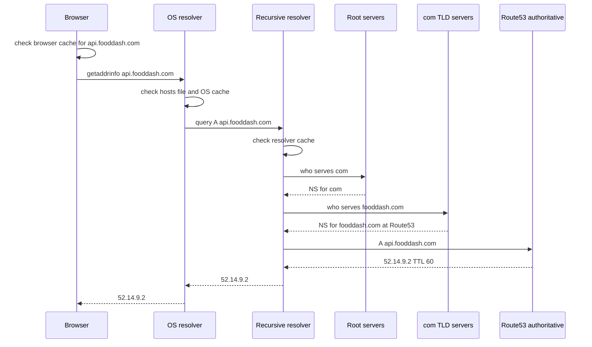

## 10.3 DNS: turning names into addresses

#### Concept

**DNS** (Domain Name System) is the distributed database that maps names such as `api.fooddash.com` to IP addresses such as `52.14.9.2`. Every request from a browser, every call from your NestJS app to Postgres by hostname, every Kubernetes service call to `orders-service.default.svc.cluster.local`, starts with a DNS lookup. DNS is the first network operation in every request path, and because of that it is also the first thing that can be slow, wrong or stale.

The record types you will meet as a backend engineer:

| Record | Maps | Backend use |
|---|---|---|
| `A` | name to IPv4 address | `api.fooddash.com -> 52.14.9.2` |
| `AAAA` | name to IPv6 address | dual-stack endpoints |
| `CNAME` | name to another name | `api.fooddash.com -> my-alb-123.ap-south-1.elb.amazonaws.com` |
| `ALIAS` / Route 53 alias | apex name to an AWS resource | `fooddash.com -> ALB` (CNAMEs are not allowed at the zone apex) |
| `SRV` | service to host and port | Kubernetes headless services, Consul |
| `TXT` | arbitrary text | domain verification, SPF, ACME challenges for TLS certificates |
| `NS` | delegation to name servers | which servers are authoritative for a zone |

#### Why does it exist?

IP addresses change. Load balancers get replaced, databases fail over to a replica with a different address, and Kubernetes pods are born and die by the minute. Humans and configuration files need a stable name. DNS provides the indirection: your code holds `PG_HOST=orders-db.internal`, and an operator can swap the machine behind it without a deployment. Without DNS you would hard-code addresses, and every failover would need a code change.

#### Mental model

Imagine asking for a shop's address. You first check your own memory (browser cache). Then your phone's contacts (OS resolver cache). Then you call a friend who knows everyone (the recursive resolver, such as your ISP's or `8.8.8.8`). If the friend does not know, they call the city directory (root servers) to find who handles `.com`, then the `.com` registry to find who handles `fooddash.com`, then finally the company's own switchboard (the authoritative name server) that gives the address. Everyone along the way writes the answer down with an expiry date (the **TTL**, time to live) so the next person asking gets it faster.

#### How it works



1. **Browser cache.** Chrome keeps resolved names for about 60 seconds regardless of TTL. First hit: 0 ms.
2. **OS resolver.** The operating system checks `/etc/hosts`, then its own cache (systemd-resolved on Linux, the DNS Client service on Windows). Typically under 1 ms.
3. **Recursive resolver.** Configured in `/etc/resolv.conf` (in Kubernetes this is CoreDNS at the cluster IP; in a VPC it is the Amazon-provided resolver at the VPC base address plus two, for example `10.0.0.2`). If it has a cached answer, 1 to 5 ms. If not, it performs the full recursion.
4. **Recursion.** Root servers (13 logical addresses, hundreds of anycast instances) point to the `.com` servers, which point to the authoritative servers for `fooddash.com`. A cold recursion costs 30 to 120 ms.
5. **Authoritative answer.** Route 53 returns the record with its TTL. Every cache on the path stores it for at most TTL seconds.
6. **TTL expiry.** After TTL seconds, the next query repeats step 3 onwards. A TTL of 60 seconds means a change propagates within about a minute to well-behaved resolvers; a TTL of 86,400 (one day) means yesterday's address may be served for a day.

DNS normally travels over UDP port 53 in a single packet each way (limited to 512 bytes classically, larger with EDNS0). Answers that do not fit fall back to TCP. DNS over HTTPS (DoH) and DNS over TLS (DoT) encrypt the query for privacy but change nothing about resolution logic.

**DNS in Node.js.** Node has two ways to resolve a name and they behave very differently:

- `dns.lookup()` calls the OS function `getaddrinfo()`. That call is **synchronous and blocking**, so libuv runs it on the **threadpool** (default size 4). It respects `/etc/hosts`, the OS cache and `resolv.conf` search domains. It is what `http.request`, `net.connect`, `pg` and `ioredis` use by default.
- `dns.resolve()` and the `dns.Resolver` class talk to DNS servers directly using c-ares, fully asynchronously, on the event loop. They ignore `/etc/hosts` and the OS cache.

The threadpool detail matters. If your NestJS app makes 200 concurrent outbound HTTP calls and each triggers a `dns.lookup`, only 4 can resolve at a time; the rest queue. Under a slow resolver (say 100 ms), 200 lookups take 200 divided by 4 times 100 ms, which is 5 seconds. Worse, the same threadpool serves `fs` operations, `crypto.pbkdf2`, zlib compression, and every other blocking libuv task, so slow DNS starves file reads and password hashing. Symptoms: high event-loop lag with idle CPU.

Node does **not** cache DNS results by itself. Every `http.request` without a keep-alive agent performs a fresh `dns.lookup`. With keep-alive, the socket is reused and no lookup happens. Since Node 20, `autoSelectFamily` (Happy Eyeballs) tries IPv6 and IPv4 in parallel with a 250 ms gap so one broken family does not stall connections.

**Service discovery in Kubernetes.** Every `Service` gets a DNS name `<service>.<namespace>.svc.cluster.local` served by CoreDNS, resolving to the service's stable ClusterIP. kube-proxy then load balances that virtual IP to pod IPs with iptables or IPVS rules, so the DNS answer stays stable while pods churn. Headless services (`clusterIP: None`) return the pod IPs directly as multiple `A` records, which is how StatefulSets (Postgres operators, Kafka) address individual members. A common trap: `resolv.conf` inside a pod has `ndots:5`, meaning any name with fewer than five dots is first tried with each search domain appended. Calling `api.stripe.com` from a pod generates lookups for `api.stripe.com.default.svc.cluster.local`, `api.stripe.com.svc.cluster.local`, `api.stripe.com.cluster.local`, and only then `api.stripe.com`; four wasted queries per call. Use a trailing dot (`api.stripe.com.`) or set `dnsConfig.options ndots: 2`.

**Route 53 basics.** Route 53 is AWS's authoritative DNS. Hosted zones hold records; routing policies decide which answer to give: simple, weighted (canary 5% of traffic to a new region), latency-based (answer with the region closest to the resolver), failover (primary with a health check, secondary when it fails), and geolocation. Alias records point at ALBs, CloudFront and S3 with no TTL cost because Route 53 resolves them internally. Health checks poll an endpoint every 10 or 30 seconds from multiple locations and flip failover records when the majority fail. Private hosted zones give internal names such as `orders-db.internal` to resources in a VPC.

#### Practical example

An e-commerce platform runs `api.shop.com` as a Route 53 alias to an ALB in `ap-south-1` and a failover record pointing to `eu-west-1`. Inside the VPC, `orders-db.internal` is a private zone CNAME to the RDS endpoint `orders-prod.cluster-abc.ap-south-1.rds.amazonaws.com`, which RDS itself updates on failover. The NestJS pods resolve `orders-db.internal` once per pool connection; because the pool holds connections for many minutes, DNS is barely visible in traces. The outbound Stripe client uses a keep-alive agent, so `api.stripe.com` is resolved a handful of times per hour per pod rather than on every payment.

#### NestJS example

Two production-grade practices in one service: a resolver-backed cache for outbound hostnames so the libuv threadpool is never a DNS bottleneck, and a health indicator that verifies the database hostname still resolves (an early signal after a failover with stale caches).

```ts
// dns-cache.service.ts
import { Injectable } from '@nestjs/common';
import { LookupFunction } from 'net';
import { Resolver } from 'dns/promises';

interface CacheEntry { addresses: string[]; expiresAt: number; }

@Injectable()
export class DnsCacheService {
  private readonly resolver = new Resolver(); // async c-ares, not the threadpool
  private readonly cache = new Map<string, CacheEntry>();

  // A lookup function compatible with http.Agent and undici's connect option.
  readonly lookup: LookupFunction = (hostname, _options, callback) => {
    const hit = this.cache.get(hostname);
    if (hit && hit.expiresAt > Date.now()) {
      return callback(null, hit.addresses[0], 4);
    }
    this.resolver.resolve4(hostname, { ttl: true })
      .then((records) => {
        const minTtl = Math.max(5, Math.min(...records.map((r) => r.ttl)));
        const addresses = records.map((r) => r.address);
        // Never cache longer than the authoritative TTL, and never below 5 s.
        this.cache.set(hostname, { addresses, expiresAt: Date.now() + minTtl * 1000 });
        callback(null, addresses[0], 4);
      })
      .catch((err) => {
        // Serve stale on resolver failure rather than failing the request outright.
        if (hit) return callback(null, hit.addresses[0], 4);
        callback(err as NodeJS.ErrnoException, '', 4);
      });
  };
}
```

```ts
// health.controller.ts
import { Controller, Get } from '@nestjs/common';
import { HealthCheck, HealthCheckService, TypeOrmHealthIndicator } from '@nestjs/terminus';
import { lookup } from 'dns/promises';

@Controller('health')
export class HealthController {
  constructor(private health: HealthCheckService, private db: TypeOrmHealthIndicator) {}

  @Get('ready')
  @HealthCheck()
  ready() {
    return this.health.check([
      () => this.db.pingCheck('postgres', { timeout: 1500 }),
      async () => {
        // Fails readiness if the DB name stops resolving (private zone deleted, resolver down).
        const { address } = await lookup(process.env.PG_HOST!);
        return { dns: { status: 'up', address } };
      },
    ]);
  }
}
```

Wire the cached lookup into an agent with `new http.Agent({ keepAlive: true, lookup: dnsCache.lookup })` or into undici with `new Agent({ connect: { lookup: dnsCache.lookup } })`. Respecting the TTL is the whole point: a cache that ignores TTL is exactly the failover bug described below.

#### PostgreSQL example

PostgreSQL itself is a DNS client (for replication and `dblink`) and a DNS subject (its hostname is what your pool resolves). The most useful DNS-related SQL is checking where your connections actually landed after a failover, which tells you whether stale DNS is still pointing writers at the old primary.

```sql
-- Am I connected to the primary or a replica? After a failover, a pool that
-- resolved the old address may still be talking to what is now a read replica.
SELECT inet_server_addr() AS server_ip,
       inet_server_port() AS server_port,
       pg_is_in_recovery() AS is_replica;

-- Writes on a replica fail with this error, which is the classic stale-DNS symptom:
-- ERROR: cannot execute INSERT in a read-only transaction
```

RDS Multi-AZ failover works by updating the DNS record of the cluster endpoint to the new primary with a 5-second TTL. Any client that cached the old address for longer, or that holds open connections to the old host, keeps writing to a machine that is now read-only until the connection is dropped. Well-behaved drivers see the connection reset, discard the pooled socket, and resolve again.

#### TypeORM example

TypeORM does not resolve DNS itself; the `pg` driver does through `dns.lookup`. What you control is how quickly a stale connection is discarded after a failover. Set connection and query timeouts so a dead primary does not hang the pool for minutes.

```ts
// data-source.ts (excerpt)
export const AppDataSource = new DataSource({
  type: 'postgres',
  host: 'orders-db.internal', // private hosted zone CNAME to the RDS cluster endpoint
  extra: {
    max: 10,
    connectionTimeoutMillis: 3_000,   // stale IP + SYN timeout would otherwise take 2 minutes
    idleTimeoutMillis: 20_000,        // idle sockets die soon, forcing a fresh DNS lookup
    statement_timeout: 10_000,        // a query stuck on a dead node fails in 10 s
    keepAlive: true,
    keepAliveInitialDelayMillis: 10_000,
  },
});
```

The `idleTimeoutMillis` choice is a DNS decision in disguise: the shorter it is, the sooner every connection is rebuilt with a fresh lookup after a failover. Ten to thirty seconds is a sensible balance.

#### Sequelize example

Sequelize supports read replication with separate hostnames, which means two DNS names and two failover behaviours to think about. Point the replica entry at the RDS reader endpoint, whose DNS answer rotates across replicas.

```ts
import { Sequelize } from 'sequelize';

export const sequelize = new Sequelize('orders', process.env.PG_USER!, process.env.PG_PASSWORD!, {
  dialect: 'postgres',
  replication: {
    write: { host: 'orders-db.internal' },            // cluster writer endpoint via private zone
    read: [{ host: 'orders-db-ro.internal' }],        // reader endpoint; DNS round-robins replicas
  },
  pool: { max: 10, min: 1, idle: 20_000, acquire: 3_000 },
  dialectOptions: { keepAlive: true, statement_timeout: 10_000 },
});
```

#### Production scenario

Numbers from a real mid-sized deployment: 40 pods, each with a pool of 8 connections, reconnecting on a 20-second idle timeout, generate about 100 DNS queries per minute to CoreDNS for the database name. CoreDNS in a small cluster comfortably answers 10,000 queries per second, so the load is trivial. The place DNS *did* hurt was the `ndots:5` problem: a notification service calling `api.sendgrid.com` 300 times per second was generating 1,500 DNS queries per second, and CoreDNS latency climbed to 40 ms under the load, which added 160 ms per outbound call. A trailing dot on the hostname cut CoreDNS traffic by 80% and the p95 of the notification path fell from 420 ms to 190 ms.

#### Failure scenario

At 03:52 the primary RDS instance in `ap-south-1a` failed. RDS promoted the standby in `1b` and updated the cluster endpoint DNS within 40 seconds. Half the fleet recovered. The other half kept logging `cannot execute UPDATE in a read-only transaction` for 31 minutes. Those pods ran an older base image whose `resolv.conf` pointed at a sidecar DNS cache configured with a **minimum TTL of 30 minutes** "to reduce DNS load". It served the old primary's address long after Route 53 said otherwise. Because the old instance came back as a replica, connections succeeded and reads worked, so health checks passed and nothing was restarted. The fix during the incident was a rolling restart of the affected deployment; the permanent fix removed the minimum-TTL override and added a synthetic check that performs a tiny write every 30 seconds and alerts on `read-only transaction`.

#### Edge cases & failure modes

- **Stale TTL after failover**: any cache that enforces a floor on TTL (Java's old default of caching forever, custom sidecars, some corporate resolvers) sends traffic to dead or demoted addresses.
- **Negative caching**: a resolver that saw `NXDOMAIN` for a freshly created name caches the "does not exist" answer for the zone's negative TTL (often 300 to 900 seconds). A new subdomain "not working" for 10 minutes after creation is usually this.
- **Threadpool starvation**: hundreds of concurrent `dns.lookup` calls with a slow resolver block file reads and bcrypt hashing. Increase `UV_THREADPOOL_SIZE` (up to 1024) or use a resolver-backed cache.
- **`ndots:5` amplification** in Kubernetes: four wasted queries per external call.
- **Search domain hijack**: with `ndots`, a typo'd hostname can resolve to an unexpected internal service.
- **UDP truncation**: answers with many records exceed 512 bytes, fall back to TCP, and a firewall that only allows UDP 53 causes intermittent failures.
- **Round-robin surprise**: multiple `A` records are returned in rotating order; `dns.lookup` returns the first, so one pod may hammer one backend.
- **Resolver outage**: if CoreDNS pods are evicted or the VPC resolver is throttled (1,024 packets per second per network interface in AWS), every new connection in the cluster fails at once. Monitor CoreDNS latency and error rate as a tier-0 service.
- **Split-horizon confusion**: the same name resolves to a public IP from a laptop and a private IP from inside the VPC; debugging from the wrong side gives wrong conclusions.
- **Clock and TTL**: a TTL is relative to when the cache stored the answer; it does not depend on wall-clock synchronisation, but health-check based failover does depend on the checker's view of time.

#### How a Senior Backend Engineer thinks about this

They treat DNS as a tier-0 dependency with its own SLO and dashboards, because when it fails everything fails at once. They choose TTLs deliberately: 60 seconds for records that participate in failover, longer (300 to 3,600) for stable records to reduce resolver load. They never cache DNS longer than the TTL, and they never cache "forever". They know that a failover plan that relies on DNS is only as fast as the slowest cache between the client and the authority, so for the database they also rely on connection-level detection: short connect timeouts, `statement_timeout`, and drivers that discard sockets on `read-only transaction` errors. They ask: "If this name changes at 03:00, which components will notice, and how long will it take?" To a product manager: "Changing an address in the phone book does not help if half the office keeps using the number written on a sticky note."

#### Common mistakes

- Hard-coding IP addresses in environment variables "because DNS is slow".
- Caching DNS results in application memory with no expiry.
- Not knowing that `dns.lookup` is threadpool-bound, then blaming the event loop for a resolver outage.
- Forgetting the trailing dot or `ndots` setting in Kubernetes, quadrupling CoreDNS load.
- Using a CNAME at the zone apex (`shop.com`), which is not allowed; use a Route 53 alias record.
- Setting a 24-hour TTL on the API record and then needing to move the load balancer in an emergency.
- Exposing the RDS endpoint name publicly and relying on a security group alone; use a private zone and no public accessibility.

#### Interview questions

1. **Walk through what happens when a browser resolves `api.shop.com` for the first time.** Browser cache, OS cache and hosts file, recursive resolver cache, root then TLD then authoritative servers, answer cached with TTL at every hop. Why it matters: it explains both the 100 ms cold-start penalty and why changes take TTL seconds to propagate. Follow-up: where do you put a CDN in this path?
2. **Why does `dns.lookup` in Node use the libuv threadpool, and what production problem does that cause?** It wraps the blocking `getaddrinfo` OS call; with a slow resolver, the four default threads become a queue, starving `fs`, zlib and crypto tasks. Follow-up: how do you fix it? Keep-alive agents so lookups are rare, a TTL-respecting resolver cache, or a larger `UV_THREADPOOL_SIZE`.
3. **Your RDS instance failed over but a subset of pods still fail writes 20 minutes later. What happened?** A DNS cache with a TTL floor, or long-lived pooled connections to the old host now serving as a replica. Follow-up: name two defences. Idle timeouts to force reconnection, and driver-level handling of read-only errors.
4. **What is `ndots:5` and why does it matter for a service making many external calls?** Kubernetes appends search domains to names with fewer than five dots, causing up to four failed lookups before the correct one.
5. **How would you canary a new region using DNS alone, and what is the catch?** Route 53 weighted records at 5%; the catch is that resolvers cache, so the split is approximate and rollbacks take TTL seconds.
6. **What does a Kubernetes Service DNS name resolve to, and how does a headless service differ?** A stable ClusterIP that kube-proxy load balances; headless returns pod IPs directly, used for stateful members.

#### Practical exercise

Build a small NestJS service that calls an external API 200 times concurrently. Measure the p95 latency with `dns.lookup` defaults and `UV_THREADPOOL_SIZE=4`, then with a keep-alive agent, then with a TTL-respecting resolver cache. Point the service at a hostname you control, lower its TTL to 30 seconds, change the record, and time how long the service takes to follow the change under each configuration. Acceptance criteria: a table of p95 latencies and propagation times for the three setups, and a one-paragraph explanation of why the keep-alive agent changes both numbers.
