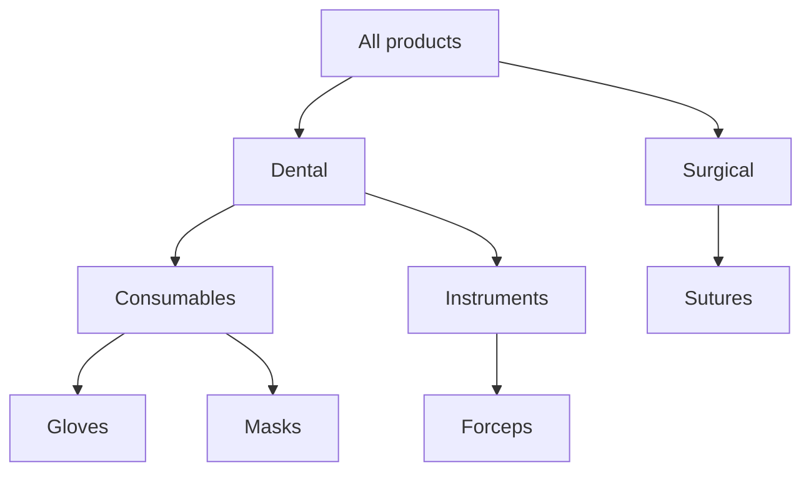
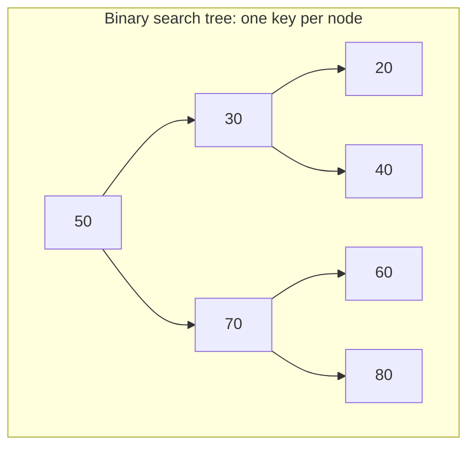
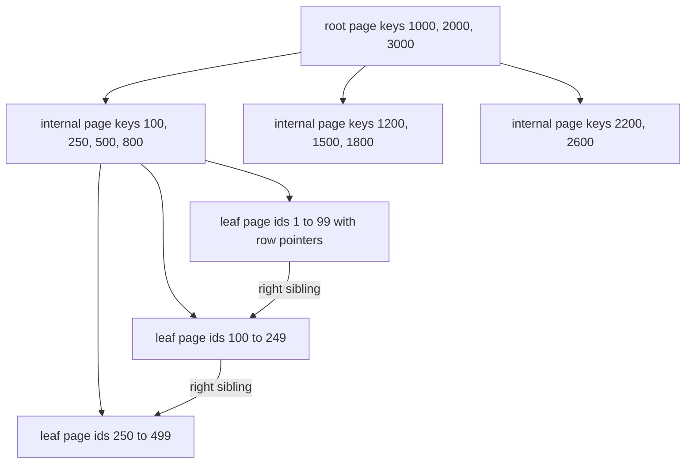

## 10.10 Tree

#### Concept

A tree is a set of nodes connected parent-to-child with exactly one path between any two nodes. One node is the **root**; nodes without children are **leaves**; the number of edges from the root to a node is its **depth**; the longest such path is the tree's **height**. A tree with at most two children per node is a binary tree; a general tree can have any number.

Backends are full of trees you did not build on purpose: product categories, comment threads, organization charts, folder hierarchies, the JSON body of every request, the NestJS module graph at bootstrap, the `EXPLAIN` plan PostgreSQL prints (each indented line is a child node), and the abstract syntax tree TypeScript compiles.

#### Why does it exist?

Hierarchy is a fact of the domain, and flat structures cannot express "is inside" or "belongs under". Trees also give algorithms a way to cut a problem in half repeatedly, which is where every O(log n) in this Part comes from. Without a tree, "all products under Dental > Consumables" is a scan over every product with string matching; with a tree it is a walk from one node down.

#### Mental model

Imagine a company org chart. Everyone has one manager except the CEO (the root). To list everyone under the VP of Engineering you start at her box and walk down; you never look at Sales. To find someone's chain of command you walk up. The chart is a tree because nobody has two managers; the moment they do, it is a graph (Section 10.15) and the questions get harder.

#### How it works

1. **In memory.** A node is `{ value, children: Node[] }` (or `parent` pointers too). Building a tree from flat database rows is a two-pass O(n) job: first put every node in a `Map` by id, then attach each node to its parent via the map.
2. **Traversal.** Depth-first (pre-order: visit then children; post-order: children then visit) uses a stack, explicit or the call stack. Breadth-first visits level by level using a queue. Post-order is what you need to compute subtree totals (stock under a category); pre-order is what you need to print a hierarchy.
3. **In the database.** Four storage patterns exist, each cheap at different questions:
   - **Adjacency list**: a `parent_id` column. Reads need a recursive CTE.
   - **Materialized path**: each row stores its full path (`root.dental.consumables`). PostgreSQL's `ltree` extension indexes it with GiST for "descendants of" and "ancestors of" in one index scan.
   - **Nested sets**: each row stores a `left` and `right` number; descendants are a range query; every insert renumbers half the table.
   - **Closure table**: a separate table of every (ancestor, descendant, depth) pair; fast reads, O(depth) rows per insert.
4. **Depth bounds.** Every traversal on user-controlled trees needs a depth limit and a cycle check; a `parent_id` column has no constraint that stops row 7 from being its own great-grandparent.



**Time complexity (general tree, n nodes, height h, node with c children)**

| Operation | Best | Average | Worst | Notes |
|---|---|---|---|---|
| Find child by key | O(1) | O(1) | O(c) | O(1) with a `Map` of children, O(c) with an array |
| Walk to root (ancestors) | O(1) | O(h) | O(n) | worst case is a chain-shaped tree |
| Traverse subtree | O(k) | O(k) | O(n) | k = nodes in the subtree |
| Build from flat rows | O(n) | O(n) | O(n) | with a `Map` by id |
| Subtree query with `ltree` and GiST | O(log n + k) | O(log n + k) | O(n) | k = matching rows |
| Subtree query with recursive CTE | O(k) | O(k x per-level cost) | O(n) | one index probe per parent per level |

**Memory implications**

A node object with a `children` array costs about 60 to 90 bytes plus 8 bytes per child pointer. A 12,000-node category tree is under 2 MB and lives comfortably in every pod. A comment thread with 5 million nodes does not; it is paginated per level from the database. Deep recursion, not memory, is the usual limit in Node.js (Section 10.5).

**Decision table: storing a tree in PostgreSQL**

| Pattern | Read subtree | Read ancestors | Insert | Move subtree | Integrity | Use when |
|---|---|---|---|---|---|---|
| Adjacency list (`parent_id`) | recursive CTE | recursive CTE | O(1) | O(1) | FK to parent | shallow trees, frequent writes |
| Materialized path (`ltree`) | one GiST scan | one GiST scan | O(1) | update every descendant path | none built in | read-heavy, categories, org charts |
| Nested sets | one range scan | one range scan | renumber O(n) | renumber O(n) | fragile | read-only or rarely edited |
| Closure table | one join | one join | O(depth) rows | O(subtree x depth) | FK on both columns | heavy ancestor and descendant reads, moderate writes |

#### Practical example

Building a tree from flat rows and computing per-category product counts with post-order traversal, both iterative.

```ts
// catalog/category-tree.ts
export interface CategoryRow { id: number; parentId: number | null; name: string; productCount: number }
export interface CategoryNode extends CategoryRow { children: CategoryNode[]; subtreeCount: number }

export function buildTree(rows: readonly CategoryRow[]): CategoryNode[] {
  const byId = new Map<number, CategoryNode>();
  for (const r of rows) byId.set(r.id, { ...r, children: [], subtreeCount: 0 }); // pass 1: O(n)

  const roots: CategoryNode[] = [];
  for (const node of byId.values()) {                                           // pass 2: O(n)
    if (node.parentId === null) roots.push(node);
    else byId.get(node.parentId)?.children.push(node);                          // orphan rows are dropped
  }
  return roots;
}

/** Post-order: a node's total is known only after all its children are done. */
export function fillSubtreeCounts(roots: CategoryNode[]): void {
  const stack: { node: CategoryNode; expanded: boolean }[] = roots.map((node) => ({ node, expanded: false }));
  while (stack.length > 0) {
    const frame = stack[stack.length - 1];
    if (!frame.expanded) {
      frame.expanded = true;                                        // push children, come back later
      for (const c of frame.node.children) stack.push({ node: c, expanded: false });
    } else {
      stack.pop();
      frame.node.subtreeCount =
        frame.node.productCount + frame.node.children.reduce((s, c) => s + c.subtreeCount, 0);
    }
  }
}
```

#### NestJS example

TypeORM has first-class tree entities. `@Tree('materialized-path')` stores an `mpath` column; the `TreeRepository` gives you `findTrees`, `findDescendants`, `findAncestors` and `findRoots`.

```ts
// catalog/category.entity.ts
import { Column, Entity, PrimaryGeneratedColumn, Tree, TreeChildren, TreeParent } from 'typeorm';

@Entity({ name: 'categories' })
@Tree('materialized-path')
export class Category {
  @PrimaryGeneratedColumn()
  id!: number;

  @Column({ type: 'text' })
  name!: string;

  @Column({ type: 'text', unique: true })
  slug!: string;

  @TreeChildren()
  children!: Category[];

  @TreeParent({ onDelete: 'CASCADE' })
  parent!: Category | null;
}

// catalog/categories.service.ts
import { Injectable, NotFoundException, OnModuleInit } from '@nestjs/common';
import { DataSource, TreeRepository } from 'typeorm';
import { Category } from './category.entity';

@Injectable()
export class CategoriesService implements OnModuleInit {
  private readonly repo: TreeRepository<Category>;
  private menu: Category[] = [];   // per-pod snapshot of the full tree, refreshed on change

  constructor(dataSource: DataSource) {
    this.repo = dataSource.getTreeRepository(Category);
  }

  async onModuleInit(): Promise<void> {
    await this.refreshMenu();
  }

  async refreshMenu(): Promise<void> {
    this.menu = await this.repo.findTrees({ depth: 3 }); // one query per level, not per node
  }

  getMenu(): Category[] {
    return this.menu;                                     // 12k nodes, ~1.5 MB, served in microseconds
  }

  async breadcrumbs(slug: string): Promise<Category[]> {
    const node = await this.repo.findOneBy({ slug });
    if (!node) throw new NotFoundException(`category ${slug}`);
    return this.repo.findAncestors(node);                 // root first
  }

  async descendantIds(slug: string): Promise<number[]> {
    const node = await this.repo.findOneBy({ slug });
    if (!node) throw new NotFoundException(`category ${slug}`);
    const nodes = await this.repo.findDescendants(node);  // includes the node itself
    return nodes.map((n) => n.id);
  }
}
```

Publish a `category.changed` event (via `@nestjs/event-emitter` in-process, or Redis pub/sub across pods) whenever an admin edits a category, and call `refreshMenu` on it; a `@Cron('0 */10 * * * *')` refresh is the safety net.

#### PostgreSQL example

`ltree` turns "everything under this node" into an index scan and gives you breadcrumbs, subtree moves and depth in one expression each.

```sql
CREATE EXTENSION IF NOT EXISTS ltree;

CREATE TABLE categories (
  id        bigint PRIMARY KEY,
  name      text   NOT NULL,
  parent_id bigint REFERENCES categories(id),
  path      ltree  NOT NULL                       -- e.g. root.dental.consumables.gloves
);
CREATE INDEX categories_path_gist ON categories USING gist (path);
CREATE INDEX categories_parent_idx ON categories (parent_id);

-- Descendants of Consumables (and itself)
SELECT id, name, nlevel(path) AS depth
FROM categories WHERE path <@ 'root.dental.consumables';

-- Breadcrumbs for Gloves, root first
SELECT id, name FROM categories
WHERE path @> 'root.dental.consumables.gloves' ORDER BY nlevel(path);

-- Move the Instruments subtree under Surgical: rewrite every descendant path once
UPDATE categories
SET path = 'root.surgical'::ltree || subpath(path, nlevel('root.dental'::ltree))
WHERE path <@ 'root.dental.instruments';

-- Adjacency-list alternative: bounded recursive CTE
WITH RECURSIVE sub AS (
  SELECT id, name, parent_id, 0 AS depth FROM categories WHERE id = $1
  UNION ALL
  SELECT c.id, c.name, c.parent_id, sub.depth + 1
  FROM categories c JOIN sub ON c.parent_id = sub.id
  WHERE sub.depth < 10                              -- hard stop against cycles and runaway depth
)
SELECT id, name, depth FROM sub;
```

```text
Bitmap Heap Scan on categories  (cost=4.43..46.12 rows=18 width=45) (actual time=0.052..0.081 rows=23 loops=1)
  Recheck Cond: (path <@ 'root.dental.consumables'::ltree)
  Heap Blocks: exact=3
  Buffers: shared hit=6
  ->  Bitmap Index Scan on categories_path_gist  (cost=0.00..4.43 rows=18 width=0) (actual time=0.041..0.041 rows=23 loops=1)
        Index Cond: (path <@ 'root.dental.consumables'::ltree)
Execution Time: 0.104 ms
```

#### TypeORM example

The tree entity above is the TypeORM angle. For the `ltree` pattern without tree entities, map the column as `@Column({ type: 'ltree' })` is not supported natively; use `@Column({ type: 'text' })` with a migration that creates the real `ltree` column and query with the query builder: `.where('c.path <@ :p', { p })`.

#### Sequelize example

Sequelize has no tree repository. Model `parent_id` normally and issue the recursive CTE with `sequelize.query`:

```ts
const rows = await sequelize.query<{ id: number; name: string; depth: number }>(
  `WITH RECURSIVE sub AS (
     SELECT id, name, parent_id, 0 AS depth FROM categories WHERE id = :rootId
     UNION ALL
     SELECT c.id, c.name, c.parent_id, sub.depth + 1
     FROM categories c JOIN sub ON c.parent_id = sub.id WHERE sub.depth < 10)
   SELECT id, name, depth FROM sub ORDER BY depth, name`,
  { replacements: { rootId }, type: QueryTypes.SELECT },
);
```

#### Production scenario

A storefront serves the navigation menu on every page: 4,000 RPS, 12,000 categories, depth 4. Loading it from PostgreSQL per request would be 4,000 recursive queries per second; instead each pod holds the tree in memory (1.5 MB), rebuilt in 40 ms when a change event arrives, and serves it in microseconds. Product listing for a category uses `descendantIds` and `WHERE category_id = ANY($1)` with an index; for the root "All products" node that list is 12,000 ids, which is why the senior caches the *serialized JSON* of the menu too, and lets the "All" listing skip the filter entirely.

Comment threads are the other production tree: a viral post with 200,000 comments is never loaded whole. The API returns the top-level comments with `LIMIT 20`, each with its `reply_count`, and children are fetched per node on expand. The tree exists in the data model; it is never materialized in one response.

#### Failure scenario

At 02:14 the on-call engineer is paged: the `GET /menu` endpoint takes 4.2 seconds and PostgreSQL connections are exhausted. A refactor replaced the batched `findTrees` with a recursive `loadChildren(node)` that issued one query per node: 12,000 queries per request, each about 0.3 ms plus pool wait. At 200 RPS that is 2.4 million queries per second requested against a pool of 20 connections per pod. The database was fine; the pool queue was the bottleneck, and every other endpoint that needed a connection waited behind menu requests. The fix was the per-pod snapshot above; the guard against regression was a test asserting the menu load issues at most `depth + 1` queries (count them with a query logger).

#### Edge cases & failure modes

- **Cycles** in `parent_id` data make recursive loads infinite; bound depth in SQL and check visited sets in code.
- **Orphans** whose parent was deleted; use `ON DELETE CASCADE` or `RESTRICT`, never silent orphaning.
- **Subtree moves** under materialized path rewrite every descendant; do it in one `UPDATE` inside a transaction, and lock the parent row first to serialize concurrent moves.
- **Deep trees** overflow recursion; iterate.
- **JSON depth bombs**: a request body nested 100,000 levels deep is a tree too; cap body size and nesting.
- **Stale per-pod snapshots** after an edit; use change events plus a periodic refresh, and accept a bounded staleness window (state it in the runbook).
- **Huge subtrees** (the root) turn "descendant ids" into a list of everything; special-case the root.

#### How a Senior Backend Engineer thinks about this

The senior asks which questions dominate: descendants, ancestors, or edits. Read-heavy hierarchies (categories, org charts, folders) get materialized paths with `ltree`, and a per-pod cache in front. Write-heavy or shallow ones (comment replies, two-level menus) keep a plain `parent_id` with a bounded recursive CTE. Nested sets are avoided unless the tree is effectively read-only. They bound every traversal, in SQL and in code, and they never load a tree whose size a user controls into one response.

To a product manager: "Categories change a few times a day and are read four thousand times a second, so we store them in a form that makes reading instant and editing slightly slower. Comment threads are the opposite, so they use a different layout. Same word, two designs."

#### Common mistakes

- One query per node ("N+1 recursion") when loading a hierarchy.
- Recursive functions without depth guards over data with no cycle constraint.
- Returning the entire tree for a request that needs one level.
- Choosing nested sets for a tree that is edited often, then discovering every insert rewrites thousands of rows.
- Forgetting to refresh per-pod snapshots, then debugging "the category shows on pod 3 but not pod 5".

#### Interview questions

1. **Compare adjacency list, materialized path, nested sets and closure table.** Expected: the decision table above; pick by read/write ratio and the dominant query.
2. **How do you build a tree from 50,000 flat rows in O(n)?** Expected: two passes with a `Map` by id; discuss orphans and cycles.
3. **How would you serve a category menu at 4,000 RPS?** Expected: per-pod snapshot rebuilt on change events, serialized once, bounded staleness, a test on query count.
4. **What does `ltree`'s `<@` operator do and how is it indexed?** Expected: "is descendant of"; GiST index; O(log n + k).
5. **Why is post-order traversal the right order for computing subtree totals?** Expected: a node's total depends on completed children; pre-order would read incomplete sums.

#### Practical exercise

Implement `CategoryModule` with `ltree` storage and a per-pod cache. Acceptance criteria: `GET /categories/:slug/breadcrumbs` and `GET /categories/:slug/descendants` each issue exactly one SQL query (assert with a query logger in tests); `PATCH /categories/:slug/move` moves a subtree in one transaction with a `SELECT ... FOR UPDATE` on the target parent, and a concurrency test with two simultaneous moves ends with a valid tree; the menu cache refreshes within 2 seconds of an edit on every pod (use Redis pub/sub in an integration test with two application instances); and a fuzz test inserting a cycle through raw SQL causes the recursive CTE to terminate at depth 10 with a 500 that names the cycle, never a hung request.

## 10.11 Binary Search Tree

#### Concept

A binary search tree (BST) is a binary tree with an ordering rule: every key in a node's left subtree is smaller than the node's key, and every key in its right subtree is larger. Searching walks from the root, going left or right at each node, so a *balanced* tree of n keys finds any key in about log2(n) steps: 20 steps for a million keys. In-order traversal (left, node, right) visits keys in sorted order, which is what makes BSTs an **ordered map**: they answer range queries, "next larger", minimum and maximum, which a hash map cannot.

The catch is balance. Insert keys in sorted order into a naive BST and every node has only a right child: the tree becomes a linked list and every search is O(n). Self-balancing variants (AVL, red-black trees) rotate nodes to keep the height logarithmic. Databases use a different relative, the **B-tree**, for reasons this section makes concrete.

#### Why does it exist?

Hash maps answer "exactly this key" and nothing else. Backends constantly ask ordered questions: orders created between two timestamps, the next delivery slot at or after 14:00, the 10 highest bids, the first job whose `run_at` has passed, all SKUs starting with `GLV-`. Every one of those is a range or neighbour query, and every one of them is what an ordered structure is for. Without one you sort the whole collection per question (O(n log n)) or scan it (O(n)).

#### Mental model

Imagine guessing a number between 1 and a million where every guess tells you "higher" or "lower". Twenty guesses always suffice, because each guess halves the range. A BST is that game with the guesses precomputed: the root is your first guess, its children are the second guesses for each answer, and so on.

#### How it works

1. **Search.** Start at the root; compare; go left if smaller, right if larger; stop on a match or a null child. O(height).
2. **Insert.** Search for the key; where the search falls off the tree, attach the new node. O(height).
3. **Delete.** A leaf is removed directly. A node with one child is replaced by that child. A node with two children is replaced by its in-order successor (the minimum of its right subtree), which by construction has at most one child.
4. **Range query.** Find the smallest key at least `lo`, then walk in-order until a key exceeds `hi`. O(height + k) for k results.
5. **Balancing.** AVL trees keep the two subtrees of every node within one level of height; red-black trees allow a looser bound (height at most 2 x log2(n)) with fewer rotations; both do O(1) rotations per insert on average. Skip lists (used by Redis sorted sets) reach the same O(log n) with randomization and no rotations.
6. **Why databases use B-trees instead.** A BST node holds one key and two pointers; a search for one key in 100 million rows takes about 27 pointer hops, and on disk each hop is a page read. A B-tree node is a whole 8 KB page holding hundreds of keys (fanout of 300 to 500 in PostgreSQL for integer keys). The same 100 million rows fit in a tree of height 3 or 4: three or four page reads, usually all cached. Leaf pages are linked left to right, so a range scan reads consecutive leaves without going back up. Pages match disk and cache-line reality; pointer-per-key trees do not. This is why every index you will create in Part 23 is a B-tree, and why in memory a sorted array with binary search often beats a BST in JavaScript: it is the same halving with zero pointer chasing.





**Time complexity**

| Operation | Best | Average (balanced) | Worst (unbalanced) | Notes |
|---|---|---|---|---|
| Search | O(1) | O(log n) | O(n) | worst case is a chain from sorted inserts |
| Insert | O(1) | O(log n) | O(n) | self-balancing trees guarantee O(log n) |
| Delete | O(1) | O(log n) | O(n) | |
| Min / max | O(1) | O(log n) | O(n) | O(1) if you cache the extremes |
| Range query (k results) | O(log n + k) | O(log n + k) | O(n) | |
| In-order traversal | O(n) | O(n) | O(n) | sorted output |
| B-tree index lookup (PostgreSQL) | O(log_f n) | O(log_f n) | O(log_f n) | f = fanout, height 3 or 4 in practice |

**Memory implications**

A BST node in V8 costs about 56 bytes (object header, key, value, left, right) plus the key; a million entries is about 60 MB and a cache miss per level. A sorted array of a million numbers is 8 MB and binary search touches about 20 cache lines. A red-black tree adds a colour bit and a parent pointer. On disk, a PostgreSQL B-tree leaf page of 8 KB holds about 400 entries of a `bigint` key plus a 6-byte row pointer.

#### Practical example

A minimal iterative BST with range queries so you can see the mechanism, and the pragmatic in-memory ordered structure for JavaScript: a sorted array with `lowerBound`.

```ts
// common/bst.ts
interface Node<K, V> { key: K; value: V; left: Node<K, V> | null; right: Node<K, V> | null }

export class BinarySearchTree<K, V> {
  private root: Node<K, V> | null = null;
  constructor(private readonly cmp: (a: K, b: K) => number) {}

  set(key: K, value: V): void {
    if (!this.root) { this.root = { key, value, left: null, right: null }; return; }
    let cur = this.root;
    for (;;) {
      const c = this.cmp(key, cur.key);
      if (c === 0) { cur.value = value; return; }
      const next = c < 0 ? cur.left : cur.right;
      if (!next) {
        const node = { key, value, left: null, right: null };
        if (c < 0) cur.left = node; else cur.right = node;
        return;
      }
      cur = next;
    }
  }

  /** All entries with lo <= key <= hi, in order. O(height + k). */
  *range(lo: K, hi: K): Generator<[K, V]> {
    const stack: Node<K, V>[] = [];
    let cur = this.root;
    while (cur || stack.length) {
      while (cur) { stack.push(cur); cur = this.cmp(cur.key, lo) < 0 ? null : cur.left; } // prune left of lo
      const node = stack.pop()!;
      if (this.cmp(node.key, hi) > 0) return;
      if (this.cmp(node.key, lo) >= 0) yield [node.key, node.value];
      cur = node.right;
    }
  }
}

// common/sorted.ts -- read-mostly ordered data: sorted array + binary search beats a BST in JS
export function lowerBound(sorted: readonly number[], target: number): number {
  let lo = 0, hi = sorted.length;
  while (lo < hi) {
    const mid = (lo + hi) >>> 1;
    if (sorted[mid] < target) lo = mid + 1; else hi = mid;
  }
  return lo; // index of the first element >= target, or length
}
```

#### NestJS example

A delivery-slot service: slots for a city are loaded once per hour as a sorted array of start times with remaining capacity; "first slot at or after the requested time with capacity" is a binary search plus a short forward scan. The per-pod array is a read cache; the reservation itself is a database transaction so two pods cannot overbook.

```ts
// delivery/slot-finder.service.ts
import { Injectable } from '@nestjs/common';
import { Cron } from '@nestjs/schedule';
import { DataSource } from 'typeorm';
import { lowerBound } from '../common/sorted';

interface Slot { startsAt: number; remaining: number; id: string }

@Injectable()
export class SlotFinderService {
  private starts: number[] = [];   // sorted, parallel to `slots`
  private slots: Slot[] = [];

  constructor(private readonly dataSource: DataSource) {}

  @Cron('0 */15 * * * *')          // refresh every 15 minutes; reservations adjust live counts below
  async refresh(): Promise<void> {
    const rows: Slot[] = await this.dataSource.query(
      `SELECT id, extract(epoch from starts_at) * 1000 AS "startsAt", capacity - reserved AS remaining
       FROM delivery_slots WHERE starts_at > now() ORDER BY starts_at`,
    );
    this.slots = rows;
    this.starts = rows.map((r) => r.startsAt);
  }

  nextAvailable(afterMs: number): Slot | undefined {
    let i = lowerBound(this.starts, afterMs);            // O(log n)
    while (i < this.slots.length && this.slots[i].remaining <= 0) i++; // skip full slots
    return this.slots[i];
  }

  /** Called after a successful DB reservation so the local view stays close to truth. */
  markReserved(id: string): void {
    const slot = this.slots.find((s) => s.id === id);   // fine: a city has a few hundred slots
    if (slot) slot.remaining--;
  }
}
```

#### PostgreSQL example

The B-tree is the index. `pageinspect` lets you see its height, and `EXPLAIN (ANALYZE, BUFFERS)` shows how few pages a lookup touches.

```sql
CREATE INDEX orders_created_at_idx ON orders (created_at);

CREATE EXTENSION IF NOT EXISTS pageinspect;
SELECT level AS height, root FROM bt_metap('orders_created_at_idx');
--  height | root
-- --------+------
--       3 | 412          -- 400M rows, three levels above the leaves

EXPLAIN (ANALYZE, BUFFERS)
SELECT id, total_cents FROM orders
WHERE created_at >= '2026-09-01' AND created_at < '2026-09-01 00:10'
ORDER BY created_at;
```

```text
Index Scan using orders_created_at_idx on orders  (cost=0.57..612.40 rows=1480 width=16) (actual time=0.041..1.912 rows=1466 loops=1)
  Index Cond: ((created_at >= '2026-09-01 00:00:00+00'::timestamptz) AND (created_at < '2026-09-01 00:10:00+00'::timestamptz))
  Buffers: shared hit=1489
Planning Time: 0.142 ms
Execution Time: 2.031 ms
```

Three internal pages plus four leaf pages found 1,466 row pointers; the remaining 1,480 or so buffer hits are the heap pages holding the rows themselves. The tree walk is a rounding error; the heap fetches are the cost, which is why covering indexes (`INCLUDE (total_cents)`) exist. Part 23 — Database Indexing builds on exactly this.

#### TypeORM example

```ts
@Entity({ name: 'orders' })
@Index('orders_merchant_created_idx', ['merchantId', 'createdAt'])   // composite B-tree
export class Order {
  @PrimaryGeneratedColumn('increment', { type: 'bigint' }) id!: string;
  @Column({ name: 'merchant_id', type: 'bigint' }) merchantId!: string;
  @Column({ name: 'created_at', type: 'timestamptz' }) createdAt!: Date;
  @Column({ name: 'total_cents', type: 'integer' }) totalCents!: number;
}

// range query that walks the composite index left to right
const recent = await repo.find({
  where: { merchantId, createdAt: Between(from, to) },
  order: { createdAt: 'DESC' },
  take: 100,
});
```

#### Sequelize example

```ts
Order.init({ /* columns */ }, {
  sequelize, tableName: 'orders', timestamps: false,
  indexes: [{ name: 'orders_merchant_created_idx', fields: ['merchant_id', 'created_at'] }],
});

const recent = await Order.findAll({
  where: { merchantId, createdAt: { [Op.between]: [from, to] } },
  order: [['createdAt', 'DESC']],
  limit: 100,
});
```

#### Production scenario

A 400-million-row `orders` table with a B-tree on `(merchant_id, created_at)` answers "this merchant's orders in the last hour" in 2 to 5 ms, because the tree is four pages high and the leaf range is contiguous. The same question against an in-memory BST would need about 28 pointer hops per lookup and 30 GB of RAM; nobody builds that. Where an *in-memory ordered structure* is needed at scale across pods, Redis sorted sets are the tool: `ZADD leaderboard 98120 user:42` and `ZRANGEBYSCORE leaderboard 90000 +inf LIMIT 0 10` are O(log n + k) on a skip list, about 0.3 ms, for tens of millions of members.

#### Failure scenario

A matching service loaded 200,000 active listings into a hand-written BST keyed by price at startup, "for fast range queries". The listings came from PostgreSQL ordered by price ascending, so the tree was a 200,000-node chain. Every range query walked up to 200,000 nodes: about 2 ms each. At 1,200 RPS the service needed 2.4 cores and had one; p99 went from 3 ms in staging (random test data, roughly balanced tree) to 900 ms in production. The fix took ten minutes: replace the BST with a sorted array and `lowerBound`. The lesson: an unbalanced BST is a linked list with better marketing, and your production data is often sorted.

#### Edge cases & failure modes

- **Sorted input** degenerates a naive BST to O(n); use a balanced tree, a sorted array or shuffle.
- **Duplicate keys** need a policy (replace, keep list, reject).
- **Comparator bugs** (`a - b` on strings, inconsistent ordering) corrupt the tree silently.
- **Floating-point keys** with `NaN` break every comparison.
- **Recursion** in tree code overflows at depth 10,000, which an unbalanced tree reaches easily.
- **Concurrency**: in-memory trees are per pod and unsynchronized; the database index is the shared ordered structure.
- **B-tree bloat** in PostgreSQL after heavy deletes; the tree stays high with mostly empty pages until `REINDEX`.

#### How a Senior Backend Engineer thinks about this

The senior almost never writes a BST. For ordered in-memory data that changes rarely, a sorted array with binary search is smaller and faster. For ordered data that changes often and must be shared, a Redis sorted set. For ordered data that must be durable and consistent, a PostgreSQL B-tree index. A red-black tree library (`sorted-btree`, `functional-red-black-tree`) is reserved for a high-churn in-process ordered set that is the product itself, such as an order book. What the senior does carry from the BST is the reasoning: log n via halving, why balance matters, why page-sized nodes win on disk, and how to read the height of an index.

#### Common mistakes

- Building a BST from sorted data and testing with random data.
- Using a hash map and then sorting the whole thing per request to answer a range question.
- Assuming an index lookup costs "one disk read"; it is height plus heap fetches, and the heap fetches dominate.
- Reaching for a tree library when `Array.prototype.sort` once plus `lowerBound` would do.

#### Interview questions

1. **Why do databases use B-trees rather than binary search trees?** Expected: page-sized nodes with high fanout give height 3 to 4 for hundreds of millions of keys; sequential leaf links for ranges; cache and disk friendliness. Why it matters: it is the bridge from CS fundamentals to index tuning.
2. **What happens to a naive BST fed sorted input, and how do balanced trees fix it?** Expected: O(n) chain; rotations keep height O(log n).
3. **Given 200,000 prices that change hourly, how do you answer range queries in-process?** Expected: sorted array plus binary search; rebuild on refresh; O(log n + k).
4. **How do you find the height of a PostgreSQL index and why does it matter?** Expected: `bt_metap(...)` level; height plus heap fetches bounds lookup cost; covering indexes reduce heap fetches.
5. **When would you pick a Redis sorted set over an in-memory ordered structure?** Expected: shared across pods, durable enough, O(log n) operations, leaderboards and delayed jobs.

#### Practical exercise

Implement `PriceBandService` for an order book: keep 500,000 active listings ordered by price in memory, support `insert`, `remove` and `range(lo, hi)`. Acceptance criteria: use a balanced tree library or a chunked sorted array (justify the choice in a comment); `range` over a 1,000-item band returns in under 0.2 ms at p99 under a load test; inserting the same 500,000 prices in ascending order does not change performance (a test compares ascending versus shuffled insert timings within 20 percent); and a comparison test proves the in-memory answer equals `SELECT ... WHERE price BETWEEN $1 AND $2 ORDER BY price` for 100 random bands.
