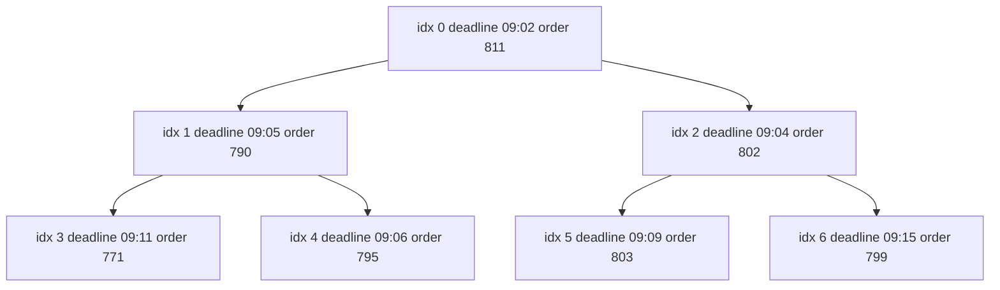

## 10.12 Heap

#### Concept

A heap is a binary tree with two rules: it is **complete** (every level is full except possibly the last, which fills left to right), and it obeys the **heap property**: in a min-heap every parent is smaller than or equal to its children, so the smallest item is always at the root. A max-heap flips the comparison. Because the tree is complete, it needs no pointers at all; it is stored in a plain array where the children of index `i` live at `2i + 1` and `2i + 2`, and the parent of `i` lives at `(i - 1) / 2` rounded down.

The heap gives you the minimum (or maximum) in O(1), and insertion or removal of the minimum in O(log n). It does *not* keep everything sorted; it keeps just enough order to always know the top.

Three unrelated things are called "heap" in a backend engineer's day: this data structure, the V8 memory region where objects live ("JavaScript heap out of memory"), and PostgreSQL's row storage ("heap tables", "Bitmap Heap Scan"), which is an unordered pile of pages with no heap property at all. Context tells you which one is meant.

#### Why does it exist?

Many systems repeatedly ask "what is the next most urgent thing?" while new things keep arriving: the next timer to fire, the next job whose `run_at` has passed, the next delivery with the earliest promised time, the k most popular products, the next post to show when merging 300 followed feeds. Keeping a fully sorted array costs O(n) per insert; sorting per query costs O(n log n). The heap does both sides in O(log n) and answers the question itself in O(1). Node.js's timer system, libuv's timer wheel, BullMQ's delayed jobs (via a Redis sorted set) and PostgreSQL's `ORDER BY ... LIMIT` all rely on this idea.

#### Mental model

Imagine a hospital triage board. Patients are not kept in a fully sorted line; the board only guarantees that the most critical patient is at the top. When a new patient arrives, the nurse compares them with their "parent" on the board and swaps upward until they are under someone more critical. When the top patient is taken in, the last patient moves to the top and sinks down until both patients below them are less critical. Nobody ever sorts the whole board.

#### How it works

1. **Array layout.** `[a0, a1, a2, a3, a4, a5, a6]` represents root `a0` with children `a1`, `a2`; `a1` has children `a3`, `a4`; `a2` has children `a5`, `a6`. No pointers, contiguous memory, cache-friendly.
2. **Push (sift up).** Append the item at the end, then repeatedly swap it with its parent while it is smaller than the parent. At most log2(n) swaps.
3. **Pop (sift down).** Take the root, move the last item to the root, then repeatedly swap it with its smaller child until both children are larger. At most log2(n) swaps.
4. **Heapify.** Building a heap from n existing items by sifting down from the last parent to the root costs O(n), not O(n log n); use it when you start with a batch.
5. **Top-k.** To find the k largest of n items, keep a *min*-heap of size k: push each item, and if the heap exceeds k, pop the minimum. O(n log k) with O(k) memory, which is how PostgreSQL executes `ORDER BY x DESC LIMIT 10` ("top-N heapsort").
6. **k-way merge.** To merge k sorted lists, push the head of each list into a heap keyed by the sort field, pop the smallest, and push the next item from the same list. O(N log k) for N total items.



```text
array:   [ 09:02 | 09:05 | 09:04 | 09:11 | 09:06 | 09:09 | 09:15 ]
index:       0       1       2       3       4       5       6
children of i:  2i+1 and 2i+2      parent of i: (i-1) >> 1
```

**Time complexity**

| Operation | Best | Average | Worst | Notes |
|---|---|---|---|---|
| `peek` (min or max) | O(1) | O(1) | O(1) | |
| `push` | O(1) | O(log n) | O(log n) | best case stops after one comparison |
| `pop` | O(log n) | O(log n) | O(log n) | |
| Build from n items (heapify) | O(n) | O(n) | O(n) | versus O(n log n) for n pushes |
| Search for arbitrary item | O(n) | O(n) | O(n) | heaps are not for searching |
| Remove arbitrary item | O(n) | O(n) | O(n) | O(log n) if you keep an index map |
| Top-k of n | O(n log k) | O(n log k) | O(n log k) | |
| k-way merge of N items | O(N log k) | O(N log k) | O(N log k) | |

**Memory implications (V8, Node.js)**

- One array of 8-byte pointers plus the items: a heap of 1 million job records costs 8 MB for the structure and whatever the records cost. No per-node objects, no pointer chasing.
- Keep the items monomorphic (same shape) and the comparator simple; a heap's cost is dominated by comparisons, and a megamorphic comparator that touches nested objects is 10 times slower than one comparing two numbers.
- Node.js stores each pending `setTimeout` in a list per duration and keeps those lists in a priority queue keyed by expiry; a million timers with distinct durations cost roughly 200 bytes each for the `Timeout` objects, which is why "one timer per job" scheduling is a memory problem before it is a CPU problem.

#### Practical example

A generic binary heap, a top-k helper, and a k-way merge that builds a social timeline from per-user post lists.

```ts
// common/binary-heap.ts
export class BinaryHeap<T> {
  private readonly a: T[] = [];

  /** `less(x, y)` returns true when x should come out before y. */
  constructor(private readonly less: (x: T, y: T) => boolean) {}

  static from<T>(items: readonly T[], less: (x: T, y: T) => boolean): BinaryHeap<T> {
    const h = new BinaryHeap<T>(less);
    h.a.push(...items);
    for (let i = (h.a.length >> 1) - 1; i >= 0; i--) h.siftDown(i); // heapify: O(n)
    return h;
  }

  get size(): number { return this.a.length; }
  peek(): T | undefined { return this.a[0]; }

  push(item: T): void {
    this.a.push(item);
    this.siftUp(this.a.length - 1);
  }

  pop(): T | undefined {
    const a = this.a;
    if (a.length === 0) return undefined;
    const top = a[0];
    const last = a.pop()!;
    if (a.length > 0) { a[0] = last; this.siftDown(0); }
    return top;
  }

  private siftUp(i: number): void {
    const a = this.a;
    while (i > 0) {
      const p = (i - 1) >> 1;
      if (!this.less(a[i], a[p])) break;
      [a[i], a[p]] = [a[p], a[i]];
      i = p;
    }
  }

  private siftDown(i: number): void {
    const a = this.a, n = a.length;
    for (;;) {
      const l = 2 * i + 1, r = l + 1;
      let m = i;
      if (l < n && this.less(a[l], a[m])) m = l;
      if (r < n && this.less(a[r], a[m])) m = r;
      if (m === i) return;
      [a[i], a[m]] = [a[m], a[i]];
      i = m;
    }
  }
}

// common/top-k.ts -- the k largest by score, O(n log k), O(k) memory
export function topK<T>(items: Iterable<T>, k: number, score: (t: T) => number): T[] {
  const h = new BinaryHeap<T>((x, y) => score(x) < score(y)); // min-heap keeps the k largest
  for (const it of items) {
    h.push(it);
    if (h.size > k) h.pop();                                   // drop the smallest of the k+1
  }
  const out: T[] = [];
  while (h.size) out.push(h.pop()!);
  return out.reverse();                                        // largest first
}
```

#### NestJS example

A timeline service that merges the latest posts of every followed account into one feed. Each followed account's recent posts come from Redis (a list per author, newest first), and a heap does the k-way merge so we stop after 50 posts instead of sorting everything.

```ts
// feed/timeline.service.ts
import { Injectable } from '@nestjs/common';
import Redis from 'ioredis';
import { BinaryHeap } from '../common/binary-heap';

interface Post { id: string; authorId: string; createdAt: number }
interface Cursor { list: Post[]; idx: number }

@Injectable()
export class TimelineService {
  constructor(private readonly redis: Redis) {}

  async build(followedIds: string[], limit = 50): Promise<Post[]> {
    const pipeline = this.redis.pipeline();
    for (const id of followedIds) pipeline.lrange(`author:${id}:posts`, 0, limit - 1); // newest first
    const replies = await pipeline.exec();                                          // one round trip

    // Heap keyed by the newest unread post of each author: k = followed accounts, not total posts.
    const heap = new BinaryHeap<Cursor>((x, y) => x.list[x.idx].createdAt > y.list[y.idx].createdAt);
    for (const reply of replies ?? []) {
      const raw = reply[1] as string[];
      if (raw.length) heap.push({ list: raw.map((s) => JSON.parse(s) as Post), idx: 0 });
    }

    const out: Post[] = [];
    while (out.length < limit && heap.size) {
      const cur = heap.pop()!;                       // author with the newest pending post
      out.push(cur.list[cur.idx]);
      if (++cur.idx < cur.list.length) heap.push(cur); // advance that author and re-insert
    }
    return out;                                       // O(limit x log followed)
  }
}
```

For a user following 300 accounts, the heap holds at most 300 cursors and the loop does 50 pops and pushes: about 50 x 9 comparisons, a few microseconds. The pipeline round trip (about 1 ms) dominates.

#### PostgreSQL example

PostgreSQL uses a heap internally whenever you write `ORDER BY ... LIMIT k`. The plan says so.

```sql
EXPLAIN (ANALYZE, BUFFERS)
SELECT id, total_cents FROM orders
WHERE merchant_id = 42
ORDER BY total_cents DESC
LIMIT 10;
```

```text
Limit  (cost=4211.53..4211.55 rows=10 width=16) (actual time=9.812..9.815 rows=10 loops=1)
  Buffers: shared hit=1123
  ->  Sort  (cost=4211.53..4302.11 rows=36232 width=16) (actual time=9.810..9.811 rows=10 loops=1)
        Sort Key: total_cents DESC
        Sort Method: top-N heapsort  Memory: 25kB
        ->  Index Scan using orders_merchant_idx on orders  (cost=0.56..3428.66 rows=36232 width=16) (actual time=0.031..6.402 rows=36104 loops=1)
              Index Cond: (merchant_id = 42)
Execution Time: 9.845 ms
```

`top-N heapsort  Memory: 25kB` is the tell: 36,104 rows flowed through a 10-element heap and only 25 KB of memory was used. Remove the `LIMIT` and the same query reports `Sort Method: quicksort  Memory: 2,812kB` or, above `work_mem`, `external merge  Disk: 4,120kB`. If the query runs thousands of times per second, an index on `(merchant_id, total_cents DESC)` removes the sort entirely and turns it into an index scan that stops after 10 rows.

#### TypeORM example

The database is the heap; the ORM only needs to express `ORDER BY` and `LIMIT`, and the entity needs the index that makes it cheap.

```ts
@Entity({ name: 'orders' })
@Index('orders_merchant_total_idx', ['merchantId', 'totalCents'])
export class Order { /* columns as in Section 1.11 */ }

const biggest = await repo.find({
  where: { merchantId },
  order: { totalCents: 'DESC' },
  take: 10,                       // ORDER BY total_cents DESC LIMIT 10
});
```

#### Sequelize example

```ts
const biggest = await Order.findAll({
  where: { merchantId },
  order: [['totalCents', 'DESC']],
  limit: 10,
});
```

#### Production scenario

A retry scheduler for outbound webhooks holds 300,000 pending deliveries with `nextAttemptAt` timestamps and receives 2,000 new or rescheduled entries per second. With a binary heap, each insert costs about 18 comparisons (log2 of 300,000), so the scheduler spends about 2 ms of CPU per second on ordering and the rest on I/O. A `@Interval(100)` loop pops every entry whose time has come and hands it to a worker pool.

The same problem at cluster scale is a Redis sorted set: `ZADD webhooks:due <timestampMs> <deliveryId>` and `ZRANGEBYSCORE webhooks:due -inf <now> LIMIT 0 100` followed by `ZREM`, or `ZPOPMIN` in newer Redis. Each operation is O(log n) on a skip list, about 0.3 ms round trip, and the set survives pod restarts. BullMQ's delayed jobs are exactly this: a `delayed` sorted set scored by the time the job becomes runnable.

#### Failure scenario

At 02:14 the on-call engineer is paged: webhook deliveries are 40 minutes late and the `webhooks-scheduler` pod shows 100 percent CPU. The scheduler kept pending deliveries in an array and, after every insert, called `pending.sort((a, b) => a.nextAttemptAt - b.nextAttemptAt)` to keep the earliest first. With 4,000 pending entries in staging that was invisible. A partner's endpoint went down at 01:30, retries with backoff piled up to 300,000 pending entries, and each of the 2,000 inserts per second now sorted 300,000 items: about 5.4 million comparisons, roughly 30 ms, per insert. The scheduler needed 60 seconds of CPU per wall-clock second. Deliveries to healthy partners were stuck behind the sorting.

The fix was the `BinaryHeap` above (18 comparisons per insert instead of 5.4 million) and, the following week, moving the schedule into a Redis sorted set so a scheduler restart no longer lost the in-memory queue. The lesson: "keep it sorted" with `sort()` after each insert is O(n log n) per operation, and n is decided by the slowest partner you have.

#### Edge cases & failure modes

- **Ties.** Two items with equal keys pop in unspecified order. If FIFO among equals matters (fairness), add a monotonically increasing sequence number to the key.
- **Mutable keys.** Changing an item's priority after insertion silently breaks the heap property. Either remove and re-insert, or use lazy deletion: keep a version number and skip stale entries on pop.
- **Comparator errors.** A comparator that returns inconsistent results (`NaN` timestamps, comparing strings as numbers) produces a heap that "works" but returns wrong items.
- **Iteration is not sorted.** Walking the array gives heap order, not sorted order; if a dashboard needs a sorted list, pop into a new array or sort a copy.
- **Unbounded growth.** A heap is a queue with an order; the overflow policy from Section 10.6 still applies.
- **In-memory loss on crash.** Anything that must survive a restart lives in a Redis sorted set or a database table with an index on the key.

#### How a Senior Backend Engineer thinks about this

Whenever the senior sees `sort()` inside a loop, `sort()` followed by `slice(0, k)`, or `setTimeout` per scheduled job, they ask whether a heap is the right shape. Their default answers: top-k of a stream is a heap of size k; merging sorted sources is a k-way heap merge; scheduling is a heap in one process or a sorted set in Redis; and "the k most recent/largest rows" is `ORDER BY ... LIMIT` with a supporting index, so the database's own heap does the work close to the data.

#### Common mistakes

- Sorting the whole array to get the top 10.
- One `setTimeout` per delayed job (memory and no durability) instead of one timer and a heap.
- Mutating priorities in place.
- Building a heap by n pushes (O(n log n)) when `heapify` (O(n)) was available for the initial batch.

#### Interview questions

1. **Why can a heap be stored without pointers, and what are the child indexes of node i?** Expected: completeness guarantees no gaps; `2i+1` and `2i+2`; parent `(i-1)/2`.
2. **Find the 10 largest of 50 million records streaming from a file with 100 MB of memory.** Expected: min-heap of size 10, O(n log 10), O(1) memory beyond the heap. Follow-up: what if records arrive from 20 sorted files? (k-way merge.)
3. **What does `Sort Method: top-N heapsort` mean in an `EXPLAIN` plan, and how do you remove the sort entirely?** Expected: a bounded heap for `ORDER BY ... LIMIT`; add an index matching the order so the scan stops early.
4. **How would you schedule 5 million delayed jobs across 12 pods?** Expected: Redis sorted set keyed by due time, workers poll `ZRANGEBYSCORE` with a lock or atomic pop; not in-process heaps.
5. **A heap-based scheduler must cancel jobs. How?** Expected: lazy deletion with a tombstone set or version counter; or an index map for O(log n) removal.

#### Practical exercise

Implement `WebhookScheduler` with `BinaryHeap`. Acceptance criteria: 300,000 pending deliveries with 2,000 inserts per second keep the scheduler under 5 percent CPU (measure with `process.cpuUsage()` in a test); cancelling a delivery is O(1) via a tombstone `Set` and popped tombstones are skipped; deliveries with equal `nextAttemptAt` are dispatched in insertion order (test with 1,000 equal timestamps); and a second implementation backed by a Redis sorted set passes the same test suite so the two can be swapped by configuration.

## 10.13 Priority Queue

#### Concept

A priority queue is an abstract type: insert items with a priority, and always remove the item with the highest priority (or the earliest deadline, or the lowest cost). The heap from Section 10.12 is its usual implementation, but not the only one: Redis sorted sets use a skip list, PostgreSQL uses a B-tree index on the priority column, and for a handful of fixed priority levels a bucket per level (an array of queues) is O(1) and simpler than any of them.

A FIFO queue says "the oldest first". A priority queue says "the most important first", and the definition of important is a function you write.

#### Why does it exist?

Real work is not equally urgent. A food-delivery dispatcher must assign the order promised in 8 minutes before the one promised in 40. A payments retry queue must retry a 3,000-dollar capture before a 3-dollar one when the gateway recovers. A notification system must send the password reset before the marketing push. Plain FIFO processes a burst of cheap, unimportant work before the critical item that arrived a second later; the priority queue reorders the world so the critical item goes first.

#### Mental model

Imagine an emergency room. Patients are seen by severity, not by arrival time. Two design problems appear immediately, and they are the same problems you will have in production: someone with a sprained ankle may wait forever if ambulances keep arriving (**starvation**), so the system slowly raises the priority of anyone who has waited too long (**aging**); and a patient's condition can change while they wait, so the board must support re-prioritizing (**decrease-key**).

#### How it works

1. **Key.** Combine the priority with a sequence number: `(priority, seq)`. Equal priorities then dequeue in FIFO order, which keeps the system fair and deterministic.
2. **Storage.** A binary heap for one process; a Redis sorted set (`ZADD queue <score> <id>`) when pods must share; a database table with an index on `(priority, run_at)` when it must be transactional; separate queues per level when there are only a few levels (BullMQ supports a `priority` job option, 1 being the highest, implemented with a separate sorted structure in Redis).
3. **Re-prioritizing.** Heaps do not support changing a key in place. Use lazy deletion: give each item a version, store `(key, version, item)`, and when popping, skip any entry whose version is not the item's current version. Redis `ZADD` simply overwrites the score.
4. **Aging.** Compute the effective priority as `basePriority - waitedMinutes * factor` so old low-priority items eventually win, or reserve a share of capacity for each priority class (weighted fair scheduling), which is easier to reason about.
5. **Starvation and inversion.** Any priority scheme can starve the lowest class and can let a low-priority item hold a resource a high-priority item needs. Bound the wait time with aging, and bound the resources a single item can hold with timeouts.

**Time complexity by implementation**

| Implementation | Insert | Pop highest | Change priority | Shared across pods | Durable |
|---|---|---|---|---|---|
| Binary heap (in process) | O(log n) | O(log n) | O(log n) lazy | no | no |
| Bucket per priority level (L levels) | O(1) | O(L) | O(1) | no | no |
| Redis sorted set (skip list) | O(log n) | O(log n) | O(log n) | yes | yes with AOF or RDB |
| PostgreSQL table with index on (priority, run_at) | O(log n) | O(log n) plus lock | O(log n) | yes | yes, transactional |
| Kafka topic | O(1) append | O(1) in order | not supported | yes | yes |

Kafka has no priorities; the idiom is separate topics per class with more consumers on the urgent one.

#### Practical example

A stable priority queue with lazy re-prioritization on top of `BinaryHeap`.

```ts
// common/priority-queue.ts
import { BinaryHeap } from './binary-heap';

interface Entry<T> { priority: number; seq: number; version: number; id: string; item: T }

export class PriorityQueue<T> {
  private readonly heap = new BinaryHeap<Entry<T>>(
    (x, y) => x.priority < y.priority || (x.priority === y.priority && x.seq < y.seq), // lower number = more urgent
  );
  private readonly versions = new Map<string, number>(); // current version per id; absent = removed
  private seq = 0;

  push(id: string, priority: number, item: T): void {
    const version = (this.versions.get(id) ?? 0) + 1;    // invalidates any older heap entry for this id
    this.versions.set(id, version);
    this.heap.push({ priority, seq: this.seq++, version, id, item });
  }

  reprioritize(id: string, priority: number, item: T): void {
    this.push(id, priority, item);                        // lazy: old entry becomes a tombstone
  }

  remove(id: string): void {
    this.versions.delete(id);
  }

  pop(): { id: string; item: T } | undefined {
    for (;;) {
      const e = this.heap.pop();
      if (!e) return undefined;
      if (this.versions.get(e.id) !== e.version) continue; // stale or removed: skip
      this.versions.delete(e.id);
      return { id: e.id, item: e.item };
    }
  }

  get size(): number { return this.versions.size; }       // live items, not heap entries
}
```

The heap can hold stale entries; they cost memory until popped. If items are re-prioritized far more often than popped, compact periodically by rebuilding from the live entries.

#### NestJS example

A delivery dispatcher. Orders enter the queue with a priority derived from the promised delivery time; a dispatch loop assigns the most urgent order to the nearest free rider. Cancellations remove; delays re-prioritize. This is the per-pod version; the production note below shows the Redis form.

```ts
// dispatch/dispatch.service.ts
import { Injectable, Logger } from '@nestjs/common';
import { Interval } from '@nestjs/schedule';
import { OnEvent } from '@nestjs/event-emitter';
import { PriorityQueue } from '../common/priority-queue';
import { RiderPoolService } from './rider-pool.service';

interface PendingOrder { orderId: string; promisedAt: number; pickupLat: number; pickupLng: number }

@Injectable()
export class DispatchService {
  private readonly logger = new Logger(DispatchService.name);
  private readonly queue = new PriorityQueue<PendingOrder>();

  constructor(private readonly riders: RiderPoolService) {}

  @OnEvent('order.ready_for_dispatch')
  onReady(order: PendingOrder): void {
    this.queue.push(order.orderId, order.promisedAt, order); // earlier promise = more urgent
  }

  @OnEvent('order.cancelled')
  onCancelled(payload: { orderId: string }): void {
    this.queue.remove(payload.orderId);                     // O(1); heap entry becomes a tombstone
  }

  @OnEvent('order.delayed')
  onDelayed(order: PendingOrder): void {
    this.queue.reprioritize(order.orderId, order.promisedAt, order);
  }

  @Interval(500)
  async dispatchTick(): Promise<void> {
    let assigned = 0;
    while (assigned < 20) {                                  // bound work per tick to keep the loop responsive
      const next = this.queue.pop();
      if (!next) return;
      const rider = await this.riders.nearestFree(next.item.pickupLat, next.item.pickupLng);
      if (!rider) {                                          // nobody free: put it back and stop this tick
        this.queue.push(next.id, next.item.promisedAt, next.item);
        return;
      }
      await this.riders.assign(rider.id, next.id);           // idempotent on (rider, order)
      assigned++;
    }
    this.logger.debug(`dispatched ${assigned}, pending ${this.queue.size}`);
  }
}
```

The cluster-wide version replaces `PriorityQueue` with a Redis sorted set per city: `ZADD dispatch:city:42 <promisedAt> <orderId>` on ready, `ZREM` on cancel, `ZADD` again on delay, and `ZPOPMIN dispatch:city:42 20` in the tick, so twelve pods share one queue and a pod restart loses nothing.

#### PostgreSQL example

A transactional priority queue is the jobs table from Section 10.6 with a priority column and an index that matches the `ORDER BY` exactly.

```sql
ALTER TABLE jobs ADD COLUMN priority smallint NOT NULL DEFAULT 100;   -- lower = more urgent

CREATE INDEX jobs_ready_priority_idx ON jobs (priority, run_at, id) WHERE status = 'queued';

UPDATE jobs SET status = 'active', locked_by = $1
WHERE id = (
  SELECT id FROM jobs
  WHERE status = 'queued' AND run_at <= now()
  ORDER BY priority, run_at, id
  FOR UPDATE SKIP LOCKED
  LIMIT 1
)
RETURNING id, kind, payload, priority;

-- Aging: nothing waits more than ~30 minutes regardless of priority.
-- Computed priorities cannot use the index; run this variant from a separate low-frequency worker.
SELECT id FROM jobs
WHERE status = 'queued'
ORDER BY priority - (extract(epoch FROM now() - created_at) / 60)::int, id
LIMIT 50;
```

```text
Limit  (cost=0.42..0.61 rows=1 width=8) (actual time=0.038..0.039 rows=1 loops=1)
  ->  LockRows  (cost=0.42..1523.10 rows=8110 width=14) (actual time=0.037..0.037 rows=1 loops=1)
        ->  Index Scan using jobs_ready_priority_idx on jobs  (cost=0.42..1442.00 rows=8110 width=14) (actual time=0.021..0.021 rows=1 loops=1)
              Index Cond: (run_at <= now())
```

Because the index order is `(priority, run_at, id)`, the scan starts at the most urgent, oldest job and stops after the first unlocked row: O(log n) per claim.

#### TypeORM example

```ts
const next = await manager
  .createQueryBuilder(JobEntity, 'j')
  .setLock('pessimistic_write')
  .setOnLocked('skip_locked')
  .where('j.status = :s AND j.run_at <= now()', { s: 'queued' })
  .orderBy('j.priority', 'ASC').addOrderBy('j.run_at', 'ASC').addOrderBy('j.id', 'ASC')
  .limit(1)
  .getOne();
```

#### Sequelize example

```ts
const next = await JobModel.findOne({
  where: { status: 'queued', runAt: { [Op.lte]: new Date() } },
  order: [['priority', 'ASC'], ['runAt', 'ASC'], ['id', 'ASC']],
  lock: t.LOCK.UPDATE,
  skipLocked: true,
  transaction: t,
});
```

#### Production scenario

A food-delivery platform dispatches 5,000 orders per minute per city at peak. Orders stay in the dispatch queue for 30 to 90 seconds, so the queue holds about 5,000 entries; each `ZADD` or `ZPOPMIN` is 13 comparisons on the skip list and about 0.3 ms over the network. The dispatch tick runs every 500 ms on every pod; each pod pops a batch of 20, which keeps the per-tick latency under 20 ms and avoids one pod hogging all riders. Delayed orders are re-scored, cancellations removed, and the on-call dashboard graphs the age of the oldest entry, exactly as with FIFO queues: the age, not the count, is the alarm.

**Decision table: which priority queue**

| Situation | Choose | Why |
|---|---|---|
| One process, thousands of items, loss on restart acceptable | `BinaryHeap` / `PriorityQueue` | fastest, simplest |
| Three to five fixed classes (critical, high, normal, low) | one queue per class, weighted polling | O(1), no starvation with reserved capacity |
| Shared by many pods, sub-millisecond, durable enough | Redis sorted set or BullMQ `priority` | O(log n), atomic pops |
| Must commit with business data | PostgreSQL table with `(priority, run_at)` index and `SKIP LOCKED` | transactional; hundreds per second |
| Firehose with replay and ordering per key | Kafka topics per class | no priorities inside a topic |

#### Failure scenario

At 02:14 the on-call engineer is paged by a merchant, not by a monitor: invoices have not been e-mailed for nine hours. The notifications worker used one BullMQ queue with priorities: push notifications at priority 1, transactional e-mails at 5, invoices at 10. A flash-sale campaign generated 40 million push notifications starting at 17:00; the worker pool never got below priority 1 because new priority-1 jobs kept arriving faster than they were processed. Nothing was wrong technically; the priority queue did exactly what it was told, and starved everything else. Nobody had alerted on the age of the oldest job per priority class.

The fix was structural: separate queues per class, with the worker pool split so that even during a campaign 20 percent of capacity processes the normal queue and 10 percent the low queue (weighted fair scheduling), plus an "oldest job age per queue" alert. Aging would also have worked, but reserved capacity is easier to explain to the merchant.

#### Edge cases & failure modes

- **Starvation** of low priorities; fix with aging or reserved capacity.
- **Priority inversion** when a low-priority job holds a lock a high-priority one needs; bound lock hold times.
- **Ties** without a sequence number produce nondeterministic order and make incidents hard to reproduce.
- **Stale heap entries** after many re-prioritizations consume memory; compact.
- **Priority as a user input**: a client that can set its own priority sets it to 1. Derive priority server-side from business rules.
- **Skew between pods** when each pod has its own in-memory queue; global ordering needs a shared queue.
- **Redis eviction** under `allkeys-lru` can evict a sorted set holding jobs; queue data belongs in an instance configured with `noeviction`.

#### How a Senior Backend Engineer thinks about this

Priorities are a business policy encoded in a data structure, so the senior asks the product owner the awkward questions first: what happens to the lowest class during a burst, how long may it wait, and who decides the priority. Then they pick the implementation from the decision table, add a sequence number for fairness, and alert on the age of the oldest item per class. They prefer a few queues with reserved capacity over one clever queue with an aging formula, because the former is explainable at 02:14.

#### Common mistakes

- One shared queue with priorities and no protection for the lowest class.
- Letting the caller choose the priority.
- Re-sorting arrays on each insert (Section 10.12's incident).
- Alerting on total queue depth, which hides a starving class behind a healthy one.

#### Interview questions

1. **How do you change an item's priority in a heap-based queue?** Expected: lazy deletion with versions, or an index map with sift-up/down; Redis `ZADD` overwrites.
2. **Design dispatch for a delivery platform across 12 pods.** Expected: Redis sorted set per city keyed by promised time, batch `ZPOPMIN`, idempotent assignment, age-based alerting.
3. **What is starvation and how do you prevent it without an aging formula?** Expected: reserved capacity per class or weighted round-robin across class queues.
4. **Why is `ORDER BY priority, run_at LIMIT 1 FOR UPDATE SKIP LOCKED` O(log n), and when does it stop being enough?** Expected: index order matches; dead tuples, polling load and lock traffic at high rates push you to Redis.

#### Practical exercise

Build `NotificationDispatcher` with three BullMQ queues (`critical`, `normal`, `low`) and a worker allocation of 70/20/10 percent, plus an in-process `PriorityQueue` for batching within each worker. Acceptance criteria: a test that enqueues 100,000 `critical` and 100 `low` jobs shows every `low` job completed within 60 seconds; per-queue "oldest job age" is exported as a Prometheus gauge and a test asserts the gauge is set; re-prioritizing a pending job via `reprioritize` is reflected in pop order (test with 1,000 random re-prioritizations against a brute-force sorted array); and no client-supplied field can set priority (a validation test sends `priority: 1` in the payload and observes it ignored).
