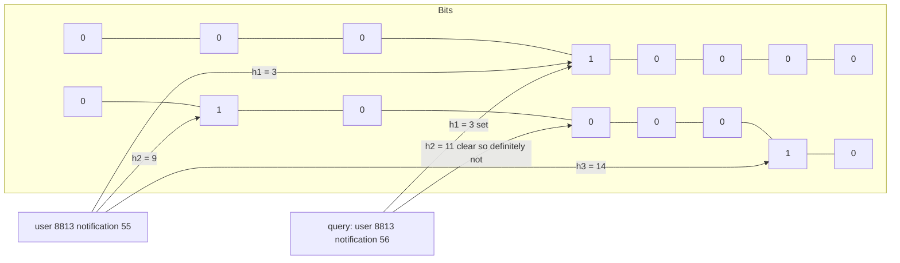

## 10.16 Bloom Filter

#### Concept

A Bloom filter is a set that can be wrong in exactly one direction. Ask it "is X in the set?" and it answers either **"definitely not"** or **"probably yes"**. It never says "no" for something you added (no false negatives), but it sometimes says "yes" for something you never added (false positives), at a rate you choose when you size it. In exchange it uses about 10 bits per item at a 1 percent false-positive rate, compared with 60 to 100 bytes per item for a `Set` of strings: fifty to eighty times smaller.

You cannot list the members, you cannot count them exactly, and the basic version cannot delete. What you get is a membership test for tens of millions of items in a few megabytes, which is exactly what several backend problems need.

#### Why does it exist?

Two problems drove its adoption. First, **cache penetration**: a request for a key that does not exist misses the cache, misses the database, and misses again on the next request, because there is nothing to cache. Bots probing random product ids, or a scraper enumerating `/users/{n}`, turn your database into the cache. A Bloom filter of all existing ids answers "definitely not" in 100 nanoseconds without touching Redis or PostgreSQL. Second, **"have we already shown or processed this?"** at scales where a real set is too large: which of 50 million users have seen a notification, which of 2 billion URLs a crawler has visited, which keys are *not* in an SSTable so the storage engine can skip reading it (RocksDB, Cassandra, LevelDB all do this).

#### Mental model

Imagine a hotel guest book that only records checkmarks, not names. Every guest, on arrival, puts a checkmark in seven boxes chosen by a fixed rule from their name. Later you ask "has Ana ever stayed here?" You compute Ana's seven boxes. If any box is empty, Ana was definitely never here. If all seven are checked, Ana probably stayed, but the checks might have come from other guests whose boxes overlap. The more guests, the more overlap, the more "probably" answers are wrong; a bigger book with more boxes keeps the overlap rare.

#### How it works

1. **Bit array.** Allocate m bits, all zero (a `Uint8Array` of m / 8 bytes).
2. **k hash functions.** Each maps an item to a position in `[0, m)`. In practice you compute two independent 32-bit hashes h1 and h2 and derive the k positions as `(h1 + i * h2) mod m` for i in `0..k-1` (double hashing), which is as good as k real hash functions and much cheaper.
3. **Add.** Compute the k positions and set those bits to 1.
4. **Query.** Compute the k positions; if any bit is 0, answer "no"; if all are 1, answer "probably".
5. **The math.** With n items inserted, the false-positive probability is approximately `(1 - e^(-kn/m))^k`. For a target rate p, the optimal size is `m = -n ln(p) / (ln 2)^2` bits and the optimal number of hashes is `k = (m / n) ln 2`. For n = 10 million and p = 1 percent: m is about 95.9 million bits (12 MB), k = 7. Rules of thumb: 9.6 bits per item for 1 percent, 14.4 for 0.1 percent, 19.2 for 0.01 percent.
6. **Capacity.** The rate is a promise only up to the n you sized for. Insert twice as many items and the rate rises steeply (from 1 percent to about 6 percent for the numbers above). Size for the maximum, or use a *scalable* Bloom filter that adds a new, larger filter when the current one fills.
7. **Deletion.** Clearing a bit could remove another item's evidence, so plain filters cannot delete. A **counting Bloom filter** keeps a small counter per position instead of a bit (4 to 8 times the memory); a **cuckoo filter** supports deletion at similar memory to a Bloom filter. Or you rebuild periodically from the source of truth, which is usually the simplest.
8. **Sharing.** Because the filter is just bits, it can be serialized and shipped to every pod, stored in Redis as a string with `SETBIT`/`GETBIT`, or kept server-side in Redis with the RedisBloom module (`BF.RESERVE`, `BF.ADD`, `BF.EXISTS`, `BF.MEXISTS`). The hash implementation and seed must be identical everywhere that reads the same bits; version the filter format.



**Time complexity (k hash functions, m bits)**

| Operation | Best | Average | Worst | Notes |
|---|---|---|---|---|
| `add` | O(k) | O(k) | O(k) | k is 7 for 1 percent; a few hundred nanoseconds |
| `mightContain` | O(1) | O(k) | O(k) | best case: the first probed bit is 0 |
| Union of two same-size filters | O(m / 64) | O(m / 64) | O(m / 64) | bitwise OR; lets pods merge their filters |
| Serialize / deserialize | O(m / 8) | O(m / 8) | O(m / 8) | 12 MB for 10 million items at 1 percent |
| Delete | not supported | | | counting or cuckoo variants, or rebuild |
| Exact count / enumerate | not supported | | | keep the source of truth elsewhere |

**Memory implications (V8, Node.js)**

- The bit array is a `Uint8Array`, allocated once, off the V8-managed heap (`arrayBuffers` in `process.memoryUsage()`): no GC pressure, no per-item objects.
- 10 million product ids: about 12 MB as a Bloom filter at 1 percent, about 1.1 GB as a `Set<string>` of UUIDs, about 900 MB as a Redis `SET`.
- Building a filter of 10 million ids takes 3 to 6 seconds of CPU (hashing dominates); do it before the pod reports ready, and consider shipping a prebuilt filter from an object store instead of rebuilding on every pod.

**Decision table: membership at scale**

| Need | Structure | Memory for 10M items | Wrong answers |
|---|---|---|---|
| Exact membership in one process, small | `Set` | about 1 GB (UUID strings) | none |
| Exact membership shared across pods | Redis `SET` or a unique index | about 900 MB in Redis | none |
| Membership with tolerable false positives, huge | Bloom filter | 12 MB at 1 percent | false "yes" only |
| Membership with deletes, huge | cuckoo filter or counting Bloom | 15 to 50 MB | false "yes" only |
| Count of distinct items only | HyperLogLog (`PFADD`, `PFCOUNT`) | 12 KB | about 0.8 percent count error |

#### Practical example

A Bloom filter with double hashing over FNV-1a, sized from capacity and target rate, with export and import so pods can share it.

```ts
// common/bloom-filter.ts
function fnv1a32(str: string, seed: number): number {
  let h = (0x811c9dc5 ^ seed) >>> 0;
  for (let i = 0; i < str.length; i++) {
    h ^= str.charCodeAt(i);
    h = Math.imul(h, 0x01000193) >>> 0;   // FNV prime, kept in 32 bits
  }
  h ^= h >>> 16; h = Math.imul(h, 0x85ebca6b) >>> 0;  // final avalanche mixing
  h ^= h >>> 13; h = Math.imul(h, 0xc2b2ae35) >>> 0;
  return (h ^ (h >>> 16)) >>> 0;
}

export class BloomFilter {
  static readonly FORMAT_VERSION = 1;              // bump when the hash or layout changes
  private readonly bits: Uint8Array;

  private constructor(readonly m: number, readonly k: number, bits?: Uint8Array) {
    this.bits = bits ?? new Uint8Array(Math.ceil(m / 8));
  }

  /** Size for `capacity` items at `falsePositiveRate` (e.g. 0.01). */
  static forCapacity(capacity: number, falsePositiveRate: number): BloomFilter {
    const m = Math.ceil((-capacity * Math.log(falsePositiveRate)) / (Math.LN2 * Math.LN2));
    const k = Math.max(1, Math.round((m / capacity) * Math.LN2));
    return new BloomFilter(m, k);
  }

  add(item: string): void {
    const h1 = fnv1a32(item, 0x9747b28c), h2 = fnv1a32(item, 0x5bd1e995) | 1; // h2 odd: better spread
    for (let i = 0; i < this.k; i++) {
      const pos = (h1 + i * h2) % this.m;
      this.bits[pos >>> 3] |= 1 << (pos & 7);
    }
  }

  mightContain(item: string): boolean {
    const h1 = fnv1a32(item, 0x9747b28c), h2 = fnv1a32(item, 0x5bd1e995) | 1;
    for (let i = 0; i < this.k; i++) {
      const pos = (h1 + i * h2) % this.m;
      if ((this.bits[pos >>> 3] & (1 << (pos & 7))) === 0) return false; // definitely not
    }
    return true;                                                            // probably
  }

  /** Header (version, m, k) + bits, for Redis, S3 or a file. */
  export(): Buffer {
    const header = Buffer.alloc(12);
    header.writeUInt32BE(BloomFilter.FORMAT_VERSION, 0);
    header.writeUInt32BE(this.m, 4);
    header.writeUInt32BE(this.k, 8);
    return Buffer.concat([header, Buffer.from(this.bits.buffer, this.bits.byteOffset, this.bits.byteLength)]);
  }

  static import(buf: Buffer): BloomFilter {
    if (buf.readUInt32BE(0) !== BloomFilter.FORMAT_VERSION) throw new Error('bloom filter format mismatch');
    const m = buf.readUInt32BE(4), k = buf.readUInt32BE(8);
    return new BloomFilter(m, k, new Uint8Array(buf.subarray(12)));
  }
}
```

FNV-1a with mixing is adequate for ids and short keys; for adversarial input or very long keys, prefer a proper 64-bit hash (an xxHash or MurmurHash3 binding) and split it into h1 and h2.

#### NestJS example

Cache-penetration protection for product lookups, plus a cluster-wide "seen this notification" check with RedisBloom. The filter is rebuilt every 10 minutes from PostgreSQL; ids created after the last build are allowed through by an id watermark so a stale filter cannot produce false "not found" answers.

```ts
// products/product-existence.service.ts
import { Injectable, Logger, OnModuleInit } from '@nestjs/common';
import { Cron } from '@nestjs/schedule';
import { DataSource } from 'typeorm';
import { BloomFilter } from '../common/bloom-filter';

@Injectable()
export class ProductExistenceService implements OnModuleInit {
  private readonly logger = new Logger(ProductExistenceService.name);
  private filter = BloomFilter.forCapacity(1, 0.01);
  private watermark = 0n;      // highest product id included in the filter

  constructor(private readonly dataSource: DataSource) {}

  async onModuleInit(): Promise<void> {
    await this.rebuild();
  }

  @Cron('30 */10 * * * *')
  async rebuild(): Promise<void> {
    const [{ count, max }] = await this.dataSource.query(`SELECT count(*)::int AS count, max(id)::text AS max FROM products`);
    const fresh = BloomFilter.forCapacity(Math.max(count * 1.5, 1_000_000), 0.01); // headroom for growth
    const rows: { id: string }[] = await this.dataSource.query(`SELECT id::text FROM products`);
    for (const r of rows) fresh.add(r.id);
    this.filter = fresh;                          // atomic swap
    this.watermark = BigInt(max ?? '0');
    this.logger.log(`rebuilt product filter: ${rows.length} ids, ${(fresh.m / 8 / 1024 / 1024).toFixed(1)} MB`);
  }

  /** Called by insert hooks on this pod; other pods rely on the watermark until their next rebuild. */
  addLocal(id: string): void {
    this.filter.add(id);
  }

  /** false means "definitely does not exist": safe to answer 404 without any I/O. */
  mightExist(id: string): boolean {
    if (!/^\d{1,18}$/.test(id)) return false;    // malformed ids are rejected before hashing
    if (BigInt(id) > this.watermark) return true; // created after the last build: let it through
    return this.filter.mightContain(id);
  }
}

// products/product-read.service.ts (excerpt)
async byId(id: string): Promise<Product> {
  if (!this.existence.mightExist(id)) throw new NotFoundException(`product ${id} not found`); // ~200 ns
  // ... Redis cache, single-flight, PostgreSQL as in Section 1.8
}

// notifications/seen.service.ts -- shared across pods with the RedisBloom module
@Injectable()
export class SeenNotificationsService {
  constructor(private readonly redis: Redis) {}

  async markSeen(userId: string, notificationId: string): Promise<void> {
    await this.redis.call('BF.ADD', 'notif:seen', `${userId}:${notificationId}`);
  }

  async probablySeen(userId: string, notificationId: string): Promise<boolean> {
    return (await this.redis.call('BF.EXISTS', 'notif:seen', `${userId}:${notificationId}`)) === 1;
  }
}
```

Create the Redis filter once with `BF.RESERVE notif:seen 0.01 100000000` (1 percent, 100 million capacity, about 120 MB); RedisBloom filters can also be created as scalable so they grow instead of degrading.

#### PostgreSQL example

PostgreSQL ships a `bloom` index type: a signature per row across several columns, useful when queries filter by equality on arbitrary subsets of columns and one B-tree per combination would be too many. It is lossy, so the plan always shows a recheck.

```sql
CREATE EXTENSION IF NOT EXISTS bloom;

-- One small index instead of a B-tree per column combination.
CREATE INDEX orders_bloom_idx ON orders
USING bloom (merchant_id, status, channel, country, payment_method)
WITH (length = 80, col1 = 4, col2 = 2, col3 = 2, col4 = 2, col5 = 2);

EXPLAIN (ANALYZE, BUFFERS)
SELECT id FROM orders WHERE status = 'refunded' AND channel = 'app' AND country = 'IN';
```

```text
Bitmap Heap Scan on orders  (cost=13210.00..14392.10 rows=402 width=8) (actual time=88.4..91.2 rows=388 loops=1)
  Recheck Cond: ((status = 'refunded') AND (channel = 'app') AND (country = 'IN'))
  Rows Removed by Index Recheck: 1417
  Heap Blocks: exact=1620
  Buffers: shared hit=9832
  ->  Bitmap Index Scan on orders_bloom_idx  (cost=0.00..13209.90 rows=1805 width=0) (actual time=86.9..86.9 rows=1805 loops=1)
        Index Cond: ((status = 'refunded') AND (channel = 'app') AND (country = 'IN'))
Execution Time: 91.6 ms
```

`Rows Removed by Index Recheck: 1417` are the false positives: the index said "probably" for 1,805 rows and the heap check kept 388. The index scan itself reads every signature (it is not a tree), so this is a win over a sequential scan only when the table is wide and the index is much smaller than the table. PostgreSQL 14 also added a BRIN `bloom` operator class (`int8_bloom_ops`) for the same idea inside block-range indexes.

#### TypeORM example

Keep the filter warm as rows are created, so the watermark rarely has to do the work.

```ts
// products/product.subscriber.ts
import { EntitySubscriberInterface, EventSubscriber, InsertEvent } from 'typeorm';
import { Product } from './product.entity';
import { ProductExistenceService } from './product-existence.service';

@EventSubscriber()
export class ProductSubscriber implements EntitySubscriberInterface<Product> {
  constructor(private readonly existence: ProductExistenceService) {}

  listenTo() { return Product; }

  afterInsert(event: InsertEvent<Product>): void {
    this.existence.addLocal(event.entity.id);   // this pod only; other pods rely on the watermark until rebuild
  }
}
```

Register the subscriber as a provider and in the `TypeOrmModule.forRoot({ subscribers: [...] })` options; TypeORM subscribers are constructed by the DI container when listed as providers in NestJS.

#### Sequelize example

```ts
Product.addHook('afterCreate', (product: Product) => {
  existenceService.addLocal(String(product.id));
});
```

Hooks run in the process that performed the insert; cross-pod freshness still comes from the watermark or a pub/sub message.

#### Production scenario

A catalog API with 9 million products receives 800 RPS of lookups, of which a scraper contributes 300 RPS of random, non-existent ids. Without the filter each of those 300 misses the Redis cache and runs a primary-key lookup in PostgreSQL: 300 useless queries per second, about 15 percent of the database's capacity, and Redis holds nothing for them. With a 1 percent filter, 297 of those 300 are answered with a 404 in 200 nanoseconds and 3 fall through as false positives. The filter costs 11 MB per pod and 4 seconds of CPU at startup.

The second use is notification de-duplication across a 50-million-user base: 200 campaigns a month means 10 billion (user, campaign) pairs a year. A Redis `SET` per campaign is 50 million members at about 90 bytes each: 4.5 GB per campaign. A RedisBloom filter per campaign is 60 MB at 1 percent, and a false positive means one user does not receive one marketing push, which the business signs off on in writing.

#### Failure scenario

At 02:14 the on-call engineer is paged by support: newly published products return 404 on three of twelve pods. Those pods had lost their Redis pub/sub connection during a Redis failover at 23:40 and missed the `product.created` messages that other pods used to add ids to their filters; the nightly rebuild was at 04:00. The filter itself was not wrong: it had never been told about the new ids. A Bloom filter has no false negatives *for what was added to it*; staleness is a false negative from the system's point of view.

The immediate mitigation was a rolling restart of the three pods. The durable fix was the watermark: any id greater than the highest id at the last build bypasses the filter. Time-ordered ids (bigint sequences, ULIDs) make this a one-line check. The other lesson: **a probabilistic structure must be wrong only in the safe direction.** Here the safe direction is "let a real product through to the database"; the filter must never be allowed to say "no" for something that might exist.

#### Edge cases & failure modes

- **Under-sizing.** Insert past capacity and the false-positive rate climbs; size with headroom and monitor the insert count.
- **Staleness** produces false negatives for items added after the build; use watermarks, events with a fallback, or short rebuild intervals.
- **Hash mismatch across pods** when sharing bits: same hash, seed, m and k, enforced with a version header.
- **No deletion.** Deleted products stay "probably present" until a rebuild, which costs one database miss per hit; harmless if the rebuild is frequent.
- **Adversarial keys.** With a weak hash an attacker can craft ids that are false positives, defeating the protection; use a strong hash for untrusted input.
- **Startup time.** Building from 10 million rows delays readiness; ship a prebuilt filter from object storage and rebuild in the background.
- **Wrong direction.** Never use "probably yes" to *grant* something (access, a discount) or "definitely no" to *skip* a safety check that must not be skipped.
- **Redis eviction.** A filter stored in Redis under `allkeys-lru` can be evicted like any key; keep it in a `noeviction` instance or rebuildable from the source.

#### How a Senior Backend Engineer thinks about this

The senior asks two questions before using any probabilistic structure: **what does a wrong answer cost, and in which direction can it be wrong?** A false positive in cache-penetration protection costs one database lookup; a false positive in notification de-duplication costs one missed message; both are acceptable and documented. A false negative would cost a 404 for a real product, which is unacceptable, so the design guarantees the filter can never produce one. They size for growth, version the format, rebuild from the source of truth on a schedule, and keep the source of truth exact (PostgreSQL, a unique index). They reach for RedisBloom when pods must share, and for HyperLogLog when the question is "how many", not "which".

To a product manager: "We can stop bots from hammering the database for products that do not exist, using about 11 MB of memory. About one in a hundred of those bogus requests will still reach the database; real products are never affected."

#### Common mistakes

- Using a Bloom filter where an exact answer is required.
- Sizing for today's row count with no headroom.
- Forgetting that a filter built at 04:00 knows nothing about rows created at 09:00.
- Storing the filter in Redis with `SETBIT` and issuing k round trips per check instead of one `BF.EXISTS` or a pipelined `BITFIELD`.
- Hashing untrusted input with a trivial hash and calling the result "protection".

#### Interview questions

1. **What can a Bloom filter never do, and what does it do well?** Expected: no false negatives (for added items), no deletion, no enumeration; tiny memory for membership with tunable false positives.
2. **Size a filter for 20 million ids at 0.1 percent.** Expected: about 14.4 bits per item, 288 million bits, 36 MB, k of about 10.
3. **Explain cache penetration and two defences.** Expected: misses for non-existent keys bypass caches; Bloom filter of existing keys, and negative caching of 404s with a short TTL.
4. **New rows return 404 after you added a Bloom filter. Why, and how do you fix it without disabling the filter?** Expected: staleness; watermark on time-ordered ids, or event-driven adds with a periodic rebuild.
5. **When would you pick a cuckoo filter, a counting Bloom filter or HyperLogLog instead?** Expected: deletion, deletion with simpler semantics at more memory, distinct counting.
6. **Where do Bloom filters appear inside databases?** Expected: LSM engines skip SSTables, PostgreSQL `bloom` index and BRIN bloom opclass, Cassandra and RocksDB.

#### Practical exercise

Build `ExistenceFilterModule` for a seeded `products` table of 5 million rows. Acceptance criteria: a load test with 90 percent random non-existent ids shows PostgreSQL query rate under 2 percent of request rate (measure with `pg_stat_statements` before and after); the measured false-positive rate over 1 million random probes is between 0.5 and 1.5 percent; a product inserted after the last rebuild is retrievable immediately on every pod (integration test with two application instances and the watermark); the filter is exported to Redis after each rebuild and a fresh pod imports it in under 500 ms instead of rebuilding; and a test proves `mightExist` returns `false` for malformed ids without hashing them.
