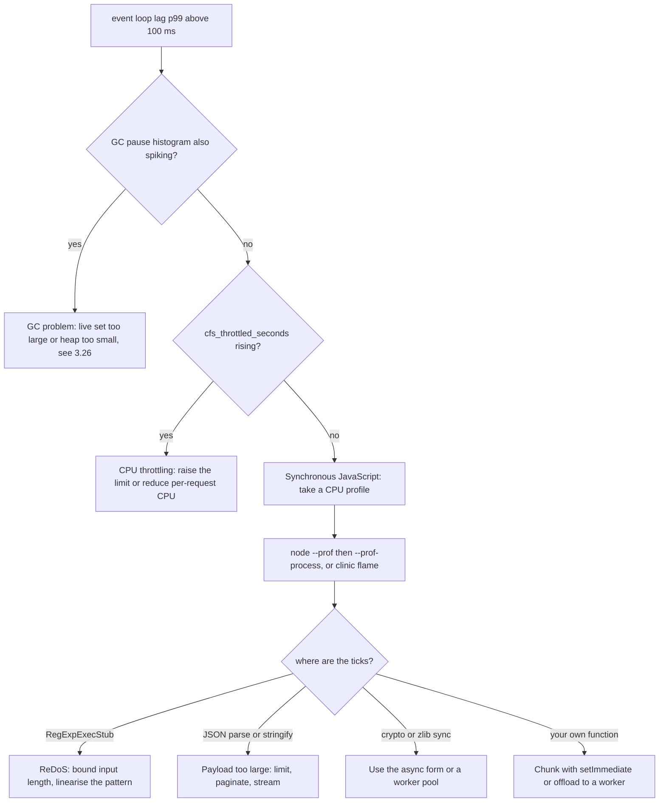
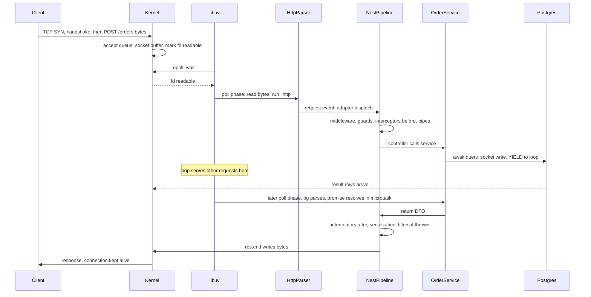

## 10.27 Blocking the event loop

#### Concept

**Blocking the event loop** means running synchronous JavaScript for long enough that the loop cannot reach its poll phase (10.16). While that code runs, nothing else in the process happens: no request is accepted, no database response is read, no timer fires, no health check is answered, no `SIGTERM` handler runs.

The unit of damage is not "the endpoint is slow". It is "**every** endpoint is slow", including the ones that do nothing. A 400 ms synchronous operation on a server handling 500 requests per second delays roughly 200 in-flight requests by up to 400 ms each. One customer's expensive request becomes two hundred customers' bad experience.

**Event loop lag** (or delay) is how you measure it: the difference between when a timer *should* have fired and when it actually did. Healthy is 0 to 5 ms. Over 50 ms, users notice. Over 1,000 ms, health checks fail and Kubernetes restarts you.

#### Why does it matter?

Because Node's entire performance model rests on one assumption — that no callback runs long. Break that assumption and every advantage disappears at once. A thread-per-request server degrades gracefully under one slow request; Node does not degrade, it stalls.

It also matters because the symptoms mislead. Blocked-loop incidents present as "the database is slow" (client-side timers fire late), "the network is flaky" (health checks time out), or "we need more pods" (CPU is high on one core). Teams routinely spend hours on the wrong system.

#### Mental model

Imagine a single cashier at a supermarket. Ninety-nine customers have three items each. One customer has a trolley of 400 loose items, all needing individual price checks. The cashier is not lazy and the queue is not long — but for four minutes the queue does not move at all. Everyone in it, including the person with a single bottle of water, waits four minutes.

You cannot fix this by hiring a faster cashier. You fix it by not letting a 400-item price check happen at the till: do it in the back office (a worker thread), do it in batches with the queue moving in between (chunking), or refuse to accept the trolley (input limits).

#### The four real causes

**1. `JSON.parse` / `JSON.stringify` of multi-megabyte payloads.**

Both are fully synchronous C++ inside V8. There is no async version and no yield point. Rough costs on a modern core:

| Payload | `JSON.parse` | `JSON.stringify` |
|---|---|---|
| 100 KB | ~1 ms | ~1 ms |
| 1 MB | ~8 ms | ~10 ms |
| 10 MB | ~90 ms | ~120 ms |
| 50 MB | ~500 ms | ~700 ms |
| 100 MB | ~1.1 s | ~1.6 s |

It is not only your own code. `body-parser` calls `JSON.parse` on every request body, the `pg` driver parses `jsonb` columns, your logger stringifies objects, and `axios` parses every response. A single endpoint that returns a 30 MB report blocks the loop for a third of a second per call.

Mitigations, in order: **limit the input** (`app.use(json({ limit: '1mb' }))` — an explicit, enforced maximum), **paginate** so responses are never multi-megabyte, **stream** with a streaming serializer or NDJSON (10.23), and only then consider moving the parse to a worker (10.20), remembering that structured-cloning the result costs almost as much as parsing it.

**2. Synchronous crypto.**

```ts
// Every one of these blocks the loop for its full duration.
crypto.pbkdf2Sync(password, salt, 600_000, 64, 'sha512');   // ~700 ms
crypto.scryptSync(password, salt, 64);                       // ~120 ms
bcrypt.hashSync(password, 12);                               // ~250 ms
crypto.randomBytes(1_000_000);                               // sync form: ~10 ms
zlib.gzipSync(bigBuffer);                                    // ~40 ms per MB
fs.readFileSync('/etc/config.json');                         // 0.1 to 50 ms, unbounded on network FS
```

The async forms of all of these run on the libuv pool (10.18) and do not block the loop. Using the sync form is strictly worse in a server: it converts a pool problem into a whole-process problem. The one legitimate place for sync calls is **startup**, before the server starts listening, where blocking costs nothing.

**3. Catastrophic regex backtracking (ReDoS).**

A regular expression engine that uses backtracking can take exponential time on certain inputs. The vulnerable shape is **nested quantifiers over overlapping character classes**: `(a+)+`, `(\s*\w+)*`, `(\d+,?)+`.

Here is a concrete vulnerable validator of exactly the sort that ends up in a DTO:

```ts
// VULNERABLE: a "reasonable-looking" email validator used in a class-validator DTO.
// The (\.[a-zA-Z0-9-]+)* group over an overlapping class is the catastrophic part.
const EMAIL = /^([a-zA-Z0-9_.+-]+)@([a-zA-Z0-9-]+)(\.[a-zA-Z0-9-]+)*$/;

// Benign input: microseconds.
EMAIL.test('customer@example.com');                              // ~0.002 ms

// Malicious input: 40 characters, no '@' terminator match, forces exhaustive backtracking.
EMAIL.test('a@' + 'a-a-a-a-a-a-a-a-a-a-a-a-a-a-a-a-a-a-a-'.repeat(2) + '!');
// n=20  ->     4 ms
// n=25  ->   140 ms
// n=30  ->  4,600 ms      <- one request, one core, 4.6 seconds, whole process frozen
// n=35  -> ~150,000 ms
```

Twelve requests per minute with a 60-character payload take the pod permanently offline. There is no CPU spike to autoscale on that helps, because the work is unbounded.

The fixes:

```ts
// 1. Use the vetted validator, which is not backtracking-vulnerable.
import { IsEmail, MaxLength, IsString } from 'class-validator';

export class CreateCustomerDto {
  @IsString()
  @MaxLength(254)              // ALWAYS bound the length before any regex runs
  @IsEmail({}, { message: 'email must be a valid address' })
  email!: string;
}

// 2. If you must write a regex, make it linear: no nested quantifiers over overlapping classes.
const SAFE_SLUG = /^[a-z0-9]+(?:-[a-z0-9]+){0,20}$/;    // bounded repetition, disjoint classes

// 3. Scan for vulnerable patterns in CI.
//    npx eslint --rule '{"security/detect-unsafe-regex":"error"}' src
//    or use the `safe-regex` / `recheck` tooling in a pre-commit hook.
```

The three rules that prevent virtually all ReDoS: **bound input length before matching**, **never nest quantifiers over overlapping character classes**, and **never build a regex from user input** (`new RegExp(req.query.search)` is both ReDoS and a logic bug).

**4. Large synchronous loops.**

```ts
// 5,000,000 iterations with an allocation each: ~1.2 s of blocked loop.
const enriched = orders.map(o => ({ ...o, total: o.lines.reduce((s, l) => s + l.price * l.qty, 0) }));

// Worse: O(n^2) hiding in an innocuous-looking join.
const withCustomer = orders.map(o => ({ ...o, customer: customers.find(c => c.id === o.customerId) }));
// 100,000 orders x 50,000 customers = 5,000,000,000 comparisons. This is not slow, it is a hang.
```

The `find`-inside-`map` pattern is the most common accidental hang in backend JavaScript. The fix is a `Map` lookup, which turns O(n·m) into O(n+m):

```ts
const byId = new Map(customers.map(c => [c.id, c]));            // O(m)
const withCustomer = orders.map(o => ({ ...o, customer: byId.get(o.customerId) }));   // O(n)
```

And when the work is genuinely large, chunk it with an I/O yield so the queue keeps moving (10.16):

```ts
import { setImmediate as yieldToLoop } from 'node:timers/promises';

for (let i = 0; i < rows.length; i += 500) {
  processChunk(rows.slice(i, i + 500));      // ~4 ms of CPU
  await yieldToLoop();                        // every pending request is served here
}
```

#### Diagnosing high lag

High lag does not always mean blocking code. Three different problems produce the same graph, and this is the order to rule them out:



#### Measuring it with `monitorEventLoopDelay`

`perf_hooks.monitorEventLoopDelay` uses a high-resolution histogram maintained in C++, sampling at a fixed interval. It is far more accurate and far cheaper than the naive `setInterval` + `Date.now()` approach, and it captures the *distribution*, not just an instantaneous value.

```ts
// runtime/event-loop-monitor.service.ts
import { Injectable, OnModuleInit, OnModuleDestroy } from '@nestjs/common';
import { monitorEventLoopDelay, performance, IntervalHistogram, EventLoopUtilization } from 'node:perf_hooks';
import { Interval } from '@nestjs/schedule';
import { Gauge } from 'prom-client';

@Injectable()
export class EventLoopMonitorService implements OnModuleInit, OnModuleDestroy {
  private histogram!: IntervalHistogram;
  private lastElu: EventLoopUtilization = performance.eventLoopUtilization();

  private readonly lagP50 = new Gauge({ name: 'nodejs_eventloop_lag_p50_seconds', help: 'median event loop delay' });
  private readonly lagP99 = new Gauge({ name: 'nodejs_eventloop_lag_p99_seconds', help: 'p99 event loop delay' });
  private readonly lagMax = new Gauge({ name: 'nodejs_eventloop_lag_max_seconds', help: 'max event loop delay in window' });
  private readonly elu = new Gauge({ name: 'nodejs_eventloop_utilization', help: 'fraction of time the loop was busy' });

  onModuleInit(): void {
    // resolution: sample every 10 ms. Lower resolution costs more CPU; 10 ms is a good default.
    this.histogram = monitorEventLoopDelay({ resolution: 10 });
    this.histogram.enable();
  }

  @Interval(10_000)
  publish(): void {
    // Values are in nanoseconds. Prometheus convention is seconds.
    this.lagP50.set(this.histogram.percentile(50) / 1e9);
    this.lagP99.set(this.histogram.percentile(99) / 1e9);
    this.lagMax.set(this.histogram.max / 1e9);
    this.histogram.reset();                       // window semantics: reset after each scrape interval

    const now = performance.eventLoopUtilization();
    this.elu.set(performance.eventLoopUtilization(now, this.lastElu).utilization);
    this.lastElu = now;
  }

  currentLagMs(): number { return this.histogram.percentile(99) / 1e6; }

  onModuleDestroy(): void { this.histogram?.disable(); }
}
```

Two metrics, two meanings, and you want both:

- **Lag** answers *"how long would a new event wait?"* — it is the latency symptom.
- **Event loop utilisation (ELU)** answers *"what fraction of wall time was the loop busy?"* — it is the saturation cause, and it is the right autoscaling signal (target roughly 0.6).

A pod can have low lag and high ELU (busy but with short callbacks: healthy, near capacity) or low ELU and high lag (idle but with occasional huge callbacks: a blocking bug). Only having both lets you tell those apart.

Useful alerts:

```yaml
# prometheus rules
- alert: EventLoopLagHigh
  expr: nodejs_eventloop_lag_p99_seconds > 0.1
  for: 5m
  annotations: { summary: "p99 event loop lag over 100 ms - synchronous work on the main thread" }
- alert: EventLoopSaturated
  expr: nodejs_eventloop_utilization > 0.85
  for: 10m
  annotations: { summary: "loop busy 85% of the time - add replicas or reduce per-request CPU" }
```

#### NestJS health indicator

A liveness probe that only checks "can I answer HTTP" is nearly useless: if the loop is blocked, the probe cannot be answered at all and times out, which at least works by accident. A **readiness** probe that reports lag is much better, because it removes a struggling pod from the load balancer before it fails outright.

```ts
// health/event-loop.health.ts
import { Injectable } from '@nestjs/common';
import { HealthIndicator, HealthIndicatorResult, HealthCheckError } from '@nestjs/terminus';
import { EventLoopMonitorService } from '../runtime/event-loop-monitor.service';

@Injectable()
export class EventLoopHealthIndicator extends HealthIndicator {
  constructor(private readonly monitor: EventLoopMonitorService) { super(); }

  async isHealthy(key = 'event_loop', thresholdMs = 250): Promise<HealthIndicatorResult> {
    const lagMs = this.monitor.currentLagMs();
    const healthy = lagMs < thresholdMs;
    const result = this.getStatus(key, healthy, { p99LagMs: Number(lagMs.toFixed(1)), thresholdMs });
    if (!healthy) throw new HealthCheckError('event loop lag above threshold', result);
    return result;
  }
}
```

```ts
// health/health.controller.ts
import { Controller, Get } from '@nestjs/common';
import { HealthCheck, HealthCheckService, TypeOrmHealthIndicator, MemoryHealthIndicator } from '@nestjs/terminus';
import { EventLoopHealthIndicator } from './event-loop.health';

@Controller('health')
export class HealthController {
  constructor(
    private readonly health: HealthCheckService,
    private readonly db: TypeOrmHealthIndicator,
    private readonly memory: MemoryHealthIndicator,
    private readonly loop: EventLoopHealthIndicator,
  ) {}

  // Liveness: is the process fundamentally broken? Keep it cheap and dependency-free,
  // or a database blip will restart every pod at once.
  @Get('live')
  @HealthCheck()
  live() { return this.health.check([() => this.memory.checkHeap('heap', 900 * 1024 * 1024)]); }

  // Readiness: should we receive traffic right now? This one may check dependencies.
  @Get('ready')
  @HealthCheck()
  ready() {
    return this.health.check([
      () => this.db.pingCheck('database', { timeout: 1_000 }),
      () => this.loop.isHealthy('event_loop', 250),
    ]);
  }
}
```

The threshold choice matters. Set readiness lag too low (50 ms) and normal GC pauses flap pods in and out of the load balancer. Set it too high (2 s) and it never fires. 200 to 300 ms is a reasonable starting point for an API, tuned against your observed p99 lag under healthy load.

#### Production scenario

A pricing service handling 800 requests per second per pod introduced a "compare with competitors" endpoint that parses a 6 MB competitor feed on each call. The endpoint was called 5 times per minute — negligible traffic — but each call blocked the loop for about 70 ms.

Five blocks per minute at 800 requests per second means roughly 56 requests delayed by up to 70 ms each, five times a minute. That is 280 affected requests per minute out of 48,000, or 0.58% — precisely the p99.5 band. The service's p99 rose from 40 ms to 105 ms and nobody could explain it, because the new endpoint's own latency (70 ms) looked perfectly reasonable in its own dashboard row.

Loop-lag monitoring made it obvious in one graph: lag spikes of 70 ms exactly five times a minute, correlated with the endpoint's request count. The fix was to parse the feed once every 10 minutes in a scheduled job and cache the result, dropping the loop impact by 99%.

#### Failure scenario

At 11:47 an ecommerce checkout service went from healthy to fully unresponsive in under a minute. All 8 pods failed liveness probes and entered `CrashLoopBackOff`. Every restarted pod died again within 90 seconds. Revenue stopped.

The cause was a coupon-code validator with a backtracking regex, deployed three days earlier:

```ts
const COUPON = /^([A-Z0-9]+-)+[A-Z0-9]+$/;    // nested quantifier over an overlapping class
```

A bot probing for vulnerabilities submitted `AAAAAAAAAAAAAAAAAAAAAAAAAAAAAA!` (30 A's and a non-matching terminator). Each such request pinned a core for about 8 seconds. The bot sent 40 per minute across all pods. Every pod was permanently inside a regex match; liveness probes timed out; Kubernetes restarted them; the bot's traffic continued to be routed to the fresh pods; the loop repeated.

Timeline: 11:47 first pod unhealthy; 11:49 all pods crash-looping; 11:52 on-call paged; 12:04 loop-lag dashboard showed lag pinned at tens of seconds with near-zero throughput, which ruled out the database; 12:11 CPU profile from a locally reproduced pod (`node --prof` plus `--prof-process`) showed 99% of ticks in `RegExpExecStub`; 12:15 the coupon endpoint blocked at the WAF; 12:17 service restored; 12:40 fix deployed with `@MaxLength(32)` and a linear regex.

Three lessons recorded: **length-bound every string before it meets a regex**, **a CPU profile identifies a blocked loop in about ninety seconds** and should have been step one, and **`security/detect-unsafe-regex` in CI** would have caught this in the pull request.

#### Edge cases & failure modes

- Loop lag hides in *someone else's* code: a logging library stringifying a huge object, an ORM hydrating 100,000 entities, a template engine, a validation library, a tracing exporter serializing spans.
- `JSON.parse` on a request body happens in body-parser before your code runs, so a payload limit is the only defence.
- GC pauses appear as event loop lag and are indistinguishable from blocking without GC metrics (10.26). Always look at both.
- CPU throttling in Kubernetes appears as loop lag too: the loop is ready to run but has no quota. Check `container_cpu_cfs_throttled_seconds_total` before blaming code.
- `Array.prototype.sort` on a million elements is 300 to 800 ms of blocking. So is `JSON.stringify` of the same array.
- A synchronous loop cannot be interrupted. There is no timeout, no cancellation, no signal handling — `SIGTERM` waits until the loop returns.
- A blocked loop makes client-side query timeouts (`pg`'s `query_timeout`) fire late, so the database looks slow when it is not (10.16).
- Chunking with `await setImmediate()` fixes latency but not throughput; if the total CPU exceeds the core, you still need workers or more pods.
- Startup blocking is fine and often desirable (config, migrations, warm-up) as long as it happens before `listen()` and readiness reports false until it is done.
- `monitorEventLoopDelay` measures the loop only; work on the libuv pool or in worker threads does not appear there.
- A single very slow regex can be triggered by a legitimate user with unusual data, not just an attacker.

#### How a Senior Backend Engineer thinks about this

They hold a CPU budget per request in their head — roughly 1 to 5 ms of JavaScript for a typical API endpoint — and treat anything above 10 ms as needing a design decision. They put loop lag and ELU on the primary dashboard next to latency, because those two metrics explain most "the app is slow but everything looks fine" incidents.

They apply the same three questions to every synchronous operation: *Is its cost bounded by something I control? What is the worst-case input? What happens at 100x today's size?* A regex, a `JSON.parse` and a `for` loop all get the same interrogation.

To a product manager: "We have one worker who handles every customer very quickly. If we ever give that worker a job that takes ten seconds, everyone else in the queue waits ten seconds. So we never let a single job get big."

#### Common mistakes

- Using `*Sync` crypto, `fs` or `zlib` in request handlers.
- No body-size limit, so payload size is attacker-controlled.
- Regexes with nested quantifiers, and no length bound before matching.
- `find` inside `map` over large arrays.
- Alerting on CPU instead of loop lag.
- Liveness probes that check dependencies, so a database blip restarts every pod simultaneously.
- Assuming lag spikes are blocking code when they are GC or CFS throttling.

#### Interview questions

1. *What does "blocking the event loop" mean and who is affected?* Expected: synchronous work prevents the loop reaching poll; every concurrent request in the process is delayed, not just the slow one.
2. *Name four common causes with concrete costs.* Expected: multi-MB `JSON.parse`/`stringify`, sync crypto, ReDoS, big synchronous loops — with rough millisecond figures.
3. *Show me a ReDoS-vulnerable regex and explain the blow-up.* Expected: nested quantifier over overlapping classes; exponential backtracking on a near-match; fix with length bounds and a linear pattern.
4. *How do you measure loop lag, and how does it differ from ELU?* Expected: `monitorEventLoopDelay` histogram in nanoseconds; lag is the latency symptom, ELU is the saturation cause; use ELU to autoscale.
5. *Loop lag is 400 ms. Name three causes that are not your synchronous code.* Expected: GC pauses, CPU throttling by the cgroup quota, a noisy neighbour or a blocked libuv-pool-adjacent operation on the same core.
6. *How would you design a health check around this?* Expected: cheap liveness with no dependencies; readiness including a lag threshold around 250 ms so a struggling pod leaves the load balancer before it dies.
7. *Your service blocks for 300 ms per request doing legitimate CPU work. What are the options?* Expected: reduce the work, chunk with `setImmediate` for latency, offload to a worker pool for isolation, or move it to a background job — and add pods only if total CPU is the real constraint.

#### Practical exercise

Build an endpoint with all four blocking causes behind feature flags: a 10 MB `JSON.parse`, a `pbkdf2Sync`, a ReDoS-vulnerable validator, and a 5-million-iteration loop. Add the loop-lag monitor and the Terminus indicator. Load a trivial `GET /ping` at 200 requests per second and trigger each blocking cause in turn, recording `/ping` p50/p99 and lag p99 for each.

Acceptance criteria: a table of five rows (baseline plus four causes) showing `/ping` p99 tracking loop lag almost exactly; a demonstration that the readiness probe fails and the pod leaves the Service endpoints during a block; and a fixed version of each cause with the measurements repeated to prove the fix.

## 10.28 What happens when a NestJS request enters a Node.js application

#### Concept

This is the section that ties Part 10 together. We will follow a single `POST /orders` request from the moment a packet arrives at the network card to the moment the response bytes leave it, naming the kernel structure, the libuv phase, the Node internal and the NestJS component at every step — and marking each step **CPU-bound** (it runs on your one JavaScript thread and blocks everything) or **I/O-bound** (it yields, and the loop serves other requests).

Nothing here is new. It is 10.1 through 10.27 assembled into one story.

#### Mental model

Imagine a letter arriving at a large office. The postal service delivers it to the building's mailroom (the kernel). A runner notices new mail and carries it upstairs (the poll phase). A clerk opens the envelope and reads the address (the HTTP parser). Reception routes it to the right department (the router). Security checks the sender's badge (guards). A form checker verifies every field (pipes). The specialist does the actual work, and while waiting for a file from the archive (the database) they put the letter down and serve the next person. When the archive delivers, they finish the reply, it is checked, sealed, and handed back to the mailroom.

The letter's total time in the building is mostly *waiting on a desk*, not being worked on. That is the key intuition: in a healthy Node service, a 45 ms request typically contains 3 ms of CPU and 42 ms of waiting.

#### The full trace



**Step 1 — TCP connection accepted. I/O-bound (kernel).**
If this is a new connection, the client's `SYN` reaches the kernel, which completes the three-way handshake entirely in kernel space and places the connection on the **accept queue** (`net.core.somaxconn`, default 4096 on modern Linux). Node has not run a single line of JavaScript. If the queue is full, the kernel drops the `SYN` and the client retries after a full second — the invisible latency source behind "the first request after a deploy takes 1 second". With keep-alive, this step is skipped entirely, which is why keep-alive matters so much (see Part 11 — Networking).

**Step 2 — Request bytes arrive. I/O-bound (kernel).**
The `POST` body (say 2 KB of JSON) arrives as one or two segments. The kernel reassembles them into the socket's receive buffer and marks the descriptor readable, adding it to the epoll ready list (10.19).

**Step 3 — libuv's poll phase notices. I/O-bound then CPU-bound.**
The loop is blocked in `epoll_wait`. It returns with the ready descriptor. libuv calls `read()` into a reusable buffer and invokes the socket's read callback. **Everything from here until the next `await` runs on the one JavaScript thread.**

**Step 4 — HTTP parsing. CPU-bound, ~20 to 80 microseconds.**
`llhttp` (a C parser) consumes the bytes, extracts the method, path, HTTP version and headers, and emits `request` with an `IncomingMessage` and a `ServerResponse`. Header parsing is bounded by `maxHeaderSize` (16 KB default) — an important limit, since unbounded header parsing is a denial-of-service vector.

**Step 5 — Framework adapter dispatch. CPU-bound, ~10 to 100 microseconds.**
Express or Fastify receives the request. Express walks its middleware stack in order, matching paths with `path-to-regexp`. Fastify uses a radix tree router, which is why it is measurably faster at high route counts. NestJS is a layer *above* this: `@nestjs/platform-express` or `@nestjs/platform-fastify` registers one handler per route at bootstrap, so by request time the routing table is already built.

**Step 6 — Body parsing. CPU-bound, proportional to size.**
`body-parser` (Express) or Fastify's content-type parser accumulates the body chunks — this part is I/O-bound and may span several poll-phase callbacks for a large body — and then calls `JSON.parse` synchronously. For 2 KB this is ~30 microseconds; for 10 MB it is ~90 ms of blocked loop (10.27). This is why `json({ limit: '1mb' })` is not optional.

**Step 7 — NestJS middleware. CPU-bound (unless it awaits).**
Middleware configured in `configure(consumer)` runs first: correlation-id assignment, request logging, `helmet`, CORS. Anything that awaits here (a session lookup in Redis) is I/O-bound and yields.

```ts
// common/correlation-id.middleware.ts
import { Injectable, NestMiddleware } from '@nestjs/common';
import { randomUUID } from 'node:crypto';
import { AsyncLocalStorage } from 'node:async_hooks';
import type { Request, Response, NextFunction } from 'express';

export const requestContext = new AsyncLocalStorage<{ correlationId: string; startedAt: number }>();

@Injectable()
export class CorrelationIdMiddleware implements NestMiddleware {
  use(req: Request, res: Response, next: NextFunction): void {
    const correlationId = (req.headers['x-correlation-id'] as string) ?? randomUUID();
    res.setHeader('x-correlation-id', correlationId);
    // AsyncLocalStorage propagates through every await in this request, across the whole pipeline.
    requestContext.run({ correlationId, startedAt: Date.now() }, () => next());
  }
}
```

**Step 8 — Guards. CPU-bound plus I/O-bound.**
Guards decide authorisation. JWT signature verification is CPU: ~0.1 ms for HS256, ~1 to 3 ms for RS256 (asymmetric crypto is an order of magnitude more expensive, which matters at 1,000 requests per second). A guard that looks up permissions in Redis adds an I/O yield of ~0.5 ms.

```ts
// auth/roles.guard.ts
import { Injectable, CanActivate, ExecutionContext, ForbiddenException } from '@nestjs/common';
import { Reflector } from '@nestjs/core';

@Injectable()
export class RolesGuard implements CanActivate {
  constructor(private readonly reflector: Reflector) {}

  canActivate(ctx: ExecutionContext): boolean {
    const required = this.reflector.getAllAndOverride<string[]>('roles', [ctx.getHandler(), ctx.getClass()]);
    if (!required?.length) return true;
    const { user } = ctx.switchToHttp().getRequest();          // set by the JWT strategy
    if (!user || !required.some((r) => user.roles.includes(r))) throw new ForbiddenException();
    return true;                                                // pure CPU: microseconds
  }
}
```

**Step 9 — Interceptors (before). CPU-bound, microseconds.**
Interceptors run *around* the handler. The "before" half executes now: start a timer, open a tracing span, set up a cache lookup. This is where OpenTelemetry creates the server span that everything downstream attaches to.

**Step 10 — Pipes and validation. CPU-bound, 0.1 to 3 ms.**
`ValidationPipe` uses `class-transformer` to turn the plain body into a DTO instance, then `class-validator` to run every decorator. This is real CPU and it scales with payload complexity: a DTO with 10 fields is ~0.1 ms; a nested DTO with a 500-item array validated element by element is 5 to 20 ms. This is also where a ReDoS regex would detonate (10.27).

```ts
// orders/dto/create-order.dto.ts
import { Type } from 'class-transformer';
import { IsArray, IsInt, IsPositive, IsString, IsUUID, MaxLength, ValidateNested, ArrayMaxSize } from 'class-validator';

class OrderLineDto {
  @IsUUID() productId!: string;
  @IsInt() @IsPositive() quantity!: number;
}

export class CreateOrderDto {
  @IsUUID() customerId!: string;

  @IsString() @MaxLength(64)
  idempotencyKey!: string;          // bounded length: cheap to validate, safe to index

  @IsArray() @ArrayMaxSize(200)      // bound the array: validation cost is now bounded too
  @ValidateNested({ each: true }) @Type(() => OrderLineDto)
  lines!: OrderLineDto[];
}
```

```ts
// main.ts
app.useGlobalPipes(new ValidationPipe({
  whitelist: true,                  // strip unknown properties: mass-assignment defence
  forbidNonWhitelisted: true,
  transform: true,
  transformOptions: { enableImplicitConversion: false },
  stopAtFirstError: true,           // cheaper: do not validate 200 lines after the first failure
}));
```

**Step 11 — The controller handler. CPU-bound, microseconds.**
The controller should be thin: bind parameters, call the service, return. Any real logic here is a design smell.

```ts
// orders/orders.controller.ts
import { Controller, Post, Body, HttpCode, UseGuards, UseInterceptors } from '@nestjs/common';
import { RolesGuard } from '../auth/roles.guard';
import { TimeoutInterceptor } from '../common/timeout.interceptor';
import { CreateOrderDto } from './dto/create-order.dto';
import { OrdersService } from './orders.service';
import { OrderResponseDto } from './dto/order-response.dto';

@Controller('orders')
@UseGuards(RolesGuard)
@UseInterceptors(TimeoutInterceptor)
export class OrdersController {
  constructor(private readonly orders: OrdersService) {}

  @Post()
  @HttpCode(201)
  async create(@Body() dto: CreateOrderDto): Promise<OrderResponseDto> {
    return this.orders.placeOrder(dto);      // one line: the controller is a router, not a brain
  }
}
```

**Step 12 — The service and the transaction. Mixed, and this is where the time goes.**

```ts
// orders/orders.service.ts
import { Injectable, ConflictException, Logger } from '@nestjs/common';
import { InjectDataSource } from '@nestjs/typeorm';
import { DataSource } from 'typeorm';
import { CreateOrderDto } from './dto/create-order.dto';
import { OrderResponseDto } from './dto/order-response.dto';
import { Order } from './order.entity';

@Injectable()
export class OrdersService {
  private readonly logger = new Logger(OrdersService.name);
  constructor(@InjectDataSource() private readonly dataSource: DataSource) {}

  async placeOrder(dto: CreateOrderDto): Promise<OrderResponseDto> {
    // Each await below is a YIELD: the event loop serves other requests during it.
    return this.dataSource.transaction('READ COMMITTED', async (manager) => {
      // I/O: acquire a pool connection (0 ms if free, or a queue wait if the pool is saturated)
      // then BEGIN, ~0.3 ms
      const existing = await manager.findOne(Order, { where: { idempotencyKey: dto.idempotencyKey } });
      if (existing) return OrderResponseDto.from(existing);           // idempotent replay, ~1 ms

      // I/O: lock the stock rows in a deterministic order to avoid deadlocks (3.9)
      const ids = dto.lines.map((l) => l.productId).sort();
      const stock = await manager.query(
        `SELECT product_id, available FROM inventory WHERE product_id = ANY($1) ORDER BY product_id FOR UPDATE`,
        [ids],
      );                                                              // ~2 ms, plus lock wait

      // CPU: pure business logic, microseconds
      const totals = this.calculateTotals(dto.lines, stock);
      if (totals.shortfall.length) throw new ConflictException({ code: 'OUT_OF_STOCK', items: totals.shortfall });

      // I/O: two writes, ~3 ms
      const order = await manager.save(Order, { ...dto, totalCents: totals.totalCents, status: 'PENDING' });
      await manager.query(`UPDATE inventory SET available = available - v.qty FROM (VALUES ...) AS v WHERE ...`);

      // COMMIT: ~1 to 4 ms, includes the WAL fsync on the primary
      return OrderResponseDto.from(order);
    });
  }

  private calculateTotals(lines: CreateOrderDto['lines'], stock: unknown[]) {
    return { totalCents: 0, shortfall: [] as string[] };
  }
}
```

**Step 13 — TypeORM builds SQL. CPU-bound, 0.1 to 2 ms.**
TypeORM turns the entity operation into a parameterised SQL string using its metadata. `save()` on an entity with relations does more work than a raw query — it inspects metadata, computes changed columns, and may issue extra `SELECT`s. This is real, measurable CPU on the main thread, and it is why hot paths sometimes drop to `query()`.

**Step 14 — The `pg` driver writes to the socket. I/O-bound, and the yield point.**
`pg` serialises the extended-query-protocol messages (Parse, Bind, Execute, Sync) into a Buffer and calls `socket.write()`. The kernel copies it into the send buffer and the syscall returns in microseconds. **`await` then returns control to the event loop.** The JavaScript stack for this request unwinds completely; the only thing keeping it alive is the promise and the closure chain.

**Step 15 — The loop serves other requests. This is the whole point.**
For the 4 ms the database is working, the loop runs other requests' step 4 through 14. At 500 requests per second with a 45 ms average latency, roughly 22 requests are "in flight" at any instant, almost all of them parked at an `await`. The process holds 22 concurrent requests with one thread and zero locks.

**Step 16 — The database response arrives. I/O-bound then CPU-bound.**
PostgreSQL sends `RowDescription`, `DataRow`s and `CommandComplete`. The kernel buffers them and marks the socket readable. In a **later poll phase** — possibly several turns later — libuv reads the bytes and calls `pg`'s data handler. `pg` parses the wire protocol and converts each field: `int8` to string or number, `numeric` to string, `timestamptz` to `Date`. This parsing is CPU on the main thread and scales with row count: 10 rows is ~0.1 ms, 100,000 rows is 200 ms of blocked loop.

**Step 17 — Promise resolution through the microtask queue. CPU-bound, microseconds.**
`pg` calls `resolve(result)`. That queues a microtask. The current poll callback finishes, Node drains the `nextTick` queue then the promise queue (10.17), and your `await` continuation resumes — inside the same event loop turn as the socket read, on a fresh stack. TypeORM hydrates the result into entities (CPU, proportional to rows and columns) and the transaction callback continues.

**Step 18 — Interceptors (after). CPU-bound, microseconds.**
The "after" half of each interceptor runs in reverse registration order: stop the timer, record the histogram, close the tracing span, apply caching, wrap the response envelope.

```ts
// common/timeout.interceptor.ts
import { Injectable, NestInterceptor, ExecutionContext, CallHandler, RequestTimeoutException } from '@nestjs/common';
import { Observable, timeout, catchError, throwError, TimeoutError } from 'rxjs';

@Injectable()
export class TimeoutInterceptor implements NestInterceptor {
  intercept(_ctx: ExecutionContext, next: CallHandler): Observable<unknown> {
    return next.handle().pipe(
      timeout(5_000),                       // a JS timer: fires only when the loop reaches timers
      catchError((err) => throwError(() => (err instanceof TimeoutError ? new RequestTimeoutException() : err))),
    );
  }
}
```

Note the caveat from 10.16: this timeout is a JavaScript timer. If the loop is blocked it fires late. It does **not** cancel the database query — for that you need `statement_timeout` on the PostgreSQL side. Client-side timeouts bound the *response*, not the *work*.

**Step 19 — Exception filters, if anything threw. CPU-bound.**
An `HttpException` thrown anywhere in steps 7 through 18 unwinds to the exception filter, which maps it to a status code and body. This is where you convert database errors into clean API errors and, critically, where you avoid leaking internals.

```ts
// common/all-exceptions.filter.ts
import { Catch, ArgumentsHost, ExceptionFilter, HttpException, HttpStatus, Logger } from '@nestjs/common';
import { QueryFailedError } from 'typeorm';
import type { Response } from 'express';
import { requestContext } from './correlation-id.middleware';

@Catch()
export class AllExceptionsFilter implements ExceptionFilter {
  private readonly logger = new Logger(AllExceptionsFilter.name);

  catch(exception: unknown, host: ArgumentsHost): void {
    const res = host.switchToHttp().getResponse<Response>();
    const correlationId = requestContext.getStore()?.correlationId;

    let status = HttpStatus.INTERNAL_SERVER_ERROR;
    let body: Record<string, unknown> = { code: 'INTERNAL_ERROR', message: 'Something went wrong' };

    if (exception instanceof HttpException) {
      status = exception.getStatus();
      const r = exception.getResponse();
      body = typeof r === 'string' ? { code: 'ERROR', message: r } : (r as Record<string, unknown>);
    } else if (exception instanceof QueryFailedError) {
      const code = (exception.driverError as { code?: string })?.code;
      if (code === '23505') { status = HttpStatus.CONFLICT; body = { code: 'DUPLICATE', message: 'Already exists' }; }
      if (code === '40P01') { status = HttpStatus.CONFLICT; body = { code: 'DEADLOCK', message: 'Please retry' }; }
      // Never return the raw SQL or driver message to the client.
    }

    if (status >= 500) this.logger.error({ err: exception, correlationId }, 'unhandled error');
    res.status(status).json({ ...body, correlationId });
  }
}
```

**Step 20 — Serialization. CPU-bound, proportional to response size.**
`ClassSerializerInterceptor` applies `@Exclude`/`@Expose` and turns the DTO into a plain object, then `res.json()` calls `JSON.stringify`. For a 3 KB response this is ~40 microseconds. For a 20 MB response it is ~250 ms of blocked loop, which is the single most common self-inflicted latency bug in NestJS applications.

**Step 21 — The socket write. I/O-bound.**
`res.end(body)` writes headers and body. If it fits in the kernel send buffer (typically 64 KB to 4 MB, auto-tuned), the syscall returns immediately and the response is out. If not, libuv queues the remainder and waits for writability — backpressure (10.24). A slow client makes step 21 the longest step in the trace, and that time is invisible in most application metrics because the handler has already returned.

**Step 22 — Keep-alive. I/O-bound (kernel), free.**
With `Connection: keep-alive` the socket stays open and the descriptor stays registered with epoll. The next request from this client skips steps 1 and 2 entirely. Node closes it after `server.keepAliveTimeout` (which must exceed your load balancer's idle timeout, 10.19).

#### The complete step table

| # | Step | Bound | Typical cost | Where p99 hides |
|---|---|---|---|---|
| 1 | TCP accept | I/O (kernel) | 0 with keep-alive | Full accept queue: +1,000 ms retry |
| 2 | Bytes arrive | I/O (kernel) | 0.1 to 50 ms | Client network, TLS handshake on new connections |
| 3 | poll phase notices | I/O then CPU | microseconds | **Loop lag: waits behind any blocking callback** |
| 4 | HTTP parse | CPU | 20 to 80 us | Huge headers |
| 5 | Adapter dispatch | CPU | 10 to 100 us | Deep Express middleware stacks |
| 6 | Body parse (`JSON.parse`) | CPU | 30 us to 90 ms | **Unbounded payload size** |
| 7 | Middleware | CPU + I/O | 0.05 to 2 ms | Synchronous logging of large objects |
| 8 | Guards (JWT, permissions) | CPU + I/O | 0.1 to 3 ms | RS256 verify at high RPS; a Redis lookup per request |
| 9 | Interceptors (before) | CPU | microseconds | Tracing exporters serializing inline |
| 10 | Pipes / validation | CPU | 0.1 to 20 ms | **Large nested arrays; ReDoS** |
| 11 | Controller | CPU | microseconds | Logic that belongs in a service |
| 12 | Service: pool acquire | I/O | 0 to 5,000 ms | **Pool exhaustion — the biggest p99 source** |
| 13 | TypeORM builds SQL | CPU | 0.1 to 2 ms | `save()` with many relations |
| 14 | `pg` writes to socket | I/O | microseconds | Yield point |
| 15 | Loop serves others | — | — | Where concurrency comes from |
| 16 | DB response, wire parse | I/O then CPU | 1 ms to 200 ms | **Large result sets parsed on the main thread** |
| 17 | Microtask resolution, hydration | CPU | 0.05 to 50 ms | Entity hydration of many rows |
| 18 | Interceptors (after) | CPU | microseconds | Synchronous metric or log serialization |
| 19 | Exception filter | CPU | microseconds | Only on errors |
| 20 | Serialization (`JSON.stringify`) | CPU | 40 us to 250 ms | **Large responses; missing pagination** |
| 21 | Socket write | I/O | 0.1 ms to minutes | **Slow clients; missing backpressure** |
| 22 | Keep-alive | I/O (kernel) | 0 | Timeout misconfigured versus the load balancer |

Reading this table is the skill. For a healthy 45 ms `POST /orders`: about 3 ms of CPU spread across steps 4 to 20, about 12 ms of database time, and about 30 ms of network and client time. **The CPU is 7% of the latency and 100% of the shared resource.** Optimising the 3 ms is what protects the other 499 concurrent requests; optimising the 12 ms is what makes this request faster. Those are different goals and senior engineers keep them distinct.

#### Where p99 latency actually hides, ranked

1. **Connection pool acquisition (step 12).** A pool of 15 that is fully busy makes every new request wait for a free connection. This is a queue, so its wait time grows non-linearly as utilisation approaches 1. It is the single most common cause of a p99 that is 20 times the p50, and it shows up as "the database is slow" when the database is idle.
2. **Event loop lag (step 3).** Every request waits behind whatever synchronous work is currently running (10.27).
3. **GC pauses (any step).** A 200 ms major GC lands on whichever requests are in flight (10.26).
4. **Response serialization (step 20) and result parsing (step 16).** Both scale with size, both are on the main thread, both are invisible to database metrics.
5. **CPU throttling.** A pod at its CFS quota is paused for the rest of the period, adding tens to hundreds of milliseconds that look like nothing at all in the application.
6. **Slow clients (step 21).** Time after your handler returns, usually unmeasured.
7. **DNS (`dns.lookup`) on outbound calls.** A pool task with a 5-second worst case (10.18).

#### Failure scenario

At 13:15 the orders API's p99 went from 90 ms to 4.2 s while p50 stayed at 55 ms. PostgreSQL's `pg_stat_statements` showed every query under 3 ms. Loop lag was 6 ms. GC pauses were 30 ms. CPU was 40%. Every individual component was healthy.

The answer was step 12. A new "order history" endpoint held a connection while making an HTTP call to a shipping provider *inside* the transaction:

```ts
// The bug: an HTTP call inside a transaction holds a pool connection for the call's duration.
await this.dataSource.transaction(async (manager) => {
  const order = await manager.save(Order, dto);
  const tracking = await this.shipping.createLabel(order);   // 800 ms p99 to an external API
  await manager.update(Order, order.id, { trackingId: tracking.id });
});
```

The shipping API's p99 was 800 ms. Each such request occupied one of 15 pool connections for 800 ms. At 15 requests per second, the pool was fully consumed and *every other endpoint* queued for a connection. The instrumentation that proved it was one gauge: `typeorm_pool_waiting_count`, which sat at 40.

Two fixes. Immediately: move the external call outside the transaction and store the tracking id in a second, short transaction. Properly: make label creation an asynchronous BullMQ job, so the order commits in 4 ms and the label attaches later. p99 returned to 85 ms.

**The rule this produced, now in the team's code review checklist: never make a network call to anything other than the database while holding a database transaction.**

#### Edge cases & failure modes

- A blocked loop at step 3 delays every other step for every other request; the trace above assumes a healthy loop.
- Steps 6, 16 and 20 all scale with payload size, and all three are synchronous. Size limits and pagination are load-bearing, not cosmetic.
- Request-scoped providers re-instantiate the injection subtree between steps 10 and 11, adding 0.1 to 1 ms per request.
- `AsyncLocalStorage` survives every `await` in the trace, which is what makes correlation ids and tracing work; it costs a few percent of CPU.
- An exception thrown after step 20 has started (during `res.write`) cannot change the status code; the client sees a truncated 200.
- A client that disconnects at step 15 leaves your handler running to completion — Node does not cancel it. You still pay for the query and the transaction. Check `req.socket.destroyed` before expensive work if that matters.
- `statement_timeout` bounds step 16 server-side; a JavaScript `timeout` interceptor does not.
- HTTP/2 multiplexes many requests on one connection, so step 1 happens once for hundreds of requests, but step 21's flow control becomes per-stream.
- Under CPU throttling, the gap between step 14 and step 16 grows even though neither Node nor PostgreSQL did anything wrong.
- With keep-alive, all requests on one connection are handled by the same cluster worker, so load can be skewed (10.22).

#### How a Senior Backend Engineer thinks about this

They can draw this diagram from memory, and they use it as a checklist during incidents: *which step is slow, and is that step CPU-bound or I/O-bound?* CPU-bound steps hurt everyone and are fixed by doing less work; I/O-bound steps hurt one request and are fixed by concurrency, timeouts and pool sizing.

They instrument the boundaries, not just the endpoints: pool wait time, loop lag, GC pause, serialization size, and time-after-handler-returns. Those five numbers explain almost every latency mystery in a NestJS service.

And they hold one rule above all others for this pipeline: **hold shared resources for as short a time as possible.** The connection, the transaction, the loop. Every incident in this part is some version of holding one of them too long.

To a product manager: "A request spends most of its time waiting — for the database, for the network. What we protect carefully is the small slice where our code is actually running, because during that slice nobody else can be served."

#### Common mistakes

- No body size limit, so step 6 is attacker-controlled.
- Returning unpaginated collections, so step 20 blocks the loop.
- External HTTP calls inside database transactions.
- Business logic in controllers, making step 11 fat and untestable.
- Liveness probes that hit the database, so a database blip restarts every pod.
- Trusting a JavaScript request timeout to cancel a database query.
- Measuring endpoint latency only, with no visibility into pool wait, loop lag or GC.

#### Interview questions

1. *Walk me through a `POST /orders` request from packet to response.* Expected: the 22 steps at a reasonable granularity — kernel accept, poll phase, parse, adapter, middleware, guards, interceptors, pipes, controller, service, ORM, driver, yield, response in a later poll phase, microtask resume, interceptors after, filters, serialize, write, keep-alive.
2. *Which steps are CPU-bound and why does that distinction matter?* Expected: parse, validate, hydrate, serialize; CPU-bound steps block every concurrent request, I/O-bound steps only delay their own.
3. *Where does p99 latency usually hide in a NestJS service?* Expected: pool acquisition, loop lag, GC pauses, serialization of large responses, CPU throttling, slow clients.
4. *After `await repository.save()`, what exactly happens before your next line runs?* Expected: socket write, loop serves others, a later poll phase reads the response, `pg` parses it, the promise resolves, the continuation runs in the microtask drain on a fresh stack.
5. *Why is an HTTP call inside a transaction so damaging?* Expected: it holds a pool connection and database locks for the external call's latency, so pool exhaustion and lock contention hit every other request.
6. *A client disconnects mid-request. What does Node do?* Expected: nothing automatically; your handler runs to completion and the write fails. Check `req.socket.destroyed` or use an abort signal for expensive work.
7. *Your p50 is 50 ms and p99 is 4 s with the database healthy. Name your first three checks.* Expected: pool wait metric, event loop lag, GC pause histogram — in that order.

#### Practical exercise

Instrument the full pipeline of a real `POST /orders` endpoint. Add timing at eight points: middleware entry, guard exit, pipe exit, controller entry, pool acquired, query complete, serialization complete, and response finished (`res.on('finish')`). Emit them as one structured log line plus a histogram per phase. Run 500 requests per second for five minutes and produce a stacked latency breakdown for p50 and p99.

Acceptance criteria: a phase-by-phase p50/p99 table that sums to the observed end-to-end latency; a demonstration that shrinking the pool from 15 to 3 moves nearly all added p99 into the "pool acquired" phase; a demonstration that returning 50,000 rows instead of 50 moves it into "serialization"; and a written statement, per phase, of whether it is CPU-bound or I/O-bound.
