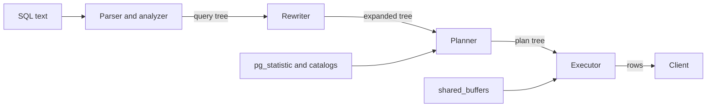

### 11.2.2 PgBouncer, pooling modes, and RDS Proxy

#### Concept

PgBouncer is a small, single-threaded proxy that speaks the PostgreSQL wire protocol. Applications connect to PgBouncer (cheap, thousands of client connections cost a few KB each). PgBouncer keeps a much smaller set of real server connections and lends them out. **Pooling mode** decides *how long* a client keeps a server connection: for a whole session, for one transaction, or for one statement.

RDS Proxy is Amazon's managed equivalent with IAM auth integration and automatic failover handling; it uses transaction-style multiplexing and "pins" a client to a server connection when the client does something session-specific.

#### Why does it exist?

Because 50 pods × 20 client connections = 1,000 client connections cannot become 1,000 backends. A pooler turns 1,000 client connections into 40 backends. It also absorbs connection storms (the pooler queues clients instead of forking backends) and makes failover smoother (clients stay connected to the pooler while it reconnects to the new primary).

#### Mental model

Imagine a hotel with 40 real phone lines but 1,000 rooms. In *session* mode a room keeps a line as long as the phone is off the hook, even when nobody is talking. In *transaction* mode you get a line when you dial and lose it when you hang up after one call. In *statement* mode you lose the line after every sentence, which makes it impossible to have a conversation (a transaction).

#### How it works

| Mode | Server connection assigned | Released | What works | What breaks |
|---|---|---|---|---|
| `session` | On client connect | On client disconnect | Everything | No multiplexing benefit beyond storm absorption |
| `transaction` | At `BEGIN` or first statement | At `COMMIT`/`ROLLBACK` | Normal queries, transactions, `SET LOCAL`, `pg_advisory_xact_lock` | Session state: `SET`, session prepared statements, `pg_advisory_lock`, `LISTEN`, temp tables, `WITH HOLD` cursors, `search_path` |
| `statement` | Per statement | After each statement | Autocommit single statements only | Multi-statement transactions |

Transaction mode is the one everyone wants, and what breaks in it needs care:

1. **Prepared statements.** A named prepared statement lives in one backend. In transaction mode your next transaction may land on a different backend that has never seen it: `prepared statement "s1" does not exist`. PgBouncer 1.21+ can track protocol-level prepared statements (`max_prepared_statements = 200`), but only with the extended protocol, not SQL `PREPARE`. `pg` (node-postgres) uses named prepared statements only when you pass `name` in the query config; TypeORM and Sequelize do not by default, so most NestJS apps are fine.
2. **`SET`.** `SET search_path = tenant_42` sticks to a backend; the next transaction from your client may land elsewhere, and worse, another tenant's transaction may inherit it. Use `SET LOCAL` inside a transaction.
3. **Advisory locks.** `pg_advisory_lock(key)` is session-level; after your transaction ends the server connection goes back to the pool still holding the lock, and your code can never unlock it. Use `pg_advisory_xact_lock`, which releases at transaction end.
4. **`LISTEN`/`NOTIFY`.** Notifications arrive on the backend that ran `LISTEN`; that backend is shared. Use a dedicated direct connection for listeners.
5. **Temp tables, session cursors, `pg_temp` schemas** all belong to the backend.

#### Practical example

A checkout worker does this in Sequelize: `await sequelize.query("SET statement_timeout = 60000")` at startup, then processes jobs. Through PgBouncer in transaction mode, that `SET` landed on one server connection. The orders API later borrowed that connection and inherited a 60 s timeout for a user-facing request, while the worker sometimes got a connection with the default 10 s and failed. Nobody could reproduce it locally because local ran without PgBouncer. Replacing `SET` with `SET LOCAL` inside the job transaction fixed it.

#### NestJS example

Advisory locks that survive transaction pooling: use the transaction-scoped form inside a transaction.

```ts
// inventory-reservation.service.ts
import { Injectable } from '@nestjs/common';
import { DataSource } from 'typeorm';

@Injectable()
export class InventoryReservationService {
  constructor(private readonly dataSource: DataSource) {}

  // Serialise reservations per product without touching the row lock
  async reserve(productId: number, qty: number): Promise<void> {
    await this.dataSource.transaction(async (em) => {
      // xact-scoped: released automatically at COMMIT/ROLLBACK,
      // safe behind PgBouncer transaction mode
      await em.query('SELECT pg_advisory_xact_lock($1)', [productId]);

      const [{ quantity }] = await em.query(
        'SELECT quantity FROM inventory WHERE product_id = $1',
        [productId],
      );
      if (quantity < qty) throw new Error('INSUFFICIENT_STOCK');

      await em.query(
        'UPDATE inventory SET quantity = quantity - $2, updated_at = now() WHERE product_id = $1',
        [productId, qty],
      );
    });
  }
}
```

#### PostgreSQL example

Minimal PgBouncer config for a NestJS fleet:

```text
[databases]
shop = host=10.0.1.5 port=5432 dbname=shop

[pgbouncer]
listen_addr = 0.0.0.0
listen_port = 6432
auth_type = scram-sha-256
auth_file = /etc/pgbouncer/userlist.txt
pool_mode = transaction
default_pool_size = 40        ; server connections per user+database pair
max_client_conn = 2000        ; cheap client side
reserve_pool_size = 5
server_idle_timeout = 600
max_prepared_statements = 200 ; PgBouncer 1.21+
```

Observe it: connect to the admin database and run `SHOW POOLS;` to see `cl_active`, `cl_waiting`, `sv_active`, `sv_idle`. A rising `cl_waiting` with `sv_idle = 0` means the server-side pool is the bottleneck.

#### TypeORM example

When behind transaction pooling, keep session state out of your connection setup. Do not use `extra.options` with `-c search_path=...`; instead set per-transaction:

```ts
await dataSource.transaction(async (em) => {
  await em.query(`SET LOCAL search_path TO tenant_${tenantId}, public`);
  return em.getRepository(Order).find({ where: { status: 'PENDING' }, take: 100 });
});
```

#### Sequelize example

Sequelize's `sequelize.transaction()` acquires one connection for the whole callback, which is exactly what transaction pooling needs. Sequelize's `dialectOptions.statement_timeout` is sent as a startup parameter, which PgBouncer applies when it *opens* the server connection, so it behaves consistently across all clients of that pool.

#### Production scenario

RDS Proxy notes for the same fleet: pods connect to the proxy endpoint; the proxy holds up to `MaxConnectionsPercent` of the instance's `max_connections`. Any of `SET`, `PREPARE`, `LISTEN`, advisory locks, or large result sets over 16 KB left unread cause **session pinning**: the client keeps one backend until it disconnects, and you silently lose multiplexing. CloudWatch metric `DatabaseConnectionsCurrentlySessionPinned` tells you how many. A NestJS app using TypeORM without named prepared statements and without `SET` pins almost never.

#### Failure scenario

At 02:14 the on-call was paged for "prepared statement does not exist" errors at 3 percent of requests. A developer had enabled `pg`'s query `name` option to "speed up" a hot query. Locally it worked. In production, PgBouncer 1.18 in transaction mode routed the second execution to a backend that had never prepared it. Rolling back the change fixed it; the long-term fix was upgrading PgBouncer to 1.21 and enabling `max_prepared_statements`.

#### Edge cases & failure modes

- PgBouncer is single-threaded: one instance handles about 10,000 to 20,000 queries per second on one core; run several behind a load balancer for more.
- `server_idle_timeout` too low causes reconnect churn; too high keeps backends around.
- `default_pool_size` × number of PgBouncer instances × databases × users must fit `max_connections`.
- Failover: the pooler hides it from clients, but in-flight transactions still fail; clients must retry.
- `SET` from a migration tool run through the pooler leaks into app connections.
- Long-running reporting queries through the pooler hold a server slot; give analytics its own pool.

#### How a Senior Backend Engineer thinks about this

They default to transaction mode and design the app for it: no session state, `SET LOCAL` only, transaction-level advisory locks, a dedicated direct connection for `LISTEN`. They put the pooler in from day one on any system with more than a handful of pods, because retrofitting it means auditing every `SET` and every prepared statement. They ask "what state does this connection carry?" before every feature that touches the session.

#### Common mistakes

- Running `SET search_path` per tenant through a transaction pooler.
- Using session-level advisory locks behind PgBouncer and wondering why "someone else" holds the lock forever.
- Putting the pooler in and then keeping pool `max: 50` per pod because "PgBouncer handles it": `cl_waiting` still grows and `max_client_conn` is finite.

#### Interview questions

1. *Explain PgBouncer's three modes and what breaks in transaction mode.* Expected: prepared statements, `SET`, session advisory locks, `LISTEN`, temp tables; the fix for each. Why it matters: multi-tenant `search_path` bugs are a classic cross-tenant data leak.
2. *How do you implement per-tenant schemas safely behind a transaction pooler?* Expected: `SET LOCAL` inside a transaction, or schema-qualified names.
3. *What is RDS Proxy session pinning and what causes it?*
4. *Why does a pooler make failover smoother but not transparent?*

#### Practical exercise

Run PgBouncer in Docker in transaction mode. From a Node script, run `SET application_name = 'a'` on one client then read `current_setting('application_name')` on another; show the leak. Then repeat with `SET LOCAL` inside a transaction. Acceptance criteria: you can demonstrate session state leakage and its fix, and explain `SHOW POOLS` output.

## 11.3 The lifecycle of a query

### 11.3.1 Parse, rewrite, plan, execute

#### Concept

Every statement your backend receives passes through four stages: the **parser** turns text into a tree and checks that tables and columns exist; the **rewriter** expands views and applies rules; the **planner** (also called optimizer) chooses how to execute (which index, which join order, which join algorithm) by estimating costs; the **executor** runs the chosen plan, pulling rows through a tree of nodes and sending them to the client.

#### Why does it exist?

SQL says *what* you want, not *how* to get it. `SELECT * FROM orders WHERE user_id = 42 ORDER BY created_at DESC LIMIT 20` has dozens of possible executions (sequential scan and sort, index scan on `user_id` and sort, index scan on `(user_id, created_at)` with no sort). The planner exists to pick a good one using statistics. Separating stages also allows plan caching: parse and plan once, execute many times.

#### Mental model

Imagine ordering at a restaurant. The waiter checks the menu (parse: does this dish exist?), the head chef rewrites "the special" into concrete dishes (rewrite: expand views), the kitchen manager decides which station cooks what in which order to be fastest (plan), then cooks execute (execute).

#### How it works



1. **Parse.** Lexing and grammar produce a raw parse tree. The analyzer resolves names against the catalog (`pg_class`, `pg_attribute`), checks types, and produces a query tree. Errors like `column "user_ids" does not exist` come from here. Cost: tens of microseconds for simple statements, milliseconds for 2,000-line reporting queries.
2. **Rewrite.** Views are replaced by their definitions; `INSTEAD OF` rules and row-level security policies are applied.
3. **Plan.** The planner enumerates access paths (seq scan, index scans, bitmap scans), join orders and join methods, estimates each path's cost from statistics, and keeps the cheapest. For joins of up to 8 tables it searches exhaustively; beyond `geqo_threshold` (12) it uses a genetic search. Detailed in 11.9.
4. **Execute.** The executor is a pull-based tree: the top node asks its child for the next row, which asks its child, down to scans that read pages from `shared_buffers`. `LIMIT 20` stops pulling after 20 rows, which is why an index that returns rows in the right order is such a big win.
5. Results stream back to the client in the wire protocol; the backend marks the transaction complete (or waits for the next statement if inside `BEGIN`).

`EXPLAIN` shows stages 1 to 3; `EXPLAIN ANALYZE` also runs stage 4 and reports actual numbers. Reading plans line by line is Part 12's core skill.

#### Practical example

Orders API endpoint `GET /orders?userId=42`. Query text is identical each time except the parameter. Without caching, the backend parses and plans every call: 0.2 ms out of a 1.5 ms request. Small, until you run 5,000 queries per second on a 4-core instance, where planning is 15 percent of CPU. That is where prepared statements come in.

#### PostgreSQL example

Watch the stages: `EXPLAIN` alone stops before execution; add `ANALYZE` to execute.

```sql
EXPLAIN (ANALYZE, BUFFERS)
SELECT id, status, total_cents
FROM orders
WHERE user_id = 42
ORDER BY created_at DESC
LIMIT 20;
```

```text
Limit  (cost=0.57..45.12 rows=20 width=21) (actual time=0.031..0.079 rows=20 loops=1)
  Buffers: shared hit=24
  ->  Index Scan Backward using idx_orders_user_created on orders
        (cost=0.57..1783.40 rows=800 width=21) (actual time=0.029..0.074 rows=20 loops=1)
        Index Cond: (user_id = 42)
        Buffers: shared hit=24
Planning Time: 0.142 ms
Execution Time: 0.098 ms
```

Planning took 0.142 ms; execution 0.098 ms. For this cheap query, planning costs more than running it.

#### Production scenario

A 6,000 query-per-second workload, mostly 3 or 4 statement shapes. `pg_stat_statements` shows `total_plan_time` (PG 13+, needs `pg_stat_statements.track_planning = on`) as 12 percent of total time. Switching the hottest shapes to prepared statements (see next section) removed that cost, saving roughly half a vCPU.

#### Failure scenario

A reporting query joined 14 tables. Above `geqo_threshold`, the genetic optimizer produced a different plan on different runs, so the query took 3 s sometimes and 90 s other times. Fixing it meant rewriting with CTEs materialised (`WITH ... AS MATERIALIZED`) to force a structure and raising `join_collapse_limit` only for that session.

#### Edge cases & failure modes

- Planning cost explodes with partitioned tables (hundreds of partitions) unless partition pruning can happen at plan time.
- Row-level security policies added in rewrite can silently add a subquery to every statement.
- Views on views on views: each layer expands, and the planner sometimes cannot push predicates through aggregate views.
- `search_path` changes make the same text resolve to different tables; plan caches are keyed on the resolved objects, so plans are invalidated.

#### How a Senior Backend Engineer thinks about this

They know that the same SQL text can produce different plans on different days (stats change) and design for that with `auto_explain` in production so a plan flip is visible instead of mysterious. They measure planning time on hot paths before adopting prepared statements.

#### Common mistakes

- Reading `EXPLAIN` (estimates) as if it were `EXPLAIN ANALYZE` (actuals).
- Assuming the ORM's generated SQL is the query; always log the exact text and parameters the driver sends.

#### Interview questions

1. *Describe the four stages a query passes through and what each can fail on.*
2. *Why can `EXPLAIN` and `EXPLAIN ANALYZE` disagree?* Expected: estimates from statistics vs actual rows; stale or missing stats.
3. *When does the planner stop searching join orders exhaustively?*

#### Practical exercise

Take three queries from your service. Run `EXPLAIN (ANALYZE, BUFFERS)` and record planning time vs execution time. Acceptance criteria: identify one query where planning is more than 20 percent of the total and explain what you would do about it.

### 11.3.2 Prepared statements and plan caching: generic vs custom plans

#### Concept

A **prepared statement** parses (and possibly plans) a statement once with placeholders (`$1`, `$2`), then executes it many times with different values. PostgreSQL caches the plan per backend. It first builds **custom plans** that use the actual parameter values, and after five executions it considers switching to a **generic plan** that does not look at values at all.

#### Why does it exist?

Parsing and planning cost CPU on every execution. For a hot query executed thousands of times per second, caching the plan is a real saving. The generic/custom split exists because a plan that ignores parameter values can be badly wrong for skewed data (a `user_id` with 2 million orders vs one with 3), while always replanning wastes the cache.

#### Mental model

Imagine a delivery driver who learns a route. For the first five trips they check the map each time (custom plan). Then they decide whether the "usual route" is good enough on average (generic plan). If one customer lives across the river, the usual route is a disaster for that customer, but the driver has stopped checking the map.

#### How it works

1. `PREPARE` (SQL) or a protocol-level `Parse` message stores the parsed query in the backend's cache.
2. Executions 1 to 5 build a custom plan using actual values, and PostgreSQL records their average estimated cost.
3. At execution 6 it builds a generic plan (parameters treated as unknown, selectivity from column averages). If the generic plan's estimated cost is not higher than the average custom cost (plus a small planning-cost allowance), it switches to generic for all future executions.
4. `plan_cache_mode` (PG 12+) overrides this: `auto` (default), `force_custom_plan`, `force_generic_plan`.
5. Cache invalidation: any DDL on referenced tables or an `ANALYZE` that changes statistics invalidates the cached plan, and the next execution replans.
6. In node-postgres, passing `{ name: 'orders_by_user', text, values }` creates a named prepared statement per connection; without `name`, the extended protocol still uses an unnamed statement that is parsed per execution (parameterised, safe from injection, but not plan-cached). TypeORM and Sequelize do not set `name`, so plans are not cached across executions unless you use the driver directly.

#### Practical example

`SELECT * FROM orders WHERE user_id = $1 ORDER BY created_at DESC LIMIT 20`. For a normal user (average 12 orders) the custom plan is an index scan on `(user_id, created_at)`. The generic plan uses the average too, so it is the same. Safe. Now `SELECT count(*) FROM orders WHERE status = $1`. Status distribution: PAID 92 percent, PENDING 0.4 percent. Custom plans for `PENDING` use a partial index; the generic plan assumes 33 percent selectivity (1/3 distinct values) and chooses a sequential scan for every value, including `PENDING`. After five calls the query flips from 1 ms to 4 s.

#### NestJS example

Use the driver's named statement only where it pays, and keep an escape hatch:

```ts
// orders.repository.ts
import { Injectable } from '@nestjs/common';
import { DataSource } from 'typeorm';
import { Pool } from 'pg';

@Injectable()
export class OrdersRepository {
  private readonly pool: Pool;

  constructor(private readonly dataSource: DataSource) {
    // TypeORM's postgres driver exposes the underlying pg Pool as `master`
    this.pool = (this.dataSource.driver as unknown as { master: Pool }).master;
  }

  async recentForUser(userId: number, limit = 20) {
    const { rows } = await this.pool.query({
      name: 'orders_recent_for_user',        // named: plan cached per backend
      text: `SELECT id, status, total_cents, created_at
               FROM orders
              WHERE user_id = $1
              ORDER BY created_at DESC
              LIMIT $2`,
      values: [userId, limit],
    });
    return rows;
  }
}
```

Only do this when (a) you are not behind an old PgBouncer in transaction mode, and (b) the parameter distribution is not badly skewed. Otherwise leave TypeORM's default unnamed statements alone.

#### PostgreSQL example

See the flip happen:

```sql
PREPARE cnt(text) AS SELECT count(*) FROM orders WHERE status = $1;
EXPLAIN (ANALYZE) EXECUTE cnt('PENDING');   -- run this 6 times
```

Runs 1 to 5:

```text
Aggregate  (actual time=0.412..0.413 rows=1 loops=1)
  ->  Index Only Scan using idx_orders_pending on orders
        (actual time=0.020..0.300 rows=812 loops=1)
```

Run 6 onward (generic plan chosen):

```text
Aggregate  (actual time=3910.221..3910.222 rows=1 loops=1)
  ->  Seq Scan on orders  (actual time=0.018..3700.114 rows=812 loops=1)
        Filter: (status = $1)
        Rows Removed by Filter: 199999188
```

Fix per session or per role:

```sql
SET plan_cache_mode = force_custom_plan;
-- or: ALTER ROLE orders_api SET plan_cache_mode = force_custom_plan;
```

#### TypeORM example

TypeORM does not name statements, so the generic-plan problem does not occur through the repository API. If you need plan caching for a hot query, use the raw pool as above, or accept the planning cost.

#### Sequelize example

Same story: `sequelize.query(sql, { bind: [...] })` uses the extended protocol without a statement name. Sequelize is safe from the generic-plan flip by default.

#### Production scenario

A payments service using a Go client with automatic statement caching (some drivers prepare everything) flipped a `WHERE merchant_id = $1` query to a generic plan; the largest merchant (40 percent of rows) got a nested loop plan designed for the average merchant (0.01 percent) and caused 20 s timeouts every evening. The fix was `plan_cache_mode = force_custom_plan` on that role, at the cost of 0.3 ms planning per call.

#### Failure scenario

"The query is fast in psql but slow in the app." Almost always one of: different parameter types (a `text` parameter compared with a `bigint` column prevents index use), a generic plan in the app but custom in psql, or a different `search_path`. Reproduce with `PREPARE` and `EXECUTE` six times, not with literals.

#### Edge cases & failure modes

- Parameter type mismatch: sending `'42'` as text for a `bigint` column forces a cast and may skip the index.
- Plan cache invalidation storms after `ALTER TABLE` on a hot table: every backend replans at once.
- Backends caching thousands of distinct prepared statements (dynamic SQL with names) grow memory without bound.
- PgBouncer transaction mode before 1.21 and named statements.

#### How a Senior Backend Engineer thinks about this

They only use named statements for hot, evenly distributed queries, and they document the decision. They add a regression test that runs the hot query seven times through the same connection and asserts on `EXPLAIN` output, or they set `plan_cache_mode` explicitly for the role.

#### Common mistakes

- Enabling driver-level statement caching globally and getting a generic-plan flip on one skewed query.
- Debugging with literals in psql when the app uses parameters.

#### Interview questions

1. *What is the difference between a custom plan and a generic plan, and when does PostgreSQL switch?* Expected: five custom executions, then a cost comparison; `plan_cache_mode` to force. Why it matters: it is a common cause of "fast in psql, slow in prod".
2. *Does TypeORM cache plans server-side?* Expected: no named statements by default; unnamed extended-protocol statements are parameterised but re-planned.
3. *How would you reproduce a generic-plan problem in psql?*

#### Practical exercise

Create an `orders` table with 5 million rows and a skewed `status` column. Reproduce the generic-plan flip with `PREPARE`/`EXECUTE`, then fix it two ways (partial index plus `force_custom_plan`; rewriting to avoid the parameter). Acceptance criteria: you show both plans and the timing difference, and explain why `EXPLAIN` on run 6 differs from run 1.
