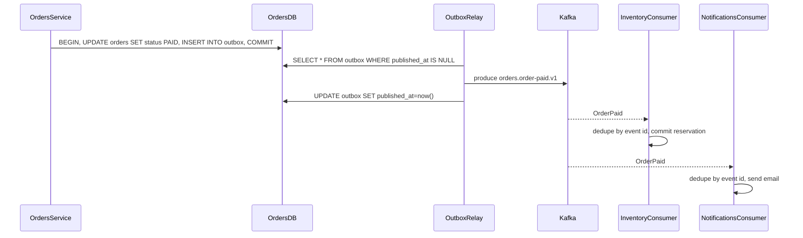

## 11.6 Event-driven architecture

#### Concept

In an event-driven architecture (EDA), components communicate by publishing facts about what happened ("an order was paid") rather than by telling each other what to do ("send the confirmation email"). Producers write events to a broker (Kafka, RabbitMQ, SNS/SQS). Consumers subscribe and react. The producer does not know who consumes, or whether anyone does.

An **event** is a record of something that already happened, named in the past tense: `OrderPaid`, `StockReserved`, `UserRegistered`. A **command** is a request to do something, named in the imperative: `ReserveStock`, `SendEmail`, `ChargeCard`. A command has exactly one handler and can be rejected. An event has zero or many consumers and cannot be rejected; it is history.

#### Why does it exist?

EDA exists to decouple the thing that happened from the things that must happen next. When checkout emits `OrderPaid`, the checkout code does not change when marketing wants a new "first purchase" campaign, when finance wants a ledger entry, or when the warehouse wants a pick list. Each of those is a new consumer.

It also absorbs load. A burst of 10,000 orders in a minute does not have to be processed by the email service in that minute. The broker holds the backlog; consumers drain it at their own pace.

Without EDA, every side effect is a synchronous call inside the request, the request grows slower with every feature, and one slow side effect fails the whole thing.

#### Mental model

Imagine a newspaper. The reporter writes a story about what happened. The paper is delivered to every subscriber. The reporter does not call each reader. Readers who are on holiday get their papers when they return (the backlog). If a reader misreads the story, the reporter is not involved. Compare this with a phone tree, where each person must call the next and wait for an answer: that is synchronous request/response.

#### How it works

1. A service performs a local state change (insert the order, mark it paid).
2. In the **same database transaction**, it writes an event row to an `outbox` table. This is the transactional outbox pattern; it guarantees that the event exists if and only if the state change committed.
3. A relay (a polling job, or Debezium reading the write-ahead log) publishes outbox rows to the broker and marks them published.
4. The broker persists the event in a topic (Kafka) or routes it to queues (RabbitMQ exchanges).
5. Each consumer group reads the event, checks a `processed_events` table to skip duplicates, performs its own local transaction, and commits its offset.
6. Consumers that fail retry; after N failures the event goes to a dead-letter topic for human inspection.



**Choreography vs orchestration.** In choreography, there is no central coordinator: `OrderPaid` triggers inventory, which emits `StockCommitted`, which triggers shipping, and so on. It is simple to start and hard to follow at scale (who decides the order is "complete"?). In orchestration, a saga orchestrator (a state machine, often in the orders service) sends commands and waits for events, holding the full picture. Choreography for three steps, orchestration for anything with compensation logic or a meaningful "process state".

**Eventual consistency.** After `OrderPaid` is published, there is a window (usually milliseconds, sometimes minutes during lag) in which orders says PAID and inventory has not yet decremented. Every read that crosses that boundary can see a stale state. The product must accept this: "your order is confirmed; stock is being allocated" is a UX statement of eventual consistency.

**Event schemas.** An event is a public contract. It needs: a unique `id` (for dedupe), `type` and `version`, `occurredAt`, the aggregate id, and a payload. Payloads should be self-contained (a consumer should not need to call back to get the data), but not bloated with the whole aggregate. Schema evolution rules: only add optional fields; never rename or change types; for breaking changes, publish a new versioned topic and run both for a deprecation window.

#### Practical example

Food delivery. When a restaurant marks an order as ready, the `orders` service emits `OrderReady`. Consumers: dispatch (find a rider), notifications (push to the customer), analytics (kitchen prep time), restaurant billing (commission ledger). Four teams, zero changes to the orders service when a fifth consumer appears.

#### NestJS example

Writing to the outbox inside the same TypeORM transaction:

```ts
// src/modules/orders/application/mark-paid.use-case.ts
import { Injectable } from '@nestjs/common';
import { DataSource } from 'typeorm';
import { randomUUID } from 'node:crypto';
import { OrderEntity } from '../infrastructure/order.entity';
import { OutboxEntity } from '../infrastructure/outbox.entity';

@Injectable()
export class MarkOrderPaidUseCase {
  constructor(private readonly dataSource: DataSource) {}

  async execute(orderId: string, paymentId: string): Promise<void> {
    await this.dataSource.transaction(async (manager) => {
      const result = await manager
        .createQueryBuilder()
        .update(OrderEntity)
        .set({ status: 'PAID', paymentId })
        .where('id = :orderId AND status = :expected', { orderId, expected: 'CREATED' })
        .execute();

      // Idempotent: a second call for the same order updates 0 rows and emits nothing.
      if (result.affected === 0) return;

      await manager.insert(OutboxEntity, {
        id: randomUUID(),
        aggregateId: orderId,
        topic: 'orders.order-paid.v1',
        payload: {
          id: randomUUID(),
          type: 'OrderPaid',
          version: 1,
          occurredAt: new Date().toISOString(),
          orderId,
          paymentId,
        },
      });
    });
  }
}
```

The relay, using `@nestjs/schedule` and KafkaJS:

```ts
// src/modules/outbox/outbox-relay.service.ts
import { Injectable, Logger } from '@nestjs/common';
import { Cron, CronExpression } from '@nestjs/schedule';
import { DataSource } from 'typeorm';
import { Producer } from 'kafkajs';
import { OutboxEntity } from '../orders/infrastructure/outbox.entity';

@Injectable()
export class OutboxRelayService {
  private readonly log = new Logger(OutboxRelayService.name);
  private running = false;

  constructor(private readonly dataSource: DataSource, private readonly producer: Producer) {}

  @Cron(CronExpression.EVERY_SECOND)
  async relay(): Promise<void> {
    if (this.running) return; // never overlap runs
    this.running = true;
    try {
      // SKIP LOCKED lets several replicas relay in parallel without double-sending.
      const rows: OutboxEntity[] = await this.dataSource.query(
        `SELECT * FROM outbox WHERE published_at IS NULL
         ORDER BY created_at LIMIT 100 FOR UPDATE SKIP LOCKED`,
      );
      for (const row of rows) {
        await this.producer.send({
          topic: row.topic,
          messages: [{ key: row.aggregateId, value: JSON.stringify(row.payload) }],
        });
        await this.dataSource.query(`UPDATE outbox SET published_at = now() WHERE id = $1`, [row.id]);
      }
    } catch (err) {
      this.log.error(`relay failed: ${(err as Error).message}`);
    } finally {
      this.running = false;
    }
  }
}
```

Note that this relay is at-least-once: if the process dies after `producer.send` but before the `UPDATE`, the event is sent twice. Consumers dedupe by `payload.id`. This is why the event carries its own id.

The Kafka key is the aggregate id, so all events for one order land on the same partition and are consumed in order.

#### PostgreSQL example

The consumer side, idempotent by event id:

```sql
CREATE TABLE processed_events (
  event_id     uuid PRIMARY KEY,
  consumer     text NOT NULL,
  processed_at timestamptz NOT NULL DEFAULT now()
);

-- In the consumer's transaction:
BEGIN;
INSERT INTO processed_events (event_id, consumer) VALUES ($1, 'inventory')
ON CONFLICT DO NOTHING;
-- If the insert affected 0 rows, this event was already handled: ROLLBACK and ack.
UPDATE inventory.stock SET reserved = reserved - $2, available = available - $2
WHERE product_id = $3 AND reserved >= $2;
COMMIT;
```

Check `rowCount` after the first insert. If it is zero, skip the work and still acknowledge the message. This gives you exactly-once *effects* on top of at-least-once *delivery*.

#### Production scenario

Kafka topic `orders.order-paid.v1` with 12 partitions, 400 events per second at peak, retention 7 days. Three consumer groups. Consumer lag is the key metric: `kafka_consumergroup_lag` per group, alert when it exceeds 5,000 messages or 60 seconds. Outbox table is pruned nightly (`DELETE WHERE published_at < now() - interval '3 days'`) to keep the partial index small.

Latency budget from commit to consumer effect: relay poll up to 1 second, Kafka produce 5 ms, consumer poll and handle 10 to 50 ms. Typical end-to-end under 1.2 seconds. With Debezium instead of polling, under 200 ms.

#### Failure scenario

At 11:05 a deploy of the notifications consumer ships a bug: it throws on events with a null `couponCode`. The consumer library retries the same message forever (no dead-letter configured). The partition stalls. Lag on that partition climbs to 180,000 messages over two hours. Customers on that partition get no confirmation emails. The other 11 partitions are fine, so dashboards showing average lag look healthy. The on-call notices only when support tickets spike.

Fixes: per-partition lag alerts, a dead-letter topic after 5 attempts, a consumer that treats malformed events as poison rather than transient failures, and a replay tool that can reprocess a partition from an offset.

#### Edge cases & failure modes

- **Event storms.** A bulk price update emits 2 million `ProductUpdated` events; every projection recomputes. Batch or coalesce, and rate-limit consumers.
- **Out-of-order events** across partitions or after a rebalance; use per-aggregate version numbers.
- **Duplicate events** from at-least-once relays; dedupe table.
- **Poison messages** stalling a partition; dead-letter after N tries.
- **Schema drift**; producer adds a required field, old consumers crash. Enforce compatibility with a schema registry and contract tests.
- **Consumer lag hiding in averages**; alert per partition.
- **Lost in-process events** if you use `EventEmitter2` as if it were a broker.
- **Large payloads** (an event carrying a 4 MB PDF); store the blob, emit the reference.
- **Fan-out loops.** Service A emits X, B reacts and emits Y, A reacts to Y and emits X again. Track causation ids.
- **Replays with side effects.** Replaying `OrderPaid` to rebuild a projection also resends 200,000 emails unless the email consumer distinguishes replays.

#### How a Senior Backend Engineer thinks about this

They separate the two questions: *Does this caller need an answer now?* (command, synchronous) and *Do others need to know this happened?* (event, asynchronous). They never publish an event without the outbox, never consume without idempotency, and never deploy a consumer without a dead-letter topic and per-partition lag alerts.

They design the event schema as carefully as a public REST API, because it is one.

#### Common mistakes

- Publishing to Kafka *then* committing the database transaction (or the reverse) without an outbox; the two get out of sync on the first crash.
- Events that are really commands in disguise (`SendEmailEvent`), coupling producer to consumer.
- Consumers with no dedupe.
- One consumer group doing three unrelated things; one bug blocks all three.
- Treating eventual consistency as a bug to be hidden rather than a product decision to be designed.

#### Interview questions

1. *Event vs command: explain the difference and the consequences for coupling.* Expected: fact vs request; many consumers vs one handler; cannot be rejected vs can.
2. *How do you guarantee an event is published if and only if the state change committed?* Expected: transactional outbox, relay, at-least-once with consumer dedupe.
3. *Choreography vs orchestration: when each?* Expected: choreography for simple flows, orchestration when there is compensation and process state.
4. *How do you evolve an event schema without breaking consumers?* Expected: additive optional fields, versioned topics for breaking changes, tolerant readers, registry.
5. *A partition is stalled. How do you detect it and recover?* Expected: per-partition lag alert, DLQ, skip poison offset, replay.

#### Practical exercise

Implement the outbox pattern in a NestJS orders module with TypeORM. Add a relay using `@nestjs/schedule` with `FOR UPDATE SKIP LOCKED`, and a Kafka consumer in another module with a `processed_events` table. Kill the relay process randomly during a 10,000-event load test.

Acceptance criteria: every committed order produces at least one Kafka message; the consumer's side effects happen exactly once per order (row counts match); running two relay replicas does not double-publish beyond what the consumer dedupes.

## 11.7 Layered architecture

#### Concept

Layered architecture organises code into horizontal layers, each of which may only call the layer directly below it. The classic three: **presentation** (HTTP controllers, DTOs, validation), **business logic** (services), and **data access** (repositories, ORM). Sometimes a fourth, the database itself, is drawn underneath.

This is the architecture NestJS's generator gives you by default: `controller -> service -> repository`.

#### Why does it exist?

It exists to stop HTTP details from leaking into business rules and SQL from leaking into controllers. When a controller contains `SELECT` statements, you cannot test the business rule without an HTTP server and a database, and you cannot reuse the rule from a Kafka consumer or a cron job.

#### Mental model

Imagine a hotel. The front desk (presentation) takes your request. It does not clean rooms; it calls housekeeping (business logic). Housekeeping does not manufacture towels; it takes them from the storeroom (data access). Each floor knows only the floor below. The guest never walks into the storeroom.

#### How it works

```text
  HTTP request
      |
      v
  +-----------------------------+
  | Presentation                |  controllers, DTOs, pipes, guards, filters
  +-----------------------------+
      | calls (method call)
      v
  +-----------------------------+
  | Business / Service          |  OrdersService, PaymentsService
  +-----------------------------+
      | calls
      v
  +-----------------------------+
  | Data access                 |  Repository<Order>, QueryBuilder, Sequelize models
  +-----------------------------+
      | SQL
      v
  PostgreSQL
```

Rules: a layer depends only on the layer below. Data flows down as parameters and up as return values. Cross-cutting concerns (logging, auth, transactions) are applied at the edges with NestJS interceptors, guards and middleware.

#### NestJS example

```ts
// presentation
@Controller('orders')
export class OrdersController {
  constructor(private readonly orders: OrdersService) {}

  @Post()
  @UseGuards(JwtAuthGuard)
  create(@CurrentUser() user: AuthUser, @Body() dto: CreateOrderDto) {
    return this.orders.create(user.id, dto); // no logic here; translate and delegate
  }
}

// business
@Injectable()
export class OrdersService {
  constructor(
    @InjectRepository(Order) private readonly orders: Repository<Order>,
    private readonly products: ProductsService,
  ) {}

  async create(userId: string, dto: CreateOrderDto): Promise<Order> {
    const product = await this.products.getActive(dto.productId); // throws NotFound
    if (dto.qty > product.maxPerOrder) throw new UnprocessableEntityException('qty too high');
    return this.orders.save(this.orders.create({ userId, productId: product.id, qty: dto.qty }));
  }
}
```

This is clean, readable and correct for most CRUD-heavy services. Most NestJS code in the world looks like this, and that is fine.

#### Where it breaks

Layered architecture has a direction problem: the business layer **depends on** the data layer. `OrdersService` imports `Repository<Order>` from TypeORM. The most important code in your system (the rules) depends on the least important (which ORM you chose). Consequences:

1. **Testing the rules needs the ORM.** You mock `Repository<Order>` with its 40 methods, or you spin up a database. Unit tests become slow or brittle.
2. **Entities become the domain model.** `Order` is a TypeORM `@Entity` with `@Column` decorators, no behaviour, public mutable fields. Business rules end up in services as procedural code over anaemic data bags.
3. **The ORM leaks upward.** A service returns a TypeORM entity; the controller serialises it; lazy relations, circular references and `password_hash` columns end up in JSON.
4. **Fat services.** With no place for domain logic, `OrdersService` grows to 1,500 lines that mix validation, orchestration, persistence and side effects.
5. **Multiple entry points strain it.** The same business rule needed from an HTTP controller, a Kafka consumer and a cron job; the "presentation layer" was designed for HTTP only.
6. **Transaction boundaries are awkward.** Who opens the transaction: the controller, the service, or the repository? Usually the service, which now holds a `DataSource` and knows about `QueryRunner`.

Layered architecture works well until the domain has real rules. The moment "can this order be cancelled?" depends on status, payment state, shipping state and a refund policy, you want a domain object that answers that question with no database in sight. That is where hexagonal, clean and onion architectures come in (next section): they keep the layers but **flip the dependency direction** so the domain depends on nothing.

#### Production scenario

A 60,000-line NestJS layered service handling 800 RPS. Over three years, `OrdersService` accumulates 38 injected dependencies. Every unit test file starts with 80 lines of mocks. A change to the refund rule takes two days because the rule is spread across `OrdersService.cancel()`, `PaymentsService.refund()` and a database trigger. The team's velocity is one third of what it was in year one.

#### Failure scenario

A developer adds `@Get(':id')` that returns the TypeORM `User` entity directly. The entity has `passwordHash` and an eager relation to `Sessions`. Every user lookup now serialises session tokens to the client. It ships on a Thursday; a security researcher reports it on Saturday. The root cause is architectural: there was no boundary between the persistence model and the API response.

#### Edge cases & failure modes

- Entities returned directly from controllers (data leaks, over-fetching).
- Services depending on `Repository<T>` make swapping or testing storage painful.
- Business rules duplicated between HTTP and messaging entry points.
- Transactions opened in controllers (or worse, in interceptors that do not know the business step).
- Circular service dependencies (`OrdersService` needs `PaymentsService` needs `OrdersService`).

#### How a Senior Backend Engineer thinks about this

They use plain layering for services that are mostly CRUD with light rules, and they draw a hard line at the API boundary: controllers return response DTOs, never entities. When the rules get thick, they introduce a domain layer with no framework imports and invert the dependency. They do not add that ceremony to a 12-endpoint admin service.

#### Common mistakes

- Logic in controllers ("just a small if").
- Returning entities from controllers.
- Services that are just pass-throughs to repositories (no value) alongside services that are 1,500 lines (too much value).
- Believing "layered" and "clean" are opposites; clean architecture is layering with inverted dependencies.

#### Interview questions

1. *What is the dependency direction problem in layered architecture?* Expected: business depends on data access; inversion fixes it.
2. *Why should a controller never return an ORM entity?* Expected: data leaks, coupling API to schema, serialisation surprises.
3. *Where do you open a transaction in a layered NestJS app?* Expected: at the use-case/service boundary, never in controllers; see Unit of Work in Part 12.
4. *When is plain layering enough?* Expected: CRUD-dominant, thin rules, small team; know the signals for moving on.

#### Practical exercise

Take a layered NestJS module where the controller returns entities. Introduce response DTOs with `class-transformer` `@Exclude()`/`@Expose()` and `ClassSerializerInterceptor`, and move one business rule ("orders over 10 items require manual approval") out of the service into a plain TypeScript class with no imports from `typeorm` or `@nestjs/*`.

Acceptance criteria: no endpoint returns a field not declared in a DTO; the rule class has a unit test with no mocks and runs in under 5 ms.
