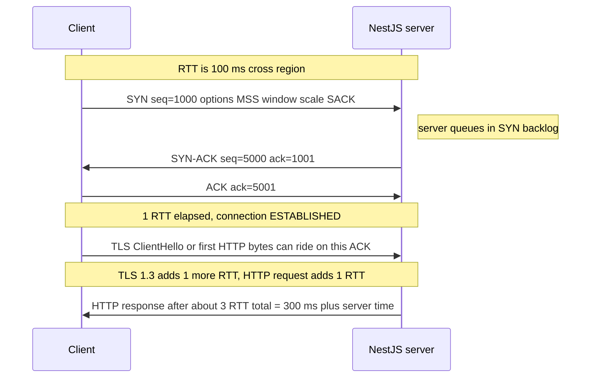
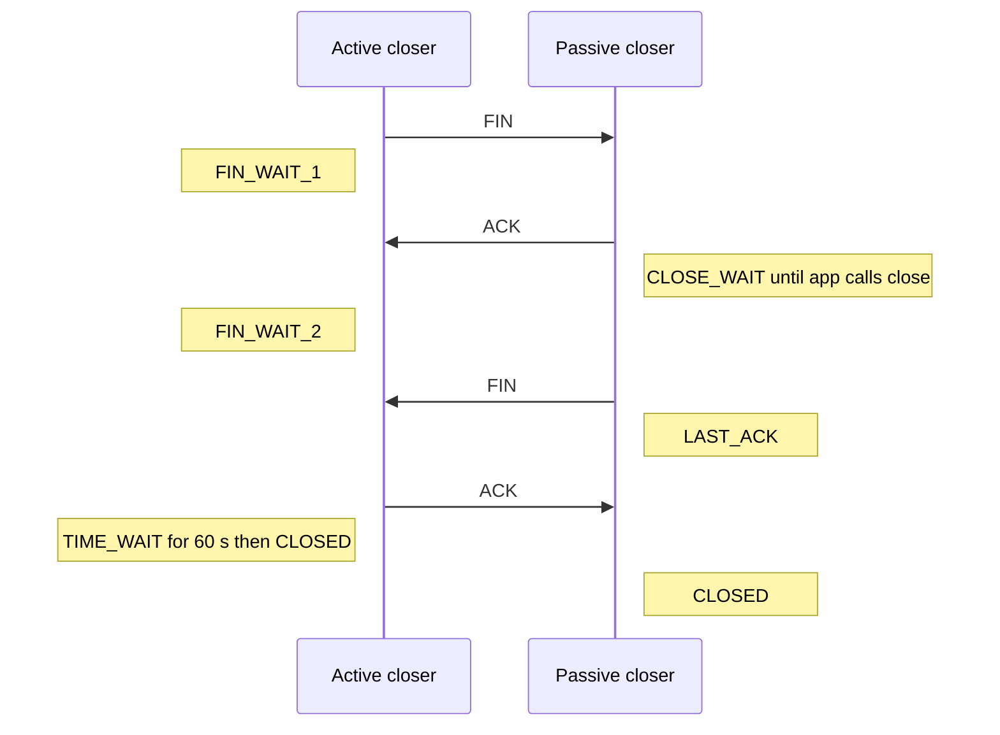

## 11.4 TCP and UDP: the transport layer

### 11.4.1 TCP: a reliable, ordered byte stream

#### Concept

**TCP** (Transmission Control Protocol) gives two processes a **reliable, ordered byte stream** over an unreliable network. You write bytes in one end; they come out the other end in the same order, with nothing missing and nothing duplicated, or the connection reports an error. TCP has no idea what a "message" or an "HTTP request" is. It only knows bytes. Framing (where one request ends and the next begins) is the application protocol's job, which is why HTTP has `Content-Length` and chunked encoding.

**UDP** (User Datagram Protocol) is the opposite: fire-and-forget datagrams with no ordering, no retransmission, no connection. It is used where speed matters more than completeness (video, games, DNS, and now HTTP/3 via QUIC).

#### Why does it exist?

IP delivers packets one hop at a time and makes no promises: packets can be lost, duplicated, reordered or corrupted. A database protocol or an HTTP request cannot tolerate that. TCP adds sequence numbers, acknowledgements, retransmission, checksums, flow control (do not overwhelm the receiver) and congestion control (do not overwhelm the network). Every backend protocol you use daily (HTTP/1.1, HTTP/2, Postgres, Redis, Kafka, gRPC, SMTP) rides on TCP because they all need "every byte, in order".

#### Mental model

Imagine dictating a long contract over a bad phone line. You number every sentence. The listener repeats back "got up to sentence 42". If you do not hear that within a few seconds, you repeat sentence 43 onwards. You also ask "how many sentences can you write down before you need a break?" (the receive **window**) and you speak slower when you notice you are being asked to repeat too often (congestion control). That is TCP.

#### How it works

1. **Segments and sequence numbers.** The byte stream is cut into segments, each stamped with the sequence number of its first byte. The receiver acknowledges the next byte it expects (`ACK 4381` means "I have everything up to byte 4380").
2. **Retransmission.** If an ACK does not arrive before the retransmission timeout (RTO, initially about 1 second, then adapted to the measured round trip), the sender resends. Three duplicate ACKs trigger a faster "fast retransmit".
3. **Flow control: the receive window.** The receiver advertises how many bytes it can still buffer (`rwnd`). The sender never has more than that many unacknowledged bytes in flight. Linux auto-tunes buffers up to several megabytes; with **window scaling**, the window can exceed the original 64 KB limit.
4. **Congestion control.** The sender maintains a congestion window (`cwnd`), starting small (10 segments, about 14 KB, in modern Linux) and growing each round trip (**slow start**) until loss is detected, then backing off. Throughput on a fresh connection is limited by `cwnd`, not by bandwidth: a 1 MB response over a 100 ms RTT link needs about 7 round trips just for slow start to ramp up, roughly 700 ms before bandwidth even matters. This is the second reason keep-alive matters: a warm connection has an already-grown `cwnd`.
5. **Nagle's algorithm.** To avoid sending many tiny packets, TCP by default holds small writes until either a full segment accumulates or the previous segment is acknowledged. Combined with delayed ACKs on the receiver (waits up to 40 ms to piggyback an ACK), this can add 40 ms to every small write-then-wait exchange. Node sets `socket.setNoDelay(true)` by default on HTTP sockets since v12; for raw `net.Socket` and some drivers you must set it explicitly. A Redis client doing thousands of small commands per second with Nagle enabled is measurably slower.
6. **Bandwidth-delay product.** The maximum throughput of one connection is `window / RTT`. A 64 KB window over a 100 ms RTT gives at most 640 KB per second regardless of the link speed. Cross-region replication and large S3 uploads need big windows or parallel streams.

**UDP and QUIC.** UDP adds only ports and a checksum to IP. It is the foundation for DNS (one packet each way, no handshake), NTP, video and voice, and **QUIC**, the transport under HTTP/3. QUIC re-implements TCP's reliability in user space on top of UDP, adding per-stream ordering (no head-of-line blocking across streams), built-in TLS 1.3, and connection IDs that survive a change of client IP address. You will meet UDP in a NestJS system through DNS, through StatsD metrics (`hot-shots` sends UDP datagrams that are dropped rather than queued when the collector is slow, which is exactly what you want from a metrics path), and through CloudFront or an HTTP/3-capable edge in front of your API.

#### Practical example

An inventory service streams a 40 MB CSV export to a client in another region. With a cold connection: DNS, handshake, TLS, then slow start ramps `cwnd` from 14 KB up over about 10 round trips at 150 ms each, and only then does the transfer approach link speed. Total: about 4 seconds, of which 1.5 seconds was TCP warming up. With a warm keep-alive connection from a previous request, the same export finishes in about 2.5 seconds. Nothing in the application changed.

#### NestJS example

Where you touch TCP from NestJS: the HTTP server's socket options, a raw TCP microservice transport, and driver keep-alive settings. Here is a NestJS TCP microservice consumer with explicit socket tuning, plus the server-side socket handling for the HTTP app.

```ts
// main.ts (excerpt): tune the HTTP server's TCP behaviour
import { NestFactory } from '@nestjs/core';
import { Server } from 'http';
import { Socket } from 'net';
import { AppModule } from './app.module';

async function bootstrap() {
  const app = await NestFactory.create(AppModule);
  const server: Server = app.getHttpServer();

  server.on('connection', (socket: Socket) => {
    socket.setNoDelay(true);              // disable Nagle: small JSON responses go out immediately
    socket.setKeepAlive(true, 30_000);    // TCP keepalive probes after 30 s idle (see 4.4.3)
  });

  // Reject clients that never finish sending headers (slowloris; see 4.15)
  server.headersTimeout = 30_000;
  server.requestTimeout = 60_000;

  await app.listen(3000, '0.0.0.0');
}
bootstrap();
```

```ts
// inventory.module.ts: a NestJS TCP transport client for an internal service
import { Module } from '@nestjs/common';
import { ClientsModule, Transport } from '@nestjs/microservices';

@Module({
  imports: [
    ClientsModule.register([
      {
        name: 'PRICING_SERVICE',
        transport: Transport.TCP,
        options: { host: 'pricing.internal', port: 4010 },
      },
    ]),
  ],
})
export class InventoryModule {}
```

The NestJS TCP transport frames messages itself (length-prefixed JSON) precisely because TCP is a byte stream with no message boundaries. If you ever write a raw `net.Server`, you must do that framing yourself; assuming one `data` event equals one message is the classic bug that works on localhost and breaks in production when segments coalesce or split.

#### PostgreSQL example

PostgreSQL's wire protocol is a byte stream of typed messages over TCP. The server exposes its TCP keepalive settings so idle connections through a NAT or load balancer stay alive, and it enforces its own idle timeouts.

```sql
-- Server-side TCP keepalive (seconds); 0 means "use the OS default"
SHOW tcp_keepalives_idle;      -- e.g. 60: probe after 60 s of silence
SHOW tcp_keepalives_interval;  -- e.g. 10: retry every 10 s
SHOW tcp_keepalives_count;     -- e.g. 6: give up after 6 failed probes

-- Kill sessions that sit idle inside a transaction holding locks (a client that
-- died mid-transaction behind a NAT can hold row locks for hours otherwise)
ALTER SYSTEM SET idle_in_transaction_session_timeout = '30s';
SELECT pg_reload_conf();

-- Find such sessions right now
SELECT pid, client_addr, state, now() - state_change AS idle_for, query
FROM pg_stat_activity
WHERE state = 'idle in transaction'
ORDER BY idle_for DESC;
```

#### Production scenario

A pricing service handles 3,000 requests per second, each doing five Redis `GET`s. With Nagle enabled on the Redis client socket, p50 latency was 43 ms; with `setNoDelay(true)` (ioredis sets it by default, but a custom wrapper had disabled it) p50 dropped to 2.1 ms. The 40 ms was the delayed-ACK timer interacting with Nagle: a textbook case that still appears in production every year.

#### Failure scenario

A reporting service opened a raw TCP socket to a legacy fixed-width-record server and parsed each `data` event as one record. It passed every test. In production, records were sometimes truncated or merged, roughly once per few thousand. TCP had split a 512-byte record across two segments at an MTU boundary, and at other times coalesced two records into one read. The fix was a proper framing buffer: accumulate bytes, emit complete 512-byte records, keep the remainder.

#### Edge cases & failure modes

- Message boundaries do not exist in TCP; framing bugs surface only under real network conditions.
- A large receive window with a slow consumer means megabytes buffered in kernel memory per connection; 10,000 slow clients can exhaust socket memory.
- Slow start after idle: Linux resets `cwnd` after an idle period (`tcp_slow_start_after_idle = 1`), so even a keep-alive connection ramps again after a few hundred milliseconds of silence.
- Nagle plus delayed ACK adds 40 ms on write-write-read patterns.
- UDP has no backpressure; a metrics library sending 100,000 datagrams per second silently drops what the receiver cannot take.

#### How a Senior Backend Engineer thinks about this

They know that a "fast network" does not make a fresh connection fast; round trips and slow start do. They reuse connections, keep them warm, and think in RTTs rather than megabits. They insist on framing when writing raw TCP, and they choose UDP only when losing data is acceptable (metrics, telemetry, media). To a product manager: "Opening a new phone call for every sentence is slower than keeping the line open, no matter how fast people talk."

#### Common mistakes

- Treating `socket.on('data')` chunks as messages.
- Disabling `setNoDelay` "to batch packets" and then measuring 40 ms floors.
- Expecting one TCP connection to saturate a 10 Gbps cross-region link.
- Using UDP for anything that must not be lost.

#### Interview questions

1. **What guarantees does TCP give, and what does it not give?** Reliable, ordered, duplicate-free byte delivery with flow and congestion control; no message boundaries, no latency bound, no guarantee the peer is alive right now.
2. **Explain the bandwidth-delay product and why cross-region transfers are slow on one connection.** Throughput is at most window divided by RTT; 64 KB over 100 ms is 640 KB per second.
3. **Why can `setNoDelay(true)` reduce latency by 40 ms?** Nagle waits for an ACK before sending another small segment; delayed ACK waits up to 40 ms; together they stall request-response protocols.
4. **When would you pick UDP for a backend feature?** Metrics, logs where loss is acceptable, real-time media, and via QUIC for HTTP/3 at the edge.
5. **What does slow start mean for a keep-alive connection that has been idle 5 seconds?** Linux resets the congestion window after idle, so the first response ramps again; `tcp_slow_start_after_idle=0` disables that on servers you control.

#### Practical exercise

Write a raw `net` server that receives length-prefixed JSON messages, and a client that sends 10,000 messages of random sizes between 10 bytes and 100 KB as fast as possible. Verify every message arrives intact, then break your framing on purpose and observe the failure. Acceptance criteria: a framing buffer that handles split and merged segments, a test that sends a message one byte at a time, and a measurement of throughput with and without `setNoDelay`.

### 11.4.2 The three-way handshake and why connection pooling exists

#### Concept

Before any data flows, TCP performs a **three-way handshake**: the client sends `SYN`, the server answers `SYN-ACK`, the client sends `ACK`. It costs one full round trip before the first byte of application data can be sent. With TLS on top, another round trip (TLS 1.3) or two (TLS 1.2) follow. Every new connection pays this tax, which is why keep-alive, connection pooling and HTTP/2 multiplexing exist: they pay once and reuse.

#### Why does it exist?

Both sides need to agree on starting sequence numbers, window sizes, and options (window scaling, selective ACK, MSS) before either can trust an acknowledgement. The random initial sequence number also protects against stale packets from an earlier connection being accepted by mistake and against blind spoofing.

#### Mental model

Imagine a phone call. You dial (SYN). The other side picks up and says "hello?" (SYN-ACK). You say "hi, it's me" (ACK). Only now can you start talking. On a local call that takes a fraction of a second. On a satellite line with a two-second delay, it takes several seconds before either of you says anything useful. Now imagine hanging up and redialling for every single sentence.

#### How it works



1. The client picks an ephemeral port and a random initial sequence number, and sends `SYN`.
2. The server's kernel, not Node, receives it. If the listen socket's **SYN backlog** is full, the SYN is dropped (or answered with a SYN cookie). Node never knows.
3. The server replies `SYN-ACK`. The half-open connection now sits in the SYN queue.
4. The client replies `ACK`. The connection moves to the **accept queue** (`backlog` argument of `server.listen`, default 511 in Node). The client can send data immediately with the ACK.
5. Node's event loop calls `accept()`, pops the connection, and emits `connection`. If Node is busy (event-loop lag), connections wait in the accept queue; if the queue fills, the kernel drops further ACKs and clients see timeouts, not errors.

Cost per new connection, typical numbers:

| Scenario | RTT | Handshake | TLS 1.3 | Total before first HTTP byte |
|---|---|---|---|---|
| Pod to pod, same AZ | 0.3 ms | 0.3 ms | 0.6 ms | about 1 ms plus CPU for crypto |
| Client to ALB, same region | 10 ms | 10 ms | 10 ms | 20 ms |
| Mobile 4G to same region | 50 ms | 50 ms | 50 ms | 100 ms |
| Cross continent | 150 ms | 150 ms | 150 ms | 300 ms |

TLS adds CPU too: an RSA-2048 handshake costs about 1 to 2 ms of CPU on the server, ECDSA about a quarter of that. At 1,000 new connections per second that is a full CPU core doing nothing but handshakes. With keep-alive, 1,000 requests per second might need 20 handshakes per second.

**TCP Fast Open** and **TLS session resumption / 0-RTT** exist to skip parts of this on repeat connections, but they are edge optimisations; the real win is reuse.

#### Practical example

A checkout page issues 30 API calls on load. Without keep-alive, over a 50 ms mobile RTT, that is 30 handshakes at 100 ms each; because browsers cap at 6 connections per host on HTTP/1.1, the handshake cost alone spreads across 5 waves, about 500 ms. With HTTP/2 on the ALB, one handshake serves all 30 calls: 100 ms once.

#### NestJS example

The server side of the handshake you control is the accept backlog and how fast you drain it. On the client side, pooling is what avoids the handshake entirely.

```ts
// main.ts (excerpt)
const server = app.getHttpServer();
// Accept queue size: bursts of new connections beyond this are dropped by the kernel.
await app.listen({ port: 3000, host: '0.0.0.0', backlog: 1024 } as never);
```

`app.listen` in NestJS accepts the same arguments as `server.listen`, so the object form with `backlog` works; the `as never` cast only silences the TypeScript overload for the object form. Combine it with `net.core.somaxconn = 1024` on the node, or the kernel silently caps the backlog.

```ts
// payments-http.module.ts: pooled HttpModule so the gateway handshake is paid rarely
import { Module } from '@nestjs/common';
import { HttpModule } from '@nestjs/axios';
import { Agent as HttpsAgent } from 'https';

@Module({
  imports: [
    HttpModule.register({
      baseURL: 'https://api.payments.example.com',
      timeout: 3_000,
      httpsAgent: new HttpsAgent({
        keepAlive: true,          // reuse sockets; skip the TCP and TLS handshakes
        maxSockets: 64,           // upper bound on concurrent connections
        maxFreeSockets: 16,       // idle sockets kept warm
        timeout: 30_000,          // idle socket timeout, below the gateway's idle limit
      }),
    }),
  ],
})
export class PaymentsHttpModule {}
```

#### PostgreSQL example

Postgres connection establishment is worse than a plain handshake: TCP handshake, TLS handshake, then Postgres startup messages, SCRAM authentication (four messages), and a fresh backend process fork on the server, typically 5 to 20 ms and a few megabytes of memory. This is why every serious deployment pools.

```sql
-- How many backends exist right now, and how many are just idle pool members
SELECT count(*) AS total,
       count(*) FILTER (WHERE state = 'idle') AS idle_pooled,
       count(*) FILTER (WHERE state = 'active') AS active
FROM pg_stat_activity WHERE backend_type = 'client backend';

-- Connection churn: rising numbackends with a flat active count means pools are
-- rebuilding sockets; check idle timeouts and connection_timeout settings
SELECT datname, numbackends, xact_commit, xact_rollback
FROM pg_stat_database WHERE datname = 'orders';
```

With PgBouncer in transaction mode in front, the application's 200 sockets map to perhaps 40 real backends, and the expensive fork-plus-auth handshake happens only when PgBouncer grows its pool.

#### Production scenario

An API at 2,000 RPS with keep-alive disabled by a misconfigured client library performed 2,000 TLS handshakes per second. CPU on 8 pods sat at 85% with only 20% attributable to application code; the rest was OpenSSL. Enabling keep-alive dropped handshakes to about 30 per second and CPU to 25%.

#### Failure scenario

At 18:00 a marketing push sent 40,000 users to a flash sale within a minute. New connections arrived at 3,000 per second. The Node accept backlog was the default 511 and the event loop was busy rendering JSON, so the accept queue filled and the kernel dropped ACKs. Clients hung for their SYN retry timeouts (1 s, 3 s, 7 s) and then retried, tripling the SYN rate. `netstat -s | grep -i listen` showed "SYNs to LISTEN sockets dropped" climbing by thousands per second. Raising `somaxconn` and `backlog` to 4,096, scaling pods, and putting HTTP/2 on the ALB so browsers reused connections resolved it.

#### Edge cases & failure modes

- SYN floods: attackers send SYNs and never ACK; SYN cookies protect the backlog at the cost of losing TCP options.
- Accept queue overflow drops the final ACK silently; clients see timeouts, not refusals.
- Half-open connections after a client crashes mid-handshake linger until the SYN-ACK retries expire.
- `EADDRNOTAVAIL` on the client side is port exhaustion, not a server problem.
- TLS handshake CPU is a real capacity limit; terminate at the ALB with ECDSA certificates.

#### How a Senior Backend Engineer thinks about this

They count round trips. Every new connection is at least 2 RTT before useful work; on mobile that is 100 to 300 ms. They design for reuse: keep-alive everywhere, HTTP/2 at the edge, pooled database and cache connections, and warm pools before traffic spikes. They size accept backlogs for bursts. To a product manager: "Each new customer connection is a handshake and an ID check before we can even hear their order. We keep the door open for repeat customers so they skip the queue."

#### Common mistakes

- Creating a `Pool` or `Agent` per request.
- Leaving `backlog` at defaults on a high-connection-rate service.
- Measuring latency from a warm local client and being surprised by mobile numbers.

#### Interview questions

1. **Describe the three-way handshake and why it costs one RTT before data.** SYN, SYN-ACK, ACK; the client's first data can ride on the ACK, but nothing before it.
2. **What is the accept backlog and what happens when it overflows?** The queue of completed handshakes waiting for `accept()`; overflow drops ACKs and clients time out.
3. **Why does a fresh HTTPS connection cost two or three RTTs, and how do pooling and HTTP/2 change the equation?** TCP 1 RTT, TLS 1.3 1 RTT (8.2 needs 2); pooling and multiplexing pay it once for many requests.
4. **Where does TLS handshake CPU go, and how do you reduce it?** Asymmetric crypto per handshake; use ECDSA certs, session resumption, terminate at the LB, and reuse connections.

#### Practical exercise

Use `curl -w` with `time_connect`, `time_appconnect` and `time_starttransfer` against your API from a laptop and from a pod in the cluster. Then run 200 sequential requests with and without `--keepalive`. Acceptance criteria: a table showing the handshake share of total latency in each case, and a written recommendation for the mobile app team on connection reuse.

### 11.4.3 Connection termination, TIME_WAIT and keepalive probes

#### Concept

Closing a TCP connection is a four-step exchange: each side sends `FIN` and receives an `ACK`. The side that closes first enters **`TIME_WAIT`** for twice the maximum segment lifetime (60 seconds on Linux) to be sure late packets do not corrupt a new connection using the same 5-tuple. A **half-open** connection is one where one side believes it is open and the other has forgotten it, which happens when a process crashes, a NAT table entry expires, or a load balancer silently drops an idle flow. **TCP keepalive probes** are tiny packets sent after an idle period to detect exactly that.

#### Why does it exist?

Without an orderly close, neither side knows whether the last bytes arrived. Without `TIME_WAIT`, a delayed segment from an old connection could be accepted by a new one with the same ports. Without keepalive probes, a server behind a NAT would hold a dead connection (and a Postgres backend, and a row lock) forever.

#### Mental model

Imagine ending a phone call politely: "I'm done" (FIN), "okay" (ACK), "me too" (FIN), "okay" (ACK). Then you keep the line reserved for a minute in case a delayed "wait, one more thing" arrives. A half-open connection is when one person quietly walked away and the other is still holding the receiver, waiting. A keepalive probe is saying "you still there?" every so often.

#### How it works



1. The application that calls `close()` first sends `FIN`; it can no longer send but can still receive.
2. The peer's kernel ACKs immediately and moves to `CLOSE_WAIT`. The peer application must call `close()` too; if it never does (a leaked socket in Node), the connection sits in `CLOSE_WAIT` forever. Thousands of `CLOSE_WAIT` sockets always mean an application bug.
3. The peer sends its own `FIN`, the first side ACKs, and the first side enters `TIME_WAIT` for 60 seconds. This is why **the side that closes first pays the `TIME_WAIT` cost**. Servers that close connections (`Connection: close`) accumulate `TIME_WAIT` and that is fine for a listening port; clients that close first burn ephemeral ports.
4. A `RST` (reset) is the impolite close: sent when data arrives for a socket that does not exist, when a process dies, or when a load balancer aborts. The peer sees `ECONNRESET`.

**Half-open connections and idle timeouts.** NAT gateways, ALBs, firewalls and Kubernetes conntrack all keep a table of flows and drop entries after an idle period (AWS NAT gateway: 350 seconds; ALB idle timeout: 60 seconds default; many corporate firewalls: 300 seconds). After that, packets on the old connection are dropped or reset. A NestJS pod that opened a Postgres connection, sat idle for 10 minutes, and then sends a query will wait for the full retransmission cycle (up to 15 minutes with default `tcp_retries2`) before failing. Meanwhile the request hangs.

**TCP keepalive probes** fix this. After `tcp_keepalive_time` seconds of silence (Linux default 7,200, far too long), the kernel sends an empty probe every `tcp_keepalive_intvl` seconds (75), up to `tcp_keepalive_probes` times (9). If nothing answers, the socket errors. Set from Node with `socket.setKeepAlive(true, 30_000)`, which sets the idle time; the interval and count come from sysctls (`net.ipv4.tcp_keepalive_intvl=10`, `net.ipv4.tcp_keepalive_probes=3` are sensible pod values). A keepalive probe also refreshes NAT and conntrack entries so the flow is never forgotten in the first place.

**HTTP keep-alive is not TCP keepalive.** HTTP keep-alive means "reuse this connection for the next request". TCP keepalive means "send probes to check the peer is alive". Both matter; see 11.9 for the HTTP side.

#### Practical example

A NestJS worker holds a Postgres pool of 5 connections and processes a queue that goes quiet for 20 minutes at night. The next job's first query hangs for 15 minutes. The NAT between the worker's subnet and the database (in a peered VPC) dropped the idle flow after 350 seconds. Enabling `keepAlive: true` in the `pg` pool with a 30-second initial delay solved it: probes every 30 seconds keep the NAT entry alive, and if the database really dies the pool learns within about a minute.

#### NestJS example

```ts
// database.module.ts
import { Module } from '@nestjs/common';
import { TypeOrmModule } from '@nestjs/typeorm';

@Module({
  imports: [
    TypeOrmModule.forRoot({
      type: 'postgres',
      host: process.env.PG_HOST,
      port: 5432,
      username: process.env.PG_USER,
      password: process.env.PG_PASSWORD,
      database: 'orders',
      autoLoadEntities: true,
      extra: {
        max: 10,
        keepAlive: true,                       // enable TCP keepalive on each pooled socket
        keepAliveInitialDelayMillis: 30_000,   // first probe after 30 s idle
        idleTimeoutMillis: 60_000,             // close idle sockets after 60 s
        connectionTimeoutMillis: 3_000,
        statement_timeout: 15_000,             // never wait 15 minutes on a half-open socket
      },
    }),
  ],
})
export class DatabaseModule {}
```

```ts
// graceful-shutdown.ts: close connections politely so clients see FIN, not RST
import { INestApplication } from '@nestjs/common';

export function enableGracefulShutdown(app: INestApplication) {
  app.enableShutdownHooks(); // SIGTERM triggers onModuleDestroy and app.close()
  const server = app.getHttpServer();
  process.on('SIGTERM', () => {
    // Stop accepting new connections; in-flight requests finish, idle keep-alive sockets close.
    server.close();
    // Node 18.2+ closes idle keep-alive connections immediately; older versions need
    // a manual sweep so the pod terminates before the Kubernetes grace period ends.
    server.closeIdleConnections?.();
  });
}
```

#### PostgreSQL example

The database is the place where half-open connections do the most damage: a client that vanished mid-transaction leaves a backend holding locks.

```sql
-- Backends whose client may be gone: idle in transaction for a long time
SELECT pid, client_addr, client_port, backend_start, state_change,
       now() - state_change AS stuck_for
FROM pg_stat_activity
WHERE state = 'idle in transaction'
  AND now() - state_change > interval '2 minutes';

-- Terminate them (the locks are released and the transaction rolled back)
SELECT pg_terminate_backend(pid)
FROM pg_stat_activity
WHERE state = 'idle in transaction'
  AND now() - state_change > interval '5 minutes';

-- Make the server detect dead clients itself (PostgreSQL 14+): check the socket every 10 s
ALTER SYSTEM SET client_connection_check_interval = '10s';
SELECT pg_reload_conf();
```

#### Production scenario

Fleet-wide numbers from a Kubernetes cluster of 60 NestJS pods: after enabling TCP keepalive with a 30-second idle time on every outbound socket, the count of requests that timed out at exactly the 30-second gateway timeout dropped from about 40 per day to zero. Those 40 had been half-open connections to a partner API behind a firewall with a 5-minute idle cutoff.

#### Failure scenario

At 05:10 a database maintenance window rebooted the RDS instance. It came back in 90 seconds. The application pods, whose pool sockets had been open to the old process, did not notice: the reboot happened on the same IP, the NAT tables were intact, and no `RST` reached them because the network stack restarted. Every pooled connection was half-open. The first query on each waited for `tcp_retries2` (about 15 minutes) before erroring, and the pool's `connectionTimeoutMillis` only applied to acquiring new sockets, not to existing dead ones. The API was effectively down for 15 minutes after a 90-second reboot. The remediation: `keepAlive` with a 20-second delay, `statement_timeout` of 10 seconds, and a readiness probe that runs `SELECT 1` through the pool so a pod with a dead pool is pulled from the load balancer.

#### Edge cases & failure modes

- `CLOSE_WAIT` accumulation means your process never called `close()`: leaked sockets, unconsumed response bodies, or an HTTP agent that never releases.
- `TIME_WAIT` accumulation on a client means connection churn; on a server it is normal.
- `RST` from a load balancer during deploy: pods removed from the target group while requests are in flight get `ECONNRESET` unless the deregistration delay (draining) is set and the app handles `SIGTERM` gracefully.
- Kubernetes conntrack table full (`nf_conntrack: table full, dropping packet`) silently drops new flows; it shows as random connection timeouts across the node.
- Keepalive probes are only as good as the sysctls that control interval and count; a 30-second delay with 9 probes at 75 seconds still takes 11 minutes to detect death.
- Half-close: a peer that sends `FIN` may still be reading; HTTP clients that half-close after sending a request are rare but legal.

#### How a Senior Backend Engineer thinks about this

They assume every idle connection will be silently killed by something in the path and design so that the application finds out quickly: keepalive probes, statement timeouts, request timeouts, and readiness checks that exercise the pool. They handle `SIGTERM` so that shutdown produces `FIN`s, not `RST`s, and they set load balancer draining to match. They monitor `CLOSE_WAIT`, `TIME_WAIT` and conntrack usage as first-class metrics. To a product manager: "If the line goes dead, we want to notice in thirty seconds, not fifteen minutes. That is a setting, and we had it wrong."

#### Common mistakes

- Relying on the OS default keepalive of two hours.
- Not consuming HTTP response bodies, leaking sockets into `CLOSE_WAIT`.
- Killing pods without draining, causing `ECONNRESET` storms on every deploy.
- Confusing HTTP keep-alive with TCP keepalive.
- Assuming a database reboot will reset client sockets.

#### Interview questions

1. **Why does `TIME_WAIT` exist and which side pays for it?** To absorb delayed segments before the 5-tuple is reused; the side that closes first.
2. **What causes thousands of sockets in `CLOSE_WAIT` and how do you find the bug?** The app never called `close()`; look for unconsumed bodies and leaked clients, use `ss -tanp state close-wait`.
3. **A query hangs for 15 minutes after a database reboot. Why, and what are the three settings that fix it?** Half-open socket, no keepalive; `keepAlive` with a short delay, `statement_timeout`, and pool health checks.
4. **How does a NAT gateway break idle connections, and how do keepalive probes help?** It drops flow entries after an idle period; probes refresh the entry and detect death.
5. **What is the difference between FIN and RST, and when does a load balancer send each?** FIN is orderly close; RST is abort. An ALB sends RST when a target is deregistered without draining or when the target resets first.

#### Practical exercise

Run a NestJS app with a Postgres pool in Docker Compose. Use `docker pause` on the database container (simulating a silent network drop), issue a query, and time how long it takes to fail with default settings. Then enable keepalive with a 10-second delay, sysctl interval 5 and count 3, and repeat. Finally kill the app with `SIGTERM` during a load test with and without graceful shutdown and count `ECONNRESET` errors. Acceptance criteria: three measured timings, and a runbook entry describing what `CLOSE_WAIT`, `TIME_WAIT` and conntrack alerts mean for this service.
