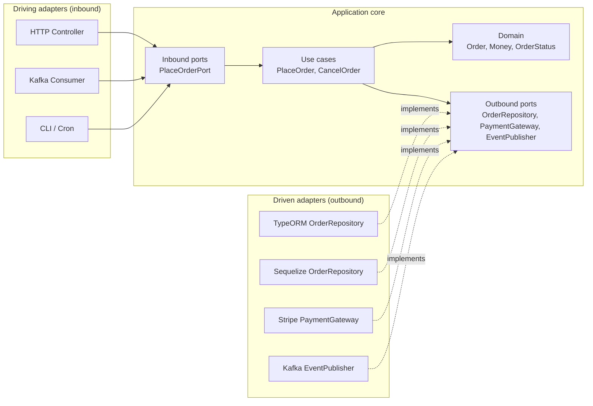
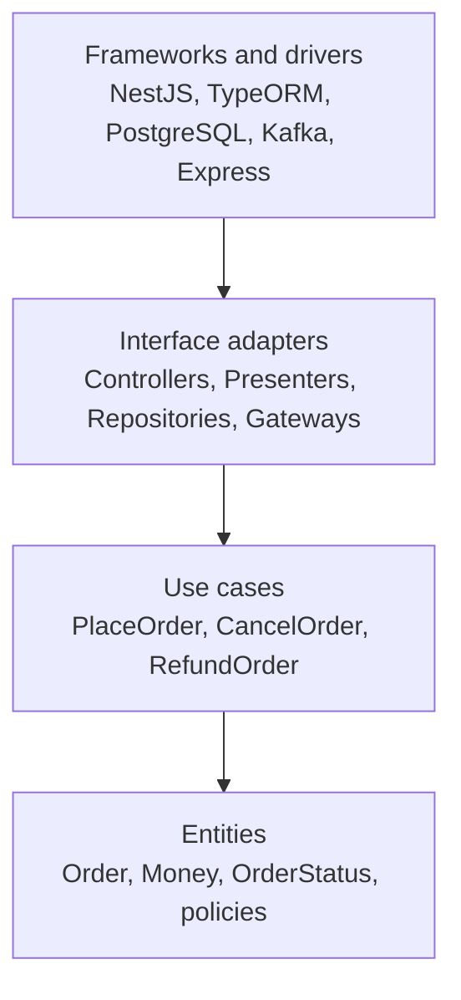

## 11.8 Hexagonal architecture (ports and adapters)

#### Concept

Hexagonal architecture, proposed by Alistair Cockburn, puts the application's core (domain model plus use cases) in the middle and surrounds it with **ports** and **adapters**. A port is an interface the core defines: "I need something that can save orders", "I need something that can charge a card". An adapter is a concrete implementation of a port using a specific technology: a TypeORM repository, a Stripe client, a Kafka consumer, an HTTP controller.

The core knows about ports. It never knows about adapters. The dependency arrows all point inward.

#### Why does it exist?

It exists to make the most valuable code in the system (business rules) independent of the most changeable code (frameworks, databases, third-party APIs). You can test the core with no database, no HTTP, no network, in milliseconds. You can swap Stripe for Razorpay by writing a new adapter. You can drive the same use case from REST, GraphQL, a Kafka message or a CLI without touching the core.

Without it, every business rule is entangled with TypeORM decorators and NestJS exceptions, and "let's add a second payment provider" means editing forty files.

#### Mental model

Imagine a laptop. The motherboard (core) exposes standard sockets: USB-C, HDMI, a headphone jack (ports). Any keyboard, monitor or headset (adapters) that fits the socket works. The motherboard does not care which brand of monitor you plug in, and the monitor manufacturer never sees the motherboard's schematics. Your business logic is the motherboard. TypeORM is one brand of monitor.

#### How it works



1. **Inbound (driving) ports** are the use-case interfaces: `PlaceOrderPort { execute(cmd): Promise<Result> }`. Controllers and consumers call them.
2. **Outbound (driven) ports** are the interfaces the core needs from the outside world: `OrderRepository`, `PaymentGateway`, `EventPublisher`, `Clock`.
3. **The domain** contains entities and value objects with behaviour (`order.cancel()` enforces the rules), and domain errors.
4. **Use cases** orchestrate: load through a port, call domain behaviour, save through a port, publish through a port.
5. **Adapters** implement the outbound ports (TypeORM, Stripe, Kafka) or call the inbound ports (HTTP, Kafka consumer).
6. **Wiring** happens in the NestJS module, using injection tokens: `{ provide: ORDER_REPOSITORY, useClass: TypeormOrderRepository }`.

The rule that makes this real in NestJS: **the `domain/` and `application/` folders contain no imports from `@nestjs/*`, `typeorm`, `sequelize`, `stripe` or `kafkajs`**. Only plain TypeScript. A lint rule enforces this.

#### Practical example

Orders in an e-commerce system. `PlaceOrderUseCase` needs to reserve inventory, create the order, and charge the customer. It depends on three ports. In production the adapters are TypeORM, a gRPC inventory client and Stripe. In tests they are in-memory fakes. In a load-test environment the payment adapter is a fake that always approves. None of that changes a line of the use case.

#### NestJS example

The domain, with no framework imports:

```ts
// src/modules/orders/domain/order.ts
import { Money } from '../../../shared-kernel/money';
import { DomainError } from '../../../shared-kernel/domain-error';

export type OrderStatus = 'CREATED' | 'PAID' | 'SHIPPED' | 'DELIVERED' | 'CANCELLED';

export class OrderLine {
  constructor(readonly productId: string, readonly qty: number, readonly unitPrice: Money) {
    if (qty <= 0) throw new DomainError('ORDER_LINE_QTY', 'qty must be positive');
  }
  get total(): Money { return this.unitPrice.multiply(this.qty); }
}

export class Order {
  private constructor(
    readonly id: string,
    readonly customerId: string,
    private _status: OrderStatus,
    readonly lines: OrderLine[],
    readonly createdAt: Date,
  ) {}

  static create(id: string, customerId: string, lines: OrderLine[], now: Date): Order {
    if (lines.length === 0) throw new DomainError('ORDER_EMPTY', 'order needs at least one line');
    return new Order(id, customerId, 'CREATED', lines, now);
  }

  static rehydrate(props: { id: string; customerId: string; status: OrderStatus; lines: OrderLine[]; createdAt: Date }) {
    return new Order(props.id, props.customerId, props.status, props.lines, props.createdAt);
  }

  get status(): OrderStatus { return this._status; }
  get total(): Money { return this.lines.reduce((sum, l) => sum.add(l.total), Money.zero('INR')); }

  markPaid(): void {
    if (this._status !== 'CREATED') throw new DomainError('ORDER_NOT_PAYABLE', `cannot pay order in ${this._status}`);
    this._status = 'PAID';
  }

  cancel(): void {
    if (this._status === 'SHIPPED' || this._status === 'DELIVERED') {
      throw new DomainError('ORDER_NOT_CANCELLABLE', `cannot cancel order in ${this._status}`);
    }
    this._status = 'CANCELLED';
  }
}
```

The outbound ports:

```ts
// src/modules/orders/application/ports/order.repository.ts
import { Order } from '../../domain/order';

export const ORDER_REPOSITORY = Symbol('ORDER_REPOSITORY');
export interface OrderRepository {
  findById(id: string): Promise<Order | null>;
  save(order: Order): Promise<void>;
}

// src/modules/orders/application/ports/payment.gateway.ts
import { Money } from '../../../../shared-kernel/money';

export const PAYMENT_GATEWAY = Symbol('PAYMENT_GATEWAY');
export interface PaymentGateway {
  charge(input: { orderId: string; amount: Money; idempotencyKey: string }): Promise<{ paymentId: string }>;
}
```

The use case, which depends only on ports and the domain:

```ts
// src/modules/orders/application/place-order.use-case.ts
import { Inject, Injectable } from '@nestjs/common'; // the ONLY framework import, for DI wiring
import { ORDER_REPOSITORY, OrderRepository } from './ports/order.repository';
import { PAYMENT_GATEWAY, PaymentGateway } from './ports/payment.gateway';
import { EVENT_PUBLISHER, EventPublisher } from './ports/event.publisher';
import { Order, OrderLine } from '../domain/order';
import { Money } from '../../../shared-kernel/money';

export interface PlaceOrderCommand {
  orderId: string; customerId: string;
  lines: { productId: string; qty: number; unitPriceMinor: number }[];
}

@Injectable()
export class PlaceOrderUseCase {
  constructor(
    @Inject(ORDER_REPOSITORY) private readonly orders: OrderRepository,
    @Inject(PAYMENT_GATEWAY) private readonly payments: PaymentGateway,
    @Inject(EVENT_PUBLISHER) private readonly events: EventPublisher,
  ) {}

  async execute(cmd: PlaceOrderCommand): Promise<{ orderId: string }> {
    const existing = await this.orders.findById(cmd.orderId);
    if (existing) return { orderId: existing.id }; // idempotent on client-generated id

    const lines = cmd.lines.map((l) => new OrderLine(l.productId, l.qty, Money.of(l.unitPriceMinor, 'INR')));
    const order = Order.create(cmd.orderId, cmd.customerId, lines, new Date());
    await this.orders.save(order);

    const { paymentId } = await this.payments.charge({
      orderId: order.id, amount: order.total, idempotencyKey: `order:${order.id}`,
    });
    order.markPaid();
    await this.orders.save(order);
    await this.events.publish({ type: 'OrderPaid', orderId: order.id, paymentId });
    return { orderId: order.id };
  }
}
```

Some teams keep even `@Inject` out of the application layer by using a small custom decorator re-export or by wiring with `useFactory`. That is a matter of taste; the important line is that nothing from `typeorm` or `stripe` appears here.

The TypeORM adapter, which maps between the persistence entity and the domain object:

```ts
// src/modules/orders/infrastructure/typeorm/typeorm-order.repository.ts
import { Injectable } from '@nestjs/common';
import { InjectRepository } from '@nestjs/typeorm';
import { Repository } from 'typeorm';
import { OrderRepository } from '../../application/ports/order.repository';
import { Order, OrderLine } from '../../domain/order';
import { OrderEntity } from './order.entity';
import { Money } from '../../../../shared-kernel/money';

@Injectable()
export class TypeormOrderRepository implements OrderRepository {
  constructor(@InjectRepository(OrderEntity) private readonly repo: Repository<OrderEntity>) {}

  async findById(id: string): Promise<Order | null> {
    const row = await this.repo.findOne({ where: { id }, relations: { lines: true } });
    if (!row) return null;
    return Order.rehydrate({
      id: row.id, customerId: row.customerId, status: row.status, createdAt: row.createdAt,
      lines: row.lines.map((l) => new OrderLine(l.productId, l.qty, Money.of(l.unitPriceMinor, 'INR'))),
    });
  }

  async save(order: Order): Promise<void> {
    const entity = this.repo.create({
      id: order.id, customerId: order.customerId, status: order.status, createdAt: order.createdAt,
      lines: order.lines.map((l) => ({ productId: l.productId, qty: l.qty, unitPriceMinor: l.unitPrice.minor })),
    });
    await this.repo.save(entity); // upsert by primary key
  }
}
```

And the module, which is the only place that knows both sides:

```ts
// src/modules/orders/orders.module.ts
import { Module } from '@nestjs/common';
import { TypeOrmModule } from '@nestjs/typeorm';
import { OrderEntity } from './infrastructure/typeorm/order.entity';
import { OrderLineEntity } from './infrastructure/typeorm/order-line.entity';
import { TypeormOrderRepository } from './infrastructure/typeorm/typeorm-order.repository';
import { StripePaymentGateway } from './infrastructure/stripe/stripe-payment.gateway';
import { KafkaEventPublisher } from './infrastructure/kafka/kafka-event.publisher';
import { PlaceOrderUseCase } from './application/place-order.use-case';
import { ORDER_REPOSITORY } from './application/ports/order.repository';
import { PAYMENT_GATEWAY } from './application/ports/payment.gateway';
import { EVENT_PUBLISHER } from './application/ports/event.publisher';
import { OrdersController } from './presentation/http/orders.controller';
import { OrderEventsConsumer } from './presentation/kafka/order-events.consumer';

@Module({
  imports: [TypeOrmModule.forFeature([OrderEntity, OrderLineEntity])],
  controllers: [OrdersController, OrderEventsConsumer],
  providers: [
    PlaceOrderUseCase,
    { provide: ORDER_REPOSITORY, useClass: TypeormOrderRepository },
    { provide: PAYMENT_GATEWAY, useClass: StripePaymentGateway },
    { provide: EVENT_PUBLISHER, useClass: KafkaEventPublisher },
  ],
})
export class OrdersModule {}
```

Swapping to Sequelize means one line: `useClass: SequelizeOrderRepository`. Testing the use case means passing fakes to the constructor, no NestJS test module required.

#### Sequelize example

A second adapter for the same port, demonstrating that the core does not care:

```ts
// src/modules/orders/infrastructure/sequelize/sequelize-order.repository.ts
import { Injectable } from '@nestjs/common';
import { InjectModel } from '@nestjs/sequelize';
import { OrderRepository } from '../../application/ports/order.repository';
import { Order, OrderLine } from '../../domain/order';
import { OrderModel } from './order.model';
import { OrderLineModel } from './order-line.model';
import { Money } from '../../../../shared-kernel/money';

@Injectable()
export class SequelizeOrderRepository implements OrderRepository {
  constructor(@InjectModel(OrderModel) private readonly model: typeof OrderModel) {}

  async findById(id: string): Promise<Order | null> {
    const row = await this.model.findByPk(id, { include: [OrderLineModel] });
    if (!row) return null;
    return Order.rehydrate({
      id: row.id, customerId: row.customerId, status: row.status, createdAt: row.createdAt,
      lines: row.lines.map((l) => new OrderLine(l.productId, l.qty, Money.of(l.unitPriceMinor, 'INR'))),
    });
  }

  async save(order: Order): Promise<void> {
    await this.model.sequelize!.transaction(async (t) => {
      await this.model.upsert({ id: order.id, customerId: order.customerId, status: order.status, createdAt: order.createdAt }, { transaction: t });
      await OrderLineModel.destroy({ where: { orderId: order.id }, transaction: t });
      await OrderLineModel.bulkCreate(
        order.lines.map((l) => ({ orderId: order.id, productId: l.productId, qty: l.qty, unitPriceMinor: l.unitPrice.minor })),
        { transaction: t },
      );
    });
  }
}
```

#### Production scenario

A payments module with three gateway adapters (Stripe for cards, Razorpay for UPI, a bank adapter for net banking). The `PAYMENT_GATEWAY` token resolves to a router adapter that picks by payment method. When Razorpay has an outage at 19:30 on a sale day, the on-call flips a config flag that routes UPI through a backup provider adapter. No deploy, because the routing lives in an adapter driven by config, and the use case never knew which provider it was talking to.

Test suite numbers: 640 use-case and domain tests run in 4 seconds with in-memory fakes; 45 adapter integration tests run in 90 seconds against a real PostgreSQL in Docker. Before hexagonal, the same coverage took 11 minutes because every test bootstrapped the whole NestJS module and a database.

#### Failure scenario

A team adopts hexagonal architecture but lets the TypeORM `OrderEntity` double as the domain `Order` "to avoid mapping code". Six months in, someone adds `@ManyToOne(() => CustomerEntity, { eager: true })` to load the customer name for an email. Now every `findById` in the use case pulls the customer row, and `order.customer.passwordHash` is reachable from domain code. A junior serialises the domain object in an event payload. The password hash ends up in Kafka, retained for 7 days, readable by every consumer team. The mapping code they skipped would have cost two hours; the incident cost a week and a security review.

#### Edge cases & failure modes

- **Anaemic domain.** Ports and adapters exist, but all rules still live in the use case as `if` chains and the domain objects are bags of fields. You paid for the ceremony and got no domain model.
- **Leaky ports.** `OrderRepository.queryBuilder(): SelectQueryBuilder<OrderEntity>` is not a port; it is TypeORM with an interface hat on.
- **Port explosion.** One interface per method. Group by capability, not per method.
- **Mapping drift.** Domain gains a field, the adapter mapper forgets it, data is silently dropped on save. Round-trip tests catch this.
- **Transactions across ports.** Two `save()` calls through two repositories are two transactions unless a Unit of Work (Part 12) wraps them.
- **Over-abstracting infrastructure that will never change.** You are not going to swap PostgreSQL for MongoDB. The value of the port is testability and clarity, not "database independence".

#### How a Senior Backend Engineer thinks about this

They apply hexagonal architecture where the domain has rules worth protecting: orders, payments, pricing, inventory allocation, subscriptions. They do not apply it to a `settings` CRUD module or a webhook that writes a row. They measure success by one question: *Can I test the rule that matters with no I/O?*

They accept that mapping code is boring and write it anyway. They keep ports narrow and adapter-shaped, and they enforce the "no framework in domain" rule with a lint plugin, not a code review comment.

#### Common mistakes

- Using the ORM entity as the domain entity.
- Ports that expose ORM types.
- Putting `@Entity` decorators in `domain/` because "it's just metadata".
- Creating a `BaseRepository<T>` with 30 generic methods and calling it a port.
- Applying the full pattern to every module including three-endpoint CRUD.

#### Interview questions

1. *What is a port and what is an adapter? Give one inbound and one outbound example.* Expected: interface defined by the core vs implementation; HTTP controller (inbound), TypeORM repository (outbound).
2. *Why must the domain have no `@nestjs` or `typeorm` imports?* Expected: dependency direction; testability; portability across entry points.
3. *How do you wire a port to an adapter in NestJS?* Expected: injection token (`Symbol` or string) with `useClass`/`useFactory` in the module; `@Inject(TOKEN)` in the consumer.
4. *What is the cost of hexagonal architecture and when is it not worth paying?* Expected: mapping code, more files, indirection; not worth it for thin CRUD.
5. *How do you keep a repository port from leaking the ORM?* Expected: return domain objects; accept domain objects; no `QueryBuilder` or `FindOptions` in the interface; specifications for complex queries.

#### Practical exercise

Refactor a layered `OrdersService` into hexagonal form: `domain/order.ts` with `markPaid()` and `cancel()` rules, `application/ports/`, `application/place-order.use-case.ts`, and two adapters (`TypeormOrderRepository`, `InMemoryOrderRepository`). Add an ESLint `no-restricted-imports` rule that forbids `typeorm`, `sequelize` and `@nestjs/*` (except `@nestjs/common` for `Inject`/`Injectable`) inside `domain/` and `application/`.

Acceptance criteria: the use-case test suite runs with no database and completes in under 1 second; switching the module's `useClass` to the in-memory adapter passes the same e2e tests; a `typeorm` import inside `domain/` fails lint.

## 11.9 Clean architecture

#### Concept

Clean architecture (Robert C. Martin) draws the system as concentric rings. Innermost: **entities** (enterprise business rules). Next: **use cases** (application business rules). Next: **interface adapters** (controllers, presenters, gateways, repositories). Outermost: **frameworks and drivers** (NestJS, TypeORM, PostgreSQL, Kafka, the web).

The one rule: **source code dependencies point inward.** Nothing in an inner ring knows the name of anything in an outer ring.

#### Why does it exist?

Same reason as hexagonal: protect business rules from infrastructure churn and make them testable. Clean architecture adds a stronger vocabulary for the layers and for what crosses their boundaries: **use cases** as first-class objects with explicit input and output models, and the insistence that data crossing a boundary is a simple structure (a DTO), never an entity or a database row.

#### Mental model

Imagine a medieval city. The keep in the centre holds the treasure (business rules). Around it, an inner wall (use cases), then the merchants' quarter (adapters), then the outer wall facing the fields and roads (frameworks). Traffic from the roads must pass through gates at each wall, showing papers (DTOs). Nobody in the keep has ever seen a road.

#### How it works



The rings map to a NestJS folder structure:

| Ring | Folder | Contains | May import |
| --- | --- | --- | --- |
| Entities | `domain/` | `Order`, `Money`, value objects, domain errors, domain events | nothing outside `domain/` and `shared-kernel/` |
| Use cases | `application/` | use cases, ports (interfaces), input/output models | `domain/` |
| Interface adapters | `infrastructure/`, `presentation/` | TypeORM repositories, Stripe gateway, controllers, DTOs, mappers | `application/`, `domain/`, frameworks |
| Frameworks | `main.ts`, modules, config | wiring | everything |

**Use cases** are the application's verbs. One class per use case with a single `execute()` method is the common style. It reads as a table of contents of what the system does: `PlaceOrderUseCase`, `CancelOrderUseCase`, `RefundOrderUseCase`, `ListOrdersForCustomerUseCase`.

**DTO mapping boundaries.** Three different shapes exist for "an order", and they must not be the same class:

1. The **request DTO** (`CreateOrderDto`, `class-validator` decorated) at the HTTP edge.
2. The **domain entity** (`Order`, with behaviour) inside.
3. The **persistence entity** (`OrderEntity`, TypeORM decorated) at the database edge.

Plus a **response DTO** for what goes back to the client. Mapping happens in the adapters: the controller maps request DTO to use-case input; the repository maps domain to persistence and back; the controller (or a presenter) maps use-case output to response DTO.

```ts
// src/modules/orders/presentation/http/orders.controller.ts
import { Body, Controller, Post, HttpCode } from '@nestjs/common';
import { PlaceOrderUseCase } from '../../application/place-order.use-case';
import { CreateOrderDto } from './dto/create-order.dto';
import { OrderCreatedResponse } from './dto/order-created.response';
import { randomUUID } from 'node:crypto';

@Controller('orders')
export class OrdersController {
  constructor(private readonly placeOrder: PlaceOrderUseCase) {}

  @Post()
  @HttpCode(201)
  async create(@Body() dto: CreateOrderDto): Promise<OrderCreatedResponse> {
    // Boundary 1: request DTO -> use-case input model (plain object)
    const result = await this.placeOrder.execute({
      orderId: dto.idempotencyKey ?? randomUUID(),
      customerId: dto.customerId,
      lines: dto.lines.map((l) => ({ productId: l.productId, qty: l.qty, unitPriceMinor: l.unitPriceMinor })),
    });
    // Boundary 2: use-case output -> response DTO
    return { orderId: result.orderId, status: 'PAID' };
  }
}
```

Domain errors are translated to HTTP at the edge with an exception filter, so the domain never throws `HttpException`:

```ts
// src/shared/http/domain-error.filter.ts
import { ArgumentsHost, Catch, ExceptionFilter, HttpStatus } from '@nestjs/common';
import { Response } from 'express';
import { DomainError } from '../../shared-kernel/domain-error';

const STATUS_BY_CODE: Record<string, number> = {
  ORDER_NOT_CANCELLABLE: HttpStatus.CONFLICT,
  ORDER_NOT_PAYABLE: HttpStatus.CONFLICT,
  ORDER_EMPTY: HttpStatus.UNPROCESSABLE_ENTITY,
  INSUFFICIENT_STOCK: HttpStatus.CONFLICT,
};

@Catch(DomainError)
export class DomainErrorFilter implements ExceptionFilter {
  catch(err: DomainError, host: ArgumentsHost) {
    const res = host.switchToHttp().getResponse<Response>();
    const status = STATUS_BY_CODE[err.code] ?? HttpStatus.BAD_REQUEST;
    res.status(status).json({ code: err.code, message: err.message });
  }
}
```

#### Production scenario

A subscription billing service: 14 use cases, 6 domain entities, 3 repositories, 2 gateways. The pricing rules (proration, trials, coupons, tax) live in `domain/` and have 300 unit tests that run in 2 seconds. Finance changes the proration rule quarterly; each change is a domain-only PR reviewed by one engineer and one finance analyst who can read the plain TypeScript. Nothing in `infrastructure/` changes. That is the payoff.

#### Edge cases & failure modes

- **Use-case explosion.** Sixty use-case classes with three lines each. Some teams group closely related operations into one application service; that is fine if the boundary rules hold.
- **Presenters and interactors ceremony.** The original book's `InputBoundary`/`OutputBoundary`/`Presenter` structure is rarely worth it in TypeScript. Returning a plain output object from `execute()` is enough.
- **Mapping fatigue.** Four representations of the same data. Use small mapper classes and round-trip tests; do not merge the representations.
- **Domain events swallowed.** The domain records events, but nobody publishes them because the use case forgot. Make the repository or unit of work publish recorded events after commit.

#### How a Senior Backend Engineer thinks about this

They see clean architecture as hexagonal architecture with a clearer vocabulary and a stricter DTO rule. They adopt the vocabulary (`domain`, `application`, `infrastructure`, `presentation`) as the team standard and apply the full ceremony only where the rules are rich. They are ruthless about the DTO boundary because that is where security incidents come from.

#### Interview questions

1. *Name the rings and the one rule.* Expected: entities, use cases, adapters, frameworks; dependencies point inward.
2. *Why are there three or four "order" classes and why not merge them?* Expected: request DTO, domain, persistence, response; different change reasons and different consumers; merging leaks data and couples layers.
3. *Where does a domain error become an HTTP 409?* Expected: at the edge, in an exception filter; domain never imports HTTP.
4. *How does a use case differ from a service in layered architecture?* Expected: single verb, explicit input/output models, depends on ports not ORM.

## 11.10 Onion architecture

#### Concept

Onion architecture (Jeffrey Palermo, 2008) is the same idea drawn slightly differently: a **domain model** core, a **domain services** ring, an **application services** ring, and an outer ring of **infrastructure, UI and tests**. Again, dependencies point inward, and infrastructure is at the edge.

The onion vocabulary adds one useful distinction: **domain services** (logic that involves several entities and belongs to the domain, like `PricingService.calculate(order, customer, promotions)`) versus **application services** (orchestration of a use case: load, call domain, save, publish).

#### Why the three are basically the same idea

Hexagonal, clean and onion were proposed independently over about a decade, and they converge on one principle:

> Put business rules in the centre. Make everything else depend on them. Never the reverse.

| Concern | Hexagonal | Clean | Onion |
| --- | --- | --- | --- |
| Centre | Application core | Entities + use cases | Domain model + domain services |
| Orchestration | Use cases / application | Use cases (interactors) | Application services |
| Interfaces owned by centre | Ports | Boundaries / gateways | Repository interfaces |
| Outside | Adapters | Interface adapters + frameworks | Infrastructure, UI, tests |
| Emphasis | Pluggable I/O | Dependency rule + DTO boundaries | Domain model richness |

Pick one vocabulary for your team and stick with it. The folder structure this book uses throughout (`domain/`, `application/`, `infrastructure/`, `presentation/`) satisfies all three.

#### Mental model

Imagine an onion. The core is the smallest and most protected. Each layer wraps the one inside it. You can peel the outer layers (swap the database, the web framework) without touching the core. Cutting from the outside in, you never find the core depending on the skin.

#### How it works in NestJS

The onion's "domain services" ring is where you place logic that needs multiple aggregates but no infrastructure:

```ts
// src/modules/orders/domain/services/pricing.service.ts
// Domain service: pure, no I/O, no framework. Injected into use cases or constructed directly.
import { Order } from '../order';
import { Money } from '../../../../shared-kernel/money';

export interface Promotion { code: string; percentOff: number; minTotalMinor: number }

export class PricingService {
  applyPromotions(order: Order, promos: Promotion[]): { total: Money; applied: string[] } {
    let total = order.total;
    const applied: string[] = [];
    for (const p of promos) {
      if (total.minor >= p.minTotalMinor) {
        total = total.subtract(total.percent(p.percentOff));
        applied.push(p.code);
      }
    }
    return { total, applied };
  }
}
```

The application service (use case) loads promotions through a port, calls the domain service, and saves. The domain service has no idea where promotions come from.

#### When this ceremony is worth it, and when it is over-engineering

Worth it when at least two of these hold:

- The module has **rules that change** (pricing, eligibility, state transitions, allocation, tax, compliance).
- The module has **more than one entry point** (HTTP plus Kafka plus cron).
- The module has **more than one infrastructure implementation** now or soon (two payment providers, a migration from Sequelize to TypeORM, an in-memory adapter for fast tests).
- The team is **larger than three** and needs a shared structure to review against.
- The module is **long-lived** (years, not a campaign microsite).

Over-engineering when:

- The module is **CRUD with validation**: settings, addresses, tags, admin lookups. A controller, a service and a repository with response DTOs is the correct architecture. Adding ports, use cases, domain objects and three mappers to `PUT /users/:id/address` produces 11 files for what should be 3, and every new engineer wastes a day tracing them.
- The **rules are in the database** anyway (unique constraints, checks) and the service is a thin pass-through.
- You are **prototyping** to learn the domain; the boundaries you draw now will be wrong.

A pragmatic rule many senior teams use: **start every module as layered with strict DTO boundaries; promote it to hexagonal/clean when the first real domain rule shows up, and not before.** The promotion is cheap if the DTO boundary was already there, because that is the part that is expensive to retrofit.

A decision table:

| Module | Rules | Entry points | Infra variants | Recommended |
| --- | --- | --- | --- | --- |
| User addresses | validation only | HTTP | 1 | Layered + response DTOs |
| Product catalog (read) | none | HTTP | 1 (plus cache) | Layered + cache adapter |
| Orders / checkout | many, changing | HTTP, Kafka, cron | 2 (TypeORM, in-memory) | Hexagonal / clean |
| Payments | many, regulated | HTTP, webhooks | 3 providers | Hexagonal / clean |
| Inventory allocation | concurrency rules | gRPC, Kafka | 1 (plus in-memory) | Hexagonal / clean |
| Admin reports | none | HTTP | read replica | Layered, raw SQL allowed |
| Notifications | templates, throttling | Kafka, cron | 3 channels | Hexagonal (ports per channel) |

#### Common mistakes across all three

- Confusing folder names with architecture. Having `domain/` does not mean you have a domain model.
- Applying it everywhere out of fear of being "unclean".
- Skipping the DTO boundary and keeping the ceremony: the worst of both worlds.
- Building "generic" abstractions (`BaseUseCase<TIn, TOut>`, `BaseRepository<T>`) that add nothing but hide types.

#### Interview questions

1. *Compare hexagonal, clean and onion.* Expected: same dependency principle, different vocabulary and emphasis; be able to map folders.
2. *What is a domain service and how is it different from an application service?* Expected: domain service is pure multi-entity logic; application service orchestrates I/O around a use case.
3. *When would you refuse to apply clean architecture?* Expected: CRUD modules, prototypes, tiny teams; explain the cost.
4. *What is the one part you would keep even in the simplest module?* Expected: the DTO boundary at the API edge; never return entities.

#### Practical exercise

Audit a NestJS codebase with at least five modules. For each, fill the decision table above (rules, entry points, infra variants) and recommend layered or hexagonal. Refactor exactly one module to hexagonal and leave one CRUD module layered, adding response DTOs to it.

Acceptance criteria: a written one-page rationale per module; the hexagonal module's use-case tests run without a database; the CRUD module returns no entity fields not declared in its response DTO.
