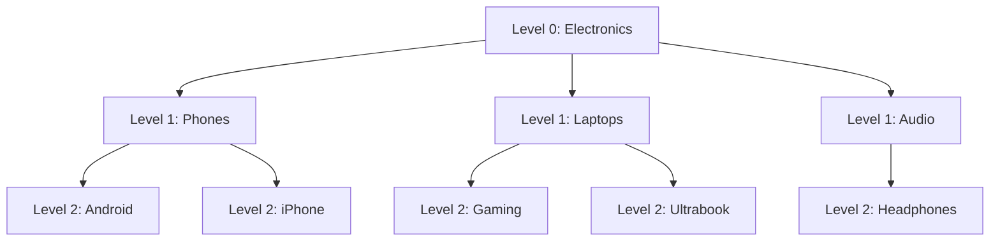

## 11.9 Recursion

#### Concept

Recursion is a function calling itself on a smaller piece of the problem until it reaches a piece small enough to answer directly (the base case). Trees are the natural home of recursion: "the total product count of a category is its own products plus the totals of its child categories" is a recursive definition, and the code that computes it looks exactly like the sentence.

In a backend, recursion appears in three places: walking hierarchies (categories, org charts, comment threads, folder structures), processing nested data (JSON, permission trees, nested DTOs), and in the database as recursive common table expressions (`WITH RECURSIVE`). It also appears in a fourth place nobody intends: as a stack overflow at 03:00.

#### Why does it exist?

Because hierarchical data has unbounded depth and recursion expresses "do this at every level" without knowing how many levels there are. Without recursion (or its iterative twin, an explicit stack), you would write loops with hard-coded depth limits, which break the day someone creates a category five levels deep.

The cost is that every recursive call adds a frame to the call stack, and the call stack in Node is small.

#### Mental model

Imagine a manager asked "how many people report to you, including indirectly?" She asks each direct report the same question, waits for their answers, adds them up, adds her direct reports, and replies. Each person in the chain is a stack frame: they are waiting, holding partial state, until the people below them answer. If the org chart is 12 levels deep, 12 people are waiting at once. If the org chart accidentally contains a loop (an intern listed as the CEO's manager), the question never comes back, and eventually everyone in the building is standing around waiting. That is a stack overflow.

#### How it works

1. **The call stack.** Each function call pushes a frame holding its arguments, local variables and return address. When the function returns, the frame is popped. Recursion of depth `d` has `d` frames alive at once.
2. **Node's stack limit.** V8's default stack is about 984 KB on 64-bit builds. A simple recursive function uses roughly 80–150 bytes per frame, so you get about 8,000–12,000 nested calls before `RangeError: Maximum call stack size exceeded`. Functions with more locals or arguments use bigger frames and overflow sooner. The `--stack-size` flag can raise the number V8 checks against, but it does not enlarge the actual thread stack the OS gave you, so setting it too high crashes the process with a segmentation fault instead of a catchable error. Treat the limit as fixed.
3. **Depth is the risk, not count.** A balanced category tree with a million nodes has depth about 20; recursion is safe. A comment thread where each reply is nested under the previous one is a linked list; at 15,000 replies it overflows.
4. **Recursion to iteration.** Any recursion can be rewritten with an explicit stack (an array you push to and pop from). The heap has gigabytes; the call stack has a megabyte. The rewrite is mechanical: what the recursive call would have received becomes what you push.
5. **Async recursion.** An `async` function that awaits and then calls itself does not overflow the call stack (each `await` unwinds the synchronous stack), but `return this.drain()` inside an async function chains promises, and each pending outer promise holds its frame's closure alive. A worker loop written as async recursion leaks memory proportional to iterations. Write worker loops as `while` loops.
6. **Recursive CTEs.** PostgreSQL evaluates `WITH RECURSIVE` iteratively: it runs the base query, then repeatedly runs the recursive part against the rows produced by the previous step, until a step produces no rows. There is no call stack; the "depth" is the number of iterations, and the working set is the rows of the current step. Unbounded depth in a cyclic graph means an infinite loop that fills a temp file, so you add a depth or path guard.

Building a tree from flat rows, recursively and iteratively:

```ts
// catalog/category-tree.ts
export interface CategoryRow { id: string; parentId: string | null; name: string; productCount: number; }
export interface CategoryNode extends CategoryRow { children: CategoryNode[]; subtreeProductCount: number; }

// O(n): index every row, then attach each node to its parent. No recursion needed to BUILD the tree.
export function buildTree(rows: CategoryRow[]): CategoryNode[] {
  const nodes = new Map<string, CategoryNode>();
  for (const r of rows) nodes.set(r.id, { ...r, children: [], subtreeProductCount: r.productCount });
  const roots: CategoryNode[] = [];
  for (const node of nodes.values()) {
    const parent = node.parentId ? nodes.get(node.parentId) : undefined;
    if (parent) parent.children.push(node); else roots.push(node);
  }
  return roots;
}

// Recursive post-order: children first, then the node. Fine for depth under ~1,000.
export function rollUpRecursive(node: CategoryNode): number {
  let total = node.productCount;
  for (const child of node.children) total += rollUpRecursive(child);
  node.subtreeProductCount = total;
  return total;
}

// Iterative post-order with an explicit stack: safe at any depth.
export function rollUpIterative(root: CategoryNode): void {
  const order: CategoryNode[] = [];
  const stack: CategoryNode[] = [root];
  while (stack.length > 0) {                 // pre-order traversal collecting nodes
    const n = stack.pop()!;
    order.push(n);
    for (const c of n.children) stack.push(c);
  }
  for (let i = order.length - 1; i >= 0; i -= 1) {   // reverse pre-order = children before parents
    const n = order[i];
    n.subtreeProductCount = n.productCount + n.children.reduce((s, c) => s + c.subtreeProductCount, 0);
  }
}
```

#### Practical example

An e-commerce catalog has 40,000 categories up to 8 levels deep. The storefront's left navigation needs the subtree under "Electronics" with product counts rolled up. Three ways to get it:

| Approach | Where the work happens | Cost | Best for |
|---|---|---|---|
| Load all 40,000 rows, `buildTree`, roll up | Node, `O(n)`, ~30 ms, ~10 MB | Once per deploy or per cache TTL | Whole-catalog navigation, cached |
| Recursive CTE from the subtree root | PostgreSQL, `O(subtree)` with an index on `parent_id` | ~2–10 ms for a few hundred rows | Ad hoc subtree queries |
| Materialized path or closure table | Precomputed on write; read is a single indexed range scan | `O(subtree)` read, `O(depth)` extra write cost | Read-heavy hierarchies with frequent subtree queries |

#### NestJS example

A service that returns a bounded subtree using a recursive CTE, with a depth cap and a cycle guard, then builds the tree in memory:

```ts
// catalog/categories.service.ts
import { Injectable, NotFoundException } from '@nestjs/common';
import { InjectDataSource } from '@nestjs/typeorm';
import { DataSource } from 'typeorm';
import { buildTree, rollUpIterative, CategoryNode, CategoryRow } from './category-tree';

@Injectable()
export class CategoriesService {
  constructor(@InjectDataSource() private readonly db: DataSource) {}

  async subtree(rootId: string, maxDepth = 6): Promise<CategoryNode> {
    // PostgreSQL walks the hierarchy one level per iteration; the path array stops cycles
    const rows: CategoryRow[] = await this.db.query(
      `WITH RECURSIVE sub AS (
         SELECT c.id, c.parent_id AS "parentId", c.name, c.product_count AS "productCount",
                0 AS depth, ARRAY[c.id] AS path
         FROM categories c WHERE c.id = $1
         UNION ALL
         SELECT c.id, c.parent_id, c.name, c.product_count, s.depth + 1, s.path || c.id
         FROM categories c
         JOIN sub s ON c.parent_id = s.id
         WHERE s.depth < $2 AND NOT c.id = ANY(s.path)
       )
       SELECT id, "parentId", name, "productCount" FROM sub`,
      [rootId, maxDepth],
    );
    if (rows.length === 0) throw new NotFoundException(`Category ${rootId} not found`);
    const roots = buildTree(rows);
    rollUpIterative(roots[0]);
    return roots[0];
  }
}
```

Note the two guards: `s.depth < $2` bounds the work, and `NOT c.id = ANY(s.path)` refuses to follow a cycle. Without them, a corrupted `parent_id` pointing back into the subtree makes the CTE loop forever.

#### PostgreSQL example

The plan for the recursive CTE, with the index that makes each iteration cheap:

```sql
CREATE INDEX CONCURRENTLY categories_parent_id_idx ON categories (parent_id);

EXPLAIN (ANALYZE, BUFFERS)
WITH RECURSIVE sub AS (
  SELECT id, parent_id, 0 AS depth, ARRAY[id] AS path FROM categories WHERE id = 'cat_electronics'
  UNION ALL
  SELECT c.id, c.parent_id, s.depth + 1, s.path || c.id
  FROM categories c JOIN sub s ON c.parent_id = s.id
  WHERE s.depth < 6 AND NOT c.id = ANY(s.path)
)
SELECT count(*) FROM sub;
```

```text
Aggregate  (actual time=3.912..3.913 rows=1 loops=1)
  CTE sub
    ->  Recursive Union  (actual time=0.021..3.640 rows=412 loops=1)
          ->  Index Scan using categories_pkey on categories  (actual time=0.018..0.019 rows=1 loops=1)
                Index Cond: (id = 'cat_electronics'::text)
          ->  Nested Loop  (actual time=0.015..0.480 rows=59 loops=7)
                ->  WorkTable Scan on sub s  (actual time=0.001..0.008 rows=59 loops=7)
                      Filter: (depth < 6)
                ->  Index Scan using categories_parent_id_idx on categories c  (actual time=0.004..0.006 rows=1 loops=412)
                      Index Cond: (parent_id = s.id)
                      Filter: (NOT (id = ANY (s.path)))
Execution Time: 3.960 ms
```

`loops=7` on the recursive part: seven iterations for a six-level subtree (the base plus six). Each iteration does one indexed lookup per row of the previous level. PostgreSQL 14 added built-in helpers: `CYCLE id SET is_cycle USING path` for cycle detection and `SEARCH DEPTH FIRST BY id SET ordercol` (or `BREADTH FIRST`) for ordered output.

#### TypeORM example

TypeORM ships tree entities that maintain a materialized path or closure table for you:

```ts
// catalog/category.entity.ts
import { Entity, PrimaryColumn, Column, Tree, TreeChildren, TreeParent } from 'typeorm';

@Entity('categories')
@Tree('materialized-path')          // stores an mpath column like "root.electronics.phones."
export class Category {
  @PrimaryColumn('text') id!: string;
  @Column('text') name!: string;
  @Column({ name: 'product_count', type: 'int', default: 0 }) productCount!: number;
  @TreeChildren() children!: Category[];
  @TreeParent() parent!: Category | null;
}

// catalog/categories.service.ts
const repo = this.dataSource.getTreeRepository(Category);
const root = await repo.findOneByOrFail({ id: 'cat_electronics' });
const tree = await repo.findDescendantsTree(root, { depth: 6 });   // one query: WHERE mpath LIKE 'root.electronics.%'
const ancestors = await repo.findAncestors(root);                   // breadcrumbs
```

The materialized-path read is a prefix `LIKE` on an indexed column: no recursion at all. The cost moves to writes: moving a subtree rewrites the `mpath` of every descendant.

#### Sequelize example

Sequelize has no tree support; run the recursive CTE directly:

```ts
import { QueryTypes } from 'sequelize';

const rows = await sequelize.query<CategoryRow>(
  `WITH RECURSIVE sub AS (
     SELECT id, parent_id AS "parentId", name, product_count AS "productCount", 0 AS depth, ARRAY[id] AS path
     FROM categories WHERE id = :rootId
     UNION ALL
     SELECT c.id, c.parent_id, c.name, c.product_count, s.depth + 1, s.path || c.id
     FROM categories c JOIN sub s ON c.parent_id = s.id
     WHERE s.depth < :maxDepth AND NOT c.id = ANY(s.path)
   )
   SELECT id, "parentId", name, "productCount" FROM sub`,
  { replacements: { rootId, maxDepth: 6 }, type: QueryTypes.SELECT },
);
```

#### Production scenario

A B2B ordering platform has customer organizations with nested cost centers (up to 10 levels). An approval workflow must find "the nearest ancestor cost center with an approver". With an index on `parent_id`, the recursive CTE walking upward does at most 10 iterations, each a primary-key lookup: about 0.5 ms. The same walk done from Node with one query per level costs 10 round trips, 10–20 ms, and holds a connection for the duration. The rule that falls out: recursion over rows should happen in one query, not in one query per level.

#### Failure scenario

At 21:40 every product page starts returning 500. The error is `RangeError: Maximum call stack size exceeded` from `computeBreadcrumbs`. The function walks `parent_id` upward recursively until it finds `null`. An admin used a bulk-edit tool to "move Electronics under Phones", which is a child of Electronics. The tree now has a cycle: Electronics -> Phones -> Electronics. The recursive walk never reaches `null` and overflows after about 11,000 frames, on every request that touches either category. The fix in the moment: a depth cap of 32 in the walk, returning an error instead of crashing. The fix that prevents recurrence: a cycle check before any `parent_id` update (the DFS section below), enforced in the database, not only in the admin UI.

#### Edge cases & failure modes

- **Deep chains.** Comment threads, linked-list-shaped data, or corrupted trees exceed the stack. Depth caps and iterative traversal.
- **Cycles.** Any recursion over user-editable parent pointers must assume a cycle is possible.
- **Deeply nested JSON.** `JSON.parse` handles depth well, but `JSON.stringify` and validation libraries that recurse (nested `@ValidateNested()` DTOs) can overflow or burn CPU on adversarial payloads. Cap request body size and nesting depth at the edge.
- **Recursive CTE without a stop condition** on cyclic data: runs until the temp space is exhausted.
- **Async recursion as a loop.** Memory grows with iterations because each pending promise retains its frame.
- **Unbounded fan-out.** A recursive "load children" that issues one query per node is `O(nodes)` round trips: the N+1 problem in tree form.
- **Stack overflow is thrown, not a crash,** so it can be caught; but state mutated on the way down is left half-updated. Design recursive updates to be idempotent or wrap them in a transaction.

#### How a Senior Backend Engineer thinks about this

The senior asks two questions of every recursive function: "What bounds the depth?" and "Who guarantees there is no cycle?" If the answer to either is "the data is always fine", the function gets a depth cap and a visited set before it ships.

They choose the storage model by the read/write ratio: adjacency list with recursive CTEs for write-heavy or rarely-read hierarchies; materialized path or closure table for read-heavy ones where subtree queries are hot. They keep hierarchy traversal inside one SQL statement rather than one query per level.

To a product manager: "Categories can be nested as deep as you like, but we enforce that a category cannot be moved inside its own descendants, because that creates a loop that no page can render."

#### Common mistakes

- Recursive traversal without a depth limit over data that users can edit.
- One database query per level (or per node) inside a recursive function.
- Raising `--stack-size` instead of converting to iteration.
- Using recursion to *build* a tree from flat rows when a two-pass `Map` does it in `O(n)`.
- Async worker loops written as recursion.
- Trusting `parent_id` integrity without a database-level cycle check.

#### Interview questions

1. **"How deep can recursion go in Node, and what happens when you exceed it? How do you make a tree traversal safe at any depth?"** Expected: roughly 10,000 frames with the default ~1 MB stack; `RangeError`; explicit-stack iteration. Follow-up: why not raise `--stack-size`? (Can exceed the OS thread stack and segfault.)
2. **"Explain how PostgreSQL executes `WITH RECURSIVE` and why it does not overflow."** Expected: iterative evaluation, working table per step, no stack; needs a stop condition on cyclic data.
3. **"Compare adjacency list plus recursive CTE, materialized path and closure table for a category tree."** Expected: write cost versus read cost; subtree move cost; index usage.
4. **"An admin can move a category under any other. What do you enforce and where?"** Expected: cycle check in a transaction with a lock, ideally also in the database.
5. **"Why is `async function loop() { await work(); return loop(); }` a memory leak?"** Expected: promise chain retains frames; use `while`.

#### Practical exercise

Seed a `categories` table with 50,000 rows, depth 8, and one deliberately introduced cycle. Implement the subtree service with the recursive CTE (with guards) and the iterative roll-up. Then write a recursive version with no guards and observe what happens when it touches the cycle.

Acceptance criteria:

- The guarded version returns the subtree in under 20 ms and skips the cycle.
- The unguarded version fails with a clear error you can explain (CTE side and Node side).
- You add a `CHECK`-style safeguard (a trigger or application-level check with a lock) that rejects the cycle-creating update.

## 11.10 Breadth-first search (BFS)

#### Concept

Breadth-first search explores a graph level by level: first everything one step from the start, then everything two steps away, and so on. It uses a queue (first in, first out) and a visited set. In an unweighted graph, the first time BFS reaches a node is via a shortest path (fewest hops), which is why BFS is the answer to "how many hops between these two users" and "which categories are at depth 2".

#### Why does it exist?

Because many backend questions are about *distance in hops*: degrees of separation, "friends of friends", "which pages are two clicks from the homepage", "level-order rendering of a menu". DFS would find *a* path but not the shortest; Dijkstra would work but is overkill when every edge costs the same. BFS is the simplest algorithm that gives the shortest hop count, and its level-by-level shape maps naturally onto batched database queries: one query per level.

#### Mental model

Imagine dropping a stone in a pond. The ripple reaches everything at distance 1 first, then distance 2, then 3. Each ring is a BFS level. If you want to know how far the far bank is, you count rings. If the pond is huge and you only care about things within three rings, you stop after three: that is a depth cap, and it is what keeps "friends of friends of friends" from touching the whole social graph.

#### How it works

1. Put the start node in a queue and in the visited set.
2. Pop the front of the queue. For each neighbor not yet visited: mark it visited, record its distance (parent's distance plus one) and optionally its parent, and push it to the back of the queue.
3. Repeat until the queue is empty or the target is found.
4. Complexity `O(V + E)`: every node enters the queue once, every edge is examined once. Memory `O(V)` for the visited set and, at worst, one whole level in the queue.

In a backend, the neighbors usually live in a database or Redis, and the important optimization is to expand a whole level with **one query**, not one query per node:



One query fetches all of level 1 (`WHERE parent_id = 'Electronics'`), one query fetches all of level 2 (`WHERE parent_id = ANY(level1Ids)`), and so on. A tree of depth 6 costs 6 round trips regardless of node count.

Three uses:

- **Shortest hops in a social graph.** "Is B within 3 hops of A?" BFS from A with a depth cap. For "shortest path between A and B" on a large graph, bidirectional BFS (expand from both ends and stop when the frontiers meet) reduces the explored set from `b^d` to roughly `2 * b^(d/2)`, which for branching factor 300 and depth 4 is 8 billion versus 180,000.
- **Crawling.** The URL frontier is a queue; the visited set is a `SET` in Redis (or a Bloom filter at web scale); BFS order gives broad coverage before depth; per-domain politeness is a rate limiter on dequeue. Depth caps and URL count caps stop a crawl of a calendar site from running until the year 9999.
- **Level-order category trees.** Menus rendered level by level, breadcrumbs, "show categories up to depth 2 for the mega-menu".

#### Practical example

A "people you may know" feature suggests friends of friends who are not already friends. That is BFS to depth 2 from the user, excluding depth-1 nodes and the user, ranked by how many depth-1 nodes connect to each candidate (mutual friend count). For a user with 300 friends who each have 300 friends, level 2 has up to 90,000 candidates; in practice, heavy overlap reduces that to a few thousand. Two batched queries, a `Map` for counting, one sort of a few thousand items: about 15 ms.

#### NestJS example

```ts
// social/social-graph.service.ts
import { Injectable } from '@nestjs/common';
import { InjectDataSource } from '@nestjs/typeorm';
import { DataSource } from 'typeorm';

@Injectable()
export class SocialGraphService {
  constructor(@InjectDataSource() private readonly db: DataSource) {}

  // Fewest hops from `from` to `to`, or null if not within maxDepth. One query per level.
  async degreesOfSeparation(from: string, to: string, maxDepth = 4, maxFrontier = 50_000): Promise<number | null> {
    if (from === to) return 0;
    const visited = new Set<string>([from]);
    let frontier: string[] = [from];

    for (let depth = 1; depth <= maxDepth; depth += 1) {
      // Expand the whole level with a single indexed query: friendships(user_id, friend_id)
      const rows: Array<{ friend_id: string }> = await this.db.query(
        `SELECT DISTINCT friend_id FROM friendships WHERE user_id = ANY($1::text[])`,
        [frontier],
      );
      const next: string[] = [];
      for (const { friend_id } of rows) {
        if (friend_id === to) return depth;
        if (!visited.has(friend_id)) { visited.add(friend_id); next.push(friend_id); }
      }
      if (next.length === 0) return null;                // graph exhausted
      if (next.length > maxFrontier) return null;        // fan-out guard: refuse to explode
      frontier = next;
    }
    return null;
  }
}
```

The `maxFrontier` guard is what makes this safe in production. One celebrity account with 5 million followers turns level 2 into millions of ids and the `ANY($1)` array into a 100 MB parameter.

#### PostgreSQL example

Level-order traversal inside PostgreSQL uses the recursive CTE, which is naturally breadth-first (each iteration is one level), and PostgreSQL 14's `SEARCH BREADTH FIRST` makes the ordering explicit:

```sql
WITH RECURSIVE reach AS (
  SELECT friend_id AS user_id, 1 AS depth FROM friendships WHERE user_id = $1
  UNION
  SELECT f.friend_id, r.depth + 1
  FROM friendships f JOIN reach r ON f.user_id = r.user_id
  WHERE r.depth < 3
)
SELECT user_id, min(depth) AS hops FROM reach WHERE user_id <> $1 GROUP BY user_id ORDER BY hops, user_id;
```

`UNION` (not `UNION ALL`) removes duplicate rows between iterations, which acts as a partial visited set; the `min(depth)` picks the shortest. For the category tree:

```sql
WITH RECURSIVE tree AS (
  SELECT id, parent_id, name, 0 AS depth FROM categories WHERE parent_id IS NULL
  UNION ALL
  SELECT c.id, c.parent_id, c.name, t.depth + 1 FROM categories c JOIN tree t ON c.parent_id = t.id
  WHERE t.depth < 2
) SEARCH BREADTH FIRST BY name SET ord
SELECT id, name, depth FROM tree ORDER BY ord;   -- level by level, alphabetical within a level
```

Index on `friendships(user_id)` and `categories(parent_id)` is what makes each iteration an index scan rather than a table scan.

#### Production scenario

A crawler for a price-comparison service must refresh 2 million product pages across 400 retailer domains. The frontier is a BullMQ queue; the visited set is a Redis `SET` of URL hashes (2 million 16-byte hashes: ~100 MB); per-domain politeness limits each domain to 2 requests per second via a token bucket. BFS order ensures every retailer's top-level category pages are fetched before any retailer's deep pages, so the "most-visited products" are refreshed in the first hour even if the whole crawl takes a day.

#### Failure scenario

At 14:22 the social service's memory triples and the pod is OOMKilled. The "mutual friends" endpoint was called for a user who follows a handful of celebrity accounts. Level 1 was 40 accounts; level 2 was 12 million ids (each celebrity's followers). The code built the level-2 array, the `ANY($1)` parameter and a `Set`, about 1.5 GB in total, then died. There was a depth cap but no frontier cap. The fix: cap the frontier, and for accounts over a follower threshold, exclude them from expansion (a "supernode" rule that every large social graph has).

#### Edge cases & failure modes

- **Supernodes.** One high-degree node makes a level explode. Frontier caps and supernode exclusion.
- **Missing visited set.** In a graph with cycles, BFS without `visited` never terminates.
- **Directed versus undirected.** Friendships are usually stored both ways; follows are directed. BFS on the wrong direction gives wrong answers silently.
- **Stale visited sets in crawlers.** Content changes; a visited set with no expiry never re-crawls. Use a "last crawled at" instead of a boolean.
- **Queue persistence.** A crawler frontier in process memory is lost on restart. Redis or a durable queue.
- **Huge `ANY($1)` parameters.** Tens of thousands of ids per query is fine; millions is not. Batch the frontier.

#### How a Senior Backend Engineer thinks about this

The senior asks what bounds the search: depth, frontier size, wall-clock budget. They want all three. They expand levels with batched queries and never one query per node. For hop-distance queries on a large graph that are hot (a friend-recommendation feed), they precompute offline and serve from a table, because BFS per request at scale is a CPU and I/O budget the request path cannot afford.

To a product manager: "Suggesting friends-of-friends is instant for most users. For users who follow celebrities, 'friends of friends' is millions of people, so we skip the celebrity links and use their other connections instead."

#### Common mistakes

- One query per node.
- No frontier cap; no supernode handling.
- Forgetting the visited set, or using an array for it (`includes` is `O(n)`).
- Using DFS when the shortest hop count is required.
- Putting the crawler frontier in process memory.

#### Interview questions

1. **"Compute degrees of separation between two users on a table of friendships. Complexity and production guards?"** Expected: BFS with one query per level, `O(V + E)` in reached nodes; depth cap, frontier cap, supernode exclusion. Follow-up: how does bidirectional BFS help?
2. **"Why is a recursive CTE naturally breadth-first?"** Expected: each iteration computes the next level from the previous one.
3. **"Design a polite crawler's frontier and visited set."** Expected: durable queue, hashed URL set with recrawl timestamps, per-domain rate limiting, depth and count caps.
4. **"When does BFS give the shortest path and when does it not?"** Expected: unweighted graphs only; weighted needs Dijkstra.
5. **"How would you serve 'people you may know' at 2,000 RPS?"** Expected: precompute offline (batch BFS), store top-N per user, serve from a table or Redis.

#### Practical exercise

Build a `friendships` table with 1 million users and about 100 million edges (average degree 100 with a few supernodes of degree 1 million). Implement `degreesOfSeparation` with per-level batching and guards. Measure the time and frontier sizes for a normal user pair and for a pair connected via a supernode.

Acceptance criteria:

- Normal pairs at distance 3 resolve in under 100 ms.
- Supernode pairs are refused or degraded predictably instead of exhausting memory.
- Each level is exactly one query (verify with query logging).

## 11.11 Depth-first search (DFS)

#### Concept

Depth-first search explores a graph by going as deep as it can along one path before backing up and trying the next. It uses a stack (the call stack when written recursively, or an explicit array) and a visited set. Where BFS answers "how far", DFS answers "is there a path", "does this graph contain a cycle", "in what order must these things be processed" and "which nodes belong together".

In backends, DFS is the workhorse for **cycle detection** in anything that can form a graph: dependency graphs, role hierarchies, category parents, workflow step definitions, module imports.

#### Why does it exist?

Because graphs with cycles break every algorithm that assumes they end: recursive traversals overflow, topological orders do not exist, permission resolution loops forever. Somebody has to check before the cycle is written, and DFS with three colors is the standard check. It also finds cycles in `O(V + E)`, which means you can afford to run it on every edge insert.

#### Mental model

Imagine exploring a cave system with a ball of string. You go down each tunnel as far as it goes, tying the string as you walk. If you ever walk into a chamber where your own string is already lying on the floor *and you have not yet left that chamber on the way back* (you are still inside it, on your current path), you have found a loop. Chambers you fully explored and left are safe to re-enter; they cannot be part of a loop that includes your current position. That distinction (still on the path versus already finished) is the three-color trick.

#### How it works

Three colors per node: **white** (unvisited), **gray** (on the current path, not finished), **black** (finished; all descendants explored).

1. Start at a node; mark it gray; push it.
2. For each neighbor: if white, recurse into it; if **gray**, you have found a back edge, which means a cycle; if black, ignore (already fully explored).
3. When all neighbors are done, mark the node black and pop it.
4. Repeat from every white node, so disconnected parts of the graph are covered.
5. Complexity `O(V + E)`. Memory `O(V)` for colors plus the stack depth.

The order in which nodes turn black (post-order) reversed is a topological order, which is why DFS and topological sorting are the same section in most textbooks; the topological sort section later in this part builds on this.


Adding "Support inherits Manager" while "Manager inherits Support" already holds creates a cycle. DFS from Manager finds Support gray on the path when it reaches the proposed edge.

#### Practical example

A role-based access system lets admins declare that one role inherits another (`Manager` inherits `Support`, which inherits `Viewer`). Effective permissions are the union of a role's own permissions and those of all ancestors, computed by a walk up the inheritance graph. If a cycle sneaks in, the walk never terminates. Every edge insert must therefore run a cycle check: "starting from the proposed parent, can I reach the proposed child?" If yes, the edge closes a loop and is rejected.

#### NestJS example

```ts
// authz/role-hierarchy.service.ts
import { ConflictException, Injectable } from '@nestjs/common';
import { InjectDataSource } from '@nestjs/typeorm';
import { DataSource } from 'typeorm';

@Injectable()
export class RoleHierarchyService {
  constructor(@InjectDataSource() private readonly db: DataSource) {}

  // Adds "child inherits parent". Serialized with an advisory lock so two concurrent
  // inserts cannot each pass the check and together form a cycle.
  async addInheritance(childRoleId: string, parentRoleId: string): Promise<void> {
    await this.db.transaction(async (tx) => {
      await tx.query(`SELECT pg_advisory_xact_lock(hashtext('role_inheritance'))`);

      const edges: Array<{ child_role_id: string; parent_role_id: string }> =
        await tx.query(`SELECT child_role_id, parent_role_id FROM role_inheritance`); // small graph: hundreds of rows

      const parents = new Map<string, string[]>();
      for (const e of edges) parents.set(e.child_role_id, [...(parents.get(e.child_role_id) ?? []), e.parent_role_id]);

      if (this.reaches(parents, parentRoleId, childRoleId)) {
        throw new ConflictException(`Role ${childRoleId} cannot inherit ${parentRoleId}: it would create a cycle`);
      }
      await tx.query(
        `INSERT INTO role_inheritance (child_role_id, parent_role_id) VALUES ($1, $2) ON CONFLICT DO NOTHING`,
        [childRoleId, parentRoleId],
      );
    });
  }

  // Iterative DFS: is `target` reachable from `start` by following parent edges?
  private reaches(parents: Map<string, string[]>, start: string, target: string): boolean {
    const visited = new Set<string>();
    const stack = [start];
    while (stack.length > 0) {
      const node = stack.pop()!;
      if (node === target) return true;
      if (visited.has(node)) continue;
      visited.add(node);
      for (const p of parents.get(node) ?? []) if (!visited.has(p)) stack.push(p);
    }
    return false;
  }
}
```

Reachability is enough here because we are checking one proposed edge: "would `child -> parent` close a loop?" is exactly "is `child` already reachable from `parent`?". The full three-color DFS is for validating an entire existing graph, which the topological sort section shows.

#### PostgreSQL example

The same check inside the database, with a recursive CTE, so that it holds even for writers that bypass the service:

```sql
-- Does parent_role reach child_role already? If any row comes back, the insert would create a cycle.
WITH RECURSIVE up AS (
  SELECT parent_role_id AS role_id, ARRAY[child_role_id, parent_role_id] AS path
  FROM role_inheritance WHERE child_role_id = $2          -- start from the proposed parent
  UNION ALL
  SELECT ri.parent_role_id, up.path || ri.parent_role_id
  FROM role_inheritance ri JOIN up ON ri.child_role_id = up.role_id
  WHERE NOT ri.parent_role_id = ANY(up.path)              -- guard against existing cycles
)
SELECT 1 FROM up WHERE role_id = $1 LIMIT 1;              -- $1 = proposed child
```

Wrap it in a trigger `BEFORE INSERT OR UPDATE ON role_inheritance` that raises an exception when a row is returned, and take `pg_advisory_xact_lock` in the trigger too, so concurrent inserts are serialized. Indexes on `role_inheritance(child_role_id)` and `(parent_role_id)` keep each iteration an index scan.

#### TypeORM example

Moving a category under a new parent is the same check on the category tree; here with a `QueryRunner` and pessimistic locking on the rows involved:

```ts
async moveCategory(categoryId: string, newParentId: string): Promise<void> {
  const runner = this.dataSource.createQueryRunner();
  await runner.connect();
  await runner.startTransaction();
  try {
    await runner.query(`SELECT pg_advisory_xact_lock(hashtext('categories_tree'))`);
    const rows: Array<{ id: string }> = await runner.query(
      `WITH RECURSIVE anc AS (
         SELECT id, parent_id, ARRAY[id] AS path FROM categories WHERE id = $1
         UNION ALL
         SELECT c.id, c.parent_id, anc.path || c.id FROM categories c JOIN anc ON c.id = anc.parent_id
         WHERE NOT c.id = ANY(anc.path)
       ) SELECT id FROM anc WHERE id = $2 LIMIT 1`,
      [newParentId, categoryId],
    );
    if (rows.length > 0) throw new ConflictException('Cannot move a category under its own descendant');
    await runner.manager.update(Category, { id: categoryId }, { parent: { id: newParentId } });
    await runner.commitTransaction();
  } catch (err) {
    await runner.rollbackTransaction();
    throw err;
  } finally {
    await runner.release();
  }
}
```

#### Production scenario

A workflow engine lets operations staff define order-processing pipelines as steps with "runs after" relationships. Pipelines have 10–60 steps. Every save runs a three-color DFS over the pipeline's steps (microseconds) and rejects cycles with a message naming the loop (`fraud_check -> manual_review -> fraud_check`). Because the check is `O(V + E)` on a tiny graph, it runs synchronously in the save request; nobody has to wait for a background validator.

#### Failure scenario

At 10:05 the authorization service's CPU pins at 100% on every pod and every API call that checks permissions times out. Two admins in different regions, three seconds apart, added `Auditor inherits Finance` and `Finance inherits Auditor`. Each request ran the reachability check, saw no cycle (the other edge was not committed yet), and inserted. The effective-permission resolver, a recursive walk with no visited set, now loops forever on any role touching either. The outage lasts 40 minutes while someone finds and deletes the offending edge by hand. The post-mortem yields three changes: an advisory lock around check-and-insert, a visited set in the resolver, and the database-level trigger so no future code path can skip the check.

#### Edge cases & failure modes

- **Check-then-insert race.** Two concurrent inserts each pass the check. Serialize with an advisory lock or `SERIALIZABLE` isolation.
- **Existing cycles.** A cycle already in the data makes the reachability CTE loop; the path guard is mandatory.
- **Recursion depth.** Long inheritance chains (rare) or deep category trees; the iterative version avoids stack limits.
- **Self-loops.** `child = parent`; check explicitly.
- **Directed versus undirected.** Cycle detection in undirected graphs is different (a parent-child edge looks like a cycle if you follow it both ways); use union-find or track the parent.
- **Graph too large to load.** For graphs of millions of edges, do the DFS in the database (CTE) or in a graph store; loading the whole edge set per check is `O(E)` per request.

#### How a Senior Backend Engineer thinks about this

Any table with a self-reference (`parent_id`, `inherits_from`, `depends_on`) is a graph, and the senior asks "what stops it becoming cyclic?" on the day the table is created. They put the check as close to the data as possible (trigger or constraint-like CTE), serialize writers, and make every reader defensive with visited sets and depth caps even though the writer check exists, because data gets imported, migrated and hand-edited.

To a product manager: "A role cannot inherit from a role that already inherits from it, in any number of steps. We check that instantly on save and reject it with a message showing the loop."

#### Common mistakes

- Reachability check without a lock.
- Readers without visited sets, trusting that writers prevented cycles.
- Using BFS or DFS interchangeably without noting that only DFS with colors detects cycles in directed graphs simply.
- Loading a huge edge set into memory per check.
- Cycle checks only in the UI.

#### Interview questions

1. **"Detect a cycle in a directed graph. Explain the three-color method and its complexity."** Expected: white/gray/black; gray neighbor means back edge; `O(V + E)`. Follow-up: how does it differ for undirected graphs?
2. **"An admin adds a role-inheritance edge. What do you check, and how do you make it safe under concurrency?"** Expected: reachability from proposed parent to proposed child; advisory lock or serializable transaction.
3. **"Why is DFS post-order related to topological sorting?"** Expected: reversed finish order respects all edges.
4. **"How do you do cycle detection inside PostgreSQL?"** Expected: recursive CTE with a path array guard, or `CYCLE` clause in PG14+, in a trigger.
5. **"A permission resolver hangs. Walk me through the diagnosis."** Expected: suspect a cycle; CPU profile shows the resolver; add visited set; find the edge with the CTE.

#### Practical exercise

Implement `RoleHierarchyService.addInheritance` with the advisory lock and a Jest test that fires two conflicting inserts concurrently (two transactions in parallel). Then add the PostgreSQL trigger and prove that a raw SQL insert bypassing the service is rejected too.

Acceptance criteria:

- The concurrent test always ends with exactly one edge committed and one `ConflictException`.
- A direct `INSERT` that would create a cycle fails with the trigger's error.
- The effective-permission resolver has a visited set and a test with a hand-crafted cycle that proves it terminates.
