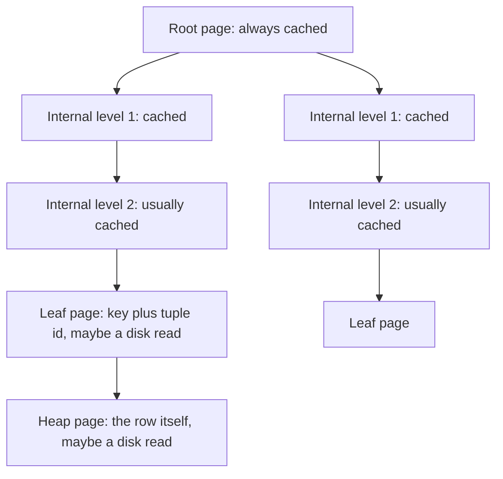
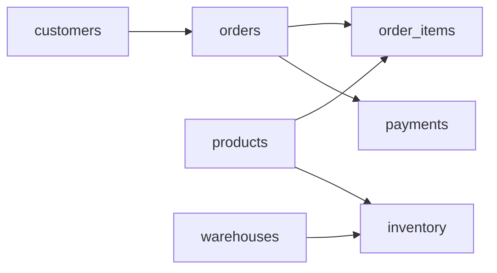

## 11.20 Worked example: database indexing, or why a B-tree lookup is O(log n) and what that costs in disk reads

#### Concept

A B-tree index is a balanced tree of fixed-size pages, sorted by key, with a very high fan-out: each page holds hundreds of keys and pointers to child pages. Finding a key means descending from the root, choosing one child per level, until you reach a leaf that points to the table row. Because each page holds hundreds of children, the tree is extremely shallow: a billion rows fit in a tree four levels deep. That is the concrete meaning of `O(log n)` for a database index, and it is why a primary-key lookup on a billion-row table takes about the same time as one on a thousand-row table.

#### Why does it exist?

Because the alternative is reading the table. A billion rows at 100 bytes each is 100 GB; a sequential scan at 1 GB/s from fast storage takes about two minutes. A B-tree descent touches four or five 8 KB pages: under a millisecond. Every `WHERE id = $1`, every foreign-key join, every `ORDER BY ... LIMIT` on an indexed column, every keyset-paginated page depends on this structure.

#### Mental model

Imagine a library with a billion books, sorted by title on the shelves. The catalog's top card says "A–F: floor 1, G–M: floor 2..."; each floor's card says which aisle; each aisle's card says which shelf; the shelf card says which position. Four cards, each narrowing the search by a factor of hundreds, and you are holding the book. The cards for the floors and aisles are used so often that the librarian keeps them on the desk (cache); only the shelf card and the walk to the shelf require leaving the desk (disk reads).

#### How it works

PostgreSQL's B-tree, in the numbers that matter:

1. **Pages.** Every index page is 8 KB. A leaf entry for a `bigint` key is the 8-byte key plus an 8-byte header plus a 6-byte tuple id (the row's physical address), aligned to 16 bytes, plus a 4-byte line pointer: about 20 bytes. Leaves are filled to about 90% by default (`fillfactor`), giving roughly 350–400 entries per leaf page. Internal pages hold one key and one child pointer per child: about the same count.
2. **Height.** With fan-out 400: 400 rows fit in one leaf; 160,000 rows in two levels; 64 million in three; 25 billion in four. So a billion-row table with a `bigint` primary key has a B-tree of height 4: one root, two internal levels, one leaf level. That is `log₄₀₀(10⁹) ≈ 3.5`, rounded up.
3. **Reads per lookup.** Four index pages plus one heap page for the row: five page reads. The root and the first internal level together are a few thousand pages (the top three levels of a billion-row index are about 7,000 pages, 56 MB), which live permanently in `shared_buffers` or the OS cache on any busy system. The leaf page and the heap page are the ones that may actually hit disk. Realistic cost of a point lookup on a cold billion-row table: two random reads, about 100–200 µs on NVMe, plus CPU: well under a millisecond. Warm: about 20–50 µs.
4. **Size.** A billion-row `bigint` index needs about 2.8 million leaf pages: roughly 22 GB. That is the price of `O(log n)`, paid in storage and in write amplification (every insert updates every index on the table).
5. **Range scans.** Leaves are linked in key order, so after the descent, `WHERE id BETWEEN a AND b` or `ORDER BY id LIMIT 50` walks siblings sequentially: `O(log n + k)`.



Seeing the height directly, with the `pageinspect` extension:

```sql
CREATE EXTENSION IF NOT EXISTS pageinspect;
SELECT level AS root_level, root, fastroot FROM bt_metap('orders_pkey');
-- level 3 means four levels (0 = leaves): root at level 3, two internal levels, leaves
SELECT pg_size_pretty(pg_relation_size('orders_pkey')) AS index_size,
       pg_size_pretty(pg_relation_size('orders')) AS table_size;
```

And the buffer accounting of one lookup:

```sql
EXPLAIN (ANALYZE, BUFFERS) SELECT * FROM orders WHERE id = 734_112_908;
```

```text
Index Scan using orders_pkey on orders  (cost=0.57..8.59 rows=1 width=142) (actual time=0.188..0.190 rows=1 loops=1)
  Index Cond: (id = 734112908)
  Buffers: shared hit=4 read=1
Planning Time: 0.061 ms
Execution Time: 0.211 ms
```

`shared hit=4 read=1`: four pages found in cache (root, two internal, leaf), one page read from disk (the heap row), 0.2 ms total on a table with 900 million rows.

#### Practical example

The choices that follow from the mechanics:

- **Composite column order.** An index on `(customer_id, created_at)` is sorted by customer first, so `WHERE customer_id = $1 AND created_at > $2` descends once and walks a range. The same index cannot efficiently answer `WHERE created_at > $2` alone; that predicate is spread across every customer's section.
- **Covering indexes.** `CREATE INDEX ... ON orders (customer_id, created_at) INCLUDE (status, total_cents)` lets `SELECT status, total_cents ...` be an index-only scan: the heap page read disappears, if the visibility map says the page is all-visible.
- **Partial indexes.** `CREATE INDEX ... ON orders (created_at) WHERE status = 'pending'` indexes only the small hot subset; a 1% subset makes the index 100x smaller and its writes 100x rarer.
- **What B-trees cannot do.** Leading-wildcard `LIKE`, arbitrary functions on the column without an expression index, and full-text search. Those are the next worked example.

#### NestJS example

Index declarations belong with the entity so migrations and code agree:

```ts
// orders/order.entity.ts
import { Entity, PrimaryGeneratedColumn, Column, Index, CreateDateColumn } from 'typeorm';

@Entity('orders')
@Index('orders_customer_created_idx', ['customerId', 'createdAt'])                       // composite for the customer timeline
@Index('orders_pending_created_idx', ['createdAt'], { where: `"status" = 'pending'` })   // partial: the hot 1%
export class Order {
  @PrimaryGeneratedColumn('increment', { type: 'bigint' }) id!: string;
  @Column({ name: 'customer_id', type: 'bigint' }) customerId!: string;
  @Column({ type: 'text' }) status!: string;
  @Column({ name: 'total_cents', type: 'bigint' }) totalCents!: string;
  @CreateDateColumn({ name: 'created_at', type: 'timestamptz' }) createdAt!: Date;
}
```

A repository method whose plan you have verified, with the exact-count trap avoided:

```ts
// orders/orders.repository.ts
async pendingSince(since: Date, limit = 500): Promise<Order[]> {
  // Uses orders_pending_created_idx: descent + range walk, O(log n + limit)
  return this.repo.createQueryBuilder('o')
    .where(`o.status = 'pending' AND o.created_at >= :since`, { since })
    .orderBy('o.created_at', 'ASC')
    .limit(limit)
    .getMany();
}
```

Never pair this with `getManyAndCount()` on a large table without thinking: `count(*)` over a billion rows is a full scan of the index or table, minutes, and no B-tree makes it `O(log n)`. Use an estimate from `pg_class.reltuples` or a maintained counter for large totals.

#### Sequelize example

```ts
Order.init({ /* columns */ }, {
  sequelize, tableName: 'orders', underscored: true,
  indexes: [
    { name: 'orders_customer_created_idx', fields: ['customer_id', 'created_at'] },
    { name: 'orders_pending_created_idx', fields: ['created_at'], where: { status: 'pending' } },
  ],
});
```

#### Production scenario

An `events` table grows by 40 million rows a day and is queried by `(tenant_id, occurred_at)`. At 3 billion rows the composite index is 90 GB, height 4, and point-in-range queries still run in 1–2 ms because the top levels are cached. The write side is the cost: each insert adds an entry to the primary key index and the composite index, about 25 µs of CPU and later write I/O per row, plus WAL. Partitioning by month keeps each partition's indexes smaller (height 3) and makes dropping old data a `DROP TABLE` rather than a billion-row `DELETE`; see the partitioning material in the database parts of this handbook.

#### Failure scenario

At 10:15 the orders API's p99 jumps from 4 ms to 900 ms after a "small" deploy. The deploy added `ORDER BY updated_at DESC` to the customer orders list. The composite index is `(customer_id, created_at)`; `updated_at` is not in it. For a customer with 400,000 orders, PostgreSQL now walks the whole customer section of the index, fetches 400,000 heap rows, and sorts them (external merge, 50 MB of temp files) to return 50. The plan went from `Index Scan` with a `Limit` to `Sort` over `Index Scan`. The fix was a new composite `(customer_id, updated_at DESC, id DESC)` built `CONCURRENTLY`; the process fix was requiring `EXPLAIN` output on production-sized data in the PR for any query change.

#### Edge cases & failure modes

- **Bloat.** Frequent updates leave dead entries; the tree grows and descents touch more pages. Monitor with `pgstattuple`, fix with `REINDEX CONCURRENTLY`.
- **Sequential keys and the rightmost leaf.** Monotonic keys (bigserial, time) concentrate inserts on one leaf page, which is fine for B-trees (PostgreSQL handles it well) but makes that page a hot spot for lock contention at very high insert rates.
- **UUID v4 keys.** Random keys spread inserts across the whole index: more page splits, worse cache locality, larger WAL. UUIDv7 (time-ordered) avoids most of it.
- **Index too wide.** Indexing `text` columns of hundreds of bytes lowers fan-out from 400 to 20 and adds levels.
- **Too many indexes.** Fifteen indexes means fifteen B-tree inserts per row.
- **Statistics stale.** The planner chooses a sequential scan because it thinks the table is small; `ANALYZE`.
- **Index build on a busy table.** Plain `CREATE INDEX` locks writes; always `CONCURRENTLY` in production, and handle the invalid-index case if it fails.

#### How a Senior Backend Engineer thinks about this

The senior thinks in page reads. They know the tree height for the big tables, know which levels are cached, and read `Buffers: shared hit/read` as the true cost. They design indexes from access paths, not from columns, and count the write amplification of each one. They know the `O(log n)` promise applies to descents and bounded range walks, never to counts, aggregates or unbounded ranges.

To a product manager: "Looking up any order among a billion takes four steps, and three of those are in memory. What is slow is *counting* orders or *sorting* a customer's whole history; those touch everything, and we design around them."

#### Common mistakes

- Sorting by an unindexed column on a large filtered set.
- `count(*)` for pagination totals on big tables.
- Wide text columns as leading index keys.
- One index per query instead of a designed set.
- Building indexes without `CONCURRENTLY`.

#### Interview questions

1. **"How many disk reads does a primary-key lookup on a billion-row table cost, and why?"** Expected: height 4 tree, top levels cached, one leaf and one heap page from disk: about two random reads. Follow-up: what changes with an index-only scan?
2. **"Why can't the index on `(customer_id, created_at)` serve `ORDER BY updated_at`?"** Expected: sort order is by leading columns; a different column requires a walk and a sort.
3. **"What does `Buffers: shared hit=4 read=1` tell you?"** Expected: four cached pages, one disk read; the tree descent plus the heap fetch.
4. **"Compare bigserial, UUID v4 and UUID v7 as primary keys from the B-tree's point of view."** Expected: locality, page splits, WAL volume.
5. **"Is `count(*)` O(log n) with an index?"** Expected: no; it visits every matching entry.

#### Practical exercise

Create a 100-million-row table with a `bigint` primary key and a composite index. Use `bt_metap` to read the tree height, `pg_relation_size` for sizes, and `EXPLAIN (ANALYZE, BUFFERS)` for a cold and a warm point lookup, a range walk with `LIMIT`, and a `count(*)`.

Acceptance criteria:

- You can state the tree height and estimate reads per lookup before measuring, and the buffer counts agree.
- The cold lookup shows `read` buffers, the warm lookup shows only `hit`.
- You explain in one paragraph why the `count(*)` cost is what it is.

## 11.21 Worked example: search, from prefix tries to trigrams and `pg_trgm`

#### Concept

"Search" in a product backend usually means three different problems: **prefix search** (autocomplete: "iph" finds "iPhone 15"), **substring or fuzzy search** ("ipone" or "phone 15" finds "iPhone 15") and **full-text search** (ranked matching on words and stems across long text). Each has a data structure that makes it fast: a trie or sorted index for prefixes, n-gram (trigram) indexes for substrings and typos, inverted indexes (`tsvector`) for full text. PostgreSQL provides all three; an in-process trie serves the hottest autocomplete cases.

#### Why does it exist?

Because `LIKE '%term%'` over a million product names is a sequential scan with a string comparison per row: 200–500 ms per keystroke, and autocomplete fires on every keystroke. Prefix structures turn that into `O(length of the prefix)` or `O(log n)`; trigram indexes turn substring and typo-tolerant search into an index lookup on the pieces of the query.

#### Mental model

Imagine a dictionary. Finding words starting with "pho" is opening at "pho" and reading forward: the dictionary's alphabetical order is the index. Finding words *containing* "hon" is impossible that way; you would need a second book listing, for every three-letter chunk, all the words that contain it: "hon: honey, phone, iPhone, Honda". That second book is the trigram index. To find "ipone" (a typo), you look up its chunks ("ipo", "pon", "one") and rank words by how many chunks they share: "iPhone" shares "one" and, after lowercasing and padding, more than anything else.

#### How it works

**Trie (prefix tree).** Each node is a character; a path from the root spells a prefix; nodes mark word ends and can carry a payload (popularity). Lookup is `O(L)` for a prefix of length `L`, independent of the vocabulary size. In JavaScript each node is an object with a `Map` of children, about 100 bytes per node, so 200,000 terms with an average of 15 characters and heavy prefix sharing is roughly 1.5 million nodes, 150 MB. That is fine for a bounded vocabulary (cities, categories, brand names, top search terms) loaded once per process; it is not fine for a 10-million-product catalog. For ranked completions, precompute each node's top-k terms at build time so a lookup is `O(L + k)` with no traversal.

```ts
// search/trie.ts
interface TrieNode { children: Map<string, TrieNode>; topK: Array<{ term: string; score: number }>; }

export class PrefixTrie {
  private readonly root: TrieNode = { children: new Map(), topK: [] };
  constructor(private readonly k = 8) {}

  // O(L) per insert, plus O(L * k) to maintain each prefix's top-k list
  insert(term: string, score: number): void {
    let node = this.root;
    for (const ch of term.toLowerCase()) {
      let next = node.children.get(ch);
      if (!next) { next = { children: new Map(), topK: [] }; node.children.set(ch, next); }
      node = next;
      node.topK.push({ term, score });
      node.topK.sort((a, b) => b.score - a.score);      // k is tiny, so this is effectively O(k)
      if (node.topK.length > this.k) node.topK.length = this.k;
    }
  }

  // O(L): walk the prefix, return the precomputed completions
  complete(prefix: string): string[] {
    let node = this.root;
    for (const ch of prefix.toLowerCase()) {
      const next = node.children.get(ch);
      if (!next) return [];
      node = next;
    }
    return node.topK.map((e) => e.term);
  }
}
```

**Prefix search in PostgreSQL.** A B-tree can serve `LIKE 'pho%'` if the index uses byte-order comparison: either the column has `COLLATE "C"` or the index uses `text_pattern_ops`. Then the query is a range scan from `'pho'` to `'php'`, `O(log n + k)`, and the same index provides `ORDER BY name`.

**Trigram (n-gram) search in PostgreSQL.** `pg_trgm` breaks strings into overlapping three-character chunks (with padding, so "phone" becomes `"  p"`, `" ph"`, `"pho"`, `"hon"`, `"one"`, `"ne "`). A GIN index maps each trigram to the rows containing it. `LIKE '%hon%'`, `ILIKE`, regular expressions and the similarity operators (`%`, `<->`, `word_similarity`) all become: split the query into trigrams, look each up, intersect or score the row sets, then recheck the candidates against the real condition. Cost is proportional to the posting lists of the query's trigrams, not to the table. The GIN index is typically 2–3x the size of the indexed text and slows inserts noticeably; `fastupdate` batches insertions in a pending list.

**Full-text search.** `to_tsvector` tokenizes, stems and removes stop words; a GIN index on the `tsvector` makes `@@ to_tsquery(...)` fast; `ts_rank` orders results. It is the right tool for descriptions and documents, not for SKUs or names with typos.

| Need | Structure | Where | Cost per query | Notes |
|---|---|---|---|---|
| Autocomplete over a bounded vocabulary | Trie with top-k | In process | O(L + k), no I/O | Rebuild on a schedule; ~100 bytes per node |
| Prefix on a large table | B-tree with `text_pattern_ops` or `COLLATE "C"` | PostgreSQL | O(log n + k) | Also serves `ORDER BY` |
| Substring, `ILIKE`, typos | GIN trigram index (`pg_trgm`) | PostgreSQL | Proportional to posting lists | 2–3x text size; slower writes |
| Words, stems, ranking over long text | GIN on `tsvector` | PostgreSQL | Proportional to posting lists | Language-aware |
| Faceting, relevance tuning, multi-field at very high volume | Inverted index engine (OpenSearch and similar) | External | ms | A second system to operate and keep in sync |
| Lexicographic autocomplete of short keys | Sorted set with `ZRANGEBYLEX` | Redis | O(log n + k) | Good for very hot, tiny payloads |

#### Practical example

A storefront search box: as the user types, the first request hits the in-process trie of the 100,000 most-searched terms (`O(L)`, microseconds); if it returns fewer than 5 results, a second request runs a trigram query against 2 million product names (5–20 ms). Submitting the search runs the trigram query plus a Levenshtein re-rank of the top 100 (the DP from the dynamic programming section), then falls through to full-text search on descriptions when names produce nothing.

#### NestJS example

```ts
// search/search.service.ts
import { Injectable, OnModuleInit, Logger } from '@nestjs/common';
import { Cron, CronExpression } from '@nestjs/schedule';
import { InjectDataSource } from '@nestjs/typeorm';
import { DataSource } from 'typeorm';
import { PrefixTrie } from './trie';

@Injectable()
export class SearchService implements OnModuleInit {
  private readonly logger = new Logger(SearchService.name);
  private trie = new PrefixTrie(8);

  constructor(@InjectDataSource() private readonly db: DataSource) {}

  async onModuleInit(): Promise<void> { await this.rebuildTrie(); }

  @Cron(CronExpression.EVERY_10_MINUTES)
  async rebuildTrie(): Promise<void> {
    const rows: Array<{ term: string; score: number }> = await this.db.query(
      `SELECT term, hits AS score FROM popular_search_terms ORDER BY hits DESC LIMIT 100000`);
    const fresh = new PrefixTrie(8);
    for (const r of rows) fresh.insert(r.term, r.score);
    this.trie = fresh;                                                 // atomic swap; ~150 ms to build
    this.logger.log(`autocomplete trie rebuilt with ${rows.length} terms`);
  }

  suggest(prefix: string): string[] {
    return prefix.length >= 2 ? this.trie.complete(prefix.slice(0, 40)) : [];   // bound L
  }

  async fuzzyProducts(q: string, limit = 20): Promise<Array<{ id: string; name: string; sim: number }>> {
    // Trigram shortlist via GIN, ranked by similarity; the % operator uses pg_trgm.similarity_threshold
    return this.db.query(
      `SELECT id, name, similarity(name, $1) AS sim
       FROM products
       WHERE name % $1
       ORDER BY name <-> $1
       LIMIT $2`, [q.slice(0, 100), limit]);
  }
}
```

The two `slice` calls are the algorithmic safety: `L` bounded at 40 for the trie, 100 characters for the trigram query, because both costs scale with query length.

#### PostgreSQL example

```sql
CREATE EXTENSION IF NOT EXISTS pg_trgm;

-- Prefix: byte-order B-tree
CREATE INDEX CONCURRENTLY products_name_prefix_idx ON products (name text_pattern_ops);
-- Substring and fuzzy: trigram GIN
CREATE INDEX CONCURRENTLY products_name_trgm_idx ON products USING gin (name gin_trgm_ops);

SET pg_trgm.similarity_threshold = 0.35;   -- default 0.3; higher is stricter and faster

EXPLAIN (ANALYZE, BUFFERS)
SELECT id, name FROM products WHERE name ILIKE '%ipone 15%' ORDER BY name <-> 'ipone 15' LIMIT 20;
```

```text
Limit  (actual time=6.812..6.901 rows=20 loops=1)
  ->  Sort  (actual time=6.810..6.880 rows=20 loops=1)
        Sort Key: ((name <-> 'ipone 15'::text))
        Sort Method: top-N heapsort  Memory: 27kB
        ->  Bitmap Heap Scan on products  (actual time=3.120..6.402 rows=312 loops=1)
              Recheck Cond: (name ~~* '%ipone 15%'::text)
              Rows Removed by Index Recheck: 1488
              Heap Blocks: exact=1706
              Buffers: shared hit=1912
              ->  Bitmap Index Scan on products_name_trgm_idx  (actual time=2.880..2.881 rows=1800 loops=1)
                    Index Cond: (name ~~* '%ipone 15%'::text)
Execution Time: 6.953 ms
```

Read it as the algorithm: the index found 1,800 candidates from the query's trigrams, the recheck kept 312 that truly match, a top-N heapsort ranked them, 7 ms total over 2 million rows. `Rows Removed by Index Recheck` is the trigram index being approximate on purpose. For prefix queries, confirm the B-tree is used:

```sql
EXPLAIN SELECT name FROM products WHERE name LIKE 'iPhone 1%' ORDER BY name LIMIT 10;
-- Index Scan using products_name_prefix_idx ... Index Cond: ((name ~>=~ 'iPhone 1') AND (name ~<~ 'iPhone 2'))
```

#### Production scenario

A marketplace runs 1,200 search requests per second at peak, 70% of them autocomplete. The trie serves autocomplete in-process (p99 under 0.5 ms, no database traffic). Trigram queries against 4 million names run on a read replica with a 12 GB GIN index at p99 of 25 ms. Writes to `products` cost about 3x more with the GIN index than without; the catalog team batches imports and sets `fastupdate = on` with a scheduled `VACUUM` to flush the pending list, because a large pending list makes reads slow.

#### Failure scenario

At 15:50 search p99 climbs from 25 ms to 2 seconds after a marketing campaign; CPU on the replica is at 100%. The query shape was fine; the input was not. Users were pasting product descriptions of 500+ characters into the search box, and each produced hundreds of trigrams, each with a large posting list, and a recheck over tens of thousands of candidates. The fix: cap the query at 100 characters, require at least 3 characters, and add a statement timeout of 200 ms on the search connection pool so a bad query fails fast instead of holding a core.

#### Edge cases & failure modes

- **Short or very long queries.** Two-character queries have few trigrams and match everything; long queries have too many. Bound both ends.
- **Common trigrams.** A query like "the" matches half the table; similarity ranking helps, but the recheck is expensive. Raise the threshold or require more characters.
- **Unicode and case.** Trigram indexes are case-insensitive for `ILIKE`; accents are not folded unless you index `unaccent(name)` via an expression index and query the same way.
- **Write amplification.** GIN indexes are expensive to maintain; bulk-load with the index dropped and rebuilt, or rely on `fastupdate` plus vacuum.
- **Stale in-process tries.** Rebuild on a schedule; swap atomically.
- **Trie memory.** Bound the vocabulary; a trie over a whole catalog will not fit.
- **Relevance expectations.** Trigram similarity is not relevance; for merchandising rules and facets, a search engine earns its keep.

#### How a Senior Backend Engineer thinks about this

The senior matches the structure to the query shape and the data size: trie for hot, bounded autocomplete; B-tree for prefix over big tables; trigram for typos and substrings; `tsvector` for text; a dedicated engine only when relevance tuning and facets demand it and the team can operate a second system. They bound every input, put search on a replica, set statement timeouts, and measure `Rows Removed by Index Recheck` as the health metric of trigram queries.

To a product manager: "Typo-tolerant search over all product names costs about 10 milliseconds and works today with PostgreSQL. 'Show me red shoes under 50 sorted by popularity with brand filters' is a different system, and I want to be sure we need it before we run one."

#### Common mistakes

- `LIKE '%x%'` with only a B-tree.
- A trie over an unbounded vocabulary.
- No length limits on search input.
- Trigram GIN on a table with heavy writes without planning vacuum.
- Jumping to a search engine for a problem `pg_trgm` solves in 10 ms.

#### Interview questions

1. **"Autocomplete over 100,000 terms at 1,000 RPS: design and complexity."** Expected: in-process trie with precomputed top-k, `O(L + k)`, periodic rebuild. Follow-up: what if the vocabulary is 10 million?
2. **"Why can't a normal B-tree serve `ILIKE '%hon%'`, and what does `pg_trgm` do instead?"** Expected: prefix order only; trigram posting lists with recheck.
3. **"What is `Rows Removed by Index Recheck` and when does it become a problem?"** Expected: candidates the index could not exclude; large values mean common trigrams or short queries.
4. **"How would you add typo tolerance to product name search?"** Expected: trigram similarity shortlist, Levenshtein re-rank on the top 100.
5. **"When is it time for a dedicated search engine?"** Expected: relevance tuning, facets, multi-field boosting, very high volume; and only if the team can operate the sync.

#### Practical exercise

Load 1 million product names. Build the prefix B-tree, the trigram GIN and the trie of the top 50,000 names. Measure p50/p99 for 100 autocomplete prefixes (trie), 100 prefix queries (B-tree) and 100 typo queries (trigram). Then remove the input length cap and send a 600-character query.

Acceptance criteria:

- Trie p99 under 1 ms; B-tree prefix p99 under 5 ms; trigram p99 under 30 ms.
- The 600-character query is rejected by validation, and with validation bypassed it is cut off by the statement timeout.
- `EXPLAIN` output for each query type is captured and annotated.

## 11.22 Worked example: dependency resolution with topological sort

#### Concept

Dependency resolution takes a set of things that declare what they need and produces an order (or a parallel schedule) in which every need is satisfied before it is used. It is topological sorting applied to packages (npm), modules (NestJS), database objects (tables with foreign keys), infrastructure (Terraform resources) and startup routines (connect to the config store before the database, before the cache, before accepting traffic). The section on topological sorting gave the algorithm; this example shows the three places a NestJS backend engineer meets it every week.

#### Why does it exist?

Because "just initialize things in the order they are written" is a global assumption built from local knowledge, and it fails silently: a service that reads config before the config module has loaded gets `undefined`; a test that truncates `customers` before `orders` hits a foreign-key error; a build that installs packages in the wrong order links against a missing dependency. Resolution makes the order a computed fact rather than a convention.

#### Mental model

Imagine setting up a new office. The internet must be connected before the computers can be configured, the computers before the software, the software before training. Some tasks are independent (paint the walls, order chairs). A good project manager lists every task's prerequisites and works out both the order and what can happen at the same time. That list of prerequisites is the dependency graph; the plan is its topological order.

#### How it works

**npm.** `package.json` files declare edges; the resolver builds a graph of packages with version constraints, deduplicates where semver allows, and writes `package-lock.json` as the resolved graph. Installation order respects dependencies (a package's `postinstall` runs after its dependencies are present). npm tolerates cycles between packages (it links them and hopes), which is why a circular dependency at the *module* level in your own code (`a.ts` imports `b.ts` imports `a.ts`) produces `undefined` exports at runtime rather than an error; tools like `madge --circular src/` run the cycle detection you learned in the DFS section over your import graph, and belong in CI.

**NestJS.** The module graph is `imports`; the provider graph is constructor injection. Nest instantiates modules and providers in dependency order and calls lifecycle hooks (`onModuleInit`, `onApplicationBootstrap`) with modules ordered by their distance from the root, so dependencies are initialized before dependents. Cycles at the module level fail at startup with the "module at index [n] is undefined" error; cycles at the provider level need `forwardRef`, which delays resolution and is a smell that usually means a third provider should own the shared logic.

```ts
// A provider-level cycle and its honest fix.
// Smell: OrdersService needs PaymentsService, PaymentsService needs OrdersService.
@Injectable()
export class OrdersService {
  constructor(@Inject(forwardRef(() => PaymentsService)) private readonly payments: PaymentsService) {}
}

// Fix: extract what both need into a lower-level provider with no upward dependency.
@Injectable()
export class OrderLedgerService { /* record and read order financial state */ }

@Injectable()
export class OrdersService { constructor(private readonly ledger: OrderLedgerService) {} }

@Injectable()
export class PaymentsService { constructor(private readonly ledger: OrderLedgerService) {} }
```

**Database objects.** Foreign keys are dependency edges: `orders.customer_id -> customers.id` means `customers` must be created first and truncated or dropped last. TypeORM's schema synchronization and migration generator order `CREATE TABLE` statements by these edges; test fixtures that clean the database must truncate in reverse topological order or use `TRUNCATE ... CASCADE`. You can read the edges from the catalog:

```sql
-- Foreign-key edges: child table -> parent table
SELECT c.conrelid::regclass AS child_table, c.confrelid::regclass AS parent_table
FROM pg_constraint c
WHERE c.contype = 'f' AND c.connamespace = 'public'::regnamespace;
```



Creation order is any topological order of this graph (`customers`, `products`, `warehouses`, `orders`, `inventory`, `order_items`, `payments`); deletion order is the reverse.

#### Practical example

A test suite resets the database between test files. The naive `DELETE FROM` in alphabetical order fails on foreign keys; `TRUNCATE ... CASCADE` works but wipes tables the test did not touch and is slow on large fixture sets. Computing the topological order once from `pg_constraint` and truncating in reverse order is exact, fast and does not need to be updated when someone adds a table.

#### NestJS example

A startup orchestrator for integrations that declare dependencies on each other (the search index needs the catalog client; the recommendation client needs both), using the `topologicalOrder` function from the topological sort section and running independent integrations in parallel level by level:

```ts
// bootstrap/integrations-bootstrap.service.ts
import { Injectable, Logger, OnApplicationBootstrap } from '@nestjs/common';
import { topologicalOrder, Task } from '../scheduling/topological-sort';

export interface Integration { id: string; dependsOn: string[]; init(): Promise<void>; }

@Injectable()
export class IntegrationsBootstrapService implements OnApplicationBootstrap {
  private readonly logger = new Logger(IntegrationsBootstrapService.name);
  constructor(private readonly integrations: Integration[]) {}   // provided via a multi-provider token

  async onApplicationBootstrap(): Promise<void> {
    const tasks: Task[] = this.integrations.map((i) => ({ id: i.id, dependsOn: i.dependsOn, priority: 0 }));
    const { order, cyclic } = topologicalOrder(tasks);
    if (cyclic.length > 0) throw new Error(`integration dependency cycle: ${cyclic.join(', ')}`);

    // Level-by-level: everything whose dependencies are done runs concurrently
    const done = new Set<string>();
    const byId = new Map(this.integrations.map((i) => [i.id, i]));
    while (done.size < order.length) {
      const level = order.filter((id) => !done.has(id) && byId.get(id)!.dependsOn.every((d) => done.has(d)));
      await Promise.all(level.map(async (id) => {
        const started = Date.now();
        await byId.get(id)!.init();
        this.logger.log(`integration ${id} ready in ${Date.now() - started} ms`);
      }));
      for (const id of level) done.add(id);
    }
  }
}
```

The level loop is `O(V²)` in the worst case because it re-scans `order` each round; for a few dozen integrations that is nothing, and the clarity is worth it. For thousands of nodes, keep the in-degree map from Kahn's algorithm live instead.

#### PostgreSQL example

Reverse-topological truncation computed from the catalog, as a function you can call from test setup:

```sql
CREATE OR REPLACE FUNCTION truncate_all_in_fk_order(schema_name text DEFAULT 'public') RETURNS void
LANGUAGE plpgsql AS $$
DECLARE
  remaining text[];
  ready text[];
  t text;
BEGIN
  SELECT array_agg(tablename::text) INTO remaining
  FROM pg_tables WHERE schemaname = schema_name AND tablename <> 'migrations';

  WHILE cardinality(remaining) > 0 LOOP
    -- ready = tables no remaining table references (leaves of the reversed graph)
    SELECT array_agg(r) INTO ready FROM unnest(remaining) AS r
    WHERE NOT EXISTS (
      SELECT 1 FROM pg_constraint c
      WHERE c.contype = 'f' AND c.confrelid = (schema_name || '.' || r)::regclass
        AND c.conrelid::regclass::text = ANY(remaining) AND c.conrelid <> c.confrelid);
    IF ready IS NULL THEN RAISE EXCEPTION 'foreign-key cycle among: %', remaining; END IF;   -- Kahn's leftover check
    FOREACH t IN ARRAY ready LOOP
      EXECUTE format('TRUNCATE TABLE %I.%I', schema_name, t);
    END LOOP;
    SELECT array_agg(r) INTO remaining FROM unnest(remaining) AS r WHERE NOT (r = ANY(ready));
  END LOOP;
END $$;
```

This is Kahn's algorithm in PL/pgSQL: each loop iteration truncates the current "ready" set (tables nothing else points to) and removes them from the graph. Self-referencing tables (`categories.parent_id`) are excluded from the cycle test by the `conrelid <> confrelid` clause, since `TRUNCATE` handles them fine.

#### Production scenario

A monorepo with 60 NestJS modules and 400 providers starts in 1.8 seconds; the module graph resolution itself is a few milliseconds. What costs time is `onModuleInit` hooks that connect to external systems serially. Grouping them as in the bootstrap service above, so that the 12 independent integrations connect concurrently, cuts startup to 0.6 seconds, which matters when Kubernetes rolls 40 pods and each one is not ready until bootstrap completes.

#### Failure scenario

At 11:00 a deploy fails to start: `Nest can't resolve dependencies of the NotificationsService (?, TemplateService). Please make sure that the argument UsersService at index [0] is available in the NotificationsModule context.` A developer added `UsersService` to a constructor without importing `UsersModule` (or without `UsersModule` exporting it). This is dependency resolution telling you an edge points to a node the graph cannot see. The fix is the import and export; the process fix is a smoke test that boots the application in CI, since the graph is only resolved at startup.

#### Edge cases & failure modes

- **Provider cycles hidden behind `forwardRef`.** They resolve, but initialization order between the two is undefined; refactor.
- **Import cycles at the TypeScript level.** `undefined` at runtime, no startup error; detect with `madge` in CI.
- **Foreign-key cycles.** Two tables referencing each other need deferred constraints and careful truncation.
- **Dynamic modules with async factories.** `forRootAsync` adds edges through `inject`; missing `imports` in the async options is a common resolution failure.
- **Global modules.** `@Global()` hides edges; use sparingly so the graph stays readable.
- **Lockfile drift.** `npm install` without committing the lockfile changes the resolved graph between machines; use `npm ci`.

#### How a Senior Backend Engineer thinks about this

The senior keeps dependency graphs explicit and acyclic, at every layer: packages, modules, providers, tables, startup steps. They put cycle detection in CI (`madge`, a boot smoke test, a fresh-database migration run) so the graph is validated before deployment. They treat `forwardRef` and `@Global()` as debts with a comment explaining why. They make startup order computed, and use it to parallelize what is independent.

#### Common mistakes

- Reaching for `forwardRef` instead of extracting a shared provider.
- Truncating tables in alphabetical order.
- Serial `onModuleInit` chains for independent integrations.
- No CI check for import cycles.
- Assuming npm's tolerance of package cycles means your code's cycles are harmless.

#### Interview questions

1. **"How does NestJS decide provider instantiation and `onModuleInit` order?"** Expected: dependency graph from imports and injection; modules by distance from root; hooks respect it.
2. **"What does `forwardRef` do and why is it a smell?"** Expected: lazy resolution to tolerate a cycle; the cycle usually means a missing lower-level provider.
3. **"Truncate every table in a schema safely. Approach?"** Expected: read FK edges from `pg_constraint`, Kahn's algorithm, truncate in reverse order.
4. **"Why do TypeScript import cycles fail silently?"** Expected: partially initialized module objects; detect with static analysis.
5. **"How do you cut startup time in a large NestJS app with many external connections?"** Expected: compute the dependency levels and initialize each level concurrently.

#### Practical exercise

Run `madge --circular src/` on a real project and fix one cycle by extracting a shared provider. Write the `truncate_all_in_fk_order` function and use it in a Jest global setup. Build the integrations bootstrap with three fake integrations (two independent, one dependent) and measure startup with serial versus level-parallel initialization.

Acceptance criteria:

- `madge` reports zero cycles and CI fails if one is reintroduced.
- Test database resets succeed with foreign keys enabled and complete in under 200 ms for the fixture set.
- Level-parallel bootstrap is faster than serial by roughly the duration of the shorter independent integration, and a planted cycle fails startup with the offending ids.
