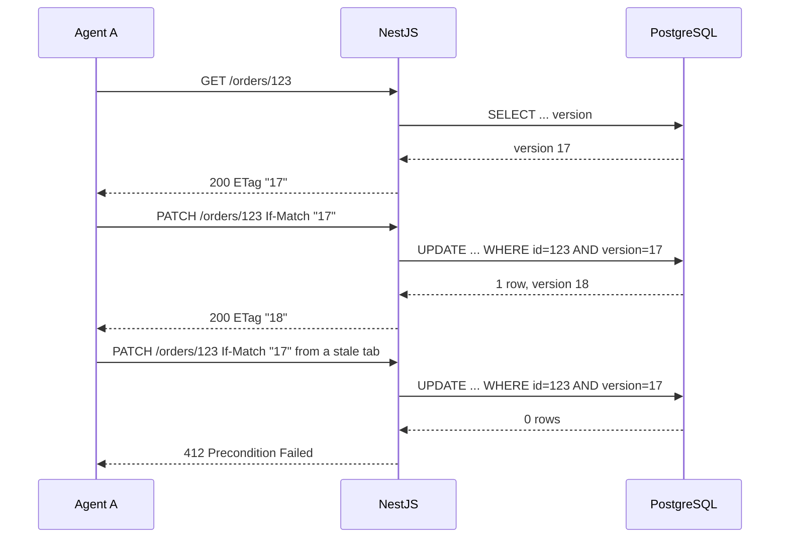
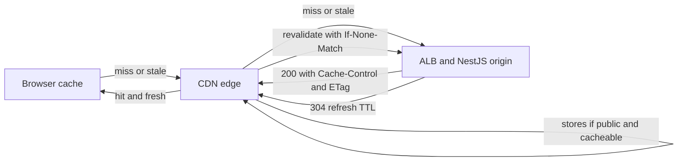

## 11.11 ETags, conditional requests and Cache-Control

### 11.11.1 ETags and conditional requests

#### Concept

An **ETag** (entity tag) is an opaque string in a response header that identifies the exact version of a resource: `ETag: "a3f9c2"`. A client that has a copy can send it back in a **conditional request**:

- `If-None-Match: "a3f9c2"` on a `GET`: "only send the body if it changed". If not, the server answers `304 Not Modified` with no body.
- `If-Match: "a3f9c2"` on a `PATCH` or `PUT`: "only apply this change if the resource is still this version". If not, the server answers `412 Precondition Failed`. This is HTTP's built-in **optimistic concurrency control**.

A **strong** ETag (`"a3f9c2"`) means byte-for-byte identical; a **weak** ETag (`W/"a3f9c2"`) means semantically equivalent (same data, possibly different encoding). `Last-Modified` with `If-Modified-Since` does the same job with a timestamp, at one-second resolution and without the concurrency use.

#### Why does it exist?

Bandwidth and correctness. A mobile app polling `GET /orders/123` every 5 seconds should not download 6 KB each time when the order has not changed; a `304` costs about 200 bytes. And two support agents editing the same order should not silently overwrite each other; `If-Match` makes the second writer fail with `412`, refresh, and retry against the new version.

#### Mental model

Imagine a library book with an edition number stamped on the spine. Before mailing you a new copy, the library asks "which edition do you have?"; if it is the current one, they just say "you are up to date" (`304`). Before accepting your proofreading corrections, they ask "which edition did you mark up?"; if a newer edition exists, they refuse (`412`) and ask you to redo your notes on the new one.

#### How it works

1. On `GET`, the server computes an ETag. Options: a hash of the response body (Express does this by default for non-streamed responses with `etag` enabled, using a weak ETag), or better, a version number from the database (`orders.version` or `xmin`), which costs nothing to compute and works before the body is serialised.
2. The response carries `ETag: "17"` (version 17) and a `Cache-Control` that allows revalidation.
3. The client stores the body and the ETag. On the next `GET`, it sends `If-None-Match: "17"`.
4. The server looks up the current version. If it is still 17, it returns `304` with empty body and the same `ETag`; if it is 18, it returns `200` with the new body and `ETag: "18"`. The `304` path can skip serialisation and, if the version is in Redis, skip Postgres.
5. For updates, the client sends `PATCH /orders/123` with `If-Match: "17"`. The service does `UPDATE ... WHERE id = $1 AND version = 17`, incrementing the version. Zero rows affected means someone else got there first: `412`.
6. `If-None-Match: *` on `PUT` means "create only if it does not exist", a race-free create.



#### Practical example

A delivery-rider app polls its assigned order every 3 seconds. 20,000 active riders make about 6,700 requests per second. With version-based ETags and the current version cached in Redis, 97% of those requests are `304`s served in 0.4 ms without touching Postgres; the remaining 3% are real changes. Egress dropped from 40 MB per second to about 2 MB per second.

#### NestJS example

An interceptor that implements `If-None-Match` using a version the handler attaches, and a controller using `If-Match` for optimistic concurrency.

```ts
// etag.interceptor.ts
import { CallHandler, ExecutionContext, Injectable, NestInterceptor } from '@nestjs/common';
import { Request, Response } from 'express';
import { Observable, of } from 'rxjs';
import { map } from 'rxjs/operators';

export interface Versioned { version: number; }

@Injectable()
export class EtagInterceptor implements NestInterceptor {
  intercept(ctx: ExecutionContext, next: CallHandler<Versioned>): Observable<unknown> {
    const req = ctx.switchToHttp().getRequest<Request>();
    const res = ctx.switchToHttp().getResponse<Response>();
    if (req.method !== 'GET' && req.method !== 'HEAD') return next.handle();

    return next.handle().pipe(
      map((body) => {
        const etag = `"${body.version}"`;                // strong ETag from the DB version, no hashing
        res.setHeader('ETag', etag);
        res.setHeader('Cache-Control', 'private, no-cache'); // may store, must revalidate every time
        const inm = req.header('if-none-match');
        if (inm && inm.split(',').map((s) => s.trim()).includes(etag)) {
          res.status(304);
          return undefined;                                // 304 has no body
        }
        return body;
      }),
    );
  }
}
```

```ts
// orders.controller.ts (excerpt)
import { Body, Controller, Get, Headers, Param, ParseUUIDPipe, Patch, PreconditionFailedException, UseInterceptors } from '@nestjs/common';

@Controller('orders')
@UseInterceptors(EtagInterceptor)
export class OrdersController {
  constructor(private readonly orders: OrdersService) {}

  @Get(':id')
  get(@Param('id', ParseUUIDPipe) id: string) {
    return this.orders.findOne(id); // returns { ..., version: 17 }
  }

  @Patch(':id')
  async patch(
    @Param('id', ParseUUIDPipe) id: string,
    @Headers('if-match') ifMatch: string | undefined,
    @Body() dto: UpdateOrderDto,
  ) {
    if (!ifMatch) throw new PreconditionFailedException('If-Match header required'); // or 428 Precondition Required
    const expected = Number(ifMatch.replace(/"/g, ''));
    const updated = await this.orders.updateIfVersion(id, expected, dto);
    if (!updated) throw new PreconditionFailedException('Order was modified by someone else'); // 412
    return updated;
  }
}
```

Disable Express's default body-hash ETag with `app.set('etag', false)` when you supply your own, or two `ETag` headers race.

#### PostgreSQL example

```sql
-- A version column: bump it on every update
ALTER TABLE orders ADD COLUMN version integer NOT NULL DEFAULT 1;

-- Conditional update: succeeds only if the client saw the current version
UPDATE orders
SET status = $2, version = version + 1, updated_at = now()
WHERE id = $1 AND version = $3
RETURNING id, status, version, updated_at;
-- 0 rows returned means a concurrent update happened: return 412

-- Cheap version lookup for 304 decisions (index-only scan on the primary key plus version)
CREATE INDEX orders_id_version_idx ON orders (id) INCLUDE (version);
SELECT version FROM orders WHERE id = $1;
```

`xmin` (the transaction id that last wrote the row) can serve as a free version, but it wraps and changes on any update including background ones; an explicit column is clearer.

#### TypeORM example

```ts
// order.entity.ts
import { Column, Entity, PrimaryGeneratedColumn, VersionColumn } from 'typeorm';

@Entity('orders')
export class Order {
  @PrimaryGeneratedColumn('uuid') id!: string;
  @Column() status!: string;
  @VersionColumn() version!: number; // TypeORM increments and checks it on save()
}
```

```ts
// orders.service.ts
async updateIfVersion(id: string, expected: number, dto: UpdateOrderDto): Promise<Order | null> {
  // Explicit conditional UPDATE: portable and returns 0 rows on conflict
  const result = await this.repo
    .createQueryBuilder()
    .update(Order)
    .set({ ...dto, version: () => 'version + 1' })
    .where('id = :id AND version = :expected', { id, expected })
    .returning('*')
    .execute();
  return result.affected === 1 ? (result.raw[0] as Order) : null;
}
```

`repo.save()` with a `@VersionColumn` throws `OptimisticLockVersionMismatchError` when the loaded entity's version is stale; the query-builder form above lets the client's `If-Match` header drive the expected version directly.

#### Sequelize example

```ts
// order.model.ts: enable optimistic locking
@Table({ tableName: 'orders', version: true }) // adds a `version` column and checks it on save
export class Order extends Model { ... }

// service
const [affected, rows] = await this.orders.update(
  { ...dto, version: literal('version + 1') },
  { where: { id, version: expected }, returning: true },
);
if (affected !== 1) throw new PreconditionFailedException();
```

#### Production scenario

An order-management UI with 300 concurrent agents produced about 12 overwrite incidents per week before `If-Match`; afterwards it produced about 40 `412`s per day, each shown as "this order was updated by someone else, please review", and zero silent overwrites. The `304` path on the same API serves 70% of `GET`s at a p99 of 1.2 ms.

#### Failure scenario

A team enabled Express's default ETag and CloudFront caching for a personalised endpoint. Express computed the weak ETag from the body, which differed per user, so revalidation was correct, but the `Cache-Control: public, max-age=60` they added meant CloudFront served user A's body to user B for a minute. ETags do not fix a wrong `Cache-Control`; see 11.11.2.

#### Edge cases & failure modes

- Body-hash ETags require serialising the body even for `304`; version-based ETags avoid the work.
- Compressed responses: the ETag must differ per encoding or be weak; NGINX strips strong ETags when it compresses.
- `If-Match` on a resource that does not exist should return `412`, not `404`, only if the client asserted a specific version; use `404` when the id is unknown.
- Clients that ignore `412` and retry blindly reintroduce lost updates; the UI must refetch.
- Weak versus strong comparison: `If-None-Match` uses weak comparison, `If-Match` uses strong; a `W/` tag can never satisfy `If-Match`.
- Multiple ETags in `If-None-Match` (comma-separated) must all be checked.
- Version numbers must change on every write, including background jobs, or a `304` lies.

#### How a Senior Backend Engineer thinks about this

They add a version column to every entity that clients edit, and they expose it as the ETag. They make `If-Match` mandatory on `PATCH` for contended resources (`428 Precondition Required` when missing). They cache the version in Redis so the `304` path is nearly free. To a product manager: "When two agents edit the same order, the second one now sees a warning instead of silently erasing the first one's work."

#### Common mistakes

- Relying on the default body-hash ETag for large responses.
- Sending `If-Match` with a weak ETag.
- Treating `412` as a server error in the client.
- Forgetting to bump the version in bulk updates.

#### Interview questions

1. **Explain `If-None-Match` and `If-Match` and the codes each produces.** Revalidation to `304`; precondition to `412`.
2. **Why prefer a version column over a body hash for ETags?** No serialisation for `304`, works for concurrency control, cheap to cache.
3. **How do you implement optimistic concurrency in SQL?** `UPDATE ... WHERE id = ? AND version = ?`, check affected rows.
4. **What is the difference between weak and strong ETags and where does it bite?** Byte-identical versus semantically equivalent; compression and `If-Match`.

#### Practical exercise

Add version-based ETags and `If-Match` to an orders API. Write a test where two clients read version 17, both `PATCH`; assert one gets `200` with version 18 and the other `412`, and that a `GET` with `If-None-Match: "18"` returns `304` without querying Postgres (assert with a query counter or `pg_stat_statements`). Acceptance criteria: tests green and the `304` path measured under 2 ms.

### 11.11.2 Cache-Control: browser caches, CDNs and a NestJS interceptor

#### Concept

**`Cache-Control`** tells every cache between your server and the user whether and how long a response may be reused without asking again. The caches are the browser's HTTP cache, corporate proxies, and your CDN (CloudFront, Cloudflare, Fastly). The directives:

| Directive | Meaning | Typical use |
|---|---|---|
| `public` | any cache may store it, even if the request had `Authorization` | product catalogue, images |
| `private` | only the browser may store it; shared caches (CDN) must not | user-specific data |
| `no-store` | do not store anywhere | payments, PII, tokens |
| `no-cache` | may store, but must revalidate (`If-None-Match`) before every use | data that changes but benefits from `304` |
| `max-age=N` | fresh for N seconds in any cache | `max-age=300` for a category listing |
| `s-maxage=N` | overrides `max-age` for shared caches only | CDN caches 1 hour, browser 1 minute |
| `stale-while-revalidate=N` | serve stale for up to N seconds while fetching fresh in the background | hide origin latency on popular items |
| `stale-if-error=N` | serve stale for N seconds if the origin errors | resilience against origin outages |
| `must-revalidate` | once stale, must not be served without revalidating | correctness-sensitive data |
| `immutable` | will never change; do not revalidate even on reload | fingerprinted assets `app.8f3a.js` |

Freshness is decided by `max-age` and the response `Age` header (how long a cache has held it); an expired cached copy may still be used for revalidation via ETag. `Expires` is the older absolute-date form; `Cache-Control` wins when both exist. `Vary` (11.7.2) determines the cache key alongside the URL.

#### Why does it exist?

Origin capacity and latency. A CDN with a 95% hit rate turns 20,000 RPS at the edge into 1,000 RPS at your NestJS pods, and serves users from a node 10 ms away instead of a region 150 ms away. Getting it wrong in the safe direction (`no-store` on everything) wastes that. Getting it wrong in the dangerous direction (`public` on personalised data) leaks one user's data to another; that is a breach, and it has happened at large companies.

#### Mental model

Imagine a newspaper stand (the CDN) near your house and the printing press (your API) across the country. `max-age` is how long the stand may sell yesterday's paper before ordering a new one. `private` means the paper has your name on it and the stand must not resell it. `no-store` means it is a bank statement: hand it over and keep nothing. `stale-while-revalidate` lets the stand sell you the slightly old edition while a new one is already on the truck.

#### How it works



1. Browser checks its cache: fresh (`max-age` not exceeded) means no request at all, 0 ms.
2. Stale in browser: it sends `If-None-Match`; a `304` from the CDN or origin refreshes it for a few hundred bytes.
3. CDN checks its cache by key (URL plus `Vary` headers, plus whatever the CDN's cache policy includes, such as query strings or selected headers). Fresh: served from the edge, typically 5 to 30 ms from the user. Stale with `stale-while-revalidate`: served immediately, refreshed in the background.
4. Miss: the CDN forwards to the origin, stores the response if `Cache-Control` allows (`public` or no `private`/`no-store`, and a `max-age` or `s-maxage`), and returns it.
5. Purge: invalidation by path or by surrogate key (`Cache-Tag` or `Surrogate-Key` headers on Fastly/Cloudflare; CloudFront invalidations by path pattern, which take about a minute and cost money in volume). Design for short TTLs plus revalidation rather than relying on purges.

Which responses are safe to cache where:

| Response | Header | Reason |
|---|---|---|
| Product detail, public | `public, max-age=60, s-maxage=600, stale-while-revalidate=300` | CDN holds 10 minutes, browsers 1 minute, background refresh |
| Category listing with pagination | `public, max-age=30, s-maxage=120` | changes often, still worth caching at the edge |
| Fingerprinted JS/CSS | `public, max-age=31536000, immutable` | URL changes when content changes |
| `GET /me`, `GET /orders` (user data) | `private, no-cache` plus ETag | browser may keep it, must revalidate; CDN never stores |
| `POST /payments`, tokens, PII exports | `no-store` | never on disk anywhere |
| Search results with `Authorization` | `private, max-age=0` | personalised ranking; do not let `public` leak it |
| Health checks, feature flags | `no-store` or `max-age=5` | freshness matters |

Two traps: a response to a request with an `Authorization` header is not stored by shared caches unless `public` or `s-maxage` is present, so adding `public` to "make it faster" on an authenticated endpoint is the leak. And CDNs default to caching by URL only; if your response varies by `Accept-Language` or a cookie and you do not include that in `Vary` and in the CDN cache policy, users get each other's variants.

#### Practical example

A grocery app's `GET /products/:id` is called 15,000 times per second during a sale. With `public, s-maxage=300, stale-while-revalidate=60` and version-based ETags, CloudFront's hit rate is 97%; the NestJS pods see 450 RPS, of which half are `304` revalidations. Price changes are propagated by bumping the product version and purging by `Cache-Tag: product-8812`, so a price update is visible at the edge within 2 seconds while the default TTL stays 5 minutes.

#### NestJS example

A decorator-driven interceptor that applies safe defaults and explicit per-route policies, and refuses `public` on responses to authenticated requests unless the route opts in.

```ts
// cache-control.decorator.ts
import { SetMetadata } from '@nestjs/common';
export const CACHE_POLICY = 'cache_policy';
export interface CachePolicy {
  scope: 'public' | 'private' | 'no-store';
  maxAge?: number; sMaxAge?: number; swr?: number; immutable?: boolean; noCache?: boolean;
}
export const CacheControl = (policy: CachePolicy) => SetMetadata(CACHE_POLICY, policy);
```

```ts
// cache-control.interceptor.ts
import { CallHandler, ExecutionContext, Injectable, NestInterceptor } from '@nestjs/common';
import { Reflector } from '@nestjs/core';
import { Request, Response } from 'express';
import { Observable } from 'rxjs';
import { tap } from 'rxjs/operators';
import { CACHE_POLICY, CachePolicy } from './cache-control.decorator';

@Injectable()
export class CacheControlInterceptor implements NestInterceptor {
  constructor(private readonly reflector: Reflector) {}

  intercept(ctx: ExecutionContext, next: CallHandler): Observable<unknown> {
    const req = ctx.switchToHttp().getRequest<Request>();
    const res = ctx.switchToHttp().getResponse<Response>();
    const policy = this.reflector.getAllAndOverride<CachePolicy | undefined>(CACHE_POLICY, [ctx.getHandler(), ctx.getClass()]);

    return next.handle().pipe(
      tap(() => {
        if (req.method !== 'GET' && req.method !== 'HEAD') { res.setHeader('Cache-Control', 'no-store'); return; }
        const authenticated = Boolean(req.header('authorization') || req.header('cookie'));
        // Safe default: authenticated GETs are private and revalidated; anonymous GETs are not cached unless declared.
        const p: CachePolicy = policy ?? (authenticated ? { scope: 'private', noCache: true } : { scope: 'no-store' });
        if (p.scope === 'public' && authenticated && !policy) p.scope = 'private'; // never leak by accident

        const parts: string[] = [p.scope];
        if (p.scope !== 'no-store') {
          if (p.noCache) parts.push('no-cache');
          if (p.maxAge !== undefined) parts.push(`max-age=${p.maxAge}`);
          if (p.sMaxAge !== undefined && p.scope === 'public') parts.push(`s-maxage=${p.sMaxAge}`);
          if (p.swr !== undefined) parts.push(`stale-while-revalidate=${p.swr}`);
          if (p.immutable) parts.push('immutable');
        }
        res.setHeader('Cache-Control', parts.join(', '));
        res.setHeader('Vary', 'Accept-Encoding'); // add Accept-Language or others when the body depends on them
      }),
    );
  }
}
```

```ts
// products.controller.ts (excerpt)
@Get(':id')
@CacheControl({ scope: 'public', maxAge: 60, sMaxAge: 600, swr: 300 })
product(@Param('id', ParseUUIDPipe) id: string) { return this.products.findOne(id); }

@Get('me/recommendations')
@CacheControl({ scope: 'private', maxAge: 30 })
recommendations(@Req() req: Request) { return this.reco.forUser(req.user.id); }
```

Register the interceptor globally (`APP_INTERCEPTOR`) so no route ships without a policy. The `@nestjs/cache-manager` `CacheInterceptor` is a different thing: it caches responses inside the process or Redis; it does not set HTTP headers. Use both when appropriate: server-side caching for expensive computations, `Cache-Control` for edge and browser caching.

#### PostgreSQL example

Edge caching changes the database's load shape: writes that must be visible quickly need a signal to purge or bump. A `version` and an `updated_at` on cached entities, plus a trigger or application event that publishes purges, keep the CDN honest.

```sql
-- Track versions for ETags and purge tags
ALTER TABLE products ADD COLUMN version integer NOT NULL DEFAULT 1;

CREATE OR REPLACE FUNCTION bump_product_version() RETURNS trigger AS $$
BEGIN
  NEW.version := OLD.version + 1;
  NEW.updated_at := now();
  PERFORM pg_notify('product_changed', NEW.id::text); -- a listener issues the CDN purge by Cache-Tag
  RETURN NEW;
END $$ LANGUAGE plpgsql;

CREATE TRIGGER products_version_trg BEFORE UPDATE ON products
FOR EACH ROW WHEN (OLD.* IS DISTINCT FROM NEW.*) EXECUTE FUNCTION bump_product_version();
```

#### Production scenario

A media-heavy marketplace: CloudFront serves 98% of image bytes and 91% of API `GET`s for catalogue endpoints. Origin egress fell from 60 TB to 6 TB per month. During a 40-minute origin outage (a bad deploy), `stale-if-error=600` kept the catalogue browsable from the edge; only checkout, which is `no-store`, was down. The post-incident review called the caching policy the reason the outage was a revenue dip and not a blackout.

#### Failure scenario

At 10:15 support tickets said "I can see someone else's cart". A developer had added `Cache-Control: public, max-age=60` to a new `GET /cart` endpoint, copying it from the products controller. The CDN cached the first user's cart under the URL `/cart` and served it to everyone for 60 seconds at a time. The fix took one line; the incident took a day of customer communication and a breach assessment. The follow-up was the global interceptor above with the "never public when authenticated unless explicitly declared" rule and an e2e test that asserts `private` or `no-store` on every route that uses an auth guard.

#### Edge cases & failure modes

- `public` on authenticated responses: data leak.
- Missing `Vary`: wrong-language or wrong-encoding responses served from cache.
- Cache key includes query string order: `?a=1&b=2` and `?b=2&a=1` are two entries; normalise at the CDN.
- Cache stampede: when a popular item expires, thousands of misses hit the origin simultaneously; `stale-while-revalidate` and request coalescing at the CDN (CloudFront does this per edge) mitigate.
- Purge lag: CloudFront invalidations take 10 to 60 seconds; use short `s-maxage` plus revalidation for anything time-sensitive.
- Browser `no-cache` versus `no-store` confusion: `no-cache` stores and revalidates; `no-store` stores nothing.
- `max-age=0` still lets caches keep a copy for revalidation; that is fine and intended.
- Error responses cached: a `500` with a default `max-age` from the CDN can pin an outage; set `no-store` on errors and configure CDN error TTLs to a few seconds.
- Cookies on cacheable responses: many CDNs refuse to cache any response with `Set-Cookie`; strip session cookies from public endpoints.

#### How a Senior Backend Engineer thinks about this

They classify every endpoint into public-cacheable, private-revalidate, or no-store before it ships, with a default that fails safe. They use short TTLs at the edge with `stale-while-revalidate` and versioned ETags rather than long TTLs and purges. They add `stale-if-error` so the CDN carries them through origin incidents. They test cache headers in CI. To a product manager: "Ninety-five percent of catalogue views never reach our servers, which is why a sale that triples traffic costs us almost nothing, and why a personalised page must never be marked as shareable."

#### Common mistakes

- Copying `public` headers onto personalised endpoints.
- `no-store` on everything, throwing away the CDN.
- Forgetting `Vary`.
- Relying on purges for correctness.
- Caching error responses.

#### Interview questions

1. **`no-cache` versus `no-store`?** `no-cache` may store but must revalidate; `no-store` never stores.
2. **When does a shared cache store a response to a request with `Authorization`?** Only with explicit `public` or `s-maxage`; that is the leak vector.
3. **Explain `stale-while-revalidate` and where it helps.** Serve stale while refreshing; hides origin latency and absorbs stampedes on expiry.
4. **How do you make a price change visible at the edge within seconds while keeping a 10-minute TTL?** Purge by tag or path on write, or short `s-maxage` with ETag revalidation.
5. **Design cache headers for `/products/:id`, `/me`, and `/payments`.** `public, max-age=60, s-maxage=600, swr`; `private, no-cache` with ETag; `no-store`.

#### Practical exercise

Put a NestJS API behind a local CDN emulator or NGINX `proxy_cache`. Implement the interceptor above, then write e2e tests that assert: a public product is served from cache on the second request (check `X-Cache` or `Age`), an authenticated `/me` is never cached by the proxy, a `500` is not cached, and a product update becomes visible within 2 seconds via version-based revalidation. Acceptance criteria: all four assertions green, and a table of hit rates from a 5-minute load test.
