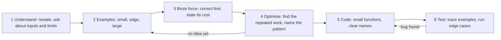
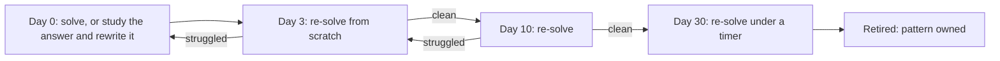
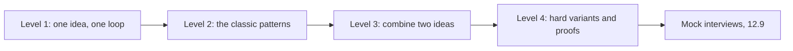

# Part 12 — Coding Practice Ladder

Part 10 — Computer Science Fundamentals: Data Structures taught the structures. Part 11 — Algorithms for Backend Engineers taught the algorithms and where they appear in real systems. Part 74 — The Interview Playbook (74.2) catalogues the patterns that coding interviews draw from. This Part is the missing piece between them: **practice**. Knowing that a sliding window exists is not the same as writing one correctly in twelve minutes while someone watches, and the only way to close that gap is to solve problems, in a sensible order, with a method, and to learn from your own mistakes.

The Part is a ladder. It starts with how to practise and a gentle on-ramp for someone who has only done Volume 0, then climbs through about thirty original problems in four levels, from warm-ups to the hard end of a typical interview. Every problem is written in backend terms (orders, logs, deploys, rate limits, schedules), because that is how many interviewers now dress them and because it trains the most useful skill of all: seeing the pattern under the product language. Every problem has a hint, then a worked answer in TypeScript with its complexity, the trap that catches most people, and tests you can run with `npx tsx`.

Use it in order the first time. Later, use the pattern index in 12.3 to drill your weak spots.

## 12.1 How to practise

### 12.1.1 A method for every problem

#### Concept

Strong problem-solvers are not people who see the answer instantly. They are people who follow the same steps every time, so that when the answer does not come, the method still moves them forward. The method used in this Part has six steps: **understand, examples, brute force, optimise, code, test**.

#### Why does it exist?

Without a method, practice turns into staring at a problem until you remember or give up, which teaches nothing. Under interview pressure it turns into coding the first idea, discovering at minute 25 that it is wrong, and running out of time. A method makes progress visible and gives the interviewer something to follow even when you are stuck.

#### Mental model

Imagine a doctor with a new patient. They do not guess the diagnosis from the doorway. They ask questions, take measurements, consider the obvious explanation, rule things out, then treat, then check the treatment worked. The steps are the same for a cold and for something rare.

#### How it works



1. **Understand.** Restate the problem in one sentence. Ask what the input looks like, how big it can be, what to return when there is no answer, whether input can be empty, contain duplicates, be unsorted, contain negatives.
2. **Examples.** Write a small normal example and solve it by hand. Then an edge case (empty, one element, all equal) and think about the largest input.
3. **Brute force.** Describe the simplest correct solution and its complexity, even if it is too slow. It proves you understand the problem, and it becomes your test oracle.
4. **Optimise.** Ask "what work does the brute force repeat?" The answer usually names the pattern: recounting a window suggests a sliding window; re-scanning for a partner suggests a hash map; re-solving the same subproblem suggests dynamic programming. Use the input limits to pick a target complexity (12.2.2).
5. **Code.** Write it cleanly: meaningful names, small helper functions, no clever one-liners. Narrate if someone is watching.
6. **Test.** Trace your code on the small example by hand, then run the edge cases. Finding your own bug is a strong signal in an interview and a habit that prevents incidents at work.

#### How a Senior Backend Engineer thinks about this

Seniors use the same six steps on production problems: a slow endpoint is "understand, reproduce with an example, find the obvious cause, find the repeated work, fix, verify". That is why interviewers value the method over the answer. A candidate who gets a correct brute force, explains why it is slow, and is halfway to the optimal solution often scores better than one who silently types a memorised answer with a bug in it.

#### Common mistakes

- Skipping the brute force because it "is obviously too slow", and then having no correct solution at all.
- Coding before choosing an approach, then rewriting twice.
- Testing only the happy-path example from the statement.
- Treating "I don't see it yet" as failure. It is step 4, and steps 2 and 3 are how you get unstuck.

### 12.1.2 Timeboxing, spaced repetition and a mistake log

#### Concept

Three habits turn hours of practice into lasting skill. **Timeboxing** limits how long you struggle before looking at a hint or answer. **Spaced repetition** means re-solving a problem after increasing gaps, so the pattern moves into long-term memory. A **mistake log** records why you got something wrong, so you stop repeating the same error.

#### Why does it exist?

Struggling for three hours on one problem teaches less than struggling for 30 minutes and then studying the answer carefully. Solving a problem once and never again means that in two weeks you remember that you solved it, not how. And without a log, the same off-by-one error in binary search costs you a round three times.

#### How it works — timeboxing

| Level | Time before the hint | Time before the answer |
|---|---|---|
| Level 1 warm-up | 10 minutes | 20 minutes |
| Level 2 easy | 15 minutes | 30 minutes |
| Level 3 medium | 20 minutes | 40 minutes |
| Level 4 hard | 30 minutes | 60 minutes |

When you read the answer, do not just read it. Close it and write the solution yourself from memory, then run the tests. If you needed the answer, the problem goes into the repetition queue with a short gap.

#### How it works — spaced repetition



A plain spreadsheet works: one row per problem, columns for date solved, next review date and result. Re-solving from scratch matters; re-reading your old solution feels productive and is not.

#### How it works — the mistake log

After every problem you got wrong or slow, write one line in each column. The "category" column is the important one: after twenty entries, it tells you exactly what to drill.

```text
| Date  | Problem               | What went wrong                         | Category        | Fix for next time                         |
|-------|-----------------------|-----------------------------------------|-----------------|-------------------------------------------|
| 03-11 | 12.5.5 first bad build | infinite loop when lo = hi - 1          | binary search   | use lo < hi and hi = mid; write invariant |
| 05-11 | 12.5.2 peak window     | forgot window smaller than k at start   | edge case       | test n < k before coding                  |
| 06-11 | 12.6.1 top K endpoints | sorted whole map, O(n log n) not n log k| missed pattern  | "top K" -> heap of size K                 |
```

Common categories: misread the problem, missed edge case, off-by-one, wrong pattern, wrong complexity, language trap (12.2.3), ran out of time.

## 12.2 A gentle start

### 12.2.1 Big-O in plain words

#### Concept

**Big-O** describes how the work an algorithm does grows as the input grows. Part 11 (11.1) explains it in depth; for practice you need only to recognise the common shapes and connect each to code you can see.

#### How it works

| Big-O | In plain words | What it looks like in code | Backend example |
|---|---|---|---|
| O(1) | Same work whatever the size | `map.get(key)`, `arr[i]` | Look up an order in a `Map` by id |
| O(log n) | Halve the problem each step | Binary search | Find a timestamp in a sorted log |
| O(n) | Look at each item once | One loop | Sum today's order totals |
| O(n log n) | Sort, or n times a halving step | `arr.sort(...)` | Sort orders by date |
| O(n²) | Compare every item with every other | A loop inside a loop | Check every pair of coupons for conflicts |
| O(2ⁿ) | Try every subset | Recursion that branches in two | Every combination of add-ons |

```ts
interface Order { id: string; totalCents: number }

// O(n): one pass over the orders.
function revenue(orders: Order[]): number {
  let sum = 0;
  for (const o of orders) sum += o.totalCents;
  return sum;
}

// O(n^2): for each order, scan all orders again. 100,000 orders -> 10 billion comparisons.
function hasDuplicateIdSlow(orders: Order[]): boolean {
  for (let i = 0; i < orders.length; i++)
    for (let j = i + 1; j < orders.length; j++)
      if (orders[i].id === orders[j].id) return true;
  return false;
}

// O(n): remember what we have seen in a Set; each lookup is O(1) on average.
function hasDuplicateId(orders: Order[]): boolean {
  const seen = new Set<string>();
  for (const o of orders) {
    if (seen.has(o.id)) return true;
    seen.add(o.id);
  }
  return false;
}
```

The last two functions are the whole idea of most optimisation in one picture: spend O(n) memory on a `Set` to turn O(n²) time into O(n). That trade (more memory, less time) appears in a third of the problems in this Part.

**Space complexity** is the same idea for memory: the `Set` above is O(n) extra space; `revenue` is O(1).

### 12.2.2 Reading a problem statement

#### Concept

A problem statement contains more information than it seems: the input format, the output format, the edge cases, and, hidden in the **constraints**, the complexity the interviewer expects.

#### How it works

Read the statement three times, for three different things:

1. **What goes in and what comes out.** Types, order, and what to return when there is no answer (`-1`, `null`, an empty array).
2. **The limits.** "n up to 10⁵" is a strong hint. A modern machine does on the order of 10⁸ simple operations per second, so:

| n is at most | Target | Typical patterns |
|---|---|---|
| 20 | O(2ⁿ) | Backtracking over subsets |
| 1,000 to 5,000 | O(n²) | Pairs, 2-D dynamic programming |
| 10⁵ to 10⁶ | O(n log n) or O(n) | Sorting, heaps, hashing, sliding window, prefix sums |
| 10⁹ or more (as a value) | O(log n) | Binary search on the answer |

3. **The words that hint at a pattern.** "Contiguous" and "at most K" suggest a sliding window; "sorted" suggests two pointers or binary search; "top K" suggests a heap; "shortest number of steps" suggests BFS; "number of ways" or "minimum cost" suggests dynamic programming; "depends on" suggests a graph and topological sort. Part 74 (74.2.1) has the full cue table.

#### Practical example

> Given the response times of the last n requests (n up to 10⁶) and an integer k, return the largest response time in every window of k consecutive requests.

Three readings give: input is an array and `k`, output is an array of `n - k + 1` numbers; n up to 10⁶ rules out O(n·k) when k is large, so the target is O(n); "every window of k consecutive" is the sliding-window cue, and "largest in each window" needs a structure that gives the maximum quickly as items enter and leave. That is problem 12.6.9, and you have already done half the work.

### 12.2.3 A TypeScript toolkit for practice

#### Concept

Interview problems in TypeScript reuse the same handful of tools. Knowing their costs and traps saves minutes. Part 74 (74.2.1) lists the traps; here they are with the tool to use instead.

#### How it works

| Need | Use | Trap to avoid |
|---|---|---|
| Count things | `Map<string, number>` with `(m.get(k) ?? 0) + 1` | Plain objects coerce keys to strings and inherit `toString` |
| Membership | `Set` | `array.includes` inside a loop is O(n²) |
| Sort numbers | `arr.sort((a, b) => a - b)` | `arr.sort()` sorts as strings: `[10, 9, 1]` becomes `[1, 10, 9]` |
| Queue | An array plus a head index | `shift()` is O(n), so a queue built on it is O(n²) |
| Stack | `push` and `pop` | Peek with `stack[stack.length - 1]`, check for empty first |
| Heap | Write the 30-line `MinHeap` in 12.6.1 | There is no built-in priority queue |
| Deep recursion | An explicit stack | Default recursion depth is on the order of 10,000 frames |
| Grid neighbours | A `DIRS` array of `[dr, dc]` pairs | Forgetting the bounds check |

Every worked answer in this Part ends with tests written with Node's built-in `node:assert/strict`, so a block runs with `npx tsx file.ts` and prints nothing when all is well. Copy the pattern for your own practice:

```ts
import assert from 'node:assert/strict';

function maxOrderValue(totals: number[]): number | null {
  if (totals.length === 0) return null;          // the edge case first
  let best = totals[0];
  for (const t of totals) if (t > best) best = t;
  return best;
}

assert.equal(maxOrderValue([4999, 1500, 12900]), 12900);
assert.equal(maxOrderValue([]), null);
assert.equal(maxOrderValue([-5, -2]), -2);        // refunds are negative
console.log('all tests passed');
```

## 12.3 The ladder

### 12.3.1 Thirty problems, four levels, every pattern

#### Concept

The problems below are grouped by level, and within each level they cover different patterns, so each level is a full workout. The table is also an index: when your mistake log says "sliding window", find every sliding-window problem here and drill them.

#### How it works

| Level | Problem | Pattern |
|---|---|---|
| 1 | 12.4.1 First repeated idempotency key | Hashing |
| 1 | 12.4.2 Most frequent error code | Counting |
| 1 | 12.4.3 Balanced migration log | Stack |
| 1 | 12.4.4 Merge two replica logs | Two pointers |
| 1 | 12.4.5 Revenue between two days | Prefix sums |
| 1 | 12.4.6 Compare release versions | Strings, two pointers |
| 2 | 12.5.1 Two orders that use up a gift card | Hashing (complements) |
| 2 | 12.5.2 Busiest k minutes | Fixed sliding window |
| 2 | 12.5.3 Shortest burst over an error budget | Variable sliding window |
| 2 | 12.5.4 Merge maintenance windows | Sorting, intervals |
| 2 | 12.5.5 First bad build | Binary search |
| 2 | 12.5.6 Identical carts | Hashing with a canonical key |
| 2 | 12.5.7 Shortest path for a warehouse robot | BFS on a grid |
| 2 | 12.5.8 Count server clusters | DFS, connected components |
| 3 | 12.6.1 Top K failing endpoints | Heap, top-k |
| 3 | 12.6.2 Free slots in a technician's day | Sorting, intervals |
| 3 | 12.6.3 Smallest nightly export capacity | Binary search on the answer |
| 3 | 12.6.4 Day ranges with a given net balance | Prefix sums with hashing |
| 3 | 12.6.5 Deploy waves | Topological sort |
| 3 | 12.6.6 Lowest-latency route | Shortest path (Dijkstra) |
| 3 | 12.6.7 Coupon combinations for an exact total | Backtracking |
| 3 | 12.6.8 Fewest boxes for a shipment | 1-D dynamic programming |
| 3 | 12.6.9 Slowest request in every window | Monotonic deque |
| 4 | 12.7.1 Diff two audit logs | 2-D dynamic programming |
| 4 | 12.7.2 Product search autocomplete | Trie |
| 4 | 12.7.3 The link that created a loop | Union-find |
| 4 | 12.7.4 Most maintenance jobs in one night | Greedy |
| 4 | 12.7.5 Cheapest courier route with few hand-offs | Graph, bounded relaxation |
| 4 | 12.7.6 Longest rising run of order values | DP with binary search |
| 4 | 12.7.7 Smallest log window with every required code | Variable sliding window with counts |



Do not move up a level until you can solve most of the current level within its timebox. Moving up too early turns practice into reading answers.
