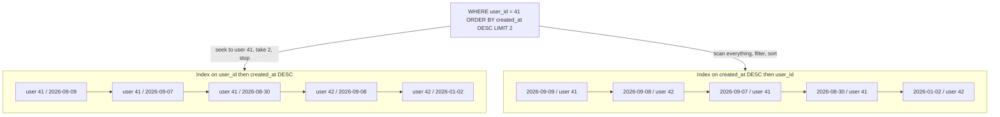

## 12.5 Composite indexes

### 12.5.1 The column-order rule: equality, then range, then sort

#### Concept

A **composite** (multi-column) index is a B-tree whose key is a tuple. `(user_id, created_at)` sorts by `user_id`, then by `created_at` within each `user_id`. Because of that structure, **the order of the columns decides which queries the index can serve**, and getting it wrong produces an index that is technically used and practically useless.

There is one rule and it fits on a sticky note:

> **Equality columns first, in any order among themselves. Then the range column. Then the sort column. At most one range or sort column can be seeked; everything after it is only a filter.**

This is sometimes called the ESR rule (Equality, Sort, Range) in other databases; in PostgreSQL the practical form is **equality, then the column you order by, then the column you range over** when those are different, because index ordering is the thing you cannot get any other way.

#### Why does it exist?

Two separate index capabilities are at stake and people conflate them:

1. **Seeking**: jumping straight to the first matching leaf entry and stopping when the key stops matching. Only the leading columns, up to and including the first inequality, can seek.
2. **Ordering**: producing rows already sorted so the planner can drop the `Sort` node and honour `LIMIT` early.

An index with the range column first can seek, but the rows come out ordered by the range column across all values of the equality column, so a `LIMIT 20` on a per-user list cannot stop early: it must read every row in the range and sort. An index with the equality column first can do both. That asymmetry is the entire section.

#### Mental model

A phone book sorted by `(city, surname)`. "All Müllers in Hamburg" is instant: find Hamburg, then Müller inside it, and the entries are already in surname order. Now imagine the book sorted by `(surname, city)`. "All Müllers in Hamburg" still works, because surname is the leading column. But "the first 20 people in Hamburg alphabetically" is a disaster: Hamburg residents are scattered across every surname section, so you must read the whole book, collect the Hamburg entries, and sort them. Same two columns. Completely different book.



#### How it works

Given a query, derive the index mechanically:

1. Write down every column compared with `=` or `IN`. Those go first. Their relative order does not affect *this* query, so order them to maximise reuse by *other* queries: most selective first is the usual tiebreak, but "the column the most queries filter on" beats it.
2. Write down the column in the `ORDER BY`. It goes next, with the same direction and nulls ordering as the query.
3. Write down the column with `<`, `>`, `BETWEEN`. It goes after the sort column if they differ; if the sort column and the range column are the same (very common: `created_at > X ORDER BY created_at DESC`), that one column serves both.
4. Any further columns you want available for an index-only scan go in `INCLUDE` (12.9), not in the key.
5. Stop. Three or four key columns is almost always enough. Each extra column widens every entry, shrinks fan-out, and grows the index.

The reason step 3 is subtle: once the index seeks past a range condition, the remaining columns are **not sorted globally**. In `(status, created_at, total_cents)`, within `status='PAID'` the entries are sorted by `created_at`, and within one exact `created_at` value by `total_cents`. So `WHERE status='PAID' AND created_at > X ORDER BY total_cents` still needs a sort. Only one inequality gets the benefit.

#### Practical example

The query behind the merchant dashboard, run 340 times a second:

```sql
SELECT id, total_cents, created_at
FROM orders
WHERE status = 'PAID' AND created_at >= now() - interval '7 days'
ORDER BY created_at DESC
LIMIT 50;
```

Two candidate indexes. Both "cover the query". They perform nothing alike.

#### PostgreSQL example

**Candidate A: `(created_at, status)` — the range column first, the wrong way round.**

```sql
CREATE INDEX idx_orders_created_status ON orders (created_at DESC, status);

EXPLAIN (ANALYZE, BUFFERS)
SELECT id, total_cents, created_at FROM orders
WHERE status = 'PAID' AND created_at >= now() - interval '7 days'
ORDER BY created_at DESC LIMIT 50;
```

```text
Limit  (cost=0.57..184.22 rows=50 width=20) (actual time=0.088..3.402 rows=50 loops=1)
  Buffers: shared hit=61 read=18
  ->  Index Scan using idx_orders_created_status on orders
        (cost=0.57..1483902.11 rows=403188 width=20) (actual time=0.086..3.398 rows=50 loops=1)
        Index Cond: ((created_at >= (now() - '7 days'::interval)) AND (status = 'PAID'::text))
        Buffers: shared hit=61 read=18
Planning Time: 0.140 ms
Execution Time: 3.442 ms
```

This looks fine. It *is* fine, for `LIMIT 50` on a status that is 76 percent of recent orders: the index is ordered by `created_at DESC` so it walks backwards and finds 50 `PAID` rows almost immediately. Now change the status to a rare one:

```sql
... WHERE status = 'REFUND_PENDING' AND created_at >= now() - interval '7 days' ...
```

```text
Limit  (cost=0.57..184.22 rows=50 width=20) (actual time=0.094..2841.552 rows=50 loops=1)
  Buffers: shared hit=402118 read=118220
  ->  Index Scan using idx_orders_created_status on orders
        (cost=0.57..1483902.11 rows=403188 width=20) (actual time=0.092..2841.544 rows=50 loops=1)
        Index Cond: ((created_at >= (now() - '7 days'::interval)) AND (status = 'REFUND_PENDING'::text))
        Buffers: shared hit=402118 read=118220
Planning Time: 0.140 ms
Execution Time: 2841.601 ms
```

Identical plan, identical cost estimate, **2.8 seconds instead of 3.4 ms**. The index walked 520,338 pages of `created_at`-ordered entries looking for the 50 rare ones. `status` was inside `Index Cond` but it was not *seekable*, because everything after the leading range column is checked, not sought. This is the most dangerous kind of index: fast in your test, catastrophic for one parameter value in production.

**Candidate B: `(status, created_at DESC)` — equality first.**

```sql
CREATE INDEX idx_orders_status_created ON orders (status, created_at DESC);

EXPLAIN (ANALYZE, BUFFERS)
SELECT id, total_cents, created_at FROM orders
WHERE status = 'REFUND_PENDING' AND created_at >= now() - interval '7 days'
ORDER BY created_at DESC LIMIT 50;
```

```text
Limit  (cost=0.57..112.88 rows=50 width=20) (actual time=0.041..0.212 rows=50 loops=1)
  Buffers: shared hit=8 read=3
  ->  Index Scan using idx_orders_status_created on orders
        (cost=0.57..4021.44 rows=1791 width=20) (actual time=0.040..0.208 rows=50 loops=1)
        Index Cond: ((status = 'REFUND_PENDING'::text) AND (created_at >= (now() - '7 days'::interval)))
        Buffers: shared hit=8 read=3
Planning Time: 0.132 ms
Execution Time: 0.238 ms
```

Eleven buffers. 0.24 ms. And it is 0.24 ms for *every* status value, common or rare, because the seek lands exactly on the `(status, created_at)` pair and walks 50 entries. **Same two columns, 11,800x difference on the bad parameter.** Write the order down before you write the DDL.

**The per-user list index.** The other archetype, and the one you will build most often:

```sql
-- GET /orders?userId=... : the single most common shape in any product
CREATE INDEX idx_orders_user_created ON orders (user_id, created_at DESC);

EXPLAIN (ANALYZE, BUFFERS)
SELECT id, status, total_cents, created_at
FROM orders WHERE user_id = 918273 ORDER BY created_at DESC LIMIT 20;
```

```text
Limit  (cost=0.57..37.44 rows=20 width=28) (actual time=0.049..0.094 rows=20 loops=1)
  Buffers: shared hit=6 read=2
  ->  Index Scan Backward using idx_orders_user_created on orders
        (cost=0.57..229.31 rows=124 width=28) (actual time=0.047..0.090 rows=20 loops=1)
        Index Cond: (user_id = 918273)
Execution Time: 0.121 ms
```

Note `Index Scan Backward`: because the index is declared `created_at DESC` and the query asks `DESC`, PostgreSQL could scan forward; here it happens to have chosen a backward scan of an ascending physical order, which is equally free. **Direction of a two-column index only matters when the two columns sort in opposite directions.** `(user_id ASC, created_at DESC)` and `(user_id ASC, created_at ASC)` both serve `WHERE user_id = ? ORDER BY created_at DESC` perfectly, because the whole index can be read backwards. You need the explicit `DESC` only for something like `ORDER BY user_id ASC, created_at DESC`, which no single-direction read can produce.

**One composite serving three queries.** Here is where index count actually drops. Given `(tenant_id, status, created_at DESC)`:

| Query | Served? | How |
|---|---|---|
| `WHERE tenant_id = ?` | Yes | leading prefix seek |
| `WHERE tenant_id = ? AND status = ?` | Yes | two-column prefix seek |
| `WHERE tenant_id = ? AND status = ? ORDER BY created_at DESC LIMIT 20` | Yes | seek plus ordered walk, no sort |
| `WHERE tenant_id = ? ORDER BY created_at DESC LIMIT 20` | Partly | seeks on `tenant_id`, but must scan all statuses and sort. Fine for small tenants, bad for large ones. |
| `WHERE status = ?` | No | not a leading prefix |
| `WHERE created_at > ?` | No | not a leading prefix |

Four indexes collapse into one for the first three rows. The fourth row is the judgement call: if the "all statuses, newest first" list is a real, hot endpoint, add a second index `(tenant_id, created_at DESC)`. If it is a rarely used admin screen, let it sort. **You do not need one index per query; you need one index per access-pattern family.**

#### NestJS example

Encode the access patterns in the repository so the index and the query stay married. If someone changes the `ORDER BY`, the method name should stop making sense.

```ts
// orders.repository.ts
import { Injectable } from '@nestjs/common';
import { DataSource } from 'typeorm';

@Injectable()
export class OrdersRepository {
  constructor(private readonly ds: DataSource) {}

  /** Served by idx_orders_user_created (user_id, created_at DESC). Keyset paginated. */
  async listForUser(userId: string, before: Date | null, limit = 20) {
    return this.ds.query(
      `SELECT id, status, total_cents, created_at
         FROM orders
        WHERE user_id = $1
          AND ($2::timestamptz IS NULL OR created_at < $2)
        ORDER BY created_at DESC
        LIMIT $3`,
      [userId, before, limit],
    );
  }
}
```

Keyset pagination (`created_at < $2`) instead of `OFFSET` is what keeps page 500 as fast as page 1: `OFFSET 10000` still reads and discards 10,000 index entries. Part 8 — API Design covers the contract; the index is what makes it possible.

#### Sequelize example

```ts
const rows = await Order.findAll({
  where: { userId, ...(before ? { createdAt: { [Op.lt]: before } } : {}) },
  order: [['createdAt', 'DESC']],
  limit: 20,
  attributes: ['id', 'status', 'totalCents', 'createdAt'],
});
```

Watch for two Sequelize traps: `order: [['createdAt', 'DESC NULLS LAST']]` will not match an index declared without `NULLS LAST`, and adding a second `order` column that is not in the index silently reintroduces a `Sort`.

#### Production scenario

An orders service with 14 single-column indexes was reduced to 5 composites over two sprints. Index storage went from 47 GB to 22 GB, p99 insert latency from 19 ms to 7 ms, and the number of queries served without a `Sort` node went from 6 to 19 out of the top 25. Nothing about the application code changed except one `ORDER BY` clause.

#### Failure scenario

`GET /admin/orders?status=X` was built and load-tested with `status=PAID`. In production the compliance team filtered by `status=CHARGEBACK`, which is 0.004 percent of rows, using the `(created_at, status)` index. Each request scanned 500,000+ index entries for 8 seconds, 40 of them ran concurrently, all 20 pool connections were held, and every other endpoint on the service started timing out. The database was at 12 percent CPU the whole time. **A slow query does not need to be frequent to take down a service; it needs to hold connections.**

#### Edge cases & failure modes

- Adding a fourth or fifth key column "just in case": each one shrinks fan-out and grows the index without helping any query.
- `IN (...)` on the leading column works as a series of seeks and is fine; `IN` on a middle column may or may not, depending on the planner's skip-scan-like handling.
- `ORDER BY a, b` where `a` is equality-constrained: PostgreSQL is smart enough to know `a` is constant and use `(a, b)`; it is not always smart enough with expressions.
- A `NULL` in an equality column: `WHERE user_id = NULL` never matches; use `IS NULL`, which a B-tree does support.
- Mixed directions requiring an explicitly declared index.
- Very wide leading columns (a `text` slug) hurting fan-out; hash or truncate.

#### How a Senior Backend Engineer thinks about this

They write the index DDL directly under the query in the pull request. They test the index against the *worst* parameter value, not the typical one, because that is what production will find. They count access-pattern families, not queries. And they treat "the index exists and appears in the plan" as the beginning of the investigation, not the end.

#### Common mistakes

- Putting the timestamp first because "we always filter on date".
- One index per column, expecting the planner to combine them (it will, with a bitmap, and it will be far slower than the composite).
- Testing only with the common parameter value.
- Assuming `(a, b)` and `(b, a)` are interchangeable.

#### Interview questions

1. *Given `WHERE status = ? AND created_at > ? ORDER BY created_at DESC LIMIT 20`, what index and why?* Expected: `(status, created_at DESC)`; equality first so the seek is exact and the walk is already ordered.
2. *Why can `(created_at, status)` be fast for one parameter and 1000x slower for another?* Expected: `status` is a check, not a seek, after the leading range; scan length depends on value frequency.
3. *When does the declared direction of a composite index matter?* Expected: only for mixed-direction `ORDER BY`, and for `NULLS FIRST/LAST` matching.
4. *How many indexes do you need for five queries on one table?* Expected: as many as there are access-pattern families; show the prefix analysis.

#### Practical exercise

Build `orders` with 20 million rows and a skewed `status` (76 percent `PAID`, 0.004 percent `CHARGEBACK`). Create both `(created_at DESC, status)` and `(status, created_at DESC)`. Run the dashboard query with both statuses against each index (use `DROP INDEX` or `enable_indexscan` tricks to isolate). Acceptance criteria: a 2x2 table of execution time and buffers, and a written rule you would put in your team's review checklist.

## 12.6 Partial indexes

### 12.6.1 Indexing 0.01 percent of a table

#### Concept

A **partial index** has a `WHERE` clause of its own. It indexes only the rows matching that predicate. Everything else is not in the index at all: not the keys, not the ctids, nothing.

```sql
CREATE INDEX idx_notifications_pending
  ON notifications (created_at)
  WHERE status = 'PENDING';
```

This is the highest leverage index feature in PostgreSQL and the one most teams have never used.

#### Why does it exist?

Queue tables. Soft deletes. Feature flags. Any table where a query only ever looks at a tiny, well-defined slice, but the table is enormous. `notifications` has 1.2 billion rows; at any moment about 120,000 are `PENDING`. A full index on `(status, created_at)` covers 1.2 billion entries, costs about 41 GB, and must be updated on every one of the 14,000 inserts per second. A partial index covers 120,000 entries, costs 3 MB, and only gets an entry when a row *enters* the pending state.

#### Mental model

A restaurant kitchen has a ticket rail. It holds only the orders that are not yet served. Nobody keeps a rail of every order from the last three years; the finished tickets go in a box and the rail stays short enough to read at a glance. A partial index is the rail. A full index is a rail with three years of tickets on it, where the cook has to find today's among them.

#### How it works

1. `CREATE INDEX ... WHERE pred` builds entries only for rows satisfying `pred`.
2. On `INSERT`, PostgreSQL evaluates `pred`. If false, **no index entry is written at all**. This is the write-cost saving, and it is why a partial index on a rare state is almost free.
3. On `UPDATE`, a row that leaves the predicate gets its entry removed (marked dead) and a row that enters it gets one added. The queue "drain" is exactly this: `status` goes `PENDING -> SENT` and the entry leaves the index.
4. **The planner uses the index only if it can prove your query's predicate implies the index's predicate.** Proof is syntactic and conservative. `WHERE status = 'PENDING'` matches `WHERE status = 'PENDING'`. `WHERE status IN ('PENDING')` matches. `WHERE status <> 'SENT'` does **not** match, even if `PENDING` and `SENT` are the only two values, because the planner cannot know that.
5. The predicate's columns do not have to be in the key. `(created_at) WHERE status = 'PENDING'` has a 8-byte key and still fully answers `WHERE status='PENDING' ORDER BY created_at`.

The size arithmetic on `notifications`:

| Index | Entries | Size | Insert cost per row |
|---|---|---|---|
| `(status, created_at)` full | 1,200,000,000 | 41 GB | ~28 us always |
| `(created_at) WHERE status='PENDING'` | ~120,000 | 3.1 MB | ~28 us for 0.01 percent of rows, 0.4 us (predicate eval only) for the rest |

Three megabytes. It lives permanently in `shared_buffers` and every queue poll is a cache hit.

#### Practical example — the queue claim

```sql
-- The worker's claim query, run 40 times a second by 12 workers
SELECT id, user_id, payload
FROM notifications
WHERE status = 'PENDING'
ORDER BY created_at
FOR UPDATE SKIP LOCKED
LIMIT 100;
```

Before the partial index, with only `(status)`:

```text
Limit  (cost=0.00..8291884.22 rows=100 width=118) (actual time=4211.884..4212.001 rows=100 loops=1)
  Buffers: shared hit=1928441 read=8821004
  ->  LockRows  (cost=0.00..9948221.44 rows=119983 width=118) (actual time=4211.882..4211.994 rows=100 loops=1)
        ->  Sort  (cost=9821004.11..9821304.07 rows=119983 width=118)
                  (actual time=4198.221..4198.884 rows=100 loops=1)
              Sort Key: created_at
              Sort Method: top-N heapsort  Memory: 44kB
              ->  Bitmap Heap Scan on notifications  (cost=2911.02..9812884.44 rows=119983 width=118)
                                                     (actual time=612.114..4102.884 rows=119412 loops=1)
                    Recheck Cond: (status = 'PENDING'::text)
                    Heap Blocks: exact=118820
                    ->  Bitmap Index Scan on idx_notifications_status  (cost=0.00..2881.07 rows=119983 width=0)
                          Index Cond: (status = 'PENDING'::text)
Execution Time: 4212.204 ms
```

4.2 seconds, 10.7 million buffers, and it reads **all 119,412 pending rows** into a sort just to take the oldest 100. Twelve workers doing this every 25 ms is a database on fire.

After:

```sql
CREATE INDEX CONCURRENTLY idx_notifications_pending
  ON notifications (created_at) WHERE status = 'PENDING';
```

```text
Limit  (cost=0.42..14.88 rows=100 width=118) (actual time=0.084..1.204 rows=100 loops=1)
  Buffers: shared hit=112 read=4
  ->  LockRows  (cost=0.42..17342.11 rows=119983 width=118) (actual time=0.083..1.198 rows=100 loops=1)
        ->  Index Scan using idx_notifications_pending on notifications
              (cost=0.42..16142.28 rows=119983 width=118) (actual time=0.041..0.402 rows=100 loops=1)
Execution Time: 1.281 ms
```

**4,212 ms to 1.3 ms**, 10.7 million buffers to 116, and no `Sort` node because the index is already in `created_at` order within the pending set. The index is 3.1 MB.

#### PostgreSQL example — partial unique indexes

The other killer use: uniqueness that only applies to *some* rows. A plain `UNIQUE` constraint cannot express "one active address per user" or "one open cart per user", because the historical rows must be allowed to duplicate.

```sql
-- One primary address per user, but any number of non-primary ones
CREATE UNIQUE INDEX uq_addresses_one_primary
  ON addresses (user_id) WHERE is_primary;

-- One open cart per user; closed carts accumulate forever
CREATE UNIQUE INDEX uq_carts_one_open
  ON carts (user_id) WHERE status = 'OPEN';

-- One non-deleted review per (user, product); soft-deleted rows may repeat
CREATE UNIQUE INDEX uq_reviews_active
  ON reviews (user_id, product_id) WHERE deleted_at IS NULL;
```

The last one is worth dwelling on. With a plain `UNIQUE (user_id, product_id)`, a user who deletes a review can never write another one for that product, because the soft-deleted row still occupies the key. With the partial unique index, soft-deleted rows fall out of the index entirely and the user can review again. This is the correct pattern for soft delete plus uniqueness, and it is a five-line migration that replaces a page of application-level checking.

Test it:

```sql
INSERT INTO carts (user_id, status) VALUES (41, 'OPEN');
INSERT INTO carts (user_id, status) VALUES (41, 'OPEN');
```

```text
ERROR:  duplicate key value violates unique constraint "uq_carts_one_open"
DETAIL:  Key (user_id)=(41) already exists.
```

```sql
UPDATE carts SET status = 'CHECKED_OUT' WHERE user_id = 41;
INSERT INTO carts (user_id, status) VALUES (41, 'OPEN');   -- succeeds
```

#### TypeORM example

TypeORM's `@Index` supports a `where` option, and it does emit a partial index:

```ts
@Entity('reviews')
@Index('uq_reviews_active', ['userId', 'productId'], {
  unique: true,
  where: '"deleted_at" IS NULL',   // raw SQL fragment, quoted column names
})
export class Review { /* ... */ }
```

Two warnings. First, the `where` string is raw SQL and must match the *database* column names, not the entity property names. Second, TypeORM's schema differ compares the predicate as text, so a whitespace difference between your entity and the database makes it want to drop and recreate the index on every `synchronize` run. On any table above a few million rows, define partial indexes in migrations only.

#### Sequelize example

```ts
await queryInterface.addIndex('reviews', ['user_id', 'product_id'], {
  name: 'uq_reviews_active',
  unique: true,
  where: { deleted_at: null },   // Sequelize translates this to WHERE deleted_at IS NULL
});
```

Sequelize accepts a `where` object and converts it. For anything more complex than equality and `IS NULL`, drop to `queryInterface.sequelize.query` with the DDL.

#### Production scenario

A payments reconciliation table with 212 million rows and 900 rows in the `NEEDS_REVIEW` state. The full `(status)` index was 4.6 GB and the review queue query took 900 ms. The partial index is 44 KB, the query takes 0.3 ms, and the index has never left the buffer cache since it was created.

#### Failure scenario

An engineer created `CREATE INDEX ... WHERE status = 'PENDING'` and then, three months later, someone "improved" the worker query to `WHERE status != 'SENT' AND status != 'FAILED'`. Semantically identical for the two-value enum in use. The planner could not prove the implication, the partial index became invisible, and the query fell back to the 4.2 second bitmap plan. The queue backed up to 3 million messages over a weekend. **The predicate in the query must textually imply the predicate in the index.** Add a plan assertion test so this fails in CI, not in production.

#### Edge cases & failure modes

- Predicate mismatch, as above. The number one cause of "my partial index is not used".
- A parameterised predicate: `WHERE status = $1` cannot match `WHERE status = 'PENDING'` even when `$1` is `'PENDING'`, because the proof happens at plan time. If the planner has the value (custom plan), it can; with a generic plan it cannot. This is a real trap with prepared statements (12.24).
- The predicate must be **immutable-ish**: `WHERE created_at > now() - interval '30 days'` is **rejected**, because `now()` is not immutable. A rolling window cannot be a partial index predicate. Use a boolean column maintained by the application, or partitioning.
- Partial unique indexes are not constraints: they cannot be the target of a foreign key, and `ON CONFLICT ON CONSTRAINT` does not work (you must use `ON CONFLICT (cols) WHERE pred`).
- `ANALYZE` collects statistics for the table, not the partial index's subset, so estimates for the partial predicate can still be poor.

#### How a Senior Backend Engineer thinks about this

Whenever they see a query with a constant, low-cardinality filter that selects a small slice, they reach for a partial index before a composite one. They check the `pg_stat_statements` query text against the index predicate character by character. And they use partial unique indexes as the default answer to "we need uniqueness but only sometimes", instead of application-level checks that lose every race.

#### Common mistakes

- Indexing `(status, created_at)` fully when only one status is ever queried.
- Writing the query predicate differently from the index predicate.
- Trying to use `now()` in the predicate.
- Forgetting that `ON CONFLICT` needs the matching `WHERE` clause for a partial unique index.

#### Interview questions

1. *When would you choose a partial index over a composite one?* Expected: a small, constant-defined slice of a large table; queue tables, soft delete, rare states.
2. *How do you enforce "one open cart per user" with historical carts?* Expected: `CREATE UNIQUE INDEX ... (user_id) WHERE status = 'OPEN'`.
3. *Why can't the predicate use `now()`?* Expected: immutability; index contents would depend on evaluation time.
4. *Your partial index is not being used. Name three causes.* Expected: predicate does not imply, generic plan with a parameter, stale statistics making a seq scan look cheaper.

#### Practical exercise

Build `notifications` with 20 million rows of which 5,000 are `PENDING`. Create the full `(status, created_at)` index and the partial one. Record both sizes with `pg_relation_size`, both plans, and the insert throughput of 100,000 rows with each index present. Then change the worker query to `status <> 'SENT'` and capture the plan again. Acceptance criteria: sizes, three plans, and a one-line rule about predicate matching.

## 12.7 Unique indexes and constraints

### 12.7.1 The same mechanism, two names, and a race-condition guard

#### Concept

A `UNIQUE` constraint in PostgreSQL is **implemented by** a unique index. When you write `ALTER TABLE users ADD CONSTRAINT uq_users_email UNIQUE (email)`, PostgreSQL creates a unique B-tree named `uq_users_email` and records a constraint entry pointing at it. There is no separate enforcement mechanism.

The differences are administrative, not behavioural:

| | `UNIQUE` constraint | `CREATE UNIQUE INDEX` |
|---|---|---|
| Appears in `information_schema.table_constraints` | Yes | No |
| Can be referenced by a foreign key | Yes | No |
| Supports partial (`WHERE`) | No | Yes |
| Supports expressions (`lower(email)`) | No | Yes |
| Can be created with `CONCURRENTLY` | Not directly | Yes |
| `ON CONFLICT ON CONSTRAINT name` | Yes | No (use `ON CONFLICT (cols)`) |

#### Why does it exist?

Because application-level uniqueness checks are always wrong under concurrency. "Select to see if the email exists, then insert" has a window between the two statements, and at 200 requests per second that window is hit several times a day. The database is the only place where uniqueness can be enforced atomically, because the unique index insert and the heap insert happen in one atomic operation with the index page locked.

#### How it works

On insert, the executor descends the unique index to the insertion point. If a matching key exists and the owning transaction has committed, it raises `23505 unique_violation`. If the owning transaction is still in flight, **the inserter waits** on that transaction (this is one of the few places a plain `INSERT` blocks), then either fails or proceeds depending on whether the other transaction commits or rolls back.

That wait is why `ON CONFLICT DO NOTHING` under high concurrency still serialises briefly on the same key: it is a correct, cheap serialisation point, and it is exactly the guarantee you want.

#### PostgreSQL example — the idempotency guard

The single most valuable use of a unique index in a backend system is not data hygiene, it is **race-condition and duplicate-request protection**:

```sql
CREATE TABLE payments (
  id            bigserial PRIMARY KEY,
  order_id      bigint NOT NULL REFERENCES orders(id),
  provider_ref  text NOT NULL,
  status        text NOT NULL,
  amount_cents  integer NOT NULL,
  created_at    timestamptz NOT NULL DEFAULT now()
);

-- The provider's reference is globally unique. Two webhook deliveries cannot both insert.
CREATE UNIQUE INDEX uq_payments_provider_ref ON payments (provider_ref);

-- One captured payment per order, but failed attempts may repeat
CREATE UNIQUE INDEX uq_payments_one_capture
  ON payments (order_id) WHERE status = 'CAPTURED';
```

And the insert that turns a duplicate into a no-op instead of a 500:

```sql
INSERT INTO payments (order_id, provider_ref, status, amount_cents)
VALUES ($1, $2, 'CAPTURED', $3)
ON CONFLICT (provider_ref) DO NOTHING
RETURNING id;
```

Zero rows returned means "already processed". For the partial unique index the syntax must include the predicate so PostgreSQL can identify the arbiter index:

```sql
INSERT INTO payments (order_id, provider_ref, status, amount_cents)
VALUES ($1, $2, 'CAPTURED', $3)
ON CONFLICT (order_id) WHERE status = 'CAPTURED' DO NOTHING;
```

Omit the `WHERE` and you get `ERROR: there is no unique or exclusion constraint matching the ON CONFLICT specification`.

#### NestJS example

Catch the constraint violation by code, never by parsing the message string:

```ts
// payments.service.ts
import { Injectable, ConflictException } from '@nestjs/common';
import { DataSource, QueryFailedError } from 'typeorm';

const UNIQUE_VIOLATION = '23505';

@Injectable()
export class PaymentsService {
  constructor(private readonly ds: DataSource) {}

  async capture(orderId: string, providerRef: string, amountCents: number) {
    try {
      const [row] = await this.ds.query(
        `INSERT INTO payments (order_id, provider_ref, status, amount_cents)
         VALUES ($1, $2, 'CAPTURED', $3)
         ON CONFLICT (provider_ref) DO NOTHING
         RETURNING id`,
        [orderId, providerRef, amountCents],
      );
      if (!row) return { duplicate: true };            // webhook redelivery, already handled
      return { duplicate: false, paymentId: row.id };
    } catch (e) {
      // Hits uq_payments_one_capture: a different provider_ref already captured this order
      if (e instanceof QueryFailedError && (e.driverError as { code?: string }).code === UNIQUE_VIOLATION) {
        throw new ConflictException('Order already captured');
      }
      throw e;
    }
  }
}
```

#### Edge cases & failure modes

- **`NULL` is not equal to `NULL`** in a unique index, so `UNIQUE (user_id, deleted_at)` allows unlimited rows with `deleted_at IS NULL`. That trick is a classic and a trap: it works, but PG 15+ `UNIQUE NULLS NOT DISTINCT` changes the behaviour, and a partial unique index expresses the intent far more clearly.
- A unique index on a soft-deleted table blocks re-creation; use the partial form.
- `ON CONFLICT` requires the exact arbiter columns and predicate.
- Adding a unique index to an existing table with duplicates fails; deduplicate first, and use `CREATE UNIQUE INDEX CONCURRENTLY` then `ALTER TABLE ... ADD CONSTRAINT ... UNIQUE USING INDEX name` to attach it as a constraint without a long lock.
- Unique index inserts on the same key serialise; a hot key (a shared idempotency value) becomes a contention point.

#### Interview questions

1. *What is the relationship between a unique constraint and a unique index?* Expected: the constraint is implemented by the index; differences are catalogue and capability, not enforcement.
2. *How do you add a unique constraint to a 200 million row table without blocking writes?* Expected: `CREATE UNIQUE INDEX CONCURRENTLY`, then `ALTER TABLE ... ADD CONSTRAINT ... USING INDEX`.
3. *How do you make a webhook handler idempotent at the database level?* Expected: unique index on the provider reference plus `ON CONFLICT DO NOTHING RETURNING`.
4. *How do you keep uniqueness with soft deletes?* Expected: partial unique index `WHERE deleted_at IS NULL`.

## 12.8 Expression indexes

### 12.8.1 Indexing what you query, not what you store

#### Concept

An **expression index** (also called a functional index) stores the *result of an expression* as the key: `lower(email)`, `(attributes->>'sku')`, `date_trunc('day', created_at)`. It exists because **any function applied to a column in a `WHERE` clause defeats a normal index**. `WHERE lower(email) = 'a@b.com'` cannot use an index on `email`, because the index holds `'A@B.com'` and the planner has no way to invert `lower`.

#### Mental model

The phone book is sorted by surname as written: "MacDonald", "Macdonald", "macdonald" all in different places. If you always search case-insensitively, you need a second book sorted by the lowercased surname. You cannot make the first book answer the question.

#### How it works

1. `CREATE INDEX ON users (lower(email))` evaluates `lower(email)` for every row at build time and stores the results as keys.
2. On insert and update, the expression is evaluated again. **A costly expression makes your inserts costly.**
3. The expression must be **`IMMUTABLE`**: same input, same output, forever. `lower()` is immutable. `now()`, `random()` and `timestamptz`-to-`date` casts (which depend on `TimeZone`) are not. PostgreSQL refuses non-immutable expressions: `ERROR: functions in index expression must be marked IMMUTABLE`.
4. The planner matches the query's expression against the index's expression **structurally**. `lower(email)` matches `lower(email)`. It does **not** match `lower(email || '')` or `upper(email)`, and `email ILIKE 'a@b.com'` does not match either (that needs `pg_trgm`, 12.11).
5. Bonus: `ANALYZE` collects statistics **for the expression**, which often fixes estimate errors that were the real problem all along.

#### PostgreSQL example

Three expression indexes you will actually build:

```sql
-- 1. Case-insensitive unique login. Both the lookup and the uniqueness.
CREATE UNIQUE INDEX uq_users_email_lower ON users (lower(email));

-- 2. A jsonb attribute promoted to a first-class lookup key.
CREATE INDEX idx_products_sku_attr ON products ((attributes->>'sku'));

-- 3. Daily rollup grouping. date_trunc on timestamptz needs an explicit zone to be immutable.
CREATE INDEX idx_orders_day
  ON orders ((date_trunc('day', created_at AT TIME ZONE 'UTC')));
```

Note the double parentheses in 2 and 3: PostgreSQL requires them around any expression that is not a bare function call.

Before, on 8 million users:

```sql
EXPLAIN (ANALYZE, BUFFERS) SELECT id FROM users WHERE lower(email) = 'anna.schmidt@example.com';
```

```text
Gather  (cost=1000.00..164882.44 rows=40000 width=8) (actual time=141.884..1284.221 rows=1 loops=1)
  Workers Planned: 2  Workers Launched: 2
  ->  Parallel Seq Scan on users  (cost=0.00..159882.44 rows=16667 width=8)
                                  (actual time=821.114..1272.884 rows=0 loops=3)
        Filter: (lower(email) = 'anna.schmidt@example.com'::text)
        Rows Removed by Filter: 2666666
        Buffers: shared hit=8214 read=132963
Execution Time: 1284.402 ms
```

Two things to notice beyond the 1.28 seconds. First, `rows=40000` estimated for a query that returns 1: with no statistics on the expression, the planner used its 0.5 percent default for an unknown function. Second, `Rows Removed by Filter: 2,666,666` per worker.

After `CREATE UNIQUE INDEX uq_users_email_lower ON users (lower(email)); ANALYZE users;`:

```text
Index Scan using uq_users_email_lower on users  (cost=0.56..8.58 rows=1 width=8)
                                                (actual time=0.038..0.039 rows=1 loops=1)
  Index Cond: (lower(email) = 'anna.schmidt@example.com'::text)
  Buffers: shared hit=4 read=1
Execution Time: 0.058 ms
```

`rows=1` estimated and 1 actual: the `ANALYZE` after creating the index built statistics for the expression, so the planner now knows the expression is unique. 1,284 ms to 0.058 ms, and a correctness bonus (the unique index makes duplicate-case signups impossible).

For the jsonb one, the same shape:

```sql
EXPLAIN (ANALYZE, BUFFERS) SELECT id, name FROM products WHERE attributes->>'sku' = 'DK-9928-XL';
```

```text
Index Scan using idx_products_sku_attr on products  (cost=0.42..8.44 rows=1 width=48)
                                                    (actual time=0.041..0.042 rows=1 loops=1)
  Index Cond: ((attributes ->> 'sku'::text) = 'DK-9928-XL'::text)
  Buffers: shared hit=4
Execution Time: 0.061 ms
```

Down from a 210 ms sequential scan of 52,000 pages. This is usually a better answer than a GIN index when you always query **one known key**; GIN is for when the queried key varies (12.11).

#### TypeORM and Sequelize

Neither ORM can declare an expression index on an entity. TypeORM's `@Index` takes column names or a raw `synchronize: false` escape hatch, and Sequelize's `fields` accepts `{ name, ... }` for columns only. Write them in migrations:

```ts
// TypeORM migration
await queryRunner.query(
  `CREATE UNIQUE INDEX uq_users_email_lower ON users (lower(email))`,
);
// Sequelize migration
await queryInterface.sequelize.query(
  `CREATE INDEX idx_products_sku_attr ON products ((attributes->>'sku'))`,
);
```

And make sure the ORM query actually emits the expression. TypeORM's `where: { email: value }` emits `email = $1`, not `lower(email) = $1`. You need a query builder:

```ts
await this.ds.getRepository(User)
  .createQueryBuilder('u')
  .where('lower(u.email) = lower(:email)', { email })   // matches the index
  .getOne();
```

Careful: `lower(:email)` on the right side is fine (it is a constant folded at plan time), but `lower(u.email) = :email` with an un-lowercased parameter is a silent correctness bug. Normalise in the application *and* index the expression.

#### Edge cases & failure modes

- Non-immutable expressions rejected: `date_trunc('day', created_at)` on a `timestamptz` is stable, not immutable, unless you pin the zone with `AT TIME ZONE 'UTC'`.
- A custom function must be declared `IMMUTABLE` and must actually be immutable. Marking a mutable function immutable to get past the error produces an index that silently returns wrong answers, and the corruption survives `REINDEX` only if you fix the function.
- The expression must match textually-equivalent structure; `lower(trim(email))` and `lower(email)` are different indexes.
- Expression evaluation cost is paid on every insert and every non-HOT update.
- `citext` is an alternative to `lower(email)`: a case-insensitive text type that works with a normal index. It is convenient and slightly slower, and it changes comparison semantics everywhere the column is used.

#### Interview questions

1. *Why does `WHERE lower(email) = $1` not use an index on `email`?* Expected: the index stores the raw value; functions are not invertible for the planner.
2. *What does `IMMUTABLE` mean and why does an index need it?* Expected: deterministic for the same input; otherwise stored keys stop matching recomputed ones and lookups silently miss rows.
3. *When would you use an expression index on jsonb instead of GIN?* Expected: when one known key is always queried; smaller, cheaper, supports ordering and uniqueness.
4. *What extra benefit do you get from `ANALYZE` after creating an expression index?* Expected: statistics for the expression, fixing the planner's default-selectivity guess.

#### Practical exercise

On an 8 million row `users` table, measure `WHERE lower(email) = $1` before and after an expression index, capturing the estimated rows in both plans. Then create a deliberately wrong index on `upper(email)` and confirm the query does not use it. Finally, try to create an index on `date_trunc('day', created_at)` without `AT TIME ZONE` and record the exact error. Acceptance criteria: three plans, one error message, and a paragraph on immutability.
