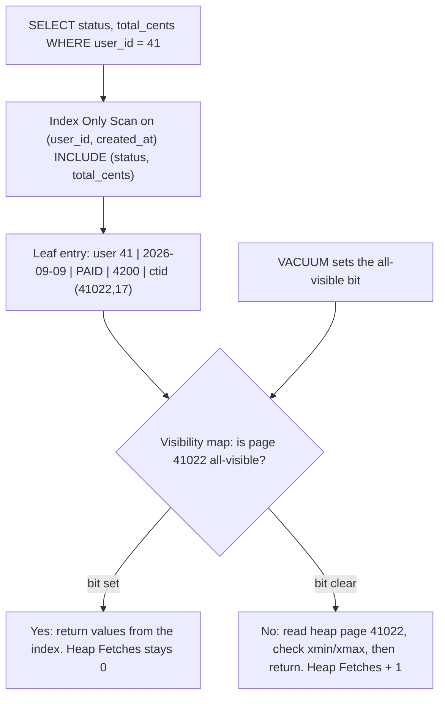
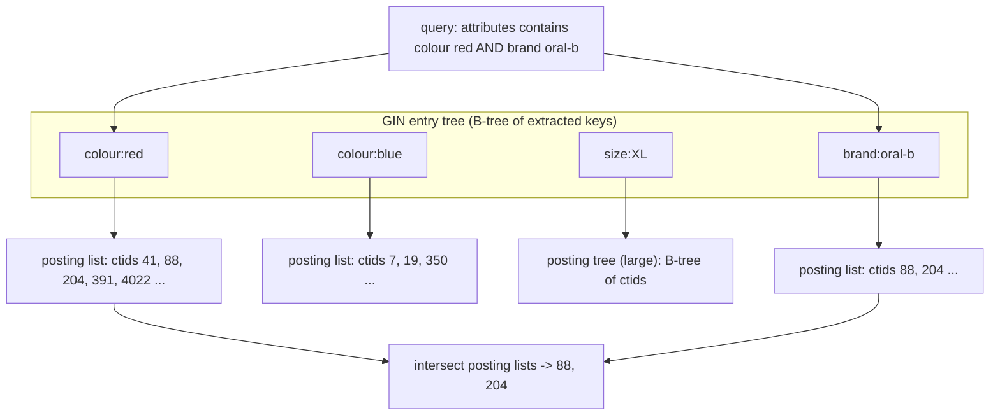
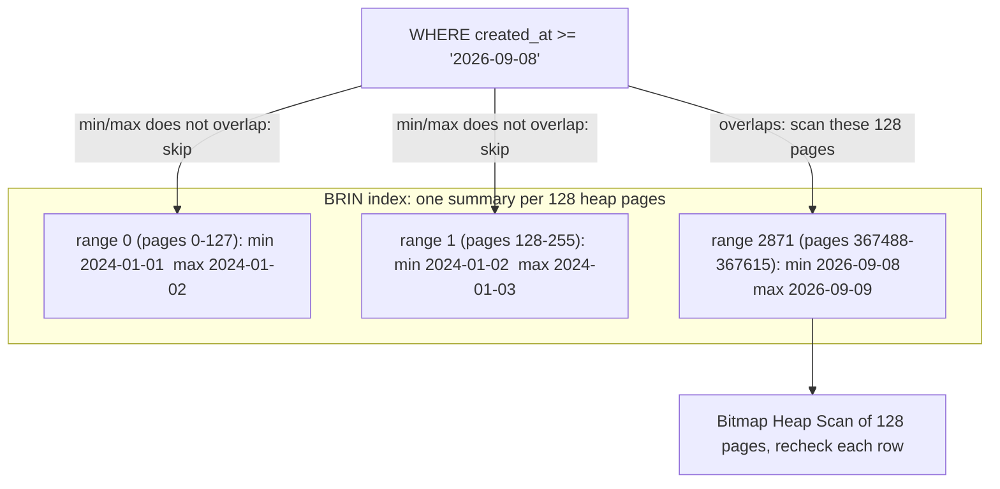

## 12.9 Covering indexes and INCLUDE

### 12.9.1 Index-only scans and the visibility map

#### Concept

An index **covers** a query when every column the query needs is available from the index, so the heap never has to be read. The plan node is called an **Index Only Scan**. Since PostgreSQL 11 you can add non-key columns with `INCLUDE`:

```sql
CREATE INDEX idx_orders_user_created_inc
  ON orders (user_id, created_at DESC)
  INCLUDE (status, total_cents);
```

`user_id` and `created_at` are **key** columns: sorted, seekable, usable in `Index Cond`. `status` and `total_cents` are **payload**: stored only in the leaf pages, not sorted, not seekable, but available to satisfy the `SELECT` list.

#### Why does it exist?

The heap fetch is the expensive half of an index scan. Reading 200 rows through an index means up to 200 random page reads across a 30 GB file. If the index already holds everything the query returns, those 200 reads disappear and the query costs only the index pages, which are dense and usually cached.

`INCLUDE` exists because adding a column to the *key* has costs you may not want: it widens every internal page (shrinking fan-out and deepening the tree), it participates in uniqueness (so `UNIQUE (a, b)` is not the same constraint as `UNIQUE (a) INCLUDE (b)`), and it forces sort-order maintenance on a column you never sort by.

#### Mental model

The warehouse binder again. Normally the binder says "tracking 8829 -> aisle 12, shelf 4" and you walk to the shelf to read the parcel's weight. A covering binder also prints the weight next to the tracking number. If the only thing the caller ever asks is "how heavy is 8829?", you never leave the desk. `INCLUDE` is printing extra facts in the binder without re-sorting the binder by them.

#### How it works

The index does not know whether a row version is visible to your transaction; that information lives in the heap tuple header (Part 11, 11.7). So an index-only scan needs a shortcut, and the shortcut is the **visibility map (VM)**: a tiny bitmap file, two bits per heap page, maintained by VACUUM. One bit means "every tuple on this page is visible to every current transaction".



1. The scan descends and reads a leaf entry.
2. It checks the VM bit for the page the ctid points at. The VM for a 30 GB table is about 1 MB, so it is always in cache.
3. Bit set: return the values straight from the index entry. No heap I/O.
4. Bit clear: read the heap page, do the normal MVCC check, and increment `Heap Fetches`.

The consequence is blunt: **index-only scans are only as good as your vacuum**. On an append-only table that is vacuumed nightly, `Heap Fetches` is near zero. On a table where 5 percent of rows are updated every hour, most pages are not all-visible and the "index-only" scan reads almost as much heap as a normal index scan.

#### Practical example

The order list endpoint returns `id, status, total_cents, created_at` for a user. With `(user_id, created_at DESC)` the plan fetches 20 heap pages. With `INCLUDE (id, status, total_cents)` it fetches none. At 20 rows the difference is 0.12 ms versus 0.09 ms and not worth it. At `LIMIT 500` for the "export my orders" screen it is 4.1 ms versus 0.6 ms. At the analytics query that sums 400,000 rows for one merchant it is 3.9 seconds versus 180 ms. **Covering pays in proportion to rows returned.**

#### PostgreSQL example

```sql
-- Before: key-only index
EXPLAIN (ANALYZE, BUFFERS)
SELECT sum(total_cents) FROM orders
WHERE user_id = 918273 AND created_at >= '2026-01-01';
```

```text
Aggregate  (cost=4218.44..4218.45 rows=1 width=8) (actual time=41.884..41.885 rows=1 loops=1)
  Buffers: shared hit=1204 read=811
  ->  Index Scan using idx_orders_user_created on orders
        (cost=0.57..4201.02 rows=6968 width=4) (actual time=0.061..40.114 rows=7021 loops=1)
        Index Cond: ((user_id = 918273) AND (created_at >= '2026-01-01 00:00:00+00'))
        Buffers: shared hit=1204 read=811
Execution Time: 41.921 ms
```

7,021 rows, 2,015 buffers: 30 index pages plus roughly 1,985 heap pages, because this user's orders are spread across the 30 GB heap by creation time.

```sql
CREATE INDEX idx_orders_user_created_inc
  ON orders (user_id, created_at DESC) INCLUDE (total_cents);
VACUUM ANALYZE orders;
```

```text
Aggregate  (cost=284.11..284.12 rows=1 width=8) (actual time=2.114..2.115 rows=1 loops=1)
  Buffers: shared hit=41 read=3
  ->  Index Only Scan using idx_orders_user_created_inc on orders
        (cost=0.57..266.61 rows=6968 width=4) (actual time=0.048..1.402 rows=7021 loops=1)
        Index Cond: ((user_id = 918273) AND (created_at >= '2026-01-01 00:00:00+00'))
        Heap Fetches: 0
        Buffers: shared hit=41 read=3
Execution Time: 2.148 ms
```

**41.9 ms to 2.1 ms**, 2,015 buffers to 44, `Heap Fetches: 0`. Now skip the vacuum and update 2 percent of the table:

```text
  ->  Index Only Scan using idx_orders_user_created_inc on orders
        (cost=0.57..266.61 rows=6968 width=4) (actual time=0.052..28.884 rows=7021 loops=1)
        Heap Fetches: 5912
        Buffers: shared hit=1102 read=684
Execution Time: 28.912 ms
```

Same node type, most of the benefit gone. Check the health of the mechanism directly:

```sql
SELECT relname,
       pg_size_pretty(pg_relation_size(oid, 'vm')) AS vm_size,
       n_live_tup, n_dead_tup, last_autovacuum
FROM pg_class c JOIN pg_stat_user_tables s ON s.relid = c.oid
WHERE relname IN ('orders', 'order_items');
```

#### INCLUDE versus a key column

| | Add to key `(a, b, c)` | Add with `INCLUDE (c)` |
|---|---|---|
| Usable in `Index Cond` | Yes | No (appears as `Filter`) |
| Usable for `ORDER BY c` | Yes | No |
| Participates in `UNIQUE` | Yes | No |
| Stored in internal pages | Yes (shrinks fan-out) | No (leaf only) |
| Index size impact | Larger, deeper | Larger leaves only |
| Right tool for | columns you filter or sort on | columns you only `SELECT` |

The `UNIQUE` row is the killer feature: `CREATE UNIQUE INDEX uq_orders_ref ON orders (order_ref) INCLUDE (user_id, status)` enforces uniqueness on `order_ref` alone while letting the lookup return the other two columns without a heap fetch. You cannot do that by widening the key.

#### Edge cases & failure modes

- **`SELECT *` destroys covering.** Any column not in the index forces the heap read. Covering indexes and `SELECT *` are mutually exclusive, and this is one of the strongest practical arguments for explicit column lists.
- Wide `INCLUDE` payloads bloat the index; a 200-byte payload on 200M rows is 40 GB.
- `INCLUDE` columns cannot be used in `Index Cond`, only as an after-the-fact `Filter`. That still avoids the heap fetch but does not reduce rows scanned.
- On a hot-update table the visibility map is rarely set and the whole optimisation quietly evaporates. Tune `autovacuum_vacuum_scale_factor` down for such tables (Part 11, 11.8).
- Toasted `INCLUDE` values are stored inline in the index up to the limit and then rejected; do not `INCLUDE` a `text` body column.

#### Interview questions

1. *What is an index-only scan and what can prevent it?* Expected: all columns in the index; visibility map bits not set; `SELECT *`.
2. *When is `INCLUDE` better than adding the column to the key?* Expected: when the column is only selected, not filtered or sorted; keeps fan-out and keeps a `UNIQUE` key narrow.
3. *`Heap Fetches: 5912` on an index-only scan. What do you do?* Expected: vacuum the table; tune autovacuum for it.

## 12.10 Hash indexes

### 12.10.1 Equality only, and why B-tree usually still wins

#### Concept

A **hash index** stores `hash(key) -> ctid` in buckets. It supports exactly one operator: `=`. No ranges, no ordering, no `LIKE`, no multi-column keys, no unique constraints, no `INCLUDE`.

Before PostgreSQL 10 hash indexes were not WAL-logged, which meant they did not survive a crash and could not be used on replicas. That is fixed: since PG 10 they are crash-safe and replicated, and the implementation was substantially improved.

#### Why does it exist?

For a very wide key, a hash index is much smaller than a B-tree, because it stores a 4-byte hash instead of the full key. Indexing a 400-byte URL: the B-tree stores 400 bytes per entry and may refuse entries above 2,704 bytes; the hash index stores 4.

#### How it works

The key is hashed into a bucket number; the bucket is a page (with overflow pages when it fills). A lookup hashes, reads the bucket page, and scans its entries comparing hashes, then re-checks the actual value from the heap because hashes collide. Growth is handled by incremental bucket splitting.

#### When to use it, honestly

| Situation | Use hash? | Why |
|---|---|---|
| Equality on a `bigint` or short text | No | B-tree is the same speed, plus ranges, plus ordering, plus uniqueness |
| Equality on a very long string (URLs, tokens over 100 bytes) | Maybe | Smaller index; but an expression index on `md5(url)` or `hashtext(url)` in a B-tree gives you the same size win plus everything else |
| Need `UNIQUE` | No | Hash indexes cannot enforce uniqueness |
| Need `ORDER BY` or ranges | No | Hash cannot |
| Need index-only scans | No | Hash does not support them |

Real measurement on 8 million `users` with a 320-byte `session_url` column: B-tree 3.1 GB, hash 268 MB, lookup 0.041 ms versus 0.038 ms. The size win is real; the speed difference is noise. And a B-tree on `md5(session_url)` is 512 MB with all the B-tree features intact.

#### PostgreSQL example

```sql
CREATE INDEX idx_sessions_token_hash ON sessions USING hash (token);

EXPLAIN (ANALYZE, BUFFERS) SELECT user_id FROM sessions WHERE token = 'a3f9...';
```

```text
Index Scan using idx_sessions_token_hash on sessions  (cost=0.00..8.02 rows=1 width=8)
                                                      (actual time=0.036..0.037 rows=1 loops=1)
  Index Cond: (token = 'a3f9...'::text)
  Buffers: shared hit=3 read=1
Execution Time: 0.054 ms
```

```sql
-- This returns nothing useful: hash indexes cannot answer ranges or ordering
EXPLAIN SELECT * FROM sessions WHERE token > 'a' ORDER BY token;   -- Seq Scan + Sort
```

#### How a Senior Backend Engineer thinks about this

They know hash indexes exist, know they are safe since PG 10, and use them roughly once every few years, for a very wide equality-only key where the size difference is measured and material. Otherwise B-tree, every time, because optionality is worth more than 8 percent.

#### Interview questions

1. *When would you pick a hash index over a B-tree?* Expected: very wide equality-only key where index size matters; note the `md5()` B-tree alternative.
2. *What changed for hash indexes in PostgreSQL 10?* Expected: WAL logging, so crash-safe and replicated.
3. *Can a hash index enforce uniqueness or support index-only scans?* Expected: no to both.

## 12.11 GIN indexes

### 12.11.1 Inverted indexes for jsonb, arrays, full text and trigrams

#### Concept

**GIN** stands for Generalized Inverted Index. A B-tree maps one key to one row. GIN maps **one element inside a value** to many rows. It is the structure behind every search engine: a dictionary of terms, and under each term a sorted list of the rows containing it (the **posting list**).

Use GIN when one column holds *many searchable things*: a `jsonb` document with many keys, a `text[]` of tags, a `tsvector` of words, or a string you want to search with `LIKE '%substring%'` via trigrams.

#### Why does it exist?

`WHERE attributes @> '{"colour":"red"}'` cannot use a B-tree, because the B-tree key would be the whole jsonb document and you are asking about one fragment of it. `WHERE 'organic' = ANY(tags)` has the same problem. `WHERE name ILIKE '%toothbrush%'` has it too: there is no prefix to seek on. Without GIN, all three are sequential scans over the whole table forever.

#### Mental model

The index at the back of a textbook. Not sorted by page; sorted by *term*, and under each term a list of page numbers: "mitochondria: 41, 88, 204, 391". Looking up two terms and intersecting their page lists is exactly how a GIN `AND` works.



#### How it works

1. An **extract function** per data type turns one value into a set of keys. For `jsonb` with the default `jsonb_ops`, every key and every value becomes a key. For `tsvector`, every lexeme. For `pg_trgm`, every 3-character sequence.
2. Those keys are stored in a B-tree (the **entry tree**). Under each key sits a **posting list** of ctids, compressed. When a key appears in very many rows, the posting list becomes a **posting tree**, a B-tree of its own.
3. A query extracts keys the same way and walks the posting lists, intersecting or unioning them, producing a bitmap. **GIN always produces a bitmap**, so the plan is always `Bitmap Index Scan` plus `Bitmap Heap Scan` with a recheck. GIN cannot produce sorted output and cannot do index-only scans.
4. **Inserts are expensive.** A single 30-key jsonb document means up to 30 entry-tree updates. To soften this, GIN has a **pending list**: with `fastupdate = on` (the default), new entries go into an unsorted pending list appended at the end of the index, and are merged into the main structure later by autovacuum or when the list exceeds `gin_pending_list_limit` (4 MB default).
5. The pending list is a trade: inserts get fast, but **queries must scan the entire pending list linearly** in addition to the tree. A 4 MB pending list adds real latency to every search. And the merge, when it happens, is a latency spike on whichever unlucky insert triggers it.

#### The operator class matters

| Type | Operator class | Supports | Size |
|---|---|---|---|
| `jsonb` | `jsonb_ops` (default) | `@>`, `?`, `?&`, `?|`, `@?`, `@@` | Large: indexes keys and values separately |
| `jsonb` | `jsonb_path_ops` | `@>` and `@?` only | 30 to 50 percent smaller, faster for `@>` |
| `text[]` | `array_ops` (default) | `@>`, `<@`, `&&`, `=` | Moderate |
| `tsvector` | `tsvector_ops` (default) | `@@` | Moderate |
| `text` | `gin_trgm_ops` (extension `pg_trgm`) | `LIKE`, `ILIKE`, `~`, `%` similarity | Large: 3 trigrams per character |

If your only jsonb query is containment (`@>`), use `jsonb_path_ops`. It is smaller and faster because it hashes whole paths instead of indexing keys and values independently.

#### PostgreSQL example — jsonb

400,000 products with a `jsonb` attributes column averaging 14 keys.

```sql
EXPLAIN (ANALYZE, BUFFERS)
SELECT id, name FROM products WHERE attributes @> '{"brand":"Oral-B","type":"electric"}';
```

Before:

```text
Seq Scan on products  (cost=0.00..64882.00 rows=400 width=48)
                      (actual time=0.412..884.221 rows=1182 loops=1)
  Filter: (attributes @> '{"type": "electric", "brand": "Oral-B"}'::jsonb)
  Rows Removed by Filter: 398818
  Buffers: shared hit=8214 read=43786
Execution Time: 884.311 ms
```

```sql
CREATE INDEX idx_products_attrs ON products USING gin (attributes jsonb_path_ops);
ANALYZE products;
```

After:

```text
Bitmap Heap Scan on products  (cost=44.12..1682.44 rows=412 width=48)
                              (actual time=1.884..6.221 rows=1182 loops=1)
  Recheck Cond: (attributes @> '{"type": "electric", "brand": "Oral-B"}'::jsonb)
  Heap Blocks: exact=1121
  Buffers: shared hit=1140 read=12
  ->  Bitmap Index Scan on idx_products_attrs  (cost=0.00..44.02 rows=412 width=0)
                                               (actual time=1.681..1.681 rows=1182 loops=1)
        Index Cond: (attributes @> '{"type": "electric", "brand": "Oral-B"}'::jsonb)
        Buffers: shared hit=31
Execution Time: 6.284 ms
```

884 ms to 6.3 ms. Index sizes: `jsonb_ops` 218 MB, `jsonb_path_ops` 122 MB, for the same query performance on `@>`.

#### PostgreSQL example — full text and trigrams

```sql
-- Full text: maintain a tsvector column (generated, so it cannot drift)
ALTER TABLE products
  ADD COLUMN search_tsv tsvector
  GENERATED ALWAYS AS (to_tsvector('english', coalesce(name,'') || ' ' || coalesce(description,''))) STORED;

CREATE INDEX idx_products_tsv ON products USING gin (search_tsv);

EXPLAIN (ANALYZE, BUFFERS)
SELECT id, name, ts_rank(search_tsv, q) AS rank
FROM products, plainto_tsquery('english', 'electric toothbrush') q
WHERE search_tsv @@ q ORDER BY rank DESC LIMIT 20;
```

```text
Limit  (cost=1884.44..1884.49 rows=20 width=52) (actual time=8.114..8.121 rows=20 loops=1)
  ->  Sort  (cost=1884.44..1889.44 rows=2000 width=52) (actual time=8.112..8.116 rows=20 loops=1)
        Sort Key: (ts_rank(products.search_tsv, q.q)) DESC
        Sort Method: top-N heapsort  Memory: 28kB
        ->  Nested Loop  (cost=28.11..1831.22 rows=2000 width=52) (actual time=0.884..7.402 rows=3104 loops=1)
              ->  Function Scan on plainto_tsquery q  (cost=0.25..0.26 rows=1 width=32) ...
              ->  Bitmap Heap Scan on products  (cost=27.86..1811.96 rows=2000 width=52) ...
                    Recheck Cond: (search_tsv @@ q.q)
                    ->  Bitmap Index Scan on idx_products_tsv (actual time=0.641..0.641 rows=3104 loops=1)
Execution Time: 8.184 ms
```

```sql
-- Substring search: pg_trgm makes LIKE '%...%' indexable
CREATE EXTENSION IF NOT EXISTS pg_trgm;
CREATE INDEX idx_products_name_trgm ON products USING gin (name gin_trgm_ops);

EXPLAIN (ANALYZE, BUFFERS) SELECT id, name FROM products WHERE name ILIKE '%toothbrush%';
```

```text
Bitmap Heap Scan on products  (cost=112.44..2104.88 rows=1840 width=48)
                              (actual time=3.114..11.884 rows=2211 loops=1)
  Recheck Cond: (name ~~* '%toothbrush%'::text)
  Rows Removed by Index Recheck: 41
  Heap Blocks: exact=1904
  ->  Bitmap Index Scan on idx_products_name_trgm  (cost=0.00..111.98 rows=1840 width=0)
                                                   (actual time=2.884..2.884 rows=2252 loops=1)
        Index Cond: (name ~~* '%toothbrush%'::text)
Execution Time: 11.921 ms
```

From a 210 ms sequential scan to 12 ms, and `Rows Removed by Index Recheck: 41` shows the trigram index is approximate: it finds candidates, and the recheck applies the real `ILIKE`. That is expected and correct.

#### The insert-throughput cost, measured

`products` with 400,000 rows, inserting 100,000 more:

| Indexes present | Time | WAL | Per-row |
|---|---|---|---|
| B-tree on `id` only | 3.1 s | 62 MB | 31 us |
| plus GIN `jsonb_path_ops` on `attributes`, `fastupdate=on` | 11.4 s | 214 MB | 114 us |
| plus the same GIN with `fastupdate=off` | 38.8 s | 388 MB | 388 us |
| plus GIN `gin_trgm_ops` on `name` as well | 71.2 s | 690 MB | 712 us |

**A GIN index can make inserts 10 to 20 times more expensive.** On `notifications` at 14,000 inserts per second, a GIN index on `payload` is simply not affordable. Tune it explicitly when you do use one:

```sql
ALTER INDEX idx_products_attrs SET (fastupdate = on, gin_pending_list_limit = 2048);  -- kB
```

Small `gin_pending_list_limit` means more frequent, smaller merges: lower query latency, more consistent insert latency. `fastupdate = off` means no pending list at all: queries never scan it, inserts pay full price. For a search table with heavy reads and batched writes, `fastupdate = off` plus batched loads is often the right shape.

#### NestJS example

```ts
// product-search.service.ts
@Injectable()
export class ProductSearchService {
  constructor(private readonly ds: DataSource) {}

  /** Uses idx_products_tsv (GIN on the generated tsvector column). */
  async search(term: string, limit = 20) {
    return this.ds.query(
      `SELECT p.id, p.name, ts_rank(p.search_tsv, q) AS rank
         FROM products p, plainto_tsquery('english', $1) q
        WHERE p.search_tsv @@ q
          AND p.is_active
        ORDER BY rank DESC
        LIMIT $2`,
      [term, limit],
    );
  }

  /** Uses idx_products_attrs (GIN jsonb_path_ops). Containment only. */
  async byAttributes(filter: Record<string, unknown>, limit = 50) {
    return this.ds.query(
      `SELECT id, name FROM products WHERE attributes @> $1::jsonb LIMIT $2`,
      [JSON.stringify(filter), limit],
    );
  }
}
```

Note `attributes @> $1::jsonb`. If you build the filter with `attributes->>'brand' = $1` instead, the GIN index is not used at all (that needs the expression index of 12.8). **The operator you write decides which index can serve you.**

#### Edge cases & failure modes

- GIN never returns sorted rows and never does index-only scans; an `ORDER BY` always adds a `Sort`.
- The pending list making a "fast" index slow to query; watch `gin_pending_list_limit` and `pg_stat_user_indexes`.
- `jsonb_ops` on documents with high-cardinality values (UUIDs inside jsonb) exploding the entry tree.
- `gin_trgm_ops` on short search terms: a 2-character search produces no full trigram and degrades to a scan. Enforce a minimum term length of 3 in the API.
- GIN builds are slow and memory-hungry; raise `maintenance_work_mem` to 2 GB before building one on a large table.
- A GIN index on a column nobody queries is the most expensive useless index you can have (12.17).

#### Interview questions

1. *What is an inverted index and why is GIN the right structure for jsonb and full text?* Expected: term to posting list; one value contains many searchable elements.
2. *What is the GIN pending list and what does it trade?* Expected: fast unsorted inserts against slower queries that must scan it; merged by autovacuum or at the limit.
3. *`jsonb_ops` versus `jsonb_path_ops`?* Expected: full operator support and bigger, versus containment only and 30 to 50 percent smaller and faster.
4. *How do you make `LIKE '%term%'` fast?* Expected: `pg_trgm` with `gin_trgm_ops`; the index is approximate and rechecked.
5. *Why might you refuse a GIN index on a hot write table?* Expected: 10 to 20x insert cost and WAL amplification.

## 12.12 GiST indexes

### 12.12.1 Ranges, geometry, exclusion constraints and nearest neighbour

#### Concept

**GiST** is the Generalized Search Tree: a balanced tree where each internal node stores a **predicate that is true for everything below it**, rather than a sorted key. "Everything under this node is inside this bounding box." "Everything under this node falls within this time range."

That generality is why GiST is the index behind geometric types, range types (`tstzrange`, `int4range`), `ltree`, exclusion constraints, and nearest-neighbour ordering.

#### Why does it exist?

Some questions have no total order. "Which delivery zones contain this point?" and "which bookings overlap 14:00 to 16:00?" cannot be answered by sorting, because containment and overlap are not orderings. GiST answers them by descending only into subtrees whose predicate could still match, pruning the rest.

#### Mental model

A set of nested boxes. The outer box says "everything in here is somewhere in Germany". Inside are boxes for Hamburg, Berlin, Munich. Looking for a point in Berlin, you open the Germany box, skip Hamburg and Munich immediately because their boxes do not contain your point, and descend into Berlin. Boxes can overlap, which is why GiST sometimes descends into more than one subtree, and why GiST lookups are usually a little slower than B-tree lookups but answer questions B-trees cannot.

#### How it works

1. Each data type provides seven support functions: `consistent` (could this subtree match?), `union` (bounding predicate for a set), `penalty` (cost of adding an entry here), `picksplit` (how to divide a full page), and others.
2. Insert descends by minimum `penalty`, which keeps bounding predicates tight.
3. Search descends into every child whose `consistent` returns true. Overlapping bounding boxes mean multiple descents, so GiST is not a strict logarithmic guarantee.
4. **Nearest neighbour**: GiST supports `ORDER BY column <-> value LIMIT k` natively, walking the tree in distance order. This is the KNN feature and it is genuinely special: no other index type gives you "20 nearest stores" without scanning.

#### PostgreSQL example — the non-overlapping booking constraint

The most valuable GiST feature for a backend engineer is the **exclusion constraint**: a database-enforced guarantee that no two rows overlap. This is how you make double-booking structurally impossible instead of hoping your application locking is right.

```sql
CREATE EXTENSION IF NOT EXISTS btree_gist;   -- lets scalar equality join a GiST constraint

CREATE TABLE delivery_slots (
  id          bigserial PRIMARY KEY,
  courier_id  bigint NOT NULL REFERENCES users(id),
  during      tstzrange NOT NULL,
  order_id    bigint REFERENCES orders(id),
  -- No two slots for the SAME courier may overlap in time.
  EXCLUDE USING gist (courier_id WITH =, during WITH &&)
);
```

`courier_id WITH =` needs `btree_gist`, because plain GiST has no equality operator class for `bigint`. The constraint creates a GiST index automatically.

```sql
INSERT INTO delivery_slots (courier_id, during)
VALUES (41, tstzrange('2026-09-09 14:00+00', '2026-09-09 16:00+00'));

INSERT INTO delivery_slots (courier_id, during)
VALUES (41, tstzrange('2026-09-09 15:00+00', '2026-09-09 17:00+00'));
```

```text
ERROR:  conflicting key value violates exclusion constraint "delivery_slots_courier_id_during_excl"
DETAIL:  Key (courier_id, during)=(41, ["2026-09-09 15:00:00+00","2026-09-09 17:00:00+00")) 
         conflicts with existing key (courier_id, during)=(41, ["2026-09-09 14:00:00+00","2026-09-09 16:00:00+00")).
```

Two concurrent transactions attempting overlapping inserts: the second waits on the first and then fails. No application lock, no race, no lost booking. Compare that to the read-check-insert pattern, which loses under concurrency every time (Part 13 — Database Transactions covers why).

The overlap query itself:

```sql
EXPLAIN (ANALYZE, BUFFERS)
SELECT id, order_id FROM delivery_slots
WHERE courier_id = 41 AND during && tstzrange(now(), now() + interval '2 hours');
```

```text
Index Scan using delivery_slots_courier_id_during_excl on delivery_slots
    (cost=0.28..8.44 rows=3 width=16) (actual time=0.041..0.044 rows=2 loops=1)
  Index Cond: ((courier_id = 41) AND (during && tstzrange(now(), (now() + '02:00:00'::interval))))
  Buffers: shared hit=4
Execution Time: 0.061 ms
```

#### PostgreSQL example — nearest neighbour

```sql
CREATE EXTENSION IF NOT EXISTS cube;
CREATE EXTENSION IF NOT EXISTS earthdistance;

CREATE INDEX idx_stores_location ON stores USING gist (ll_to_earth(lat, lon));

EXPLAIN (ANALYZE, BUFFERS)
SELECT id, name FROM stores
ORDER BY ll_to_earth(lat, lon) <-> ll_to_earth(53.5511, 9.9937)
LIMIT 10;
```

```text
Limit  (cost=0.28..12.44 rows=10 width=40) (actual time=0.102..0.288 rows=10 loops=1)
  ->  Index Scan using idx_stores_location on stores  (cost=0.28..3821.44 rows=3140 width=40)
                                                      (actual time=0.101..0.284 rows=10 loops=1)
        Order By: (ll_to_earth(lat, lon) <-> '(3785.4, 663.1, 5107.2)'::earth)
        Buffers: shared hit=12
Execution Time: 0.311 ms
```

`Order By:` inside an index scan node, not a separate `Sort`. That is KNN.

#### When GiST versus GIN for text search

Both index `tsvector`. GIN is 2 to 3 times faster for search and 3 times slower to build and update. GiST is lossy (it stores a signature, so every hit needs a heap recheck) and therefore slower to query but cheaper to maintain. **Default to GIN for text search**; consider GiST only when the table has very heavy write volume and modest search volume. For range types and geometry there is no choice: GiST (or SP-GiST for non-overlapping partitioned spaces like IP prefixes and quadtrees).

#### Edge cases & failure modes

- GiST index quality depends on the `picksplit` implementation; badly overlapping bounding boxes make searches degenerate toward scanning.
- `btree_gist` is required for scalar equality inside an exclusion constraint, and it is an extension you must install in every environment including CI.
- Exclusion constraints cannot be created with `CONCURRENTLY` directly; build the index concurrently and then attach with `ALTER TABLE ... ADD CONSTRAINT ... USING INDEX` (which works for unique, and for exclusion requires a plain `ADD CONSTRAINT`, so plan a maintenance window).
- KNN ordering with a `WHERE` that is not indexable can still scan.
- GiST on `tstzrange` with unbounded ranges (`[x,)`) makes bounding predicates useless.

#### Interview questions

1. *How does GiST differ structurally from a B-tree?* Expected: internal nodes hold predicates, not sorted keys; search descends every possibly-matching child.
2. *How do you prevent double-booking at the database level?* Expected: `EXCLUDE USING gist (resource WITH =, during WITH &&)` plus `btree_gist`.
3. *GIN or GiST for full-text search, and why?* Expected: GIN for query speed, GiST for cheaper maintenance and lossy signatures.
4. *What is a KNN index scan?* Expected: `ORDER BY col <-> point LIMIT k` served by walking the GiST tree in distance order.

## 12.13 BRIN indexes

### 12.13.1 Three megabytes for nine hundred million rows

#### Concept

**BRIN** is Block Range INdex. Instead of one entry per row, it stores one small summary per **range of heap pages** (128 pages by default, so 1 MB of heap). For each range it records the minimum and maximum value of the indexed column.

A query for `created_at BETWEEN X AND Y` reads the tiny BRIN index, collects the ranges whose min/max overlap `[X, Y]`, and scans only those heap pages. Everything else is skipped without being read.

#### Why does it exist?

Because for append-only time-series data, a B-tree is absurd overkill. `notifications` has 1.2 billion rows; a B-tree on `created_at` is 36 GB and must be maintained on every insert. A BRIN index on the same column is **4 MB** and costs almost nothing to maintain, because an insert into the last page range usually just widens that range's max value.

#### Mental model

A library where books were shelved strictly in the order they arrived. You do not need a card catalogue with one card per book. You need a sign at the end of each shelf saying "this shelf: January 3rd to January 9th". To find everything from January 5th you read the signs, ignore 4,000 shelves, and walk the two that could contain it. The signs fit on one page.



#### How it works

1. `CREATE INDEX ... USING brin (col)` walks the heap and records min/max per block range (`pages_per_range`, default 128).
2. Inserts into the last range update its summary in place. Inserts into an already-summarised earlier range **desummarise nothing**; the range just widens, which is why out-of-order data destroys BRIN effectiveness.
3. New pages beyond the summarised area are not indexed until `brin_summarize_new_values()` runs or autovacuum summarises them (`autosummarize = on`, off by default, and you almost always want it on).
4. A query builds a bitmap of candidate page ranges and hands it to a bitmap heap scan, which rechecks every row. BRIN is always **lossy**: it tells you which pages might match, never which rows.

**Correlation is everything.** `pg_stats.correlation` for the column is the number that decides whether BRIN works:

| `correlation` | Meaning | BRIN verdict |
|---|---|---|
| 0.99 to 1.0 | Physical order matches value order (append-only `created_at`) | Excellent |
| 0.7 to 0.95 | Mostly ordered, some churn | Usable, more pages scanned |
| under 0.5 | Values scattered across the heap | Useless: every range's min/max spans everything |
| `user_id` on any real table | Random | Never |

```sql
SELECT attname, correlation, n_distinct
FROM pg_stats WHERE tablename = 'notifications' AND attname IN ('created_at', 'user_id');
```

```text
  attname   | correlation | n_distinct
------------+-------------+------------
 created_at |    0.999812 |         -1
 user_id    |    0.000411 |    7982114
```

`created_at` at 0.9998 is a perfect BRIN candidate. `user_id` at 0.0004 would produce an index where every single range says "min 1, max 7,982,114", matching everything, scanning the whole table plus the index.

#### PostgreSQL example

900 million rows in a partition-free `notifications` table, indexed three ways:

```sql
CREATE INDEX idx_notif_created_btree ON notifications (created_at);
CREATE INDEX idx_notif_created_brin  ON notifications USING brin (created_at) WITH (pages_per_range = 128, autosummarize = on);

SELECT indexrelname, pg_size_pretty(pg_relation_size(indexrelid)) AS size
FROM pg_stat_user_indexes WHERE relname = 'notifications';
```

```text
      indexrelname       |  size
-------------------------+---------
 idx_notif_created_btree | 27 GB
 idx_notif_created_brin  | 3520 kB
```

**27 GB versus 3.4 MB.** A factor of 7,800. Now the query, a one-day analytics window over that 210 GB table:

```sql
EXPLAIN (ANALYZE, BUFFERS)
SELECT count(*), kind FROM notifications
WHERE created_at >= '2026-09-08' AND created_at < '2026-09-09'
GROUP BY kind;
```

With BRIN:

```text
HashAggregate  (cost=1284402.11..1284402.14 rows=3 width=40)
               (actual time=2884.114..2884.221 rows=3 loops=1)
  Group Key: kind
  Buffers: shared hit=8214 read=118820
  ->  Bitmap Heap Scan on notifications  (cost=412.02..1264882.44 rows=3903934 width=32)
                                         (actual time=18.884..2214.882 rows=3884102 loops=1)
        Recheck Cond: ((created_at >= '2026-09-08 00:00:00+00') AND (created_at < '2026-09-09 00:00:00+00'))
        Rows Removed by Index Recheck: 412008
        Heap Blocks: lossy=127034
        Buffers: shared hit=8214 read=118820
        ->  Bitmap Index Scan on idx_notif_created_brin  (cost=0.00..411.02 rows=3903934 width=0)
                                                         (actual time=17.114..17.114 rows=1270340 loops=1)
              Index Cond: ((created_at >= '2026-09-08 00:00:00+00') AND (created_at < '2026-09-09 00:00:00+00'))
              Buffers: shared hit=440
Execution Time: 2884.402 ms
```

Read the key lines. The **BRIN index scan itself cost 440 buffers and 17 ms** on a 210 GB table. `Heap Blocks: lossy=127034` means it identified 127,034 candidate pages out of 27.5 million: it skipped 99.5 percent of the table. `Rows Removed by Index Recheck: 412,008` is the price of page granularity: it read some rows outside the window and threw them away, about 10 percent overhead.

With the B-tree the same query runs in 2,102 ms: about 27 percent faster, using 27 GB of storage and paying full B-tree insert cost on 14,000 inserts per second. **For this workload BRIN is the right answer and it is not close.**

Where BRIN dies:

```sql
CREATE INDEX idx_notif_user_brin ON notifications USING brin (user_id);
EXPLAIN (ANALYZE, BUFFERS) SELECT count(*) FROM notifications WHERE user_id = 918273;
```

```text
Aggregate  (cost=27884102.44..27884102.45 rows=1 width=8) (actual time=98221.884..98221.885 rows=1 loops=1)
  ->  Bitmap Heap Scan on notifications  (cost=8214.02..27883902.44 rows=80000 width=0)
                                         (actual time=214.114..98218.884 rows=41 loops=1)
        Recheck Cond: (user_id = 918273)
        Rows Removed by Index Recheck: 1199999959
        Heap Blocks: lossy=27500000
Execution Time: 98221.902 ms
```

Every block range matched. It read the entire 210 GB table plus the index and threw away 1.2 billion rows. **98 seconds, slower than a plain sequential scan.** That is what an uncorrelated BRIN index does.

#### Practical guidance

- Use BRIN on append-only or time-partitioned tables where the indexed column tracks insertion order: `created_at`, `event_time`, a monotonically increasing id, or a partition key.
- Always set `autosummarize = on`, or new data is not indexed until vacuum happens to run.
- Tune `pages_per_range`: smaller (32) means a bigger, more precise index; larger (512) means smaller and coarser. 128 is a good default; drop to 32 if your ranges are wide because of moderate churn.
- Check `correlation` before creating it and after any bulk reorganisation. `CLUSTER` or a partitioned rewrite can restore correlation.
- BRIN plus `CLUSTER` is a real combination for cold archival tables: cluster on the column once, then BRIN is near-perfect.

#### Edge cases & failure modes

- Out-of-order inserts (backfills, late-arriving events) widening ranges and destroying selectivity, permanently, until `REINDEX`.
- Updates moving rows to new pages, which does the same.
- `autosummarize` off, so the newest data (the data everyone queries) is unindexed.
- Using BRIN for a point lookup: never right.
- Deleting old rows and reusing their pages for new rows, which scrambles correlation.

#### Interview questions

1. *How does BRIN differ from a B-tree in what it stores?* Expected: min/max per block range versus one entry per row; lossy versus exact.
2. *What single statistic decides whether BRIN will work?* Expected: `pg_stats.correlation` for the column.
3. *Give a case where BRIN is slower than a sequential scan.* Expected: uncorrelated column; every range matches, so full scan plus index plus recheck.
4. *Why must `autosummarize` be on?* Expected: otherwise new block ranges are unsummarised and excluded from the index until vacuum.

#### Practical exercise

Build a 50 million row `notifications` table with `created_at` strictly increasing. Create both a B-tree and a BRIN index on it, record both sizes, and run a one-day range query against each (isolate with `DROP INDEX` or `enable_*`). Then insert 5 million rows with `created_at` values scattered randomly across the whole history, re-run, and record how the BRIN plan degrades. Acceptance criteria: two size numbers, four plans, and the `correlation` value before and after the scattered insert.
