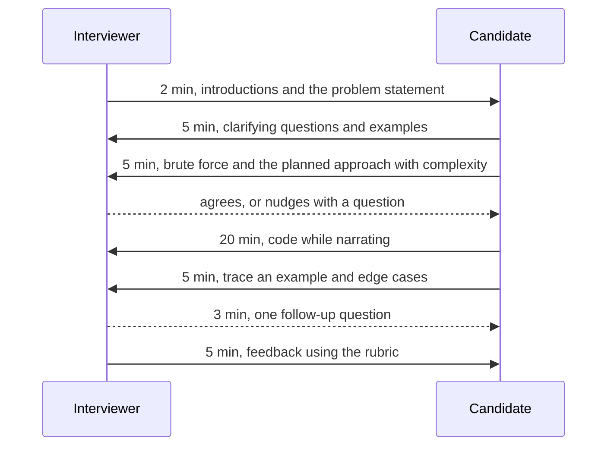

## 12.8 A six-week practice plan

### 12.8.1 From Volume 0 to interview-ready

#### Concept

The ladder is the material; a plan turns it into a habit. This plan assumes about an hour a day on five days a week, plus one longer session at the weekend. It is coding practice only. If you are preparing for a full interview loop, Part 74 — The Interview Playbook (74.9) has an eight-week plan that combines coding with system design and behavioural preparation; this plan fits inside its coding column.

#### Why does it exist?

Without a schedule, practice drifts towards the problems you already enjoy, and the patterns you avoid are the ones that fail you. A fixed plan with a review day every week forces spaced repetition (12.1.2) and keeps the mistake log honest.

#### How it works

| Week | New problems | Review | Goal by the end of the week |
|---|---|---|---|
| 1 | Level 1: all seven (12.4) | Re-solve any you needed the answer for | The six-step method is automatic; tests with `node:assert` are a habit |
| 2 | Level 2: 12.5.1 to 12.5.4 | Week 1 problems, from scratch | Hashing, both sliding windows and interval merging without hints |
| 3 | Level 2: 12.5.5 to 12.5.8 | Week 2 problems | Binary search template and BFS/DFS written from memory in under 10 minutes each |
| 4 | Level 3: 12.6.1 to 12.6.5 | Weeks 2 and 3, timed | Heap, sweep, binary search on the answer, prefix-sum counting, topological sort |
| 5 | Level 3: 12.6.6 to 12.6.9, plus two Level 4 problems | Week 4, timed; first mock interview (12.9) | Dijkstra, backtracking, 1-D DP, monotonic deque; first mock done |
| 6 | Level 4: the remaining five | Everything in the mistake log; second and third mocks | Medium problems in 30 to 35 minutes with narration; hard problems reach a correct brute force and a clear plan |


A typical day in week 4:

```text
10 min  Re-solve one problem from the review queue, from scratch, timed
35 min  One new problem with the six steps (hint at 20 minutes, answer at 40)
10 min  Mistake log entry; schedule the problem's next review date
 5 min  Read the pattern's section in Part 10 or 11 if the problem exposed a gap
```

#### Edge cases & failure modes

- **Falling behind.** Drop new problems, never the review. Ten problems you can re-solve beat thirty you once read.
- **Everything feels easy.** Add a timer and narrate out loud. Most people discover that "easy" problems take twice as long when explained.
- **Everything feels impossible.** Go back one level for a week. The ladder is ordered on purpose.
- **The interview date moves earlier.** Keep the review days and the mocks; cut Level 4 down to the problems your mistake log points at.
- **Only reading answers.** If the mistake log shows more than half the problems needed the answer, slow down: attempt, hint, attempt again, then the answer, then rewrite it from memory the next day.

#### How a Senior Backend Engineer thinks about this

Seniors treat interview preparation like any skill gap at work: measure (the mistake log), plan, practise deliberately, review, adjust. They also keep it in proportion. Coding rounds are one signal among several (Part 64 — Senior Backend Interview Preparation, 64.0.1), and for senior roles system design and experience usually weigh more; six focused weeks are enough to stop the coding round from being the weak link.

## 12.9 Running a mock coding interview with a friend

### 12.9.1 Practising the part that actually fails

#### Concept

A **mock interview** is a timed practice round with one person as the candidate and another as the interviewer. It trains what solo practice cannot: thinking while talking, being watched, taking hints gracefully, and managing the clock. Two friends preparing together can swap roles; being the interviewer teaches almost as much as being the candidate.

#### How it works — the 45-minute script



**The interviewer's job:**

1. Pick a problem the candidate has **not** solved: from a level they have finished, but not one in their review queue.
2. Read the statement aloud and paste it into a shared editor. Have the worked answer open, but do not volunteer it.
3. Answer clarifying questions precisely. If the candidate does not ask about an important edge case, do not tell them; note it.
4. Stay quiet while they are making progress. If they are stuck for about three minutes, give the smallest useful hint, in the form of a question ("what does the brute force recompute?"). Record every hint.
5. Ask one follow-up at the end: a changed constraint ("what if the logs do not fit in memory?") or a complexity question.
6. Score with the rubric in 12.10, then give feedback: two things that went well, the one change that would help most.

**The candidate's job:** treat it as real. Narrate, state complexity before coding, test your own code, and ask for a hint rather than sitting silent. Record the session if you can; watching ten minutes of yourself is uncomfortable and very effective.

#### Practical example — useful hints, from smallest to largest

```text
For 12.6.4 (day ranges with a given net balance), if the candidate is stuck on a sliding window:
  Hint 1  "Do the values contain negatives? What does that do to shrinking a window?"
  Hint 2  "Suppose you knew the running total at every day. How would you get the total of days i to j?"
  Hint 3  "For the current day, which earlier running totals would give exactly k?"
Each later hint costs the candidate more on the rubric; that is fine. The goal is to see them finish.
```

#### Common mistakes

- The interviewer helping too early or too much, so the mock tests nothing.
- Picking a problem the candidate has already seen.
- Skipping the feedback because "it went fine". Even a strong round has one thing to improve.
- Doing mocks only at the end of preparation. Start in week 5 so there is time to act on what they reveal.

## 12.10 What interviewers score

### 12.10.1 The rubric behind the coding round

#### Concept

Most companies score coding rounds against a rubric with a few dimensions, then combine it with a hire or no-hire recommendation. The exact names vary, but the dimensions are remarkably consistent, and the answer is only one of them. Part 64 (64.0.2) lists what is assessed at senior level across all rounds; Part 74 (74.2.2) narrates a live solve. Here is the coding rubric as a practice tool.

#### How it works

| Dimension | Strong signal | Weak signal |
|---|---|---|
| Problem understanding | Restates the problem; asks about limits, empty input, duplicates, ties | Starts coding immediately; discovers the real problem at minute 25 |
| Approach and complexity | Brute force first, names the pattern, states time and space before coding | Codes the first idea; cannot say its complexity |
| Code quality | Clear names, small helpers, handles edge cases, no dead code | One long function, single-letter names, off-by-one fixes by trial and error |
| Testing | Traces an example by hand; tests edge cases unprompted; finds own bugs | "I think it works"; waits for the interviewer to find the bug |
| Communication | Narrates decisions; takes hints and builds on them | Long silences; argues with hints |
| Speed and completion | Working solution with time for a follow-up | Partial solution, or correct only for the given example |

Use it in mocks: score each dimension from 1 to 4 and write one sentence of evidence for each. After three mocks, the lowest dimension is your next week's focus, the same way the mistake log picks your next patterns.

#### Failure scenario

A candidate with strong production experience was given 12.6.3 (smallest nightly export capacity). Recognising "binary search on the answer" quickly, they coded silently for 15 minutes and announced they were done. They had started the search at 1, so for one input the function returned a capacity smaller than the largest job, and they had not run a single example. The interviewer gave a hint; the candidate fixed it with 4 minutes left. The written feedback: "correct pattern recognition, no clarification, no testing, communication only when prompted: lean no-hire". The same solution, with two minutes of examples at the start and a trace at the end, would have been a clear hire. The rubric rewards the method, not just the insight.

#### How a Senior Backend Engineer thinks about this

Seniors know the rubric mirrors the job: understand the requirement, choose an approach with known costs, write code others can read, test it, and communicate while doing it. They therefore practise the round the way they would want a colleague to work, and they do not panic when the optimal solution does not appear; a correct brute force, a clear explanation of what is slow, and a plan for improving it already score well on four of the six dimensions.

#### Interview questions

1. **You cannot find the optimal solution. What do you do?** Say so, implement the brute force correctly with its complexity, explain where it repeats work, and outline the improvement you would try next.
2. **How do you test code in an interview without running it?** Trace a small example line by line, then walk through edge cases: empty input, one element, duplicates, boundaries.
3. **How do you take a hint well?** Thank the interviewer, restate what the hint suggests, and connect it to your approach; do not ignore it or argue with it.
4. **How did you prepare for coding interviews?** A plan, a pattern-based ladder, a mistake log, spaced repetition and mock interviews; with numbers if you have them.

#### Practical exercise

Run one complete mock interview with a friend using the script in 12.9 and a problem neither of you has seen from 12.5 or 12.6. Swap roles and run a second one. Acceptance criteria: both mocks are timed at 45 minutes, both are scored on all six rubric dimensions with one sentence of evidence each, and each of you writes down the single lowest dimension and the plan to improve it next week.

#### Worked answer to the exercise

```text
Mock 1 - candidate: Aisha, interviewer: Ravi, problem 12.6.2 (free slots), 45 minutes
Understanding      3  Asked about bookings outside working hours and overlaps; not about minLength = 0.
Approach           4  Brute force (minute-by-minute array) stated with its cost, then sort + sweep.
Code quality       3  Clear; one 30-line function that could have used a helper for clipping.
Testing            2  Traced the example; did not test a booking inside another until hinted.
Communication      3  Narrated well; went quiet for 3 minutes while debugging.
Speed/completion   3  Working at 38 minutes; follow-up (multiple technicians) discussed, not coded.
Lowest: Testing. Plan for next week: write three edge-case tests BEFORE coding, every problem.
```

Why it is right: every score carries evidence a third person could check, so the feedback is about behaviour, not impressions. The lowest dimension becomes one concrete habit for the next week, not "practise more". Notice that the candidate's nested-booking bug is the exact trap listed in 12.6.2; the mistake log and the rubric point at the same weakness, which is what makes the plan believable.

The trap most learners fall into is scoring a mock only by "did they solve it". A solved problem with no testing and long silences scores worse in a real loop than an unfinished one that was clearly reasoned. The second trap is skipping the role swap; interviewing your friend shows you, from the other side, how much the narration matters.

## Senior Checklist — Part 12

- [ ] I understand the concept
- [ ] I can explain it simply
- [ ] I can implement it
- [ ] I understand its failure modes
- [ ] I understand its scaling limitations
- [ ] I understand its security implications
- [ ] I understand its operational implications
- [ ] I can choose between alternatives
- [ ] I can explain the tradeoffs
- [ ] I can answer senior-level interview questions
- [ ] I use the six steps on every problem: understand, examples, brute force, optimise, code, test
- [ ] I read the input limits and pick a target complexity before choosing an approach
- [ ] I keep a mistake log with categories and re-solve problems on a spaced schedule
- [ ] I can write hashing, two-pointer, sliding-window, prefix-sum, interval and binary-search solutions from memory
- [ ] I can write BFS, iterative DFS, a binary heap, topological sort, Dijkstra and union-find in TypeScript without help
- [ ] I can recognise 1-D and 2-D dynamic programming and justify or refute a greedy choice
- [ ] I avoid the TypeScript traps: default sort, `shift()` queues, deep recursion, object keys as strings
- [ ] I have run at least three timed mock interviews and acted on the rubric scores

## Part 12 — Key Takeaways

- Practice, not reading, closes the gap between knowing a pattern and using it under pressure.
- Use the same six steps every time; a correct brute force is a result, not a failure.
- The input limits tell you the target complexity; say it before you code.
- Asking "what does the brute force repeat?" names the pattern most of the time.
- Timebox, then study the answer and rewrite it from memory; re-solve after 3, 10 and 30 days.
- A mistake log with categories tells you exactly what to drill next.
- Write tests with `node:assert` for every problem, and use the brute force as a test oracle.
- Most hard problems are two familiar patterns combined; learn the classic ones until they are automatic.
- In TypeScript, pass a comparator to `sort`, use a head index for queues and an explicit stack for deep searches.
- Mock interviews train the part that fails: thinking aloud while someone watches.
- Interviewers score understanding, approach, code quality, testing and communication, not just the answer.
