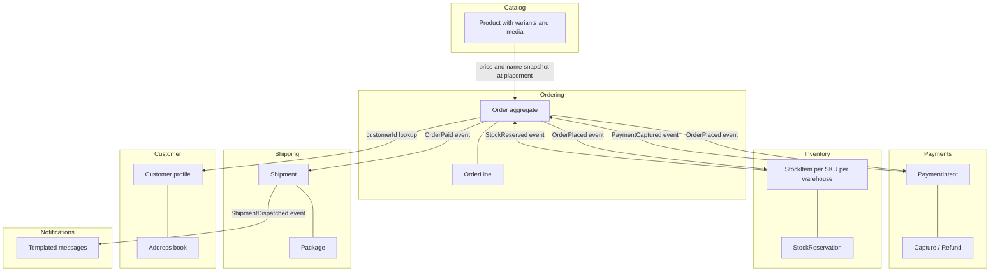

# Part 13 — Domain-Driven Design

Domain-Driven Design (DDD) is a way of building software where the **business problem** shapes the code, not the database schema and not the framework. It was described by Eric Evans in 2003, and twenty years later it is still the most useful vocabulary we have for organising a large backend.

Throughout this part we use one running example: an e-commerce platform with **Order**, **Payment**, **Inventory**, **Shipping** and **Customer**, plus **Catalog** and **Notifications** on the side. By the end you will have seen a complete `PlaceOrder` use case in NestJS with an `Order` aggregate, a repository, a TypeORM mapper, a unit of work, domain events dispatched after commit, and the PostgreSQL schema that backs the invariants.

A warning before we begin. DDD has two halves. The *strategic* half (domains, bounded contexts, context maps) is about deciding **where the boundaries go**. The *tactical* half (entities, value objects, aggregates, repositories) is about **how to write the code inside a boundary**. Most teams jump straight to the tactical patterns and end up with folders called `domain/` full of classes that do nothing. The strategic half is where the real leverage is. We start there.

## 13.1 Domain, subdomain, and core vs supporting vs generic

#### Concept

The **domain** is the whole area of business your software serves. For us it is "selling physical goods online". A domain is too big to reason about in one piece, so we split it into **subdomains**: natural sub-areas that a business person would recognise. Our subdomains are Ordering, Payments, Inventory, Shipping, Customer management, Catalog and Notifications.

Not every subdomain matters equally. DDD names three kinds:

| Kind | Meaning | E-commerce examples | Build or buy? |
|---|---|---|---|
| **Core** | What makes the business win. Complex, changes often, competitive advantage. | Ordering (pricing rules, promotions, bundles), Inventory allocation across warehouses | Build. Put your best engineers here. |
| **Supporting** | Needed for the business to run, specific to you, but not a differentiator. | Shipping (carrier selection, label generation), Customer profiles | Build simply, or thin wrapper over a vendor. |
| **Generic** | Every company needs it; solved problems. | Payments (card processing), Notifications (email/SMS), Authentication | Buy or use a library/SaaS: Stripe, SES, Auth0/Keycloak. |

#### Why does it exist?

Without this classification, engineering effort is spread evenly. Teams spend three sprints building a beautiful email templating engine (generic) while the promotion engine that actually drives revenue (core) is a 900-line `if/else` in a controller. Classifying subdomains tells you where to invest design effort, where to accept "good enough", and where to pay a vendor.

It also tells you which parts to protect. Core domain code should be the most tested, the most isolated from frameworks, and the last to be outsourced.

#### Mental model

Imagine a restaurant. The core is the kitchen and the menu: it is why customers come. Supporting is the reservation book: needed, custom to how this restaurant seats people, but nobody chooses the restaurant for it. Generic is the card terminal: every restaurant has one and none of them builds their own. You would never let the chef spend a week choosing card terminals, and you would never buy a kitchen "as a service".

#### How it works

Classifying subdomains is a conversation, not a code task. A senior engineer runs it like this:

1. List every capability the business needs. Write them on cards: "accept an order", "charge a card", "reserve stock", "print a shipping label", "send order confirmation", "search products".
2. Group cards into subdomains by asking "which business person owns this?" Sales owns ordering, Finance owns payments, Warehouse owns inventory and shipping, Marketing owns catalog.
3. For each subdomain ask two questions: *Would the company lose to a competitor if this were mediocre?* (core if yes) and *Could we buy this off the shelf tomorrow?* (generic if yes). Everything else is supporting.
4. Revisit yearly. Subdomains move. Shipping is supporting for a small shop; for Amazon it became core, which is why they built their own logistics.

#### Practical example

Our e-commerce classification, and the reasoning:

- **Ordering — core.** Pricing, promotions, cart rules, B2B credit terms and multi-currency are complex and unique. A bug here costs money on every order. This is where the richest domain model lives.
- **Inventory — core.** Multi-warehouse allocation, backorders and reservation expiry directly affect whether we can promise delivery dates. Competitors with better allocation sell more.
- **Shipping — supporting.** We must pick carriers and produce labels, but the interesting logic lives inside carriers' APIs. We build a thin service that maps our shipment to their formats.
- **Customer — supporting.** Addresses, preferences, loyalty tier. Custom enough that a generic CRM does not fit, simple enough for a straightforward model.
- **Payments — generic.** We never touch card numbers. We integrate Stripe or Razorpay. Our "Payment" context stores intents, captures and refunds, and talks to the provider.
- **Catalog — supporting leaning generic.** Product data and search. Many teams use a headless PIM or Elasticsearch.
- **Notifications — generic.** Templated email/SMS/push over SES, Twilio, FCM.

#### NestJS example

Subdomain classification shows up in how you lay out modules and how thick each one is.

```ts
// src/app.module.ts
import { Module } from '@nestjs/common';
import { OrderingModule } from './ordering/ordering.module';        // core: rich domain model
import { InventoryModule } from './inventory/inventory.module';     // core: rich domain model
import { ShippingModule } from './shipping/shipping.module';        // supporting: thin service over carrier APIs
import { CustomerModule } from './customer/customer.module';        // supporting: simple CRUD + a few rules
import { PaymentsModule } from './payments/payments.module';        // generic: adapter over Stripe
import { NotificationsModule } from './notifications/notifications.module'; // generic: adapter over SES/Twilio

@Module({
  imports: [
    OrderingModule,
    InventoryModule,
    ShippingModule,
    CustomerModule,
    PaymentsModule,
    NotificationsModule,
  ],
})
export class AppModule {}
```

Inside `ordering/` you will find `domain/`, `application/`, `infrastructure/` folders. Inside `notifications/` you will find one service and one provider. That asymmetry is deliberate and correct.

#### Production scenario

A mid-size retailer processes 40,000 orders a day, about 0.5 orders per second on average and 15 per second during a sale. The ordering domain handles pricing for 120 promotion types. The notifications system sends 200,000 emails a day through SES. Which one gets a dedicated three-person team and a domain model with 400 unit tests? Ordering. Notifications is one engineer's part-time job and a 300-line adapter.

#### Failure scenario

A team spent four months building an in-house payment gateway abstraction with retry logic, fraud scoring and settlement reconciliation. It was elegant. Meanwhile the checkout page (core) still had a bug where a promotion could apply twice, costing roughly 2% of revenue on discounted orders. The post-mortem finding was not "bad engineers"; it was "no subdomain classification, so effort went to the interesting problem instead of the valuable one".

#### How a Senior Backend Engineer thinks about this

- "Which subdomain is this ticket in?" is the first question before estimating.
- Core gets the full DDD treatment: aggregates, invariants, domain events, exhaustive tests.
- Supporting gets a clean service layer and DTOs; a rich domain model is optional.
- Generic gets an adapter with a clear interface so the vendor can be swapped.
- They refuse to let the team build a generic subdomain from scratch without a written reason (regulatory, cost at scale, or vendor lock-in risk).

#### Common mistakes

- Treating every module as equally important, so the codebase has uniform mediocre quality.
- Calling everything "core" because it feels important. If everything is core, nothing is.
- Building generic subdomains (auth, email, payments) by hand and then owning security patches forever.
- Never revisiting the classification as the business changes.

#### Interview questions

1. *How do you decide whether a subdomain is core, supporting or generic?* Expected: the two questions (competitive advantage, buy-able off the shelf); give an example where the answer changed over time. Follow-up: what changes in how you build each kind?
2. *Payments is critical to an e-commerce business. Why is it usually classified as generic, not core?* Expected: critical is not the same as differentiating; card processing is a solved, regulated problem; you build the adapter and orchestration, not the processor.
3. *Where would you put your most experienced engineers and why?*
4. *A startup with five engineers wants to "do DDD". Which half of DDD would you start with?* Expected: strategic; name subdomains and boundaries first, tactical patterns only in the core.

#### Practical exercise

Take a system you know (or the e-commerce example). List 15 capabilities, group them into subdomains and classify each as core, supporting or generic with one sentence of justification. Acceptance criteria: at most two subdomains are core; each generic subdomain names a vendor or library you would use instead of building; at least one classification includes a note on when it might change.

## 13.2 Ubiquitous language

#### Concept

The **ubiquitous language** is a shared vocabulary between developers and domain experts, used everywhere: in conversations, in tickets, in class names, in table names, in API paths. If the warehouse manager says "pick list", the code has a `PickList` class, not a `FulfillmentItemsCollection`.

The word "ubiquitous" means "the same everywhere". The point is not politeness; it is that every translation between a business term and a code term is a place for a bug to hide.

#### Why does it exist?

Consider the word **order** in our company:

- **Sales** means "what the customer asked for and agreed to pay": lines, prices, discounts, payment status.
- **Warehouse** means "what has to be picked, packed and shipped": SKUs, quantities, bin locations, box sizes. Prices are irrelevant.
- **Finance** means "a revenue event with tax, invoice number and settlement date". Which bin the item was in is irrelevant.

If you build one `Order` class that satisfies all three, it has 80 fields, three lifecycles tangled together, and nobody can change it without breaking someone. The ubiquitous language forces you to notice that these are three different concepts that happen to share a word, and to give each a precise name inside its own boundary (which is exactly what bounded contexts are for in section 13.3).

#### Mental model

Imagine a hospital where doctors say "discharge" and the billing office says "close the account" and IT says "set status = 4". A nurse asks IT "was the patient discharged?" and IT says "status is 4" and the nurse does not know if that is yes. Everyone is translating. Now imagine the whole hospital agrees on "discharged" and the database column is literally `discharged_at`. Questions become answerable without translation.

#### How it works

1. **Listen** to domain experts. Write down the nouns and verbs they use. "We *allocate* stock to an order." "A shipment can be *split*." "A payment is *captured*, not *charged*."
2. **Challenge ambiguity.** When one word means two things, or two words mean one thing, stop and resolve it. "Is a *cancelled* order the same as a *rejected* order?" (No: cancelled is by the customer; rejected is by fraud review.)
3. **Put the words in code.** `order.cancel()` not `order.setStatus('CANCELLED')`. `StockAllocation` not `InventoryRecordLink`.
4. **Put the words in the schema.** Table `stock_allocations`, column `captured_at`, enum value `SPLIT`.
5. **Put the words in the API.** `POST /orders/{id}/cancellations` not `POST /orders/{id}/status`.
6. **Keep a glossary** per bounded context. A short markdown file is enough. Review it when new terms appear.

#### Practical example

Before the language was agreed, a ticket read: "When the order is done, update inventory". Three engineers read "done" as *paid*, *shipped* and *delivered*. Inventory was decremented at three different points depending on which code path ran. After the glossary existed, the ticket read: "When an order is **Placed** (customer confirmed and payment authorised), **reserve** stock. When the shipment is **Dispatched**, **consume** the reservation." Two precise verbs, two precise events, one implementation.

#### NestJS example

The language appears directly in method names, event names and DTOs.

```ts
// src/ordering/domain/order.ts (excerpt)
export class Order {
  // Verbs from the glossary, not generic setters.
  place(): void { /* validates lines, moves to PLACED, raises OrderPlaced */ }
  cancel(reason: CancellationReason): void { /* raises OrderCancelled */ }
  markPaid(paymentId: PaymentId): void { /* raises OrderPaid */ }
}

// src/inventory/domain/stock-item.ts (excerpt)
export class StockItem {
  reserve(qty: Quantity, forOrder: OrderId): StockReservation { /* ... */ }
  consume(reservation: StockReservation): void { /* on dispatch */ }
  release(reservation: StockReservation): void { /* on cancellation or expiry */ }
}

// src/ordering/application/events/order-placed.event.ts
export class OrderPlaced {
  constructor(
    public readonly orderId: string,
    public readonly customerId: string,
    public readonly lines: ReadonlyArray<{ sku: string; quantity: number }>,
    public readonly occurredAt: Date,
  ) {}
}
```

A reviewer who is not a developer can read `order.cancel(reason)` and `stockItem.reserve(qty, forOrder)` and confirm they match the business process.

#### PostgreSQL example

The same words in the schema. Note that the ordering context and the inventory context each use their own table names, and the words match the glossary.

```sql
-- Ordering context
CREATE TYPE order_status AS ENUM ('DRAFT', 'PLACED', 'PAID', 'CANCELLED', 'FULFILLED');

CREATE TABLE orders (
  id           uuid PRIMARY KEY,
  customer_id  uuid NOT NULL,
  status       order_status NOT NULL DEFAULT 'DRAFT',
  placed_at    timestamptz,
  cancelled_at timestamptz,
  cancellation_reason text
);

-- Inventory context: the glossary says "reserve", "consume", "release"
CREATE TYPE reservation_status AS ENUM ('ACTIVE', 'CONSUMED', 'RELEASED', 'EXPIRED');

CREATE TABLE stock_reservations (
  id            uuid PRIMARY KEY,
  sku           text NOT NULL,
  warehouse_id  uuid NOT NULL,
  order_id      uuid NOT NULL,        -- reference by id, not FK across contexts
  quantity      integer NOT NULL CHECK (quantity > 0),
  status        reservation_status NOT NULL DEFAULT 'ACTIVE',
  expires_at    timestamptz NOT NULL,
  consumed_at   timestamptz,
  released_at   timestamptz
);
```

#### Production scenario

On a team of 12 engineers and 3 product managers, a glossary of about 60 terms lived in the repository under `docs/glossary/ordering.md`. New engineers reported that reading the glossary plus the aggregate classes was enough to understand the checkout flow in an afternoon. Support tickets referenced statuses by the same names the UI showed, so engineers could search logs for `status=PLACED` and find exactly what the customer saw.

#### Failure scenario

At 09:40 a product manager asked "how many orders were *completed* yesterday?" The analyst ran a query on `status = 'COMPLETED'`. The number was 30% lower than the dashboard. The dashboard counted `FULFILLED`. Finance counted `PAID`. Three definitions of complete, three numbers, a two-hour meeting to reconcile. The fix was a glossary entry and a rename: `COMPLETED` was removed from the enum entirely because nobody could define it.

#### How a Senior Backend Engineer thinks about this

- They treat renaming as a legitimate engineering task, not cosmetics. If the business now says "fulfilment" instead of "delivery", they rename the module.
- They spot translation layers (a `mapStatusToUiLabel()` with 14 cases) as a smell that the language is not shared.
- They keep the language *per context*. "Product" in Catalog is allowed to be a different word from "SKU" in Inventory, as long as each is precise within its boundary.

#### Common mistakes

- Using technical words for business concepts: `OrderDTO`, `OrderEntity`, `OrderRecord` used interchangeably in conversation with product people.
- Generic verbs (`update`, `process`, `handle`) that hide business meaning.
- One giant global glossary that tries to force Sales, Warehouse and Finance to mean the same thing by "order".
- Enum values that no domain expert recognises (`STATUS_3`, `PENDING_2`).

#### Interview questions

1. *What is the ubiquitous language and where does it have to appear?* Expected: everywhere including code, schema, API and tickets; the point is eliminating translation.
2. *The sales team and the warehouse use "order" differently. What do you do?* Expected: recognise two concepts, separate bounded contexts, precise names in each, an explicit mapping between them.
3. *Give an example of a bug caused by ambiguous language.*
4. *How do you keep a glossary alive after the first month?* Expected: it lives in the repo, is reviewed in PRs that add enum values or events, and product people can edit it.

#### Practical exercise

Pick one entity in a codebase you work on. List every status or verb applied to it in code, database and UI. Find at least two that are ambiguous or duplicated. Propose a glossary with precise definitions and the code/schema renames required. Acceptance criteria: each term has one sentence of definition, one owner (a role), and the rename list is complete enough to become a PR.

## 13.3 Bounded contexts

#### Concept

A **bounded context** is a boundary inside which a model and its language are consistent. Inside the Ordering context, "Order" means one precise thing and the `Order` class has exactly the fields ordering needs. Inside the Shipping context, "Shipment" is the concept, and if it references an order it does so by id and with only the fields shipping cares about.

Each bounded context **owns its data**. No other context reads or writes its tables directly. Communication happens through APIs or events.

A bounded context is not the same as a microservice. A monolith can have five bounded contexts as five NestJS modules that talk through interfaces and events. A microservice should contain one bounded context (or a few small ones), but a bounded context does not require a microservice. Boundaries are a design decision; deployment is a separate decision.

#### Why does it exist?

Without bounded contexts, you get the single shared `Product` class problem. Catalog needs marketing description, images, SEO slug and variant options. Inventory needs SKU, weight, dimensions, warehouse bins and reorder point. Ordering needs SKU, display name and price at the moment of ordering. Put all of that in one class and one table, and:

- A change to how images are stored requires regression-testing the order pipeline.
- Inventory's nightly stock sync locks rows that the checkout is trying to read.
- The `products` table has 70 columns and nobody knows which ones are safe to null.
- Teams block each other on every migration.

Bounded contexts turn one giant tangled model into several small consistent ones with explicit contracts between them.

#### Mental model

Imagine a large office building where each department has its own filing system. Sales files by customer name. The warehouse files by shelf location. Finance files by invoice number. The same physical item appears in all three systems, described differently. When Sales needs to know if something shipped, they do not walk into the warehouse and rummage; they ask at the counter, and the warehouse answers in Sales' terms. Each department is a bounded context. The counter is the API. The internal filing system is private.

#### How it works

1. **Find the seams.** Where does the language change? Where does a word start meaning something else? Where does one team's change break another team's code? Those are boundaries.
2. **Give each context one model.** Its own classes, its own tables (or schema), its own module.
3. **Reference across contexts by id only.** Ordering stores `customerId: string`, not a `Customer` object and definitely not a foreign key into the customer context's table in a way that couples migrations.
4. **Duplicate data deliberately.** Ordering copies `productName` and `unitPrice` into the order line at placement time. It is not a bug; it is a snapshot. If Catalog renames the product next week, the order still shows what the customer bought.
5. **Communicate by contract.** Synchronous API calls for questions ("is this customer allowed to order on credit?"); asynchronous events for facts ("OrderPlaced").
6. **Protect the boundary.** Lint rules, module encapsulation in NestJS (`exports` on modules), separate PostgreSQL schemas or databases, separate DB users with grants.

Here is the e-commerce system as bounded contexts:



Notice that Ordering never reaches into Inventory's tables. It publishes `OrderPlaced`; Inventory decides how to reserve; Inventory publishes `StockReserved`; Ordering reacts.

#### Practical example

The same "Product" in three contexts:

| Field | Catalog | Inventory | Ordering (OrderLine) |
|---|---|---|---|
| Identity | `productId`, `slug` | `sku`, `warehouseId` | `sku` |
| Name | Marketing title, translations | Short pick name | Name snapshot at order time |
| Price | List price, sale price, price history | none | `unitPrice` snapshot with currency |
| Physical | none | weight, dimensions, bin | none |
| Media | images, videos, 3D | none | thumbnail URL snapshot (optional) |
| Quantity | none | on hand, reserved, reorder point | quantity ordered |

Three classes, three tables, three lifecycles. Catalog can rewrite its media pipeline without touching Inventory or Ordering.

#### NestJS example

A bounded context is a NestJS module with a **narrow public surface**. Only the application service and a few read models are exported. Entities, repositories and internal services stay private.

```ts
// src/inventory/inventory.module.ts
import { Module } from '@nestjs/common';
import { TypeOrmModule } from '@nestjs/typeorm';
import { StockItemOrmEntity } from './infrastructure/stock-item.orm-entity';
import { StockReservationOrmEntity } from './infrastructure/stock-reservation.orm-entity';
import { TypeOrmStockItemRepository } from './infrastructure/typeorm-stock-item.repository';
import { STOCK_ITEM_REPOSITORY } from './domain/stock-item.repository';
import { ReserveStockService } from './application/reserve-stock.service';
import { StockAvailabilityQuery } from './application/stock-availability.query';
import { OrderPlacedHandler } from './application/handlers/order-placed.handler';

@Module({
  imports: [TypeOrmModule.forFeature([StockItemOrmEntity, StockReservationOrmEntity])],
  providers: [
    { provide: STOCK_ITEM_REPOSITORY, useClass: TypeOrmStockItemRepository },
    ReserveStockService,
    StockAvailabilityQuery,
    OrderPlacedHandler, // reacts to events from Ordering
  ],
  // Only the public contract leaves the module. No repositories, no ORM entities.
  exports: [StockAvailabilityQuery],
})
export class InventoryModule {}
```

If `OrderingModule` needs to know availability, it injects `StockAvailabilityQuery`, which returns a plain DTO. It cannot inject `TypeOrmStockItemRepository` because it is not exported; NestJS will refuse to resolve it.

#### PostgreSQL example

Separate schemas per context in one database is the pragmatic middle ground for a modular monolith. Each context gets a database role with grants only on its schema, so a "quick join" across contexts fails at the database instead of silently coupling two teams.

```sql
CREATE SCHEMA ordering;
CREATE SCHEMA inventory;
CREATE SCHEMA catalog;

CREATE ROLE ordering_app LOGIN PASSWORD '...';
CREATE ROLE inventory_app LOGIN PASSWORD '...';

GRANT USAGE ON SCHEMA ordering TO ordering_app;
GRANT SELECT, INSERT, UPDATE, DELETE ON ALL TABLES IN SCHEMA ordering TO ordering_app;
ALTER DEFAULT PRIVILEGES IN SCHEMA ordering GRANT SELECT, INSERT, UPDATE, DELETE ON TABLES TO ordering_app;

GRANT USAGE ON SCHEMA inventory TO inventory_app;
GRANT SELECT, INSERT, UPDATE, DELETE ON ALL TABLES IN SCHEMA inventory TO inventory_app;

-- ordering_app cannot read inventory.stock_items. A cross-context join is a permission error.
-- Cross-context references are plain columns, not foreign keys:
CREATE TABLE ordering.orders (
  id          uuid PRIMARY KEY,
  customer_id uuid NOT NULL,   -- id from the customer context; no REFERENCES customer.customers
  status      text NOT NULL
);
```

The missing foreign key is intentional. A foreign key across contexts means Customer cannot archive or re-key a customer without coordinating with Ordering's tables. Referential integrity across contexts is enforced by process (events, reconciliation jobs), not by the database.

#### TypeORM example

Two TypeORM entities named "product-ish", in two contexts, in two schemas. They do not share a base class.

```ts
// src/catalog/infrastructure/product.orm-entity.ts
import { Entity, PrimaryColumn, Column } from 'typeorm';

@Entity({ schema: 'catalog', name: 'products' })
export class ProductOrmEntity {
  @PrimaryColumn('uuid') id: string;
  @Column() slug: string;
  @Column() title: string;
  @Column('text') description: string;
  @Column('jsonb') media: { url: string; kind: 'image' | 'video' }[];
  @Column('bigint') listPriceMinor: string; // stored as minor units, see Money in 7.5
  @Column({ length: 3 }) currency: string;
}

// src/inventory/infrastructure/stock-item.orm-entity.ts
import { Entity, PrimaryColumn, Column, Index, VersionColumn } from 'typeorm';

@Entity({ schema: 'inventory', name: 'stock_items' })
@Index(['sku', 'warehouseId'], { unique: true })
export class StockItemOrmEntity {
  @PrimaryColumn('uuid') id: string;
  @Column() sku: string;
  @Column('uuid') warehouseId: string;
  @Column('int') onHand: number;
  @Column('int') reserved: number;
  @Column('int') reorderPoint: number;
  @Column('numeric', { precision: 8, scale: 3 }) weightKg: string;
  @VersionColumn() version: number; // optimistic locking, see 7.15
}
```

#### Sequelize example

The same boundary in Sequelize: each context has its own `Sequelize` instance or at least its own schema option, and models are registered per module.

```ts
// src/inventory/infrastructure/stock-item.model.ts
import { Table, Column, Model, DataType, Index } from 'sequelize-typescript';

@Table({ schema: 'inventory', tableName: 'stock_items', version: true, timestamps: true })
export class StockItemModel extends Model {
  @Column({ type: DataType.UUID, primaryKey: true }) declare id: string;
  @Index({ name: 'ux_stock_sku_wh', unique: true }) @Column(DataType.STRING) declare sku: string;
  @Index({ name: 'ux_stock_sku_wh', unique: true }) @Column(DataType.UUID) declare warehouseId: string;
  @Column(DataType.INTEGER) declare onHand: number;
  @Column(DataType.INTEGER) declare reserved: number;
  @Column(DataType.INTEGER) declare reorderPoint: number;
}

// src/inventory/inventory.module.ts (Sequelize variant)
// SequelizeModule.forFeature([StockItemModel, StockReservationModel])
```

`version: true` gives Sequelize's optimistic locking column, analogous to TypeORM's `@VersionColumn`.

#### Production scenario

A modular monolith with seven bounded contexts ran as one NestJS process on 6 pods, one PostgreSQL primary with 7 schemas, and RabbitMQ for events between contexts. Total traffic 1,200 RPS. When Inventory needed to move to its own database because stock syncs from 40 warehouses were saturating I/O, the migration took three weeks instead of six months, because the schema was already separate, nothing joined across it, and all communication already went through events and one exported query service. That is the payoff of boundaries: you can change deployment later.

#### Failure scenario

The opposite story. A team had one `products` table shared by Catalog, Inventory and Ordering. Catalog added a trigger to update `search_vector` on every product update. Inventory's stock sync updated `products.quantity_on_hand` 500,000 times per night. Each update fired the trigger and rebuilt a tsvector. The nightly sync went from 12 minutes to 3 hours, and at 03:00 the checkout started timing out because the sync held row locks on products that customers were ordering. Root cause: three contexts sharing one table, so a change by one team silently changed the performance of the others.

#### Edge cases & failure modes

- **Shared table across contexts.** Any change is a cross-team change. Break it up: separate schemas, copy the needed fields.
- **Cross-context foreign keys.** They block re-keying, archiving and independent deployment. Replace with id columns and a reconciliation job.
- **Chatty synchronous calls across contexts.** Placing an order calls Customer, Catalog and Inventory synchronously; one slow context slows checkout. Prefer snapshots and events for anything that is not a hard precondition.
- **Boundary drawn along technical lines** ("the database module", "the API module") instead of business lines. Those are layers, not contexts.
- **Too many tiny contexts.** Fifteen contexts for a team of six means fifteen contracts to maintain. Merge until each context has an owner.
- **Stale snapshots.** Ordering's copy of the product name is wrong after a rename. Decide explicitly which snapshots are meant to be historical (price at purchase: yes) and which should refresh (display name: maybe).

#### How a Senior Backend Engineer thinks about this

- They draw the context boundaries before the class diagram.
- They ask "who owns this data?" for every table. One owner. If two contexts both write to it, the boundary is wrong.
- They accept duplication of data across contexts and reject duplication of *logic* (two contexts both computing tax is a bug; two contexts both storing `customerId` is fine).
- They keep contexts inside a monolith until there is a scaling, team or deployment reason to split, and they make sure that when the reason comes, the split is mechanical.
- To a product manager: "Each team gets its own room with its own whiteboard. Rooms talk through the door, not through the wall. That is why the shipping team can change their whole system next quarter without the checkout breaking."

#### Common mistakes

- Equating bounded context with microservice and splitting into services before the boundaries are understood.
- Sharing ORM entities between modules "to avoid duplication".
- Exporting repositories from NestJS modules so other modules can "just query".
- Foreign keys everywhere, including across contexts, then discovering nothing can be deployed independently.
- Drawing one context called "Core" that contains everything.

#### Interview questions

1. *What is a bounded context, and how does it differ from a microservice?* Expected: a model/language boundary versus a deployment unit; contexts can live in a monolith.
2. *Why would you store the product name and price inside the order line instead of joining to the products table?* Expected: snapshot semantics, boundary independence, historical accuracy. Follow-up: which fields should refresh and which should not?
3. *How do you enforce a boundary in a NestJS monolith?* Expected: module exports, separate schemas, DB grants, lint rules on imports, events for cross-context communication.
4. *Two contexts need to be consistent (order paid and stock reserved). How do you handle that without a shared transaction?* Expected: events, sagas/process managers (see Part 29 — Distributed Transactions: Sagas, Outbox, Inbox and Idempotency), compensation, reconciliation.
5. *When is it wrong to split a context?* Expected: no clear owner, high chatter, team too small.

#### Practical exercise

Take a `products` table with 40+ columns from a real or imagined system. Split it into Catalog, Inventory and Ordering views. For each column decide which context owns it and which contexts hold a snapshot of it. Write the three `CREATE TABLE` statements in three schemas and the NestJS module `exports` for each context. Acceptance criteria: no column has two owners; no foreign key crosses a schema; the only exported providers are query services or application services, never repositories or ORM entities.
