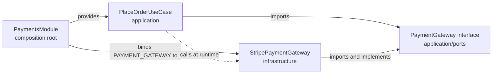

## 13.2 DRY — Don't Repeat Yourself

#### Concept

DRY says every piece of **knowledge** should have a single, authoritative representation in the system. Note the word: knowledge, not code. Two functions that look identical but encode different business facts are not a DRY violation. Two places that both encode "orders over 50,000 INR need manual review" are, even if the code looks different.

#### Why does it exist?

When a rule lives in two places, they drift. Someone changes the threshold in the API validator and forgets the one in the Kafka consumer. Now the same order is accepted by one path and rejected by the other, and the bug is invisible until an auditor asks why.

#### Mental model

Imagine a company's holiday policy printed in the employee handbook, on the intranet, and in the onboarding slides. HR updates the handbook. Two years later, new hires still learn the old policy from the slides. DRY says: one source of truth, and everything else links to it.

#### How it works

Identify the *knowledge*: a business rule, a validation constraint, a mapping, a configuration value. Give it one home (a domain class, a value object, a constant, a shared validator). Make every consumer reference that home. Duplication of *mechanism* (two loops that look alike) is not the target; duplication of *decisions* is.

#### NestJS example

Before: the threshold appears in three places.

```ts
// dto: create-order.dto.ts
@Max(50_000_00, { message: 'orders over 50,000 need manual review' })
totalMinor!: number;

// service: orders.service.ts
if (order.totalMinor > 50_000_00) await this.review.enqueue(order);

// consumer: order-events.consumer.ts
if (event.amountMinor >= 5_000_000) { /* someone typed it differently: >= vs > */ }
```

After: one domain policy, referenced everywhere.

```ts
// domain/policies/manual-review.policy.ts
export const MANUAL_REVIEW_THRESHOLD = Money.of(50_000_00, 'INR');

export class ManualReviewPolicy {
  static requiresReview(total: Money): boolean {
    return total.greaterThan(MANUAL_REVIEW_THRESHOLD);
  }
}

// dto: no business threshold; only structural validation (positive integer)
@IsInt() @Min(1) totalMinor!: number;

// use case and consumer both call the policy
if (ManualReviewPolicy.requiresReview(order.total)) await this.review.enqueue(order.id);
```

The DTO stopped encoding a business rule. That is a separate principle (separation of concerns, section 13.5) working together with DRY.

#### The danger of the wrong abstraction

DRY has a famous failure mode. Two code blocks look 80% similar; someone extracts a shared function with a boolean parameter for the 20% difference. A third caller needs a slightly different 20%, so a second parameter appears. A year later the shared function has six flags, nobody understands all the paths, and every change to it risks all six callers. Sandi Metz's line captures it: **duplication is far cheaper than the wrong abstraction.**

A concrete NestJS case: `sendNotification(user, type, options)` that started as "send order email" and grew to handle SMS, push, marketing opt-outs, template selection and retries through flags. The fix is usually to *inline* the abstraction back into its callers, look at what each actually does, and only then extract the genuinely shared pieces (template rendering, say) while leaving the differing pieces separate.

Rules of thumb:

- Wait for the **third** occurrence before extracting (the "rule of three"). Two data points do not define a pattern.
- Extract **knowledge** (a rule, a mapping), not **shape** (two loops that happen to look alike).
- If the extracted function needs a boolean parameter to choose behaviour, you probably extracted two things.
- Prefer small, composable pieces over one configurable mega-function.

#### Where juniors misapply this

They DRY up test code until tests are unreadable (a `makeOrderTestCase(flags)` helper that nobody can follow). Test code is allowed to repeat; clarity beats reuse there. They also DRY across module boundaries, creating `libs/common` that every module depends on, which quietly reintroduces coupling the modular monolith was trying to remove. Duplicating a five-line DTO across two modules is often the correct choice.

#### Interview questions

1. *Define DRY precisely and give a case where duplicated code is not a DRY violation.* Expected: single representation of knowledge; two similar-looking functions encoding different rules.
2. *What is "the wrong abstraction" and how do you recover from it?* Expected: over-generalised shared code with flags; inline back, then re-extract only the shared knowledge.
3. *Why is DRY across module boundaries dangerous?* Expected: shared code becomes coupling; modules can no longer change independently.

#### Practical exercise

Find a shared helper in a codebase that takes at least two boolean parameters. Inline it into every caller. Identify which parts are genuinely shared knowledge and re-extract only those.

Acceptance criteria: no boolean "mode" parameters remain; each caller's behaviour is unchanged (existing tests pass); the extracted pieces are each under 20 lines with a single purpose.

## 13.3 KISS — Keep It Simple

#### Concept

KISS says: of all the designs that solve the problem, choose the simplest one that works. Simplicity is measured by how much a new engineer must hold in their head to change the code safely, not by line count.

#### Why does it exist?

Complexity is the main cost driver in software. Every layer, indirection, generic parameter and configuration option must be understood by everyone who touches the code, forever. Complexity also hides bugs: the more paths, the more untested paths.

#### Mental model

Imagine a kitchen gadget that peels, slices, dices and juliennes, with 14 attachments. Most people use a knife. The knife is KISS. The gadget is impressive and sits in a drawer.

#### NestJS example

Before: a "flexible" generic base service.

```ts
// BEFORE: a generic CRUD base that every service extends
export abstract class BaseCrudService<T extends ObjectLiteral, CreateDto, UpdateDto> {
  constructor(protected readonly repo: Repository<T>, protected readonly mapper: Mapper<T, CreateDto, UpdateDto>) {}
  async findAll(query: QueryOptions<T>): Promise<Paginated<T>> { /* 60 lines of generic filter/sort/paginate */ }
  async create(dto: CreateDto, hooks?: LifecycleHooks<T>): Promise<T> { /* beforeCreate, afterCreate, validation plugins */ }
  // ...
}
```

Every real service overrides half of it, hooks fight with transactions, and the generic `QueryOptions<T>` lets clients filter by any column including `passwordHash`.

After: write the three endpoints the module needs.

```ts
@Injectable()
export class AddressesService {
  constructor(@InjectRepository(AddressEntity) private readonly repo: Repository<AddressEntity>) {}

  listForUser(userId: string): Promise<AddressEntity[]> {
    return this.repo.find({ where: { userId }, order: { isDefault: 'DESC', createdAt: 'DESC' }, take: 20 });
  }

  async create(userId: string, dto: CreateAddressDto): Promise<AddressEntity> {
    if ((await this.repo.countBy({ userId })) >= 10) throw new UnprocessableEntityException('max 10 addresses');
    return this.repo.save(this.repo.create({ ...dto, userId }));
  }

  async remove(userId: string, id: string): Promise<void> {
    const result = await this.repo.delete({ id, userId }); // ownership check in the WHERE
    if (result.affected === 0) throw new NotFoundException();
  }
}
```

Twenty lines a new engineer reads in a minute. The "flexibility" of the base class was never needed; addresses have three operations.

#### Where juniors misapply this

They use KISS to justify skipping structure that *is* needed: "just put the SQL in the controller, KISS". Simplicity is about the whole system's understandability, not about the fewest files in this PR. A controller with 200 lines of SQL is not simple to change safely. The test is: *what does the next person need to understand to make the next change?*

#### Interview questions

1. *How do you measure simplicity?* Expected: cognitive load for the next change; number of concepts, not lines.
2. *Give an example of complexity disguised as flexibility.* Expected: generic base classes, plugin systems, config-driven behaviour with one configuration ever used.

## 13.4 YAGNI — You Aren't Gonna Need It

#### Concept

Do not build functionality until it is actually needed. Not "might be needed next quarter", not "would be nice", not "the other team said they might want it".

#### Why does it exist?

Speculative features cost the same to build as real ones, plus they cost maintenance, plus they are usually wrong because the real requirement, when it arrives, differs from the guess. A study of feature usage in enterprise software regularly finds that most built features are rarely or never used.

#### Mental model

Imagine packing for a weekend trip and bringing a snow shovel because "you never know". You carry it all weekend. If it snows, you will find it was the wrong shovel anyway.

#### NestJS example

Before: speculative multi-tenancy, multi-currency and soft delete on day one of a single-tenant, single-currency product.

```ts
@Entity()
export class Order {
  @Column() tenantId!: string;          // one tenant exists
  @Column() currency!: string;          // INR only, for the foreseeable future
  @Column({ nullable: true }) deletedAt?: Date; // nothing deletes orders
  @Column('jsonb', { default: {} }) metadata!: Record<string, unknown>; // "for future flexibility"
}
```

Every query must now filter by `tenantId`; every money calculation must consider currency; every read must exclude soft-deleted rows; `metadata` becomes the dumping ground where real columns should have gone.

After: the columns the product needs today, with a migration path noted in the ADR.

```ts
@Entity()
export class Order {
  @PrimaryColumn('uuid') id!: string;
  @Column('uuid') customerId!: string;
  @Column('integer') totalMinor!: number; // INR; add a currency column when a second currency is scheduled
  @Column({ type: 'text' }) status!: OrderStatus;
  @Index() @Column('timestamptz') createdAt!: Date;
}
```

Adding a column later costs one migration. Carrying an unused abstraction costs every developer, every day.

#### Where YAGNI does not apply

YAGNI is about **features and abstractions**, not about **engineering fundamentals**. You always need: idempotency on payment calls, timeouts on network calls, input validation, structured logging with a request id, a migration tool, and a DTO boundary. Those are not speculative; they are the cost of being in production. Juniors sometimes invoke YAGNI to skip them, which is how a system ends up with no way to trace a failed payment.

The other exception is **irreversible decisions**: primary key type (uuid vs bigint), timezone handling (always `timestamptz`), money as integer minor units. These are cheap to get right now and very expensive to change later. YAGNI does not apply to them.

#### Interview questions

1. *Give an example of YAGNI done right and one of YAGNI used as an excuse.* Expected: skipping speculative multi-tenancy vs skipping idempotency keys.
2. *Which decisions should you make early even under YAGNI?* Expected: irreversible ones: ids, time, money representation, DTO boundary.

## 13.5 Separation of concerns

#### Concept

Separation of concerns (SoC) means each part of the system deals with one kind of thing: HTTP concerns in controllers and pipes, business rules in the domain, persistence in repositories, cross-cutting behaviour (auth, logging, caching, rate limiting) in guards, interceptors and middleware. The concerns are separated so they can be reasoned about, tested and changed independently.

#### Why does it exist?

When concerns mix, changes to one force re-testing all of them, and reuse becomes impossible. A business rule embedded in an HTTP controller cannot be triggered from a Kafka consumer. A caching decision inside a repository method cannot be turned off for a batch job.

#### Mental model

Imagine a hospital where the surgeon also handles billing and parking. Every surgery would include a stop at the payment desk. Separate roles let each get better at its job and let the hospital change its billing system without retraining surgeons.

#### How NestJS is built for it

NestJS's request pipeline is a separation-of-concerns machine. Each stage has one job:

```text
Request
  -> Middleware        (raw request: body parsing, correlation id, raw-body capture for webhooks)
  -> Guards            (authentication, authorisation: who is this and may they do this)
  -> Interceptors pre  (timing, logging, caching lookup)
  -> Pipes             (validation and transformation of params/body into typed DTOs)
  -> Controller        (translate HTTP into a use-case call; nothing else)
  -> Use case / domain (business rules)
  -> Repository        (persistence)
  -> Interceptors post (response mapping, caching store, metrics)
  -> Exception filters (map domain errors to HTTP status codes)
Response
```

#### NestJS example

Each concern in its home:

```ts
// Cross-cutting: correlation id middleware
@Injectable()
export class CorrelationIdMiddleware implements NestMiddleware {
  use(req: Request, res: Response, next: NextFunction) {
    const id = (req.headers['x-request-id'] as string) ?? randomUUID();
    req.headers['x-request-id'] = id;
    res.setHeader('x-request-id', id);
    next();
  }
}

// Authorisation concern: a guard, not an `if` in the controller
@Injectable()
export class OrderOwnerGuard implements CanActivate {
  constructor(@Inject(ORDER_READER) private readonly orders: OrderReader) {}
  async canActivate(ctx: ExecutionContext): Promise<boolean> {
    const req = ctx.switchToHttp().getRequest();
    const order = await this.orders.findById(req.params.id);
    if (!order) throw new NotFoundException();
    return order.customerId === req.user.id || req.user.roles.includes('support');
  }
}

// HTTP concern: the controller translates and delegates
@Controller('orders')
export class OrdersController {
  constructor(private readonly cancelOrder: CancelOrderUseCase) {}

  @Post(':id/cancel')
  @UseGuards(JwtAuthGuard, OrderOwnerGuard)
  @HttpCode(200)
  async cancel(@Param('id', ParseUUIDPipe) id: string, @Body() dto: CancelOrderDto): Promise<OrderResponse> {
    const order = await this.cancelOrder.execute({ orderId: id, reason: dto.reason });
    return OrderResponse.from(order);
  }
}

// Domain concern: the rule itself, testable with no HTTP
cancel(reason: string): void {
  if (this._status === 'SHIPPED' || this._status === 'DELIVERED') throw new DomainError('ORDER_NOT_CANCELLABLE', this._status);
  this._status = 'CANCELLED';
  this._cancelReason = reason;
}
```

#### Where juniors misapply this

They separate by **technical type** instead of by **concern**: a `validators/` folder for all validators across all modules, a `helpers/` folder with 80 unrelated functions. That is sorting, not separating. Concerns are things like "authorisation", "pricing", "persistence of orders". They also over-separate trivial things: a `dto/`, `mapper/`, `interface/`, `impl/` folder tree for a two-method module.

#### Interview questions

1. *Map each stage of the NestJS request pipeline to a concern.* Expected: as in the diagram above.
2. *Why should authorisation be a guard rather than an `if` in the service?* Expected: reuse across endpoints, testability, clear failure mode, no business logic contamination; note that data-dependent authorisation sometimes needs both.
3. *What is the difference between separating by concern and separating by technical type?* Expected: concern is a reason to change; type is a syntactic category.

## 13.6 Dependency inversion (the principle, standalone)

#### Concept

Section 13.1.5 covered DIP as the "D" of SOLID. It deserves a standalone view because it is the single most important idea in this part: it is the mechanism behind hexagonal architecture, testability, and every pattern that swaps implementations (Strategy, Adapter, Repository).

Stated simply: **the caller defines what it needs; the callee conforms.** The import arrows point toward the abstraction, and the abstraction lives with the caller.

#### How it works, mechanically, in TypeScript and NestJS

1. The high-level module declares an interface and a runtime token (`Symbol`) in its own folder.
2. The low-level module imports that interface and implements it.
3. A composition root (the NestJS module) binds the token to the implementation.
4. The high-level code receives the implementation through its constructor (`@Inject(TOKEN)`), never constructing it.



Notice the solid arrows (compile-time imports) all point at the port or are made by the module. The dashed arrow (runtime call) goes from use case to Stripe, but no import does.

#### Inversion without a DI container

DI containers are convenient, not required. Plain TypeScript inversion looks like this and is what your tests use:

```ts
const useCase = new PlaceOrderUseCase(new InMemoryOrderRepository(), new FakePaymentGateway(), new FakePublisher());
```

If your use case can be built this way, the inversion is real. If it can only be built by NestJS, something (a static import, a `ModuleRef` lookup, a decorator with side effects) is hiding a dependency.

#### What not to invert

Not everything deserves a port. Inverting `Logger`, `ConfigService`, `Date`, `crypto` is sometimes valuable (a `Clock` port makes time-based rules testable; a `Logger` port rarely earns its keep). The test: *would a second implementation exist in production or in tests, and does the abstraction make an important test possible?* If not, import the concrete thing.

#### Interview questions

1. *Explain dependency inversion without using the words "interface" or "abstract".* Expected: the code that needs something defines the shape of what it needs; the thing that provides it adapts to that shape; wiring happens in one place.
2. *How do you verify inversion is real in a NestJS codebase?* Expected: use cases constructible with `new` and fakes; lint rules on import direction.
3. *Name something you would not invert and why.* Expected: something with one implementation and no test value.

#### Practical exercise

Introduce a `Clock` port (`now(): Date`) into an orders module and inject it wherever `new Date()` was called in domain or application code. Write a unit test for "reservations expire after 15 minutes" that advances the fake clock.

Acceptance criteria: no `new Date()` remains in `domain/` or `application/`; the expiry test runs in under 10 ms with no timers or sleeps; production binds `Clock` to a system implementation via `useValue`.
