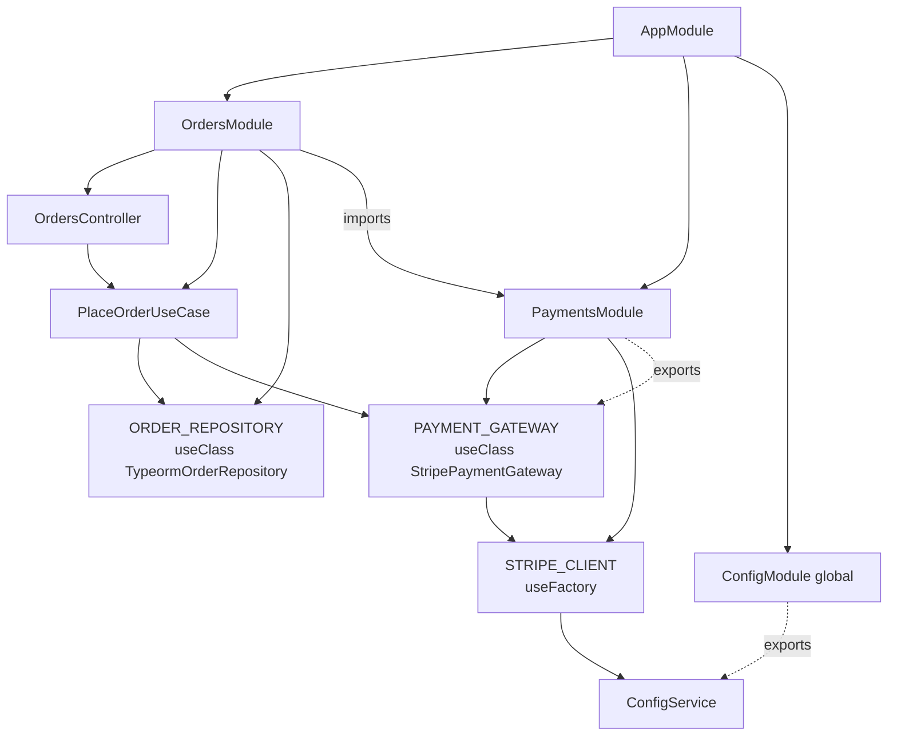

## 13.7 Dependency injection and the NestJS container

#### Concept

Dependency injection (DI) means a class receives its collaborators from the outside (usually through its constructor) instead of creating them itself. A **DI container** is the piece of infrastructure that builds the object graph: it reads what each class needs, creates instances in the right order, and hands them in. NestJS ships such a container and builds the entire application from it at startup.

Dependency inversion (section 13.6) is the principle; dependency injection is one mechanism for achieving it.

#### Why does it exist?

Without DI, `PlaceOrderUseCase` would contain `this.payments = new StripePaymentGateway(new Stripe(process.env.STRIPE_KEY))`. Now the use case knows about Stripe, about environment variables, and about how to construct an SDK client. You cannot test it without Stripe, cannot swap the provider, and cannot share one Stripe client across the app. DI moves construction to one place (the module) and gives every class exactly what it declares.

#### Mental model

Imagine a film set. Actors (classes) do not build their own props. A props department (the container) reads the script (the metadata on each class), builds every prop once, and hands each actor what their scene needs. Change the prop supplier and the actors do not notice.

#### How it works

At `NestFactory.create(AppModule)`, the container performs these steps:

1. **Scan modules.** Starting from `AppModule`, it walks `imports` recursively and builds a module graph. Each module gets its own container scope.
2. **Register providers.** For each module, every entry in `providers` and `controllers` is registered under a **token**. For a class provider, the token is the class itself. For `{ provide: X, ... }`, the token is `X` (a class, a string, or a `Symbol`).
3. **Read constructor metadata.** TypeScript's `emitDecoratorMetadata` writes the constructor parameter types into `design:paramtypes`. `@Inject(TOKEN)` overrides a parameter's token explicitly (necessary for interfaces and for string/symbol tokens).
4. **Resolve.** For each provider, the container resolves each constructor parameter's token by looking in the current module's providers, then in providers *exported* by imported modules, then in global modules. If nothing matches, boot fails with `Nest can't resolve dependencies of X (?, Y)`. The `?` marks the unresolvable position.
5. **Instantiate in dependency order.** Providers are singletons per module by default (`Scope.DEFAULT`): each is created once and cached.
6. **Run lifecycle hooks** (`onModuleInit`, `onApplicationBootstrap`) in dependency order.



Solid arrows are "depends on" or "declares"; dashed arrows are exports. `UC` can see `PG` only because `PaymentsModule` exports it and `OrdersModule` imports `PaymentsModule`.

#### Provider types

| Syntax | What the container does | Typical use |
| --- | --- | --- |
| `MyService` (class) | `new MyService(...resolved deps)` once | The default; most providers |
| `{ provide: T, useClass: Impl }` | `new Impl(...)` registered under token `T` | Binding a port to an adapter; environment-specific implementations |
| `{ provide: T, useValue: obj }` | Registers `obj` as-is | Constants, config objects, pre-built SDK clients, test doubles |
| `{ provide: T, useFactory: fn, inject: [A, B] }` | Calls `fn(a, b)` (may be async) and registers the result | Anything needing construction logic: SDK clients with keys, connections, conditional bindings |
| `{ provide: T, useExisting: U }` | Aliases `T` to whatever `U` resolves to (same instance) | ISP: one implementation under several narrow tokens; backward-compatible renames |

```ts
// payments.module.ts
import { Module } from '@nestjs/common';
import { ConfigModule, ConfigService } from '@nestjs/config';
import Stripe from 'stripe';

export const STRIPE_CLIENT = Symbol('STRIPE_CLIENT');

@Module({
  imports: [ConfigModule],
  providers: [
    // useFactory: construct an SDK client from config, once, with a timeout
    {
      provide: STRIPE_CLIENT,
      useFactory: (config: ConfigService) =>
        new Stripe(config.getOrThrow<string>('STRIPE_SECRET_KEY'), { apiVersion: '2024-06-20', timeout: 8_000, maxNetworkRetries: 2 }),
      inject: [ConfigService],
    },
    // useClass: bind the port to the adapter chosen by environment
    {
      provide: PAYMENT_GATEWAY,
      useClass: process.env.PAYMENTS_FAKE === 'true' ? FakePaymentGateway : StripePaymentGateway,
    },
    // useValue: a constant policy object
    { provide: REFUND_POLICY, useValue: { windowDays: 14, maxAutoRefundMinor: 20_000_00 } },
    // useExisting: expose the same instance under a narrower token
    StripePaymentGateway,
    { provide: REFUND_PROCESSOR, useExisting: StripePaymentGateway },
  ],
  exports: [PAYMENT_GATEWAY, REFUND_PROCESSOR],
})
export class PaymentsModule {}
```

#### Scopes and their performance cost

NestJS providers have three scopes:

| Scope | Instances | When created | Cost |
| --- | --- | --- | --- |
| `Scope.DEFAULT` | One per application (per module registration) | At bootstrap | None per request |
| `Scope.REQUEST` | One per incoming request | Lazily, per request, for the whole dependency subtree | Allocation and resolution per request; every provider that *depends on* a request-scoped provider becomes request-scoped too |
| `Scope.TRANSIENT` | One per injection point | When the consumer is created | Multiple instances; consumers of a transient in a default-scoped provider still get one instance (created once with that consumer) |

The **bubbling** rule is the trap. If `OrdersController` injects `PlaceOrderUseCase` which injects `TypeormOrderRepository` which injects a request-scoped `TenantContext`, then all three become request-scoped. The container now constructs the controller, the use case and the repository for every request. At 2,000 RPS that is 6,000 object constructions per second plus resolution work, and TypeORM repositories are not cheap to build. Benchmarks on typical NestJS apps show 10 to 30% throughput loss and measurable p99 increase when a request-scoped provider sits low in the graph.

```ts
// A legitimate request-scoped provider: it genuinely holds per-request state
@Injectable({ scope: Scope.REQUEST })
export class RequestContext {
  readonly requestId: string;
  readonly userId?: string;
  constructor(@Inject(REQUEST) req: Request) {
    this.requestId = req.headers['x-request-id'] as string;
    this.userId = (req as any).user?.id;
  }
}
```

The senior alternative is **`AsyncLocalStorage`** (Node.js built-in, see `nestjs-cls` for a NestJS integration): a middleware stores request context in async-local storage, and any default-scoped provider reads it without changing scope. You get per-request context at zero DI cost.

```ts
// Default-scoped provider reading per-request context via AsyncLocalStorage
import { AsyncLocalStorage } from 'node:async_hooks';

export const requestStore = new AsyncLocalStorage<{ requestId: string; userId?: string }>();

@Injectable()
export class RequestContextMiddleware implements NestMiddleware {
  use(req: Request, _res: Response, next: NextFunction) {
    requestStore.run({ requestId: req.headers['x-request-id'] as string }, () => next());
  }
}

@Injectable() // DEFAULT scope: constructed once
export class AuditLogger {
  log(action: string) {
    const ctx = requestStore.getStore();
    console.log(JSON.stringify({ action, requestId: ctx?.requestId, userId: ctx?.userId }));
  }
}
```

`Scope.TRANSIENT` has a narrower use: a `Logger` that should carry the class name of whoever injected it. Even then, NestJS's built-in `Logger` with `new Logger(MyClass.name)` is simpler.

#### Circular dependencies and `forwardRef`

A circular dependency is `A` needing `B` and `B` needing `A`. At the class level, TypeScript's metadata for `A`'s constructor references `B` before `B`'s module has finished evaluating (or vice versa), so the container sees `undefined` and fails with `Nest can't resolve dependencies... A circular dependency between modules/providers`. `forwardRef(() => B)` defers the reference until both classes exist.

```ts
// Works, but treat it as a warning sign
@Injectable()
export class OrdersService {
  constructor(@Inject(forwardRef(() => PaymentsService)) private readonly payments: PaymentsService) {}
}
@Injectable()
export class PaymentsService {
  constructor(@Inject(forwardRef(() => OrdersService)) private readonly orders: OrdersService) {}
}
// Module-level cycles need it too:
@Module({ imports: [forwardRef(() => PaymentsModule)] })
export class OrdersModule {}
```

A circular dependency between two business services almost always means a missing third concept or a missing event. Orders needs to *tell* payments to charge (a call), and payments needs to *tell* orders it succeeded (an event, not a call back). Replace the back-edge with `EventEmitter2` or extract the shared piece into a third provider both depend on. Use `forwardRef` to get unblocked, then fix the design.

Barrel files (`index.ts` re-exporting everything) cause many accidental cycles. Import from the concrete file inside a module.

#### Dynamic modules: `forRoot`, `forRootAsync`, `forFeature`

A dynamic module is a module whose providers are computed from arguments at import time. `TypeOrmModule.forRoot(options)`, `ConfigModule.forRoot()`, `JwtModule.registerAsync()` and `BullModule.forRootAsync()` all follow this convention.

- **`forRoot(options)`**: configure once with static options; typically returns a global module.
- **`forRootAsync({ useFactory, inject, imports })`**: configure with options that depend on other providers (usually `ConfigService`), possibly asynchronously (fetching secrets).
- **`forFeature(...)`**: register per-module pieces (entities, queues) against the root configuration.

Writing your own:

```ts
// libs/platform/src/kafka/kafka.module.ts
import { DynamicModule, Module, Provider } from '@nestjs/common';
import { Kafka, Producer } from 'kafkajs';

export interface KafkaModuleOptions { clientId: string; brokers: string[] }
export const KAFKA_PRODUCER = Symbol('KAFKA_PRODUCER');
export const KAFKA_OPTIONS = Symbol('KAFKA_OPTIONS');

@Module({})
export class KafkaModule {
  static forRoot(options: KafkaModuleOptions): DynamicModule {
    return {
      module: KafkaModule,
      global: true,
      providers: [{ provide: KAFKA_OPTIONS, useValue: options }, KafkaModule.producerProvider()],
      exports: [KAFKA_PRODUCER],
    };
  }

  static forRootAsync(opts: { imports?: any[]; useFactory: (...args: any[]) => Promise<KafkaModuleOptions> | KafkaModuleOptions; inject?: any[] }): DynamicModule {
    return {
      module: KafkaModule,
      global: true,
      imports: opts.imports ?? [],
      providers: [
        { provide: KAFKA_OPTIONS, useFactory: opts.useFactory, inject: opts.inject ?? [] },
        KafkaModule.producerProvider(),
      ],
      exports: [KAFKA_PRODUCER],
    };
  }

  private static producerProvider(): Provider {
    return {
      provide: KAFKA_PRODUCER,
      useFactory: async (options: KafkaModuleOptions): Promise<Producer> => {
        const producer = new Kafka(options).producer({ idempotent: true, maxInFlightRequests: 5 });
        await producer.connect(); // async factory: bootstrap waits for the connection
        return producer;
      },
      inject: [KAFKA_OPTIONS],
    };
  }
}

// app.module.ts
KafkaModule.forRootAsync({
  imports: [ConfigModule],
  useFactory: (c: ConfigService) => ({ clientId: c.getOrThrow('SERVICE_NAME'), brokers: c.getOrThrow<string>('KAFKA_BROKERS').split(',') }),
  inject: [ConfigService],
}),
```

The `ConfigurableModuleBuilder` in `@nestjs/common` generates this boilerplate for you in recent NestJS versions; the hand-written version above is what it produces.

#### Practical example

A checkout request resolves through this graph: `OrdersController` (default) -> `PlaceOrderUseCase` (default) -> `ORDER_REPOSITORY` (default, TypeORM) and `PAYMENT_GATEWAY` (default, Stripe, which holds a shared `STRIPE_CLIENT` built by a factory). Per-request data (user id, request id) flows through `AsyncLocalStorage`, not through scoped providers. Total DI work per request: zero allocations. At 2,000 RPS on four pods, the container is not on any flame graph.

#### Production scenario

A team introduced `Scope.REQUEST` on a `TenantContext` provider that most repositories injected. Throughput dropped from 1,900 RPS to 1,350 RPS on the same hardware, and p99 rose from 110 ms to 190 ms. The DI resolution showed up as 18% of CPU in a profile. Moving tenant context to `AsyncLocalStorage` restored the original numbers in one afternoon.

#### Failure scenario

At startup after a refactor, the app fails: `Nest can't resolve dependencies of the PlaceOrderUseCase (ORDER_REPOSITORY, ?). Please make sure that the argument Symbol(PAYMENT_GATEWAY) at index [1] is available in the OrdersModule context.` The token exists in `PaymentsModule`, but someone removed it from `exports` while cleaning up. The `?` marks index 1. The fix is one line, but the lesson is that DI errors are boot-time and loud, which is far better than runtime and silent. Keep a smoke test that boots the full `AppModule` in CI.

#### Edge cases & failure modes

- **Injecting an interface by type** (`constructor(private gw: PaymentGateway)`) compiles but resolves to `Object` at runtime; the container cannot find it. Always `@Inject(TOKEN)` for interfaces.
- **Two modules registering the same class provider** get two instances (one per module). Share by exporting from one module and importing it.
- **Async `useFactory` that never resolves** hangs bootstrap; add timeouts to connection factories.
- **`@Global()` overuse** makes the dependency graph invisible; anything can inject anything.
- **Request scope bubbling** silently turning half the app request-scoped after one innocent change.
- **`forwardRef` masking a design cycle** that later becomes an event-loop-level deadlock in `onModuleInit` ordering.
- **Provider side effects in constructors** (opening connections) happen during boot, before health checks are live; move to `onModuleInit`.
- **Lifecycle hook ordering.** `onModuleInit` runs per module in dependency order; `onApplicationBootstrap` runs after all modules are initialised. Start Kafka consumers in the latter so their dependencies are ready.

#### How a Senior Backend Engineer thinks about this

They keep everything `Scope.DEFAULT` unless proven otherwise, and they carry per-request state in `AsyncLocalStorage`. They treat `forwardRef` as a lint warning. They build SDK clients in `useFactory` providers with explicit timeouts, once, and never `new Stripe()` inside a service. They write module `exports` deliberately, as a public API, and they keep a boot smoke test.

They can also explain the DI container to a junior in one sentence: "It reads each class's constructor, builds what it asks for, and hands it in; you write classes that declare what they need and never construct their collaborators."

#### Common mistakes

- Using `ModuleRef.get()` all over the codebase instead of constructor injection (service locator; see anti-patterns in section 13.23).
- Request scope for convenience.
- Exporting everything from every module.
- Creating SDK clients per request.
- Missing `@Inject` on token-based dependencies.
- Constructor logic that throws or does I/O.

#### Interview questions

1. *Walk through what NestFactory.create does with the module graph.* Expected: scan imports, register providers under tokens, read `design:paramtypes`, resolve via module scope then imported exports then globals, instantiate singletons, run hooks.
2. *Explain request scope bubbling and its cost.* Expected: any provider depending on a request-scoped one becomes request-scoped; per-request construction; measurable throughput loss; alternative is `AsyncLocalStorage`.
3. *Compare `useClass`, `useValue`, `useFactory` and `useExisting` with a use case for each.* Expected: as in the table.
4. *When is `forwardRef` acceptable?* Expected: temporarily; a cycle between business providers signals a missing event or third concept.
5. *How would you write a `forRootAsync` for a custom module?* Expected: async `useFactory` with `inject`, options token, provider built from the options.
6. *Why does injecting by interface type fail at runtime?* Expected: interfaces are erased; metadata records `Object`; use tokens.

#### Practical exercise

Profile a NestJS app under load (`autocannon`, 60 seconds) with a request-scoped provider injected into a repository. Record RPS and p99. Replace the provider with an `AsyncLocalStorage`-based context and re-run.

Acceptance criteria: the request-scoped version shows measurable DI overhead in a CPU profile (`node --cpu-prof`); the `AsyncLocalStorage` version restores RPS to within 5% of a baseline with no per-request context; every provider in the app is back to `Scope.DEFAULT`.
