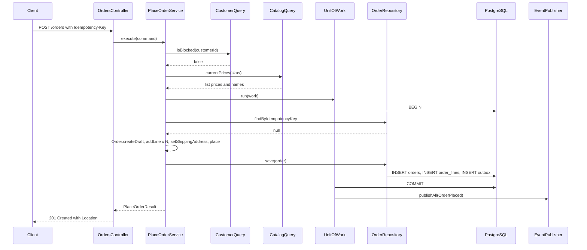

## 13.11 Worked example: PlaceOrder end to end

This section assembles everything from 13.4 to 13.10 into one runnable slice: an HTTP request arrives at `POST /orders`, a draft order is built and placed, stock is reserved by reaction, and the client receives a response. Every file is real code you can drop into a NestJS project.

#### Concept

`PlaceOrder` is the core use case of the Ordering context. Its inputs are the customer, the lines the customer wants, the shipping address and an idempotency key. Its outputs are the placed order and an `OrderPlaced` event. Its guarantees:

- The order is either fully placed or not at all (one transaction).
- Repeating the same request with the same idempotency key returns the same order and does not create a second one.
- Prices are snapshotted at placement time from Catalog.
- The customer is checked against Customer's "blocked" rule before placement.
- `OrderPlaced` is dispatched only after commit, and also written to the outbox.

#### How it works



The two cross-context calls (`CustomerQuery`, `CatalogQuery`) happen **before** the transaction opens. They are reads with tight timeouts. Nothing external happens inside the transaction.

#### Practical example

Two small additions to the `Order` aggregate from section 13.6: it carries the idempotency key (so the uniqueness rule can live on the row), and it exposes `placedAt` for the mapper.

```ts
// src/ordering/domain/order.ts (additions to the class from 7.6)
export class Order extends AggregateRoot<string> {
  // ... existing fields ...
  private constructor(
    id: string,
    public readonly customerId: string,
    public readonly idempotencyKey: string,     // new: stored on the row with a unique constraint
    private readonly currency: string,
    private status: OrderStatus,
    private lines: OrderLine[],
    private shippingAddress: Address | null,
    public readonly version: number,
    private placedAt: Date | null,
  ) { super(id); }

  static createDraft(customerId: string, currency: string, idempotencyKey: string): Order {
    return new Order(randomUUID(), customerId, idempotencyKey, currency, 'DRAFT', [], null, 0, null);
  }

  placedAtOrNull(): Date | null { return this.placedAt; }
  // ... rest unchanged ...
}
```

The **unit of work** owns the transaction, builds the repositories bound to it, and dispatches events after commit. It is the only place in the codebase that calls `BEGIN`/`COMMIT`.

```ts
// src/shared/application/unit-of-work.ts
import { OrderRepository } from '../../ordering/domain/order.repository';
import { AggregateRoot } from '../domain/aggregate-root';

export interface Repositories { orders: OrderRepository; }

export interface UnitOfWork {
  /**
   * Runs `work` inside one transaction. Aggregates passed to `track` have their events
   * dispatched after a successful commit. If `work` throws, the transaction is rolled back
   * and no events are dispatched.
   */
  run<T>(work: (repos: Repositories, track: (root: AggregateRoot<string>) => void) => Promise<T>): Promise<T>;
}
export const UNIT_OF_WORK = Symbol('UNIT_OF_WORK');
```

```ts
// src/shared/infrastructure/typeorm-unit-of-work.ts
import { Inject, Injectable, Logger } from '@nestjs/common';
import { DataSource } from 'typeorm';
import { UnitOfWork, Repositories } from '../application/unit-of-work';
import { AggregateRoot, DomainEvent } from '../domain/aggregate-root';
import { TypeOrmOrderRepository } from '../../ordering/infrastructure/typeorm-order.repository';
import { OutboxOrmEntity } from './outbox.orm-entity';
import { EVENT_PUBLISHER, EventPublisher } from './event-emitter.publisher';
import { randomUUID } from 'node:crypto';

@Injectable()
export class TypeOrmUnitOfWork implements UnitOfWork {
  private readonly log = new Logger(TypeOrmUnitOfWork.name);

  constructor(
    private readonly dataSource: DataSource,
    @Inject(EVENT_PUBLISHER) private readonly publisher: EventPublisher,
  ) {}

  async run<T>(work: (repos: Repositories, track: (root: AggregateRoot<string>) => void) => Promise<T>): Promise<T> {
    const tracked = new Set<AggregateRoot<string>>();
    let events: DomainEvent[] = [];

    const result = await this.dataSource.transaction('READ COMMITTED', async (em) => {
      const repos: Repositories = { orders: new TypeOrmOrderRepository(em) };
      const out = await work(repos, (root) => tracked.add(root));

      // Collect events and write them to the outbox INSIDE the transaction.
      events = [...tracked].flatMap((root) => root.pullEvents());
      if (events.length) {
        await em.getRepository(OutboxOrmEntity).insert(
          events.map((e) => ({
            id: randomUUID(), aggregateId: (e as { orderId?: string }).orderId ?? 'n/a',
            eventName: e.name, payload: JSON.parse(JSON.stringify(e, bigintReplacer)), occurredAt: e.occurredAt,
          })),
        );
      }
      return out;
    });
    // Transaction committed. Only now do in-process handlers run.
    // The outbox relay is the durable path; this is the fast path.
    try {
      await this.publisher.publishAll(events);
    } catch (err) {
      // Never fail the request: the commit stands and the outbox relay will redeliver.
      this.log.error({ msg: 'in-process event dispatch failed; outbox will retry', err });
    }
    return result;
  }
}

function bigintReplacer(_k: string, v: unknown) { return typeof v === 'bigint' ? v.toString() : v; }
```

The **application service**:

```ts
// src/ordering/application/place-order.service.ts
import { Inject, Injectable } from '@nestjs/common';
import { UNIT_OF_WORK, UnitOfWork } from '../../shared/application/unit-of-work';
import { CustomerQuery } from '../../customer/application/customer.query';        // exported by CustomerModule
import { CatalogQuery } from '../../catalog/application/catalog.query';           // exported by CatalogModule
import { Order } from '../domain/order';
import { PricingService } from '../domain/pricing.service';
import { Money } from '../../shared/domain/money';
import { Address } from '../../customer/domain/address';
import { CustomerBlockedError, UnknownSkuError } from '../domain/errors';

export interface PlaceOrderCommand {
  customerId: string;
  idempotencyKey: string;
  currency: string;
  lines: Array<{ sku: string; quantity: number }>;
  shippingAddress: { line1: string; line2?: string; city: string; postalCode: string; countryCode: string };
}
export interface PlaceOrderResult {
  orderId: string; status: string; total: { amount: string; currency: string }; created: boolean;
}

@Injectable()
export class PlaceOrderService {
  constructor(
    @Inject(UNIT_OF_WORK) private readonly uow: UnitOfWork,
    private readonly customers: CustomerQuery,
    private readonly catalog: CatalogQuery,
    private readonly pricing: PricingService,
  ) {}

  async execute(cmd: PlaceOrderCommand): Promise<PlaceOrderResult> {
    // 1. Cross-context reads, before the transaction. Both have 300 ms timeouts internally.
    const [customer, prices] = await Promise.all([
      this.customers.profile(cmd.customerId),
      this.catalog.currentPrices(cmd.lines.map((l) => l.sku)),
    ]);
    if (customer.blocked) throw new CustomerBlockedError(cmd.customerId);

    const address = Address.of(cmd.shippingAddress); // value object validation

    // 2. One transaction, one aggregate.
    return this.uow.run(async ({ orders }, track) => {
      const existing = await orders.findByIdempotencyKey(cmd.customerId, cmd.idempotencyKey);
      if (existing) return this.toResult(existing, false);       // idempotent replay

      const order = Order.createDraft(cmd.customerId, cmd.currency, cmd.idempotencyKey);
      track(order);

      for (const line of cmd.lines) {
        const p = prices.get(line.sku);
        if (!p) throw new UnknownSkuError(line.sku);
        const unitPrice = this.pricing.unitPrice({
          sku: line.sku, listPrice: Money.parse(p.listPrice, cmd.currency), quantity: line.quantity,
          tier: customer.tier, promotions: p.activePromotions,
        });
        order.addLine(line.sku, p.name, line.quantity, unitPrice);  // snapshot of name and price
      }
      order.setShippingAddress(address);
      order.place();                                                // invariants + OrderPlaced raised

      await orders.save(order);                                     // may throw ConcurrencyError or unique violation
      return this.toResult(order, true);
    });
  }

  private toResult(order: Order, created: boolean): PlaceOrderResult {
    const total = order.total();
    return {
      orderId: order.id, status: order.currentStatus, created,
      total: { amount: total.toString().split(' ')[0], currency: total.currency },
    };
  }
}
```

A race is still possible: two identical requests arrive within the same millisecond, both see `existing === null`, both insert. The database's unique constraint on `(customer_id, idempotency_key)` rejects the second. The repository translates the unique violation into a domain error, and the service can retry the lookup once. Section 14.12 in Part 14 shows the general-purpose idempotency interceptor that handles this at the HTTP layer for any endpoint.

#### NestJS example

The controller is thin: validate, map to command, call use case, map to HTTP.

```ts
// src/ordering/api/dto/create-order.dto.ts
import { Type } from 'class-transformer';
import {
  ArrayMaxSize, ArrayMinSize, IsArray, IsInt, IsOptional, IsString, Length, Matches, Max, Min, ValidateNested,
} from 'class-validator';

class LineDto {
  @IsString() @Length(3, 64) sku: string;
  @IsInt() @Min(1) @Max(10000) quantity: number;
}
class AddressDto {
  @IsString() @Length(1, 200) line1: string;
  @IsOptional() @IsString() @Length(0, 200) line2?: string;
  @IsString() @Length(1, 100) city: string;
  @IsString() @Length(3, 12) postalCode: string;
  @Matches(/^[A-Z]{2}$/) countryCode: string;
}
export class CreateOrderDto {
  @Matches(/^[A-Z]{3}$/) currency: string;
  @IsArray() @ArrayMinSize(1) @ArrayMaxSize(100) @ValidateNested({ each: true }) @Type(() => LineDto) lines: LineDto[];
  @ValidateNested() @Type(() => AddressDto) shippingAddress: AddressDto;
}
```

```ts
// src/ordering/api/orders.controller.ts
import { Body, Controller, Headers, HttpCode, Post, Res, BadRequestException, UseGuards } from '@nestjs/common';
import { Response } from 'express';
import { PlaceOrderService } from '../application/place-order.service';
import { CreateOrderDto } from './dto/create-order.dto';
import { JwtAuthGuard } from '../../auth/jwt-auth.guard';
import { CurrentUser } from '../../auth/current-user.decorator';

@Controller('orders')
@UseGuards(JwtAuthGuard)
export class OrdersController {
  constructor(private readonly placeOrder: PlaceOrderService) {}

  @Post()
  @HttpCode(201)
  async create(
    @CurrentUser() user: { id: string },
    @Headers('idempotency-key') idempotencyKey: string | undefined,
    @Body() dto: CreateOrderDto,
    @Res({ passthrough: true }) res: Response,
  ) {
    if (!idempotencyKey || idempotencyKey.length > 128) {
      throw new BadRequestException('Idempotency-Key header is required (max 128 chars)');
    }
    const result = await this.placeOrder.execute({
      customerId: user.id, idempotencyKey, currency: dto.currency,
      lines: dto.lines, shippingAddress: dto.shippingAddress,
    });
    res.setHeader('Location', `/orders/${result.orderId}`);
    if (!result.created) res.status(200);   // replay of an existing order
    return result;
  }
}
```

Domain errors are mapped to HTTP by a global exception filter (Part 14, section 14.9 shows the full filter): `CustomerBlockedError` becomes 403, `UnknownSkuError` becomes 422, `OrderInvariantError` becomes 422, `ConcurrencyError` becomes 409.

Module wiring:

```ts
// src/ordering/ordering.module.ts
import { Module } from '@nestjs/common';
import { TypeOrmModule } from '@nestjs/typeorm';
import { OrderOrmEntity } from './infrastructure/order.orm-entity';
import { OrderLineOrmEntity } from './infrastructure/order-line.orm-entity';
import { OrdersController } from './api/orders.controller';
import { PlaceOrderService } from './application/place-order.service';
import { CancelOrderService } from './application/cancel-order.service';
import { PricingService } from './domain/pricing.service';
import { CustomerModule } from '../customer/customer.module';
import { CatalogModule } from '../catalog/catalog.module';
import { SharedInfrastructureModule } from '../shared/infrastructure/shared-infrastructure.module'; // provides UNIT_OF_WORK, EVENT_PUBLISHER

@Module({
  imports: [
    TypeOrmModule.forFeature([OrderOrmEntity, OrderLineOrmEntity]),
    CustomerModule,     // for CustomerQuery
    CatalogModule,      // for CatalogQuery
    SharedInfrastructureModule,
  ],
  controllers: [OrdersController],
  providers: [PlaceOrderService, CancelOrderService, PricingService],
  exports: [],          // nothing: other contexts react to events, they do not call Ordering's internals
})
export class OrderingModule {}
```

#### PostgreSQL example

The complete schema for the Ordering context. Every invariant from the aggregate has a database-level twin.

```sql
CREATE SCHEMA IF NOT EXISTS ordering;

CREATE TABLE ordering.orders (
  id                uuid PRIMARY KEY,
  customer_id       uuid NOT NULL,
  idempotency_key   text NOT NULL,
  currency          char(3) NOT NULL,
  status            text NOT NULL CHECK (status IN ('DRAFT','PLACED','PAID','FULFILLED','CANCELLED')),
  total_minor       bigint NOT NULL DEFAULT 0 CHECK (total_minor >= 0),
  ship_line1        text, ship_line2 text, ship_city text, ship_postal_code text, ship_country char(2),
  version           integer NOT NULL DEFAULT 0,
  placed_at         timestamptz,
  created_at        timestamptz NOT NULL DEFAULT now(),
  updated_at        timestamptz NOT NULL DEFAULT now(),
  CONSTRAINT ux_orders_idempotency UNIQUE (customer_id, idempotency_key),   -- exactly-once creation
  CONSTRAINT chk_placed_requires_address CHECK (status = 'DRAFT' OR ship_line1 IS NOT NULL),
  CONSTRAINT chk_placed_requires_time    CHECK (status = 'DRAFT' OR placed_at IS NOT NULL),
  CONSTRAINT chk_placed_positive_total   CHECK (status = 'DRAFT' OR total_minor > 0)
);
CREATE INDEX ix_orders_customer_created ON ordering.orders (customer_id, created_at DESC);
CREATE INDEX ix_orders_status_placed    ON ordering.orders (status, placed_at) WHERE status IN ('PLACED','PAID');

-- Often named order_items; we follow the glossary and call them lines.
CREATE TABLE ordering.order_lines (
  id                uuid PRIMARY KEY,
  order_id          uuid NOT NULL REFERENCES ordering.orders(id) ON DELETE CASCADE,
  sku               text NOT NULL,
  product_name      text NOT NULL,
  quantity          integer NOT NULL CHECK (quantity BETWEEN 1 AND 10000),
  unit_price_minor  bigint NOT NULL CHECK (unit_price_minor >= 0),
  line_total_minor  bigint NOT NULL CHECK (line_total_minor >= 0),
  CONSTRAINT chk_line_total CHECK (line_total_minor = quantity * unit_price_minor),
  CONSTRAINT ux_order_line_sku UNIQUE (order_id, sku)
);
CREATE INDEX ix_order_lines_order ON ordering.order_lines (order_id);

CREATE TABLE ordering.outbox (
  id            uuid PRIMARY KEY,
  aggregate_id  uuid NOT NULL,
  event_name    text NOT NULL,
  payload       jsonb NOT NULL,
  occurred_at   timestamptz NOT NULL,
  published_at  timestamptz,
  attempts      integer NOT NULL DEFAULT 0
);
CREATE INDEX ix_outbox_unpublished ON ordering.outbox (occurred_at) WHERE published_at IS NULL;

-- Deferred total check (function from 7.6) attached to both tables.
CREATE CONSTRAINT TRIGGER trg_order_total_lines
  AFTER INSERT OR UPDATE OR DELETE ON ordering.order_lines
  DEFERRABLE INITIALLY DEFERRED FOR EACH ROW EXECUTE FUNCTION ordering.check_order_total();
CREATE CONSTRAINT TRIGGER trg_order_total_orders
  AFTER INSERT OR UPDATE OF total_minor ON ordering.orders
  DEFERRABLE INITIALLY DEFERRED FOR EACH ROW EXECUTE FUNCTION ordering.check_order_total();
```

What the transaction actually does on the wire, for a 3-line order:

```sql
BEGIN;
SELECT o.*, l.* FROM ordering.orders o LEFT JOIN ordering.order_lines l ON l.order_id = o.id
  WHERE o.customer_id = $1 AND o.idempotency_key = $2;            -- ~0.3 ms, index hit, 0 rows
INSERT INTO ordering.orders (...) VALUES (...);                    -- ~0.4 ms
DELETE FROM ordering.order_lines WHERE order_id = $1;              -- ~0.1 ms, 0 rows
INSERT INTO ordering.order_lines (...) VALUES (...), (...), (...); -- ~0.4 ms
INSERT INTO ordering.outbox (...) VALUES (...);                    -- ~0.2 ms
COMMIT;                                                            -- ~1 to 3 ms (fsync of WAL)
```

Roughly 3 to 5 ms in the database, with the row lock held only for that window.

#### TypeORM example

The ORM entity from 13.6 gains the idempotency column and the unique index; the outbox entity is new.

```ts
// src/ordering/infrastructure/order.orm-entity.ts (additions)
@Entity({ schema: 'ordering', name: 'orders' })
@Index('ux_orders_idempotency', ['customerId', 'idempotencyKey'], { unique: true })
export class OrderOrmEntity {
  // ... columns from 7.6 ...
  @Column({ name: 'idempotency_key' }) idempotencyKey: string;
}

// src/shared/infrastructure/outbox.orm-entity.ts
import { Entity, PrimaryColumn, Column, Index } from 'typeorm';

@Entity({ schema: 'ordering', name: 'outbox' })
export class OutboxOrmEntity {
  @PrimaryColumn('uuid') id: string;
  @Column('uuid', { name: 'aggregate_id' }) aggregateId: string;
  @Column({ name: 'event_name' }) eventName: string;
  @Column('jsonb') payload: Record<string, unknown>;
  @Column('timestamptz', { name: 'occurred_at' }) occurredAt: Date;
  @Index() @Column('timestamptz', { name: 'published_at', nullable: true }) publishedAt: Date | null;
  @Column('int', { default: 0 }) attempts: number;
}
```

The mapper's `toPersistence` adds `row.idempotencyKey = order.idempotencyKey;` and the repository's insert path includes it. The unique-violation error from `pg` has `code === '23505'`; the repository catches it and rethrows a `DuplicateIdempotencyKeyError` so the service can re-read and return the existing order.

```ts
// inside TypeOrmOrderRepository.save(), insert path
try {
  await this.em.getRepository(OrderOrmEntity).insert({ ...row, lines: undefined, version: 0 });
} catch (err) {
  if ((err as { code?: string }).code === '23505') throw new DuplicateIdempotencyKeyError(row.idempotencyKey);
  throw err;
}
```

#### Sequelize example

The equivalent unit of work in Sequelize uses `sequelize.transaction()` and passes the `Transaction` to the repository constructor.

```ts
// src/shared/infrastructure/sequelize-unit-of-work.ts
@Injectable()
export class SequelizeUnitOfWork implements UnitOfWork {
  constructor(private readonly sequelize: Sequelize, @Inject(EVENT_PUBLISHER) private readonly publisher: EventPublisher) {}

  async run<T>(work: (repos: Repositories, track: (root: AggregateRoot<string>) => void) => Promise<T>): Promise<T> {
    const tracked = new Set<AggregateRoot<string>>();
    let events: DomainEvent[] = [];
    const result = await this.sequelize.transaction({ isolationLevel: Transaction.ISOLATION_LEVELS.READ_COMMITTED }, async (t) => {
      const repos: Repositories = { orders: new SequelizeOrderRepository(t) };
      const out = await work(repos, (root) => tracked.add(root));
      events = [...tracked].flatMap((r) => r.pullEvents());
      if (events.length) {
        await OutboxModel.bulkCreate(
          events.map((e) => ({ id: randomUUID(), aggregateId: (e as { orderId?: string }).orderId ?? 'n/a',
            eventName: e.name, payload: JSON.parse(JSON.stringify(e, (k, v) => typeof v === 'bigint' ? v.toString() : v)),
            occurredAt: e.occurredAt })),
          { transaction: t },
        );
      }
      return out;
    });
    await this.publisher.publishAll(events).catch(() => undefined); // outbox relay is the durable path
    return result;
  }
}
```

#### Testing the use case

Because the use case depends on interfaces, it is testable with an in-memory unit of work and fakes for the two queries.

```ts
// src/ordering/application/place-order.service.spec.ts
describe('PlaceOrderService', () => {
  const uow = new InMemoryUnitOfWork();              // holds an InMemoryOrderRepository and records dispatched events
  const customers = { profile: jest.fn().mockResolvedValue({ id: 'c1', blocked: false, tier: 'STANDARD' }) };
  const catalog = { currentPrices: jest.fn().mockResolvedValue(new Map([['SKU-1', { name: 'Mug', listPrice: '199.00', activePromotions: [] }]])) };
  const service = new PlaceOrderService(uow, customers as never, catalog as never, new PricingService());
  const cmd = { customerId: 'c1', idempotencyKey: 'k1', currency: 'INR',
    lines: [{ sku: 'SKU-1', quantity: 2 }], shippingAddress: { line1: 'A', city: 'B', postalCode: '560001', countryCode: 'IN' } };

  it('places an order and dispatches OrderPlaced after commit', async () => {
    const res = await service.execute(cmd);
    expect(res.status).toBe('PLACED');
    expect(res.total).toEqual({ amount: '398.00', currency: 'INR' });
    expect(uow.dispatched.map((e) => e.name)).toEqual(['ordering.order.placed']);
  });

  it('is idempotent on the same key', async () => {
    const a = await service.execute(cmd);
    const b = await service.execute(cmd);
    expect(b.orderId).toBe(a.orderId);
    expect(b.created).toBe(false);
  });

  it('refuses blocked customers before opening a transaction', async () => {
    customers.profile.mockResolvedValueOnce({ id: 'c1', blocked: true, tier: 'STANDARD' });
    await expect(service.execute(cmd)).rejects.toBeInstanceOf(CustomerBlockedError);
    expect(uow.transactionsStarted).toBe(0);
  });
});
```

#### Production scenario

At 15 orders/s peak, `PlaceOrder` p50 is 28 ms and p99 is 90 ms end to end: ~8 ms for the two cross-context reads (in-process, cached), ~5 ms in PostgreSQL, ~3 ms for in-process handlers (stock reservation runs its own ~4 ms transaction), the rest in JSON, validation and network. The outbox relay publishes to Kafka within 300 ms. Memory per request is dominated by the aggregate (a few KB). A single 2-vCPU pod sustains ~150 orders/s before CPU saturates on JSON and validation, so 6 pods give ample headroom.

#### Failure scenario

At 02:14 on a sale night the on-call was paged: `PlaceOrder` p99 jumped to 4 seconds and the PostgreSQL connection pool was exhausted. Root cause: Catalog's price lookup had been changed the day before from an in-process query to an HTTP call to the new catalog service, and someone had moved that call *inside* the `uow.run` block "so the price would be consistent with the transaction". Each order now held a database connection and a row lock for the duration of an HTTP call whose p99 had risen to 3 seconds under load. The fix was a one-line move back above the transaction and a 300 ms timeout on the catalog client. The rule "no external I/O inside a transaction" was added to the team's PR checklist.

#### Edge cases & failure modes

- **Duplicate request, same key.** Handled by lookup plus unique constraint; returns the same order with 200 instead of 201.
- **Same key, different payload.** The service returns the original order, silently ignoring the new payload. Better: store a hash of the request with the key and return 422 on mismatch (Part 14, section 14.12).
- **Client timeout after server success.** The client retries with the same key and gets the existing order. Without a key, you would have two orders.
- **Catalog down.** `currentPrices` times out at 300 ms; the request fails with 503 before any transaction. No partial state.
- **Concurrency on a draft order** (cart edits from two devices): version mismatch on save, `ConcurrencyError`, 409 to the client, client reloads.
- **Inventory handler fails after commit.** Order is placed; reservation is missing. The outbox relay redelivers; if the handler keeps failing, the reconciliation job flags the order. The customer is never told "placed" and then silently unplaced.
- **Huge order** (100 lines is the cap). The `ArrayMaxSize(100)` DTO rule rejects at the edge; the aggregate rejects as a second line of defence.
- **Money in the response.** `total.amount` is a string. Clients must not parse it as a float for arithmetic; the API documentation says so.

#### How a Senior Backend Engineer thinks about this

- They can point to the exact line where the transaction begins and ends, and the exact line where events leave the process.
- They keep external calls outside the transaction and give each a timeout.
- They know what happens on every failure path: before the transaction (no state), during (rollback, no events), after commit but before dispatch (outbox saves the day), in a handler (retry, reconcile).
- They test the use case without a database, and the repository against a real one.

#### Common mistakes

- Putting the idempotency check only in memory (a `Map`), which fails across pods.
- Checking `existing` and then inserting without a unique constraint: two pods race and both insert.
- Calling `order.place()` and then computing the total in the service "to double-check": the aggregate is the source of truth.
- Returning the ORM entity from the controller.

#### Interview questions

1. *Walk through `PlaceOrder`: where is the transaction, where are the external calls, where do events leave?* Expected: the sequence above, with reasons for each placement.
2. *How do you make order creation idempotent across multiple pods?* Expected: idempotency key on the row with a unique constraint; lookup first; catch 23505.
3. *A stock reservation handler throws after commit. What does the customer see and what does the system do?* Expected: customer sees success; outbox redelivers; reconciliation as backstop; never roll back a committed order.
4. *Why snapshot price and name into the order line?* Expected: historical accuracy, context independence.
5. *Why not call the catalog service inside the transaction "for consistency"?* Expected: lock and connection hold time; external latency becomes database contention; the incident above.

#### Practical exercise

Implement `PlaceOrder` end to end in a fresh NestJS project with PostgreSQL in Docker: aggregate, repository, mapper, unit of work with outbox, controller, DTO, exception filter, and an `OrderPlacedHandler` in an Inventory module that writes a `stock_reservations` row per line. Then run 200 concurrent identical requests with the same `Idempotency-Key` using `autocannon` or a small script. Acceptance criteria: exactly one `orders` row and one set of reservations; all 200 responses return the same `orderId`; `EXPLAIN (ANALYZE, BUFFERS)` on the idempotency lookup shows an index scan on `ux_orders_idempotency`; killing the process between commit and dispatch (simulate by throwing in the publisher) leaves an unpublished outbox row that a relay later delivers.
