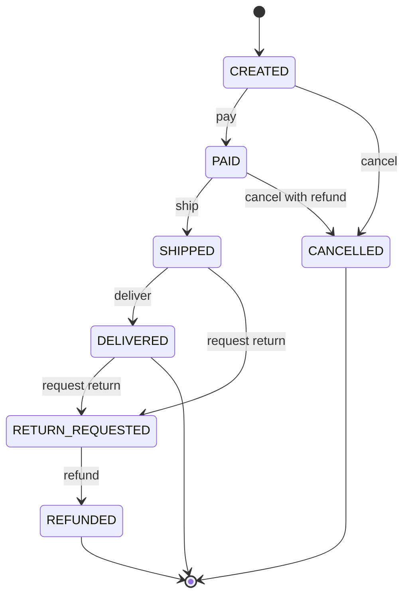
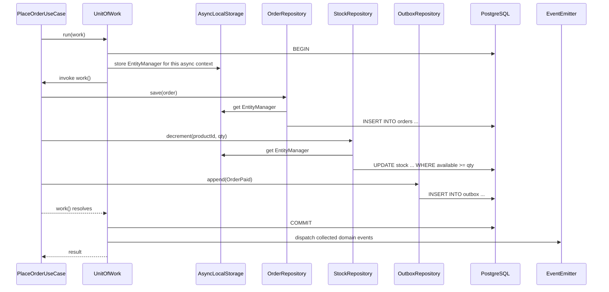

## 13.20 State pattern

#### Concept

The State pattern models an object whose behaviour depends on which state it is in, with an explicit list of states and an explicit list of legal transitions between them. An order is CREATED, then PAID, then SHIPPED, then DELIVERED; or it is CANCELLED from some of those states but not others. "Can this order be cancelled?" is answered by the state machine, not by a chain of `if` statements scattered across services.

#### Why does it exist?

Without it, status is a string column that anything can set to anything. `order.status = 'SHIPPED'` runs from a controller, a Kafka consumer and an admin script, each with its own idea of what is allowed. Eventually an order goes from DELIVERED back to CREATED because a retry replayed an old message, and a customer is charged twice. The State pattern centralises the rules: one table of legal transitions, one method to apply them, one error when they are violated.

#### Mental model

Imagine a traffic light. It has exactly three states and exactly three legal transitions: green to yellow, yellow to red, red to green. It never goes red to yellow. The wiring enforces this; no driver, no operator and no bug can make it happen. Your order's status column deserves the same wiring.

#### How it works

1. Enumerate the states. Keep the list small and business-meaningful.
2. Enumerate the legal transitions as a table: from state, event or action, to state.
3. Implement a `transition()` method on the aggregate that consults the table, throws a typed error for an illegal transition, and records what happened.
4. Persist the transition history (who, when, why) in addition to the current state; it is the audit trail and the debugging tool.
5. Protect against concurrent transitions with optimistic locking (a version column) or a conditional `UPDATE ... WHERE status = :expected`.



#### The legal transitions table

| From | Action | To | Guard | Side effects |
| --- | --- | --- | --- | --- |
| CREATED | pay | PAID | payment captured | `OrderPaid` event; commit stock reservation |
| CREATED | cancel | CANCELLED | none | release reservation |
| CREATED | expire | CANCELLED | older than 15 minutes, unpaid | release reservation |
| PAID | ship | SHIPPED | stock committed; shipment created | `OrderShipped` event |
| PAID | cancel | CANCELLED | refund succeeded | release stock; `OrderCancelled` event |
| SHIPPED | deliver | DELIVERED | carrier confirmation | `OrderDelivered` event |
| SHIPPED | requestReturn | RETURN_REQUESTED | within return window | create return ticket |
| DELIVERED | requestReturn | RETURN_REQUESTED | within 14 days of delivery | create return ticket |
| RETURN_REQUESTED | refund | REFUNDED | goods received | `OrderRefunded` event |
| any other combination | any | (illegal) | | throw `IllegalTransitionError` |

Note what is *not* in the table: SHIPPED to CANCELLED. Once goods leave the warehouse, cancellation becomes a return. Encoding that rule here means no code path can cancel a shipped order by accident.

#### TypeScript implementation

```ts
// domain/order-status.ts
export type OrderStatus = 'CREATED' | 'PAID' | 'SHIPPED' | 'DELIVERED' | 'CANCELLED' | 'RETURN_REQUESTED' | 'REFUNDED';
export type OrderAction = 'pay' | 'cancel' | 'expire' | 'ship' | 'deliver' | 'requestReturn' | 'refund';

// The single source of truth for legal transitions.
const TRANSITIONS: Record<OrderStatus, Partial<Record<OrderAction, OrderStatus>>> = {
  CREATED: { pay: 'PAID', cancel: 'CANCELLED', expire: 'CANCELLED' },
  PAID: { ship: 'SHIPPED', cancel: 'CANCELLED' },
  SHIPPED: { deliver: 'DELIVERED', requestReturn: 'RETURN_REQUESTED' },
  DELIVERED: { requestReturn: 'RETURN_REQUESTED' },
  RETURN_REQUESTED: { refund: 'REFUNDED' },
  CANCELLED: {},
  REFUNDED: {},
};

export class IllegalTransitionError extends DomainError {
  constructor(readonly from: OrderStatus, readonly action: OrderAction) {
    super('ORDER_ILLEGAL_TRANSITION', `cannot ${action} an order in ${from}`);
  }
}

export function nextStatus(from: OrderStatus, action: OrderAction): OrderStatus {
  const to = TRANSITIONS[from][action];
  if (!to) throw new IllegalTransitionError(from, action);
  return to;
}

export function canTransition(from: OrderStatus, action: OrderAction): boolean {
  return TRANSITIONS[from][action] !== undefined;
}
```

The aggregate uses the table and records each transition as history plus a domain event:

```ts
// domain/order.ts (excerpt)
export interface OrderTransition { from: OrderStatus; to: OrderStatus; action: OrderAction; at: Date; actor: string; reason?: string }

export class Order {
  private _status: OrderStatus;
  private readonly _transitions: OrderTransition[] = [];
  private readonly _events: DomainEvent[] = [];
  readonly version: number; // for optimistic locking; copied from persistence

  get status() { return this._status; }
  get pendingEvents(): readonly DomainEvent[] { return this._events; }
  get transitions(): readonly OrderTransition[] { return this._transitions; }

  private apply(action: OrderAction, actor: string, now: Date, reason?: string): void {
    const from = this._status;
    const to = nextStatus(from, action); // throws IllegalTransitionError
    this._status = to;
    this._transitions.push({ from, to, action, at: now, actor, reason });
  }

  pay(paymentId: string, actor: string, now: Date): void {
    this.apply('pay', actor, now);
    this._paymentId = paymentId;
    this._events.push(new OrderPaidEvent({ orderId: this.id, paymentId, amountMinor: this.total.minor, occurredAt: now.toISOString() }));
  }

  cancel(actor: string, now: Date, reason: string): void {
    // Guards beyond the table live here: a PAID order needs a refund before it is CANCELLED.
    const wasPaid = this._status === 'PAID';
    this.apply('cancel', actor, now, reason);
    this._events.push(new OrderCancelledEvent({ orderId: this.id, refundRequired: wasPaid, reason, occurredAt: now.toISOString() }));
  }

  ship(shipmentId: string, actor: string, now: Date): void {
    this.apply('ship', actor, now);
    this._shipmentId = shipmentId;
    this._events.push(new OrderShippedEvent({ orderId: this.id, shipmentId, occurredAt: now.toISOString() }));
  }

  requestReturn(actor: string, now: Date, deliveredAt: Date | null): void {
    if (this._status === 'DELIVERED' && deliveredAt && now.getTime() - deliveredAt.getTime() > 14 * 86_400_000) {
      throw new DomainError('RETURN_WINDOW_CLOSED', 'returns accepted within 14 days of delivery');
    }
    this.apply('requestReturn', actor, now);
  }
}
```

Unit tests for the state machine need no database and are exhaustive: iterate every state and every action, assert that exactly the table's entries succeed.

```ts
describe('order transitions', () => {
  const states: OrderStatus[] = ['CREATED', 'PAID', 'SHIPPED', 'DELIVERED', 'CANCELLED', 'RETURN_REQUESTED', 'REFUNDED'];
  const actions: OrderAction[] = ['pay', 'cancel', 'expire', 'ship', 'deliver', 'requestReturn', 'refund'];
  it.each(states.flatMap((s) => actions.map((a) => [s, a] as const)))('%s + %s', (from, action) => {
    if (canTransition(from, action)) expect(() => nextStatus(from, action)).not.toThrow();
    else expect(() => nextStatus(from, action)).toThrow(IllegalTransitionError);
  });
});
```

#### PostgreSQL example: persisting state and transitions

```sql
CREATE TABLE orders.orders (
  id           uuid PRIMARY KEY,
  customer_id  uuid NOT NULL,
  status       text NOT NULL CHECK (status IN ('CREATED','PAID','SHIPPED','DELIVERED','CANCELLED','RETURN_REQUESTED','REFUNDED')),
  version      integer NOT NULL DEFAULT 0,
  payment_id   text,
  shipment_id  text,
  created_at   timestamptz NOT NULL DEFAULT now(),
  updated_at   timestamptz NOT NULL DEFAULT now()
);

-- Append-only history; the audit trail and the debugging tool
CREATE TABLE orders.order_transitions (
  id           bigserial PRIMARY KEY,
  order_id     uuid NOT NULL REFERENCES orders.orders(id),
  from_status  text NOT NULL,
  to_status    text NOT NULL,
  action       text NOT NULL,
  actor        text NOT NULL,             -- user id, 'system:expiry-job', 'webhook:stripe'
  reason       text,
  occurred_at  timestamptz NOT NULL DEFAULT now()
);
CREATE INDEX order_transitions_order_idx ON orders.order_transitions (order_id, occurred_at);

-- Optimistic concurrency: only apply if nobody else moved the order since we loaded it
UPDATE orders.orders
SET status = 'PAID', payment_id = $2, version = version + 1, updated_at = now()
WHERE id = $1 AND version = $3;
-- rowCount 0 means a concurrent transition happened: reload and re-evaluate, or reject.
```

With TypeORM, `@VersionColumn()` on the entity makes `repository.save()` add `WHERE version = :expected` automatically and throw `OptimisticLockVersionMismatchError` on conflict. With Sequelize, `version: true` on the model does the same and throws `OptimisticLockError`. The repository catches these and re-throws a domain `ConcurrentModificationError`, which the HTTP layer maps to `409 Conflict`.

#### Production scenario

An order service processes 300 transitions per second. Payment webhooks (`pay`), carrier webhooks (`deliver`), an expiry cron (`expire`) and customer actions (`cancel`, `requestReturn`) all arrive concurrently and out of order. The state table rejects the ones that no longer apply: a delayed `expire` for an order that was paid 200 ms earlier hits `CREATED -> expire` on an order that is now `PAID` and throws `IllegalTransitionError`, which the cron logs at `info` level and moves on. A replayed Stripe webhook for an already `PAID` order is recognised the same way. Illegal-transition counts are a dashboard metric; a sudden spike means a producer is replaying or a clock is wrong.

#### Failure scenario

Before the state machine existed, the carrier webhook handler wrote `UPDATE orders SET status = 'DELIVERED' WHERE id = $1` with no guard. A carrier bug replayed 40,000 old delivery webhooks over one night. Orders that had been returned and refunded went back to `DELIVERED`. The refund reconciliation job, which selects `REFUNDED` orders, no longer saw them, and finance closed the month with 40,000 refunds unaccounted for. The fix was a transition table plus `WHERE status = 'SHIPPED'` in the update; the cleanup was three days of manual reconciliation.

#### Edge cases & failure modes

- **Concurrent transitions** on the same order: two admins cancel at once; a webhook and a cron race. Optimistic locking or conditional updates are mandatory.
- **Out-of-order events**: `deliver` arrives before `ship` because two carrier integrations report independently. Decide explicitly: reject (and let the retry succeed later) or allow a skip transition with an audit entry.
- **Idempotent replays**: applying `pay` to an already `PAID` order should be a no-op for the *same* payment id and an error for a *different* one.
- **State explosion**: sub-states (`PAID_AWAITING_STOCK`, `PAID_PARTIALLY_SHIPPED`) multiply transitions. Consider a second, smaller machine for fulfilment rather than one giant table.
- **Time-based transitions** (expiry) require a job that is itself idempotent and uses the machine, never raw updates.
- **Migration of existing rows** to a new state set; add the state, migrate data, then remove the old state, never rename in place.

#### When NOT to use it

- A boolean lifecycle (`active`/`inactive`) does not need a machine; a well-named method does.
- Read-only status projections (a dashboard colour) do not transition anything.
- When the workflow is genuinely user-defined at runtime (a configurable approval flow); then you want a workflow engine or a data-driven machine, not a hard-coded table.

#### Common mistakes

- `status` as a free string with no `CHECK` constraint and no central transition function.
- Transition rules duplicated in a controller `if`, a service `if` and a database trigger, each slightly different.
- No transition history, so "how did this order end up here?" is unanswerable.
- Emitting the domain event *before* the transition is persisted.
- Guards that need I/O (refund succeeded) placed inside the pure domain method; put them in the use case, and let the domain method assume the guard has passed.

#### Interview questions

1. *How do you prevent an order from being cancelled after shipping?* Expected: a transition table that has no SHIPPED to CANCELLED entry; a domain method that throws; a conditional update or version check for concurrency.
2. *Why store transition history in addition to current status?* Expected: audit, debugging, reconciliation, analytics (time in state).
3. *How do you handle a replayed webhook that tries an already-applied transition?* Expected: distinguish same-payment replay (no-op) from a genuine illegal transition (error); count both.
4. *Optimistic vs pessimistic locking for state transitions: when each?* Expected: optimistic for low contention (most orders); `SELECT ... FOR UPDATE` for hot rows or when a read-then-write must be serialised.
5. *How do you unit-test a state machine exhaustively?* Expected: cross product of states and actions against the table.

#### Practical exercise

Implement the order state machine above with `@VersionColumn()` in TypeORM. Write a Kafka consumer for carrier events and a cron for expiry, both going through the aggregate. Replay 10,000 old carrier events during a load test.

Acceptance criteria: no order ever leaves `REFUNDED` or `CANCELLED`; the exhaustive transition test passes; concurrent `cancel` and `pay` on the same order result in exactly one winner and one `409`; `order_transitions` shows a complete, ordered history for every order.

## 13.21 Specification pattern

#### Concept

A specification is an object that encapsulates a business rule as a predicate: "is this product eligible for free shipping?", "does this order match the fraud review criteria?", "which products satisfy this customer's filter?". Specifications compose with `and`, `or`, `not`, so complex rules are built from small named ones. The same specification can be evaluated in memory against a domain object and translated into a database query.

#### Why does it exist?

Filtering logic tends to end up in two places at once: an `if` chain in a service for in-memory checks, and a hand-built `WHERE` clause in a repository for queries. They drift. Specifications give the rule one name and one definition, and they let query construction stay composable without exposing the ORM's `QueryBuilder` to callers (which the Repository pattern forbids).

#### Mental model

Imagine a job posting's requirements: "5+ years experience AND (TypeScript OR Go) AND NOT currently employed by a competitor". Each requirement is a small rule. The posting is a combination. A recruiter can check one candidate against it by hand (in-memory) or ask the database for everyone who matches (query). The requirements list is the specification.

#### How it works

1. Define `Specification<T>` with `isSatisfiedBy(candidate: T): boolean` for in-memory evaluation.
2. Give each specification a second capability: contributing its condition to a query. In TypeORM that is a method that adds a `WHERE` fragment to a `SelectQueryBuilder`; in Sequelize it returns a `WhereOptions` fragment.
3. Provide `and`, `or`, `not` combinators that compose both capabilities.
4. The repository accepts a specification: `products.findMatching(spec, page)`. Callers compose rules; the repository translates them.

#### NestJS example: composable product filters

```ts
// domain/specifications/specification.ts
import { SelectQueryBuilder } from 'typeorm';

export interface Specification<T, Q = SelectQueryBuilder<any>> {
  isSatisfiedBy(candidate: T): boolean;
  applyTo(qb: Q, alias: string): Q; // query-side translation
  and(other: Specification<T, Q>): Specification<T, Q>;
  or(other: Specification<T, Q>): Specification<T, Q>;
  not(): Specification<T, Q>;
}

export abstract class CompositeSpecification<T> implements Specification<T> {
  abstract isSatisfiedBy(candidate: T): boolean;
  abstract applyTo(qb: SelectQueryBuilder<any>, alias: string): SelectQueryBuilder<any>;
  and(other: Specification<T>) { return new AndSpecification(this, other); }
  or(other: Specification<T>) { return new OrSpecification(this, other); }
  not() { return new NotSpecification(this); }
}

// Parameter names must be unique per specification instance to avoid collisions when composing.
let paramSeq = 0;
const param = (name: string) => `${name}_${++paramSeq}`;

class AndSpecification<T> extends CompositeSpecification<T> {
  constructor(private readonly a: Specification<T>, private readonly b: Specification<T>) { super(); }
  isSatisfiedBy(c: T) { return this.a.isSatisfiedBy(c) && this.b.isSatisfiedBy(c); }
  applyTo(qb: SelectQueryBuilder<any>, alias: string) {
    return qb.andWhere(new Brackets((w) => { this.a.applyTo(w as any, alias); this.b.applyTo(w as any, alias); }));
  }
}

class OrSpecification<T> extends CompositeSpecification<T> {
  constructor(private readonly a: Specification<T>, private readonly b: Specification<T>) { super(); }
  isSatisfiedBy(c: T) { return this.a.isSatisfiedBy(c) || this.b.isSatisfiedBy(c); }
  applyTo(qb: SelectQueryBuilder<any>, alias: string) {
    return qb.andWhere(new Brackets((w) => {
      w.where(new Brackets((x) => this.a.applyTo(x as any, alias)));
      w.orWhere(new Brackets((y) => this.b.applyTo(y as any, alias)));
    }));
  }
}

class NotSpecification<T> extends CompositeSpecification<T> {
  constructor(private readonly inner: Specification<T>) { super(); }
  isSatisfiedBy(c: T) { return !this.inner.isSatisfiedBy(c); }
  applyTo(qb: SelectQueryBuilder<any>, alias: string) {
    return qb.andWhere(new NotBrackets((w) => this.inner.applyTo(w as any, alias)));
  }
}
```

Concrete product specifications:

```ts
// domain/specifications/product.specs.ts
export class InCategory extends CompositeSpecification<Product> {
  constructor(private readonly categoryId: string) { super(); }
  isSatisfiedBy(p: Product) { return p.categoryId === this.categoryId; }
  applyTo(qb: SelectQueryBuilder<any>, alias: string) {
    const k = param('category');
    return qb.andWhere(`${alias}.category_id = :${k}`, { [k]: this.categoryId });
  }
}

export class PriceBetween extends CompositeSpecification<Product> {
  constructor(private readonly minMinor: number, private readonly maxMinor: number) { super(); }
  isSatisfiedBy(p: Product) { return p.price.minor >= this.minMinor && p.price.minor <= this.maxMinor; }
  applyTo(qb: SelectQueryBuilder<any>, alias: string) {
    const lo = param('pmin'), hi = param('pmax');
    return qb.andWhere(`${alias}.price_minor BETWEEN :${lo} AND :${hi}`, { [lo]: this.minMinor, [hi]: this.maxMinor });
  }
}

export class InStock extends CompositeSpecification<Product> {
  isSatisfiedBy(p: Product) { return p.available > 0; }
  applyTo(qb: SelectQueryBuilder<any>, alias: string) { return qb.andWhere(`${alias}.available > 0`); }
}

export class HasAnyTag extends CompositeSpecification<Product> {
  constructor(private readonly tags: string[]) { super(); }
  isSatisfiedBy(p: Product) { return p.tags.some((t) => this.tags.includes(t)); }
  applyTo(qb: SelectQueryBuilder<any>, alias: string) {
    const k = param('tags');
    return qb.andWhere(`${alias}.tags && :${k}::text[]`, { [k]: this.tags }); // PostgreSQL array overlap
  }
}
```

Composition in a use case, and translation in the repository:

```ts
// application/search-products.use-case.ts
const spec = new InCategory(q.categoryId)
  .and(new PriceBetween(q.minMinor ?? 0, q.maxMinor ?? Number.MAX_SAFE_INTEGER))
  .and(q.inStockOnly ? new InStock() : new InStock().or(new HasAnyTag(['preorder'])));
const page = await this.products.findMatching(spec, { limit: 24, cursor: q.cursor });

// infrastructure/typeorm/typeorm-product.repository.ts
async findMatching(spec: Specification<Product>, page: { limit: number; cursor?: string }): Promise<Product[]> {
  let qb = this.repo.createQueryBuilder('p').orderBy('p.id', 'ASC').take(Math.min(page.limit, 100));
  qb = spec.applyTo(qb, 'p');
  if (page.cursor) qb = qb.andWhere('p.id > :cursor', { cursor: page.cursor });
  const rows = await qb.getMany();
  return rows.map(ProductMapper.toDomain);
}
```

The same specification is used to validate a single product in memory (for example, "does this product still satisfy the promotion's rules at checkout time?"), so the promotion rule and the promotion listing can never disagree.

#### Sequelize variant

With Sequelize, `applyTo` returns a `WhereOptions` fragment and the combinators use `Op.and`, `Op.or`, `Op.not`:

```ts
export class PriceBetweenSeq implements SeqSpecification<Product> {
  constructor(private readonly minMinor: number, private readonly maxMinor: number) {}
  isSatisfiedBy(p: Product) { return p.price.minor >= this.minMinor && p.price.minor <= this.maxMinor; }
  toWhere(): WhereOptions { return { priceMinor: { [Op.between]: [this.minMinor, this.maxMinor] } }; }
}
// and: { [Op.and]: [a.toWhere(), b.toWhere()] }   or: { [Op.or]: [...] }   not: { [Op.not]: inner.toWhere() }
```

#### PostgreSQL example

The specification's SQL is only as fast as the indexes behind it. A category-plus-price filter with cursor pagination wants a composite index:

```sql
CREATE INDEX products_category_price_id_idx ON catalog.products (category_id, price_minor, id);
CREATE INDEX products_tags_gin_idx ON catalog.products USING gin (tags);

EXPLAIN (ANALYZE, BUFFERS)
SELECT * FROM catalog.products p
WHERE p.category_id = 'c1' AND p.price_minor BETWEEN 50000 AND 200000 AND p.available > 0 AND p.id > 'p_00001234'
ORDER BY p.id LIMIT 24;
-- Index Scan using products_category_price_id_idx on products p (actual time=0.041..0.412 rows=24 loops=1)
--   Index Cond: ((category_id = 'c1') AND (price_minor >= 50000) AND (price_minor <= 200000))
--   Filter: ((available > 0) AND (id > 'p_00001234'))
--   Rows Removed by Filter: 61
-- Buffers: shared hit=19
-- Execution Time: 0.451 ms
```

Because specifications compose freely, watch for combinations that produce un-indexable predicates (`OR` across different columns often forces a sequential scan). The repository is the place to log slow specification shapes and add indexes.

#### When NOT to use it

- A fixed set of two or three query shapes. Named repository methods (`findActiveInCategory`) are simpler and easier to index deliberately.
- Reports and analytics. Write SQL.
- When the query side and the in-memory side would never both be used; then you only need a query object, not a specification.
- When callers would need to build arbitrary specifications from HTTP input (a generic filter API). That leads to unbounded query shapes and SQL cost you cannot predict; whitelist the composable rules instead.

#### Common mistakes

- Parameter name collisions when the same specification class is used twice in one query (fixed above with unique parameter names).
- Specifications that hit the database inside `isSatisfiedBy`; they must be pure.
- Exposing `SelectQueryBuilder` to callers "because specifications already use it"; the builder stays inside the repository and the specifications.
- Building specifications from raw request bodies without validation.

#### Interview questions

1. *What problem does Specification solve that a repository method does not?* Expected: composable rules with one definition for both in-memory and query evaluation.
2. *How do you keep composed specifications from breaking the query?* Expected: bracketed sub-conditions, unique parameter names, tests per combinator.
3. *When is Specification over-engineering?* Expected: few fixed queries; reports; no in-memory reuse.
4. *What is the performance risk of composable predicates?* Expected: un-indexable combinations; monitor slow shapes; whitelist compositions.

#### Practical exercise

Implement `InCategory`, `PriceBetween`, `InStock` and `HasAnyTag` with `and`/`or`/`not`, a `findMatching` repository method with cursor pagination, and an in-memory check used at checkout to confirm a promotion still applies.

Acceptance criteria: a property-based test asserts that for random products and random specification trees, `isSatisfiedBy` agrees with the database query result; `EXPLAIN` for the three most common compositions shows index scans; no controller can construct a specification the whitelist does not allow.

## 13.22 Unit of Work

#### Concept

A Unit of Work (UoW) defines a transaction boundary around a business operation: everything inside either commits together or rolls back together, even when it spans several repositories and aggregates. It also collects domain events raised during the operation and dispatches them only after a successful commit.

In TypeORM, the mechanism is a `QueryRunner` or a transactional `EntityManager`; in Sequelize, a `Transaction` object. The pattern's job is to make sure every repository call inside the operation uses the *same* transaction without every method signature carrying a `manager` parameter.

#### Why does it exist?

A use case that saves an order, decrements stock and writes an outbox row through three repositories must not end with two of the three done. Without a UoW, each `repository.save()` is its own transaction; a crash between them leaves the system inconsistent. Passing an `EntityManager` into every repository method works but couples the application layer to TypeORM and turns every signature into `save(order, manager)`. The UoW hides the transaction while guaranteeing it.

#### Mental model

Imagine a shopping trolley at a supermarket. You pick up items from many aisles (repositories). Nothing is bought until you pay at the till (commit). If your card is declined, everything goes back (rollback). Nobody in the aisles needs to know about the till.

#### How it works



1. The use case calls `uow.run(async () => { ... })`.
2. The UoW acquires a `QueryRunner`, starts a transaction, and stores the transactional `EntityManager` in `AsyncLocalStorage` (CLS: continuation-local storage) for the current async context.
3. Repositories, when they need a manager, ask a small helper for "the current manager", which returns the transactional one if a UoW is active or the default one if not.
4. When the callback resolves, the UoW commits, releases the runner, and dispatches any domain events collected from aggregates during the operation.
5. If the callback throws, the UoW rolls back, releases the runner, discards the collected events, and re-throws.
6. Nested `run()` calls join the outer transaction (or create a savepoint) rather than opening a second one.

#### TypeORM implementation with `AsyncLocalStorage`

```ts
// libs/platform/src/persistence/transaction-context.ts
import { AsyncLocalStorage } from 'node:async_hooks';
import { EntityManager } from 'typeorm';

export interface TxContext { manager: EntityManager; events: DomainEvent[] }
export const txStorage = new AsyncLocalStorage<TxContext>();

// libs/platform/src/persistence/typeorm-unit-of-work.ts
import { Injectable, Logger } from '@nestjs/common';
import { DataSource } from 'typeorm';
import { EventEmitter2 } from '@nestjs/event-emitter';

@Injectable()
export class TypeormUnitOfWork implements UnitOfWork {
  private readonly log = new Logger(TypeormUnitOfWork.name);
  constructor(private readonly dataSource: DataSource, private readonly emitter: EventEmitter2) {}

  async run<T>(work: () => Promise<T>, opts: { isolation?: 'READ COMMITTED' | 'REPEATABLE READ' | 'SERIALIZABLE' } = {}): Promise<T> {
    const existing = txStorage.getStore();
    if (existing) return work(); // nested call joins the outer transaction

    const runner = this.dataSource.createQueryRunner();
    await runner.connect();
    await runner.startTransaction(opts.isolation ?? 'READ COMMITTED');
    const ctx: TxContext = { manager: runner.manager, events: [] };
    try {
      const result = await txStorage.run(ctx, work); // everything awaited inside sees ctx
      await runner.commitTransaction();
      await this.dispatch(ctx.events); // after commit, never before
      return result;
    } catch (err) {
      await runner.rollbackTransaction().catch((e) => this.log.error(`rollback failed: ${e.message}`));
      throw err;
    } finally {
      await runner.release(); // ALWAYS: leaking runners exhausts the pool
    }
  }

  collect(events: readonly DomainEvent[]): void {
    const ctx = txStorage.getStore();
    if (ctx) ctx.events.push(...events);
    else void this.dispatch([...events]); // outside a UoW: dispatch immediately
  }

  private async dispatch(events: DomainEvent[]): Promise<void> {
    for (const e of events) {
      try { await this.emitter.emitAsync(e.name, e); }
      catch (err) { this.log.error(`listener failed for ${e.name}: ${(err as Error).message}`); }
    }
  }
}
```

Repositories resolve the manager from context:

```ts
// libs/platform/src/persistence/current-manager.ts
@Injectable()
export class CurrentManager {
  constructor(private readonly dataSource: DataSource) {}
  get(): EntityManager { return txStorage.getStore()?.manager ?? this.dataSource.manager; }
}

// modules/orders/infrastructure/typeorm/typeorm-order.repository.ts
@Injectable()
export class TypeormOrderRepository implements OrderRepository {
  constructor(private readonly current: CurrentManager, private readonly uow: TypeormUnitOfWork) {}

  async save(order: Order): Promise<void> {
    const repo = this.current.get().getRepository(OrderEntity); // transactional if inside run()
    await repo.save(OrderMapper.toPersistence(order));
    this.uow.collect(order.pendingEvents); // dispatched after commit
    order.clearEvents();
  }

  async findById(id: string): Promise<Order | null> {
    const row = await this.current.get().getRepository(OrderEntity).findOne({ where: { id }, relations: { lines: true } });
    return row ? OrderMapper.toDomain(row) : null;
  }
}
```

The use case is now free of transaction plumbing:

```ts
async execute(cmd: PlaceOrderCommand): Promise<{ orderId: string }> {
  return this.uow.run(async () => {
    const order = Order.create(cmd.orderId, cmd.customerId, toLines(cmd.lines), this.clock.now());
    const ok = await this.stock.decrementIfAvailable(cmd.lines); // same transaction
    if (!ok) throw new DomainError('INSUFFICIENT_STOCK', 'one or more lines unavailable');
    order.pay(cmd.paymentId, cmd.actor, this.clock.now());
    await this.orders.save(order);                                // same transaction; events collected
    await this.outbox.append(order.pendingEvents);                // same transaction; durable publish
    return { orderId: order.id };
  }, { isolation: 'READ COMMITTED' });
}
```

The `nestjs-cls` package with its TypeORM transactional plugin (`@nestjs-cls/transactional`) implements exactly this shape and is the production-grade option; the hand-written version above shows what it does underneath.

#### Sequelize implementation

Sequelize has CLS support built in: `Sequelize.useCLS(namespace)` (with `cls-hooked`) makes every query inside `sequelize.transaction(async (t) => ...)` automatically use `t` without passing `{ transaction: t }`. The modern equivalent with `AsyncLocalStorage` is the same idea:

```ts
// libs/platform/src/persistence/sequelize-unit-of-work.ts
import { Sequelize, Transaction } from 'sequelize';

export const seqTx = new AsyncLocalStorage<{ transaction: Transaction; events: DomainEvent[] }>();

@Injectable()
export class SequelizeUnitOfWork implements UnitOfWork {
  constructor(private readonly sequelize: Sequelize, private readonly emitter: EventEmitter2) {}

  async run<T>(work: () => Promise<T>): Promise<T> {
    if (seqTx.getStore()) return work();
    let events: DomainEvent[] = [];
    // sequelize.transaction with a callback commits on resolve and rolls back on throw
    const result = await this.sequelize.transaction({ isolationLevel: Transaction.ISOLATION_LEVELS.READ_COMMITTED }, async (transaction) => {
      const ctx = { transaction, events: [] as DomainEvent[] };
      const r = await seqTx.run(ctx, work);
      events = ctx.events;
      return r;
    });
    for (const e of events) await this.emitter.emitAsync(e.name, e).catch(() => undefined);
    return result;
  }
}

// Repository: pass the current transaction explicitly (or rely on useCLS)
async save(order: Order) {
  const transaction = seqTx.getStore()?.transaction;
  await OrderModel.upsert(OrderMapper.toModelAttrs(order), { transaction });
}
```

Pessimistic row locks inside the unit of work use `lock: Transaction.LOCK.UPDATE` on `findOne`/`findAll` (Sequelize) or `setLock('pessimistic_write')` (TypeORM) and must happen within the same transaction, which the UoW guarantees.

#### PostgreSQL example

What the database sees for one `run()`:

```sql
BEGIN ISOLATION LEVEL READ COMMITTED;
UPDATE inventory.stock SET available = available - 2 WHERE product_id = 'p1' AND available >= 2;  -- rowCount must be 1
INSERT INTO orders.orders (id, customer_id, status, version, ...) VALUES (...);
INSERT INTO orders.order_lines (...) VALUES (...), (...);
INSERT INTO orders.order_transitions (...) VALUES (...);
INSERT INTO outbox (id, aggregate_id, topic, payload) VALUES (...);
COMMIT;
```

Everything or nothing. The stock decrement's `WHERE available >= 2` is the atomic guard; if `rowCount` is 0 the use case throws, and the whole transaction rolls back including any earlier inserts.

Transaction duration matters: the UoW holds a connection and row locks for its whole duration. Keep network calls (payment provider, email) *outside* `run()` or the pool drains under load. The pattern in section 13.19 (charge first with an idempotency key, then run a short transaction to record it) is the usual shape.

#### Production scenario

A checkout endpoint at 400 RPS with a pool of 20 connections per pod. Each UoW holds a connection for 6 to 12 ms (four statements, local PostgreSQL). Pool utilisation sits around 40%. A developer moves the Stripe call inside `run()` to "keep it atomic". Stripe p50 is 180 ms, p99 is 1.5 s. Connections are now held 200 ms to 1.5 s each; the pool saturates at about 100 RPS; requests queue for connections; p99 climbs to 9 s and the pods fail health checks. Reverting the change fixes it in one deploy. Rule: no external I/O inside a unit of work.

#### Failure scenario

An early version of the UoW forgot `runner.release()` on the rollback path. Every failed checkout (about 2% of traffic, mostly insufficient stock) leaked one connection. After 1,000 failed checkouts across the fleet, every pod's pool was exhausted. Checkout returned `503` for everyone while `pg_stat_activity` showed hundreds of `idle in transaction` sessions holding row locks on popular products. The fix was the `finally` block; the detection was an alert on `idle in transaction` sessions older than 30 seconds, which has been on the standard dashboard ever since.

#### Edge cases & failure modes

- **Leaked query runners** on error paths; always `finally { release() }`.
- **Long transactions** holding locks and connections; keep I/O out.
- **Nested `run()`**: join the outer transaction; be explicit about whether an inner failure should roll back everything (usually yes) or use a savepoint (`SAVEPOINT`/`ROLLBACK TO SAVEPOINT`, supported by TypeORM's nested `transaction()` and Sequelize's nested transactions).
- **Context loss**: `AsyncLocalStorage` context does not survive some callback-style APIs or `EventEmitter` listeners registered outside the context; verify with a test that a repository called from inside `run()` sees the transactional manager.
- **Events dispatched before commit** (a listener reading uncommitted data); the UoW must dispatch after `COMMIT`.
- **Events lost after commit** if the process dies before dispatch; for critical reactions, write to the outbox inside the transaction as well.
- **Deadlocks** when two UoWs lock rows in different orders; always lock in a consistent order (sort product ids) and let PostgreSQL's deadlock detector abort one; retry the whole `run()` on `40P01`.
- **Serialization failures** under `REPEATABLE READ`/`SERIALIZABLE` (`40001`); retry the whole unit with backoff.
- **Read replicas**: reads inside a UoW go to the primary (the transactional manager); do not route them elsewhere or you will read stale data inside your own transaction.

#### When NOT to use it

- Single-statement operations; the statement is already atomic.
- Read-only queries; a transaction adds nothing (except when you need a consistent snapshot across several reads, where `REPEATABLE READ` inside a UoW is exactly right).
- Operations that span services; there is no cross-service transaction. Use a saga (Part 30.3).
- Batch jobs processing millions of rows; one giant transaction bloats the WAL and holds locks for hours. Chunk into many small units.

#### Common mistakes

- Passing `EntityManager` through every method signature instead of using context.
- Opening the transaction in a controller or interceptor that does not know the business boundary.
- Catching errors inside `run()` and swallowing them, so the transaction commits partial work.
- External HTTP calls inside the transaction.
- Forgetting that `repository.save()` outside `run()` still works (auto-commit), which hides missing boundaries; add a lint or a test that critical use cases call `uow.run`.

#### Interview questions

1. *What is a Unit of Work and what two guarantees does it provide?* Expected: atomic commit/rollback across repositories; post-commit event dispatch.
2. *How do repositories find the current transaction without a `manager` parameter?* Expected: `AsyncLocalStorage`/CLS holding the transactional manager; fallback to the default manager.
3. *Why must external calls stay outside the unit of work?* Expected: connection and lock hold time; pool exhaustion under load.
4. *What happens on a nested `run()`?* Expected: join outer transaction or savepoint; explain the choice.
5. *How do you detect leaked transactions in production?* Expected: `idle in transaction` sessions, pool wait time, `pg_stat_activity` age.
6. *How do TypeORM and Sequelize differ in transaction propagation?* Expected: TypeORM `QueryRunner`/`EntityManager` plus CLS; Sequelize `transaction` object, `useCLS`, or explicit `{ transaction }`.

#### Practical exercise

Implement `TypeormUnitOfWork` with `AsyncLocalStorage`, wire `OrderRepository`, `StockRepository` and `OutboxRepository` through `CurrentManager`, and make `PlaceOrderUseCase` use `uow.run`. Write an integration test against Docker PostgreSQL that throws after the order insert and before the stock update.

Acceptance criteria: after the failing test, both `orders` and `stock` are unchanged and no outbox row exists; `pg_stat_activity` shows zero `idle in transaction` sessions after 1,000 failed runs; a listener on `order.paid` observes the committed order (a `findById` from the listener returns it); moving a fake 500 ms HTTP call inside `run()` makes a pool-saturation test fail, and moving it out makes it pass.
