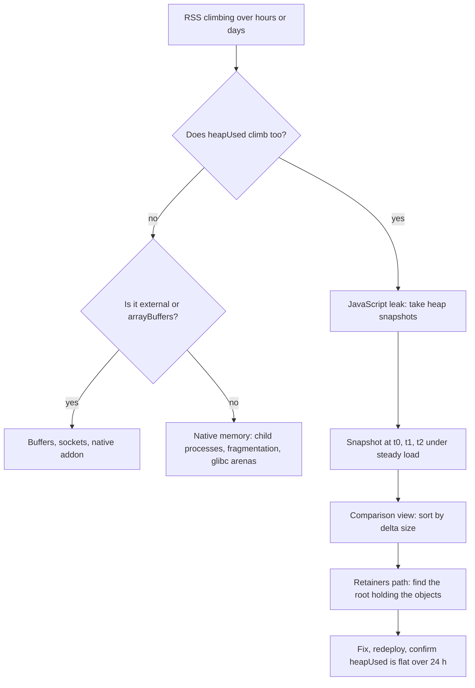
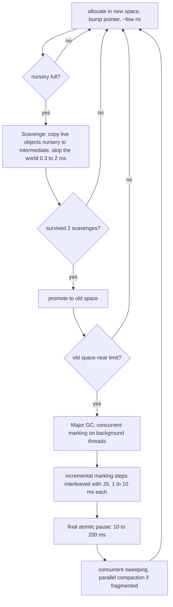
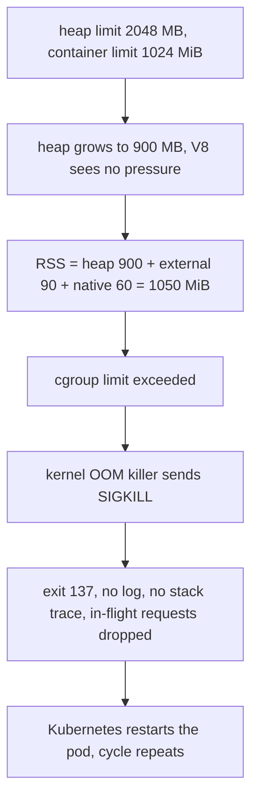

## 13.25 Memory leaks in Node

#### Concept

A **memory leak** in a garbage-collected runtime is not memory the collector forgot. V8's collector is correct: it frees everything unreachable. A leak is memory that is still **reachable** from a root — a global, a module-level variable, an active closure, a live event listener, a running timer — but that your program will never use again.

The distinction matters because it tells you how to hunt: you are not looking for a bug in V8, you are looking for a reference you did not intend to keep.

Leaks in a long-lived server process are especially punishing. A CLI that leaks 2 MB per run does not matter; it exits. A NestJS pod that leaks 2 MB per hour hits a 1 GiB limit in about two weeks, gets OOMKilled at 03:00 on a Sunday, and looks like a mystery because the deploy that introduced it was fourteen days earlier.

#### Why does it matter?

Because in Kubernetes, memory is a hard limit enforced by the kernel, not a soft target. When the container's RSS exceeds `limits.memory`, the OOM killer terminates the process with `SIGKILL`. There is no exception, no stack trace, no chance to log anything, no graceful shutdown. You see exit code 137, `OOMKilled` in the pod status, and in-flight requests are dropped mid-response.

Before that, the process usually spends minutes near the heap limit, where V8 runs increasingly aggressive garbage collection, adding hundreds of milliseconds of pause to p99 latency. A leaking service is a slow service long before it is a dead one.

#### Mental model

Imagine a warehouse where a robot removes any box that nobody holds a rope to. It never makes a mistake. But you have a habit of tying a rope to every box that arrives and hanging the rope on a hook by the door "just in case". The robot sees a rope, so it leaves the box. After a year the warehouse is full of boxes nobody has looked at, all held by ropes on that one hook.

The hook is your module-level `Map`. The leak is not the robot's fault.

#### The four classic leaks, with real NestJS code

**1. The unbounded module-level cache in a singleton provider.**

NestJS providers are singletons by default and live for the entire process lifetime. Any collection on one grows forever unless you bound it.

```ts
// LEAKING: pricing/pricing.service.ts
import { Injectable } from '@nestjs/common';

@Injectable()
export class PricingService {
  // Singleton provider, so this Map lives as long as the pod.
  // One entry per (productId, customerId, currency) combination. Never evicted.
  private readonly cache = new Map<string, { price: number; computedAt: number }>();

  async priceFor(productId: string, customerId: string, currency: string): Promise<number> {
    const key = `${productId}:${customerId}:${currency}`;
    const hit = this.cache.get(key);
    if (hit) return hit.price;
    const price = await this.computePrice(productId, customerId, currency);
    this.cache.set(key, { price, computedAt: Date.now() });   // grows without bound
    return price;
  }

  private async computePrice(p: string, c: string, cur: string): Promise<number> { return 0; }
}
```

The arithmetic: 40,000 products times 200,000 active customers times 3 currencies is 24 billion possible keys. In practice the working set is smaller, but with 500,000 unique keys per day at roughly 180 bytes each (key string plus object plus Map overhead), that is 90 MB per day. Day 8 is an OOMKill.

The fix is either a bounded LRU with a TTL, or Redis. Redis is usually right, because a cache in process memory is per-pod, inconsistent across replicas, and lost on every deploy.

```ts
// FIXED: bounded LRU with a TTL, plus a metric so the cache is observable.
import { Injectable } from '@nestjs/common';
import { LRUCache } from 'lru-cache';
import { Gauge } from 'prom-client';

@Injectable()
export class PricingService {
  private readonly cache = new LRUCache<string, number>({
    max: 50_000,                       // hard entry cap
    maxSize: 32 * 1024 * 1024,         // and a byte cap
    sizeCalculation: (_v, k) => k.length * 2 + 64,
    ttl: 5 * 60_000,                   // stale prices are a correctness bug, not just memory
  });
  private readonly size = new Gauge({
    name: 'pricing_cache_entries', help: 'entries in the in-process price cache',
    collect() { /* set from the cache on scrape */ },
  });

  async priceFor(productId: string, customerId: string, currency: string): Promise<number> {
    const key = `${productId}:${customerId}:${currency}`;
    const hit = this.cache.get(key);
    if (hit !== undefined) return hit;
    const price = await this.computePrice(productId, customerId, currency);
    this.cache.set(key, price);
    this.size.set(this.cache.size);
    return price;
  }

  private async computePrice(p: string, c: string, cur: string): Promise<number> { return 0; }
}
```

**Rule: every in-process collection that grows with traffic needs a bound and a gauge.** If you cannot state its maximum size in megabytes, it is a leak.

**2. Event listener accumulation on a long-lived emitter.**

```ts
// LEAKING: orders/order-notifier.service.ts
import { Injectable, Scope } from '@nestjs/common';
import { EventEmitter2 } from '@nestjs/event-emitter';

@Injectable({ scope: Scope.REQUEST })     // a NEW instance per request
export class OrderNotifierService {
  constructor(private readonly events: EventEmitter2) {   // but a SINGLETON emitter
    // One listener added per request, never removed. The closure retains `this`,
    // which retains the request-scoped injection subtree.
    this.events.on('order.created', (payload) => this.notify(payload));
  }
  private notify(p: unknown) { /* ... */ }
}
```

At 200 requests per second this adds 200 listeners per second to a singleton emitter. Node warns at 11 listeners (`MaxListenersExceededWarning`) and then goes quiet, so the warning scrolls past in the logs once and is never seen again. Two hours later there are 1.4 million listeners, each retaining a request-scoped object graph, and every `emit('order.created')` calls all of them.

Fixes, in order of preference:

```ts
// Best: use the declarative decorator on a SINGLETON provider. Nest registers the handler once.
import { Injectable } from '@nestjs/common';
import { OnEvent } from '@nestjs/event-emitter';

@Injectable()                                   // default singleton scope
export class OrderNotifierService {
  @OnEvent('order.created', { async: true })
  async handleOrderCreated(payload: { orderId: string }): Promise<void> { /* ... */ }
}

// If you genuinely must subscribe imperatively, remove the listener in the lifecycle hook.
@Injectable()
export class TemporarySubscriber implements OnModuleDestroy {
  private readonly handler = (p: unknown) => this.notify(p);
  constructor(private readonly events: EventEmitter2) { this.events.on('order.created', this.handler); }
  onModuleDestroy() { this.events.off('order.created', this.handler); }   // same function reference
  private notify(p: unknown) {}
}
```

The same shape appears with `process.on('SIGTERM', ...)` inside a factory, `socket.on('close', ...)` inside a per-message handler, and `redisClient.on('error', ...)` registered per query. `emitter.listenerCount(event)` as a gauge catches all of them.

**3. Closures capturing large buffers.**

This one is subtle because the retained object is not the one you are thinking about.

```ts
// LEAKING: uploads/upload.service.ts
@Injectable()
export class UploadService {
  private readonly pending = new Map<string, () => Promise<void>>();

  async register(uploadId: string, fileBuffer: Buffer): Promise<void> {   // fileBuffer is 40 MB
    const checksum = createHash('sha256').update(fileBuffer).digest('hex');
    // This closure only USES `checksum` and `uploadId` - but V8's context object for this
    // scope also holds `fileBuffer`, so all 40 MB stays alive as long as the callback does.
    this.pending.set(uploadId, async () => {
      await this.markVerified(uploadId, checksum);
    });
  }
  private async markVerified(id: string, c: string) {}
}
```

V8 allocates one **context object** per closure-creating scope, and every closure created in that scope shares it. If any closure in the scope survives, the whole context survives, including variables the surviving closure never mentions. (V8 does optimise away variables no closure in the scope references, but as soon as *one* closure touches `fileBuffer` — or the function is not optimised — everything is retained.)

The fix is to narrow the scope so the big value is not in it:

```ts
// FIXED: extract the small values, and build the closure in a scope that never sees the buffer.
async register(uploadId: string, fileBuffer: Buffer): Promise<void> {
  const checksum = createHash('sha256').update(fileBuffer).digest('hex');
  this.pending.set(uploadId, this.makeVerifier(uploadId, checksum));   // fileBuffer not in this scope
}
private makeVerifier(uploadId: string, checksum: string): () => Promise<void> {
  return async () => { await this.markVerified(uploadId, checksum); };
}
```

The same trap appears with `setTimeout(() => log(id), 60_000)` written inside a handler that also holds a large parsed request body, and with promise chains where a rejected-but-retained promise holds its whole creation context.

**4. Timers never cleared.**

```ts
// LEAKING: sessions/session.service.ts
@Injectable()
export class SessionService {
  private readonly sessions = new Map<string, { user: User; timer: NodeJS.Timeout }>();

  touch(sessionId: string, user: User): void {
    // A new interval per touch. The old one is never cleared, so it keeps running
    // AND keeps `user` alive through its closure. Both the timer and the user leak.
    const timer = setInterval(() => this.refresh(sessionId), 30_000);
    this.sessions.set(sessionId, { user, timer });
  }
  private refresh(id: string) {}
}
```

Every active timer is a libuv handle and a GC root. A `setInterval` never cleared keeps its closure, and therefore everything the closure captures, alive forever — and keeps the process alive on shutdown, which is why `SIGTERM` sometimes hangs until Kubernetes escalates to `SIGKILL`.

```ts
// FIXED: clear before replacing, clear on removal, and use lifecycle hooks.
touch(sessionId: string, user: User): void {
  const existing = this.sessions.get(sessionId);
  if (existing) clearInterval(existing.timer);          // never stack timers
  const timer = setInterval(() => this.refresh(sessionId), 30_000);
  timer.unref();                                        // do not keep the process alive
  this.sessions.set(sessionId, { user, timer });
}
onModuleDestroy() { for (const s of this.sessions.values()) clearInterval(s.timer); this.sessions.clear(); }
```

For anything recurring in NestJS, prefer `@Interval` / `@Cron` from `@nestjs/schedule`: the framework registers and tears down the handles for you.

#### A leaking NestJS interceptor

Interceptors are singletons instantiated once and invoked on every request, which makes them a perfect leak vector. This one looks reasonable and leaks three ways at once:

```ts
// LEAKING: common/audit.interceptor.ts
import { Injectable, NestInterceptor, ExecutionContext, CallHandler } from '@nestjs/common';
import { Observable, tap } from 'rxjs';

@Injectable()
export class AuditInterceptor implements NestInterceptor {
  // (1) Unbounded array of every request ever seen.
  private readonly trail: Array<{ at: number; user: string; body: unknown; res: unknown }> = [];

  intercept(ctx: ExecutionContext, next: CallHandler): Observable<unknown> {
    const req = ctx.switchToHttp().getRequest();
    const res = ctx.switchToHttp().getResponse();

    // (2) A listener added per request to a socket that may be kept alive for thousands of requests.
    req.socket.on('close', () => this.flush());

    return next.handle().pipe(
      tap((data) => {
        // (3) Retains the full request body and full response body, including 8 MB uploads.
        this.trail.push({ at: Date.now(), user: req.user?.id, body: req.body, res: data });
      }),
    );
  }
  private flush() {}
}
```

Three independent leaks: an unbounded array, listeners accumulating on keep-alive sockets (a socket serving 5,000 requests collects 5,000 `close` listeners), and retention of large request and response payloads. At 300 requests per second with an average 6 KB body, the array alone grows at 1.8 MB/s — the pod dies in under ten minutes.

```ts
// FIXED: emit, do not accumulate. Never retain payloads. Never add per-request socket listeners.
import { Injectable, NestInterceptor, ExecutionContext, CallHandler, Logger } from '@nestjs/common';
import { Observable, tap, catchError, throwError } from 'rxjs';
import { Counter, Histogram } from 'prom-client';

@Injectable()
export class AuditInterceptor implements NestInterceptor {
  private readonly logger = new Logger(AuditInterceptor.name);
  private readonly requests = new Counter({ name: 'http_requests_total', help: 'requests', labelNames: ['route', 'status'] });
  private readonly duration = new Histogram({ name: 'http_request_seconds', help: 'duration', labelNames: ['route'] });

  intercept(ctx: ExecutionContext, next: CallHandler): Observable<unknown> {
    const req = ctx.switchToHttp().getRequest();
    const route = req.route?.path ?? 'unknown';       // low cardinality: the ROUTE, never the URL with ids
    const end = this.duration.startTimer({ route });

    return next.handle().pipe(
      tap(() => { end(); this.requests.inc({ route, status: '2xx' }); }),
      catchError((err) => {
        end();
        this.requests.inc({ route, status: 'error' });
        // Log identifiers, never bodies. The log ships out of the process; the array never did.
        this.logger.warn({ route, userId: req.user?.id, err: err?.message }, 'request failed');
        return throwError(() => err);
      }),
    );
  }
}
```

Note the label cardinality warning too: `labelNames: ['route']` with the *route pattern* is bounded; using `req.url` would create one time series per order id and leak memory inside `prom-client` itself. Unbounded metric labels are a leak that looks like a monitoring feature.

#### How to find a leak



**Step 1: confirm it is a JavaScript heap leak.** `process.memoryUsage()` splits the picture:

```ts
// runtime/memory.service.ts - trend every metric, not just heapUsed
import { Injectable } from '@nestjs/common';
import { Interval } from '@nestjs/schedule';
import { Gauge } from 'prom-client';
import { readFileSync } from 'node:fs';

@Injectable()
export class MemoryMetricsService {
  private readonly g = {
    rss: new Gauge({ name: 'node_memory_rss_bytes', help: 'resident set size' }),
    heapTotal: new Gauge({ name: 'node_memory_heap_total_bytes', help: 'heap reserved by V8' }),
    heapUsed: new Gauge({ name: 'node_memory_heap_used_bytes', help: 'live JS objects' }),
    external: new Gauge({ name: 'node_memory_external_bytes', help: 'C++ objects bound to JS' }),
    arrayBuffers: new Gauge({ name: 'node_memory_array_buffers_bytes', help: 'Buffers and ArrayBuffers' }),
    containerRss: new Gauge({ name: 'container_memory_current_bytes', help: 'cgroup memory.current' }),
  };

  @Interval(15_000)
  sample(): void {
    const m = process.memoryUsage();
    this.g.rss.set(m.rss);
    this.g.heapTotal.set(m.heapTotal);
    this.g.heapUsed.set(m.heapUsed);
    this.g.external.set(m.external);
    this.g.arrayBuffers.set(m.arrayBuffers);
    try {
      // The number the OOM killer actually looks at, including child processes and page cache.
      this.g.containerRss.set(Number(readFileSync('/sys/fs/cgroup/memory.current', 'utf8').trim()));
    } catch { /* not cgroup v2 */ }
  }
}
```

Read it like this:

| Pattern | Diagnosis |
|---|---|
| `heapUsed` climbs steadily, `rss` follows | JavaScript leak: retained objects. Take snapshots. |
| `heapUsed` flat and sawtoothing, `rss` climbs | `external`/`arrayBuffers` (Buffers, sockets), native addon, or heap fragmentation |
| `arrayBuffers` climbs | Buffers retained: streams without backpressure, a Buffer cache, an unreleased socket |
| Container RSS >> Node RSS | Child processes, or page cache from heavy file I/O |
| `heapUsed` grows linearly during one long request | Not a leak: missing backpressure (13.24) |
| Sawtooth with a rising floor | Real leak underneath normal GC activity — look at the *minima* after major GCs, not the peaks |

That last row is the most useful diagnostic habit in this section. Heap graphs always look like a sawtooth. **Only the troughs matter**; if the trough after each major GC is higher than the previous trough, you have a leak.

**Step 2: heap snapshots.** Start the pod with the inspector bound to localhost and port-forward:

```bash
# In the pod (never expose 9229 publicly - the inspector is full code execution)
node --inspect=127.0.0.1:9229 dist/main.js
# From your machine
kubectl port-forward pod/api-7c9f 9229:9229
# Then open chrome://inspect, click "inspect", go to the Memory tab.
```

The workflow that actually finds leaks is **comparison snapshots**:

1. Let the pod warm up under steady load for 10 minutes.
2. Take snapshot 1. Note the total size.
3. Apply a known workload — for example exactly 10,000 requests to the suspect endpoint.
4. Force a GC (the Memory tab's bin icon, or start with `--expose-gc` and call `global.gc()`), then take snapshot 2.
5. Repeat for snapshot 3.
6. Select snapshot 3, switch the view to **Comparison** against snapshot 1, and sort by **Delta size**.

Objects with a large positive delta and a count that grew by roughly your request count are your leak. Click one, open **Retainers** at the bottom, and follow the chain up to a root. That chain literally reads as the answer: `Object -> closure context -> Array -> AuditInterceptor -> ... -> (GC roots)`.

Three shortcuts worth knowing:

- Filter by **"Objects allocated between snapshot 1 and 2"** in the class filter to hide everything pre-existing.
- **`(string)`** and **`(array)`** at the top of the delta list usually point at an accumulating array of log lines or keys.
- **`(closure)`** growth with a large **Retained Size** is the closure-capture leak (leak 3 above).

**Step 3: snapshots without a debugger.** In production you often cannot attach an inspector, and taking a snapshot of a 1.5 GB heap pauses the process for several seconds and needs heap-sized free memory. `--heapsnapshot-signal` is the safest mechanism:

```yaml
# deployment.yaml
env:
  - name: NODE_OPTIONS
    value: "--heapsnapshot-signal=SIGUSR2"
volumeMounts:
  - name: diagnostics
    mountPath: /diagnostics
```

```bash
kubectl exec api-7c9f -- kill -USR2 1              # writes Heap.<date>.<pid>.<seq>.heapsnapshot to cwd
kubectl cp api-7c9f:/app/Heap.20260909.1.0.001.heapsnapshot ./snap1.heapsnapshot
# Load it in Chrome DevTools -> Memory -> Load
```

Do this on a pod you have first removed from the load balancer (`kubectl label pod api-7c9f app-` if your Service selects on that label), because the pause will fail health checks. `v8.writeHeapSnapshot(path)` from inside an admin-only endpoint is the programmatic equivalent, and `--heap-prof` gives you allocation sampling with far less impact when you want to know *where* memory is allocated rather than *what* is retained.

**Step 4: clinic doctor** for the first-pass diagnosis, which tells you which of the four resources is the problem before you commit to a deep investigation:

```bash
npx clinic doctor --on-port 'autocannon -c 50 -d 120 http://localhost:3000/orders' -- node dist/main.js
# Produces an HTML report with event loop delay, heap, CPU and active handles over time,
# plus a plain-English verdict such as "possible memory leak" or "event loop blocked".
npx clinic flame -- node dist/main.js       # where CPU time goes
npx clinic bubbleprof -- node dist/main.js  # where async time goes
```

`clinic doctor`'s active-handles graph is underrated: a handle count that only rises is a socket, timer or stream leak, and you learn that in two minutes without any snapshots.

#### Production scenario

A notifications service on 8 pods, 1 GiB each, had a `Map<userId, WebSocket[]>` for delivering push messages. Sockets were added on connect and removed on `'close'` — except when the process itself initiated the close during a shard rebalance, where the removal path was missed. About 0.4% of disconnects leaked one entry.

At 40,000 connections per hour, that is 160 leaked entries per hour, each retaining a socket object and its buffers: roughly 4 MB/hour. Nine days later the first pod was OOMKilled, and because pods had staggered start times, they died one by one over the following week — which made it look like an infrastructure problem rather than a code problem.

The catch was a gauge: `websocket_map_entries` next to `websocket_active_connections`. The two lines diverged immediately and unmistakably. Total time to diagnose after adding the gauge: eight minutes.

**The lesson generalises: for every collection whose size should track a real-world quantity, export both numbers and alert on the divergence.** It turns a nine-day mystery into a graph.

#### Failure scenario

At 03:12 on a Sunday, four of six payment API pods were OOMKilled within ten minutes of each other. The remaining two absorbed the traffic, hit their own limits, and by 03:26 the service was fully down. The night before, a deploy had added a "recently viewed products" feature.

The implementation stored recently viewed items in a `Map` on a singleton service, keyed by session id, with no eviction. Weekday traffic had disguised it: pods were redeployed every few hours during the week, resetting the leak. Over a quiet weekend with no deploys, the pods ran for 40 hours uninterrupted and all crossed the limit at roughly the same time — because they had all started at the same time on Friday evening.

Timeline of the response: 03:12 first page; 03:19 exit code 137 identified as OOMKilled, not a crash; 03:24 the deploy diff reviewed and the unbounded `Map` spotted; 03:31 rollback started; 03:38 service restored. The permanent fix was an LRU with `max: 10_000` and `ttl: 30 minutes`, moved to Redis a week later so the data survived deploys.

Two lessons the team wrote down: **frequent deploys hide leaks** (a service that only survives because you restart it is already broken), and an alert on `container_memory_working_set_bytes / limit > 0.85` sustained for 15 minutes would have paged someone on Saturday afternoon with a warning instead of on Sunday morning with an outage.

#### Edge cases & failure modes

- `heapUsed` never returning to its previous floor after load subsides is the definitive leak signal; peaks are noise.
- Closures retain their entire scope's context object, including variables they do not reference.
- `WeakMap` and `WeakRef` keys do not prevent collection — but a `WeakMap`'s *values* keep their own references alive, and a `WeakMap` keyed by a string does nothing at all (primitives cannot be weak keys).
- `MaxListenersExceededWarning` is emitted **once per emitter**. Missing it in the logs does not mean there is no listener leak.
- Prometheus label cardinality is a leak: one label value per user id or per URL grows `prom-client`'s registry forever.
- Global `console.log` on a stdout that is a blocking pipe can back up; more commonly, an in-memory log transport with a buffer that is never flushed grows without limit.
- Request-scoped providers instantiate their whole injection subtree per request; a request-scoped provider referenced by a singleton pins that subtree.
- `Buffer.allocUnsafe` from a pool: slicing a small piece of a pooled 8 KB buffer retains the whole 8 KB. Use `Buffer.from` or `Buffer.copyBytesFrom` for long-lived small slices.
- Native addon leaks show in `rss` and `external` but never in a heap snapshot.
- Taking a heap snapshot of a large heap pauses the process for seconds and needs heap-sized headroom, so it can itself trigger the OOMKill you are investigating.
- Heap fragmentation makes `rss` exceed `heapTotal` permanently; glibc's `malloc` arenas make this worse in multi-threaded processes (`MALLOC_ARENA_MAX=2` sometimes helps).
- A leak that only appears with a specific customer's data (a very large order, a pathological payload) will never reproduce in staging.

#### How a Senior Backend Engineer thinks about this

They treat every long-lived collection, listener and timer as a liability that must have an owner, a bound and a metric. In code review, `new Map()` at class level is a question, not a detail: *what bounds this?*

When memory rises they do not guess. They look at the four `memoryUsage` numbers first to decide *which kind* of leak it is, then take comparison snapshots under a controlled workload. They alert on working-set fraction of the limit rather than on absolute megabytes, so the alert survives a limit change. And they are suspicious of any service whose stability depends on regular deploys.

To a product manager: "The app was keeping every price it ever calculated, forever, just in case. We now keep the last fifty thousand for five minutes, which is all the benefit and none of the risk."

#### Common mistakes

- Unbounded `Map`/`Set`/array on a singleton provider.
- Adding listeners in request-scoped constructors or per-request socket handlers.
- Assuming a heap graph's sawtooth peaks matter; only the troughs do.
- Calling `global.gc()` in production to "fix" memory (it hides the problem and adds pauses).
- Raising `--max-old-space-size` above the container limit to stop OOMKills, which guarantees them.
- Retaining request or response bodies in logs, metrics or audit buffers.
- Blaming V8 for a leak that is a reference you wrote.

#### Interview questions

1. *Define a memory leak in a garbage-collected runtime.* Expected: reachable but unused memory; the collector is correct, the reference is unintended.
2. *Name four leak patterns you have seen in a Node server, with the fix for each.* Expected: unbounded singleton cache (bound + TTL), listener accumulation (declarative handlers or `off` in lifecycle hooks), closure capture of large buffers (narrow the scope), uncleared timers (clear/unref + lifecycle hooks).
3. *`rss` is rising but `heapUsed` is flat. What is your next step?* Expected: check `external`/`arrayBuffers` for Buffers and sockets, look for child processes, consider native addons and fragmentation; heap snapshots will not help.
4. *Walk me through finding a leak with heap snapshots.* Expected: warm up, snapshot, apply a known workload, force GC, snapshot again, comparison view sorted by delta, retainers path to a root.
5. *How do you take a snapshot from a production pod safely?* Expected: `--heapsnapshot-signal=SIGUSR2`, remove the pod from the load balancer first, copy the file out, accept a multi-second pause and the memory headroom requirement.
6. *Why is a leak more dangerous in a service you deploy rarely?* Expected: restarts mask it; a quiet weekend or a frozen release window turns a slow leak into a synchronized multi-pod outage.
7. *When is a `WeakMap` the right fix, and when is it useless?* Expected: right for per-object metadata keyed by objects you do not own; useless for string keys and for bounding growth where the keys stay alive anyway.

#### Practical exercise

Write a NestJS service with all four leaks (unbounded cache, listener accumulation, closure capture of a 10 MB buffer, uncleared interval). Run it under `autocannon` for 10 minutes while sampling `process.memoryUsage()` every second. Take comparison heap snapshots at minutes 1, 5 and 10 and identify each leak from the retainers path. Fix them one at a time and confirm `heapUsed` troughs stop rising.

Acceptance criteria: a memory plot showing rising troughs before and flat troughs after; a screenshot or transcript of the retainers path for each of the four leaks; a working `--heapsnapshot-signal=SIGUSR2` demonstration; and a gauge for each bounded collection exported to `/metrics`.

## 13.26 V8 garbage collection in depth and tuning

#### Concept

V8's collector is **generational**, built on a simple empirical observation known as the *generational hypothesis*: **most objects die young**. The request DTO, the intermediate array, the string you built to log — almost all of it is garbage microseconds after allocation. A small fraction survives: your cache entries, your connection pool, your compiled route table.

So V8 uses two strategies for two populations:

- **Young generation (new space)**: small, 1 to 16 MB per isolate, collected very often by a fast copying algorithm called **Scavenge**. Cost is proportional to the *survivors*, not to the space size, so when 95% of objects are dead it is nearly free.
- **Old generation (old space)**: large, up to `--max-old-space-size`, collected rarely by **Mark-Sweep-Compact**. Cost is proportional to the *live set*, which is why a big cache makes every major GC more expensive.

13.13 introduced the concept; this section is about what it costs you in p99 latency and how to configure it for a container.

#### Why does it exist?

Because a single-strategy collector must choose between throughput and pause time, and generational collection lets you have most of both. Scavenging a 4 MB young space with 200 KB of survivors takes under a millisecond. Marking a 900 MB old space takes hundreds of milliseconds — so you do it as rarely as possible, incrementally, and mostly on background threads.

#### Mental model

Imagine a busy kitchen. Everything on the prep counter (young generation) is either used within minutes or swept into the bin. Twice an hour someone wipes the counter clean: they carry off the two or three items still in use and bin the rest without looking at it. It is fast because they only handle what is *kept*, not what is thrown away.

The pantry (old generation) is different. It holds the things that survived several counter-wipes. Cleaning the pantry means checking every shelf, which takes real time — so you do it rarely, you do most of the checking while service continues, and you only stop the kitchen for the short bits that cannot be done concurrently.

#### How it works



**Young generation, in detail.** New space is split into two equal **semi-spaces**, `from` and `to`. Allocation is a pointer bump in `from` — a few nanoseconds, cheaper than `malloc`. When `from` fills, Scavenge runs: live objects are copied into `to`, the spaces swap, and everything left behind is reclaimed by simply forgetting it. An object that survives two scavenges is **promoted** to old space. Typical pause: 0.3 to 2 ms, and it is a genuine stop-the-world pause, but a short one.

**Old generation, in detail.** A major GC has four activities, and the modern implementation (Orinoco) works hard to keep the stop-the-world portion small:

1. **Concurrent marking** — background threads trace the object graph while JavaScript runs. This is where most of the marking work happens, and it costs you CPU rather than pause time.
2. **Incremental marking** — small marking steps interleaved with your code, historically triggered on allocation. A **write barrier** records mutations so nothing is missed while the mutator runs.
3. **Final atomic pause** — everything stops to finish marking and process weak references. This is the pause you see in p99 latency: typically 10 to 60 ms for a healthy heap, 200 ms or more for a large one.
4. **Concurrent sweeping and parallel compaction** — freeing memory happens on background threads; compaction (moving objects to defragment) runs on parallel threads during the pause and is only done for fragmented pages.

**Where the p99 goes.** GC pauses do not slow the average request; they add a fixed penalty to whichever unlucky requests are in flight. With a major GC every 30 seconds at 80 ms, at 500 requests per second, roughly 40 requests per GC take 80 ms longer. That is 0.27% of requests, which is exactly the p99.7 region — enough to shape p99 if pauses are frequent, and the reason "our p99 is spiky but p50 is fine" so often turns out to be GC. It is also why loop-lag monitoring (13.27) and GC tracing tell you the same story from two directions.

#### Reading `--trace-gc` output line by line

```bash
node --trace-gc --trace-gc-verbose dist/main.js
```

```text
[41283:0x5f8d1a0]    18452 ms: Scavenge 128.4 (146.2) -> 113.7 (147.2) MB, 1.8 / 0.0 ms  (average mu = 0.994, current mu = 0.992) allocation failure
[41283:0x5f8d1a0]    24011 ms: Mark-Compact 742.1 (801.3) -> 402.9 (762.1) MB, 214.3 / 0.0 ms  (average mu = 0.812, current mu = 0.664) allocation failure; scavenge might not succeed
[41283:0x5f8d1a0]    31770 ms: Mark-Compact (reduce) 918.6 (961.0) -> 901.2 (960.0) MB, 486.1 / 0.0 ms  (average mu = 0.402, current mu = 0.011) allocation failure; GC in old space requested
```

Field by field, using the second line:

- `[41283:0x5f8d1a0]` — process id and isolate address. **Different isolate addresses mean worker threads**, which is how you tell whose GC you are reading.
- `24011 ms` — time since process start.
- `Mark-Compact` — the collector type. `Scavenge` is minor and cheap; `Mark-Compact` is major; `Mark-Compact (reduce)` means V8 is trying hard to shrink the heap, which is a distress signal.
- `742.1 (801.3) -> 402.9 (762.1) MB` — heap **used** before (total committed before) then heap used after (total committed after). Here 742 MB was reduced to 403 MB, so 339 MB was garbage. Good.
- `214.3 / 0.0 ms` — pause duration, then time spent in external callbacks. **214 ms is the number that hits your p99.**
- `average mu = 0.812, current mu = 0.664` — **mutator utilisation**: the fraction of time your JavaScript ran rather than the collector. 0.994 is healthy. 0.812 means the collector took 19% of recent wall time. 0.402 with `current mu = 0.011` on the third line means the process spent 99% of that window collecting garbage and is about to die.
- `allocation failure` — the trigger: an allocation could not be satisfied. `scavenge might not succeed` and `GC in old space requested` are escalating warnings.

The three-line story here is a service in a death spiral: heap climbing from 742 to 918 MB, major GCs taking 214 ms then 486 ms, and recovering only 17 MB on the last one. Within seconds this process throws `FATAL ERROR: Reached heap limit Allocation failed - JavaScript heap out of memory` or is OOMKilled.

**The healthy pattern to compare against**: mostly `Scavenge` lines at 1 to 3 ms, a `Mark-Compact` every 30 to 120 seconds recovering most of the heap in under 100 ms, and `average mu` above 0.98.

For a production-friendly version of the same data, use `perf_hooks` instead of parsing stderr:

```ts
// runtime/gc-metrics.service.ts
import { Injectable, OnModuleInit, OnModuleDestroy } from '@nestjs/common';
import { PerformanceObserver, constants } from 'node:perf_hooks';
import { Histogram, Counter } from 'prom-client';

const KIND: Record<number, string> = {
  [constants.NODE_PERFORMANCE_GC_MINOR]: 'scavenge',
  [constants.NODE_PERFORMANCE_GC_MAJOR]: 'mark_compact',
  [constants.NODE_PERFORMANCE_GC_INCREMENTAL]: 'incremental',
  [constants.NODE_PERFORMANCE_GC_WEAKCB]: 'weak_callback',
};

@Injectable()
export class GcMetricsService implements OnModuleInit, OnModuleDestroy {
  private observer!: PerformanceObserver;
  private readonly pause = new Histogram({
    name: 'nodejs_gc_pause_seconds', help: 'GC pause duration', labelNames: ['kind'],
    buckets: [0.001, 0.005, 0.01, 0.025, 0.05, 0.1, 0.25, 0.5, 1],
  });
  private readonly count = new Counter({ name: 'nodejs_gc_runs_total', help: 'GC runs', labelNames: ['kind'] });

  onModuleInit(): void {
    this.observer = new PerformanceObserver((list) => {
      for (const entry of list.getEntries()) {
        const kind = KIND[(entry as unknown as { detail: { kind: number } }).detail.kind] ?? 'unknown';
        this.pause.observe({ kind }, entry.duration / 1000);
        this.count.inc({ kind });
      }
    });
    this.observer.observe({ entryTypes: ['gc'] });
  }
  onModuleDestroy(): void { this.observer?.disconnect(); }
}
```

Alert on `histogram_quantile(0.99, nodejs_gc_pause_seconds_bucket{kind="mark_compact"}) > 0.2` and on major GC *frequency* above roughly one every 10 seconds. Frequent major GCs mean the heap is too small for the live set, and no amount of code tuning fixes that.

#### `--max-old-space-size` and the 75% rule

`--max-old-space-size` (in megabytes) caps V8's old space. When the heap approaches it, V8 collects harder; when it cannot free enough, it throws a fatal out-of-memory error.

Node's default is derived from total system memory, and **in a container it is derived from the host's memory, not your limit.** On a 64 GiB node, Node in a 1 GiB pod may default to a 4 GB heap cap. V8 will happily grow to 3 GB, the cgroup limit is 1 GiB, and the kernel kills the container long before V8 thinks there is any problem. This is the number-one cause of OOMKilled Node pods.

**The rule: set the old-space limit to about 75% of the container memory limit.** The arithmetic for a 1 GiB (1024 MiB) pod:

```text
Container limit                         1024 MiB
- Node binary, code, JIT code cache      ~40 MiB
- V8 metadata, compiled code space       ~30 MiB
- Native stacks: main + 4 pool threads
  + ~4 V8 helper threads                 ~25 MiB resident
- Buffers, sockets, TLS (external)       ~80 MiB   (scales with connections)
- Heap fragmentation and malloc arenas   ~60 MiB
- Safety headroom for GC copying spikes  ~40 MiB
                                        ---------
Available for the V8 old space           ~749 MiB
Round down:  --max-old-space-size=768
768 / 1024 = 75%
```

Baselines worth memorising:

| Container memory limit | `--max-old-space-size` | Notes |
|---|---|---|
| 512 MiB | 384 | Tight; only for small services with few connections |
| 1 GiB | 768 | The common NestJS API pod |
| 2 GiB | 1536 | Services with caches or streaming |
| 4 GiB | 3072 | Above this, consider whether the work belongs in one process |

Adjust downward when the process has large `external` memory (many TLS sockets, big Buffers), when it spawns child processes (their memory is in the same cgroup, 13.21), or when it runs worker threads (each isolate needs its own `resourceLimits` budget, 13.20).

```yaml
# deployment.yaml - the complete, correct shape
resources:
  requests: { memory: "1Gi", cpu: "500m" }
  limits:   { memory: "1Gi", cpu: "1" }      # requests == limits for memory: Guaranteed QoS
env:
  - name: NODE_OPTIONS
    value: "--max-old-space-size=768"
  - name: UV_THREADPOOL_SIZE
    value: "4"
```

Setting `requests.memory` equal to `limits.memory` puts the pod in the **Guaranteed** QoS class, so the kubelet does not evict it under node memory pressure before other pods. That is a meaningful reliability difference for a stateful-ish API.

#### Why OOMKilled happens when you get this wrong



The signature is unmistakable once you have seen it: `kubectl describe pod` shows `Last State: Terminated, Reason: OOMKilled, Exit Code: 137`, and the application logs simply stop mid-line. There is no JavaScript error because `SIGKILL` cannot be handled.

Contrast with the *correct* failure. With `--max-old-space-size=768` in a 1 GiB pod, V8 hits its own limit first and throws:

```text
FATAL ERROR: Ineffective mark-compacts near heap limit Allocation failed - JavaScript heap out of memory
 1: 0xb00e10 node::Abort() [node]
 ...
```

This is far better: you get a stack trace, you can write a heap snapshot on the way out with `--heapsnapshot-near-heap-limit=1`, and you know it is a JavaScript heap problem rather than an unexplained kill.

```yaml
env:
  - name: NODE_OPTIONS
    # Write one snapshot when the heap limit is nearly reached, then die. Gold for post-mortems.
    value: "--max-old-space-size=768 --heapsnapshot-near-heap-limit=1"
```

#### Other flags that matter (and the many that do not)

- **`--max-semi-space-size=<MB>`** — the size of each young-generation semi-space (default 16 MB on 64-bit for typical heaps; effective new space is roughly 3x this). Raising it to 32 or 64 means fewer scavenges and, more importantly, **fewer objects promoted to old space** because objects get more time to die young. For allocation-heavy services (JSON-heavy APIs, template rendering) raising it from 16 to 64 commonly cuts major GC frequency by half at the cost of ~150 MB of RSS. **Measure it; it is one of the few flags with a real, repeatable win.**
- **`--expose-gc`** — allows `global.gc()`. Useful for tests and snapshot workflows. Never call it in production request paths: you are forcing pauses V8 was avoiding.
- **`--optimize-for-size`** — trades speed for a smaller footprint. Occasionally worth it in very small containers.
- **`--max-heap-size`** / `--max-old-space-size` interaction: prefer `--max-old-space-size`, which is the documented, stable knob.
- Flags people copy from blog posts that you should not set without evidence: `--gc-interval`, `--min-semi-space-size`, `--no-incremental-marking`, `--single-threaded-gc`. Each disables an optimisation that exists for a good reason.

The most effective GC tuning is not a flag at all: **allocate less**. Reuse buffers, avoid building intermediate arrays with chained `map`/`filter` on large collections, stream instead of materialising (13.23), select only the columns you need, and do not hydrate ORM entities for read-only projections. Every object you do not allocate is a scavenge you do not run and a promotion that never happens.

#### Production scenario

An orders API on 2 GiB pods with `--max-old-space-size=1536` showed p50 of 24 ms and p99 of 310 ms. The p99 was spiky with no correlation to database latency or downstream calls. `--trace-gc` on one pod showed a `Mark-Compact` every 8 seconds at 90 to 140 ms, with `average mu` around 0.90.

Investigation with `--trace-gc-verbose` and a heap profile showed the cause: every request hydrated 400 TypeORM entities for a listing page that used 4 fields per row. Objects survived long enough to be promoted (the request took 40 ms, spanning several scavenges), so old space churned constantly.

Two changes: `select` only the four needed columns via `createQueryBuilder().select([...]).getRawMany()`, avoiding entity hydration entirely; and `--max-semi-space-size=32` so short-lived objects had more room to die young. Result: major GCs dropped from one every 8 seconds to one every 95 seconds, pause p99 fell to 45 ms, and endpoint p99 fell from 310 ms to 78 ms. The database was never touched.

#### Failure scenario

At 08:50 during a Monday traffic ramp, a search service began missing its 500 ms SLA. Latency was not uniformly bad — p50 stayed at 30 ms — but p99 hit 1.4 s. CPU was 85%, which the team read as "we need more pods", and they scaled from 6 to 12. Nothing improved; per-pod CPU stayed at 85%.

`--trace-gc` on one pod told the real story: `Mark-Compact` every 3 seconds, 400 to 600 ms each, `average mu = 0.55`. The process was spending nearly half its time collecting garbage. The heap was at 1,480 MB against a 1,536 MB limit, and a recently added in-process document cache had grown to 1.1 GB of live objects. Every major GC had to mark 1.1 GB of *live* data, which is pure cost with nothing recovered.

Scaling out did not help because each new pod filled its own cache to the same size and hit the same wall. The immediate mitigation was capping the cache at 200 MB (a config change, applied in 6 minutes), which took major GCs to one every 40 seconds at 70 ms and p99 to 90 ms. The permanent fix moved the cache to Redis, where it is shared across pods, survives restarts, and does not participate in GC at all.

The general principle: **a large live set is expensive forever, not just once.** Major GC cost scales with what you keep, so an in-process cache is not free memory — it is a tax on every future collection.

#### Edge cases & failure modes

- Node's default heap limit is derived from *host* memory, so containers are mis-sized by default. Always set it explicitly.
- `--max-old-space-size` applies to the **main isolate only**. Worker threads need `resourceLimits.maxOldGenerationSizeMb`.
- A very large live set makes every major GC expensive; the fix is a smaller live set, not a bigger heap.
- `Buffer` allocations live **outside** the V8 heap (in `external`), so a Buffer-heavy service can be OOMKilled with a small `heapUsed`. `--max-old-space-size` does not bound them.
- `heapTotal` (committed) can exceed `heapUsed` (live) substantially; V8 returns memory to the OS lazily, so RSS lags real usage downward.
- CPU limits and GC interact badly: concurrent marking threads consume the same CFS quota, so a `limits.cpu: 1` pod can be throttled *by its own collector*, turning a 50 ms pause into 300 ms.
- `global.gc()` in a request path is a self-inflicted latency spike.
- Very large single allocations (a 600 MB string from `JSON.stringify`) can fail even with free heap, because V8 has per-object size limits (strings are capped around 512 MB on 64-bit; older versions ~1 GB).
- `--heapsnapshot-near-heap-limit` needs disk space and free memory to write the snapshot; on a full pod it may fail.
- Different Node major versions change GC defaults and heap sizing. Re-validate your flags after every runtime upgrade.
- A memory *limit* raised without raising `--max-old-space-size` gives you nothing; the two must move together.

#### How a Senior Backend Engineer thinks about this

They set two numbers deliberately for every service — the container memory limit and the V8 heap limit — and keep the second at about 75% of the first. They know that GC tuning is mostly about **allocating less and keeping less**, and that flags are the last 10%. When p99 is spiky while p50 is flat, GC is one of their first three hypotheses, alongside event-loop blocking and connection pool waits.

They refuse large in-process caches in favour of Redis, not because in-process is slow (it is faster) but because it makes every major GC more expensive, is inconsistent across replicas, and turns a memory limit into a latency cliff. And they never scale out to fix a GC problem, because every new pod brings its own copy of the same problem.

To a product manager: "The app tidies up its memory as it goes. When we ask it to hold on to too much, tidying takes longer and every so often a customer waits half a second for no reason. We fixed it by holding less."

#### Common mistakes

- Leaving the heap limit at the default in a container.
- Setting `--max-old-space-size` at or above the container limit, guaranteeing OOMKilled instead of a catchable error.
- Raising the heap limit to stop OOMKills rather than fixing the live set.
- Copying GC flags from a blog post without measuring.
- Reading `heapUsed` peaks instead of troughs.
- Scaling out to solve a GC problem.
- Forgetting worker-thread heaps in the memory budget.
- Calling `global.gc()` in production.

#### Interview questions

1. *Explain generational GC and why it works.* Expected: most objects die young; a small nursery collected by copying (cost proportional to survivors) plus a large old space collected rarely by mark-sweep-compact.
2. *Read this `--trace-gc` line for me.* Expected: identify collector type, heap used before/after, committed sizes, pause duration, mutator utilisation, and the trigger; then state whether the process is healthy.
3. *How do GC pauses show up in latency metrics?* Expected: p50 unchanged, p99 spiky; requests in flight during the final atomic pause absorb the whole pause.
4. *What do you set `--max-old-space-size` to in a 1 GiB container, and why?* Expected: about 768; walk through the budget for binary, native stacks, external Buffers, fragmentation and headroom; explain that the default comes from host memory.
5. *Why is OOMKilled worse than a V8 heap-limit error?* Expected: `SIGKILL` gives no stack trace, no snapshot, no graceful shutdown; the V8 error is catchable-ish, diagnosable and can dump a snapshot.
6. *You have a 1.1 GB in-process cache and 400 ms major GCs. What do you do?* Expected: shrink the live set (bound the cache, move it to Redis); a bigger heap makes pauses worse, and more pods duplicate the problem.
7. *What does `--max-semi-space-size` change and when would you raise it?* Expected: young-generation size; raising it means fewer scavenges and fewer premature promotions for allocation-heavy workloads, at the cost of RSS. Measure.

#### Practical exercise

Run a NestJS API under load with `--trace-gc` redirected to a file. Parse the output into a CSV of timestamp, collector type, pause duration and mutator utilisation, and plot pause duration against your endpoint's p99 over the same window. Then run three configurations: default heap, `--max-old-space-size=768`, and `--max-old-space-size=768 --max-semi-space-size=32`. Add a 500 MB in-process cache and repeat.

Acceptance criteria: a chart showing p99 spikes aligned with major GC pauses; a table of major GC frequency and pause p99 for all three configurations, with and without the large cache; a documented derivation of the correct heap size for a 1 GiB pod; and a demonstration of both failure modes — OOMKilled with a too-large heap limit, and a clean V8 heap-limit error with a snapshot when the limit is set correctly.
