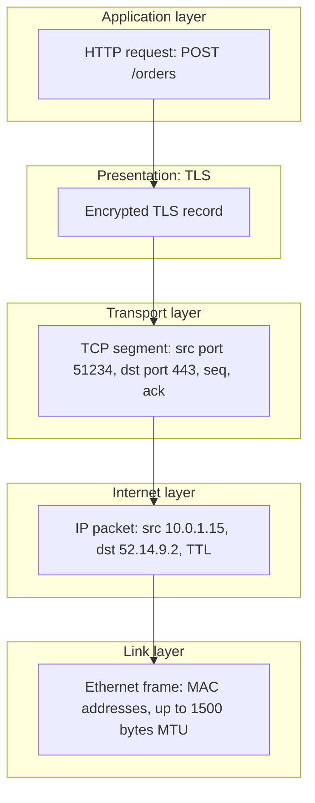
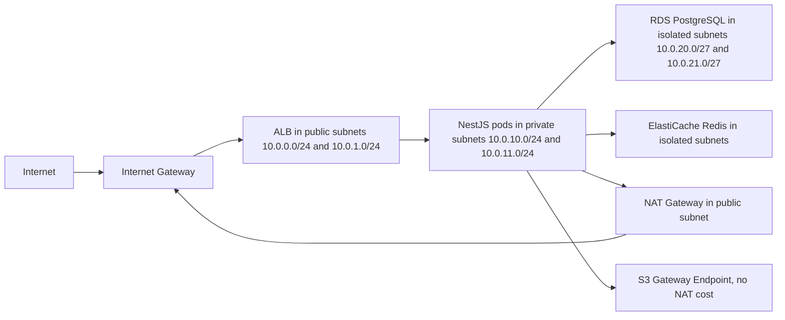

# Part 14 — Networking and HTTP

Every request your NestJS application serves has already survived a long journey before your controller sees it. It was a DNS lookup, then a TCP handshake, then a TLS negotiation, then a stream of bytes parsed into an HTTP request, then a load balancer decision, and only then a JavaScript object called `req`. When something goes wrong in production, it is very often in one of those earlier layers, and the error you see in your logs is only a symptom.

This part teaches the network from the bottom up, always with one question in mind: *how would I meet this in a real backend system?* You will learn the layers, IP addresses and ports, DNS, TCP and UDP, the handshake and its cost, latency versus bandwidth, VPC design, and then HTTP in real depth: versions, methods, headers, status codes, cookies, keep-alive, pooling, compression, streaming, caching, TLS and CORS. We finish with a full end-to-end trace of a browser calling a NestJS API, and a catalogue of the failure modes that senior engineers have all been paged for at least once.

## 14.1 The layered model: OSI and the practical TCP/IP view

#### Concept

Networking is organised in layers. Each layer does one job and hands its result to the layer above. The classic teaching model is the seven-layer **OSI model**. The model that real systems are actually built on is the four-layer **TCP/IP model**. You need both: OSI for vocabulary ("a Layer 4 load balancer", "a Layer 7 firewall"), TCP/IP for understanding what actually happens.

| OSI layer | Name | What it carries | TCP/IP layer | Where you meet it as a backend engineer |
|---|---|---|---|---|
| 7 | Application | HTTP, DNS, gRPC, SMTP | Application | NestJS, Express, Postgres wire protocol, Redis RESP |
| 6 | Presentation | TLS, encoding, compression | Application | TLS termination, gzip, JSON serialization |
| 5 | Session | Session setup, TLS session resumption | Application | Mostly folded into TLS and app code |
| 4 | Transport | TCP segments, UDP datagrams, ports | Transport | Network Load Balancer, `net.Socket`, connection pools |
| 3 | Network | IP packets, routing, addresses | Internet | VPC, subnets, NAT gateway, security groups |
| 2 | Data link | Ethernet frames, MAC addresses, Wi-Fi | Link | Cloud handles it; you see it as MTU issues |
| 1 | Physical | Electrical signals, fibre, radio | Link | Never, unless a cable gets cut in a data centre |

#### Why does it exist?

Without layering, every application would need to know how to route packets across the internet, detect lost data, and negotiate encryption. Layering means your NestJS handler only knows about HTTP, TCP only knows about reliable byte delivery between two ports, and IP only knows how to get a packet one hop closer to its destination. Each layer can be replaced independently: HTTP/3 swapped TCP for QUIC without changing your controllers.

The practical value for you is diagnosis. When a request fails, the layer tells you who to blame:

- "Connection refused" is Layer 4: nothing is listening on that port.
- "No route to host" or a timeout with no response at all is Layer 3: a security group, a route table, or a dead subnet.
- "502 Bad Gateway" is Layer 7: the load balancer spoke HTTP to your app and got a broken answer.
- "Certificate has expired" is Layer 6: TLS, before a single HTTP byte was exchanged.

#### Mental model

Imagine sending a gift to a friend abroad. You write a letter (application data). You put it in an envelope with the friend's name (application header). You place that in a box with a room number (port), then in a courier package with the street address (IP address), then the courier loads it on a truck with a licence plate (MAC address). Every step wraps the previous one. At the destination, each layer unwraps its own envelope and hands the inside up. This wrapping is called **encapsulation**, and the layers never open each other's envelopes.

#### How it works



Step by step, for one HTTP request leaving your laptop:

1. Your HTTP client builds the text `POST /orders HTTP/1.1` plus headers and a JSON body.
2. TLS encrypts that into one or more records so no router on the path can read it.
3. TCP splits the encrypted bytes into segments, numbers them, and adds source and destination ports.
4. IP wraps each segment in a packet with source and destination addresses and hands it to the network card.
5. Ethernet or Wi-Fi puts each packet in a frame of at most 1,500 bytes (the **MTU**, maximum transmission unit) and sends it.
6. Every router along the way looks only at the IP header, decrements the TTL (time to live) hop counter, and forwards.
7. At the server, the process reverses: frame, packet, segment, TLS record, HTTP request, and finally `req.body` in NestJS.

Where the pieces of the standard stack live:

| Component | Layer | What it looks at |
|---|---|---|
| AWS Network Load Balancer (NLB) | 4 | IP and TCP/UDP headers only; forwards bytes, never parses HTTP |
| AWS Application Load Balancer (ALB), NGINX, Envoy | 7 | Full HTTP: paths, headers, host names; can route `/api/*` to one target group |
| Web Application Firewall (WAF) | 7 | HTTP content: SQL injection patterns, bad user agents, rate limits per IP |
| Security groups, network ACLs | 3 and 4 | Source IP, destination port, protocol |
| TLS termination | 6 | Certificates, cipher negotiation, decryption |
| NestJS | 7 | Only the decrypted HTTP request; it has no idea a TLS handshake happened |
| PostgreSQL wire protocol | 7 over TCP | Its own binary message protocol on port 5432 |

#### Practical example

A food-delivery API on AWS: the browser hits `api.fooddash.com`. That name resolves to an ALB (Layer 7) that terminates TLS (Layer 6), checks the `Host` header, matches the listener rule `path is /v1/*`, and forwards plain HTTP/1.1 to a target group of NestJS pods. Between the ALB and the pods sits a security group (Layer 3/4) that only allows TCP 3000 from the ALB's security group. The pods talk to RDS PostgreSQL on TCP 5432 inside a private subnet (Layer 3 design). The WAF in front of the ALB blocks requests whose body matches `' OR 1=1` at Layer 7 before they cost you a database round trip.

#### NestJS example

NestJS lives entirely at Layer 7, but it can be told about the lower layers. A trust-proxy setting, for example, is how you tell Express that Layer 3 source addresses have been rewritten by the load balancer and the real client IP now lives in a Layer 7 header.

```ts
// main.ts
import { NestFactory } from '@nestjs/core';
import { NestExpressApplication } from '@nestjs/platform-express';
import { AppModule } from './app.module';

async function bootstrap() {
  const app = await NestFactory.create<NestExpressApplication>(AppModule);

  // The ALB rewrites the Layer 3 source IP. Trust exactly one proxy hop so
  // req.ip reads the last value of X-Forwarded-For instead of the ALB's IP.
  app.set('trust proxy', 1);

  const server = app.getHttpServer();
  // Layer 4 knobs that matter for the "502 behind an ALB" bug (see 14.9).
  server.keepAliveTimeout = 65_000; // must exceed the ALB idle timeout (60 s)
  server.headersTimeout = 66_000;   // must exceed keepAliveTimeout

  await app.listen(3000, '0.0.0.0'); // bind on all interfaces inside the container
}
bootstrap();
```

The `'0.0.0.0'` matters: binding to `127.0.0.1` inside a container means the app listens only on the loopback interface, and the load balancer's health checks (arriving on the container's network interface) get "connection refused" at Layer 4. That is one of the most common "my pod is healthy locally but the target group says unhealthy" tickets.

#### PostgreSQL example

PostgreSQL sits at Layer 7 with its own protocol, but you configure it at Layers 3 and 4. `listen_addresses` is a Layer 3 binding decision; `pg_hba.conf` is a Layer 3 allow-list; `port` is Layer 4.

```sql
-- Which interfaces PostgreSQL is bound to (Layer 3)
SHOW listen_addresses;   -- '*' inside RDS; '0.0.0.0' or a private IP self-hosted

-- Which port (Layer 4)
SHOW port;               -- 5432

-- Who is connected, from which Layer 3 address and Layer 4 port
SELECT pid, usename, client_addr, client_port, state, wait_event_type
FROM pg_stat_activity
WHERE datname = 'orders';
```

`client_addr` tells you which application pod holds the connection. During a connection-exhaustion incident this is the first query you run, because it tells you whether one runaway pod or every pod is hogging connections.

#### Production scenario

A typical production request path with numbers: a browser in Mumbai calls an API in `ap-south-1`. DNS 5 ms (cached), TCP handshake 12 ms, TLS 1.3 handshake 12 ms, ALB routing 1 ms, NestJS handling 20 ms including a 4 ms Postgres query, response 6 ms on the wire. About 56 ms total. Move the same user to a `us-east-1` deployment and every round trip becomes 220 ms, so the handshake phases alone cost 440 ms before HTTP begins. Layer 3 geography dominates Layer 7 optimisation; this is why we place regions near users and why keep-alive (reusing the connection) is worth more than shaving 2 ms off a query.

#### Failure scenario

At 09:40 on a Monday, a new deployment moved the checkout service from one Kubernetes node group to another. Every request began failing with `ECONNREFUSED` from the ALB health checker, the target group went to zero healthy targets, and the ALB started returning 503 to customers. The app logs showed nothing; the app never received any traffic. The cause was Layer 3: the new node group's security group did not allow inbound TCP 3000 from the ALB's security group. No Layer 7 debugging (logs, tracing, code) could have found it. The on-call engineer ran `nc -zv <pod-ip> 3000` from a pod in the old node group (success) and from the ALB's subnet (timeout), and fixed the rule in two minutes. Total outage: 14 minutes, mostly spent looking at the wrong layer.

#### Edge cases & failure modes

- A Layer 4 NLB cannot inject `X-Forwarded-For`; if you need the client IP behind an NLB you must enable **proxy protocol v2** and parse it, or use an ALB.
- A Layer 7 balancer parses HTTP, so a malformed request (bad chunked encoding, oversized headers) is rejected by the ALB with 400 and never reaches your logs.
- WebSocket upgrades are a Layer 7 feature that must be supported by every Layer 7 hop; an ALB supports them, some corporate proxies do not.
- Security groups are stateful: an allowed inbound connection automatically allows its return traffic. Network ACLs are stateless: you must open the ephemeral return port range (1024 to 65535) or replies are dropped silently.
- MTU mismatch across a VPN or overlay network (Layer 2) causes large packets to vanish while small ones work; health checks pass and real responses hang. See 14.15.

#### How a Senior Backend Engineer thinks about this

A senior engineer names the layer before touching the keyboard. "Is this a routing problem, a connection problem, a TLS problem, or an HTTP problem?" Each has a different tool: `traceroute` or VPC reachability analyzer for Layer 3, `nc -zv` or `ss -tan` for Layer 4, `openssl s_client` for Layer 6, `curl -v` for Layer 7. They also decide where to put logic deliberately: TLS terminates at the ALB (cheap, central certificate management), rate limiting at the WAF or API gateway (before it costs CPU), business validation in NestJS (where it belongs). Explaining it to a product manager: "The building has a front gate, a receptionist, and your team's office. The gate was locked. Nobody in the office could have fixed it."

#### Common mistakes

- Debugging a 503 by adding `console.log` to the controller when the app never received the request. Check the target group health first.
- Binding to `localhost` inside a container.
- Believing an NLB can route on URL path. It cannot; it only sees ports.
- Opening `0.0.0.0/0` inbound on the database security group "temporarily" during an incident and forgetting it.
- Assuming that because `curl` from your laptop works, the load balancer in another subnet can also reach the pod.

#### Interview questions

1. **At which layer does an ALB operate, and what can it do that an NLB cannot?** Layer 7; it can route by path, host and header, terminate TLS, inject `X-Forwarded-For`, and return its own 4xx/5xx. Follow-up: when would you still choose an NLB? For raw TCP protocols, extremely high throughput, static IPs, or preserving the client IP without headers.
2. **Your service returns "connection refused" to the load balancer but works with `curl localhost` inside the pod. Name three causes.** Bound to 127.0.0.1; wrong container port mapping; security group blocks the LB's source.
3. **Where does TLS live, and why does that mean your NestJS code cannot see the client certificate when TLS is terminated at the ALB?** Layer 6 at the ALB; after termination the request is plain HTTP. The ALB can forward certificate details only in headers if configured for mTLS passthrough or verify mode.
4. **Why are security groups stateful but network ACLs stateless, and what bug does that cause?** Security groups track connections and allow replies automatically; NACLs evaluate every packet, so forgetting the ephemeral port range drops replies.
5. **What does encapsulation mean for the size of a packet, and why does a 1,500-byte MTU matter for a 1,460-byte TLS record?** Each layer adds headers (IP 20 bytes, TCP 20 to 60 bytes), so the payload that fits in one frame is about 1,460 bytes; anything larger fragments or, with a "don't fragment" flag, is dropped.

#### Practical exercise

Deploy a small NestJS app in Docker on a cloud VM. Break it deliberately at three different layers and diagnose each only with command-line tools, writing down which command proved which layer: (a) bind it to 127.0.0.1, (b) block the port in the firewall, (c) put an expired self-signed certificate in front with NGINX. Acceptance criteria: for each break you can state the failing layer, the single command that proved it, and the fix, without reading application logs.

## 14.2 IP addresses, ports, NAT, subnets and CIDR

#### Concept

An **IP address** identifies a network interface. A **port** identifies a process on that interface. Together, `(source IP, source port, destination IP, destination port, protocol)` is the **5-tuple** that uniquely identifies one TCP connection. **IPv4** addresses are 32 bits (`10.0.1.15`), giving about 4.3 billion addresses; we ran out, so **NAT** (network address translation) lets many private devices share one public address, and **IPv6** (128 bits, `2600:1f18:22a:1b00::5`) gives effectively unlimited addresses. A **subnet** is a contiguous block of addresses described in **CIDR** notation such as `10.0.1.0/24`, where `/24` means the first 24 bits are the network and the remaining 8 bits (256 addresses) identify hosts.

#### Why does it exist?

Ports exist because one machine runs many services: NestJS on 3000, Postgres on 5432, Redis on 6379, and thousands of outbound client connections. Without ports, an IP address could only host one conversation. Subnets exist to group machines and apply rules to groups: "the database subnet accepts traffic only from the application subnet". NAT exists because the world has far more devices than IPv4 addresses, and as a bonus it hides internal topology. CIDR exists because the original class A/B/C address scheme wasted enormous ranges; CIDR lets you carve any power-of-two-sized block.

#### Mental model

Imagine an office tower. The street address is the IP address. The floor and room number is the port. A **subnet** is one floor; the building's security policy says "floor 3 (databases) only admits people coming from floor 2 (applications)". NAT is the building's single public phone number: everyone inside can call out, and the receptionist remembers which extension made which call so replies come back to the right desk, but nobody outside can call an extension directly.

#### How it works

**Ports.** Ports are 16-bit numbers, 0 to 65535. Ports below 1024 are privileged (a process must run as root to bind them, which is why containers usually bind 3000 or 8080 and let the load balancer own 443). When your NestJS app opens an outbound connection to Postgres, the OS picks a free **ephemeral port** as the source port. On Linux the default range is `32768` to `60999`, so about 28,000 ports.

**The 5-tuple and ephemeral port exhaustion.** Each outbound connection to the same destination `(IP, port)` needs a unique source port. If a NestJS pod opens a new TCP connection per request to a payment gateway without keep-alive, and each closed connection sits in `TIME_WAIT` for 60 seconds (Linux default, see 14.4), then at 500 requests per second you accumulate 30,000 sockets in `TIME_WAIT` and run out of ephemeral ports. New connections fail with `EADDRNOTAVAIL`. This is one of the most misdiagnosed production failures: the app is healthy, the gateway is healthy, but every call fails.

**CIDR arithmetic.** `/n` means n network bits; hosts = 2^(32-n). AWS reserves 5 addresses per subnet (network, router, DNS, future use, broadcast).

| CIDR | Addresses | Usable in AWS | Typical use |
|---|---|---|---|
| `/16` | 65,536 | 65,531 | Whole VPC (`10.0.0.0/16`) |
| `/20` | 4,096 | 4,091 | Large Kubernetes pod subnet |
| `/24` | 256 | 251 | Application subnet per AZ |
| `/27` | 32 | 27 | Database subnet per AZ |
| `/32` | 1 | 1 | One host; used in security group rules |

**NAT.** A NAT gateway rewrites the source IP of outbound packets from a private address (`10.0.2.40`) to its own public elastic IP, records the mapping in a translation table keyed by the 5-tuple, and rewrites replies back. This is **source NAT**. It is stateful, it has a per-gateway connection limit (an AWS NAT gateway supports about 55,000 simultaneous connections to a single destination, limited by its own ephemeral ports), and it costs money per gigabyte, which is why sending terabytes to S3 through a NAT gateway instead of a VPC gateway endpoint is a classic bill surprise.

**A typical VPC design.**



- **Public subnet**: has a route to the internet gateway. Only the load balancer and the NAT gateway live here. Nothing in it should hold data.
- **Private subnet**: no direct inbound route from the internet; outbound goes through the NAT gateway. Application pods live here so they can call Stripe or Twilio but cannot be reached directly.
- **Isolated subnet**: no route to the internet at all. The database and cache live here. Even if an attacker gets a shell in a pod, exfiltrating a dump requires pivoting through the NAT, which you monitor.

**IPv6.** IPv6 addresses are written as eight groups of four hex digits with `::` compressing consecutive zeros. There is no NAT in IPv6 by design; every device gets a globally routable address, and privacy comes from firewalls, not address hiding. Mobile networks in India, the US and much of Asia are increasingly IPv6-only with a translation layer (NAT64/DNS64) to reach IPv4 services. If your API has only an `A` record and no `AAAA` record, those clients reach you through carrier translation that adds latency and occasionally breaks. Publish both, and make sure your logging and rate limiting handle 128-bit addresses (a `VARCHAR(15)` column for IPs is an IPv6 bug waiting to happen; use `INET`).

#### Practical example

A ride-booking backend calls a maps provider for every fare estimate. At launch it used `fetch()` with a fresh connection per call. Traffic hit 400 estimates per second at the evening peak. Within three minutes, `ss -s` on the pods showed 28,000 sockets in `TIME_WAIT`, and calls started failing with `connect EADDRNOTAVAIL 10.0.10.14:0`. The fix was an HTTP agent with keep-alive and a pool of 50 connections per pod, dropping the connection rate from 400 per second to near zero. The number of ports needed went from 28,000 to 50.

#### NestJS example

```ts
// maps-client.service.ts
import { Injectable, OnModuleDestroy } from '@nestjs/common';
import { Agent, request } from 'undici';

@Injectable()
export class MapsClientService implements OnModuleDestroy {
  // One pooled agent per process. Each pooled socket is one ephemeral port.
  private readonly agent = new Agent({
    connections: 50,          // hard cap on sockets to this origin
    keepAliveTimeout: 30_000, // keep idle sockets 30 s, below the provider's idle limit
    keepAliveMaxTimeout: 60_000,
    connect: { timeout: 3_000 },
  });

  async estimate(originId: string, destId: string): Promise<number> {
    const res = await request('https://maps.example.com/v1/route', {
      method: 'POST',
      dispatcher: this.agent,
      headers: { 'content-type': 'application/json' },
      body: JSON.stringify({ originId, destId }),
      headersTimeout: 2_000,
      bodyTimeout: 2_000,
    });
    if (res.statusCode !== 200) {
      await res.body.dump(); // release the socket back to the pool
      throw new Error(`maps provider returned ${res.statusCode}`);
    }
    const data = (await res.body.json()) as { seconds: number };
    return data.seconds;
  }

  async onModuleDestroy() {
    await this.agent.close(); // drain the pool on shutdown, avoid dangling sockets
  }
}
```

The important lines are the `connections` cap (bounded port usage), the keep-alive timeouts (sockets reused instead of churned), and `dump()` on error paths, because a response body that is never consumed keeps its socket out of the pool.

#### PostgreSQL example

The database side of the same story: each pod's connection pool is a set of TCP connections from the app subnet to the database subnet. You can see exactly which IP and ephemeral port each one uses, and you can enforce network-level rules with `pg_hba.conf` in CIDR notation.

```sql
-- Count connections per source address (which pod is holding what)
SELECT client_addr, count(*) AS conns,
       count(*) FILTER (WHERE state = 'idle') AS idle,
       count(*) FILTER (WHERE state = 'active') AS active
FROM pg_stat_activity
WHERE backend_type = 'client backend'
GROUP BY client_addr
ORDER BY conns DESC;

-- Store client IPs correctly: INET handles both IPv4 and IPv6, and supports CIDR ops
CREATE TABLE login_audit (
  id         bigint GENERATED ALWAYS AS IDENTITY PRIMARY KEY,
  user_id    uuid NOT NULL,
  client_ip  inet NOT NULL,
  created_at timestamptz NOT NULL DEFAULT now()
);

-- Find logins from a whole office subnet in one query
SELECT user_id, client_ip, created_at
FROM login_audit
WHERE client_ip <<= '203.0.113.0/24'::cidr
  AND created_at > now() - interval '1 day';
```

The `pg_hba.conf` line that enforces "only the application subnets may connect" reads `hostssl orders app_user 10.0.10.0/23 scram-sha-256`. The `/23` covers both `10.0.10.0/24` and `10.0.11.0/24`, which is a tidy example of CIDR arithmetic in daily use.

#### TypeORM example

The TypeORM `DataSource` options are where the pool size is set, and pool size multiplied by pod count is the number of database-side sockets you consume.

```ts
// data-source.ts
import { DataSource } from 'typeorm';

export const AppDataSource = new DataSource({
  type: 'postgres',
  host: process.env.PG_HOST,          // a private DNS name, never a public IP
  port: Number(process.env.PG_PORT ?? 5432),
  username: process.env.PG_USER,
  password: process.env.PG_PASSWORD,
  database: 'orders',
  ssl: { rejectUnauthorized: true },
  extra: {
    max: 10,                          // 10 pods x 10 = 100 sockets at the database
    idleTimeoutMillis: 30_000,        // release idle sockets so ports and PG backends free up
    connectionTimeoutMillis: 5_000,   // fail fast when the pool is exhausted
    keepAlive: true,                  // TCP keepalive probes (see 14.4) through NAT and LBs
  },
  entities: [__dirname + '/**/*.entity.js'],
});
```

#### Sequelize example

```ts
// sequelize.config.ts
import { Sequelize } from 'sequelize';

export const sequelize = new Sequelize(process.env.PG_DATABASE!, process.env.PG_USER!, process.env.PG_PASSWORD!, {
  host: process.env.PG_HOST,
  port: 5432,
  dialect: 'postgres',
  dialectOptions: {
    ssl: { require: true, rejectUnauthorized: true },
    keepAlive: true,
  },
  pool: {
    max: 10,       // same maths: pods x max must stay under PG max_connections
    min: 2,
    idle: 30_000,  // ms before an idle socket is closed
    acquire: 5_000 // ms to wait for a free socket before throwing
  },
  logging: false,
});
```

#### Production scenario

A payments service with 20 pods, each pooling 10 connections, holds 200 sockets to a Postgres instance whose `max_connections` is 200. That leaves zero connections for migrations, PgBouncer, or the on-call engineer's `psql`. Real numbers from a mid-sized e-commerce system: `max_connections = 500`, a PgBouncer layer in front doing transaction pooling, and application pools sized at 5 per pod. The NAT gateway in the same account moved 40 TB per month to S3 before someone added a gateway endpoint; the NAT data processing charge alone was about 1,800 USD a month, reduced to zero by a single route table entry.

#### Failure scenario

At 02:14 on a Saturday the on-call was paged: "checkout error rate 38%". Pods were healthy, CPU was 20%, the database was idle. Logs showed `connect EADDRNOTAVAIL` on calls to the fraud-scoring service. `ss -tan state time-wait | wc -l` on a pod returned 27,900. A colleague had "simplified" the fraud client the previous afternoon by replacing a pooled agent with bare `axios` calls and no agent, so every call opened and closed a TCP connection. At 450 calls per second, ports ran out in under a minute of peak traffic. The rollback restored the pooled agent; the follow-up added a Prometheus alert on `node_sockstat_TCP_tw` (sockets in `TIME_WAIT`) above 15,000.

#### Edge cases & failure modes

- Ephemeral port exhaustion is per `(source IP, destination IP, destination port)`; one destination that receives all your traffic hits the limit first.
- `net.ipv4.tcp_tw_reuse = 1` lets Linux reuse `TIME_WAIT` sockets for new outbound connections safely; `tcp_tw_recycle` was removed in Linux 4.12 because it broke clients behind NAT.
- A NAT gateway's own ephemeral port pool is shared by every pod behind it; 20 pods each churning connections to the same SaaS endpoint can exhaust the gateway even when each pod is fine. Symptom: `ErrorPortAllocation` metric on the NAT gateway.
- Overlapping CIDR ranges between two VPCs make peering impossible; plan `10.0.0.0/16` versus `10.1.0.0/16` from day one.
- Kubernetes pods each get an IP from a pod CIDR; a `/24` node subnet with 30 pods per node needs a separate, larger pod range or nodes stop scheduling with "insufficient IP addresses".
- Storing IPs in `VARCHAR(15)` truncates IPv6 addresses (up to 45 characters); use `INET`.
- Rate limiting per IP behind carrier-grade NAT throttles thousands of legitimate mobile users who share one public IPv4 address.

#### How a Senior Backend Engineer thinks about this

They budget ports and connections like memory: pods multiplied by pool size, plus per-request outbound fan-out, compared against `max_connections`, NAT capacity and the ephemeral range. They design the VPC so that the blast radius of a compromised pod is small: three subnet tiers, no public IPs on anything that holds data, and egress through a NAT they can monitor and, in an emergency, cut. They refuse to whitelist `0.0.0.0/0` on a data tier. To a product manager: "The database is in a room with no windows and one door, and only the application floor has a key. That is why the fix for the compromised laptop last month was a one-line firewall change rather than a data breach notification."

#### Common mistakes

- Creating a new HTTP client or `Pool` per request. Every one of those is a port and a handshake.
- Sizing every pod's pool at 50 "to be safe" and then wondering why Postgres refuses connections at 10 pods.
- Putting the database in a public subnet with a security group "so it is easy to connect from home".
- Ignoring IPv6 until a mobile carrier's users report timeouts.
- Routing S3 and DynamoDB traffic through the NAT gateway.

#### Interview questions

1. **What is the 5-tuple, and why does it explain ephemeral port exhaustion?** Source IP, source port, destination IP, destination port, protocol; each new connection to the same destination needs a fresh source port, and `TIME_WAIT` holds ports for 60 s, so high connection churn to one destination exhausts about 28,000 ports.
2. **How many usable addresses are in a `/27` AWS subnet, and would you use it for a Kubernetes node subnet?** 27 usable; no, pods need many IPs per node, use `/20` or larger pod ranges.
3. **Why do we put the database in a private or isolated subnet even though it has a password?** Defence in depth: credentials leak, zero-days happen, and a subnet without an internet route makes exfiltration and brute force far harder. Follow-up: how do you run migrations then? From a pod or a bastion inside the VPC, through CI runners with VPC access.
4. **Explain source NAT and one operational limit of a cloud NAT gateway.** Rewrites private source addresses to a public one and tracks the mapping; limited to about 55,000 concurrent connections per destination, with a `ErrorPortAllocation` metric when exceeded.
5. **A mobile carrier's users report timeouts to your API but desktop users are fine. What do you check?** Whether you publish an `AAAA` record and whether your stack (ALB dualstack, WAF rules, IP parsing, rate-limit keys) handles IPv6.

#### Practical exercise

On a Linux VM, write a small Node script that makes 50,000 sequential HTTP requests to a local server with `Connection: close`, watching `ss -s` in another terminal. Record when `EADDRNOTAVAIL` appears. Then repeat with a keep-alive agent and record the socket count. Acceptance criteria: you can explain the two socket counts, you can calculate the maximum connection rate your ephemeral range supports at a 60-second `TIME_WAIT`, and you can name the sysctl that would let you reuse `TIME_WAIT` sockets safely.
