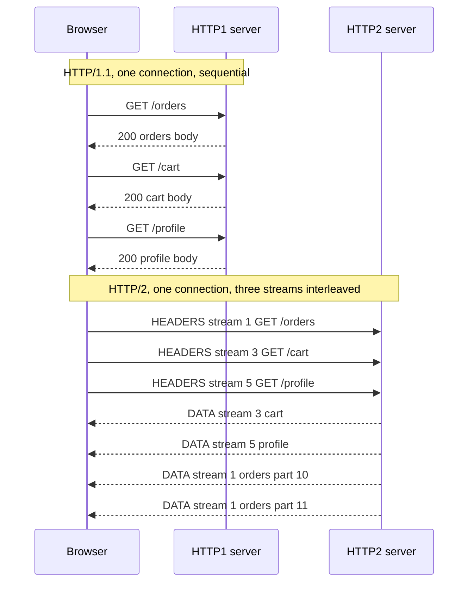

## 14.6 HTTP/1.1, HTTP/2 and HTTP/3

#### Concept

**HTTP** is the application protocol your NestJS app speaks. It has three versions in production use, and they differ not in what a request means but in how requests are put on the wire:

- **HTTP/1.1** (1997): plain text. One request at a time per connection. Persistent connections (keep-alive) by default. Chunked transfer encoding for streaming. Still the version most servers, including Node's `http` module and therefore NestJS by default, speak behind the load balancer.
- **HTTP/2** (2015): binary framing. Many requests **multiplexed** on one connection. Header compression (**HPACK**). Server push (deprecated in practice). Required by gRPC. Almost always run over TLS. What browsers speak to your ALB or CDN.
- **HTTP/3** (2022): the same semantics over **QUIC**, a UDP-based transport with TLS 1.3 built in, 0-RTT resumption, per-stream loss recovery, and connection migration across IP changes. Served by CDNs and some load balancers at the edge; your NestJS app does not speak it and does not need to.

#### Why does it exist?

HTTP/1.1's limitation is **head-of-line (HOL) blocking**: on one connection, the second response cannot start until the first is fully sent. Browsers worked around it by opening up to 6 connections per host, which multiplied handshake cost and starved TCP's congestion control. HTTP/2 solved application-level HOL blocking with multiplexing, but TCP-level HOL blocking remained: one lost packet stalls every stream on that connection because TCP delivers bytes in order. HTTP/3 moved to QUIC so that a lost packet stalls only the stream it belonged to, and so that a phone moving from Wi-Fi to 4G keeps its connection.

#### Mental model

Imagine a restaurant with one waiter per table (HTTP/1.1): the waiter takes one order, walks to the kitchen, brings it back, and only then takes the next order. Six waiters per table (browser connections) help, but the kitchen door gets crowded. HTTP/2 is one waiter carrying a tray with many numbered orders in both directions at once. HTTP/3 is that same waiter, but if one plate is dropped, only that dish is remade while the others are still served; and the waiter follows you if you move tables.

#### How it works

**HTTP/1.1 on the wire.** A request is text lines terminated by `\r\n`, a blank line, then the body. The server parses until the blank line, reads `Content-Length` bytes (or chunked frames), and only then can parse the next request on the same socket. Node's `http` parser (`llhttp`) does this parsing and hands NestJS a `req` object.

```text
POST /v1/orders HTTP/1.1\r\n
Host: api.fooddash.com\r\n
Content-Type: application/json\r\n
Content-Length: 58\r\n
Authorization: Bearer eyJhbGciOi...\r\n
\r\n
{"restaurantId":"r_91","items":[{"sku":"BRG-1","qty":2}]}
```

Pipelining (sending several requests without waiting) exists in the spec but responses must still return in order, and proxies handled it so badly that every browser disabled it. In practice HTTP/1.1 means one request in flight per connection.

**HTTP/2 framing.** After the TLS handshake negotiates `h2` via ALPN (application-layer protocol negotiation), the connection carries binary **frames**: `HEADERS`, `DATA`, `SETTINGS`, `WINDOW_UPDATE`, `RST_STREAM`, `PING`, `GOAWAY`. Each frame belongs to a **stream** identified by an integer. A request is a `HEADERS` frame (possibly with `DATA` frames) on a new stream; the response comes back on the same stream id. Streams are interleaved, so 30 API calls share one TCP connection and one TLS session. Header names and values are compressed with HPACK, which keeps a dynamic table on both sides so a repeated `Authorization: Bearer ...` header costs a couple of bytes after the first time. Flow control is per stream and per connection. **Server push** let a server send resources the client had not asked for; Chrome removed support in 2022 and `103 Early Hints` replaced the use case. Do not design around push.



**HTTP/2 in the AWS path.** An ALB accepts HTTP/2 from clients by default and, for each incoming stream, opens or reuses an HTTP/1.1 connection to the target. Your NestJS app sees ordinary HTTP/1.1 requests; the multiplexing benefit exists between the browser and the ALB, where the slow, lossy, high-RTT network is. Since 2020 the ALB can also speak HTTP/2 to targets (protocol version `HTTP2` on the target group), which mostly matters for gRPC. Node has a built-in `http2` module and NestJS can run on it with the Fastify adapter's `http2: true` option, but because the ALB terminates HTTP/2 anyway, almost no one does this in production.

**gRPC** uses HTTP/2 as its transport: each RPC is a stream, messages are length-prefixed protobuf in `DATA` frames, and trailers carry the status. This is why gRPC needs end-to-end HTTP/2 (an ALB with an HTTP/2 target group or an NLB) and why it cannot pass through an HTTP/1.1 proxy. NestJS supports gRPC through `@nestjs/microservices` with `Transport.GRPC`.

**HTTP/3 and QUIC.** QUIC runs over UDP. Each connection has a **connection ID** independent of IP and port, so a phone that switches from Wi-Fi to cellular continues the same connection (**connection migration**). TLS 1.3 is integrated: a first connection costs one round trip (versus two for TCP plus TLS 1.3), and a resumed connection can send application data in the first packet (**0-RTT**), which is safe only for idempotent requests because a replayed 0-RTT packet would be executed twice. Loss recovery is per stream, so one lost packet does not stall unrelated streams. HTTP/3 is what CloudFront, Cloudflare and Google Front Ends offer to browsers; the edge translates to HTTP/1.1 or HTTP/2 towards your origin.

Comparison:

| Property | HTTP/1.1 | HTTP/2 | HTTP/3 |
|---|---|---|---|
| Transport | TCP | TCP | QUIC over UDP |
| Framing | text | binary frames | binary frames |
| Requests per connection in flight | 1 | many (default 100 to 250 streams) | many |
| HOL blocking | per connection, at HTTP level | at TCP level only | none across streams |
| Header compression | none | HPACK | QPACK |
| TLS | optional | practically required | built in (1.3) |
| New connection cost | 1 RTT TCP plus TLS | same | 1 RTT total, 0-RTT on resume |
| Browser connections per host | 6 | 1 | 1 |
| Where you meet it | NestJS, Node http, LB to target | browser to ALB/CDN, gRPC | CDN edge, mobile |
| Node support | `http` | `http2` | none in core |

#### Practical example

A checkout page on a social-commerce site made 42 XHR calls on load. On HTTP/1.1 through a classic ELB with a 60 ms mobile RTT, the browser used 6 connections, each with a 120 ms handshake, and the calls queued in 7 waves: 1.3 seconds until the last response. Moving to an ALB with HTTP/2 made it one connection, one handshake, and all 42 requests in flight at once: 380 ms until the last response, dominated by the slowest single API. Nothing in the NestJS code changed. Later, fronting the ALB with CloudFront (HTTP/3 to mobile clients) cut another 80 to 100 ms for users on lossy networks and eliminated reconnects when users walked out of Wi-Fi range.

#### NestJS example

The default NestJS server is HTTP/1.1 and that is correct behind an ALB. Two things you should still do: make the app tolerate HTTP/2-origin traffic (lowercase header names, no reliance on `Connection` headers, since HTTP/2 forbids them and the ALB strips them) and, when you actually need HTTP/2 to the app for gRPC, use the microservices transport.

```ts
// main.ts: HTTP/1.1 app behind an ALB that terminates HTTP/2 and TLS
import { NestFactory } from '@nestjs/core';
import { ValidationPipe } from '@nestjs/common';
import { AppModule } from './app.module';

async function bootstrap() {
  const app = await NestFactory.create(AppModule);
  app.useGlobalPipes(new ValidationPipe({ whitelist: true, transform: true }));

  // Headers arrive lowercase whether the client spoke HTTP/1.1 or HTTP/2; Node
  // normalises them, so always read req.headers['x-request-id'], never 'X-Request-Id'.
  await app.listen(3000, '0.0.0.0');
}
bootstrap();
```

```ts
// grpc-main.ts: an internal gRPC service that needs HTTP/2 end to end
import { NestFactory } from '@nestjs/core';
import { MicroserviceOptions, Transport } from '@nestjs/microservices';
import { join } from 'path';
import { PricingModule } from './pricing.module';

async function bootstrap() {
  const app = await NestFactory.createMicroservice<MicroserviceOptions>(PricingModule, {
    transport: Transport.GRPC,
    options: {
      package: 'pricing',
      protoPath: join(__dirname, 'proto/pricing.proto'),
      url: '0.0.0.0:50051',
      // Keep the HTTP/2 connection alive through NATs and LBs between calls.
      keepalive: { keepaliveTimeMs: 30_000, keepaliveTimeoutMs: 5_000, keepalivePermitWithoutCalls: 1 },
    },
  });
  await app.listen();
}
bootstrap();
```

If you expose this gRPC service through an ALB, the target group must use protocol version `GRPC` (HTTP/2 to targets) and health checks must be gRPC health checks; an HTTP/1.1 target group will return 502 for every call.

#### PostgreSQL example

There is no HTTP inside Postgres, but the HTTP version at the edge changes the shape of database load: HTTP/2 lets a browser fire 40 API calls at once, and each one may checkout a pool connection. A page that was naturally rate-limited by 6 browser connections can now open 40 concurrent queries per user. Watch for it in `pg_stat_activity` bursts and size pools and per-user concurrency accordingly.

```sql
-- Concurrent active queries per application user right now; a burst that tracks
-- page loads is the HTTP/2 fan-out effect
SELECT application_name, usename, count(*) FILTER (WHERE state = 'active') AS active_now
FROM pg_stat_activity
WHERE backend_type = 'client backend'
GROUP BY application_name, usename
ORDER BY active_now DESC;
```

#### Production scenario

Numbers from a marketplace API: enabling HTTP/2 on the ALB lowered the count of new TCP connections at the ALB from about 9,000 per minute to 1,100 per minute at the same request rate, and the browser-measured time-to-interactive on the product page fell from 2.9 s to 1.7 s on 4G. Behind the ALB, the NestJS pods saw no protocol change but did see burstier concurrency: p99 pool wait time rose from 2 ms to 11 ms until pool size was raised from 8 to 12 per pod and one endpoint was changed to batch three queries into one.

#### Failure scenario

A team migrated an internal service to gRPC and put it behind the existing ALB with an HTTP/1.1 target group. Every call returned `502 Bad Gateway`. The ALB accepted the client's HTTP/2 stream, translated it to HTTP/1.1, and the gRPC server replied with an HTTP/2 preface that the ALB's HTTP/1.1 client could not parse. The fix was a new target group with protocol version `GRPC`, plus a gRPC health check. The lesson: gRPC is not "just HTTP"; it needs HTTP/2 on every hop, including trailers, which many HTTP/1.1 proxies drop.

#### Edge cases & failure modes

- HTTP/2 forbids `Connection`, `Keep-Alive`, `Transfer-Encoding` and `Upgrade` headers; an app that sets `Connection: close` on responses will have it stripped by the ALB, and one that checks for `Connection: upgrade` will never see it from HTTP/2 clients.
- One HTTP/2 connection multiplexes everything, so a single slow stream with a large body can consume the connection-level flow-control window and delay others; per-stream windows matter.
- HTTP/2 rapid reset attacks (CVE-2023-44487): clients open and immediately reset thousands of streams, exhausting server CPU. ALBs and CDNs mitigate this; Node's `http2` server has `maxSessionMemory` and stream limits you must set if you expose HTTP/2 directly.
- An ALB coalesces many HTTP/2 client streams onto a small number of HTTP/1.1 target connections; your per-connection assumptions (client IP from the socket, one client per connection) are false. Use `X-Forwarded-For`.
- HTTP/3 0-RTT replays: a non-idempotent request accepted in 0-RTT could be executed twice; edges only allow 0-RTT for safe methods, and origins receive an `Early-Data: 1` header they can reject with `425 Too Early`.
- UDP blocked by corporate firewalls means HTTP/3 fails; browsers fall back to HTTP/2 using the `Alt-Svc` header, which adds a race on the first visit.
- Mixed protocols in tests: a load tool speaking HTTP/1.1 to the ALB will not reproduce HTTP/2 fan-out concurrency on the database.

#### How a Senior Backend Engineer thinks about this

They put HTTP/2 or HTTP/3 where the bad network is (the edge) and keep HTTP/1.1 where the network is good and the tooling is mature (between the ALB and the pods), unless gRPC forces HTTP/2 end to end. They know the ALB is a protocol translator, which shapes how they read headers, how they count connections, and how they plan database concurrency. They treat server push and pipelining as dead. To a product manager: "Upgrading the front door to HTTP/2 made the app feel twice as fast on mobile, with zero code changes and a config switch on the load balancer. The kitchen still works the same way."

#### Common mistakes

- Setting `Connection: keep-alive` or `Connection: close` headers in application code.
- Relying on the socket's remote address for the client IP behind any Layer 7 balancer.
- Believing HTTP/2 between the ALB and the pods will speed up an API; the ALB-to-pod hop is 0.5 ms RTT and gains nothing.
- Putting gRPC behind an HTTP/1.1 target group.
- Assuming the browser's 6-connection limit still throttles fan-out after moving to HTTP/2.

#### Interview questions

1. **What is head-of-line blocking in HTTP/1.1, and how do HTTP/2 and HTTP/3 each address it?** One response blocks the next on a connection; HTTP/2 multiplexes streams over one TCP connection (removing HTTP-level HOL but keeping TCP-level HOL), HTTP/3 runs streams over QUIC with independent loss recovery.
2. **Your NestJS app is behind an ALB with HTTP/2 enabled. What protocol does the app see, and what changes for you?** HTTP/1.1; headers are lowercase, `Connection` headers vanish, many clients share each target connection, and concurrency per user rises.
3. **Why does gRPC need HTTP/2, and what happens if you put it behind an HTTP/1.1 proxy?** Streams, trailers and binary framing; the proxy returns 502 or drops trailers, breaking status codes.
4. **What is 0-RTT and why is it dangerous for a `POST /payments`?** Application data in the first packet of a resumed connection; it can be replayed, so only idempotent requests may use it.
5. **Explain what the `Alt-Svc` header does.** Advertises that the same origin is reachable over HTTP/3 on UDP 443, so the next connection tries QUIC.
6. **Is server push worth using?** No; browsers removed it. Use `103 Early Hints` and preload headers.

#### Practical exercise

Deploy a NestJS API behind an NGINX or ALB that supports HTTP/2. Build a page that fires 40 concurrent XHR calls. Measure the load time in Chrome DevTools with HTTP/2 enabled and disabled (`--disable-http2` flag). Then observe `pg_stat_activity` during a page load under each mode. Acceptance criteria: two waterfall screenshots or timings, a count of peak concurrent database queries under each mode, and a written pool-size recommendation that accounts for the difference.
