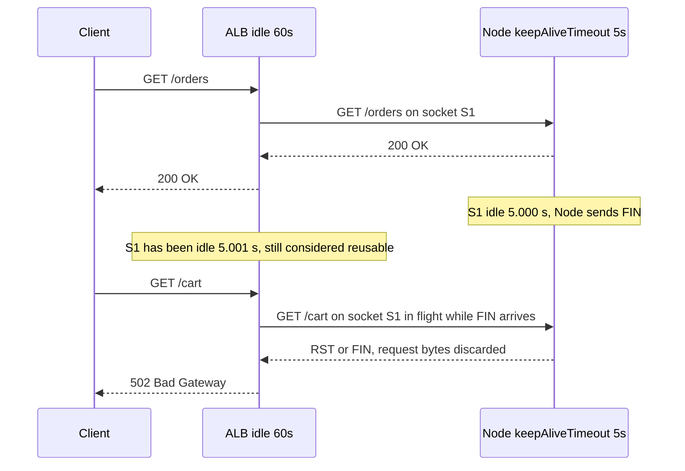

## 14.9 Keep-alive and connection pooling

### 14.9.1 HTTP keep-alive and the classic 502 bug

#### Concept

**HTTP keep-alive** means reusing one TCP connection for many HTTP requests, one after another. It is the default in HTTP/1.1 and mandatory in HTTP/2. It is a different thing from **TCP keepalive** (14.4.3), which sends probes to detect dead peers; HTTP keep-alive is about reuse, TCP keepalive is about liveness.

Every hop has its own idea of how long an idle connection may live: the browser, the CDN, the load balancer, the Node server, and the outbound agents your app uses. When two adjacent hops disagree about who closes an idle connection first, you get intermittent `502 Bad Gateway`. This is the single most common networking bug in Node deployments behind an ALB, NGINX or any reverse proxy.

#### Why does it exist?

A new connection costs a TCP handshake and a TLS handshake (14.4.2): 2 to 3 round trips and a millisecond or two of CPU. At 1,000 requests per second that would be 1,000 handshakes per second. Keep-alive amortises the cost across hundreds of requests. Idle timeouts exist because a connection that is kept open forever holds a file descriptor, kernel buffers and, behind a proxy, a slot in the proxy's connection table; someone must reap idle ones.

#### Mental model

Imagine a taxi rank with a rule: a taxi waits five minutes for a passenger, then leaves. A dispatcher, standing at the rank, believes taxis wait for an hour and confidently sends a customer to a taxi at minute six. The customer walks to an empty spot. That is a `502`: the proxy sent a request into a connection the server had just closed. The fix is trivial once stated: the taxi must wait longer than the dispatcher expects, never shorter.

#### How it works

The relevant timers in a standard AWS deployment:

| Hop | Timer | Default | Meaning |
|---|---|---|---|
| Browser | idle connection reuse | about 60 s to 5 min | reuses HTTP/1.1 and HTTP/2 connections |
| ALB (client side) | idle timeout | 60 s | closes client connections idle longer than this |
| ALB (target side) | idle timeout | same 60 s setting | reuses target connections; sends the next request on any idle connection under 60 s old |
| Node `http.Server` | `keepAliveTimeout` | 5 s | closes an idle keep-alive socket after 5 s of no requests |
| Node `http.Server` | `headersTimeout` | 60 s | max time to receive full headers; must be greater than `keepAliveTimeout` |
| Node `http.Server` | `requestTimeout` | 300 s | max time for a whole request |
| NGINX upstream | `keepalive_timeout` | 60 s | idle upstream connection lifetime |
| Node outbound `http.Agent` | `timeout` on free sockets | none by default | how long the pool keeps an idle socket |
| undici `Agent` | `keepAliveTimeout` | 4 s | idle socket lifetime in the pool |

The race, step by step:



1. The ALB forwards a request to a Node pod over socket S1 and gets a response. S1 is now idle on both sides.
2. Node's `keepAliveTimeout` (5 s) expires first. Node closes S1 by sending `FIN`.
3. In the few milliseconds it takes the `FIN` to reach the ALB, or simply because the ALB checks idleness only when it needs a connection, the ALB picks S1 for the next request and writes the request bytes.
4. The bytes arrive at a closed socket. The kernel replies `RST`. Node never sees the request, so nothing is logged.
5. The ALB, having sent a request and received a reset with no response, returns `502` to the client. The access log shows `elb_status_code=502 target_status_code=-`.

The probability per request is small (the window is a few milliseconds around every 5-second idle boundary), so it shows up as a 0.01% to 0.5% background `502` rate that no one can reproduce and that rises during low traffic, when connections go idle more often.

**The rule.** At every hop, the **upstream (server-side) idle timeout must be longer than the downstream (client-side) idle timeout**, so the client always closes first, and a client that closes first never sends a request into a dead socket. For an ALB with a 60-second idle timeout, set Node's `keepAliveTimeout` to 65 seconds and `headersTimeout` to 66 seconds (Node requires `headersTimeout` to exceed `keepAliveTimeout`, or the headers timer closes keep-alive sockets early). The same rule applies to NGINX upstreams (`keepalive_timeout` on Node above the NGINX `keepalive_timeout`) and to your own outbound agents (your agent's idle timeout below the third-party server's idle timeout).

Some proxies retry idempotent requests on connection reset, which hides the bug for `GET` and reveals it only for `POST`. The ALB does not retry; it returns `502`.

#### Practical example

A checkout API behind an ALB saw a stable 0.08% `502` rate for months, dismissed as "network noise". During a quiet night it rose to 1.2% because most target connections were idle. One config change (`keepAliveTimeout = 65000`, `headersTimeout = 66000`) brought the rate to zero the next day.

#### NestJS example

```ts
// main.ts
import { NestFactory } from '@nestjs/core';
import { Server } from 'http';
import { AppModule } from './app.module';

async function bootstrap() {
  const app = await NestFactory.create(AppModule);
  const server: Server = app.getHttpServer();

  // The ALB idle timeout is 60 s. The server must outlive it so the ALB always closes first.
  const lbIdleTimeoutMs = Number(process.env.LB_IDLE_TIMEOUT_MS ?? 60_000);
  server.keepAliveTimeout = lbIdleTimeoutMs + 5_000; // 65 s
  server.headersTimeout = lbIdleTimeoutMs + 6_000;   // 66 s, must be greater than keepAliveTimeout
  server.requestTimeout = 120_000;                   // whole-request cap; below this, our own 504 interceptor fires

  await app.listen(3000, '0.0.0.0');
}
bootstrap();
```

For Fastify (`@nestjs/platform-fastify`), pass the same values as adapter options: `new FastifyAdapter({ keepAliveTimeout: 65_000, connectionTimeout: 0 })`; `headersTimeout` is not exposed by Fastify's constructor options, so set it on `app.getHttpServer()` after creation, exactly as above.

#### PostgreSQL example

The identical race exists between your pool and PgBouncer or the database. If the pool keeps an idle client for 30 seconds but PgBouncer's `server_idle_timeout` or the database's idle session timeout closes it at 20 seconds, the next checkout hands you a dead socket and the first query fails with `Connection terminated unexpectedly`.

```sql
-- PostgreSQL 14+: server-side idle session cutoff. Keep it LONGER than the app pool's
-- idleTimeoutMillis so the pool closes first and never hands out a dead socket.
ALTER SYSTEM SET idle_session_timeout = '10min';
SELECT pg_reload_conf();

-- With PgBouncer in the path: pgbouncer.ini
-- server_idle_timeout = 600   ; seconds, must exceed the app pool idle timeout
-- client_idle_timeout = 0     ; do not cut clients that are pooled on the app side
```

Rule of thumb: `pg` pool `idleTimeoutMillis` (e.g. 30 s) is shorter than PgBouncer `server_idle_timeout` (600 s), which is shorter than PostgreSQL `idle_session_timeout` (10 min or disabled). Client closes first at every hop.

#### Production scenario

An API cluster of 24 pods behind an ALB serves 1,800 RPS with about 40 target connections per pod, most of them reused thousands of times before being closed by the ALB at the 60-second idle mark. New target connections: about 5 per second cluster-wide. After the timeout fix, ALB `HTTPCode_ELB_502_Count` went from 1,400 per day to about 3 per day, all of which coincided with deployments (pods terminating mid-request, fixed separately with deregistration delay).

#### Failure scenario

At 03:20 the `502` alert fired for a payments webhook receiver. Traffic at that hour was 2 requests per minute, which meant every ALB-to-target connection sat idle past Node's 5-second cutoff between requests, and nearly every request hit a socket the pod had just closed. The webhook sender (a payment provider) retried each `502` with exponential back-off, then gave up after 6 attempts, and 11 payment confirmations were lost. Recovery required a reconciliation job against the provider's API. The permanent fix was the timeout rule plus making the webhook handler idempotent so replays from the provider's dashboard were safe.

#### Edge cases & failure modes

- `headersTimeout` less than or equal to `keepAliveTimeout` reintroduces the bug in Node 18+, because the headers timer fires on idle keep-alive sockets.
- Pods behind both an ALB and a service mesh sidecar (Envoy) have two hops to align; Envoy's default upstream idle timeout is 1 hour, which is fine, but its cluster-level `idle_timeout` can be lowered by platform teams.
- During a deploy, Kubernetes sends `SIGTERM`; if the app keeps serving on existing sockets but the ALB is not told to drain (deregistration delay, readiness flipping to false first), in-flight requests get `RST` when the container dies.
- Serverless targets (Lambda behind an ALB) have no keep-alive between ALB and function; the rule applies only to container and instance targets.
- Outbound: your `http.Agent` keeps a free socket for 60 seconds by default only if you set `timeout`; a third-party API that closes idle connections after 10 seconds will reset your next request. Set the agent's free-socket timeout below the remote's idle timeout, and retry `ECONNRESET` on idempotent requests.
- Half-open sockets from NAT expiry (14.4.3) look identical in the logs to the keep-alive race; TCP keepalive probes distinguish them.

#### How a Senior Backend Engineer thinks about this

They draw every hop in the request path and write down its idle timeout before deploying a service, and they check the rule "server outlives client" at each hop. They alert on load balancer generated `5xx` separately, with a low threshold. They treat a nonzero background `502` rate as a bug, never as noise. To a product manager: "Two machines disagreed by one second about when to hang up. That was the entire cause of the lost payment confirmations."

#### Common mistakes

- Leaving Node's 5-second default behind a 60-second ALB.
- Setting `keepAliveTimeout` but not `headersTimeout`.
- Setting the same value on both sides (still a race).
- Fixing it with retries at the client instead of fixing the timers.
- Copying an NGINX config with `keepalive_timeout 75s` in front of a Node server with 65 seconds (wrong direction).

#### Interview questions

1. **Explain the ALB-to-Node `502` bug and its fix.** Node closes idle sockets at 5 s, the ALB reuses them for 60 s; requests hit dead sockets. Set Node's `keepAliveTimeout` above the ALB idle timeout and `headersTimeout` above that.
2. **What is the general rule for idle timeouts along a chain of proxies?** Each server-side timeout must exceed the client-side timeout of the hop before it, so clients close first.
3. **How would you prove the bug from logs?** ALB access log with `elb_status_code=502` and `target_status_code=-`, no matching app log, correlation with low-traffic periods.
4. **Does the same problem exist with database pools?** Yes: pool idle timeout must be shorter than PgBouncer's and the server's idle cutoffs.
5. **Why does HTTP/2 not eliminate this class of bug?** HTTP/2 connections also go idle and get closed; `GOAWAY` handling is cleaner but the server-outlives-client rule still applies.

#### Practical exercise

Run NestJS behind NGINX with `proxy_http_version 1.1`, `keepalive 32` in the upstream block, and a Node `keepAliveTimeout` of 2 seconds. Send one request every 2.0 to 2.1 seconds for ten minutes and count `502`s in the NGINX log. Then apply the rule and repeat. Acceptance criteria: a nonzero `502` count before, zero after, and a short written explanation referencing the exact timers involved.

### 14.9.2 Outbound connection pooling: `http.Agent`, undici and pool sizing

#### Concept

A **connection pool** is a set of pre-opened, reusable connections to one destination. Inbound, the load balancer pools connections to your pods. Outbound, your NestJS service should pool connections to every HTTP dependency (payment gateway, maps, internal services), to Postgres, and to Redis. Node's `http.Agent` (used by `axios`, `node-fetch` and `@nestjs/axios`) and **undici** (the client behind Node's global `fetch`) are the two HTTP pool implementations you will meet.

#### Why does it exist?

Without a pool, every outbound call pays a DNS lookup, a TCP handshake, a TLS handshake, and a slow-start ramp (14.4 and 14.5), and churns an ephemeral port into `TIME_WAIT` (14.2). A pool turns that into a reused warm socket: a 40 ms overhead becomes 0 ms. A pool also gives you a **cap**: a bounded number of concurrent connections per destination, which protects the dependency and your own port range from a traffic spike.

#### Mental model

Imagine a hotel switchboard with a fixed number of outside lines. Guests pick up a free line, talk, and hang up, and the line is instantly ready for the next guest. If all lines are busy, guests queue. That queue, and how long a guest is willing to wait, is the part that matters during an incident.

#### How it works

1. A request needs a connection to `api.payments.example.com:443`.
2. The agent checks its free list for that origin. If a warm socket exists and is not past its idle timeout, it is used immediately.
3. Otherwise, if the number of open sockets to that origin is below `maxSockets` (`http.Agent`) or `connections` (undici), a new one is opened: DNS, TCP, TLS.
4. Otherwise the request waits in the agent's queue until a socket frees. Unbounded queues are how one slow dependency turns into memory growth and a latency cliff.
5. When the response body is fully consumed, the socket returns to the free list. If the body is not consumed, the socket is stuck: this is the most common pool leak.
6. Free sockets past their idle timeout are closed; the remote's idle timeout must be longer (14.9.1).

**Sizing.** For a dependency with average latency `L` seconds at a call rate of `R` per second, you need about `R * L` connections in use (Little's law), plus headroom for tails. For 200 calls per second at 50 ms, that is 10 connections; set the cap at 3 to 5 times that (30 to 50) to absorb p99 spikes, and set a queue timeout so callers fail fast rather than pile up. Per pod, not per process cluster: with 20 pods, the dependency sees 20 times your cap.

**`http.Agent` versus undici.**

| Feature | `http.Agent` | undici `Agent` / `Pool` |
|---|---|---|
| Used by | `http.request`, `axios`, `node-fetch`, `@nestjs/axios` | global `fetch` in Node 18+, `undici.request` |
| Keep-alive default | off before Node 19; on since Node 19 | on |
| Concurrency cap | `maxSockets` per origin (default Infinity) | `connections` per origin (default unlimited), `pipelining` |
| Idle socket timeout | `timeout` option, applies to free sockets | `keepAliveTimeout` (4 s default), `keepAliveMaxTimeout` |
| Per-request timeouts | you must implement (`axios` `timeout` is total) | `headersTimeout`, `bodyTimeout` separately |
| Performance | fine | 2 to 3 times higher throughput in benchmarks; less allocation |
| HTTP/2 | no | experimental `allowH2` |

#### NestJS example

A single, injectable pooled client per dependency, with explicit caps, timeouts, and a queue-wait guard, plus a health signal from pool stats.

```ts
// payments-client.service.ts
import { Injectable, Logger, OnModuleDestroy, ServiceUnavailableException } from '@nestjs/common';
import { Pool, errors } from 'undici';

@Injectable()
export class PaymentsClientService implements OnModuleDestroy {
  private readonly logger = new Logger(PaymentsClientService.name);
  private readonly pool = new Pool('https://api.payments.example.com', {
    connections: 40,             // hard cap per pod; 20 pods x 40 = 800 at the provider
    pipelining: 1,               // HTTP/1.1, one request per socket at a time
    keepAliveTimeout: 20_000,    // below the provider's 30 s idle cutoff: we close first
    keepAliveMaxTimeout: 60_000,
    connect: { timeout: 2_000 },
  });

  async capture(paymentId: string, idempotencyKey: string): Promise<{ status: string }> {
    // Refuse to queue when the pool is saturated: fail fast instead of piling up.
    const stats = this.pool.stats;
    if (stats.pending > 100) throw new ServiceUnavailableException('payments pool saturated');

    try {
      const res = await this.pool.request({
        method: 'POST',
        path: `/v1/payments/${paymentId}/capture`,
        headers: { 'content-type': 'application/json', 'idempotency-key': idempotencyKey },
        body: '{}',
        headersTimeout: 3_000,   // time to first byte of headers
        bodyTimeout: 3_000,      // time between body chunks
      });
      if (res.statusCode >= 500) {
        await res.body.dump();   // always consume so the socket returns to the pool
        throw new ServiceUnavailableException(`payments returned ${res.statusCode}`);
      }
      return (await res.body.json()) as { status: string };
    } catch (e) {
      if (e instanceof errors.HeadersTimeoutError || e instanceof errors.BodyTimeoutError) {
        this.logger.warn({ paymentId, msg: 'payments timeout' });
        throw new ServiceUnavailableException('payments timeout');
      }
      throw e;
    }
  }

  onModuleDestroy() {
    return this.pool.close();
  }
}
```

For code that must stay on `axios` (`@nestjs/axios`), the equivalent is an `https.Agent({ keepAlive: true, maxSockets: 40, maxFreeSockets: 10, timeout: 20_000 })` passed in `HttpModule.register`, plus `timeout: 3_000` on the request.

#### PostgreSQL example

The database pool follows the same rules, with one extra concern: each pooled connection is a server process. Size for `pods * max` under `max_connections` minus a reserve, and measure wait time.

```sql
-- Global budget
SHOW max_connections;               -- e.g. 200
SHOW superuser_reserved_connections; -- e.g. 3; keep a few for the on-call

-- Are pools waiting? In pg you measure this on the client (pool.waitingCount);
-- on the server you see it as near-max backends with mostly 'idle' state:
SELECT count(*) AS backends,
       count(*) FILTER (WHERE state = 'active') AS active
FROM pg_stat_activity WHERE backend_type = 'client backend';
-- If backends is near max_connections but active is small, the pools are oversized
-- and the fix is smaller pools (or PgBouncer), not a bigger database.
```

#### TypeORM example

```ts
// Expose pool stats for a readiness probe and metrics
import { Injectable } from '@nestjs/common';
import { DataSource } from 'typeorm';
import { PostgresDriver } from 'typeorm/driver/postgres/PostgresDriver';
import { Pool } from 'pg';

@Injectable()
export class DbPoolMetrics {
  constructor(private readonly ds: DataSource) {}

  snapshot() {
    const pool = (this.ds.driver as PostgresDriver).master as Pool; // the underlying pg Pool
    return { total: pool.totalCount, idle: pool.idleCount, waiting: pool.waitingCount };
  }
}
```

Export `waiting` as a Prometheus gauge; a rising `waiting` with a flat `total` at the cap is the exact signature of pool saturation, and it should page before latency does.

#### Sequelize example

```ts
// Sequelize pool with acquire timeout so saturation fails fast
export const sequelize = new Sequelize(process.env.DATABASE_URL!, {
  dialect: 'postgres',
  pool: { max: 8, min: 1, idle: 20_000, acquire: 2_000, evict: 10_000 },
});
// sequelize.connectionManager.pool exposes size, available, using, waiting for metrics
```

#### Production scenario

A notifications service fans out to 4 providers. Per pod: 30 connections to the SMS provider (50 ms latency, 300 calls per second cluster-wide across 10 pods), 10 to email, 10 to push, 10 to an internal template service. Pool wait p99 stays under 1 ms in normal operation. During an SMS provider slowdown to 2 seconds, the 30-connection cap held the concurrent calls at 30 per pod, the pending queue guard rejected the overflow with `503`, and the service kept email and push flowing. Without the cap, the service would have opened thousands of sockets and stalled everything.

#### Failure scenario

At 12:05 an internal service's memory grew from 300 MB to 2 GB in ten minutes and pods were OOM-killed. The cause was a pooled `axios` client whose responses were only read on the success path; every non-2xx response left its body unconsumed, so the socket never returned to the pool. `maxSockets` was `Infinity`, so new sockets were opened instead, each holding a response buffer. The fix: consume or dump every response body, set `maxSockets`, and add a pool-stat gauge.

#### Edge cases & failure modes

- Unconsumed response bodies leak sockets.
- Unbounded queues turn a slow dependency into an OOM.
- A pool per request (creating the agent inside the handler) is not a pool.
- DNS changes are not seen by warm sockets; bound the socket lifetime (`keepAliveMaxTimeout`) so a failover is followed within a minute.
- Behind a NAT gateway, all pods share the gateway's port budget to a single destination.
- HTTP/1.1 pipelining above 1 is unsafe with most servers; leave it at 1.
- Retrying on `ECONNRESET` is safe for idempotent requests and only for the first attempt on a reused socket; a fresh socket that resets indicates a real problem.

#### How a Senior Backend Engineer thinks about this

One pooled client per dependency, injected, with caps, timeouts and metrics; never a bare `fetch()` in a service. They size pools with Little's law and validate under load. They put a queue limit or a circuit breaker in front of every pool so saturation is a fast, visible `503`, not a slow collapse. To a product manager: "We keep forty phone lines open to the payment provider. When the provider slowed down, the lines filled and we told the extra callers to try again in a second instead of leaving everyone on hold."

#### Common mistakes

- `new Agent()` per request.
- `maxSockets: Infinity` (the `http.Agent` default).
- Consuming the body only on success.
- Total timeouts only, with no connect or headers timeout.
- Ignoring the pool's pending count until the OOM.

#### Interview questions

1. **Size an outbound pool for 400 calls per second at 80 ms p50 and 400 ms p99.** About 32 in use on average, 160 at p99; cap around 100 to 160 with a queue limit and fail-fast.
2. **Why does an unconsumed response body leak a connection?** The socket stays reserved until the body is read or dumped.
3. **Compare `http.Agent` and undici.** undici: faster, separate headers and body timeouts, keep-alive by default, sensible caps; `http.Agent`: ubiquitous, unlimited sockets by default.
4. **What signal tells you a pool is saturated before latency alarms?** Pending or waiting count rising while open connections sit at the cap.
5. **How do warm sockets interact with DNS failover?** They keep talking to the old IP; bound socket lifetime.

#### Practical exercise

Build a NestJS service that calls a mock dependency you control. Make the dependency sleep 2 seconds for 10% of calls. Load test at 300 RPS with an unbounded `http.Agent`, then with an undici `Pool` capped at 40 with a pending guard. Acceptance criteria: memory and socket counts for both runs, the p99 latency of the unaffected 90% of calls in each run, and a written pool configuration for production with justification.
