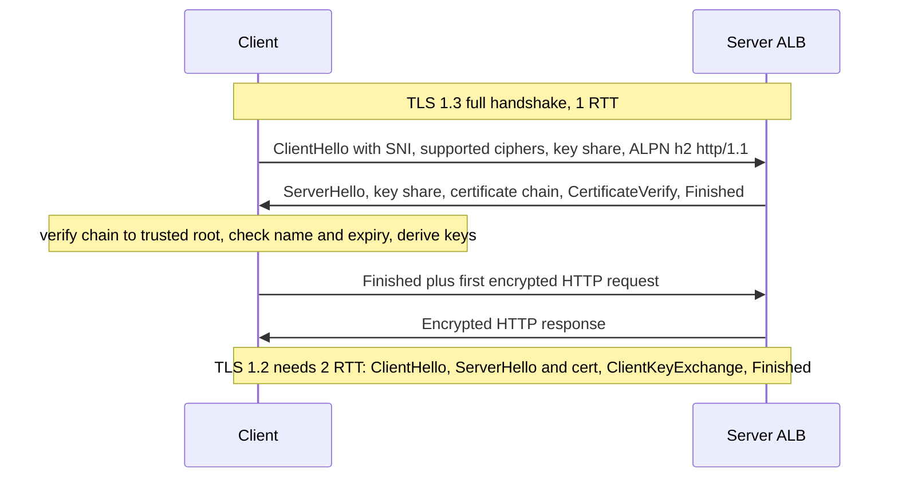
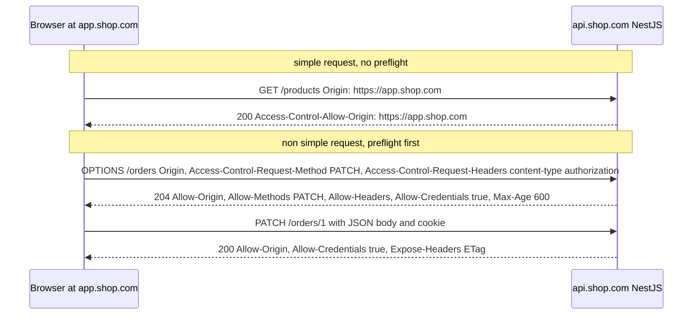

## 14.12 TLS: encryption, certificates and where to terminate

#### Concept

**TLS** (Transport Layer Security) is the protocol that turns `http://` into `https://`. It gives three things: **confidentiality** (nobody on the path can read the bytes), **integrity** (nobody can alter them undetected), and **authentication** (the client knows it is talking to the real `api.shop.com`, proven by a certificate signed by a certificate authority the client trusts). TLS 1.2 (2008) and TLS 1.3 (2018) are the versions in use; 1.0 and 1.1 are disabled everywhere serious. "SSL" is the old name; the protocol has been TLS for over twenty years but the word survives in library names.

A **certificate** binds a public key to one or more names (`CN` and `Subject Alternative Names`), is signed by a CA, and expires (90 days for Let's Encrypt and, since 2026, the industry is moving all public certificates towards short lifetimes). **SNI** (Server Name Indication) is the client saying which hostname it wants in the first handshake message so one IP can serve many certificates. **mTLS** (mutual TLS) adds a client certificate so the server authenticates the client too.

#### Why does it exist?

Without TLS, every password, session cookie and order travels in plain text across ISPs, coffee-shop Wi-Fi and cloud backbones, and any hop can rewrite a response. Browsers now mark plain HTTP as insecure and refuse `Secure` cookies and many APIs without it. Inside a VPC the risk is lower, but compliance regimes (PCI DSS, HIPAA, SOC 2) and the reality of shared cloud networks mean traffic to the database and between services is usually encrypted too.

#### Mental model

Imagine sending a locked box. First, you and the recipient agree on a lock only you two can open (key exchange), using a tamper-proof method even if someone watches you agree (Diffie-Hellman). The recipient shows an ID card signed by a passport office you trust (the certificate) so you know the box goes to the right person. From then on, every parcel is locked with the shared key. TLS 1.3 made the agreement faster: one exchange instead of two.

#### How it works



1. **ClientHello.** The client lists the TLS versions and cipher suites it supports, includes the hostname (SNI, in plain text unless Encrypted Client Hello is used), the protocols it wants via ALPN (`h2`, `http/1.1`), and, in 1.3, its ephemeral key share.
2. **ServerHello.** The server picks the version and cipher, sends its key share, its certificate chain (leaf plus intermediates; the root is already on the client), a signature proving it holds the private key, and `Finished`. In 1.3 everything after ServerHello is already encrypted.
3. **Verification.** The client checks that the chain leads to a trusted root, that the leaf's names include the requested hostname, that the current time is inside the validity window (this is where clock skew bites, 14.15), and optionally revocation (OCSP stapling). A failed check is `CERT_HAS_EXPIRED`, `UNABLE_TO_VERIFY_LEAF_SIGNATURE` (missing intermediate), or `ERR_TLS_CERT_ALTNAME_INVALID` (wrong name).
4. **Key derivation.** Both sides derive symmetric session keys from the exchanged shares. The heavy asymmetric work (ECDHE plus a signature) is roughly 0.3 ms of CPU with ECDSA P-256 or 1 to 2 ms with RSA-2048 per handshake.
5. **Application data.** Encrypted with AES-GCM or ChaCha20-Poly1305 at gigabytes per second per core with hardware acceleration; bulk encryption is not the expensive part.
6. **Resumption.** A returning client presents a session ticket; TLS 1.3 resumes in 1 RTT and can send data in 0-RTT (replayable; only for idempotent requests). TLS 1.2 resumes in 1 RTT instead of 2.

**Where to terminate.** Terminating means decrypting. Options:

| Model | Where TLS ends | Pros | Cons |
|---|---|---|---|
| Edge termination | CDN or ALB; plain HTTP to pods inside the VPC | central certificates (ACM auto-renews), no CPU in Node, HTTP/2 at the edge | plaintext inside the VPC; compliance may forbid |
| Re-encryption | ALB terminates, then new TLS to pods | encrypted everywhere; ALB still sees HTTP for routing | two handshakes; certificates on pods too |
| Passthrough | NLB forwards TCP; Node terminates | end-to-end, client cert visible to the app | no Layer 7 routing at the LB; Node does the crypto CPU; certificate rotation on every pod |
| Service mesh mTLS | sidecars terminate and originate | zero-trust inside the cluster, identity per service | operational complexity; extra hop and latency |

The common production choice: ACM certificate on the ALB (auto-renewed, ECDSA where supported), HTTP/1.1 in plain text between the ALB and pods inside private subnets, TLS to RDS (`sslmode=verify-full`) and to Redis (in-transit encryption), and mTLS only where a service mesh or a partner integration demands it.

**Cost.** ALB TLS handshakes are metered as part of LCU usage; on Node, each RSA handshake is about 1.5 ms of CPU, meaning a pod doing 500 handshakes per second spends most of a core on TLS. Keep-alive and edge termination make that disappear. Bulk encryption of a 100 KB response is under 0.1 ms.

#### Practical example

`api.shop.com` resolves to an ALB with an ACM certificate for `api.shop.com` and `*.shop.com`. The listener on 443 uses the `ELBSecurityPolicy-TLS13-1-2-2021-06` policy (TLS 1.3 preferred, 1.2 allowed). The HTTP listener on 80 redirects to 443 with `301`. Pods listen on plain HTTP 3000, reachable only from the ALB's security group. The NestJS app connects to RDS with `ssl: { rejectUnauthorized: true, ca: rdsCaBundle }`, so a spoofed database endpoint would fail verification.

#### NestJS example

Three things to get right in the app: honour the ALB's `X-Forwarded-Proto` so redirects and `Secure` cookies behave, verify TLS to the database and to outbound APIs, and, when the app must terminate TLS itself, do it with modern settings and hot-reloaded certificates.

```ts
// main.ts: app behind an ALB that terminates TLS
import helmet from 'helmet';
app.set('trust proxy', 1);                       // req.secure and req.protocol come from X-Forwarded-Proto
app.use(helmet({ hsts: { maxAge: 31_536_000, includeSubDomains: true, preload: true } })); // Strict-Transport-Security
```

```ts
// database TLS: verify the RDS certificate chain, never rejectUnauthorized: false in production
import { readFileSync } from 'fs';
TypeOrmModule.forRoot({
  type: 'postgres',
  host: process.env.PG_HOST,
  ssl: {
    rejectUnauthorized: true,
    ca: readFileSync('/etc/ssl/certs/rds-global-bundle.pem', 'utf8'),
  },
  // ... other options
});
```

```ts
// self-terminating TLS (NLB passthrough or no LB): NestJS with httpsOptions and cert reload
import { NestFactory } from '@nestjs/core';
import { readFileSync } from 'fs';
import { Server } from 'https';
import { constants } from 'crypto';
import { AppModule } from './app.module';

async function bootstrap() {
  const load = () => ({
    key: readFileSync('/certs/tls.key'),
    cert: readFileSync('/certs/tls.crt'),             // leaf plus intermediates, in that order
  });
  const app = await NestFactory.create(AppModule, {
    httpsOptions: {
      ...load(),
      minVersion: 'TLSv1.2',
      secureOptions: constants.SSL_OP_NO_TLSv1 | constants.SSL_OP_NO_TLSv1_1,
      honorCipherOrder: true,
    },
  });
  const server = app.getHttpServer() as Server;
  // cert-manager or ACM rotates files on disk; pick them up without a restart
  setInterval(() => server.setSecureContext(load()), 60 * 60 * 1000).unref();
  await app.listen(443, '0.0.0.0');
}
bootstrap();
```

`server.setSecureContext()` is a real Node `https.Server` and `tls.Server` method; it swaps the certificate for new connections without dropping existing ones.

#### PostgreSQL example

```sql
-- Is my session encrypted, and with what? (requires the sslinfo extension or pg_stat_ssl)
SELECT s.pid, s.ssl, s.version, s.cipher, a.client_addr
FROM pg_stat_ssl s JOIN pg_stat_activity a USING (pid)
WHERE a.backend_type = 'client backend';

-- Enforce TLS for application users in pg_hba.conf:
-- hostssl  orders  app_user  10.0.10.0/23  scram-sha-256
-- hostnossl all     all       0.0.0.0/0     reject

-- Server-side settings
SHOW ssl;                  -- on
SHOW ssl_min_protocol_version; -- TLSv1.2
```

Connection strings should use `sslmode=verify-full` so the client checks both the chain and the hostname; `sslmode=require` encrypts but does not authenticate the server, which permits a man-in-the-middle inside the network.

#### Production scenario

An API cluster serving 3,000 RPS behind an ALB performs about 40 client TLS handshakes per second (keep-alive and HTTP/2 do the rest). The ALB handles it; the pods do none. When a partner required mTLS for a webhook endpoint, the team put that single path on a separate ALB listener with the ALB's mutual TLS verify mode and an S3 trust store, and the app read the validated client certificate fields from `X-Amzn-Mtls-Clientcert-Subject`, avoiding TLS passthrough for the whole service.

#### Failure scenario

At 00:00 UTC on a Tuesday, every request to `internal-payments.shop.com` began failing with `CERT_HAS_EXPIRED`. That internal service used a manually issued one-year certificate that nobody had put in a calendar; ACM was not involved because the service sat behind an NLB with passthrough. Pods restarted in a loop because the readiness check called the service. Recovery took 55 minutes: issue a new certificate, push a secret, roll the deployment. The permanent fix moved the service behind an ALB with an ACM certificate, and added a Prometheus alert from the blackbox exporter on `probe_ssl_earliest_cert_expiry` below 14 days for every endpoint, internal and external.

#### Edge cases & failure modes

- Expired certificates, missing intermediates (works in browsers that cache intermediates, fails in Node with `UNABLE_TO_VERIFY_LEAF_SIGNATURE`), wrong SAN after a hostname change.
- Clock skew: a client 10 minutes ahead rejects a freshly issued certificate as not yet valid; a container with a broken NTP is enough (14.15).
- Root CA rotation: RDS rotated its CA bundle in 2024; apps that pinned the old CA lost database connectivity on a schedule announced months earlier.
- `rejectUnauthorized: false` left in production: silent loss of authentication, and an audit finding.
- SNI missing from custom clients (older `net`-based tools) leads to the default certificate and a name mismatch.
- TLS handshake CPU under a new-connection storm (mobile retry storms, 14.15) saturates pods that terminate TLS themselves.
- OCSP responder outages: with hard-fail revocation checking, a CA outage takes your site down; stapling with soft-fail is the usual compromise.
- Mixed content: a page over HTTPS calling an API over HTTP is blocked by the browser.
- HSTS preload is effectively permanent; a subdomain that must stay HTTP will be unreachable.

#### How a Senior Backend Engineer thinks about this

Terminate at the edge with managed certificates, encrypt to data stores with verification, and add mTLS only where identity between services is a real requirement. Automate issuance and renewal (ACM, cert-manager with Let's Encrypt), and alert on expiry for every certificate including internal ones. Never disable verification to make an error go away. To a product manager: "Every certificate is a passport with an expiry date. We used to renew them by memory; now a robot renews them and a second robot checks the first one did."

#### Common mistakes

- `rejectUnauthorized: false`.
- Manual certificates without expiry monitoring.
- `sslmode=require` instead of `verify-full`.
- Terminating TLS in Node behind an ALB for no reason and paying the CPU.
- Forgetting the intermediate certificate in the chain file.

#### Interview questions

1. **Compare TLS 1.2 and 1.3 handshakes.** 1.3 is 1 RTT with forward-secret key exchange only and encrypted server certificate; 1.2 is 2 RTT with optional RSA key exchange. Follow-up: what is 0-RTT and its risk? Replay.
2. **Where would you terminate TLS in an ALB plus NestJS plus RDS setup, and why?** ALB with ACM, plaintext in private subnets, TLS with verification to RDS; central rotation and no Node CPU.
3. **What does SNI solve?** Multiple certificates behind one IP; the client names the host before the certificate is chosen.
4. **How does mTLS differ and when is it worth it?** Client certificates authenticate the caller; worth it for service meshes and partner integrations, costly operationally.
5. **A Node service fails with `UNABLE_TO_VERIFY_LEAF_SIGNATURE` while browsers work. Why?** Missing intermediate in the server's chain; browsers fetch or cache intermediates, Node does not.
6. **How do you monitor certificate expiry?** Blackbox exporter `probe_ssl_earliest_cert_expiry`, ACM expiry events, cert-manager metrics, alert at 14 days.

#### Practical exercise

Generate a private CA with `openssl`, issue a server certificate for `api.local`, and run NestJS with `httpsOptions` and `setSecureContext` reloading. Connect with `curl --cacert` and with a Node client using a custom `ca`. Then issue a certificate that expired yesterday and observe the error at each client. Finally set the container clock 15 minutes ahead with `faketime` and observe. Acceptance criteria: a table of error messages per failure, a working hot-reload demonstrated by rotating the certificate without restarting, and a Prometheus alert rule for expiry.

## 14.13 CORS: why the browser blocks your API and how NestJS enables it

#### Concept

**CORS** (Cross-Origin Resource Sharing) is a browser mechanism. An **origin** is the scheme plus host plus port (`https://app.shop.com`). By default, JavaScript running on one origin may not read responses from another origin; that is the **same-origin policy**. CORS is the set of response headers a server sends to relax that rule for specific origins, methods and headers. It is enforced by browsers only; Postman, `curl`, mobile apps and other servers ignore it completely. CORS is not an authentication or access-control mechanism for your API; it protects users' browsers from malicious sites reading data from your API using the user's cookies.

#### Why does it exist?

Without the same-origin policy, `evil.com` could load in your browser and use `fetch('https://bank.com/accounts')` with your bank cookies attached, reading your balance. The policy blocks reading the response. CORS exists because legitimate apps do need cross-origin calls: `app.shop.com` calling `api.shop.com`. The server declares which origins are allowed and the browser enforces it.

#### Mental model

Imagine a receptionist at your API's building who only talks to visitors carrying a badge from an approved company. A stranger without a badge can still shout a question through the door (the request is sent), but the receptionist will not hand over the answer to them (the browser hides the response). And for unusual requests, the visitor must first ask "are you willing to accept a `DELETE` with a custom header from my company?" (the preflight).

#### How it works



1. The browser adds an `Origin` header to every cross-origin request.
2. **Simple requests** (`GET`, `HEAD`, `POST` with `Content-Type` of `application/x-www-form-urlencoded`, `multipart/form-data` or `text/plain`, and only safe-listed headers) are sent immediately. The response is delivered to JavaScript only if `Access-Control-Allow-Origin` matches the origin (or is `*` and the request had no credentials).
3. **Non-simple requests** (`PUT`, `PATCH`, `DELETE`, `Content-Type: application/json`, an `Authorization` header, custom headers like `Idempotency-Key`) trigger a **preflight**: the browser sends `OPTIONS` with `Access-Control-Request-Method` and `Access-Control-Request-Headers`, and only sends the real request if the response allows them. `Access-Control-Max-Age` caches the preflight for up to 2 hours in Chrome (600 seconds is common), so a chatty API does not pay an extra round trip per call.
4. **Credentials** (cookies, `Authorization` set by the browser, TLS client certs) are sent cross-origin only when the request sets `credentials: 'include'` and the response has `Access-Control-Allow-Credentials: true` with an explicit origin, never `*`.
5. **Exposed headers**: JavaScript can read only a safe-listed set of response headers (`Content-Type`, `Cache-Control`, and a few more) unless `Access-Control-Expose-Headers` names others, such as `ETag`, `X-Request-Id`, `Location`.
6. The server still executes non-preflighted requests; CORS only hides the response. That is why CSRF protection (`SameSite` cookies, tokens) is separate from CORS.

Key facts:

- The `Origin` in a CORS response must be a single exact value; to allow several origins, echo the request's origin after checking it against an allow-list, and add `Vary: Origin` so caches do not serve one origin's headers to another.
- A `*` origin cannot be combined with credentials.
- Preflights are `OPTIONS` requests that reach your app unless the gateway or CDN answers them; they must not require authentication.
- Mobile apps and server-to-server calls never send preflights and never see CORS errors; the same API works for them regardless.
- A "CORS error" in the console with a `5xx` behind it is usually not a CORS bug: the error response lacked the headers because the exception filter or the gateway did not add them.

#### Practical example

`app.shop.com` (a React SPA) calls `api.shop.com` with a session cookie. The API allows origins `https://app.shop.com` and `https://admin.shop.com`, methods `GET, POST, PATCH, DELETE`, headers `Content-Type, Authorization, Idempotency-Key, If-Match`, exposes `ETag, X-Request-Id, Location`, allows credentials, and caches preflights for 10 minutes. A preview deployment at `pr-812.preview.shop.com` is allowed by a regex in non-production only.

#### NestJS example

```ts
// main.ts (excerpt)
import { NestFactory } from '@nestjs/core';
import { AppModule } from './app.module';

async function bootstrap() {
  const app = await NestFactory.create(AppModule);

  const allowList = (process.env.CORS_ORIGINS ?? 'https://app.shop.com,https://admin.shop.com').split(',');
  const previewPattern = process.env.NODE_ENV !== 'production' ? /^https:\/\/pr-\d+\.preview\.shop\.com$/ : null;

  app.enableCors({
    origin: (origin, callback) => {
      // No Origin header: same-origin, curl, mobile, server-to-server. Allow (CORS does not apply).
      if (!origin) return callback(null, true);
      if (allowList.includes(origin) || previewPattern?.test(origin)) return callback(null, true);
      // Not allowed: respond without CORS headers so the browser blocks it; do not throw 500.
      return callback(null, false);
    },
    methods: ['GET', 'HEAD', 'POST', 'PATCH', 'DELETE', 'OPTIONS'],
    allowedHeaders: ['Content-Type', 'Authorization', 'Idempotency-Key', 'If-Match', 'X-Request-Id'],
    exposedHeaders: ['ETag', 'X-Request-Id', 'Location', 'Retry-After'],
    credentials: true,            // required for cookie sessions; origin must then be explicit, never *
    maxAge: 600,                  // cache preflights for 10 minutes
    optionsSuccessStatus: 204,
  });

  await app.listen(3000, '0.0.0.0');
}
bootstrap();
```

`enableCors` accepts the same options as the `cors` package; `origin` as a function is what lets you echo the exact origin (with `Vary: Origin`, which the package adds). Make sure the global exception filter still lets the CORS headers through on error responses; because `cors` runs as early middleware, headers are set before the handler and survive an exception, but a gateway in front that generates its own `502` will not have them, which is why users see "CORS error" during outages.

For Fastify use `@fastify/cors` via `app.register(fastifyCors, { ... })` with the same option names.

#### PostgreSQL example

CORS has no database angle. The one operational touch: if the allow-list lives in a table so that tenants can register their own origins (a white-label storefront product), cache it in memory with a short TTL, because the origin check runs on every cross-origin request and every preflight.

```sql
CREATE TABLE tenant_origins (
  tenant_id  uuid NOT NULL REFERENCES tenants(id),
  origin     text NOT NULL CHECK (origin ~ '^https://[a-z0-9.-]+(:[0-9]+)?$'),
  PRIMARY KEY (tenant_id, origin)
);
-- Load all origins at startup and refresh every 60 s; never query per request
SELECT origin FROM tenant_origins;
```

#### Production scenario

A public API with 40,000 browser users sees about 6% of its requests as `OPTIONS` preflights with `maxAge: 600`; without `maxAge` it was 38%, and the extra round trip added 50 to 150 ms to every first call in a burst. Preflights are answered in under 1 ms because they short-circuit before guards and never hit the database.

#### Failure scenario

At 09:05 a frontend deploy switched the SPA from `www.shop.com` to `app.shop.com`. Every API call failed in the browser with "blocked by CORS policy", while Postman worked fine and the API dashboards showed no errors, because the API executed every simple `GET` and simply omitted the headers. The allow-list was a hard-coded array in `main.ts`. The fix was adding the origin via the `CORS_ORIGINS` environment variable and redeploying, 20 minutes of a broken site for a one-line config. The follow-up moved the allow-list to configuration with a CI check that every frontend origin in the infrastructure repo is present.

#### Edge cases & failure modes

- `Access-Control-Allow-Origin: *` with `credentials: true` is rejected by browsers; cookie-based APIs need explicit origins.
- Reflecting any `Origin` back unconditionally (`origin: true`) with credentials means any site can read a logged-in user's data; that is a vulnerability, not a convenience.
- Preflight requires authentication: a guard applied to `OPTIONS` returns `401` and the browser reports a CORS failure.
- Missing `Vary: Origin` on cached responses leaks one origin's allow header to another.
- Custom headers not in `allowedHeaders` (a new `X-Client-Version`) break every call from the browser with a preflight failure.
- Redirects during preflight are not allowed; a `301` from HTTP to HTTPS on the API origin breaks CORS if the frontend uses the wrong scheme.
- `localhost` and `127.0.0.1` are different origins; `http://localhost:3000` and `http://localhost:5173` are different origins.
- Error responses from the gateway or CDN lack CORS headers, so a `503` looks like a CORS error to the user; configure the gateway to add them.
- CORS does not stop CSRF: a cross-site `POST` form submission is not a CORS request at all. Use `SameSite` cookies and CSRF tokens.

#### How a Senior Backend Engineer thinks about this

They treat CORS as a browser safety feature, configured tightly (explicit origins, explicit headers, credentials only when needed, preflight caching), sourced from configuration, tested in CI, and applied at one layer only. They know that "CORS error" is a symptom to trace, not a diagnosis. They pair it with real CSRF protection and never mistake it for authorisation. To a product manager: "The browser refused to hand our own frontend the answers because the API's guest list still had the old address. Nothing was broken on the server; it was a list."

#### Common mistakes

- `origin: '*'` or `origin: true` on an API with cookies.
- Hard-coding origins in code.
- Applying auth guards to `OPTIONS`.
- No `maxAge`, doubling request count.
- Debugging CORS with Postman, which does not enforce it.
- Believing CORS protects the API from non-browser clients.

#### Interview questions

1. **What triggers a preflight, and how do you reduce their cost?** Non-simple methods, `application/json`, custom or `Authorization` headers; `Access-Control-Max-Age`.
2. **Why can you not use `*` with credentials?** Browsers refuse it; it would let any site read authenticated data.
3. **Is CORS a security control for your API?** No; it protects browser users. Non-browser clients ignore it; use authentication and CSRF defences.
4. **A user reports a CORS error during an outage. What is likely happening?** The gateway's `5xx` lacks CORS headers; the real problem is the outage.
5. **How do you support multiple origins with cookies?** Allow-list check, echo the exact origin, `Vary: Origin`, `credentials: true`.
6. **What is the difference between CORS and CSRF protection?** CORS hides responses from other origins; CSRF protection stops other origins from causing state changes with the user's cookies.

#### Practical exercise

Serve a small HTML page from `http://localhost:5173` that calls a NestJS API on `http://localhost:3000` with `fetch(..., { credentials: 'include' })` using `PATCH` and a custom header. Configure `enableCors` step by step until it works, observing each browser error message in DevTools. Then add a second allowed origin from an environment variable and write an e2e test that asserts the preflight response headers for allowed and disallowed origins. Acceptance criteria: a list of the distinct browser error messages you triggered and their causes, and green tests for both the allowed and blocked cases.
