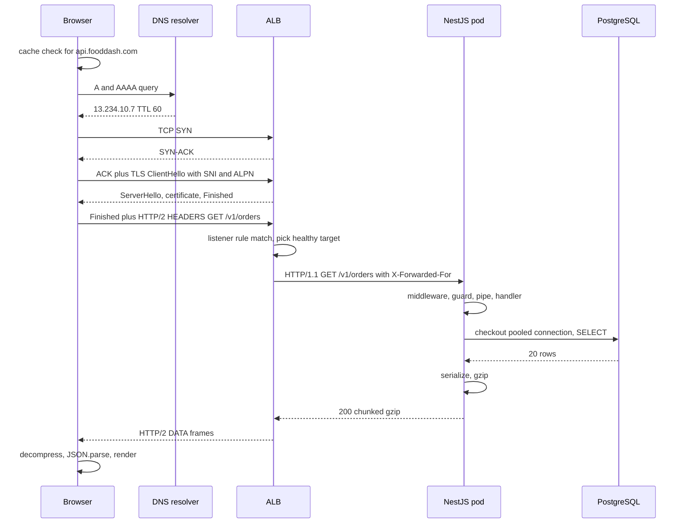

## 14.14 What exactly happens when I call a NestJS API from a browser or Postman?

#### Concept

Everything in this part comes together in one request. A user on a phone in Pune taps "My orders". The app calls `GET https://api.fooddash.com/v1/orders?limit=20`. About 220 milliseconds later, a list appears. This section traces every step between those two moments, with realistic timings, the actual bytes on the wire, and a budget showing where the 220 ms went. Postman follows the same path with two differences: it has no browser DNS cache and no same-origin policy, so no CORS preflight.

```text
DNS -> TCP -> TLS -> HTTP -> Load Balancer -> NestJS -> Database -> Response
```

#### Why does it exist?

You cannot optimise, debug or size what you cannot see. Engineers who think a request is "controller, service, query" will look for a 200 ms problem in code that takes 8 ms. The trace is the map: it tells you which layer to suspect, which tool to use, and which fix is worth doing. It is also the single most common senior interview question in backend engineering, in some form.

#### Mental model

Imagine ordering food by phone from a restaurant in another city. You look up the number (DNS), dial and wait for someone to pick up (TCP), agree on a private language so nobody listening can understand (TLS), state your order (HTTP request), the receptionist routes it to the right kitchen (load balancer), a cook checks your ID and reads the order (NestJS middleware, guards, pipes), walks to the storeroom for ingredients (database), plates it (serialisation), vacuum-packs it (gzip), and the delivery comes back the same road. Every step has a duration; most of them are travel time, not cooking.

#### How it works



The numbered narrative, with timings for a phone on 4G in Pune, an ALB and NestJS in `ap-south-1` (Mumbai), and RDS in the same AZ. RTT phone to ALB: 45 ms. RTT pod to database: 0.4 ms.

1. **The app builds the request** (0 ms). `fetch('/v1/orders?limit=20', { credentials: 'include' })`. The browser decides this is a cross-origin `GET` with no custom headers, so no CORS preflight. If the app had added an `Authorization` header, an `OPTIONS` preflight would go first and cost a full extra round trip unless cached by `Access-Control-Max-Age`.

2. **Browser DNS cache** (0 ms). Chrome checks its internal host cache (about 60 seconds). The app resolved this name two minutes ago, so it is stale.

3. **OS resolver** (0.2 ms). `getaddrinfo` checks `/etc/hosts` equivalent and the OS cache. Miss.

4. **Recursive resolver** (12 ms). The phone asks the carrier's resolver (or `8.8.8.8` with private DNS). The resolver had the record cached from another user with 40 seconds of TTL left, so no recursion: 12 ms is the round trip to the resolver. A cold recursion (root, `.com`, Route 53) would be 60 to 120 ms. Route 53 answers `A 13.234.10.7` and `AAAA 2406:da1a:...`; the phone is IPv6-capable and, with Happy Eyeballs, tries both and keeps the first to connect.

5. **TCP three-way handshake** (45 ms, 1 RTT). SYN to the ALB's address on port 443, SYN-ACK, ACK. The ALB is an anycast-free regional endpoint; its nodes sit in two public subnets. The connection is now `ESTABLISHED` on both sides; the ALB node's kernel accepted it, no application yet.

6. **TLS 1.3 handshake** (45 ms, 1 RTT, plus about 1 ms of CPU each side). ClientHello with SNI `api.fooddash.com` and ALPN `h2, http/1.1`; the ALB picks the ACM certificate for that name, replies ServerHello plus certificate plus Finished. The phone validates the chain to a trusted root, checks the name and expiry, sends Finished, and the first HTTP bytes ride in the same flight. ALPN selected `h2`, so this is HTTP/2. On a repeat visit within the ticket lifetime, resumption keeps it at 1 RTT; TLS 1.2 would have cost 2.

7. **HTTP request on the wire** (0.5 ms to serialise, then travels with step 6's last flight). In HTTP/2 the request is a `HEADERS` frame with HPACK-compressed pseudo-headers. Logically it is this request; what the ALB forwards to the pod, translated to HTTP/1.1, is byte-for-byte close to:

```text
GET /v1/orders?limit=20 HTTP/1.1
Host: api.fooddash.com
X-Forwarded-For: 2406:da1a:9c0:1b2::4f
X-Forwarded-Proto: https
X-Forwarded-Port: 443
X-Amzn-Trace-Id: Root=1-66db3f2a-0a1b2c3d4e5f60718293a4b5
Accept: application/json
Accept-Encoding: gzip, deflate, br
Accept-Language: en-IN,en;q=0.9
Cookie: __Host-sid=s%3A9f2c1a...; 
If-None-Match: "4127"
User-Agent: Mozilla/5.0 (Linux; Android 14) ... Chrome/128
Origin: https://app.fooddash.com
```

8. **ALB listener and rules** (1 ms). The HTTPS:443 listener's rules run in priority order: rule 1 `path is /v1/*` forwards to target group `orders-api-prod`; rule 10 `host is admin.fooddash.com` forwards elsewhere; the default returns a fixed `404`. The ALB then picks a target from the healthy set using round robin (or least outstanding requests, if configured). Health: the target group checks `GET /health/ready` on port 3000 every 10 seconds, needs 2 consecutive successes to mark healthy and 2 failures to mark unhealthy, and only healthy targets receive traffic. If zero targets are healthy, the ALB returns `503` itself, without touching a pod. The ALB reuses an existing keep-alive connection to the chosen pod; a new one costs a 0.3 ms handshake inside the VPC.

9. **ALB to pod** (0.5 ms RTT inside the VPC). Plain HTTP/1.1 on port 3000 into a private subnet; the pod's security group allows TCP 3000 only from the ALB's security group. The pod's kernel accept queue hands the socket to Node's event loop.

10. **Node HTTP parser** (0.1 ms). `llhttp` parses the request line and headers into `IncomingMessage`. Express (under NestJS) builds `req` and `res`, lowercases headers, and applies `trust proxy: 1`, so `req.ip` is the last `X-Forwarded-For` value, the phone's IPv6 address.

11. **NestJS request pipeline** (0.4 ms before the handler). In order: global middleware (`RequestIdMiddleware` generates or accepts `X-Request-Id`; `express-session` reads the cookie, verifies the signature, and fetches `sess:9f2c1a` from Redis in 0.3 ms), then guards (`SessionAuthGuard` confirms `session.userId`), then interceptors' "before" phase (`TimeoutInterceptor` starts a 10-second timer, `EtagInterceptor` and `CacheControlInterceptor` wait for the response), then pipes (`ValidationPipe` turns `limit=20` into a number and checks it is between 1 and 100), and finally the handler `OrdersController.list`.

12. **Service and pool checkout** (0.05 ms when a connection is idle; up to the pool's `connectionTimeoutMillis` when it is not). `OrdersService.recentForUser(userId, 20)` calls the repository; TypeORM asks the `pg` pool for a client. With 10 connections per pod and a p99 concurrency of 6, checkout is immediate. If all 10 were busy, this request would queue here, invisible to the database and visible only as `pool.waitingCount`.

13. **Query** (0.4 ms network RTT plus 1.6 ms in Postgres). The driver sends a `Parse`/`Bind`/`Execute` sequence over the pooled TLS connection. Postgres plans (or reuses a prepared plan), scans `orders_user_created_idx`, joins 20 orders to their items, and returns 20 rows of about 300 bytes each. `pg_stat_statements` shows a mean of 1.6 ms for this query shape.

14. **Serialisation** (0.6 ms). TypeORM hydrates entities; the service maps them to a response DTO with `class-transformer`'s `@Expose` fields; `JSON.stringify` produces 6.2 KB. The `EtagInterceptor` attaches `ETag: "4131"` from the newest order's version; the client's `If-None-Match: "4127"` does not match, so a full `200` goes out. `CacheControlInterceptor` sets `private, no-cache` because a cookie is present.

15. **Compression** (0.3 ms). The `compression` middleware sees `Accept-Encoding: gzip, deflate, br`, a JSON body over the 1 KB threshold, and compresses 6.2 KB to about 1.1 KB with gzip level 6. `Content-Encoding: gzip`, `Vary: Accept-Encoding`, and chunked encoding are set because the compressed length is not known up front.

16. **Response on the wire, pod to ALB** (0.5 ms). What the pod sends:

```text
HTTP/1.1 200 OK
Content-Type: application/json; charset=utf-8
Content-Encoding: gzip
Transfer-Encoding: chunked
ETag: "4131"
Cache-Control: private, no-cache
Vary: Accept-Encoding, Origin
Access-Control-Allow-Origin: https://app.fooddash.com
Access-Control-Allow-Credentials: true
Access-Control-Expose-Headers: ETag,X-Request-Id
X-Request-Id: 7f3a9c1e-2b1d-4a5e-9c0f-1e2d3c4b5a69
Date: Mon, 07 Sep 2026 06:12:41 GMT
Connection: keep-alive
Keep-Alive: timeout=65

45c
<1116 bytes of gzip data>
0

```

17. **ALB to phone** (45 ms, half an RTT for the first byte, plus transmission). The ALB re-frames the response as HTTP/2 `HEADERS` and `DATA` frames, drops `Connection` and `Transfer-Encoding` (illegal in HTTP/2), and sends. 1.1 KB fits in one packet; no slow-start ramp is needed. The phone's radio was already awake from the request.

18. **Browser processing** (3 ms). Decompress, `JSON.parse` 6.2 KB, hand to the app's state store, React re-render, paint. The user sees the list.

**Where did 220 ms go.** The numbers above sum to about 205 ms of network and CPU; the remaining margin is jitter on the mobile link. The budget:

| Step | Time | Share | Who owns it | Lever |
|---|---|---|---|---|
| DNS (resolver RTT, cached upstream) | 12 ms | 5% | carrier, Route 53 TTL | longer browser session, keep-alive so it happens rarely |
| TCP handshake | 45 ms | 20% | physics, region choice | keep-alive, HTTP/2, region near users |
| TLS 1.3 handshake | 45 ms | 20% | physics, ALB | session resumption, keep-alive, 0-RTT for idempotent GETs via HTTP/3 |
| Request bytes to ALB | included above | 0% | | small headers, HPACK, no preflight |
| ALB rule match, target selection | 1 ms | 0.5% | ALB | few rules, healthy targets |
| ALB to pod hop | 0.5 ms | 0.2% | VPC | same AZ, keep-alive to targets |
| Node parse plus NestJS pipeline (session lookup in Redis 0.3 ms) | 0.5 ms | 0.2% | app | keep middleware lean |
| Pool checkout | 0.05 ms | 0% | app | sized pool; alert on waiting |
| Postgres query plus round trip | 2.0 ms | 1% | app and DB | index, one round trip, column selection |
| Serialisation and interceptors | 0.6 ms | 0.3% | app | small DTOs |
| gzip | 0.3 ms | 0.1% | app | threshold, level 6 |
| Response first byte to phone | 45 ms | 20% | physics | same as handshake levers |
| Response transmission (1.1 KB) | about 1 ms | 0.5% | link | compression, pagination |
| Browser decompress, parse, render | 3 ms | 1.4% | frontend | small payloads |
| Jitter, queueing on radio link | about 15 ms | 7% | carrier | nothing; budget for it |
| **Total** | **about 220 ms** | | | |

Read the shares: about 150 ms, 70% of the total, is three mobile round trips (TCP, TLS, request-response). The application, database and serialisation together are under 4 ms, under 2%. On a **warm connection** (keep-alive, HTTP/2 stream on an existing connection), steps 2 to 6 vanish and the same request completes in about 50 to 60 ms: one RTT plus 4 ms of work. That is why keep-alive, HTTP/2 at the edge, and putting the region near the user are worth more than any query optimisation for this endpoint, and why the same endpoint measured from a pod in the cluster reports 4 ms and misleads everyone.

A `304` path (the client's `If-None-Match` matches) skips steps 13 to 15 on a version cached in Redis and returns about 200 bytes; on a warm connection it is a 46 ms request that costs the server 0.5 ms.

#### Practical example

Postman on a laptop in the office (fibre, 18 ms RTT to Mumbai), same endpoint, cold: DNS 9 ms (office resolver), TCP 18 ms, TLS 18 ms, request-response 18 ms plus 4 ms of work, total about 70 ms. Postman shows this in its timing tab as "DNS lookup", "TCP handshake", "SSL handshake", "Transfer start" (time to first byte) and "Download". The same call from a Kubernetes pod in the cluster: 0.3 ms TCP, 0.6 ms TLS, 4 ms work, about 5 ms total. Three clients, three very different numbers, one server that did the same 4 ms of work each time.

#### NestJS example

The instrumentation that makes this trace visible in production: a middleware that records server-side timing per phase and returns it in a `Server-Timing` header so the browser DevTools and Postman show where server time went, and a readiness endpoint that reflects the health of the dependencies the ALB should care about.

```ts
// server-timing.middleware.ts
import { Injectable, NestMiddleware } from '@nestjs/common';
import { NextFunction, Request, Response } from 'express';
import { performance } from 'perf_hooks';

@Injectable()
export class ServerTimingMiddleware implements NestMiddleware {
  use(req: Request, res: Response, next: NextFunction) {
    const start = performance.now();
    const marks: Record<string, number> = {};
    // Services call req.mark('db', ms) to record phase timings
    (req as Request & { mark: (name: string, ms: number) => void }).mark = (name, ms) => {
      marks[name] = (marks[name] ?? 0) + ms;
    };
    res.on('finish', () => void 0);
    const original = res.writeHead.bind(res);
    res.writeHead = ((...args: Parameters<typeof res.writeHead>) => {
      const total = performance.now() - start;
      const parts = Object.entries(marks).map(([k, v]) => `${k};dur=${v.toFixed(1)}`);
      parts.push(`app;dur=${total.toFixed(1)}`);
      res.setHeader('Server-Timing', parts.join(', ')); // shown in DevTools Network > Timing
      return original(...args);
    }) as typeof res.writeHead;
    next();
  }
}
```

```ts
// orders.service.ts (excerpt): mark the database phase
async recentForUser(req: Request & { mark: (n: string, ms: number) => void }, userId: string, limit: number) {
  const t0 = performance.now();
  const rows = await this.repo.recentForUser(userId, limit);
  req.mark('db', performance.now() - t0);
  return rows.map(toOrderDto);
}
```

```ts
// health.controller.ts: what the ALB target group polls
@Controller('health')
export class HealthController {
  constructor(private health: HealthCheckService, private db: TypeOrmHealthIndicator, private mem: MemoryHealthIndicator) {}

  @Get('ready')
  @HealthCheck()
  ready() {
    return this.health.check([
      () => this.db.pingCheck('postgres', { timeout: 1_000 }),   // SELECT 1 through the pool: catches dead pools
      () => this.mem.checkHeap('heap', 900 * 1024 * 1024),       // stop taking traffic before OOM
    ]);
  }

  @Get('live')
  live() { return { status: 'ok' }; } // Kubernetes liveness: process is alive, never checks dependencies
}
```

With OpenTelemetry auto-instrumentation (`@opentelemetry/auto-instrumentations-node`), the same phases appear as spans (`http.server`, `express.middleware`, `pg.query`) under one trace whose id arrived in the `traceparent` header, and the ALB's `X-Amzn-Trace-Id` links the access log line to it.

#### PostgreSQL example

The query from step 13, with the plan that makes it 1.6 ms rather than 160 ms, and the statistics view that tells you its real-world mean.

```sql
-- The endpoint's query (parameterised; $1 user, $2 limit)
SELECT o.id, o.status, o.total_cents, o.version, o.created_at,
       COALESCE(json_agg(json_build_object('sku', i.sku, 'qty', i.qty) ORDER BY i.id)
                FILTER (WHERE i.id IS NOT NULL), '[]') AS items
FROM orders o
LEFT JOIN order_items i ON i.order_id = o.id
WHERE o.user_id = $1
GROUP BY o.id
ORDER BY o.created_at DESC
LIMIT $2;

-- Supporting indexes
CREATE INDEX orders_user_created_idx ON orders (user_id, created_at DESC);
CREATE INDEX order_items_order_id_idx ON order_items (order_id);

EXPLAIN (ANALYZE, BUFFERS)  -- with $1 = a real user id, $2 = 20
-- Limit  (actual time=0.612..1.418 rows=20 loops=1)
--   ->  GroupAggregate  (actual time=0.610..1.409 rows=20 loops=1)
--         Group Key: o.id
--         ->  Nested Loop Left Join  (actual time=0.048..0.981 rows=83 loops=1)
--               ->  Index Scan using orders_user_created_idx on orders o  (actual time=0.031..0.142 rows=21 loops=1)
--                     Index Cond: (user_id = '3b1c...'::uuid)
--               ->  Index Scan using order_items_order_id_idx on order_items i  (actual time=0.009..0.021 rows=4 loops=21)
--                     Index Cond: (order_id = o.id)
--   Buffers: shared hit=167
-- Planning Time: 0.210 ms
-- Execution Time: 1.472 ms

-- What this query costs across the fleet
SELECT calls, round(mean_exec_time::numeric, 2) AS mean_ms, round(max_exec_time::numeric, 1) AS max_ms, rows
FROM pg_stat_statements
WHERE query LIKE 'SELECT o.id, o.status, o.total_cents%'
ORDER BY calls DESC LIMIT 1;
-- calls    | mean_ms | max_ms | rows
-- 18442310 | 1.63    | 212.4  | 368846200
```

The `max_ms` of 212 ms is the tail: lock waits or a cold cache after a failover. It matters for the p99, not the p50, and it is the number to chase after the network levers are exhausted.

#### Production scenario

For this endpoint at 1,400 RPS across 12 pods: browser-measured p50 210 ms cold, 58 ms warm; server-side p50 3.9 ms, p99 24 ms; ALB `TargetResponseTime` p99 26 ms; Postgres mean 1.6 ms. 62% of requests arrive on warm HTTP/2 connections, 31% are `304`s. Dashboards show all four latencies side by side; when the browser number moves and the server number does not, the problem is in the first 150 ms of the budget and the fix is not in the code.

#### Failure scenario

At 19:40 the client-side p50 for "My orders" jumped from 210 ms to 640 ms while server-side p50 stayed at 4 ms. Every layer of the app looked healthy. The trace showed the extra 430 ms in step 6: TLS handshakes were happening on every request. A CDN configuration change earlier that day had set `Connection: close` on responses passing through it, so every call opened a new connection: DNS, TCP and TLS on each. Reverting the CDN change restored warm connections. The team added the browser-measured "connection reuse rate" from the Navigation Timing API to their dashboards, because the server could not have seen this at all.

#### Edge cases & failure modes

- A preflight adds a fourth round trip on the first call; caching it with `Access-Control-Max-Age` matters on mobile.
- A cold recursive DNS lookup adds 60 to 120 ms; a stale TTL after failover sends the request to a dead IP and the TCP SYN times out for seconds (14.15).
- Zero healthy targets: the ALB returns `503` at step 8, in 1 ms, with no pod involved.
- A full pool: step 12 waits up to `connectionTimeoutMillis`; the trace shows a gap between the handler start and the query start.
- A dead pooled socket (half-open): step 13 hangs until `statement_timeout` or keepalive detects it.
- Keep-alive race: step 9 hits a socket the pod just closed; the ALB returns `502` and the pod logs nothing.
- Missing `Vary` or wrong `Cache-Control`: a CDN in the path serves another user's orders at step 17.
- Slow start on a cold connection makes a 200 KB response take four extra round trips; the 1.1 KB gzip body here fits in one packet.
- Event-loop lag on the pod adds to every step between 10 and 15 at once; tail latency rises fleet-wide when one endpoint serialises a large object synchronously.
- Node's `JSON.stringify` of a 5 MB payload at step 14 blocks the loop for tens of milliseconds and stalls other requests on that pod.
- A Postman "Cloud agent" runs from a different geography than your laptop, so its timings differ from local runs.

#### How a Senior Backend Engineer thinks about this

They can recite this trace and put a number next to every line for their own system. They measure at four points (browser, ALB, app, database) and compare. They spend their effort in proportion to the budget: connection reuse and region placement first, payload size second, query time third. They know which `5xx` comes from which box. When asked "why is the API slow?", their first question is "slow from where, and on a warm or cold connection?". To a product manager: "Our servers answer in four milliseconds. The other two hundred are the distance to the phone and the three handshakes we need before we can talk. We are cutting those by keeping the line open and moving closer to the user."

#### Common mistakes

- Benchmarking from inside the cluster and reporting 4 ms as user latency.
- Optimising a 1.6 ms query while every call pays a 90 ms handshake pair.
- Adding an `Authorization` header (and thus a preflight) to an endpoint that could use the session cookie, without caching the preflight.
- Health checks that hit dependencies the pod does not need, causing the ALB to drop healthy pods.
- Not exporting `Server-Timing` or trace ids, so the browser and server numbers cannot be joined.

#### Interview questions

1. **Walk through what happens when a browser calls an HTTPS API, with approximate timings on mobile.** DNS (0 to 120 ms), TCP (1 RTT), TLS 1.3 (1 RTT), request and response (1 RTT), plus a few ms of server work; on a warm connection only the last RTT remains. Why it matters: it demonstrates layered thinking and where latency really lives. Follow-ups: what changes with HTTP/2, HTTP/3, a CDN, a preflight?
2. **Server p50 is 4 ms, users see 200 ms. Where is the time, and what do you do?** Round trips and handshakes; reuse connections, HTTP/2 at the edge, region placement, compression, `304`s.
3. **Describe the NestJS request pipeline order.** Middleware, guards, interceptors (before), pipes, handler, interceptors (after), exception filters.
4. **Which component returns `503` when no pod is healthy, and how do you tell?** The ALB; access log shows `elb_status_code=503` with no target status.
5. **What does the ALB change in the request before your app sees it?** Adds `X-Forwarded-*` and `X-Amzn-Trace-Id`, translates HTTP/2 to HTTP/1.1, strips hop-by-hop headers, may reuse a connection shared by many clients.
6. **How would you instrument this path so browser and server timings can be correlated?** Request id and W3C `traceparent` propagated end to end, `Server-Timing` on responses, ALB access logs joined by trace id, RUM in the app.

#### Practical exercise

Deploy a NestJS orders endpoint behind an ALB (or NGINX with TLS and HTTP/2). Capture the full trace three ways: `curl -w` with `time_namelookup`, `time_connect`, `time_appconnect`, `time_starttransfer` and `time_total` from a laptop and from a pod; Chrome DevTools timing for the same call cold and warm; and an OpenTelemetry trace with `Server-Timing`. Build the "where did the time go" table for your own system. Acceptance criteria: the table sums to within 10% of the measured total for both the cold and warm cases, and you can name the single change that would remove the largest slice.
