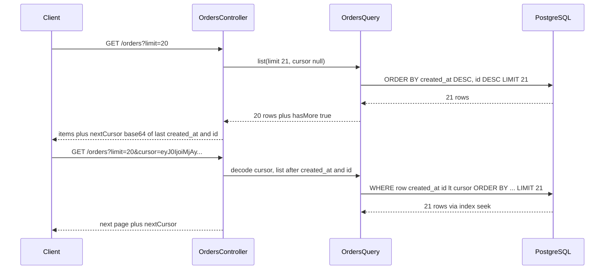

## 15.5 Pagination

#### Concept

Pagination splits a large collection into pages a client can fetch one at a time. Two families:

- **Offset pagination**: `GET /orders?limit=20&offset=400` (or `page=21`). The client asks for "rows 401 to 420". Simple, supports "jump to page N" and total counts, and gets slower the further you go.
- **Cursor (keyset) pagination**: `GET /orders?limit=20&cursor=eyJ...`. The client says "give me 20 rows after the last one I saw". The cursor encodes the sort key of the last row. Constant cost per page regardless of depth, stable under inserts, no "jump to page N".

#### Why does it exist?

`GET /orders` on a 50-million-row table without pagination is a denial-of-service against yourself: the database scans and sorts everything, Node serialises hundreds of megabytes of JSON, and the client's parser dies. Pagination bounds the work per request. Cursor pagination additionally bounds the work per *page* no matter how deep the client goes, which is what keeps the 10,000th page as cheap as the first.

#### Mental model

Imagine a paper phone book. Offset pagination is "open to page 400 and read 20 names": to find page 400 you count through 399 pages every time. Cursor pagination is a bookmark: "start after 'Patel, Rahul' and read 20 names". The book falls open at the bookmark instantly, and if a new name is inserted earlier in the book, your bookmark still points at the right place.

#### How it works

**Offset**, what the database does:

```sql
SELECT * FROM ordering.orders
WHERE customer_id = $1
ORDER BY created_at DESC, id DESC
LIMIT 20 OFFSET 200000;
```

PostgreSQL must walk the index (or sort the heap) through 200,020 rows and discard 200,000. Cost grows linearly with offset. On a 50M-row table:

```text
EXPLAIN (ANALYZE, BUFFERS)
SELECT * FROM ordering.orders ORDER BY created_at DESC, id DESC LIMIT 20 OFFSET 200000;

Limit  (cost=8412.33..8413.17 rows=20 width=312) (actual time=182.410..182.437 rows=20 loops=1)
  Buffers: shared hit=61234 read=13890
  ->  Index Scan Backward using ix_orders_created_id on orders
        (cost=0.56..2103417.02 rows=50000000 width=312) (actual time=0.031..171.884 rows=200020 loops=1)
        Buffers: shared hit=61234 read=13890
Planning Time: 0.140 ms
Execution Time: 182.468 ms
```

200,020 rows read to return 20; 75,000 buffer pages touched; 182 ms. Page 1 of the same query is 0.05 ms. Page 500,000 would be seconds. Under load this is what takes the database down: one analytics client paging through everything.

**The total-count problem.** Offset UIs want "page 21 of 2,500", which needs `SELECT count(*)`. On a big table with a `WHERE`, that is a full index or heap scan (hundreds of ms to seconds) on every page request. Options: cache the count for a minute; return an estimate from `pg_class.reltuples` or `EXPLAIN`; return `hasMore` instead of a total; or drop totals entirely (which is what cursor APIs do).

**Cursor / keyset**, what the database does:

```sql
SELECT * FROM ordering.orders
WHERE customer_id = $1
  AND (created_at, id) < ($2, $3)          -- row comparison: strictly after the cursor row
ORDER BY created_at DESC, id DESC
LIMIT 21;                                  -- fetch one extra to know if there is a next page
```

With an index on `(customer_id, created_at DESC, id DESC)`, PostgreSQL seeks directly to the cursor position and reads 21 rows, whatever the depth:

```text
Limit  (cost=0.56..24.91 rows=21 width=312) (actual time=0.038..0.071 rows=21 loops=1)
  Buffers: shared hit=6
  ->  Index Scan using ix_orders_customer_created_id on orders
        (cost=0.56..57934.10 rows=49978 width=312) (actual time=0.036..0.066 rows=21 loops=1)
        Index Cond: ((customer_id = $1) AND (ROW(created_at, id) < ROW($2, $3)))
        Buffers: shared hit=6
Execution Time: 0.092 ms
```

Six buffer pages instead of 75,000. That is the whole argument.

Why the composite `(created_at, id)`? Because `created_at` is not unique: two orders can share a timestamp, and paging by `created_at < $2` alone would skip or repeat them. Adding the unique `id` as a tiebreaker makes the ordering **total** and the cursor unambiguous. The row-value comparison `(created_at, id) < ($2, $3)` is exactly "later rows in the sort order" and PostgreSQL can use the composite index for it directly.

The flow:



**Opaque cursors.** Encode the cursor (`{ t: createdAtIso, i: id }`) as base64url, and optionally sign it with an HMAC so clients cannot forge cursors that page through someone else's data or inject SQL. Clients treat it as a string they got from the server and hand back unchanged. Never accept raw `created_at` and `id` as separate query params; that becomes an API surface you must support forever.

**Backward paging.** Store the direction in the cursor. For "previous page", flip the comparison and the ordering, fetch, then reverse the rows in memory so the client sees them in the normal order. Include both `nextCursor` and `prevCursor` in the response.

**Stable ordering.** The sort key must be immutable for the row. Paging by `updated_at` breaks when a row is updated mid-pagination (it jumps to the front). Paging by `(created_at, id)` or by a time-ordered id (UUID v7) is stable.

#### Practical example

Response shape:

```json
{
  "items": [ { "id": "8f3c...", "status": "PAID", "total": { "amount": "1299.00", "currency": "INR" }, "placedAt": "2026-09-05T10:22:31Z" } ],
  "pageInfo": {
    "hasNextPage": true,
    "hasPreviousPage": false,
    "nextCursor": "eyJ0IjoiMjAyNi0wOS0wNVQxMDoyMjozMVoiLCJpIjoiOGYzYy4uLiIsImQiOiJuIn0",
    "prevCursor": null
  }
}
```

#### NestJS example

Cursor codec with HMAC, a query DTO, and the query service.

```ts
// src/shared/api/cursor.ts
import { createHmac, timingSafeEqual } from 'node:crypto';
import { BadRequestException } from '@nestjs/common';

export interface OrderCursor { t: string; i: string; d: 'n' | 'p'; }   // createdAt ISO, id, direction

export class CursorCodec {
  constructor(private readonly secret: string) {}

  encode(c: OrderCursor): string {
    const payload = Buffer.from(JSON.stringify(c)).toString('base64url');
    const sig = createHmac('sha256', this.secret).update(payload).digest('base64url').slice(0, 22);
    return `${payload}.${sig}`;
  }

  decode(raw: string): OrderCursor {
    const [payload, sig] = raw.split('.');
    if (!payload || !sig) throw new BadRequestException('Invalid cursor');
    const expected = createHmac('sha256', this.secret).update(payload).digest('base64url').slice(0, 22);
    if (sig.length !== expected.length || !timingSafeEqual(Buffer.from(sig), Buffer.from(expected))) {
      throw new BadRequestException('Invalid cursor');
    }
    const c = JSON.parse(Buffer.from(payload, 'base64url').toString()) as OrderCursor;
    if (typeof c.t !== 'string' || typeof c.i !== 'string' || !['n', 'p'].includes(c.d) || Number.isNaN(Date.parse(c.t))) {
      throw new BadRequestException('Invalid cursor');
    }
    return c;
  }
}
```

```ts
// src/ordering/api/dto/list-orders.query.dto.ts
import { IsIn, IsInt, IsOptional, IsString, Max, Min, MaxLength } from 'class-validator';
import { Type } from 'class-transformer';

export class ListOrdersQueryDto {
  @IsOptional() @Type(() => Number) @IsInt() @Min(1) @Max(100) limit = 20;
  @IsOptional() @IsString() @MaxLength(512) cursor?: string;
  @IsOptional() @IsIn(['DRAFT', 'PLACED', 'PAID', 'FULFILLED', 'CANCELLED']) status?: string;
}
```

#### TypeORM example

```ts
// src/ordering/application/orders.query.ts (TypeORM)
import { Injectable } from '@nestjs/common';
import { InjectRepository } from '@nestjs/typeorm';
import { Repository } from 'typeorm';
import { OrderOrmEntity } from '../infrastructure/order.orm-entity';
import { CursorCodec, OrderCursor } from '../../shared/api/cursor';

export interface Page<T> { items: T[]; pageInfo: { hasNextPage: boolean; hasPreviousPage: boolean; nextCursor: string | null; prevCursor: string | null } }

@Injectable()
export class OrdersQuery {
  constructor(@InjectRepository(OrderOrmEntity) private readonly repo: Repository<OrderOrmEntity>,
              private readonly cursors: CursorCodec) {}

  async listForCustomer(customerId: string, p: { limit: number; cursor?: string; status?: string }): Promise<Page<OrderSummaryDto>> {
    const cur = p.cursor ? this.cursors.decode(p.cursor) : null;
    const backward = cur?.d === 'p';

    const qb = this.repo.createQueryBuilder('o')
      .select(['o.id', 'o.status', 'o.totalMinor', 'o.currency', 'o.createdAt', 'o.placedAt'])
      .where('o.customer_id = :customerId', { customerId })
      .orderBy('o.created_at', backward ? 'ASC' : 'DESC')     // flip for backward paging
      .addOrderBy('o.id', backward ? 'ASC' : 'DESC')
      .take(p.limit + 1);                                     // one extra row to detect more pages

    if (p.status) qb.andWhere('o.status = :status', { status: p.status });
    if (cur) {
      // Row-value comparison uses the composite index directly.
      qb.andWhere(backward ? '(o.created_at, o.id) > (:t, :i)' : '(o.created_at, o.id) < (:t, :i)', { t: cur.t, i: cur.i });
    }

    const rows = await qb.getMany();
    const hasMore = rows.length > p.limit;
    const pageRows = hasMore ? rows.slice(0, p.limit) : rows;
    if (backward) pageRows.reverse();                          // present in normal order

    const first = pageRows[0], last = pageRows[pageRows.length - 1];
    const mk = (r: OrderOrmEntity, d: 'n' | 'p') => this.cursors.encode({ t: r.createdAt.toISOString(), i: r.id, d });
    return {
      items: pageRows.map(toSummary),
      pageInfo: {
        hasNextPage: backward ? true : hasMore,                // coming back means there was a next page
        hasPreviousPage: backward ? hasMore : cur !== null,
        nextCursor: last ? mk(last, 'n') : null,
        prevCursor: first ? mk(first, 'p') : null,
      },
    };
  }
}
```

The supporting index (note `DESC` on both keys so backward index scans are not needed for the common direction):

```sql
CREATE INDEX CONCURRENTLY ix_orders_customer_created_id
  ON ordering.orders (customer_id, created_at DESC, id DESC);

-- If lists are usually filtered by status too, a partial or composite index helps:
CREATE INDEX CONCURRENTLY ix_orders_customer_status_created_id
  ON ordering.orders (customer_id, status, created_at DESC, id DESC);
```

One subtlety: `created_at` is `timestamptz` with microsecond precision, and the cursor carries it as an ISO string with millisecond precision. Round-tripping through JavaScript `Date` loses microseconds, so two rows 300 µs apart could be mis-ordered. Fix: carry `created_at` in the cursor as the raw PostgreSQL text (`o.created_at::text`) or as epoch microseconds, or use a time-ordered id (UUID v7) alone as the sort key, which sidesteps timestamps entirely.

#### Sequelize example

```ts
// src/ordering/application/orders.query.ts (Sequelize)
import { Op, literal } from 'sequelize';

async listForCustomer(customerId: string, p: { limit: number; cursor?: string; status?: string }) {
  const cur = p.cursor ? this.cursors.decode(p.cursor) : null;
  const backward = cur?.d === 'p';
  const dir = backward ? 'ASC' : 'DESC';

  const where: Record<string | symbol, unknown> = { customerId };
  if (p.status) where.status = p.status;
  const and: unknown[] = [];
  if (cur) {
    // Sequelize has no row-value operator; use a literal with bound replacements.
    and.push(literal(backward ? '("created_at", "id") > (:t, :i)' : '("created_at", "id") < (:t, :i)'));
  }
  if (and.length) where[Op.and] = and;

  const rows = await OrderModel.findAll({
    attributes: ['id', 'status', 'totalMinor', 'currency', 'createdAt', 'placedAt'],
    where,
    order: [['createdAt', dir], ['id', dir]],
    limit: p.limit + 1,
    replacements: cur ? { t: cur.t, i: cur.i } : undefined,
  });
  const hasMore = rows.length > p.limit;
  const pageRows = hasMore ? rows.slice(0, p.limit) : rows;
  if (backward) pageRows.reverse();
  /* build pageInfo exactly as in the TypeORM version */
}
```

#### Offset, when it is still fine

Offset pagination is acceptable when: the table is small (under ~100k rows); users genuinely need "jump to page 37" (admin tables with a page picker); or you cap the offset (`offset <= 10,000`, which is what Elasticsearch does by default). Return `Link` headers or a `pageInfo` block either way, and never return a total count computed on every request for big tables.

```ts
// Offset variant with a hard cap
@IsOptional() @Type(() => Number) @IsInt() @Min(0) @Max(10000) offset = 0;
```

#### Decision table

| Need | Offset | Cursor |
|---|---|---|
| Jump to arbitrary page | Yes | No |
| Total count | Possible (expensive) | Not naturally |
| Constant cost at any depth | No | Yes |
| Stable under inserts/deletes | No (drift, duplicates) | Yes |
| Infinite scroll, feeds, sync APIs | Poor | Ideal |
| Admin table with 5k rows | Fine | Overkill |
| Public API for partners | Cap offset or avoid | Preferred |

#### Production scenario

An orders list endpoint served 900 RPS. With offset pagination, the p99 was 340 ms and the database CPU sat at 70% because a handful of integrations paged through their entire history nightly. Switching to cursors dropped p99 to 12 ms and database CPU to 25%. The total count was replaced by `hasNextPage`; product complained for a week and then nobody mentioned it again.

#### Failure scenario

At 01:30 a partner's sync job hit `GET /orders?offset=1,850,000&limit=100` in a loop (they were re-syncing from scratch after a bug on their side). Each request read 1.85 million index entries. Forty concurrent requests saturated I/O on the primary and checkout latency went from 30 ms to 2 s. The on-call blocked the partner's key at the gateway. The permanent fix was cursor pagination plus a max offset of 10,000 on the legacy endpoint.

#### Edge cases & failure modes

- **Pagination drift.** With offsets, a row inserted at the front pushes every later row down by one: page 2 repeats the last item of page 1. Cursors do not drift.
- **Non-unique sort key.** Duplicate timestamps cause skipped or repeated rows. Always add a unique tiebreaker.
- **Mutable sort key.** Paging by `updated_at` reorders mid-pagination.
- **Forged cursors.** Unsigned cursors let clients inject values. Sign them or, at minimum, validate types strictly.
- **Cursor across filters.** A cursor produced with `status=PAID` used with `status=DRAFT` yields nonsense. Encode a hash of the filter set into the cursor and reject mismatches.
- **Deleted cursor row.** The row the cursor points to is deleted; keyset comparison still works because it compares values, not row existence.
- **Timezone/precision loss** when round-tripping timestamps through JavaScript.
- **Large `limit`.** Cap at 100; document it; return 400 above the cap.

#### How a Senior Backend Engineer thinks about this

Default to cursor pagination for anything user-facing or partner-facing. Offer offset only for small admin tables, with a hard cap. Design the index and the sort key together; the cursor is only as fast as the index that backs it. Make cursors opaque so the sort key can change later.

#### Common mistakes

- `ORDER BY created_at` alone (non-unique).
- Building the cursor from the row's *position* instead of its *value*.
- Using `skip()`/`take()` in TypeORM with joins, which makes TypeORM run two queries with a subselect and can produce wrong page sizes.
- Returning `total` computed with `count(*)` on a 50M-row table on every page.

#### Interview questions

1. *Why is `OFFSET 200000` slow, and what does `EXPLAIN` show?* Expected: rows read and discarded; buffers touched; linear cost.
2. *How does keyset pagination work, and why the composite `(created_at, id)`?* Expected: seek by value; unique tiebreaker; index support; row-value comparison.
3. *How do you implement backward paging with cursors?* Expected: flip comparison and order, reverse in memory, direction in cursor.
4. *Why make cursors opaque and signed?* Expected: freedom to change sort keys; prevent forgery and injection.
5. *A product manager insists on total counts. What do you offer?* Expected: cached or estimated counts, `hasNextPage`, counts only for filtered small sets.

#### Practical exercise

Create an `orders` table with 5 million rows (use `generate_series`), add the composite index, and implement both offset and cursor list endpoints. Capture `EXPLAIN (ANALYZE, BUFFERS)` for page 1, page 1,000 and page 100,000 of each. Implement backward paging and a signed cursor. Acceptance criteria: cursor pages read fewer than 50 buffers at any depth; offset page 100,000 reads more than 50,000; a tampered cursor returns 400; paging forward then backward returns the original page exactly.

## 15.6 Filtering, sorting and searching

#### Concept

List endpoints accept **filters** (`status=PAID`, `placedAfter=2026-09-01`), **sorting** (`sort=-placedAt,total`) and **search** (`q=blue mug`). All three arrive as untrusted strings in the query string and must be validated, allow-listed and mapped to index-friendly SQL.

#### Why does it exist?

Clients need subsets. Without server-side filtering they download everything and filter locally (slow, expensive, leaks data). Without conventions, every endpoint invents its own parameter names and the API becomes unlearnable. Without allow-listing, dynamic `ORDER BY` and `WHERE` become SQL injection and full-table-scan vectors.

#### Mental model

Imagine a library catalogue terminal. It has fixed dropdowns: author, year, subject, sort by title or date. You cannot type "sort by the librarian's shoe size"; the terminal only knows the fields it has indexes for. That is allow-listing. The terminal also ignores fields it does not recognise instead of crashing.

#### How it works

Conventions that work well:

| Purpose | Convention | Example |
|---|---|---|
| Equality filter | `field=value` | `status=PAID` |
| Multiple values | comma list or repeated param | `status=PAID,FULFILLED` |
| Range | suffixes or bracket syntax | `placedAfter=2026-09-01T00:00:00Z&placedBefore=...` or `total[gte]=1000` |
| Sort | comma list, `-` prefix for descending | `sort=-placedAt,total` |
| Free text | `q` | `q=blue+mug` |
| Field selection | `fields` | `fields=id,status,total` |

Rules:

1. **Allow-list every filterable and sortable field.** Map API names to column names explicitly. Never interpolate a client string into SQL.
2. **Only allow sorts that an index can serve.** Sorting 5M rows by an unindexed column is a multi-second sort on disk.
3. **Every sort gets the unique tiebreaker appended** so pagination remains stable.
4. **Validate types.** Dates must parse; enums must be members; ranges must have `min <= max`.
5. **Reject unknown parameters** (or ignore them explicitly and document it). Silently ignoring `staus=PAID` (typo) returns everything, which surprises clients and can leak data.
6. **Search is a different problem.** `ILIKE '%mug%'` cannot use a B-tree index. Use PostgreSQL full-text search with a GIN index, a trigram index (`pg_trgm`) for substring/fuzzy matching, or an external engine (Elasticsearch/OpenSearch) for large catalogs.

#### NestJS example

Query DTO with a sort parser and an allow-list. `class-transformer` turns `status=PAID,PLACED` into an array.

```ts
// src/ordering/api/dto/list-orders.query.dto.ts (extended)
import { Transform, Type } from 'class-transformer';
import { ArrayMaxSize, IsArray, IsDateString, IsIn, IsInt, IsOptional, IsString, Max, MaxLength, Min } from 'class-validator';

export const ORDER_STATUSES = ['DRAFT', 'PLACED', 'PAID', 'FULFILLED', 'CANCELLED'] as const;

// API field -> column, plus which are sortable. This is the allow-list.
export const ORDER_SORT_FIELDS: Record<string, string> = {
  placedAt: 'o.placed_at',
  createdAt: 'o.created_at',
  total: 'o.total_minor',
};

export class ListOrdersQueryDto {
  @IsOptional() @Type(() => Number) @IsInt() @Min(1) @Max(100) limit = 20;
  @IsOptional() @IsString() @MaxLength(512) cursor?: string;

  @IsOptional()
  @Transform(({ value }) => (typeof value === 'string' ? value.split(',') : value))
  @IsArray() @ArrayMaxSize(5) @IsIn(ORDER_STATUSES, { each: true })
  status?: string[];

  @IsOptional() @IsDateString() placedAfter?: string;
  @IsOptional() @IsDateString() placedBefore?: string;

  /** e.g. "-placedAt,total". Parsed and validated against the allow-list. */
  @IsOptional() @IsString() @MaxLength(100)
  @Transform(({ value }) => String(value))
  sort = '-createdAt';

  @IsOptional() @IsString() @MaxLength(100) q?: string;
}

export interface SortSpec { column: string; direction: 'ASC' | 'DESC'; }

export function parseSort(sort: string): SortSpec[] {
  const specs = sort.split(',').filter(Boolean).slice(0, 2).map((part) => {
    const desc = part.startsWith('-');
    const field = desc ? part.slice(1) : part;
    const column = ORDER_SORT_FIELDS[field];
    if (!column) throw new BadRequestException(`Cannot sort by '${field}'`);   // allow-list, not interpolation
    return { column, direction: desc ? 'DESC' : 'ASC' } as SortSpec;
  });
  specs.push({ column: 'o.id', direction: specs[0]?.direction ?? 'DESC' });     // stable tiebreaker
  return specs;
}
```

Enable `forbidNonWhitelisted` in the global `ValidationPipe` (15.10) so `staus=PAID` returns 400 instead of silently returning all orders.

#### PostgreSQL example

Index-aware filtering and sorting, plus search.

```sql
-- Filters commonly combined: customer + status + time range, sorted by placed_at.
CREATE INDEX CONCURRENTLY ix_orders_customer_status_placed
  ON ordering.orders (customer_id, status, placed_at DESC, id DESC);

-- Sorting by total for a customer (admin "largest orders"):
CREATE INDEX CONCURRENTLY ix_orders_customer_total
  ON ordering.orders (customer_id, total_minor DESC, id DESC);

-- Full-text search over product names in order lines (for "find my order with the blue mug"):
ALTER TABLE ordering.order_lines ADD COLUMN name_tsv tsvector
  GENERATED ALWAYS AS (to_tsvector('simple', product_name)) STORED;
CREATE INDEX CONCURRENTLY ix_order_lines_name_tsv ON ordering.order_lines USING GIN (name_tsv);

-- Substring / typo-tolerant search on SKU:
CREATE EXTENSION IF NOT EXISTS pg_trgm;
CREATE INDEX CONCURRENTLY ix_order_lines_sku_trgm ON ordering.order_lines USING GIN (sku gin_trgm_ops);
```

And what a bad sort looks like:

```text
EXPLAIN (ANALYZE, BUFFERS)
SELECT * FROM ordering.orders WHERE customer_id = $1 ORDER BY ship_city LIMIT 20;

Limit  (actual time=412.118..412.126 rows=20 loops=1)
  ->  Sort  (actual time=412.116..412.119 rows=20 loops=1)
        Sort Key: ship_city
        Sort Method: top-N heapsort  Memory: 31kB
        ->  Index Scan using ix_orders_customer_created_id on orders (actual rows=48211 loops=1)
Execution Time: 412.201 ms
```

48,211 rows pulled and sorted to show 20, because `ship_city` is not in any index. Either add `ship_city` to the allow-list *and* an index, or do not offer the sort.

#### TypeORM example

```ts
const qb = this.repo.createQueryBuilder('o').where('o.customer_id = :customerId', { customerId });
if (q.status?.length) qb.andWhere('o.status IN (:...status)', { status: q.status });
if (q.placedAfter) qb.andWhere('o.placed_at >= :after', { after: q.placedAfter });
if (q.placedBefore) qb.andWhere('o.placed_at < :before', { before: q.placedBefore });
if (q.q) {
  qb.andWhere(`EXISTS (SELECT 1 FROM ordering.order_lines l WHERE l.order_id = o.id
               AND l.name_tsv @@ plainto_tsquery('simple', :q))`, { q: q.q });
}
for (const [i, s] of parseSort(q.sort).entries()) {
  // s.column comes from the allow-list map, never from the client string.
  i === 0 ? qb.orderBy(s.column, s.direction) : qb.addOrderBy(s.column, s.direction);
}
qb.take(q.limit + 1);
```

#### Sequelize example

```ts
const order: Array<[string, 'ASC' | 'DESC']> = parseSort(q.sort).map((s) => [s.column.replace('o.', ''), s.direction]);
const where: Record<string | symbol, unknown> = { customerId };
if (q.status?.length) where.status = { [Op.in]: q.status };
if (q.placedAfter || q.placedBefore) {
  where.placedAt = { ...(q.placedAfter && { [Op.gte]: q.placedAfter }), ...(q.placedBefore && { [Op.lt]: q.placedBefore }) };
}
const rows = await OrderModel.findAll({ where, order, limit: q.limit + 1 });
```

Sequelize's `order` accepts column names, but if you ever pass a client string into `sequelize.literal()` for ordering, you have written a SQL injection. The allow-list map is the fix in both ORMs.

#### Production scenario

A product listing API allowed sorting by any of 30 fields "for flexibility". Three of them were indexed. A marketing dashboard sorted by `discount_percent` (not indexed) every 30 seconds, sorting 2M rows each time, costing 400 ms of CPU per call and making the primary's CPU graph look like a comb. The fix was an allow-list of six sortable fields, each with an index, and a 400 for the rest. The dashboard team was given a materialised view for their case.

#### Failure scenario

`GET /orders?sort=placed_at;DROP TABLE orders;--`. The API used `qb.orderBy(req.query.sort)` directly. TypeORM's `orderBy` does not parameterise the sort expression (it cannot; `ORDER BY $1` sorts by a constant). The table was not dropped because the app's database role lacked `DROP` privileges (defence in depth), but `ORDER BY (SELECT pg_sleep(10))` worked, and an attacker used it to hold connections until the pool was exhausted. Allow-listing sort fields is not optional.

#### Edge cases & failure modes

- **Dynamic `ORDER BY` from user input.** Injection and full sorts. Allow-list.
- **`ILIKE '%term%'`** on large tables: sequential scan. Use `pg_trgm` or full-text.
- **Filter typos silently ignored**, returning everything. `forbidNonWhitelisted`.
- **Case sensitivity** in enum filters (`status=paid`). Normalise or reject, but decide.
- **Conflicting filters** (`placedAfter > placedBefore`): validate and return 400.
- **Huge `IN` lists** (`status` is small, but `ids=` with 10,000 entries is not): cap the array size.
- **Search parameter passed to `to_tsquery`** directly can throw syntax errors on `&` or `!`. Use `plainto_tsquery` or `websearch_to_tsquery`.

#### How a Senior Backend Engineer thinks about this

Every filter and sort field is a promise that an index exists. They add fields one at a time with an index and an `EXPLAIN`, not thirty at once. They separate "list with filters" (PostgreSQL, indexes) from "search" (full-text or a search engine) and do not pretend `ILIKE` scales.

#### Common mistakes

- `qb.orderBy(req.query.sort)`.
- `where: { [req.query.field]: req.query.value }`.
- Offering filters on JSONB fields without a GIN index.
- Building an "all-purpose query language" (`filter[or][0][and][1][eq]=...`) that nobody can index or audit.

#### Interview questions

1. *How do you prevent SQL injection through a `sort` parameter when the ORM cannot parameterise `ORDER BY`?* Expected: allow-list map from API field to column; never interpolate client input.
2. *A client asks to sort by a field that has no index. What do you do?* Expected: refuse, or add an index after measuring; show the `EXPLAIN`.
3. *When is `ILIKE` acceptable and what replaces it at scale?* Expected: small tables; `pg_trgm`, full-text search, external engine.
4. *Why should unknown query parameters return 400?* Expected: typos silently widen results; data leak; client bugs hidden.

#### Practical exercise

Add `status`, `placedAfter`, `placedBefore`, `sort` and `q` to the orders list endpoint with an allow-list, indexes and full-text search on line product names. Write e2e tests for: unknown sort field (400), unknown query param (400), `placedAfter > placedBefore` (400), and an `EXPLAIN` check (via a test helper) that the sorted query uses an index scan. Acceptance criteria: no client string reaches an `orderBy`/`literal` call; every allowed sort has a matching index; search for a two-word phrase returns only matching orders.
