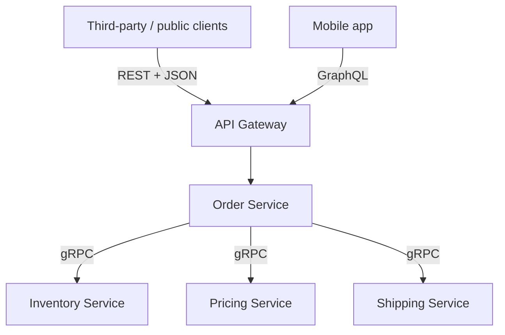

### 15.2.2 Schema evolution and gRPC operations

#### Concept

A protobuf schema is a contract between services that are deployed independently, so it must evolve without breaking either side. Protobuf's design — identifying fields by **number**, not name, and making fields optional — supports backward- and forward-compatible evolution if you follow the rules. The main operational concerns beyond the schema are load balancing (HTTP/2 is sticky), and reaching gRPC from the browser (gRPC-Web and gateways).

#### Why does it exist?

Services deploy on their own schedules, so at any moment an old client may talk to a new server or vice versa. If a schema change broke that, every change would require a lockstep deploy of all services — impossible at scale. Protobuf's field-number identity and optional fields make most changes compatible, so a new server with an extra field still works with an old client, and an old server ignores a new field it does not understand. The rules exist to preserve this, and breaking them causes exactly the cross-version failures Part 24 warns about.

#### How it works — the compatibility rules

```proto
message Order {
  string id = 1;
  string status = 2;
  int32 total_cents = 3;
  repeated OrderItem items = 4;
  string currency = 5;          // ADD: new fields get a new number; old code ignores it (safe)
  reserved 6;                    // RESERVE a retired number so it is never reused
  reserved "old_field_name";     // RESERVE a retired name too
}
```

The rules that keep protobuf compatible:

- **Never change a field's number.** The number is its identity on the wire; changing it makes old and new code disagree about what the field is. This is the cardinal rule.
- **Never reuse a retired field's number.** When you remove a field, `reserved` its number (and name) so a future field cannot accidentally reuse it and misinterpret old data.
- **Add new fields with new numbers.** Old code ignores them (forward compatible); new code reading old data sees them as default (backward compatible).
- **Do not change a field's type incompatibly.** Some type changes are compatible, many are not; treat a type change as potentially breaking.
- **Removing or renaming** a field is a breaking-ish change to callers that use it; deprecate and migrate (Part 24), and reserve the number.

This is the same backward/forward compatibility discipline as Part 24 (schema and API compatibility), expressed through protobuf's field numbers. Follow it and services evolve independently; break it and you get subtle data corruption across versions.

Which type changes are actually safe on the wire? Protobuf encodes each field as a number plus a **wire type** (varint, 64-bit, length-delimited, 32-bit). Two types are wire-compatible when they share a wire type and decode to the same value:

| Change | Wire-safe? | What really happens |
|---|---|---|
| `int32` -> `int64` | Yes | Same varint; old readers truncate values above 2^31 |
| `int32` <-> `uint32` / `bool` | Mostly | Same varint; negative numbers and values > 1 change meaning |
| `int32` -> `sint32` | No | Different (zigzag) encoding; -1 becomes a huge number |
| `string` <-> `bytes` | Mostly | Same wire type; fails only if bytes are not valid UTF-8 |
| `string` -> `int32` | No | Different wire type; old readers drop or misread the field |
| Singular -> `repeated` (scalar) | Risky | Old readers keep only the last element |
| Adding an `enum` value | Yes, with care | Old readers see an unknown number; always define `0 = UNSPECIFIED` |
| Moving a field into a `oneof` | Risky | Presence semantics change for existing readers |
| Renaming a field | Wire-safe | Breaks JSON mapping, generated code and `grpc-gateway` URLs |

Rules on paper get broken under deadline pressure, so enforce them in CI. `buf` compares the current `.proto` files with the main branch and fails the build on a breaking change:

```yaml
# buf.yaml (v2) -- lint and breaking-change rules for the proto directory
version: v2
modules:
  - path: proto
lint:
  use: [STANDARD]          # package versioning (orders.v1), naming, enum zero values
breaking:
  use: [FILE]              # field number, type, name and deletion checks per file
```

```bash
# In the pipeline: fail if this branch breaks the contract published on main
buf lint
buf breaking --against '.git#branch=main'
# Example failure:
# proto/orders/v1/orders.proto:14:3:Field "3" with name "total_cents" on message "Order"
#   changed type from "int32" to "string".
```

For a change that truly must break (a redesign), do not edit `orders.v1`: add `orders.v2` as a new package, serve both from the same NestJS app, migrate callers, and retire v1 once its call count is zero. That is versioning at the package level, the protobuf equivalent of `/v2` in REST.

#### Failure scenario

A payments team removed the deprecated field `string coupon_code = 7;` from `Order` and, a sprint later, added `int64 discount_cents = 7;` because 7 looked free. Nobody had written `reserved 7;`. The order service was deployed first; the old reporting service still decoded field 7 as a string. For two days, reports showed garbled coupon codes for every discounted order, and an automated reconciliation job flagged 41,000 orders as "unknown coupon" and paused their payouts. No error was logged anywhere, because the bytes decoded without failing. The fix was to move `discount_cents` to field 12, reserve 7 and its name, and add `buf breaking` to CI, which reports a reused number as a deletion plus an incompatible addition. The lesson: protobuf compatibility failures are silent; the only defence is reserving numbers and a machine check.

#### Edge cases & failure modes

- **Unknown fields dropped by a middleman**: a service that decodes and re-encodes a message with an old schema can strip fields it does not know; pass messages through as bytes or keep middlemen on the latest schema.
- **Enum without a zero value**: proto3 requires the first value to be 0; make it `STATUS_UNSPECIFIED` so "not set" is never mistaken for a real status.
- **Required semantics**: proto3 has no required fields; validate presence in the handler, or with `optional` plus a check.
- **Field number 19000–19999**: reserved by protobuf itself; numbers 1–15 take one byte on the wire, so give them to the most frequent fields.
- **JSON transcoding**: renaming a field is wire-safe but breaks JSON clients behind a REST gateway (15.8), because JSON uses names.
- **Generated code in many repos**: if each service vendors its own copy of the `.proto`, they drift; publish the contract from one repository or a schema registry such as the Buf Schema Registry.

#### How it works — load balancing and gRPC-Web

**Load balancing**: because gRPC runs over long-lived HTTP/2 connections that multiplex many calls, a naive connection-level load balancer sends all of one client's calls to one server (sticky), causing uneven load. gRPC load balancing is therefore done at the request level (client-side load balancing or an L7 proxy/service mesh that understands HTTP/2), so individual calls spread across servers. This is a known gRPC operational consideration (see Part 45 — Cloud Architecture, 45.7 Load balancing and the API edge, and the full treatment in 15.8).

**gRPC-Web and gateways**: browsers cannot make raw gRPC calls (they lack the needed HTTP/2 control). **gRPC-Web** is a variant that works in browsers via a proxy that translates between gRPC-Web and gRPC. Alternatively, a **gateway** exposes a REST/JSON or GraphQL facade in front of gRPC services for external clients. The common pattern: gRPC internally between services, a gateway (REST or GraphQL) for the public and the browser (15.3).

#### How a Senior Backend Engineer thinks about this

A senior treats the `.proto` as a shared contract under the same compatibility discipline as any API (Part 24): never change or reuse field numbers, add fields with new numbers, reserve retired numbers, and deprecate rather than remove. They know gRPC's HTTP/2 connections need request-level load balancing (client-side or an L7 proxy/mesh), not naive connection-level balancing, or load concentrates on a few servers. They expose gRPC to browsers only through gRPC-Web with a proxy or, more commonly, through a REST/GraphQL gateway, keeping raw gRPC internal. They apply deadlines and the right status codes so the whole mesh behaves well under failure (see Part 30 — Reliability Engineering).

#### Common mistakes

- Changing or reusing a field number, corrupting data across versions.
- Removing a field without reserving its number, so a future field reuses it.
- Connection-level load balancing of gRPC, concentrating load on few servers.
- Trying to call raw gRPC from a browser without gRPC-Web or a gateway.

#### Interview questions

1. **What are the protobuf rules for compatible schema evolution?** Never change or reuse field numbers, add fields with new numbers, reserve retired numbers and names, avoid incompatible type changes, and deprecate rather than remove — so independently deployed services stay compatible.
2. **Why is gRPC load balancing different from REST?** gRPC uses long-lived multiplexed HTTP/2 connections, so connection-level balancing is sticky; you need request-level balancing (client-side or an L7 proxy/mesh) to spread calls.
3. **How do browsers use gRPC services?** Not directly — via gRPC-Web through a translating proxy, or via a REST/GraphQL gateway in front of the gRPC services.
4. **Why do protobuf field numbers matter more than names?** Numbers are the field identity on the wire; changing one makes old and new code disagree about the data, causing corruption.
5. **How do you stop a breaking `.proto` change from reaching production?** Run `buf lint` and `buf breaking --against` the main branch in CI, review `.proto` diffs like database migrations, and keep one source of truth for the contract. Follow-up: what if the break is intentional? Publish a new package version (`orders.v2`), serve both, and migrate callers.
6. **Is changing `int32` to `int64` safe?** On the wire, yes (both are varints), but readers still on `int32` truncate large values, and in JavaScript `int64` arrives as a string or `Long` depending on loader options; treat it as a coordinated change.

#### Practical exercise

Evolve the `Order` protobuf by adding a `currency` field with a new number, then simulate removing an old field by reserving its number and name. Verify that an old client and a new server interoperate after the additive change. Then describe how you would load-balance this gRPC service and expose it to a browser. Acceptance criteria: the additive change is backward/forward compatible, the retired number is reserved, and you can explain request-level load balancing and the gRPC-Web/gateway options.

## 15.3 Choosing REST, GraphQL or gRPC

### 15.3.1 The decision and the combined architecture

#### Concept

REST, GraphQL and gRPC are three tools for three situations, not competitors where one wins. The senior skill is matching each to where it fits: REST for simple, public, cacheable APIs; GraphQL for flexible, nested data to rich clients (mobile, complex frontends); gRPC for fast, typed, high-volume internal service-to-service communication. A mature system often uses all three at once.

#### Why does it exist?

Each style optimizes for different things. REST optimizes for simplicity, universality and HTTP caching. GraphQL optimizes for client flexibility and few round trips. gRPC optimizes for internal performance and typed contracts. No single style is best at all three, so forcing one everywhere means paying its weaknesses where another's strengths were needed. Choosing per situation gives you each strength where it matters.

#### Practical example

Real boundaries and what wins at each:

| Scenario | Choice | Deciding reason |
|---|---|---|
| Public partner API for order status | REST | Partners use any language and `curl`; HTTP caching and OpenAPI docs; long-term stability |
| Mobile app order-history and order-detail screens | GraphQL | Many screen-specific shapes, one round trip over 4G, app releases ship weekly |
| Checkout calling inventory, pricing, shipping 6,000 times a second | gRPC | Typed contract, low overhead, deadline propagation, HTTP/2 multiplexing |
| Webhooks to merchants when an order ships | REST (HTTP POST) | Receivers are arbitrary HTTP servers (Part 14, 14.17 Webhooks) |
| Internal admin dashboard in the browser | REST or GraphQL | Browser-native; gRPC would need gRPC-Web and a proxy |
| Driver app streaming GPS points every 2 seconds | gRPC streaming or WebSocket | Long-lived stream; see Part 34 — Real-Time Systems |
| Nightly bulk export to the data warehouse | Neither: files or CDC | Bulk data moves better as files or change streams (Part 38) |

#### How it works — the decision matrix

| Factor | REST | GraphQL | gRPC |
|---|---|---|---|
| Best for | Public APIs, simple CRUD | Mobile/complex frontends needing tailored nested data | Internal service-to-service |
| Format | JSON (text, human-readable) | JSON | Binary protobuf (compact) |
| Transport | HTTP/1.1 or 2 | HTTP (usually POST) | HTTP/2 |
| Client flexibility | Fixed shapes | Client picks fields | Fixed (typed contract) |
| HTTP caching | Easy (by URL) | Harder (rebuild at entity/client) | Not applicable |
| Browser-native | Yes | Yes | No (needs gRPC-Web/gateway) |
| Typed contract | Via OpenAPI (optional) | Via schema | Strong (protobuf, generated) |
| Round trips for nested data | Many | One | Few (and streaming) |
| Main risk | Over/under-fetching | N+1, query cost, caching | Not for public/browser |
| Debuggability | High (readable) | Medium | Lower (binary) |

```text
Choose REST when:            Choose GraphQL when:          Choose gRPC when:
- public or third-party API  - mobile app / rich frontend  - internal service-to-service
- simple CRUD resources      - many client-specific shapes - high volume, perf-sensitive
- HTTP caching matters       - few round trips needed      - streaming between services
- maximum simplicity/        - a backend-for-frontend      - a strict typed contract
  compatibility/debuggability                              - deadline propagation in a mesh
```

#### The combined architecture (the worked example)



The order service exposes **REST publicly** for third-party integrations and simple cacheable reads (its simplicity and HTTP caching win there), **GraphQL for the mobile app** so a screen's nested data comes in one round trip with only the fields it needs, and talks **gRPC internally** to inventory, pricing and shipping services for fast, typed, high-volume calls with deadline propagation. Each style is used exactly where its strengths apply and its weaknesses do not matter. This is not over-engineering; it is matching the tool to the job, and it is a common real architecture.

#### Failure scenario

A team rebuilt its public partner API in GraphQL "so partners only fetch what they need". Six months later, CDN hit rate had dropped from 85% to almost zero, origin traffic had tripled, and partner support tickets were dominated by "how do I write this query" and "why did I get HTTP 200 with an error". Two large partners with Java batch jobs refused to migrate and kept calling the old REST endpoints, so the team now ran both. The GraphQL layer stayed, but only for the team's own mobile app; the public API went back to REST with sparse fieldsets (`?fields=id,status`). The lesson matches 61.3 in Part 61: GraphQL helps clients you control and ship together with the server; it hurts consumers you do not control.

#### Edge cases & failure modes

- **One style everywhere**: forcing REST onto a chatty internal mesh, or gRPC onto browsers, pays a style's weaknesses where another style's strengths were available.
- **Duplicated business logic per protocol**: three adapters that each re-implement validation drift apart; keep one domain service and thin protocol adapters (15.9).
- **Inconsistent errors across protocols**: the same "out of stock" becomes a 409, a `BAD_USER_INPUT` and a `FAILED_PRECONDITION`; define one domain error and map it once per adapter.
- **Gateway as a bottleneck**: a REST or GraphQL gateway in front of gRPC services is now on every request path; give it its own capacity planning, timeouts and circuit breakers.
- **Auth gaps between edges**: the public edge checks API keys, but the internal gRPC port is reachable from anywhere in the cluster; use mTLS or network policies internally too.

#### How a Senior Backend Engineer thinks about this

A senior chooses the API style per boundary, not per company. For the public edge they default to REST for its simplicity, universality, cacheability and debuggability, reaching for GraphQL only when a rich client's data-fetching pain (over/under-fetching, many round trips) genuinely justifies the added server complexity and the N+1/caching/query-cost work it brings. For internal service-to-service traffic at volume they reach for gRPC's efficiency and typed contracts, while keeping it off the public edge. They are comfortable running all three in one system, because that is often the right answer, and they resist both the dogma that REST is always enough and the hype that GraphQL or gRPC should be everywhere. The question is always "what does this specific boundary need?"

#### Common mistakes

- Forcing one style everywhere out of dogma or hype.
- Using GraphQL for a simple public API, taking on its complexity for no benefit.
- Using gRPC at the public/browser edge, fighting its lack of browser support.
- Using REST for high-volume internal calls where gRPC's efficiency and typing would help.
- Not considering a combined architecture where each style serves its natural boundary.

#### Interview questions

1. **When do you choose REST, GraphQL and gRPC respectively?** REST for simple, public, cacheable APIs; GraphQL for rich clients needing tailored nested data in few round trips; gRPC for high-volume, performance-sensitive, typed internal service-to-service communication.
2. **Why not use GraphQL everywhere?** It adds server complexity (N+1, query-cost limits, rebuilt caching) and is overkill for simple public CRUD where REST's simplicity and HTTP caching win.
3. **Why keep gRPC internal?** Browsers cannot speak it directly, its binary format is not human-readable, and it offers no HTTP caching; REST/GraphQL serve external clients better.
4. **Describe a realistic architecture using all three.** REST for public/third-party, GraphQL for the mobile app via a gateway/BFF, gRPC internally between services — each at the boundary where its strengths fit.
5. **How do you avoid triplicating business logic when one service speaks REST, GraphQL and gRPC?** One domain service owns validation, rules and transactions; REST controllers, GraphQL resolvers and gRPC handlers are thin adapters that map input, call the service and map errors. Follow-up: where do authorization checks live? In the domain service (or a policy it calls), so no adapter can skip them.

#### Practical exercise

For the order system, write a one-page decision (an ADR, Part 61) specifying which API style serves the public/third-party edge, the mobile app, and the internal inventory/pricing/shipping calls, with justifications tied to each style's strengths and the concrete needs (caching, nested data, performance, typing, browser support). Acceptance criteria: each choice follows from stated requirements, and the decision explicitly rejects the styles not chosen for each boundary with reasons.
