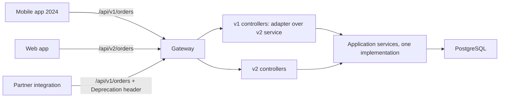

## 15.9 Error responses

#### Concept

An error response has three jobs: tell a machine what kind of failure it was (status code and a stable error `type`), tell a human what to do about it (`title`, `detail`), and give operators a way to find it in the logs (correlation id). RFC 9457 (which replaced RFC 7807) standardises the shape as **Problem Details**, media type `application/problem+json`:

```json
{
  "type": "https://errors.example.com/order-not-cancellable",
  "title": "Order cannot be cancelled",
  "status": 409,
  "detail": "Order 8f3c... is FULFILLED; fulfilled orders cannot be cancelled.",
  "instance": "/api/v1/orders/8f3c.../cancellations",
  "code": "ORDER_NOT_CANCELLABLE",
  "correlationId": "req_01J7Q8Z...",
  "errors": [ { "field": "reason", "message": "must not be empty" } ]
}
```

`type`, `title`, `status`, `detail`, `instance` are the standard members. `code`, `correlationId` and `errors` are extensions, which the RFC explicitly allows.

#### Why does it exist?

Without a standard shape, every endpoint invents its own: `{ error: "..." }`, `{ message: "..." }`, `{ errors: [...] }`, a bare string. Clients write a parser per endpoint. Support cannot find the request in the logs. And the most dangerous variant, the default framework 500, leaks stack traces, file paths and SQL to the internet.

A stable `type`/`code` catalogue lets clients branch on errors without string-matching English text that will change.

#### Mental model

Imagine an airline's rejection slip. It has a code (`OVERBOOKED-17`), a plain explanation, the flight number and a reference the call centre can look up. You would not accept a slip that just says "Error" or one that prints the airline's internal database dump.

#### How it works

1. Domain and application code throws typed errors (`OrderStateError`, `ConcurrencyError`, `CustomerBlockedError`).
2. A single **global exception filter** catches everything, maps each error class to a status and a problem `type`, attaches the correlation id, logs the full error server-side, and returns the problem body.
3. `HttpException` subclasses thrown from controllers and guards pass through with their status.
4. Anything unknown becomes a 500 with a generic title, the correlation id, and nothing else.
5. The **error catalogue** is one file, versioned with the API, listing every `code`, its status, and when it happens. It is also emitted into the OpenAPI document.

The catalogue for the orders API:

| Code | Status | Type suffix | When |
|---|---|---|---|
| `VALIDATION_FAILED` | 400 | `/validation` | DTO validation failed; `errors[]` lists fields |
| `UNAUTHENTICATED` | 401 | `/unauthenticated` | Missing or invalid token |
| `FORBIDDEN` | 403 | `/forbidden` | Not allowed; also used for blocked customers |
| `NOT_FOUND` | 404 | `/not-found` | Resource missing or not visible |
| `ORDER_NOT_CANCELLABLE` | 409 | `/order-not-cancellable` | State forbids the transition |
| `VERSION_CONFLICT` | 409 / 412 | `/version-conflict` | Optimistic lock failed (412 when `If-Match` was used) |
| `IDEMPOTENCY_KEY_REUSED` | 422 | `/idempotency-key-reused` | Same key, different payload |
| `UNKNOWN_SKU` | 422 | `/unknown-sku` | SKU not in catalog |
| `INSUFFICIENT_STOCK` | 422 | `/insufficient-stock` | Cannot reserve |
| `PAYLOAD_TOO_LARGE` | 413 | `/payload-too-large` | Body above limit |
| `RATE_LIMITED` | 429 | `/rate-limited` | See 15.13; `Retry-After` set |
| `UPSTREAM_UNAVAILABLE` | 503 | `/upstream-unavailable` | Catalog/ERP/payment provider down or timed out |
| `INTERNAL` | 500 | `/internal` | Anything unexpected |

#### NestJS example

The domain error base and the filter. The filter uses `HttpAdapterHost` so it works with Express and Fastify.

```ts
// src/shared/domain/domain-error.ts
export abstract class DomainError extends Error {
  abstract readonly code: string;
  abstract readonly httpStatus: number;
  constructor(message: string, public readonly details?: Record<string, unknown>) {
    super(message);
    this.name = new.target.name;
  }
}

// src/ordering/domain/errors.ts
export class OrderNotFoundError extends DomainError {
  readonly code = 'NOT_FOUND'; readonly httpStatus = 404;
  constructor(id: string) { super(`Order ${id} not found`, { orderId: id }); }
}
export class OrderStateError extends DomainError {
  readonly code = 'ORDER_NOT_CANCELLABLE'; readonly httpStatus = 409;
}
export class OrderInvariantError extends DomainError {
  readonly code = 'ORDER_INVARIANT_VIOLATED'; readonly httpStatus = 422;
}
export class UnknownSkuError extends DomainError {
  readonly code = 'UNKNOWN_SKU'; readonly httpStatus = 422;
  constructor(sku: string) { super(`SKU ${sku} does not exist`, { sku }); }
}
export class CustomerBlockedError extends DomainError {
  readonly code = 'FORBIDDEN'; readonly httpStatus = 403;
  constructor(customerId: string) { super('Customer is not allowed to place orders'); }
}
// src/shared/domain/errors.ts
export class ConcurrencyError extends DomainError {
  readonly code = 'VERSION_CONFLICT'; readonly httpStatus = 409;
}
```

```ts
// src/shared/api/problem-details.filter.ts
import { ArgumentsHost, Catch, ExceptionFilter, HttpException, HttpStatus, Logger } from '@nestjs/common';
import { HttpAdapterHost } from '@nestjs/core';
import { ValidationError } from 'class-validator';
import { DomainError } from '../domain/domain-error';

const ERROR_BASE = 'https://errors.example.com';

export interface ProblemDetails {
  type: string; title: string; status: number; detail?: string; instance?: string;
  code: string; correlationId?: string; errors?: Array<{ field: string; message: string }>;
}

@Catch()
export class ProblemDetailsFilter implements ExceptionFilter {
  private readonly log = new Logger(ProblemDetailsFilter.name);
  constructor(private readonly adapterHost: HttpAdapterHost) {}

  catch(exception: unknown, host: ArgumentsHost): void {
    const { httpAdapter } = this.adapterHost;
    const ctx = host.switchToHttp();
    const req = ctx.getRequest();
    const res = ctx.getResponse();
    const correlationId: string | undefined = req.headers['x-correlation-id'] ?? req.id;
    const instance = httpAdapter.getRequestUrl(req);

    const problem = this.toProblem(exception, instance, correlationId);

    if (problem.status >= 500) {
      // Full detail stays server-side. Never in the body.
      this.log.error({ msg: 'unhandled error', correlationId, instance, err: exception });
    } else {
      this.log.warn({ msg: 'client error', correlationId, instance, code: problem.code, status: problem.status });
    }

    httpAdapter.setHeader(res, 'Content-Type', 'application/problem+json');
    if (correlationId) httpAdapter.setHeader(res, 'X-Correlation-Id', correlationId);
    httpAdapter.reply(res, problem, problem.status);
  }

  private toProblem(ex: unknown, instance: string, correlationId?: string): ProblemDetails {
    if (ex instanceof DomainError) {
      return {
        type: `${ERROR_BASE}/${ex.code.toLowerCase().replace(/_/g, '-')}`,
        title: humanize(ex.code), status: ex.httpStatus, detail: ex.message, instance, code: ex.code, correlationId,
      };
    }
    if (ex instanceof HttpException) {
      const status = ex.getStatus();
      const body = ex.getResponse();
      // ValidationPipe throws BadRequestException with { message: string[] | ValidationError[] }
      const errors = extractValidationErrors(body);
      const code = status === 400 && errors ? 'VALIDATION_FAILED' : codeForStatus(status);
      return {
        type: `${ERROR_BASE}/${code.toLowerCase().replace(/_/g, '-')}`,
        title: humanize(code), status, instance, code, correlationId,
        detail: typeof body === 'string' ? body : (body as { message?: string }).message?.toString(),
        ...(errors ? { errors } : {}),
      };
    }
    // Unknown: hide everything.
    return { type: `${ERROR_BASE}/internal`, title: 'Internal Server Error', status: HttpStatus.INTERNAL_SERVER_ERROR,
             instance, code: 'INTERNAL', correlationId, detail: 'An unexpected error occurred. Quote the correlationId when contacting support.' };
  }
}

function codeForStatus(s: number): string {
  return ({ 400: 'BAD_REQUEST', 401: 'UNAUTHENTICATED', 403: 'FORBIDDEN', 404: 'NOT_FOUND', 405: 'METHOD_NOT_ALLOWED',
            409: 'CONFLICT', 412: 'VERSION_CONFLICT', 413: 'PAYLOAD_TOO_LARGE', 415: 'UNSUPPORTED_MEDIA_TYPE',
            422: 'UNPROCESSABLE', 428: 'PRECONDITION_REQUIRED', 429: 'RATE_LIMITED', 503: 'UPSTREAM_UNAVAILABLE' } as Record<number, string>)[s] ?? 'INTERNAL';
}
function humanize(code: string): string { return code.toLowerCase().split('_').map((w) => w[0].toUpperCase() + w.slice(1)).join(' '); }
function extractValidationErrors(body: unknown): Array<{ field: string; message: string }> | undefined {
  const msg = (body as { message?: unknown })?.message;
  if (!Array.isArray(msg)) return undefined;
  if (msg.every((m) => typeof m === 'string')) return msg.map((m: string) => ({ field: m.split(' ')[0], message: m }));
  const flat: Array<{ field: string; message: string }> = [];
  const walk = (errs: ValidationError[], prefix = '') => errs.forEach((e) => {
    const path = prefix ? `${prefix}.${e.property}` : e.property;
    Object.values(e.constraints ?? {}).forEach((message) => flat.push({ field: path, message }));
    if (e.children?.length) walk(e.children, path);
  });
  walk(msg as ValidationError[]);
  return flat;
}
```

Register it once in `main.ts`:

```ts
const adapterHost = app.get(HttpAdapterHost);
app.useGlobalFilters(new ProblemDetailsFilter(adapterHost));
```

Correlation ids come from a middleware that reads `X-Correlation-Id` (or `traceparent` when using OpenTelemetry, Part 42) or generates one, and attaches it to `req.id` and the logger context. The same id appears in every log line for that request and in the error body, which is what lets support paste it into the log search.

#### PostgreSQL example

The database has its own error codes; the repository layer translates the ones the API cares about so they surface as domain errors rather than 500s:

```sql
-- SQLSTATE 23505 unique_violation  -> ConcurrencyError / DuplicateIdempotencyKeyError -> 409 / 422
-- SQLSTATE 23503 foreign_key_violation -> OrderInvariantError -> 422
-- SQLSTATE 23514 check_violation -> OrderInvariantError -> 422
-- SQLSTATE 40001 serialization_failure, 40P01 deadlock_detected -> retry once, then 503
-- SQLSTATE 57014 query_canceled (statement_timeout) -> 503 with Retry-After
```

```ts
// in a repository
catch (err) {
  const code = (err as { code?: string }).code;
  if (code === '23505') throw new ConcurrencyError('duplicate key');
  if (code === '23514' || code === '23503') throw new OrderInvariantError('constraint violated');
  if (code === '40001' || code === '40P01') throw new TransientDbError();   // application layer retries once
  throw err;
}
```

#### Production scenario

A payments API served 40 error codes through one filter. The mobile SDK switched on `code` and showed localised messages; the `detail` string was for developers only. When the backend changed a `detail` from "Card declined by issuer" to "Card declined (do not honour)", no client broke because none of them parsed it. Support resolved "it says error" tickets in one step by asking for the correlation id shown on the error screen.

#### Failure scenario

A new NestJS service went live with no global filter. A `TypeError` deep in a mapper produced the default NestJS 500 body, which in this deployment (NODE_ENV unset) included the stack trace: file paths under `/app/src/payments/infrastructure/stripe/`, the Stripe API version, and a query with a customer's email. A security researcher reported it within a day. The fix took an hour; the disclosure process took a month.

#### Edge cases & failure modes

- **Stack traces in bodies.** Never, in any environment reachable from outside.
- **Error bodies without `Content-Type: application/problem+json`**: clients cannot detect the shape.
- **Different shapes from gateway, framework and app.** Configure the gateway to emit problem+json for its own 429/503 too, or accept two shapes and document both.
- **`detail` containing user input** (`"SKU <script>..."`) reflected into a web page by a careless client. Escape or avoid echoing raw input.
- **Losing the correlation id across async boundaries** (queues, workers). Propagate it in message headers.
- **Filters that swallow errors** and return 200. Test the filter.
- **Unique-violation on an idempotency key mis-mapped to 409** when the client expects the original resource back; the idempotency layer (15.12) must intercept before the generic mapping.

#### How a Senior Backend Engineer thinks about this

One shape, one filter, one catalogue. They review new error codes like new API fields: is the `code` stable, is the status right, does the client need to branch on it? They keep `detail` human and non-contractual. They log the full exception server-side with the correlation id and nothing sensitive client-side.

#### Common mistakes

- `catch (e) { throw new InternalServerErrorException(e.message) }` everywhere, hiding the real status.
- Error messages as the contract (`if (err.message === 'Order not found')`).
- A different envelope for success (`{ data }`) and error (`{ error }`) that requires clients to check both.
- Returning the ValidationPipe's raw `message: string[]` without field names.

#### Interview questions

1. *Describe RFC 9457 Problem Details and why you would use it.* Expected: standard members, media type, extensions, client branching on `type`/`code`.
2. *How do you map domain errors to HTTP in NestJS without scattering `HttpException` through the domain?* Expected: typed domain errors with a status hint; one global filter.
3. *What must never appear in an error response?* Expected: stack traces, internal paths, SQL, secrets, other users' data.
4. *How does a support engineer go from a customer's screenshot to the server log?* Expected: correlation id in body and logs, propagated through async work.

#### Practical exercise

Implement the filter above, the error catalogue as a TypeScript `const` used by both the filter and the OpenAPI document, and a correlation-id middleware. Write e2e tests asserting: a thrown `OrderStateError` yields 409 problem+json with `code: ORDER_NOT_CANCELLABLE`; a thrown `TypeError` yields 500 with no stack and a correlation id; a validation failure yields `errors[]` with dotted field paths for nested DTOs. Acceptance criteria: all bodies have `Content-Type: application/problem+json`; the catalogue has no duplicate codes; a snapshot test freezes the shape.

## 15.10 Validation

#### Concept

Validation rejects requests whose shape or content cannot be processed, as early as possible, with a precise error. In NestJS the standard stack is `class-validator` (rules as decorators on DTO classes) plus `class-transformer` (turning raw JSON into DTO instances) driven by `ValidationPipe`.

Validation happens in layers: **transport** (JSON parse, size limits), **shape** (DTO: types, required, ranges, formats), **meaning** (domain: value objects, invariants), **integrity** (database constraints). Each layer catches what the previous cannot.

#### Why does it exist?

Every byte from a client is hostile until proven otherwise. Unvalidated input is how you get `quantity: -1` refunds, `"__proto__"` keys that pollute prototypes, 50 MB bodies that exhaust memory, regular expressions that run for minutes, and SQL injection through sort parameters. Validation is also documentation: a well-decorated DTO *is* the request schema, and `@nestjs/swagger` reads the same decorators.

#### Mental model

Imagine airport security in layers. The check-in desk rejects passengers without tickets (transport). The scanner rejects bags with forbidden shapes (DTO). The gate agent rejects a valid ticket for the wrong flight (domain). The aircraft door is counted one last time (database). Nobody relies on a single checkpoint.

#### How it works

The `ValidationPipe` options that matter, and what each prevents:

| Option | Effect | Without it |
|---|---|---|
| `whitelist: true` | Strips properties that have no decorator on the DTO | Unknown fields pass through to services and ORMs; mass assignment |
| `forbidNonWhitelisted: true` | Rejects (400) instead of stripping unknown properties | Typos silently ignored (`staus`), attackers probe fields quietly |
| `transform: true` | Returns a real DTO instance (and converts primitives with `@Type`) | You get a plain object; `instanceof` and methods fail; query params stay strings |
| `transformOptions.enableImplicitConversion` | Converts by TypeScript type without `@Type` | Convenient but dangerous: `"false"` becomes `true` for booleans; prefer explicit `@Type` |
| `forbidUnknownValues: true` (default since 0.14) | Rejects objects that are not DTO instances | Empty-class DTOs pass anything |
| `stopAtFirstError: false` | Report all errors | Clients fix one field at a time |
| `validationError.target: false, value: false` | Do not echo the object or value in errors | Passwords and PII reflected in error bodies |
| `disableErrorMessages` | Hide messages entirely (rare) | |

**Prototype pollution.** `class-transformer`'s `plainToInstance` copies properties from the raw object onto a new instance. Without `whitelist`, a body like `{ "__proto__": { "isAdmin": true } }` or `{ "constructor": { "prototype": { ... } } }` can end up on objects or, with older versions, on `Object.prototype`. `whitelist: true` (only decorated properties survive) closes the door; so does a JSON parser that rejects `__proto__` keys. Use both.

**ReDoS.** A `@Matches(/^(a+)+$/)` on a user-controlled string is a denial-of-service: a 30-character non-matching input takes seconds. Keep regexes linear (no nested quantifiers, no overlapping alternations), cap length with `@MaxLength` *before* `@Matches` (decorators run in declaration order bottom-up in class-validator, so put the cheap check where it runs first; simplest is to test both), and prefer built-in validators (`@IsEmail`, `@IsUUID`, `@IsISO8601`) which are vetted.

**Size limits.** Body size is enforced before validation by the body parser (`json({ limit: '1mb' })`). Array lengths (`@ArrayMaxSize`), string lengths (`@MaxLength`) and nesting depth (avoid arbitrary recursion in DTOs) are enforced by the DTO.

#### NestJS example

Global pipe configuration, body limit, and a DTO exercising nested validation, custom validators and query/path validation.

```ts
// src/main.ts
import { ValidationPipe, BadRequestException } from '@nestjs/common';
import { json, urlencoded } from 'express';

const app = await NestFactory.create(AppModule, { bodyParser: false, rawBody: true }); // rawBody for webhook HMAC (8.17)
app.use(json({ limit: '1mb', strict: true }));          // strict: only objects/arrays at top level
app.use(urlencoded({ extended: false, limit: '100kb' }));
app.useGlobalPipes(new ValidationPipe({
  whitelist: true,
  forbidNonWhitelisted: true,
  transform: true,
  forbidUnknownValues: true,
  validationError: { target: false, value: false },
  exceptionFactory: (errors) => new BadRequestException({ message: errors }), // filter (8.9) flattens ValidationError[]
}));
```

```ts
// src/ordering/api/dto/create-order.dto.ts (with a custom validator)
import { Type } from 'class-transformer';
import {
  ArrayMaxSize, ArrayMinSize, IsArray, IsIn, IsInt, IsOptional, IsString, Length, Matches, Max, MaxLength, Min,
  ValidateNested, registerDecorator, ValidationArguments, ValidationOptions,
} from 'class-validator';

const SUPPORTED_CURRENCIES = ['INR', 'USD', 'EUR'] as const;

/** Custom validator: all lines must have distinct SKUs. Runs on the array as a whole. */
function UniqueBy(key: string, options?: ValidationOptions) {
  return (object: object, propertyName: string) => registerDecorator({
    name: 'uniqueBy', target: object.constructor, propertyName, options: { message: `${propertyName} contains duplicate ${key}`, ...options },
    validator: {
      validate(value: unknown) {
        if (!Array.isArray(value)) return false;
        const seen = new Set(value.map((v) => (v as Record<string, unknown>)?.[key]));
        return seen.size === value.length;
      },
    },
  });
}

class LineDto {
  @IsString() @MaxLength(64) @Matches(/^[A-Z0-9-]+$/) sku: string;   // linear regex; MaxLength bounds it
  @IsInt() @Min(1) @Max(10000) quantity: number;
}
class AddressDto {
  @IsString() @Length(1, 200) line1: string;
  @IsOptional() @IsString() @MaxLength(200) line2?: string;
  @IsString() @Length(1, 100) city: string;
  @IsString() @Length(3, 12) @Matches(/^[A-Za-z0-9 -]+$/) postalCode: string;
  @IsIn(['IN', 'US', 'GB', 'DE']) countryCode: string;
}
export class CreateOrderDto {
  @IsIn(SUPPORTED_CURRENCIES) currency: (typeof SUPPORTED_CURRENCIES)[number];
  @IsArray() @ArrayMinSize(1) @ArrayMaxSize(100)
  @ValidateNested({ each: true }) @Type(() => LineDto) @UniqueBy('sku')
  lines: LineDto[];
  @ValidateNested() @Type(() => AddressDto) shippingAddress: AddressDto;
  @IsOptional() @IsString() @MaxLength(500) customerNote?: string;
}
```

Query and path params go through the same pipe when you use a DTO class for `@Query()` and pipes for `@Param()`:

```ts
@Get()
list(@Query() q: ListOrdersQueryDto) { /* q.limit is a number thanks to @Type(() => Number) */ }

@Get(':id')
getOne(@Param('id', new ParseUUIDPipe({ version: '4' })) id: string) { /* 400 on junk before the service runs */ }
```

For conditional rules use `@ValidateIf((o) => o.paymentMethod === 'CARD')` on the card fields. For cross-field rules that are really business rules ("gift wrap requires a message"), prefer the domain layer; DTOs validate shape.

#### PostgreSQL example

The last layer. Every shape rule that matters for integrity also exists as a constraint, so imports, scripts and other services cannot bypass it:

```sql
ALTER TABLE ordering.order_lines
  ADD CONSTRAINT chk_sku_format CHECK (sku ~ '^[A-Z0-9-]{1,64}$'),
  ADD CONSTRAINT chk_qty_range  CHECK (quantity BETWEEN 1 AND 10000);
ALTER TABLE ordering.orders
  ADD CONSTRAINT chk_currency CHECK (currency IN ('INR','USD','EUR')),
  ADD CONSTRAINT chk_note_len CHECK (char_length(customer_note) <= 500);
```

#### Production scenario

An API handled 3,000 RPS with validation on every request. `ValidationPipe` cost about 40 µs per typical order body (three lines, one address), under 1% of request time. The one expensive validator was a home-grown `@Matches` for postal codes with a 40-alternative regex; replacing it with a per-country lookup table and a simple regex cut it from 300 µs to 5 µs. Validation is cheap unless you make it expensive.

#### Failure scenario

At 11:50 the API's event loop lag alarm fired: p99 latency 8 s, CPU 100% on all pods, RPS unchanged. A single client was sending `customerNote` values of 5,000 characters shaped like `aaaaaaaa...!` against a validator `@Matches(/^([a-z]+\s?)+$/)` (nested quantifier). Each request pinned a core for 2 to 4 seconds. Six requests per second were enough to take down twelve pods. The fix: `@MaxLength(500)` first, a linear regex, and a CI check (`safe-regex2` or `recheck`) on every `@Matches` pattern.

#### Edge cases & failure modes

- **`whitelist` off**: mass assignment and prototype pollution.
- **`forbidNonWhitelisted` off**: typos silently return wrong results; probing goes unnoticed.
- **Implicit conversion** turning `"false"` into `true`.
- **Nested DTO without `@Type`**: `@ValidateNested` validates nothing (the value is a plain object, not a class instance) and everything passes.
- **Arrays without `each: true`** on `@ValidateNested`.
- **Numbers from JSON for money**: use strings and parse exactly (Part 14, section 14.5).
- **Unicode tricks**: `@MaxLength` counts UTF-16 code units; a 500-"character" note of emoji is 1,000 units. Decide what you mean and document it.
- **Body limit set on the app but the gateway allows 100 MB**: the app still receives and rejects it after reading; set the limit at the gateway too.
- **Validating in the controller only**: jobs and consumers create invalid data. Value objects and constraints are the backstop.

#### How a Senior Backend Engineer thinks about this

Validation is a security control first and a UX feature second. They set the pipe globally with `whitelist`, `forbidNonWhitelisted` and `transform` on day one, cap every string and array, ban nested-quantifier regexes, and keep a constraint in PostgreSQL for every rule that protects money or integrity.

#### Common mistakes

- Per-controller `@UsePipes(new ValidationPipe())` with inconsistent options.
- `@IsOptional()` on a field that must be present but may be `null` (use `@ValidateIf`).
- `@IsNumber()` on a query param without `@Type(() => Number)`.
- Copying regexes from the internet without checking them for catastrophic backtracking.

#### Interview questions

1. *Explain `whitelist`, `forbidNonWhitelisted` and `transform` and what goes wrong without each.* Expected: the table above; prototype pollution and mass assignment.
2. *What is ReDoS and how do you prevent it in validators?* Expected: nested quantifiers; length caps; linear patterns; CI checks.
3. *Where does validation belong: DTO, domain, or database?* Expected: all three, each for a different class of rule.
4. *How do you validate query params so `limit` is a number and bounded?* Expected: DTO with `@Type(() => Number)`, `@IsInt`, `@Min`, `@Max`.

#### Practical exercise

Configure the global pipe as above and write tests for: an extra field (`400`), `__proto__` in the body (`400`, and `({}).isAdmin` still undefined afterwards), a 2 MB body (`413`), a 20,000-character `customerNote` (`400` within 50 ms), a nested line with `quantity: "2"` (`400`, not coerced), and `limit=abc` (`400`). Acceptance criteria: all pass; a script scans every `@Matches` in the codebase with a ReDoS checker and CI fails on unsafe patterns.

## 15.11 API versioning

#### Concept

Versioning lets you change an API's contract without breaking clients that depend on the old one. The version is a label on the contract; clients pin to it; you keep serving old labels for a published period, then retire them.

Three ways to carry the version:

| Strategy | Example | Pros | Cons |
|---|---|---|---|
| **URI** | `/api/v1/orders` | Visible, cacheable, easy to route at the gateway, easy to test with curl | Version is not really part of the resource identity; `v1` and `v2` orders are the same orders |
| **Header** | `X-API-Version: 2` | URIs stay clean | Invisible in logs and browser; easy to forget; harder to route |
| **Media type** | `Accept: application/vnd.example.orders.v2+json` | The "correct" REST way; per-representation | Almost nobody does it consistently; tooling is weak |

Most teams use URI versioning for the major version and evolve additively within it. NestJS supports all three plus custom extractors via `app.enableVersioning`.

#### Why does it exist?

Because you cannot update all clients at once. A mobile app released today will still be running on some phones in two years. A partner's integration was written by a contractor who left. If you rename `total` to `grandTotal` in place, those clients break silently and the support tickets say "the app crashes". Versioning gives you a way to change while old clients keep working, and a way to tell them when to move.

#### Mental model

Imagine a bank changing its cheque format. It does not invalidate every cheque in circulation overnight; it announces the new format, accepts both for a year with a "please switch" notice, and only then stops honouring the old one. The version number is the cheque series.

#### How it works



The rules that make versioning bearable:

1. **What to version:** the shape of requests and responses, the meaning of fields, URI structure. **What not to version:** bug fixes, added optional fields, added enum values (with care), added endpoints, performance improvements. Adding is not breaking; removing, renaming, retyping or changing meaning is.
2. **Evolve additively inside a major version** as long as possible. A `v2` should be rare, driven by a real redesign, not by one renamed field.
3. **One implementation.** Old versions are thin adapters over the current application services. Never fork the business logic per version.
4. **Announce deprecation in-band.** `Deprecation: true` (or an `@`-prefixed date per the RFC draft), `Sunset: Sat, 01 Aug 2026 00:00:00 GMT`, and a `Link: <https://docs.example.com/migrate-v2>; rel="deprecation"` header on every v1 response. Log which API keys still call v1.
5. **Publish a sunset policy** (for example: "a version is supported for 12 months after its successor ships; 3 months' notice before sunset") and stick to it.
6. **Measure before sunset.** Dashboards of requests per version per client; contact the stragglers; then return 410 Gone with a problem body pointing to the migration guide.

#### NestJS example

URI versioning with a v1 adapter that keeps an old response shape while the service moved on.

```ts
// src/main.ts
app.enableVersioning({ type: VersioningType.URI, defaultVersion: '2' });   // unversioned -> v2

// Header or media-type alternatives (pick one strategy per API):
// app.enableVersioning({ type: VersioningType.HEADER, header: 'X-API-Version' });
// app.enableVersioning({ type: VersioningType.MEDIA_TYPE, key: 'v=' });   // Accept: application/json;v=2
```

```ts
// src/ordering/api/v2/orders.controller.ts
@Controller({ path: 'orders', version: '2' })
export class OrdersV2Controller {
  @Get(':id')
  async getOne(@Param('id', ParseUUIDPipe) id: string) {
    const o = await this.orders.getById(id);
    return { id: o.id, status: o.status, total: { amount: o.totalAmount, currency: o.currency }, placedAt: o.placedAt };
  }
}

// src/ordering/api/v1/orders.controller.ts   (deprecated shape: flat total, integer paise, different field names)
@Controller({ path: 'orders', version: '1' })
@UseInterceptors(DeprecationHeadersInterceptor)
export class OrdersV1Controller {
  constructor(private readonly orders: OrdersQuery) {}

  @Get(':id')
  async getOne(@Param('id', ParseUUIDPipe) id: string) {
    const o = await this.orders.getById(id);           // same service as v2
    return { orderId: o.id, state: o.status, totalPaise: Number(o.totalMinor), currency: o.currency, created: o.placedAt };
  }
}

// src/shared/api/deprecation-headers.interceptor.ts
@Injectable()
export class DeprecationHeadersInterceptor implements NestInterceptor {
  intercept(ctx: ExecutionContext, next: CallHandler) {
    const res = ctx.switchToHttp().getResponse();
    res.setHeader('Deprecation', 'true');
    res.setHeader('Sunset', 'Sat, 01 Aug 2026 00:00:00 GMT');
    res.setHeader('Link', '<https://docs.example.com/api/migrate-v2>; rel="deprecation"');
    return next.handle();
  }
}
```

A method-level `@Version('1')` decorator also exists for versioning individual handlers inside one controller, and `VERSION_NEUTRAL` marks routes served for any version (health checks).

#### PostgreSQL example

Versioning is an API concern; the schema has one version. But a **response-shape change often comes with a schema change**, and the two must be sequenced: expand the schema (add the new column, backfill), serve both shapes from it, contract the schema only after the old version is sunset (see Part 24 — Database Migrations and Zero-Downtime Schema Changes for expand/contract). A quick usage query for the sunset dashboard, assuming request logs land in a table or a warehouse:

```sql
SELECT api_key_id, api_version, count(*) AS calls, max(requested_at) AS last_seen
FROM ops.api_request_log
WHERE requested_at > now() - interval '30 days' AND api_version = 'v1'
GROUP BY api_key_id, api_version
ORDER BY calls DESC;
```

#### Production scenario

A B2B API kept `v1` for 18 months after `v2` shipped. The `v1` adapter layer was 900 lines and handled 6% of traffic by the end. Deprecation headers plus monthly emails to the 14 remaining API keys got that to 0.2% (two keys) before sunset. Those two received 410 with a migration link; one migrated in a week, the other had been abandoned. Nothing paged.

#### Failure scenario

A team "fixed" `total` from paise (integer) to rupees (decimal string) in place, no version bump, because "it is more correct". The Android app multiplied by 100 to display and showed every order at 100x. The Play Store release took nine days to reach 90% of users. Revenue support tickets, refunds for panicked cancellations, and a two-week freeze on API changes followed. The field should have been added as `totalAmount` alongside `totalPaise`, with the old one deprecated.

#### Edge cases & failure modes

- **Mobile clients stuck on old versions** for years. Budget for it; log per-client versions; force-upgrade screens for security-critical changes only.
- **Enum additions.** Adding `PARTIALLY_REFUNDED` to `status` breaks clients that `switch` exhaustively. Document that enums are open and clients must handle unknown values, or add enum values only in a new version.
- **Removing a field "nobody uses"** without a usage dashboard. Someone uses it.
- **Semantic change without shape change** (timestamps switching from local to UTC, `total` including tax). The worst kind; version it.
- **Version sprawl.** Five live versions means five adapters to test. Keep two.
- **Gateway rewriting versions** inconsistently with the app.

#### How a Senior Backend Engineer thinks about this

They design for additive evolution so that `v2` almost never happens: optional new fields, new endpoints, tolerant readers. When a breaking change is genuinely needed, they version at the URI, keep one implementation with thin adapters, emit deprecation headers from day one, measure, and sunset on a published schedule. They treat event schemas (Part 14, section 14.10) with the same rules.

#### Common mistakes

- Bumping `v2` for every small change and ending up with `v7`.
- Copy-pasting the whole controller and service tree per version.
- No `Sunset` header, then "surprise" removal.
- Header versioning that nobody sends, so everyone silently gets the default and breaks when the default changes.

#### Interview questions

1. *Compare URI, header and media-type versioning.* Expected: the table; visibility, caching, routing, tooling.
2. *What changes require a new version and what do not?* Expected: removing/renaming/retyping/meaning change vs additive.
3. *How do you sunset a version safely?* Expected: deprecation headers, usage dashboard, notice period, 410 with migration link.
4. *A field's meaning must change but its name stays. What do you do?* Expected: new field name or new version; never silent semantic change.

#### Practical exercise

Add a `v2` of `GET /orders/{id}` that returns `total` as `{ amount, currency }` while `v1` keeps `totalPaise`, both served by one query service. Add the deprecation interceptor to v1 and a per-version request counter metric. Acceptance criteria: both versions pass e2e tests against the same database row; v1 responses carry `Deprecation`, `Sunset` and `Link` headers; `/api/orders/{id}` without a version returns v2; a Grafana-style query (or a log aggregation) can show calls per version per API key.
