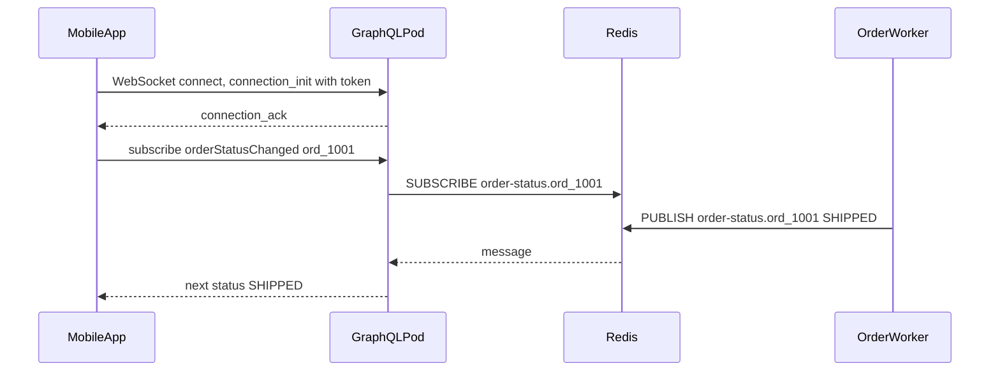

## 15.4 Pagination, errors and evolution in GraphQL

Section 15.1.3 named three rules: paginate every list with connections, handle partial errors, and evolve by adding and deprecating. This section shows how each one is actually built and operated.

### 15.4.1 Relay connections and cursor pagination

#### Concept

A **connection** is the standard GraphQL shape for a paginated list, defined by the Relay specification and used far beyond Relay itself. Instead of returning `[Order]`, a list field returns an `OrderConnection` with `edges` (each holding a `node`, the order, and an opaque `cursor`) and `pageInfo` (`hasNextPage`, `endCursor`). The client asks for `first: 20` and, for the next page, `first: 20, after: "<endCursor>"`.

#### Why does it exist?

An unpaginated list field is a time bomb: `customer { orders }` is fine with 12 orders and an outage with 40,000. Offset pagination (`page: 250`) is slow on deep pages (the database still reads and throws away every skipped row) and unstable when new rows arrive (items shift between pages, so users see duplicates or miss orders). Cursor pagination solves both, exactly as it does in REST (see Part 14 — API Design, 14.5 Pagination). The connection shape exists so that every client library, cache and UI component can page through any list the same way.

#### Mental model

Imagine reading a long ledger with a bookmark. Offset pagination is "turn to page 250", which means counting 250 pages from the front every time, and if someone inserts pages at the front you land in the wrong place. A cursor is the bookmark itself: "continue right after the entry dated 14 March, number 8812". It does not matter how many entries came before or were added since.

#### How it works

```graphql
type OrderEdge { cursor: String!  node: Order! }
type PageInfo { hasNextPage: Boolean!  endCursor: String }
type OrderConnection { edges: [OrderEdge!]!  pageInfo: PageInfo! }

type Customer {
  id: ID!
  orders(first: Int = 20, after: String): OrderConnection!
}
```

1. The client sends `orders(first: 20)`.
2. The server fetches 21 rows (one extra) ordered by a unique, stable key such as `(created_at DESC, id DESC)`.
3. If 21 rows came back, `hasNextPage` is true; the server returns 20.
4. Each edge's cursor encodes the sort key of its row, base64-encoded so clients treat it as opaque.
5. The next request sends `after: endCursor`; the server decodes it and adds `WHERE (created_at, id) < (cursorTime, cursorId)`.

#### NestJS example

Code-first GraphQL cannot express generics directly, so the common NestJS pattern is a function that builds a connection class for any node type.

```ts
// connection.ts -- reusable Relay connection types for code-first schemas
import { Type } from '@nestjs/common';
import { ArgsType, Field, Int, ObjectType } from '@nestjs/graphql';
import { IsOptional, Max, Min, IsBase64 } from 'class-validator';

@ObjectType()
export class PageInfo {
  @Field() hasNextPage: boolean;
  @Field({ nullable: true }) endCursor?: string;
}

export function Connection<T>(nodeType: Type<T>) {
  @ObjectType(`${nodeType.name}Edge`)
  abstract class Edge { @Field() cursor: string; @Field(() => nodeType) node: T; }

  @ObjectType({ isAbstract: true })
  abstract class ConnectionType {
    @Field(() => [Edge]) edges: Edge[];
    @Field(() => PageInfo) pageInfo: PageInfo;
  }
  return ConnectionType as Type<{ edges: { cursor: string; node: T }[]; pageInfo: PageInfo }>;
}

@ObjectType()
export class OrderConnection extends Connection(Order) {}

@ArgsType()
export class ConnectionArgs {
  @Field(() => Int, { defaultValue: 20 }) @Min(1) @Max(100) first: number;   // hard page-size cap
  @Field({ nullable: true }) @IsOptional() @IsBase64() after?: string;
}
```

```ts
// customer-orders.resolver.ts
@ResolveField(() => OrderConnection, { complexity: ({ args, childComplexity }) => args.first * childComplexity })
orders(@Parent() customer: Customer, @Args() args: ConnectionArgs) {
  return this.orders.pageForCustomer(customer.id, args.first, args.after);
}
```

#### TypeORM example

```ts
// orders.service.ts -- keyset pagination with an opaque cursor
type Cursor = { t: string; id: string };
const encode = (c: Cursor) => Buffer.from(JSON.stringify(c)).toString('base64');
function decode(raw: string): Cursor {
  const c = JSON.parse(Buffer.from(raw, 'base64').toString('utf8'));
  if (typeof c?.t !== 'string' || typeof c?.id !== 'string') throw new BadRequestException('Invalid cursor');
  return c;                                            // never trust client-supplied cursors blindly
}

async pageForCustomer(customerId: string, first: number, after?: string) {
  const qb = this.repo.createQueryBuilder('o')
    .where('o.customer_id = :customerId', { customerId })
    .orderBy('o.created_at', 'DESC').addOrderBy('o.id', 'DESC')
    .limit(first + 1);                                  // one extra row tells us if there is a next page
  if (after) {
    const c = decode(after);
    qb.andWhere('(o.created_at, o.id) < (:t, :id)', { t: c.t, id: c.id });
  }
  const rows = await qb.getMany();
  const page = rows.slice(0, first);
  const edges = page.map((o) => ({ node: o, cursor: encode({ t: o.createdAt.toISOString(), id: o.id }) }));
  return { edges, pageInfo: { hasNextPage: rows.length > first, endCursor: edges.at(-1)?.cursor } };
}
```

#### PostgreSQL example

```sql
CREATE INDEX CONCURRENTLY orders_customer_created_id_idx
  ON orders (customer_id, created_at DESC, id DESC);

EXPLAIN (ANALYZE, BUFFERS)
SELECT id, status, total_cents, created_at FROM orders
 WHERE customer_id = $1 AND (created_at, id) < ($2, $3)
 ORDER BY created_at DESC, id DESC
 LIMIT 21;
```

```text
Limit  (cost=0.56..24.80 rows=21 width=40) (actual time=0.028..0.061 rows=21 loops=1)
  ->  Index Scan using orders_customer_created_id_idx on orders  (actual time=0.027..0.057 rows=21 loops=1)
        Index Cond: ((customer_id = $1) AND (ROW(created_at, id) < ROW($2, $3)))
        Buffers: shared hit=6
Planning Time: 0.11 ms
Execution Time: 0.08 ms
```

Six buffer hits and 0.08 ms on page 1 or page 500. The offset version on page 250 (`OFFSET 5000`) reads 5,021 index entries and takes about 9 ms, and grows linearly with depth. The row comparison `(created_at, id) < (...)` is used directly as an index condition because it matches the index order.

#### Production scenario

A customer-support tool listed orders per merchant. Big merchants had 2 million orders, and support agents scrolled deep. With offset pagination, page 2,000 took 1.4 seconds and the "next" button produced duplicates whenever new orders arrived during scrolling. After switching to connections with keyset cursors, every page took under 2 ms in the database regardless of depth, and duplicates disappeared. The team dropped `totalCount` from the default selection because `COUNT(*)` over 2 million rows cost 300 ms on every page; it became a separate, cached field that the UI requested once.

#### Edge cases & failure modes

- **Non-unique sort key**: sorting by `created_at` alone skips or repeats rows with identical timestamps; always add a unique tie-breaker (`id`).
- **Tampered cursors**: a cursor is client input; decode defensively and reject garbage with a validation error, not a 500.
- **Cursor tied to a sort that changed**: a cursor built for "newest first" is meaningless for "highest total first"; encode the sort in the cursor or reject mismatches.
- **`totalCount` on huge lists**: exact counts are expensive; make it opt-in, cached or approximate.
- **`last`/`before` (backwards paging)**: requires the reversed comparison and order, then reversing the page in memory; implement only if a real UI needs it.
- **Nested connections**: `customers(first: 100) { orders(first: 100) }` is 10,000 nodes; complexity limits (15.1.3) must multiply page sizes.

#### How a Senior Backend Engineer thinks about this

A senior paginates every list field that can grow, on day one, because adding pagination later is a breaking change (the field type changes from a list to a connection). They use keyset cursors backed by a matching composite index, cap `first`, make cursors opaque and validated, and keep `totalCount` out of the hot path. They price nested connections in the complexity limit.

#### Common mistakes

- Returning plain lists for fields that grow, then needing a breaking change to paginate them.
- Offset pagination on deep or fast-changing lists.
- Cursors that expose raw database ids or SQL fragments.
- No cap on `first`, letting one request ask for 100,000 rows.
- Computing `COUNT(*)` on every page.

#### Interview questions

1. **Why do GraphQL APIs use connections instead of plain lists?** A connection carries cursors and `pageInfo`, enabling stable cursor pagination and a uniform shape for every client library. Follow-up: why is changing a list to a connection later a breaking change? The field's type changes, so every existing query selecting it fails validation.
2. **How do you implement keyset pagination for "newest orders first"?** Order by `(created_at DESC, id DESC)`, fetch `first + 1` rows using a row comparison against the cursor values, back it with a matching composite index, and verify with `EXPLAIN` that the condition is an index condition.
3. **What goes in a cursor?** The sort-key values of the last row (and optionally the sort direction), encoded so clients treat it as opaque; never a raw offset that breaks under inserts.
4. **How do you make `totalCount` safe?** Make it opt-in, cache it, or return an estimate; never compute an exact count over millions of rows on every page.

#### Practical exercise

Convert `Customer.orders` from `[Order!]!` to an `OrderConnection` with `first`/`after`, a capped page size, opaque validated cursors and a matching composite index. Acceptance criteria: `EXPLAIN (ANALYZE, BUFFERS)` shows an index scan with a row-comparison index condition; page 500 takes the same time as page 1; inserting new orders while paging produces no duplicates; a corrupted cursor returns a validation error.

### 15.4.2 Errors: partial data, error codes and result unions

#### Concept

A GraphQL response can contain both `data` and an `errors` array at the same time. If one field fails, the other fields still return, and the failed field becomes `null` with an error entry that carries a `path` (which field failed) and `extensions.code` (a machine-readable reason). Business outcomes that clients must handle, such as "out of stock", are often better modelled as part of the schema (result union types) than as errors.

#### Why does it exist?

A GraphQL query can touch ten independent data sources. Failing the whole response because the recommendations service is slow would punish the user for something irrelevant to the order screen. Partial results let the screen render what it can. The cost is that HTTP status codes no longer describe the outcome: most GraphQL servers return HTTP 200 even when fields failed.

#### How it works

```json
{
  "data": { "order": { "id": "ord_1001", "status": "PAID", "recommendations": null } },
  "errors": [{
    "message": "Recommendations unavailable",
    "path": ["order", "recommendations"],
    "extensions": { "code": "DEPENDENCY_UNAVAILABLE" }
  }]
}
```

Null propagation decides how far a failure spreads. If `recommendations` is nullable, only it becomes `null`. If it were declared non-null (`[Product!]!`), the null would bubble up to the nearest nullable parent, and the whole `order` would vanish. Declaring a field non-null is therefore a promise that it will never fail independently.

Two families of errors need different handling:

| Kind | Example | How to model |
|---|---|---|
| Technical / unexpected | Database down, bug, timeout | `errors` array with a code; mask internals |
| Expected business outcome | Out of stock, coupon expired, payment declined | Result union in the schema, so clients must handle each case |

#### NestJS example

```ts
// Result union for a mutation: the client's type system forces it to handle each outcome
import { createUnionType, Field, ObjectType, Int } from '@nestjs/graphql';

@ObjectType() export class PlaceOrderSuccess { @Field(() => Order) order: Order; }
@ObjectType() export class OutOfStock { @Field() productId: string; @Field(() => Int) available: number; }
@ObjectType() export class PaymentDeclined { @Field() reason: string; }

export const PlaceOrderResult = createUnionType({
  name: 'PlaceOrderResult',
  types: () => [PlaceOrderSuccess, OutOfStock, PaymentDeclined] as const,
  resolveType: (value) => ('order' in value ? PlaceOrderSuccess : 'available' in value ? OutOfStock : PaymentDeclined),
});

// @Mutation(() => PlaceOrderResult) placeOrder(@Args('input') input: PlaceOrderInput) { ... }
```

```ts
// Technical errors: stable codes for clients, no stack traces or SQL for attackers
import { GraphQLError, GraphQLFormattedError } from 'graphql';

GraphQLModule.forRoot<ApolloDriverConfig>({
  driver: ApolloDriver,
  autoSchemaFile: true,
  includeStacktraceInErrorResponses: false,
  formatError: (formatted: GraphQLFormattedError, error: unknown) => {
    const code = formatted.extensions?.code;
    if (code === 'INTERNAL_SERVER_ERROR' || !code) {
      logger.error({ err: error, path: formatted.path }, 'graphql_internal_error'); // full detail to logs only
      return { message: 'Internal error', path: formatted.path, extensions: { code: 'INTERNAL_SERVER_ERROR' } };
    }
    return formatted;                                   // expected codes pass through unchanged
  },
});

// In a resolver, throw a coded error for an expected technical failure:
throw new GraphQLError('Recommendations unavailable', { extensions: { code: 'DEPENDENCY_UNAVAILABLE' } });
```

#### Failure scenario

For three weeks after a GraphQL launch, the error-rate dashboard showed 0.02% and everyone was happy. Then a product manager noticed that 6% of order-detail screens had no shipping tracker. The tracking field resolver had been throwing `DEADLINE_EXCEEDED` from a gRPC call since day one, but GraphQL returned HTTP 200 with a partial result, and the dashboard counted only HTTP 5xx from the load balancer. The fix was an Apollo plugin that, in `didEncounterErrors`, incremented a Prometheus counter labelled by operation name, field path and error code, plus an alert on that counter. The lesson: with GraphQL, the HTTP status is not your error rate; measure errors per operation and per field.

#### Edge cases & failure modes

- **Non-null fields that can fail**: one failing non-null field wipes out its parent; make fields that depend on other services nullable.
- **Leaking internals**: default error messages can include SQL or file paths; mask unknown errors in `formatError`.
- **Errors inside lists**: one failing item in a list of 50 nulls only that item if the list item type is nullable; with `[Order!]!` the whole list disappears.
- **Clients ignoring `errors`**: many client apps only read `data`; agree on which codes the client must handle.
- **Validation errors are 400, execution errors are 200**: Apollo Server returns HTTP 400 for parse and validation failures, so you need both signals in monitoring.

#### Interview questions

1. **Why does GraphQL often return HTTP 200 for a failed request?** Because a response can hold partial data plus errors; the HTTP status describes transport, not the result. Monitor the `errors` array per operation instead.
2. **When do you use a result union instead of an error?** When the outcome is an expected business case the client must handle (out of stock, payment declined); unions make those cases part of the typed contract.
3. **How does null propagation affect schema design?** A null in a non-null field bubbles to the nearest nullable parent; make fields that can fail independently nullable so failures stay local.

#### Practical exercise

Model `placeOrder` as a `PlaceOrderResult` union with success, out-of-stock and payment-declined members, add a `formatError` that masks unexpected errors, and add a plugin that counts errors by operation name and code. Acceptance criteria: an out-of-stock order returns `data.placeOrder.__typename = "OutOfStock"` and no `errors`; a thrown database error reaches the client only as `INTERNAL_SERVER_ERROR` with no stack; the counter increments with correct labels.

### 15.4.3 Versioning without versions: additive change and deprecation

#### Concept

GraphQL APIs usually have no `/v2`. Because clients select fields explicitly, adding a field or type never affects existing queries. Changing or removing one does, so the lifecycle is: add the replacement, mark the old field `@deprecated` with a reason, measure who still uses it, and remove it only when usage reaches zero (or after a published sunset for clients you cannot see).

#### How it works

```ts
@ObjectType()
export class Order {
  @Field(() => Int, { deprecationReason: 'Use total { amountMinor currency }. Removal after 2027-03-01.' })
  totalCents: number;

  @Field(() => Money) total: Money;               // the replacement, added first
}
```

Deprecation is only a label in the schema; it does not tell you who still calls the field. Field-level usage metrics do:

```ts
// field-usage.plugin.ts -- count which fields real operations resolve, by client
import { Plugin } from '@nestjs/apollo';
import { ApolloServerPlugin, GraphQLRequestListener } from '@apollo/server';
import { Counter } from 'prom-client';

const fieldUsage = new Counter({ name: 'graphql_field_usage_total', help: 'Resolved fields', labelNames: ['field', 'client'] });

@Plugin()
export class FieldUsagePlugin implements ApolloServerPlugin {
  async requestDidStart({ request }): Promise<GraphQLRequestListener<any>> {
    const client = request.http?.headers.get('apollographql-client-name') ?? 'unknown';
    return {
      async executionDidStart() {
        return {
          willResolveField({ info }) {
            if (info.parentType.name === 'Order' && info.fieldName === 'totalCents') {  // watch deprecated fields only
              fieldUsage.inc({ field: 'Order.totalCents', client });
            }
          },
        };
      },
    };
  }
}
```

`willResolveField` runs for every field of every object, so keep it cheap: track only deprecated fields, or sample. Mobile clients should send a client name and version header, so you can see that "iOS 4.12 and older" are the last users of a field and decide when forcing an upgrade is worth it.

#### Production scenario

The team replaced `totalCents: Int` with a `Money` type to support multiple currencies. They added `total`, deprecated `totalCents`, and shipped app versions using `total`. Usage of `totalCents` dropped from 100% to 9% in four weeks, then plateaued: old Android versions. After 120 days and a minimum-version prompt in the app, usage was 0.3%, all from one internal script, which was updated. The field was removed in a schema change that CI's schema diff flagged as breaking and the team approved explicitly.

#### Common mistakes

- Removing or renaming a field because "the new app does not use it", breaking every installed old version.
- Deprecating without measuring usage, so nobody knows when removal is safe.
- Changing a field's type in place (`Int` to `Float`, nullable to non-null in arguments) instead of adding a new field.
- No schema diff in CI; use the committed `schema.gql` and a schema-diff tool to flag breaking changes in review.

#### Interview questions

1. **How do you evolve a GraphQL schema without versions?** Additive changes only; deprecate with a reason, measure field usage per client, remove after usage reaches zero or a published sunset. Follow-up: which changes are breaking? Removing or renaming fields, changing types, making an argument required, making a nullable output field non-null is safe but making a non-null output field nullable is breaking for clients.
2. **How do you know when a deprecated field can be removed?** Field-level usage metrics labelled by client name and version, not the deprecation label itself.

#### Practical exercise

Deprecate `Order.totalCents` in favour of `total: Money`, add the usage plugin, and generate traffic from two "client versions". Acceptance criteria: the schema shows the deprecation reason; the metric shows usage by client; a CI step diffing the committed `schema.gql` against main fails when `totalCents` is removed without approval.

## 15.5 Subscriptions in production

#### Concept

A **subscription** is a GraphQL operation that keeps a connection open and pushes results to the client whenever an event happens: `subscription { orderStatusChanged(orderId: "ord_1001") { status updatedAt } }`. In NestJS it is a resolver decorated with `@Subscription()` that returns an async iterator fed by a pub/sub engine. The usual transport is a WebSocket speaking the `graphql-ws` protocol.

#### Why does it exist?

Some screens must update without the user refreshing: order tracking, chat, live auctions. Polling every 5 seconds from 200,000 phones is 40,000 requests per second, almost all returning "nothing changed". Subscriptions push only real changes, using the same schema and types as queries.

#### Mental model

A query is phoning the restaurant to ask if your order is ready. A subscription is leaving your number so they call you when it is. The restaurant now has to keep a list of who to call and survive a busy evening of keeping all those lines open.

#### How it works



1. The client opens a WebSocket and sends `connection_init` with its auth token.
2. The server authenticates once per connection, then accepts `subscribe` messages.
3. The subscription resolver returns an async iterator bound to a channel.
4. Something else (a Kafka consumer, an outbox worker) publishes events to the channel.
5. Every pod holding a matching subscription receives the event and pushes it down the socket.

Step 5 is the production trap: the in-memory `PubSub` from `graphql-subscriptions` only delivers events published **in the same process**. With six pods, an event published on pod 2 never reaches a client connected to pod 5. Use a shared broker such as Redis pub/sub (see Part 34 — Real-Time Systems, 34.5 Pub/Sub for fan-out across pods).

#### NestJS example

```ts
// pubsub.provider.ts -- Redis-backed pub/sub shared by every pod
import { ConfigService } from '@nestjs/config';
import { RedisPubSub } from 'graphql-redis-subscriptions';
import Redis from 'ioredis';

export const PUB_SUB = 'PUB_SUB';
export const pubSubProvider = {
  provide: PUB_SUB,
  inject: [ConfigService],
  useFactory: (config: ConfigService) => {
    const options = { host: config.getOrThrow<string>('REDIS_HOST'), port: 6379, retryStrategy: (n: number) => Math.min(n * 200, 5_000) };
    return new RedisPubSub({ publisher: new Redis(options), subscriber: new Redis(options) }); // two connections: a subscriber cannot publish
  },
};
```

```ts
// GraphQL module: authenticate once per WebSocket connection
GraphQLModule.forRootAsync<ApolloDriverConfig>({
  driver: ApolloDriver,
  inject: [JwtService],
  useFactory: (jwt: JwtService) => ({
    autoSchemaFile: true,
    subscriptions: {
      'graphql-ws': {
        onConnect: async (ctx: Context<{ authorization?: string }>) => {   // Context type from 'graphql-ws'
          const token = ctx.connectionParams?.authorization?.replace('Bearer ', '');
          if (!token) return false;                                         // closes the socket as forbidden
          (ctx.extra as { user?: unknown }).user = await jwt.verifyAsync(token);
        },
      },
    },
    context: ({ req, extra }) => ({ req, user: extra?.user ?? req?.user }),
  }),
});
```

```ts
// order-status.resolver.ts -- authorize at subscribe time, one channel per order
@Resolver()
export class OrderStatusResolver {
  constructor(@Inject(PUB_SUB) private readonly pubSub: RedisPubSub, private readonly orders: OrdersService) {}

  @Subscription(() => OrderStatusEvent)
  async orderStatusChanged(@Args('orderId', { type: () => ID }) orderId: string, @Context('user') user: AuthUser) {
    await this.orders.assertCanView(user, orderId);                         // never let user A watch user B's order
    return this.pubSub.asyncIterableIterator(`order-status.${orderId}`);  // asyncIterator in graphql-subscriptions 2.x
  }
}

// Publisher side, for example in the consumer of the order-status Kafka topic:
await this.pubSub.publish(`order-status.${event.orderId}`, { orderStatusChanged: event });
```

#### Production scenario

A food-delivery app keeps about 45,000 concurrent subscription sockets at dinner peak, spread over 8 pods behind a load balancer with WebSocket support and a 1-hour idle timeout. Each socket costs roughly 30–60 KB of memory in Node.js including buffers, so about 2.5 GB across the fleet; the more important limits are file descriptors per pod and the time to drain sockets during deploys. Status events are low volume (about 300 per second), published by the order-status consumer to per-order Redis channels. Deploys drain pods gradually so 45,000 phones do not reconnect in the same second.

#### Failure scenario

The first release used the in-memory `PubSub` because it worked perfectly on a laptop. In production with 6 pods, about five out of six customers never saw status updates: the event was published on whichever pod handled the internal webhook, and only clients connected to that pod got it. Support tickets said "tracking is frozen" while the logs showed every event "published successfully". Switching to `RedisPubSub` fixed it. A month later, a deploy restarted all pods at once and 40,000 clients reconnected within 3 seconds, each re-running `onConnect` with a JWT verification and a database permission check, which saturated the database. The team added jittered client reconnect backoff, rolling restarts with `maxUnavailable: 1`, and cached permission checks for 60 seconds.

#### Edge cases & failure modes

- **In-memory pub/sub across pods**: events silently reach only one pod's clients.
- **Missed events during reconnect**: pub/sub is fire-and-forget; after reconnecting, the client must re-query current state (or the server replays from a durable log).
- **Token expiry on a long-lived socket**: a JWT verified at connect time may expire hours later; close sockets at expiry or require re-auth.
- **Reconnect storms**: deploys and network blips make thousands of clients reconnect at once; jitter, backoff and rolling restarts.
- **Proxy idle timeouts**: load balancers close idle sockets (often 60 seconds by default); `graphql-ws` keep-alive pings keep them open.
- **Authorization only at connect**: authorize every `subscribe`, not only the connection.

#### How a Senior Backend Engineer thinks about this

A senior uses GraphQL subscriptions when the app already speaks GraphQL and needs a few live fields, and keeps them thin: notify that something changed, then let the client re-query. For very high fan-out, server-to-many broadcasts or simple one-way streams, they consider Server-Sent Events or push notifications instead (Part 34). They never ship in-memory pub/sub to a multi-pod deployment, they authorize per subscription, and they plan deploys and capacity around long-lived connections.

#### Common mistakes

- In-memory `PubSub` in production with more than one pod.
- Authorizing the connection but not each subscription.
- Pushing large payloads through subscriptions instead of a small "changed" event.
- Assuming delivery is guaranteed; pub/sub drops events during disconnects.

#### Interview questions

1. **Why does a subscription work locally but miss events in production?** The default `PubSub` is in-memory and per process; with several pods, events published on one pod never reach clients on others. Use Redis or another shared broker. Follow-up: what about events missed while a client was disconnected? Re-query on reconnect or replay from a durable stream.
2. **Where do you authenticate and authorize subscriptions?** Authenticate in `onConnect` using `connectionParams`, and authorize each subscription in its resolver against the requested resource.
3. **When would you choose SSE or push notifications over GraphQL subscriptions?** One-way updates, very large fan-out, clients that are not GraphQL-based, or when the app is in the background (push notifications).

#### Practical exercise

Add `orderStatusChanged(orderId)` backed by `RedisPubSub`, authenticate with a JWT in `onConnect`, and authorize per order. Run two app instances behind a local proxy. Acceptance criteria: a client connected to instance A receives an event published by instance B; a user subscribing to another user's order gets a `FORBIDDEN` error; killing one instance makes its clients reconnect to the other and re-query the current status.
