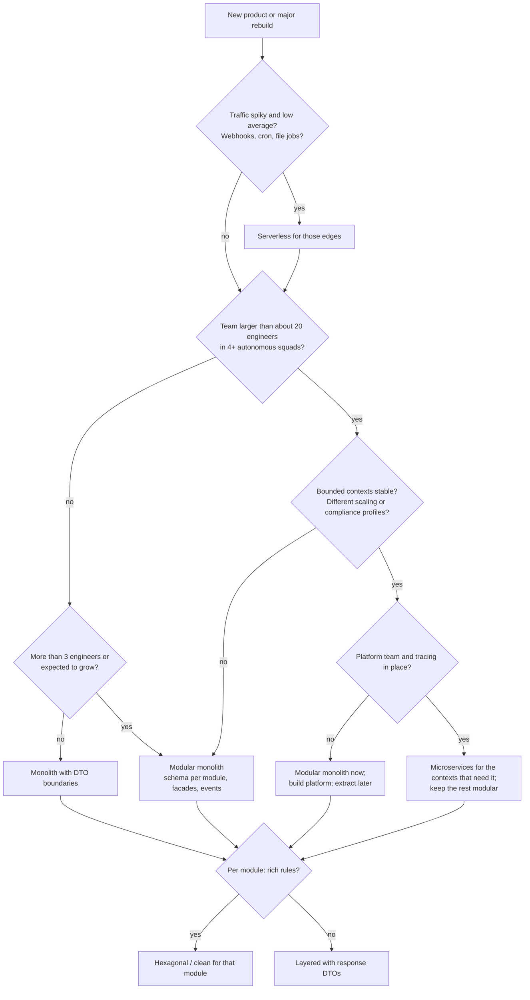
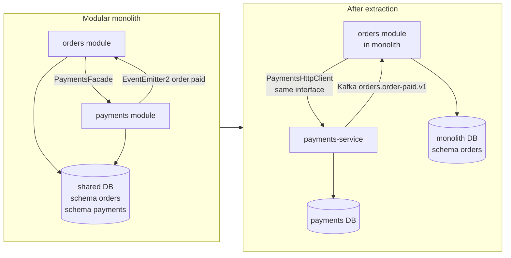

## 15.11 When should I choose each architecture?

There is no best architecture. There is only the architecture that fits the team, the domain, the traffic and the money you have today, with a credible path to what you will need in eighteen months. This section gives you the decision tools senior engineers actually use.

#### Concept

Architecture choice is a function of five inputs: **team size and shape**, **domain complexity and stability**, **scaling profile** (traffic level, and whether different parts scale differently), **operational budget** (people and money for platform work), and **time to first release**. The styles from the previous sections each optimise for a different combination.

#### The decision matrix

| Architecture | Team size | Complexity | Scaling | Operational cost | Time to first release | Best for |
| --- | --- | --- | --- | --- | --- | --- |
| Monolith | 1 to 8 | Low to medium; domain still being discovered | Vertical plus identical replicas; one DB | Very low: 1 pipeline, 1 image, 1 DB | Days to weeks | MVPs, internal tools, early startups, small SaaS |
| Modular monolith | 4 to 40 | Medium to high; domain becoming clear | Same as monolith plus read replicas, separate worker processes | Low: 1 pipeline, some lint/boundary tooling | Weeks | Most products for most of their life; growth-stage startups; teams with 2 to 6 squads |
| Microservices | 20 to 1,000+ | High; well-understood bounded contexts | Independent per service; heterogeneous | High: N pipelines, tracing, contracts, platform team | Months (for a real, operable system) | Large organisations, many autonomous teams, very different scaling or compliance profiles |
| SOA with ESB | Enterprise-scale | High, legacy integration heavy | Bus-limited | High plus vendor cost | Months to years | Integrating dozens of legacy vendor systems; rarely chosen fresh |
| Serverless | 1 to 10 per function set | Low per function | Automatic, to the concurrency limit; DB is the bottleneck | Low for spiky loads; hidden costs at steady high load | Days | Webhooks, file processing, cron, glue, low-traffic APIs |
| Event-driven (overlay) | Any | Adds complexity; needs idempotency discipline | Excellent for decoupling and burst absorption | Medium: broker, lag monitoring, DLQs, replay tooling | Adds weeks | Side effects, integration between modules or services, audit trails, analytics feeds |
| Layered (code-level) | Any | Low to medium rules | N/A | None | Fastest | CRUD-dominant modules |
| Hexagonal / Clean / Onion (code-level) | 3+ per module | Rich, changing rules | N/A | Mapping and structure overhead | Adds days per module | Orders, payments, pricing, inventory; anything with real business rules |

Two of these rows (event-driven; layered vs hexagonal) are not alternatives to the deployment shapes above them. They are overlays. You can have an event-driven modular monolith with hexagonal orders and layered settings. In fact, that combination is the recommended default for most teams.

#### Secondary decision factors

| Factor | Pushes toward monolith / modular monolith | Pushes toward microservices |
| --- | --- | --- |
| Domain clarity | Boundaries still moving | Bounded contexts stable for 12+ months |
| Deploy cadence | Everyone can ship together several times a day | One team is blocked by another's release freeze |
| Scaling profile | Uniform: every request is similar | Search needs 64 GB RAM nodes; checkout needs 20 small pods; ML inference needs GPUs |
| Failure isolation | A shared process is acceptable with bulkheads | A recommendation bug must never take down checkout |
| Compliance | Single audit scope | PCI or health data must be in an isolated scope with restricted access |
| Data consistency | Cross-domain transactions are common | Domains rarely need atomic writes across each other |
| Platform capability | No dedicated platform/SRE team | A platform team owns CI templates, service mesh, tracing, on-call tooling |
| Hiring | Generalists | Enough seniors to own services end-to-end |

#### The decision flow



Read this flow as a set of gates, not a scoring sheet. Most products exit at "modular monolith". That is not a consolation prize; it is where most successful systems live for most of their life.

#### How a Senior Backend Engineer thinks about this

They ask the uncomfortable questions in the first meeting:

- *How many engineers will we have in 12 months?* (Not "how many do we hope for.")
- *Which parts of this system will change every week, and which will not change for years?*
- *What is the one workload with a different shape?* (Search, media processing, reporting, ML.)
- *What happens to revenue if module X is down for 30 minutes? For module Y?*
- *Who is on call, and how many dashboards can they honestly watch?*
- *What is our tolerance for eventual consistency in the checkout flow?*

They refuse to choose microservices "because we will need to scale". Scale is a load number; ask for it. A modular monolith on ten pods handles 20,000 RPS. Most products never reach 2,000.

They also refuse the opposite trap: a 300-engineer company on one deploy train, where a Friday release freeze for one team freezes everyone.

To a product manager: "The architecture decision is really a team decision. Tell me how the team will be organised in a year and I will tell you the shape of the system."

#### Common mistakes

- Choosing based on résumé value or conference talks.
- Choosing based on a competitor's architecture, whose team is ten times larger.
- Deciding once and never revisiting. Architecture should be reviewed quarterly against the signals in the next section.
- Mixing up code architecture (hexagonal) with deployment architecture (microservices) and thinking one implies the other.

#### Interview questions

1. *A fintech startup with 6 engineers asks you to design their payments platform. What shape do you propose and why?* Expected: modular monolith, hexagonal payments module, event-driven side effects with outbox, serverless for webhooks; explain each choice against the matrix.
2. *What would make you move from a modular monolith to microservices?* Expected: the signals in 15.12; give at least three.
3. *How do team structure and architecture relate?* Expected: Conway's law; architecture mirrors communication structure; design the team and the architecture together.
4. *What is the difference between "scaling" and "scaling independently", and why does it matter for this decision?* Expected: replicas scale a monolith; independent scaling is about heterogeneous resource profiles.

#### Practical exercise

Write a one-page architecture decision record (ADR) for a hypothetical ride-booking backend with 12 engineers: choose a deployment shape, list which modules get hexagonal treatment, name the event flows, and state three concrete signals that would trigger extracting the first service.

Acceptance criteria: the ADR names the numbers you assumed (RPS, team growth), lists alternatives rejected with reasons, and includes the decision flow path you followed.

## 15.12 Why a modular monolith is often better than microservices

#### Concept

A modular monolith gives you the boundaries of microservices (clear ownership, contracts, independent evolution of code) without the network in between. For teams under roughly 20 to 40 engineers, it delivers most of the benefit at a fraction of the cost, and it is the best possible starting point if you do end up extracting services later.

#### What microservices actually cost

The honest list. Every item below is a thing you pay for with engineer-hours, latency, or incidents, and none of them exist in a modular monolith.

1. **Network calls replace method calls.** An in-process call costs about 100 nanoseconds. An HTTP call between pods in the same cluster costs 1 to 5 ms; gRPC 0.5 to 2 ms; with TLS and service mesh sidecars, add 1 to 3 ms. A checkout that touches five modules goes from 0 ms of communication overhead to 10 to 40 ms.
2. **Partial failure.** A method call either returns or throws. A network call can time out with the work done, done twice, or half done. Every cross-service interaction needs timeouts, retries with backoff and jitter, idempotency keys, and a plan for the "unknown outcome" case.
3. **Data consistency.** One ACID transaction becomes a saga with compensations and an outbox. "Reserve stock and charge card" goes from 12 lines in a transaction to two services, three events, a state machine and a reconciliation job.
4. **Observability.** Logs from one process become logs from twenty. You need distributed tracing (OpenTelemetry), trace-id propagation through HTTP headers and Kafka message headers, centralised logging, and per-service dashboards. Without these, debugging a production issue means guessing.
5. **CI/CD times N.** Twenty services means twenty pipelines, twenty Dockerfiles, twenty Helm charts, twenty sets of secrets, twenty dependency-upgrade PRs when a CVE lands in `undici`.
6. **Contracts and versioning.** Types checked by the TypeScript compiler become API contracts checked by... nothing, unless you build consumer-driven contract tests and a schema registry.
7. **A platform team.** Someone must own the CI templates, the service mesh, the tracing backend, the secrets management, the deployment tooling and the on-call for all of it. In practice this is 3 to 6 senior engineers who are not building product.
8. **Local development.** `docker compose up` with two containers becomes twenty containers or a shared remote dev environment.
9. **Cross-team features are slower.** A feature that touches orders and payments now needs two PRs in two repositories, a contract change, a coordinated deploy order, and a backward-compatible window.
10. **Security surface.** Every service is a network endpoint that needs authentication (mTLS or service tokens), authorisation, and rate limiting. In a monolith, module calls are not attackable.

#### The distributed monolith trap

The worst outcome is not a monolith and not microservices. It is a **distributed monolith**: services that must be deployed together, share a database, and call each other synchronously in long chains. You pay every cost above and get none of the independence.

Symptoms:

- Two or more services read and write the same tables.
- A release requires deploying services in a specific order.
- A change to one service's DTO breaks three others at runtime.
- The "user service" is called synchronously by every other service on every request.
- Integration tests must run the whole fleet.
- On-call for any service requires understanding all services.

The trap is easy to fall into because splitting the code is easy and splitting the data is hard. Teams split the code first, keep the shared database "temporarily", and never finish.

#### The signals that tell you it is time to split

Extract a module into its own service when you observe **at least two** of these, and not before:

1. **Team scaling.** A single module is owned by more than about two "two-pizza teams" (16+ engineers) and their merge queue on the shared repository is the bottleneck.
2. **Independent deploy cadence.** One module needs to ship several times a day while another needs release freezes (payments during tax season, for example), and the shared pipeline forces the slower cadence on everyone.
3. **Different scaling profile.** One module needs 10x the CPU, or GPUs, or 64 GB RAM for an in-memory index, and running the whole monolith on that hardware is wasteful; or one module's load pattern (nightly batch) disrupts another's (daytime checkout).
4. **Regulatory or security isolation.** PCI DSS, HIPAA, SOC 2 scope reduction: putting card handling in a separate service with a separate database and restricted access shrinks the audit scope from the whole company to one team.
5. **Fault isolation is worth more than consistency.** A bug in recommendations must never take down checkout; and recommendations does not need atomic transactions with orders anyway.
6. **A different runtime.** The ML team writes Python; the image pipeline wants Rust. That is a real service boundary.

If you see only one signal, look for a cheaper fix first: a separate worker process from the same codebase, a read replica, a separate connection pool, a feature flag, or a second deployment of the same image with a different entry point. Many "we need microservices" conversations end with "we needed a separate worker deployment".

#### The folder layout that can be split later

```text
repo/
  package.json
  nest-cli.json
  apps/
    api/                          <- the monolith's HTTP entry point
      src/main.ts
      src/app.module.ts           <- imports every module below
    worker/                       <- same code, different entry point: consumers and cron only
      src/main.ts
  libs/
    shared-kernel/                <- tiny: Money, Ids, DomainError, Result, Clock port
      src/
    contracts/                    <- public DTOs and event schemas, versioned; NO logic
      src/
        events/
          orders/order-paid.v1.ts
          inventory/stock-reserved.v1.ts
        inventory/reserve-stock.dto.ts
        payments/charge.dto.ts
    platform/                     <- cross-cutting infrastructure: logging, tracing, outbox, kafka client, config
      src/
  src/modules/
    orders/
      orders.module.ts
      public/orders.facade.ts     <- the only export
      application/
      domain/
      infrastructure/             <- schema: orders
      presentation/
    payments/
      payments.module.ts
      public/payments.facade.ts
      application/
      domain/
      infrastructure/             <- schema: payments
      presentation/
    inventory/
      inventory.module.ts
      public/inventory.facade.ts
      application/
      domain/
      infrastructure/             <- schema: inventory
      presentation/
    notifications/
      ...
  db/
    migrations/
      orders/                     <- migrations per schema, so a schema can leave with its history
      payments/
      inventory/
  .dependency-cruiser.js          <- forbids cross-module deep imports and domain -> infra imports
```

The properties that make this splittable:

- **Each module depends only on `contracts`, `shared-kernel` and `platform`.** Never on another module's internals.
- **Each module owns a PostgreSQL schema and its migrations folder.** The day it leaves, `pg_dump --schema=payments` and its migrations go with it.
- **Cross-module calls go through facades** that have the exact shape a network client would have: async methods, DTO in, DTO out, no shared entities, no passing `EntityManager` across.
- **Cross-module reactions go through events** whose schemas already live in `contracts/`, so replacing `EventEmitter2` with Kafka changes the publisher and subscriber adapters, not the contracts.
- **Two entry points already exist** (`api`, `worker`), so the team is used to running the same code in different processes.

#### The extraction, step by step



1. **Prove the boundary.** Run `dependency-cruiser`; confirm zero deep imports into `payments` and zero cross-schema queries (grep migrations and `pg_stat_statements` for joins that touch both schemas).
2. **Move to a second database while still in-process.** Register a second TypeORM `DataSource` named `payments` pointing at a new database; migrate the schema with `pg_dump --schema=payments | psql payments_db`. The module now has no shared transactions with anyone; if something breaks here, you found hidden coupling cheaply.
3. **Swap in-process events for the broker.** Publish `order.paid` through the outbox to Kafka; subscribe from the payments module via a Kafka consumer instead of `@OnEvent`. Still one process, but the event path is now the production path.
4. **Create the new app.** `apps/payments-service/src/main.ts` importing `PaymentsModule`, with its own health checks and config. Deploy it alongside the monolith, consuming from Kafka, but not yet receiving synchronous calls.
5. **Replace the facade with a client.** Implement `PaymentsFacade`'s interface as `PaymentsHttpClient` (or gRPC) with timeouts, retries on idempotent operations, and a circuit breaker. Switch the provider in `OrdersModule` behind a feature flag; run both paths in shadow mode if the volume justifies it.
6. **Remove the module from the monolith.** Delete `src/modules/payments` from the monolith; the code lives only in the new service (or in a monorepo package it owns).
7. **Observe for two weeks.** Latency, error rates, consumer lag, reconciliation reports. Only then extract the next module, if a signal exists for it.

Each step is reversible. That is what separates an extraction from a rewrite.

#### Production scenario

A B2B invoicing company ran a modular monolith with 11 modules and 34 engineers for four years. Peak 1,800 RPS, one PostgreSQL primary, 40 pods. In year four, the payments team hit two signals at once: PCI scope reduction and a deploy freeze conflict with the reporting team. They extracted `payments` in five weeks using the steps above. Nothing else was extracted for the following two years because no other module showed two signals. Their platform investment stayed at one SRE.

#### Failure scenario

A different company, same size, went straight to 18 microservices in year one "to be ready for scale". By year two: three engineers on a platform team, a shared PostgreSQL that seven services wrote to (the distributed monolith), a 45-minute end-to-end test suite that ran all services, and a checkout p99 of 1.4 seconds from six sequential hops. A feature that touched orders and invoices took three weeks instead of three days. They spent year three merging nine services back into a modular monolith. The scale they were "ready for" peaked at 300 RPS.

#### How a Senior Backend Engineer thinks about this

They treat the modular monolith as the default and microservices as an exception that must be justified per module, per signal. They keep the door open (schemas, facades, contracts) so that extraction is a five-week project, not a rewrite. They measure whether the door is still open with tooling, not trust.

They are equally clear about the limits: at 60 engineers with six squads that need different deploy cadences, a single deploy train is a real cost, and they will split. The point is to split for a reason you can name and measure.

#### Common mistakes

- Extracting a service before the boundary exists in the monolith (a shared table becomes a shared database).
- Extracting the wrong module first (the most-called one, which then becomes a synchronous dependency of everything).
- Skipping step 2 (separate database while in-process), which is the cheapest way to find hidden coupling.
- Removing the module from the monolith before the new service has run in production.
- Not budgeting for the platform work, so the first service has no tracing, no DLQ, no runbook.

#### Interview questions

1. *List five concrete costs of microservices that a modular monolith does not have.* Expected: network latency, partial failure handling, sagas/outbox, tracing, N pipelines, platform team, contracts.
2. *What is a distributed monolith and how do you detect one?* Expected: shared DB, ordered deploys, synchronous chains, fleet-wide tests.
3. *Name the signals that justify extracting a service.* Expected: team scaling, deploy cadence, scaling profile, compliance isolation, fault isolation, runtime.
4. *Describe the safe extraction sequence and why the database moves before the process.* Expected: steps above; moving the DB first reveals hidden coupling while rollback is trivial.
5. *How does a facade in a modular monolith prepare for extraction?* Expected: async DTO-in/DTO-out interface identical to a network client; swap via DI token.

#### Practical exercise

In your modular monolith, register a second `DataSource` for one module pointing at a separate database. Move that module's schema with `pg_dump --schema`. Run the full test suite and the app.

Acceptance criteria: the module works from the separate database with no code changes outside its `infrastructure/` folder and module file; any failure identifies a hidden cross-module coupling, which you document and fix through the owning module's facade.
