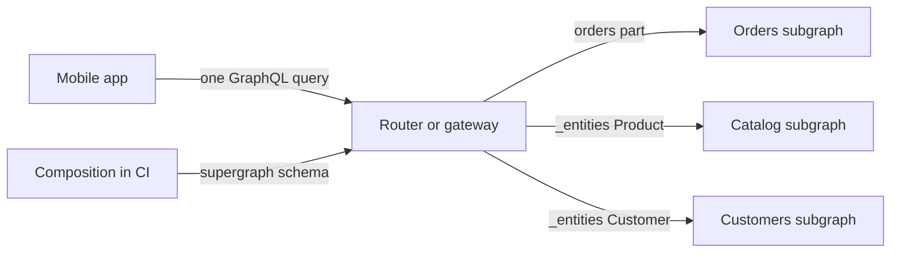
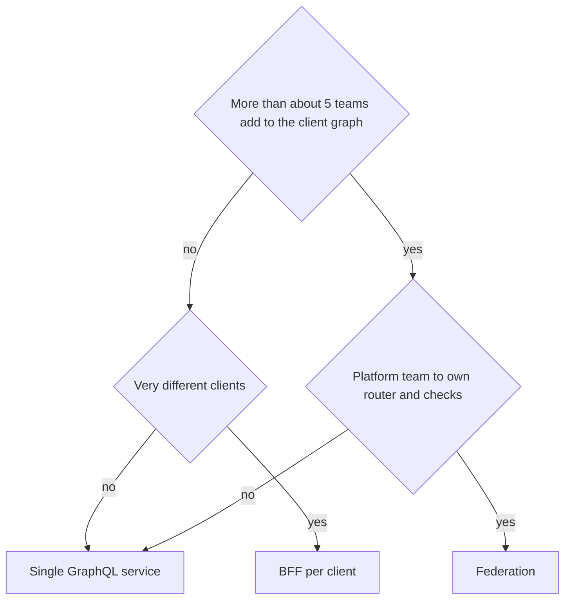

## 15.6 Federation and supergraphs

Section 15.1.3 introduced federation in one paragraph. This section shows what actually happens when a client query crosses services, how to build subgraphs and a gateway in NestJS, and, most importantly, when one graph across many services is worth what it costs.

### 15.6.1 How federation works

#### Concept

**Federation** splits one GraphQL schema across several services. Each service is a **subgraph** that owns some types and fields: the orders service owns `Order`, the catalog service owns `Product`, the customers service owns `Customer`. A **router** (or gateway) composes the subgraph schemas into one **supergraph** and exposes a single endpoint. When a client asks for an order with its products and customer, the router builds a **query plan**, calls each subgraph for its part, and stitches the results into one response. Types shared across subgraphs are **entities**, identified by a `@key` such as `id`.

#### Why does it exist?

A single GraphQL server in front of many teams' services becomes a bottleneck: every schema change goes through one repository and one team, and that team ends up owning resolvers for domains it does not understand. The alternative, one GraphQL API per service, pushes the stitching onto every client. Federation lets each team own and deploy its part of the graph independently while clients still see one coherent graph. It exists for an organisational problem (many teams, one client-facing graph) more than a technical one.

#### Mental model

Imagine a department store with one customer-service desk. You ask: "my order, what is in it, and which loyalty tier am I?" The clerk does not know everything, but has a directory saying orders are handled upstairs, products in the catalog office and loyalty by the membership desk. The clerk sends one note to each with your order number, collects the answers and hands you one sheet. The directory is the supergraph schema; the clerk's plan of who to ask in what order is the query plan; each office is a subgraph.

#### How it works



1. Each subgraph publishes its schema with federation directives: `@key(fields: "id")` marks an entity; `@shareable`, `@external`, `@requires`, `@provides` and `@override` control how fields are shared and moved.
2. **Composition** merges the subgraph schemas into a supergraph and fails if they conflict (two subgraphs define the same field differently). Run it in CI, not at runtime.
3. The router receives a query and builds a query plan: fetch the order from the orders subgraph (which returns product references `{ __typename: "Product", id }`), then send all references in one `_entities` query to the catalog subgraph.
4. Each subgraph resolves the references it owns via a **reference resolver** and returns the requested fields.
5. The router merges results, applies null propagation across subgraph boundaries and returns one response.

```text
Query plan for: order(id) { status items { quantity product { name } } customer { loyaltyTier } }

Sequence
  1. Fetch(orders)    { order(id) { status items { quantity product { __typename id } } customer { __typename id } } }
  2. Parallel
       Fetch(catalog)   _entities(representations: [Product x 6])  { ... on Product { name } }
       Fetch(customers) _entities(representations: [Customer x 1]) { ... on Customer { loyaltyTier } }
```

Each step is a network hop (1–3 ms inside a data centre), so this query costs two sequential hops plus each subgraph's own work. Deep plans with many sequential steps add latency, which is why entity boundaries should follow how data is actually queried together.

#### NestJS example

`@nestjs/apollo` provides drivers for both subgraphs and the gateway.

```ts
// orders subgraph -- app.module.ts and the Order entity
import { ApolloFederationDriver, ApolloFederationDriverConfig } from '@nestjs/apollo';
import { Directive, Field, ID, ObjectType, Int } from '@nestjs/graphql';

GraphQLModule.forRoot<ApolloFederationDriverConfig>({
  driver: ApolloFederationDriver,
  autoSchemaFile: { federation: 2 },        // emits Federation 2 SDL with @link
});

@ObjectType()
@Directive('@key(fields: "id")')            // Order is an entity other subgraphs can extend
export class Order {
  @Field(() => ID) id: string;
  @Field() status: string;
  @Field(() => Int) totalCents: number;
  @Field(() => [OrderItem]) items: OrderItem[];
}

@ObjectType()
@Directive('@key(fields: "id", resolvable: false)')   // a stub: orders only knows Product's id
export class Product {
  @Field(() => ID) id: string;
}

@ObjectType()
export class OrderItem {
  @Field(() => Int) quantity: number;
  @Field(() => Product) product: Product;  // resolved below as a reference, the router fetches the rest
}
```

```ts
// orders subgraph -- return a reference; the catalog subgraph fills in name, price, image
@ResolveField(() => Product)
product(@Parent() item: OrderItemRow) {
  return { __typename: 'Product', id: item.productId };
}
```

```ts
// catalog subgraph -- owns Product and resolves references in batches
@ObjectType()
@Directive('@key(fields: "id")')
export class Product {
  @Field(() => ID) id: string;
  @Field() name: string;
  @Field({ nullable: true }) imageUrl?: string;
}

@Resolver(() => Product)
export class ProductsResolver {
  @ResolveReference()
  resolveReference(ref: { __typename: string; id: string }, @Context('loaders') loaders: Loaders) {
    return loaders.product.load(ref.id);   // called once PER reference: without a DataLoader, 6 products = 6 queries
  }
}
```

```ts
// gateway service -- composes subgraphs (development); production loads a composed supergraph file
import { ApolloGatewayDriver, ApolloGatewayDriverConfig } from '@nestjs/apollo';
import { IntrospectAndCompose } from '@apollo/gateway';

GraphQLModule.forRoot<ApolloGatewayDriverConfig>({
  driver: ApolloGatewayDriver,
  server: { introspection: false },
  gateway: {
    supergraphSdl: new IntrospectAndCompose({
      subgraphs: [
        { name: 'orders', url: 'http://orders:3000/graphql' },
        { name: 'catalog', url: 'http://catalog:3000/graphql' },
        { name: 'customers', url: 'http://customers:3000/graphql' },
      ],
    }),
  },
});
```

`IntrospectAndCompose` composes at gateway start-up by calling every subgraph, so one unreachable subgraph at boot means the gateway cannot start, and composition errors appear in production instead of in CI. In production, compose in the pipeline (for example `rover supergraph compose --config supergraph.yaml > supergraph.graphql`), fail the build on composition errors, and give the gateway the static `supergraphSdl` string read from that file. Many teams also replace the Node.js gateway with Apollo Router, a separate Rust binary with lower overhead per request; check its licence and operating model before adopting it.

#### Production scenario

An e-commerce company with 9 product teams ran one GraphQL monolith. The schema had 1,400 fields, every change needed a review from the two-person "graph team", and the median wait for a schema change was 6 days. After moving to federation with 7 subgraphs, teams shipped schema changes in their own pipelines, with composition and breaking-change checks in CI. The router added about 4 ms at p50 and 15 ms at p99 compared with the monolith, mostly from the extra hop for entity resolution. The graph team became a platform team that owned the router, composition checks, cost limits and shared conventions (naming, pagination, error codes) rather than everyone's resolvers.

#### Failure scenario

At 11:05 the mobile home screen started returning `null` for every product carousel. The catalog team had deployed a subgraph change that renamed `Product.imageUrl` to `Product.image`. The gateway used `IntrospectAndCompose` with polling, so it recomposed at runtime, the new supergraph no longer had `imageUrl`, and every persisted mobile query selecting it failed validation. Because the catalog team's CI only tested their own subgraph, nobody had checked the change against real client operations. The rollback took 20 minutes. Afterwards: composition moved into CI with a static supergraph artifact; every subgraph change ran a check against the last 30 days of real operations (field usage, 15.4.3); renames followed the add-deprecate-remove cycle.

#### Edge cases & failure modes

- **Reference resolver N+1**: `@ResolveReference` runs per entity; batch with a DataLoader or a 50-product page makes 50 queries.
- **A subgraph is down**: fields it owns become `null` with errors; make cross-subgraph fields nullable so the rest of the screen survives.
- **Runtime composition**: composing at gateway start-up or by polling moves schema conflicts into production.
- **Deep sequential query plans**: entity chains (`order -> customer -> addresses -> region`) across four subgraphs add four hops; review plans for hot operations.
- **Auth across subgraphs**: the router forwards headers; each subgraph must still authorize, and subgraphs must not be reachable from outside the cluster without the router.
- **Two subgraphs owning the same field**: composition fails unless the field is marked `@shareable` and both return the same data.

#### How a Senior Backend Engineer thinks about this

A senior treats federation as a solution to an organisational scaling problem, not a performance feature. They compose in CI and ship a static supergraph, check every subgraph change against real client operations, batch every reference resolver, keep cross-subgraph fields nullable, and draw entity boundaries along real domain ownership (see Part 13 — Domain-Driven Design). They would rather run one well-structured GraphQL service until the review queue proves otherwise.

#### Common mistakes

- Adopting federation with two teams and three services, buying a router and composition pipeline for no organisational benefit.
- Splitting subgraphs along database tables instead of domain ownership, creating chatty query plans.
- Unbatched `@ResolveReference` methods.
- Letting the gateway compose at runtime.
- Assuming the router handles authorization for subgraphs.

#### Interview questions

1. **What is an entity in federation and how is it resolved across subgraphs?** A type with a `@key` that several subgraphs can contribute fields to; the owning subgraph returns a reference `{ __typename, id }`, and the router sends references to other subgraphs' `_entities` field, where reference resolvers load the data. Follow-up: what performance trap does this create? Reference resolvers run per entity, so they need DataLoader batching.
2. **Why should composition happen in CI and not in the gateway at runtime?** Composition errors and breaking changes are then caught before deploy, the gateway does not depend on every subgraph being up at boot, and the supergraph in production is a reviewed, versioned artifact.
3. **What does federation cost compared with a single GraphQL service?** An extra network hop per query-plan step (a few ms each), a router to operate and scale, a composition and checks pipeline, and distributed debugging; in return, teams own and ship their part of the graph independently.
4. **A subgraph is down. What does the client see?** Partial data: fields owned by that subgraph are `null` with errors, if they are nullable; if they are non-null, the null propagates and can wipe out much larger parts of the response.

#### Practical exercise

Build two NestJS subgraphs (orders and catalog) and a gateway. `Order.items.product` in the orders subgraph returns references; the catalog subgraph resolves `Product` with `@ResolveReference` and a DataLoader. Compose the supergraph with a CLI step and load it as a static `supergraphSdl`. Acceptance criteria: one client query returns order, items and product names; the catalog subgraph receives one `_entities` request and runs one SQL query for a page of 20 orders; stopping the catalog subgraph returns orders with `product: null` and an error, not a total failure; renaming a product field breaks the CI composition or operation check.

### 15.6.2 When one graph across services makes sense

#### Concept

There are four common ways to put GraphQL in front of many services, and federation is the heaviest. Choosing among them depends on how many teams own the graph, how many clients use it, and whether a small team can own all resolvers.

#### How it works — the decision table

| Option | How it works | Fits when | Main cost |
|---|---|---|---|
| Single GraphQL service (modular monolith) | One NestJS app; resolvers call services via gRPC or REST | 1–3 teams; one graph team can own it | Review bottleneck as teams grow |
| BFF per client | A small GraphQL or REST service per client type (mobile, web) | Clients differ a lot; each client team owns its BFF | Duplicate logic across BFFs |
| Schema stitching | A gateway merges remote schemas with hand-written glue | Legacy; small number of schemas | Glue code owned centrally; fragile |
| Federation | Subgraphs own types; a router composes and plans | Many teams (roughly 5 or more) contributing to one client-facing graph | Router, composition pipeline, extra hops, distributed debugging |



#### How a Senior Backend Engineer thinks about this

A senior picks the lightest option that removes the current pain. Start with a single GraphQL service whose resolvers call domain services over gRPC (15.9 shows this shape). Move to federation when the schema-change queue, not technology enthusiasm, says the single service has become the bottleneck, and only with a team ready to own the router and checks. They explain it to a product manager as: "Federation lets nine teams change the app's API without waiting on each other. It costs us a platform team and a few milliseconds per request. With two teams, it costs the same and buys nothing."

#### Interview questions

1. **Your company has three backend teams and one mobile app. Would you federate?** Usually no: one GraphQL service owned by one team, with resolvers calling the other teams' services, is simpler. Revisit when schema-change lead time becomes a measured bottleneck.
2. **How is a BFF different from federation?** A BFF is a per-client API owned by the client team, shaping data for one client; federation is one shared graph owned jointly by domain teams for all clients.

#### Practical exercise

For an organisation with 3 teams today and a plan for 10 in two years, write a short ADR (see Part 78 — Writing as an Architect) choosing a GraphQL topology now and the measurable trigger for moving to federation. Acceptance criteria: the trigger is a metric (for example, median schema-change lead time above 3 days or more than 4 teams editing the schema monthly), and the ADR lists what must be true before migrating (static composition in CI, operation checks, an owning platform team).
