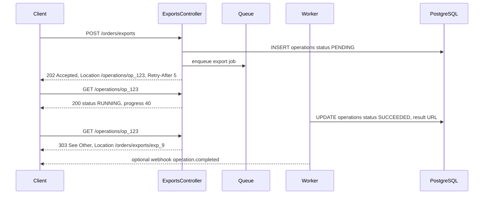
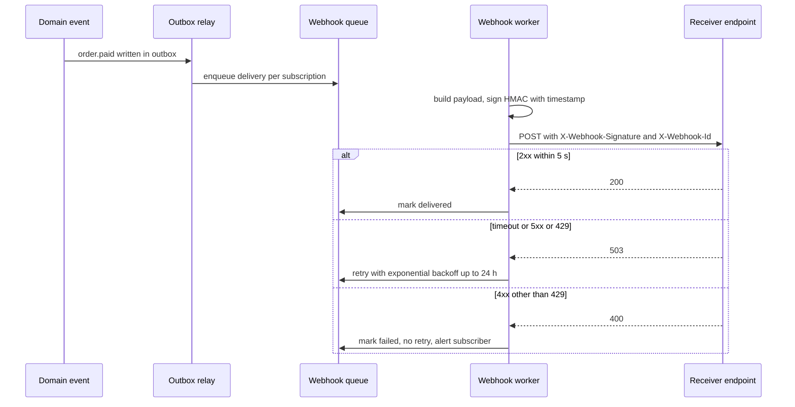

## 15.14 API contracts (OpenAPI)

#### Concept

An API contract is a machine-readable description of every endpoint, parameter, request body, response and error: for REST that is an **OpenAPI** document (3.0 or 3.1, YAML or JSON). It is the single source of truth that documentation, client SDKs, mock servers, contract tests and gateways are generated from.

Two ways to produce it:

- **Code-first**: decorate NestJS controllers and DTOs with `@nestjs/swagger` and generate the document at build time. The code is the truth; the spec follows.
- **Contract-first** (design-first): write the OpenAPI document by hand (or with a designer tool), review it with consumers, then generate server stubs or validate the implementation against it. The spec is the truth; the code follows.

#### Why does it exist?

Without a contract, the API is whatever the code happens to do today. Frontend and mobile teams read the source or guess; partners email questions; changes are discovered by breakage. A contract lets consumers build in parallel against mocks, lets you generate typed clients instead of hand-writing them, and gives you something to diff in CI to catch breaking changes before they ship.

#### Mental model

Imagine architectural blueprints. Builders, electricians and inspectors all work from the same drawing. If the drawing is derived from the finished house (code-first), it is always accurate but you only see problems after the walls are up. If the house is built from the drawing (contract-first), you can argue about the kitchen before pouring concrete, but the drawing and the house can drift unless someone checks.

#### How it works

| | Code-first (`@nestjs/swagger`) | Contract-first |
|---|---|---|
| Source of truth | Decorated code | OpenAPI file in the repo |
| Drift risk | Low (generated) but decorators can lie (wrong `@ApiResponse`) | High unless validated at runtime or in CI |
| Review before build | Hard; the code exists first | Natural; consumers review the YAML |
| Parallel work | Consumers wait for a deployable | Consumers mock from the spec on day one |
| Tooling in NestJS | First-class | Generate DTOs with `openapi-typescript`/`openapi-generator`; validate with `express-openapi-validator` |
| Best for | Small teams, internal APIs, fast iteration | Public/partner APIs, multiple consumer teams, regulated changes |

A pragmatic hybrid that works: code-first generation, the generated spec committed to the repo, and a CI step that diffs it against the previous version (`oasdiff`, `openapi-diff`) and fails on breaking changes. You get accuracy from generation and review from the diff.

**Generating clients.** From the spec, `openapi-generator-cli` produces TypeScript (`typescript-fetch`, `typescript-axios`), Kotlin, Swift and more. The mobile team never hand-writes a request again; a renamed field becomes a compile error in their build, not a runtime crash in production.

**Contract tests.** The contract is only valuable if the implementation honours it. Provider-side: run the e2e suite through an OpenAPI validator middleware that fails any response not matching the schema. Consumer-side: consumer-driven contracts (Pact) let each consumer record what it actually uses, and the provider's CI verifies it never breaks those expectations. Part 41 — Testing covers the full setup.

#### NestJS example

Swagger setup and the decorators that make the document accurate.

```ts
// src/main.ts (excerpt)
import { DocumentBuilder, SwaggerModule } from '@nestjs/swagger';
import { writeFileSync } from 'node:fs';

const config = new DocumentBuilder()
  .setTitle('Orders API')
  .setDescription('Place, read and cancel orders. All money values are decimal strings.')
  .setVersion('2.0.0')
  .addBearerAuth()
  .addServer('https://api.example.com', 'production')
  .build();
const document = SwaggerModule.createDocument(app, config, { ignoreGlobalPrefix: false });
if (process.env.WRITE_OPENAPI === '1') writeFileSync('openapi.json', JSON.stringify(document, null, 2)); // committed and diffed in CI
SwaggerModule.setup('api/docs', app, document);   // interactive UI at /api/docs, disabled in production behind a flag
```

```ts
// src/ordering/api/dto/order-response.dto.ts
import { ApiProperty, ApiPropertyOptional } from '@nestjs/swagger';

export class MoneyDto {
  @ApiProperty({ example: '1299.00', description: 'Decimal string, never a float' }) amount: string;
  @ApiProperty({ example: 'INR', minLength: 3, maxLength: 3 }) currency: string;
}
export class OrderResponseDto {
  @ApiProperty({ format: 'uuid' }) id: string;
  @ApiProperty({ enum: ['DRAFT', 'PLACED', 'PAID', 'FULFILLED', 'CANCELLED'], description: 'Open enum: clients must tolerate unknown values' }) status: string;
  @ApiProperty({ type: MoneyDto }) total: MoneyDto;
  @ApiPropertyOptional({ format: 'date-time' }) placedAt?: string;
  @ApiProperty({ description: 'Optimistic concurrency token; send back as If-Match', example: 12 }) version: number;
}
export class ProblemDetailsDto {
  @ApiProperty({ example: 'https://errors.example.com/order-not-cancellable' }) type: string;
  @ApiProperty({ example: 'Order cannot be cancelled' }) title: string;
  @ApiProperty({ example: 409 }) status: number;
  @ApiPropertyOptional() detail?: string;
  @ApiProperty({ example: 'ORDER_NOT_CANCELLABLE' }) code: string;
  @ApiPropertyOptional() correlationId?: string;
}
```

```ts
// controller decorators (full controller in 8.18)
@ApiTags('orders')
@ApiBearerAuth()
@Controller({ path: 'orders', version: '2' })
export class OrdersController {
  @Post()
  @ApiOperation({ summary: 'Place an order', description: 'Idempotent via Idempotency-Key. Replays return 200 with Idempotent-Replayed: true.' })
  @ApiHeader({ name: 'Idempotency-Key', required: true, description: 'UUID v4 per logical operation; reuse only for retries' })
  @ApiCreatedResponse({ type: OrderResponseDto, headers: { Location: { schema: { type: 'string' } } } })
  @ApiResponse({ status: 200, description: 'Idempotent replay', type: OrderResponseDto })
  @ApiBadRequestResponse({ type: ProblemDetailsDto })
  @ApiUnprocessableEntityResponse({ type: ProblemDetailsDto, description: 'Unknown SKU, insufficient stock, key reused' })
  @ApiResponse({ status: 429, type: ProblemDetailsDto, description: 'Rate limited; see Retry-After' })
  create() {}
}
```

The `class-validator` decorators already carry constraints; `@nestjs/swagger`'s CLI plugin (`@nestjs/swagger/plugin` in `nest-cli.json`) reads them and the TypeScript types, so most `@ApiProperty` boilerplate disappears and the spec stays in sync with validation.

#### Production scenario

A public API with 80 endpoints generated its spec in CI on every merge, published it to a developer portal, and produced TypeScript, Kotlin and Swift SDKs automatically. A breaking-change diff gate (`oasdiff breaking`) blocked 11 PRs in a year that would have removed or retyped fields. Partner onboarding used the mock server generated from the same spec; partners integrated before the endpoints were finished.

#### Failure scenario

A controller's `@ApiOkResponse({ type: OrderResponseDto })` was copy-pasted onto a list endpoint that actually returned `{ items, pageInfo }`. The generated Kotlin client expected a single order, crashed on parse, and the Android release was pulled. The contract test that would have caught it (validate every e2e response against the spec) was added the next sprint. A decorator is a claim; only a test makes it true.

#### Edge cases & failure modes

- **Decorators that lie.** Response types not matching reality. Validate responses against the spec in e2e tests.
- **Spec published from a branch that never shipped.** Publish from the deployed build's artefact.
- **Global prefix and versioning missing from the spec paths.** Check `ignoreGlobalPrefix` and version handling in `createDocument`.
- **Swagger UI exposed in production** with `try it out` against live data. Gate it behind auth or an environment flag.
- **Enums closed in the spec** while the server adds values; clients generated with strict enums crash. Document enums as open or add values only with a version.
- **Money as `number` in the spec** because a DTO used `number`. Strings, always.

#### How a Senior Backend Engineer thinks about this

They pick code-first with a committed, diffed spec for most teams, and contract-first for partner-facing APIs where consumers must review before build. They treat the spec as an artefact of the release, generate clients from it, and gate CI on breaking-change detection. They make sure something executes the contract against the implementation.

#### Common mistakes

- No spec, or a hand-maintained one that is two versions behind.
- Spec with no error responses documented.
- Hand-written client SDKs that drift.
- `any`-typed DTOs that generate `{}` schemas.

#### Interview questions

1. *Code-first vs contract-first: tradeoffs and when you choose each.* Expected: the table; hybrid with diff gate.
2. *How do you catch a breaking API change before it ships?* Expected: committed spec, `oasdiff` in CI, consumer contract tests.
3. *How do you make sure the spec matches the implementation?* Expected: response validation in e2e tests; generated from code; plugin reads validators.
4. *What do generated clients buy you and what do they cost?* Expected: type safety and no hand-written requests; regeneration workflow and versioning.

#### Practical exercise

Enable the swagger CLI plugin, generate `openapi.json` in CI, commit it, add `oasdiff breaking` against the previous commit, and add an e2e test that validates every response against the spec with an OpenAPI validator. Then generate a `typescript-fetch` client and use it in one e2e test. Acceptance criteria: removing a response field fails CI; the generated client compiles and places an order; the spec documents 400, 401, 404, 409, 422 and 429 for the create endpoint.

## 15.15 HATEOAS (briefly)

#### Concept

HATEOAS (Hypermedia As The Engine Of Application State) is the idea that responses include **links** to the next possible actions, so a client navigates the API by following links rather than by hard-coding URIs and rules:

```json
{
  "id": "8f3c...", "status": "PLACED",
  "_links": {
    "self":   { "href": "/api/v2/orders/8f3c..." },
    "cancel": { "href": "/api/v2/orders/8f3c.../cancellations", "method": "POST" },
    "pay":    { "href": "/api/v2/orders/8f3c.../payments", "method": "POST" }
  }
}
```

A fulfilled order would have no `cancel` link; the client learns what is possible from the server, not from a copy of the business rules.

#### Why it is attractive

The server owns the state machine. Clients do not duplicate "can I cancel?" logic. URIs can change without breaking clients that follow links. It is what makes the web itself work: browsers know nothing about your site and still navigate it.

#### Why most teams skip it

- **Clients are not generic.** A mobile app is built by people who read your docs and design a screen with a "Cancel" button; they still need to know the rules to design the UI, and they still hard-code the screens.
- **Tooling is thin.** OpenAPI does not describe link semantics well; generated clients ignore `_links`.
- **Payload bloat** for lists (links per item).
- **Format wars**: HAL, JSON:API, Siren, Collection+JSON. Each has a small following.
- **The value is real but small** compared to the cost, unless you are building a truly generic client (an admin console that renders any resource, a workflow engine).

#### The pragmatic middle

Keep two things from HATEOAS and drop the rest:

1. **Return a `Location` header on 201** and `self` where cheap.
2. **Return allowed actions as booleans or a list** when the UI needs them: `"actions": ["cancel", "pay"]` or `"canCancel": true`. Clients get the server's decision on what is possible without a full link format. This is HATEOAS in spirit: the server, not the client, decides.

```ts
// in the response mapper
return { ...dto, actions: computeAllowedActions(order) };   // ['cancel'] for PLACED, [] for FULFILLED
```

#### Interview questions

1. *What is HATEOAS and why is it rarely implemented fully?* Expected: links drive navigation; non-generic clients, tooling, bloat.
2. *What part of the idea is worth keeping?* Expected: server-decided allowed actions; `Location`; `self`.

## 15.16 Long-running operations

#### Concept

Some requests cannot finish inside an HTTP timeout: generating a 200,000-row export, capturing a payment that requires a bank redirect, provisioning a tenant, bulk imports. The API accepts the work, returns **202 Accepted** immediately with a way to track it, does the work in the background, and lets the client find out the result by **polling** a status resource or by receiving a **webhook**.

#### Why does it exist?

HTTP connections through gateways and load balancers have timeouts of 30 to 60 seconds, mobile networks less. Holding a connection open for minutes wastes a worker, fails unpredictably, and leaves the client unsure whether the work happened. The 202 pattern decouples "I accepted your request" from "the work is done".

#### Mental model

Imagine dropping off a car for service. You get a ticket number immediately (202 plus operation id). You can call and ask "is it ready?" (polling), or leave your phone number and be called when it is (webhook). You do not stand at the counter for four hours holding the line.

#### How it works



1. `POST` the request. Validate synchronously (a bad request should fail now, not five minutes later).
2. Create an **operation resource** (`operations` row) in `PENDING`, enqueue a job with the operation id, and return 202 with `Location: /operations/{id}` and `Retry-After`.
3. The client polls `GET /operations/{id}`. Return `200` with `{ status: PENDING | RUNNING | SUCCEEDED | FAILED, progress, result, error }`. On success, either embed the result or return `303 See Other` to the result resource.
4. Optionally, on completion send a webhook (15.17).
5. The operation is idempotent through the same `Idempotency-Key` mechanism as any `POST`.
6. Operations expire (keep 7 days), and the job is retried with backoff; the status resource reflects retries.

#### NestJS example

Using `@nestjs/bullmq` for the queue. The controller returns 202; the processor updates the operation.

```ts
// src/ordering/api/exports.controller.ts
import { Body, Controller, Get, HttpCode, Param, Post, Res, ParseUUIDPipe } from '@nestjs/common';
import { InjectQueue } from '@nestjs/bullmq';
import { Queue } from 'bullmq';
import { Response } from 'express';

@Controller()
export class ExportsController {
  constructor(@InjectQueue('exports') private readonly queue: Queue, private readonly operations: OperationsService) {}

  @Post('orders/exports')
  @HttpCode(202)
  @Idempotent()
  @UseInterceptors(IdempotencyInterceptor)
  async start(@Body() dto: CreateExportDto, @CurrentUser() user: { id: string }, @Res({ passthrough: true }) res: Response) {
    const op = await this.operations.create({ kind: 'orders.export', requestedBy: user.id, input: dto });
    await this.queue.add('export', { operationId: op.id }, {
      jobId: op.id,                                            // dedupe: one job per operation
      attempts: 5, backoff: { type: 'exponential', delay: 2_000 }, removeOnComplete: true,
    });
    res.setHeader('Location', `/api/v2/operations/${op.id}`);
    res.setHeader('Retry-After', '5');
    return { operationId: op.id, status: 'PENDING' };
  }

  @Get('operations/:id')
  async status(@Param('id', ParseUUIDPipe) id: string, @CurrentUser() user: { id: string }, @Res({ passthrough: true }) res: Response) {
    const op = await this.operations.getOwned(id, user.id);   // 404 if not yours
    if (op.status === 'SUCCEEDED' && op.resultLocation) {
      res.status(303); res.setHeader('Location', op.resultLocation);
    } else if (op.status === 'PENDING' || op.status === 'RUNNING') {
      res.setHeader('Retry-After', '5');
    }
    return { id: op.id, status: op.status, progress: op.progress, error: op.error, createdAt: op.createdAt, updatedAt: op.updatedAt };
  }
}
```

```ts
// src/ordering/application/export.processor.ts
import { Processor, WorkerHost } from '@nestjs/bullmq';
import { Job } from 'bullmq';

@Processor('exports', { concurrency: 2 })
export class ExportProcessor extends WorkerHost {
  constructor(private readonly operations: OperationsService, private readonly exporter: OrdersExporter) { super(); }

  async process(job: Job<{ operationId: string }>): Promise<void> {
    const op = await this.operations.markRunning(job.data.operationId);   // no-op if already SUCCEEDED (idempotent retry)
    if (!op) return;
    try {
      const url = await this.exporter.run(op.input, async (pct) => this.operations.progress(op.id, pct));
      await this.operations.succeed(op.id, { resultLocation: url });
    } catch (err) {
      if (job.attemptsMade + 1 >= (job.opts.attempts ?? 1)) await this.operations.fail(op.id, toProblem(err));
      throw err;   // let BullMQ retry with backoff
    }
  }
}
```

#### PostgreSQL example

```sql
CREATE TABLE ops.operations (
  id               uuid PRIMARY KEY,
  kind             text NOT NULL,
  requested_by     uuid NOT NULL,
  status           text NOT NULL CHECK (status IN ('PENDING','RUNNING','SUCCEEDED','FAILED')),
  progress         smallint NOT NULL DEFAULT 0 CHECK (progress BETWEEN 0 AND 100),
  input            jsonb NOT NULL,
  result_location  text,
  error            jsonb,
  created_at       timestamptz NOT NULL DEFAULT now(),
  updated_at       timestamptz NOT NULL DEFAULT now(),
  expires_at       timestamptz NOT NULL DEFAULT now() + interval '7 days'
);
CREATE INDEX ix_operations_owner ON ops.operations (requested_by, created_at DESC);
CREATE INDEX ix_operations_expiry ON ops.operations (expires_at);

-- Idempotent transition to RUNNING (a retried job must not restart a finished operation):
UPDATE ops.operations SET status = 'RUNNING', updated_at = now()
WHERE id = $1 AND status IN ('PENDING','RUNNING') RETURNING *;
```

#### Production scenario

An exports endpoint produced CSVs of up to 2 million rows (3 to 8 minutes). Synchronous attempts timed out at the load balancer's 60 s. With 202 plus polling every 5 s, clients saw `progress` climb, and the result was a pre-signed S3 URL returned via 303. Two worker pods with concurrency 2 handled 300 exports a day; the queue absorbed month-end spikes of 40 in an hour with no API impact.

#### Failure scenario

A payment capture that took 20 s (issuer slow) was implemented synchronously. The gateway timed out at 30 s roughly 3% of the time; the capture succeeded; the client saw a 504 and showed "payment failed"; customers paid again. Moving to 202 with `Location: /payments/{id}` and a status of `PENDING` until the provider's webhook arrived eliminated the double payments; the mobile app polls every 2 s for up to a minute and then falls back to "we will email you".

#### Edge cases & failure modes

- **Polling storms.** Thousands of clients polling every 200 ms. Return `Retry-After`; rate limit the status endpoint per operation; offer webhooks.
- **Worker crash mid-job.** BullMQ re-delivers; `markRunning` is idempotent; the exporter must tolerate a restart (write to a temp key, move on success).
- **Operation visible to other users.** Scope status reads by owner.
- **Result too large for the status body.** Return a location, not the data.
- **Stuck in RUNNING** forever after a crash with no retry. A sweeper marks operations older than N minutes as FAILED with a retryable error.
- **Client loses the operation id.** Provide `GET /operations?kind=...` for the owner's recent operations.

#### How a Senior Backend Engineer thinks about this

Anything over a few seconds becomes 202 with an operation resource. They validate synchronously, enqueue with a deterministic job id, make the worker idempotent, expose progress, set `Retry-After`, expire operations, and offer webhooks for integrations that should not poll.

#### Interview questions

1. *Design an export endpoint for millions of rows.* Expected: 202, operation resource, queue, worker, 303 to result, expiry.
2. *A payment provider takes up to 30 s. How does the API behave?* Expected: 202 with status resource; provider webhook completes it; client polls or is notified.
3. *How do you stop polling from becoming a problem?* Expected: `Retry-After`, per-operation rate limits, webhooks, long-polling or SSE for interactive cases.

#### Practical exercise

Implement `POST /orders/exports` and `GET /operations/{id}` with BullMQ. Kill the worker mid-export and prove the retry completes without producing two files. Acceptance criteria: 202 with `Location` and `Retry-After`; status shows progress; success returns 303; a stale RUNNING operation is failed by a sweeper after 10 minutes; another user gets 404 for your operation.

## 15.17 Webhooks

#### Concept

A webhook is an HTTP request **you** make to a URL the client registered, when something happens: `order.paid`, `shipment.dispatched`, `operation.completed`. It is the push alternative to polling. You are now the client, and everything that makes clients hard (timeouts, retries, duplicates, ordering, security) is your problem.

#### Why does it exist?

Polling wastes resources on both sides and adds latency equal to the polling interval. Integrations (ERPs, marketplaces, customer systems) want to know within seconds that an order was paid, without asking every second. Webhooks deliver that, at the cost of you operating a reliable delivery system.

#### Mental model

Imagine subscribing to a courier's SMS updates. The courier sends a message when the parcel moves. Sometimes the message is delayed, sometimes duplicated, and occasionally "out for delivery" arrives after "delivered". You still trust it because each message has a parcel number and a timestamp, and you can always check the tracking page (fetch current state) if in doubt.

#### How it works



Design rules for the **sender**:

1. **Sign every delivery.** HMAC-SHA256 over `timestamp.rawBody` with a per-subscription secret. Header: `X-Webhook-Signature: t=1725700000,v1=<hex>`. Including the timestamp prevents replay of an old captured request; receivers reject if `|now - t| > 5 min`.
2. **Include an event id** (`X-Webhook-Id`, also in the body) so receivers can deduplicate. Delivery is at-least-once.
3. **Small payload with ids and the event type**; the receiver fetches the current resource for details if it needs them. This also solves ordering: the fetched state is always current.
4. **Timeouts and retries.** 5 s connect+response timeout. Retry on timeout, 5xx and 429 with exponential backoff and jitter: 1 min, 5 min, 30 min, 2 h, 6 h, 12 h, 24 h. Do not retry on other 4xx (the receiver rejected it deliberately).
5. **Per-subscription circuit breaking.** After N consecutive failures, pause the subscription, alert the subscriber, expose a "redeliver" endpoint.
6. **Durability.** Deliveries originate from the outbox (Part 14, 14.10) so a crash never loses an event.
7. **Security of the destination.** Only HTTPS; block private IP ranges (SSRF); resolve DNS once and pin; no redirects.
8. **Observability.** A `webhook_deliveries` table with attempts, status codes and latencies; a dashboard per subscriber; a UI to replay.

Design rules for the **receiver** (you will write these too, for Stripe, Razorpay, shipping carriers):

1. Verify the signature against the **raw body** (not re-serialised JSON), with `timingSafeEqual`.
2. Check the timestamp tolerance.
3. **Return 200 fast** (under a second), before doing the work; enqueue the work internally. Senders time out and retry otherwise.
4. **Deduplicate** by event id in a table with a unique constraint; a duplicate is a 200 no-op.
5. **Tolerate out-of-order** delivery: apply state transitions defensively, or fetch the current resource.
6. Never trust the payload for authorisation; look up your own records by id.

#### NestJS example

Sender worker with signing and retry policy, and a receiver with raw-body verification.

```ts
// src/webhooks/application/webhook-delivery.processor.ts
import { Processor, WorkerHost } from '@nestjs/bullmq';
import { Job, UnrecoverableError } from 'bullmq';
import { createHmac } from 'node:crypto';

interface DeliveryJob { deliveryId: string; url: string; secret: string; eventId: string; body: string; }

@Processor('webhooks', { concurrency: 20 })
export class WebhookDeliveryProcessor extends WorkerHost {
  constructor(private readonly deliveries: WebhookDeliveriesRepository, private readonly guard: OutboundUrlGuard) { super(); }

  async process(job: Job<DeliveryJob>): Promise<void> {
    const { deliveryId, url, secret, eventId, body } = job.data;
    await this.guard.assertAllowed(url);                                 // https only, no private ranges, no redirects
    const t = Math.floor(Date.now() / 1000);
    const sig = createHmac('sha256', secret).update(`${t}.${body}`).digest('hex');

    const controller = new AbortController();
    const timer = setTimeout(() => controller.abort(), 5_000);
    let status = 0;
    try {
      const res = await fetch(url, {
        method: 'POST', redirect: 'manual', signal: controller.signal,
        headers: { 'Content-Type': 'application/json', 'X-Webhook-Id': eventId, 'X-Webhook-Signature': `t=${t},v1=${sig}`, 'User-Agent': 'example-webhooks/1.0' },
        body,
      });
      status = res.status;
    } catch (err) {
      await this.deliveries.recordAttempt(deliveryId, job.attemptsMade + 1, 0, String(err));
      throw err;                                                          // retry with backoff
    } finally { clearTimeout(timer); }

    await this.deliveries.recordAttempt(deliveryId, job.attemptsMade + 1, status);
    if (status >= 200 && status < 300) { await this.deliveries.markDelivered(deliveryId); return; }
    if (status === 429 || status >= 500) throw new Error(`Receiver returned ${status}`);            // retry
    await this.deliveries.markFailed(deliveryId, status);
    throw new UnrecoverableError(`Receiver rejected with ${status}`);                                // no retry
  }
}

// enqueue with the backoff policy (from the outbox relay):
// queue.add('deliver', job, { jobId: deliveryId, attempts: 8, backoff: { type: 'exponential', delay: 60_000 }, removeOnComplete: true });
```

```ts
// src/payments/api/provider-webhook.controller.ts  (we are the receiver)
import { Controller, Headers, HttpCode, Post, Req, UnauthorizedException, BadRequestException } from '@nestjs/common';
import { RawBodyRequest } from '@nestjs/common';
import { Request } from 'express';
import { createHmac, timingSafeEqual } from 'node:crypto';

@Controller('webhooks/payments')
export class ProviderWebhookController {
  constructor(private readonly inbox: WebhookInboxService, private readonly config: ConfigService) {}

  @Post()
  @HttpCode(200)
  @SkipThrottle()                                         // never rate limit a provider's webhooks
  async receive(@Req() req: RawBodyRequest<Request>, @Headers('x-webhook-signature') sigHeader?: string) {
    const raw = req.rawBody;                              // requires NestFactory.create(AppModule, { rawBody: true })
    if (!raw || !sigHeader) throw new BadRequestException('Missing body or signature');
    const { t, v1 } = parseSignature(sigHeader);
    if (Math.abs(Date.now() / 1000 - Number(t)) > 300) throw new UnauthorizedException('Stale signature');  // 5 min tolerance
    const expected = createHmac('sha256', this.config.getOrThrow('PAYMENT_WEBHOOK_SECRET')).update(`${t}.${raw.toString()}`).digest('hex');
    if (expected.length !== v1.length || !timingSafeEqual(Buffer.from(expected), Buffer.from(v1))) throw new UnauthorizedException('Bad signature');

    const event = JSON.parse(raw.toString()) as { id: string; type: string; data: Record<string, unknown> };
    await this.inbox.enqueueOnce(event);                  // INSERT ... ON CONFLICT (event_id) DO NOTHING, then a job
    return { received: true };                            // fast 200; the work happens in a worker
  }
}

function parseSignature(h: string): { t: string; v1: string } {
  const parts = Object.fromEntries(h.split(',').map((kv) => kv.split('=') as [string, string]));
  if (!parts.t || !parts.v1) throw new BadRequestException('Malformed signature header');
  return { t: parts.t, v1: parts.v1 };
}
```

#### PostgreSQL example

Sender-side deliveries and receiver-side inbox.

```sql
CREATE TABLE webhooks.subscriptions (
  id            uuid PRIMARY KEY,
  owner_id      uuid NOT NULL,
  url           text NOT NULL,
  secret        text NOT NULL,                       -- store encrypted at rest
  event_types   text[] NOT NULL,
  status        text NOT NULL DEFAULT 'ACTIVE' CHECK (status IN ('ACTIVE','PAUSED')),
  consecutive_failures integer NOT NULL DEFAULT 0
);

CREATE TABLE webhooks.deliveries (
  id               uuid PRIMARY KEY,
  subscription_id  uuid NOT NULL REFERENCES webhooks.subscriptions(id),
  event_id         uuid NOT NULL,
  event_type       text NOT NULL,
  payload          jsonb NOT NULL,
  status           text NOT NULL DEFAULT 'PENDING' CHECK (status IN ('PENDING','DELIVERED','FAILED')),
  attempts         integer NOT NULL DEFAULT 0,
  last_status_code integer,
  last_error       text,
  next_attempt_at  timestamptz,
  created_at       timestamptz NOT NULL DEFAULT now(),
  delivered_at     timestamptz,
  CONSTRAINT ux_delivery_per_sub_event UNIQUE (subscription_id, event_id)   -- one delivery record per event per subscriber
);
CREATE INDEX ix_deliveries_pending ON webhooks.deliveries (next_attempt_at) WHERE status = 'PENDING';

-- Receiver side: dedupe inbox
CREATE TABLE payments.webhook_inbox (
  event_id     text PRIMARY KEY,
  event_type   text NOT NULL,
  payload      jsonb NOT NULL,
  received_at  timestamptz NOT NULL DEFAULT now(),
  processed_at timestamptz
);
```

#### Production scenario

A platform delivered 1.2 million webhooks a day to 400 subscribers. First-attempt success was 97.5%; 2.1% succeeded on retry within an hour; 0.4% exhausted retries (dead subscribers) and were surfaced in the subscriber dashboard with a replay button. Median delivery latency from event to receiver 200 was 800 ms. Two subscribers with flapping endpoints were auto-paused and emailed; nobody was paged.

#### Failure scenario

A receiver (an ERP integration) processed each webhook synchronously in the handler: 12 s of ERP calls before returning 200. The sender timed out at 5 s and retried; the ERP received the same order three to eight times; duplicate purchase orders were raised. Fix on the receiver: return 200 immediately after writing to an inbox with a unique event id, process asynchronously, dedupe. Fix on the sender's docs: "respond within 5 s; we retry on timeout; deliveries are at-least-once".

#### Edge cases & failure modes

- **Duplicates.** At-least-once delivery. Receivers dedupe by event id.
- **Out of order.** `shipment.delivered` before `shipment.dispatched` after a retry. Receivers apply defensively or fetch current state; senders include a `sequence` or `occurredAt`.
- **Clock skew** between sender and receiver breaks timestamp tolerance. 5 minutes is standard; log skew when rejecting.
- **Secret rotation.** Support two active secrets per subscription during rotation; sign with the new, verify with either.
- **SSRF via subscriber URL** pointing at `http://169.254.169.254/` or an internal service. Validate and block private ranges; resolve and pin DNS.
- **Slow receivers** holding worker concurrency. Per-subscriber concurrency limits; timeouts.
- **Payload includes PII** the subscriber should not have. Send ids; let them fetch with their own authorisation.
- **Retrying 4xx forever.** Only retry timeouts, 5xx and 429.
- **Signature over re-serialised JSON** fails because key order changed. Always sign and verify the raw bytes.

#### How a Senior Backend Engineer thinks about this

Webhooks are a distributed system they now operate. They sign with timestamps, deliver from the outbox with backoff, dedupe on both sides, keep payloads small, protect against SSRF, expose delivery logs and replay to subscribers, and write the receiver contract ("200 within 5 s, at-least-once, verify raw body") into the docs. As a receiver they verify, ack fast, inbox, dedupe, process async.

#### Common mistakes

- No signature, or signature without timestamp.
- Verifying against `JSON.stringify(req.body)` instead of the raw body.
- Doing the work inside the receiver handler.
- Retrying on 400.
- Sending the full order with customer PII to every subscriber.

#### Interview questions

1. *Design outbound webhooks: security, retries, ordering, observability.* Expected: HMAC with timestamp, backoff schedule, at-least-once with ids, small payloads with fetch, delivery log and replay, SSRF protection.
2. *How do you verify an incoming webhook safely?* Expected: raw body, `timingSafeEqual`, timestamp tolerance, fast 200, inbox dedupe.
3. *Why include a timestamp in the signature?* Expected: replay protection.
4. *A subscriber's endpoint is down for a day. What happens?* Expected: backoff up to 24 h, pause after N failures, alert, manual replay.

#### Practical exercise

Build both sides: a sender that delivers `order.paid` from the outbox with signing and backoff, and a receiver for a mock payment provider with raw-body verification and an inbox. Test: tampered body (401), stale timestamp (401), duplicate event id (200, processed once), receiver returning 503 twice then 200 (delivered on attempt 3), receiver returning 400 (failed, no retry), subscriber URL `http://10.0.0.1/` (rejected). Acceptance criteria: all six pass; the deliveries table shows attempts and status codes; a replay endpoint re-enqueues a failed delivery.
