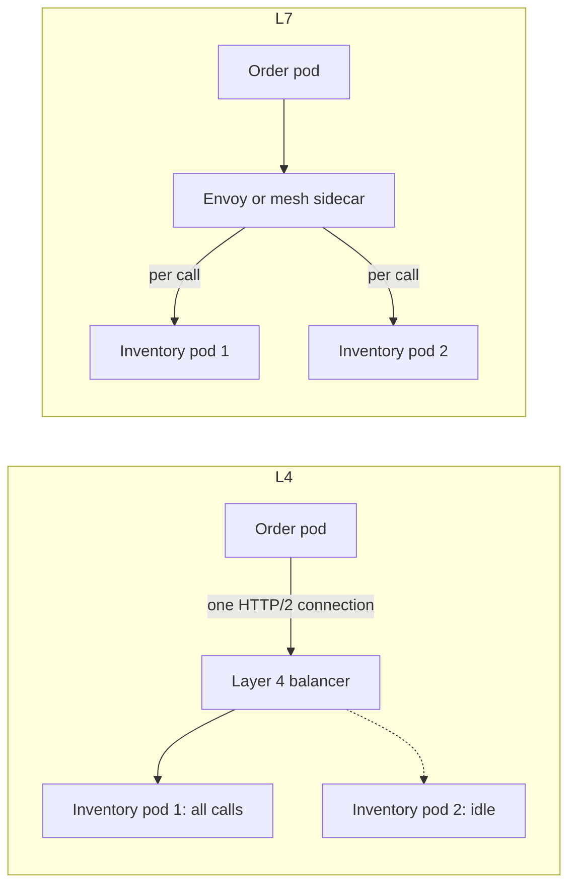

## 15.7 gRPC in production with NestJS

#### Concept

Sections 15.2.1 and 15.2.2 covered what gRPC is and how its contract evolves. Running it in production adds four concerns: wiring the transport (server and client), deadlines that shrink as a request travels through services, mapping errors to status codes, and making the service observable and debuggable (health checks, reflection, metadata for tracing).

#### How it works

```proto
// proto/inventory/v1/inventory.proto
syntax = "proto3";
package inventory.v1;

service InventoryService {
  rpc ReserveStock (ReserveStockRequest) returns (ReserveStockResponse);   // unary
  rpc WatchStock (WatchStockRequest) returns (stream StockLevel);         // server streaming
}

message ReserveStockRequest {
  string idempotency_key = 1;            // retries must not reserve twice
  string order_id = 2;
  repeated Line lines = 3;
}
message Line { string sku = 1; int32 quantity = 2; }
message ReserveStockResponse { string reservation_id = 1; }
message WatchStockRequest { repeated string skus = 1; }
message StockLevel { string sku = 1; int32 available = 2; }
```

1. The server loads the `.proto` at start-up (via `@grpc/proto-loader`) and maps each `rpc` to a handler decorated with `@GrpcMethod`.
2. The client loads the same `.proto`, gets a typed service object from `ClientGrpc.getService()`, and each call returns an RxJS Observable.
3. The client attaches a deadline in the call options; grpc-js sends it as the `grpc-timeout` header.
4. The server reads the remaining time from `call.getDeadline()` and passes a smaller deadline to its own downstream calls.
5. Errors travel as a status code plus message; NestJS turns `RpcException({ code, message })` into that status.

#### NestJS example

```ts
// main.ts -- hybrid app: HTTP (REST + GraphQL) and gRPC in one process
import { NestFactory } from '@nestjs/core';
import { MicroserviceOptions, Transport } from '@nestjs/microservices';
import { ReflectionService } from '@grpc/reflection';
import { HealthImplementation } from 'grpc-health-check';
import { join } from 'path';

async function bootstrap() {
  const app = await NestFactory.create(AppModule);
  const health = new HealthImplementation({ '': 'NOT_SERVING' });   // flips to SERVING when ready

  app.connectMicroservice<MicroserviceOptions>({
    transport: Transport.GRPC,
    options: {
      package: 'inventory.v1',
      protoPath: join(__dirname, 'proto/inventory/v1/inventory.proto'),
      url: '0.0.0.0:50051',
      loader: { keepCase: false, longs: String, enums: String, defaults: true },
      onLoadPackageDefinition: (pkg, server) => {
        new ReflectionService(pkg).addToServer(server);   // grpcurl can list and call methods
        health.addToServer(server);                        // grpc.health.v1 for Kubernetes probes
      },
    },
  });
  app.enableShutdownHooks();
  await app.startAllMicroservices();
  await app.listen(3000);
  health.setStatus('', 'SERVING');
}
bootstrap();
```

```ts
// inventory.grpc.controller.ts -- server side: deadline-aware handler with proper status codes
import { Controller } from '@nestjs/common';
import { GrpcMethod, RpcException } from '@nestjs/microservices';
import { Metadata, ServerUnaryCall, status } from '@grpc/grpc-js';

@Controller()
export class InventoryGrpcController {
  constructor(private readonly inventory: InventoryService) {}

  @GrpcMethod('InventoryService', 'ReserveStock')
  async reserveStock(req: ReserveStockRequest, metadata: Metadata, call: ServerUnaryCall<unknown, unknown>) {
    const deadline = call.getDeadline();                      // Date, number or Infinity
    try {
      return await this.inventory.reserve(req, { deadline, requestId: String(metadata.get('x-request-id')[0] ?? '') });
    } catch (e) {
      if (e instanceof InsufficientStockError) throw new RpcException({ code: status.FAILED_PRECONDITION, message: e.message });
      if (e instanceof UnknownSkuError) throw new RpcException({ code: status.NOT_FOUND, message: e.message });
      throw e;                                                // unknown errors become INTERNAL
    }
  }
}
```

```ts
// inventory.client.ts -- client side: deadline from the caller's remaining budget, metadata for tracing
import { Inject, Injectable, OnModuleInit } from '@nestjs/common';
import { ClientGrpc } from '@nestjs/microservices';
import { Metadata } from '@grpc/grpc-js';
import { firstValueFrom } from 'rxjs';

@Injectable()
export class InventoryClient implements OnModuleInit {
  private svc: InventoryServiceClient;                       // interface generated by ts-proto
  constructor(@Inject('INVENTORY') private readonly client: ClientGrpc) {}
  onModuleInit() { this.svc = this.client.getService<InventoryServiceClient>('InventoryService'); }

  reserve(req: ReserveStockRequest, budget: { deadlineAt: number; requestId: string }) {
    const deadline = Math.min(budget.deadlineAt - 20, Date.now() + 250); // keep 20 ms for our own work; cap at 250 ms
    const md = new Metadata();
    md.set('x-request-id', budget.requestId);
    return firstValueFrom(this.svc.reserveStock(req, md, { deadline })); // unsubscribing also cancels the call
  }
}

// orders.module.ts
ClientsModule.register([{
  name: 'INVENTORY',
  transport: Transport.GRPC,
  options: {
    package: 'inventory.v1',
    protoPath: join(__dirname, 'proto/inventory/v1/inventory.proto'),
    url: 'dns:///inventory-headless.shop.svc.cluster.local:50051',              // see 61.8
    channelOptions: { 'grpc.service_config': JSON.stringify({ loadBalancingConfig: [{ round_robin: {} }] }) },
  },
}]);
```

For server streaming, a `@GrpcMethod` handler may return an Observable; each emitted value is one message. Converting an async generator with RxJS `from()` streams a large result set without loading it all into memory:

```ts
@GrpcMethod('InventoryService', 'WatchStock')
watchStock(req: WatchStockRequest): Observable<StockLevel> {
  return from(this.inventory.stockChanges(req.skus));   // async generator yielding StockLevel objects
}
```

Status codes to map deliberately:

| Domain situation | gRPC status | Caller retries? |
|---|---|---|
| Invalid input | `INVALID_ARGUMENT` | No |
| Entity missing | `NOT_FOUND` | No |
| Business rule blocks it (out of stock) | `FAILED_PRECONDITION` | No |
| Duplicate create with same key | `ALREADY_EXISTS` (or return the original) | No |
| Caller not allowed | `PERMISSION_DENIED` / `UNAUTHENTICATED` | No |
| Overloaded, shedding load | `RESOURCE_EXHAUSTED` / `UNAVAILABLE` | Yes, with backoff and jitter |
| Deadline passed | `DEADLINE_EXCEEDED` | Only if idempotent |
| Bug | `INTERNAL` | No |

#### Production scenario

Checkout calls inventory, pricing and shipping on every order: about 2,000 orders per second at peak, so 6,000 internal RPCs per second. Each order request has a 1,500 ms budget at the edge. The order service passes `deadlineAt` down; pricing gets at most 150 ms, inventory 250 ms, shipping quote 300 ms, each capped by what remains. Typical latencies are p50 2–4 ms and p99 12–25 ms per RPC. Server reflection lets on-call engineers run `grpcurl -d '{"skus":["SKU-1"]}' inventory:50051 inventory.v1.InventoryService/WatchStock` from a debug pod. Kubernetes uses native gRPC probes against `grpc.health.v1`, and the service reports `NOT_SERVING` during shutdown so traffic drains before the process exits.

#### Edge cases & failure modes

- **Handler keeps working after the deadline**: the client has given up, but the server still writes to the database; check the deadline before expensive steps and stop when `call.cancelled` is true.
- **Streaming without flow control awareness**: emitting faster than the client reads fills memory on the server; pace producers or page.
- **Proto loaded from the wrong path in the Docker image**: `protoPath` must point at files copied into the image; copy them in the build step.
- **Reflection exposed publicly**: reflection reveals every method; keep the gRPC port internal.
- **Retry amplification**: three layers each retrying three times turns one failure into 27 calls; retry at one layer only (see Part 30 — Reliability Engineering, 30.3 Retries).

#### Interview questions

1. **How do you propagate a deadline through a chain of gRPC services?** Read the remaining time from the incoming call (`call.getDeadline()`), subtract a margin for local work, and set that as the deadline of each downstream call, capped per dependency. Follow-up: what happens if a middle service ignores it? Downstream work continues after the original caller has failed, wasting capacity during exactly the overload you were trying to survive.
2. **How do you debug a gRPC service when `curl` does not work?** Enable server reflection and use `grpcurl`, or point `grpcurl` at the `.proto` files; add request ids in metadata to correlate logs and traces.
3. **How do Kubernetes health checks work for a gRPC-only service?** Implement the standard `grpc.health.v1.Health` service and use the native `grpc` probe type, flipping to `NOT_SERVING` during shutdown.

#### Practical exercise

Implement `InventoryService` with a unary `ReserveStock` and a streaming `WatchStock` in a hybrid NestJS app, with reflection and health. From an order service, call it with a deadline computed from a 1,500 ms request budget. Acceptance criteria: `grpcurl` lists the service; a handler that sleeps 500 ms makes the client fail with `DEADLINE_EXCEEDED` at 250 ms and the server logs that the call was cancelled; out-of-stock returns `FAILED_PRECONDITION`; the Kubernetes gRPC probe passes only after start-up.

## 15.8 Load balancing, HTTP/2, gRPC-Web and gateways

#### Concept

gRPC runs on **HTTP/2**, which carries many concurrent requests (streams) over one long-lived TCP connection. That is efficient, but it breaks the assumption behind connection-level (layer 4) load balancing: one connection used to mean one request. With HTTP/2, one connection can carry all of a client's traffic for hours. Browsers add a second problem: their JavaScript APIs cannot speak native gRPC, so they need **gRPC-Web** through a proxy, or a REST/GraphQL **gateway**.

#### Why does it exist?

Imagine a supermarket that assigns each customer to a checkout lane when they walk in and never reassigns them. If one customer arrives with ten trolleys (an HTTP/2 connection carrying many calls), that lane is jammed while new lanes sit empty. gRPC load balancing exists to assign each **trolley**, not each customer, to a lane.

#### How it works



| Approach | How | Pros | Cons |
|---|---|---|---|
| Layer 4 (Kubernetes ClusterIP, NLB) | Balances TCP connections | Zero setup | Sticky; new pods get no traffic until clients reconnect |
| Client-side round robin | Headless Service + `dns:///` target + `round_robin` policy | No proxy hop; per-call balancing | DNS refresh delay; every client language must configure it |
| Layer 7 proxy or service mesh | Envoy, Linkerd or Istio sidecars balance per request | Per-call balancing, retries, mTLS, metrics | Extra hop (about 0.2–1 ms) and a mesh to operate |
| Server `max_connection_age` | Server closes connections every N minutes | Forces rebalancing with any approach | Reconnect churn; does not fix bursts |

```yaml
# Headless Service: DNS returns every pod IP, so the client can balance across them
apiVersion: v1
kind: Service
metadata:
  name: inventory-headless
  namespace: shop
spec:
  clusterIP: None
  selector:
    app: inventory
  ports:
    - name: grpc
      port: 50051
      targetPort: 50051
```

With the `dns:///inventory-headless...` target and the `round_robin` service config from 15.7, grpc-js opens a connection to every pod and spreads calls across them. Setting `'grpc.max_connection_age_ms': 300000` on the server makes clients reconnect every 5 minutes, re-resolve DNS and discover new pods.

For browsers, Envoy translates gRPC-Web (HTTP/1.1 or HTTP/2, base64 or binary framing that browsers can produce) into native gRPC:

```yaml
# envoy.yaml (excerpt) -- gRPC-Web filter in front of the order service
http_filters:
  - name: envoy.filters.http.grpc_web
    typed_config:
      "@type": type.googleapis.com/envoy.extensions.filters.http.grpc_web.v3.GrpcWeb
  - name: envoy.filters.http.cors
    typed_config:
      "@type": type.googleapis.com/envoy.extensions.filters.http.cors.v3.Cors
  - name: envoy.filters.http.router
    typed_config:
      "@type": type.googleapis.com/envoy.extensions.filters.http.router.v3.Router
```

The other route is a **gateway** that exposes REST/JSON or GraphQL to the outside and calls gRPC inside: a NestJS service (15.9), Envoy's `grpc_json_transcoder` filter driven by `google.api.http` annotations in the `.proto`, or `grpc-gateway` in Go. Transcoding gives partners REST from the same contract, but REST URLs then depend on proto field names, so renames become breaking (15.2.2).

#### Failure scenario

Before a sale, the inventory deployment was scaled from 4 to 12 pods. CPU on the original 4 pods stayed at 90% while the 8 new pods sat at 2%. The order service talked to inventory through a normal ClusterIP Service: kube-proxy balanced TCP connections, and the order pods' HTTP/2 connections, opened hours earlier, stayed on the original 4 pods. p99 rose to 800 ms during the sale's first ten minutes until someone restarted the order pods. The permanent fix: a headless Service with client-side `round_robin`, and `grpc.max_connection_age_ms` of 5 minutes on the inventory servers. The lesson: scaling out a gRPC service does nothing until clients open connections to the new pods.

#### How a Senior Backend Engineer thinks about this

A senior assumes gRPC traffic is unbalanced until proven otherwise and checks per-pod request rates after every scale-out. They choose client-side balancing for a few services in one language, a mesh when they also need mTLS and uniform retries for many services, and always set a maximum connection age. They keep raw gRPC off the public internet, using gRPC-Web only for first-party browser apps that benefit from the shared contract, and a REST or GraphQL gateway for everyone else.

#### Common mistakes

- Putting gRPC behind a ClusterIP Service or an L4 load balancer and expecting even load.
- Using a headless Service without the `round_robin` policy (grpc-js defaults to `pick_first`, which uses one address).
- Exposing native gRPC to browsers or partners instead of a gateway.
- Forgetting CORS headers for gRPC-Web.

#### Interview questions

1. **Why does Kubernetes' default Service not balance gRPC well?** It balances TCP connections, and HTTP/2 multiplexes all calls over long-lived connections, so load sticks to the pods that existed when the connections opened. Fix with client-side round robin over a headless Service, an L7 proxy or mesh, and `max_connection_age`.
2. **How can a browser call a gRPC service?** Through gRPC-Web and a translating proxy such as Envoy, or through a REST/GraphQL gateway that calls gRPC internally.
3. **What is JSON transcoding and its risk?** A proxy maps REST/JSON requests to gRPC methods using `google.api.http` annotations; renaming a proto field changes the JSON contract even though the wire format is unaffected.

#### Practical exercise

Deploy 3 inventory pods behind a ClusterIP Service, generate steady gRPC load from one client, and record per-pod request rates. Then scale to 6 pods. Switch to a headless Service with `round_robin` and a 5-minute `max_connection_age`. Acceptance criteria: before the change, new pods receive almost no traffic; after it, requests spread within 10% across all pods within 5 minutes of a scale-out.
