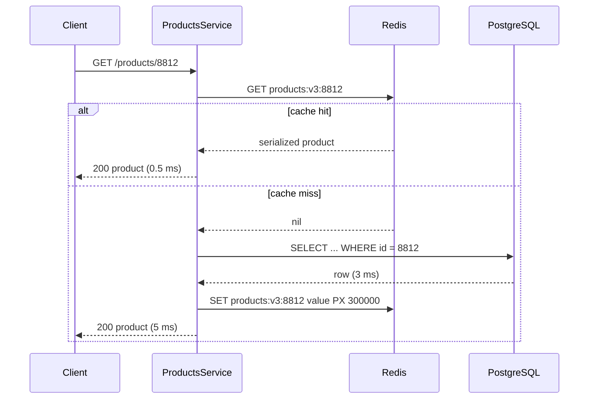

# Part 16 — Caching and Redis

## 16.1 Why caching exists

Most developers meet caching as "put Redis in front of the database and things get faster". That sentence is true and dangerous in equal measure. It is true because a Redis read costs about 0.3 ms and a PostgreSQL query costs 2 to 20 ms. It is dangerous because the moment you keep a second copy of any data, you own a consistency problem, and nobody warned you that the consistency problem is the whole job.

This part teaches caching the way a principal engineer meets it: as a set of copies of data, each with a rule for when it is allowed to be wrong, and a plan for what happens when the copy disappears. Redis is the tool we use for most of it, so the second half of this part goes deep on Redis itself: how it executes commands, how it loses data, how it clusters, and what every data structure is actually for in a backend.

### 16.1.1 The latency and load argument

#### Concept

A cache is a copy of data kept somewhere cheaper to read than the original. "Cheaper" means lower latency, lower CPU cost, or both. The original is called the source of truth. The cache is never the source of truth; it is a convenience that is allowed to be stale or absent.

Caching exists because two things are expensive: computing an answer, and moving an answer across a network. A product page in an e-commerce app might need six queries, two joins and a price calculation. Doing that once and reusing the result 10,000 times is the entire idea.

#### Why does it exist?

Look at the numbers for one `GET /products/:id` request on a typical NestJS plus PostgreSQL stack:

| Step | Cost | Notes |
|---|---|---|
| Node.js parses request, runs guards and pipes | 0.1 to 0.3 ms | CPU only |
| PostgreSQL point query by primary key, warm buffers | 1 to 3 ms | Network round trip plus planner plus executor |
| PostgreSQL query with two joins and aggregation | 5 to 20 ms | Planner cost, possibly a sort, more pages read |
| PostgreSQL query with cold buffers | 20 to 200 ms | Disk reads |
| Redis `GET` of a serialized product, same region | 0.2 to 0.5 ms | Mostly network round trip |
| Node.js in-process `Map.get` | 0.001 ms | No network at all |

Latency is only half the story. The other half is load. PostgreSQL executes a query with one backend process per connection, and each query burns CPU for parsing, planning and executing. A 4-vCPU PostgreSQL instance can serve perhaps 5,000 to 15,000 simple indexed reads per second before CPU saturates. A single Redis instance serves 100,000 or more `GET`s per second on one core because it does almost no work per command: hash the key, find the value, write bytes to the socket.

Without a cache, a product catalog with 3,000 reads per second at 4 ms each keeps the database busy for 12 CPU-seconds every second. That is three cores dedicated to answering the same 200 popular products over and over. With a 95 percent hit ratio in Redis, the database sees 150 reads per second and the other 2,850 get an answer in under a millisecond.

#### Mental model

Imagine a busy restaurant kitchen. The pantry (PostgreSQL) holds every ingredient, organized and safe, but walking there takes a minute. The chef's station (Redis) has small bowls of the ingredients used most, prepared and within arm's reach. The chef's own hands (in-process memory) hold the knife and the salt. Nobody stores the restaurant's inventory at the chef's station; the pantry is where truth lives. But the station is why the restaurant can serve 200 covers an hour. When a bowl runs empty (a cache miss), someone walks to the pantry, refills it, and service continues.

#### How it works

At the highest level every cache does four things:

1. **Lookup.** On a read, compute a key from the request (for example `products:v3:8812`) and ask the cache.
2. **Hit or miss.** If the value is there and not expired, return it. Otherwise go to the source of truth.
3. **Fill.** After a miss, store the fresh value under the key, usually with a time-to-live (TTL).
4. **Invalidate.** When the source changes, remove or overwrite the cached copy, or let the TTL expire it.

Step 4 is where the engineering lives. Steps 1 to 3 take ten lines of code; step 4 is a career.

#### Practical example

A food-delivery app shows a restaurant menu. The menu changes a few times per day (items go out of stock, prices change at lunch). It is read 50,000 times per day per popular restaurant. The menu query joins `restaurants`, `menu_sections`, `menu_items`, `item_options` and `inventory`, and costs 12 ms. Caching the rendered menu JSON for 60 seconds cuts database load by roughly 99 percent and improves p50 latency from 18 ms to 3 ms. The business accepts that an item might show as available for up to 60 seconds after it sells out, because the order placement step re-checks stock in PostgreSQL anyway.

That last sentence is the pattern to remember: cache the read, verify at the write.

#### Production scenario

A marketplace with 2 million products and 400 requests per second on product detail pages. Without a cache, PostgreSQL runs at 70 percent CPU and p99 latency is 180 ms during flash sales. After adding cache-aside with a 5 minute TTL and event-driven invalidation on price change, PostgreSQL drops to 12 percent CPU, Redis serves 380 of the 400 requests per second, and p99 falls to 25 ms. Redis memory: 2 million products at roughly 3 KB each is 6 GB if everything were cached, but only 300,000 products are ever requested in a 5 minute window, so actual memory sits at about 1 GB.

### 16.1.2 Cache is already everywhere: the layers

#### Concept

Before you add Redis, understand that a request already passes through half a dozen caches. Adding one more layer is a choice about where staleness is acceptable, not a switch from "no cache" to "cache".

```text
Browser cache (Cache-Control, ETag)          minutes to days, per user
        |
        v
CDN edge cache (CloudFront, Cloudflare)      seconds to hours, shared, geographic
        |
        v
API gateway / reverse proxy cache (nginx)    seconds, shared per region
        |
        v
NestJS in-process memory (Map, LRU)          milliseconds to seconds, per pod
        |
        v
Redis (shared, network)                      seconds to hours, shared across pods
        |
        v
PostgreSQL shared_buffers                    hot pages in RAM, managed by PG
        |
        v
OS page cache                                file blocks in RAM, managed by Linux
        |
        v
Disk (NVMe / EBS)                            the only thing that is truly durable
```

#### How it works

Each layer catches a share of traffic so the layer below sees less:

- **Browser cache** removes repeat requests entirely. `Cache-Control: max-age=300` on a public product image means the browser does not even ask.
- **CDN** serves static assets and, if you let it, whole API responses (`Cache-Control: public, s-maxage=60`). It is the cheapest cache per request you will ever have and the one most teams forget.
- **Gateway cache** is rare for authenticated APIs but valuable for public read endpoints.
- **In-process memory** is the fastest layer and the least consistent, because each pod has its own copy. We return to it in section 16.6 on multi-level caching.
- **Redis** is the shared application cache. Every pod sees the same value, which is why it is the default for anything invalidated on write.
- **PostgreSQL shared_buffers** is a cache you already run. A table that fits in `shared_buffers` (say 8 GB) serves point reads from RAM without disk I/O. This is why "the database is slow" often means "the working set no longer fits in memory", and why a Redis layer sometimes helps less than adding RAM to the database.
- **OS page cache** sits under PostgreSQL. Data files read once stay in Linux memory until evicted.

#### How a Senior Backend Engineer thinks about this

Before adding Redis, a senior asks: is the expensive thing the query, or the request? If PostgreSQL answers in 1 ms from `shared_buffers` and the request costs 30 ms because of serialization and three downstream HTTP calls, Redis in front of the query saves nothing. If the endpoint is public and identical for every user, the CDN saves more than Redis and costs less to operate. Redis is the right answer when the data is shared across users, changes on a timescale of seconds to hours, and the read is expensive relative to the request.

## 16.2 Cache strategies

A cache strategy answers two questions: who fills the cache, and who writes to the database. The five classic patterns differ only in those answers, but the operational consequences are very different.

### 16.2.1 Cache-aside (lazy loading)

#### Concept

In cache-aside, the application code owns both the cache and the database. On a read it checks the cache first; on a miss it reads the database and writes the result into the cache. On a write it updates the database and then deletes (or updates) the cache entry. The cache never talks to the database on its own.

This is the pattern behind 90 percent of Redis usage in NestJS applications, and it is the one you should default to.

#### Why does it exist?

Cache-aside exists because it is simple, it requires nothing from Redis except `GET`, `SET` and `DEL`, and it only caches data that is actually requested. A product nobody views never enters the cache. A Redis restart is survivable: the cache refills lazily as requests arrive.

#### Mental model

Imagine a librarian with a small desk shelf. When you ask for a book, she checks the shelf first. If it is not there, she walks to the stacks, brings it back, hands it to you, and leaves a copy on the shelf for the next person. If a book is corrected in the stacks, she throws the shelf copy away so the next reader triggers a fresh fetch.

#### How it works



1. Build the key from the identity of the thing (`products:v3:8812`). The `v3` is a schema version; we cover it in 16.4.
2. `GET` the key. Redis returns the value or `nil`.
3. On hit, deserialize and return.
4. On miss, query PostgreSQL, serialize, `SET` with a TTL, return.
5. On write, update PostgreSQL inside a transaction, then `DEL` the key after commit.

#### NestJS example

A minimal but production-shaped implementation using `ioredis` directly. The important lines are the TTL with jitter, the fail-open behaviour when Redis is down, and the delete after commit.

```ts
// products/products.service.ts
import { Injectable, Logger, NotFoundException } from '@nestjs/common';
import { InjectRepository } from '@nestjs/typeorm';
import { Repository } from 'typeorm';
import Redis from 'ioredis';
import { Product } from './product.entity';
import { REDIS } from '../redis/redis.module';
import { Inject } from '@nestjs/common';

const KEY_VERSION = 'v3';
const BASE_TTL_MS = 5 * 60 * 1000;

@Injectable()
export class ProductsService {
  private readonly logger = new Logger(ProductsService.name);

  constructor(
    @InjectRepository(Product) private readonly repo: Repository<Product>,
    @Inject(REDIS) private readonly redis: Redis,
  ) {}

  private key(id: string): string {
    return `products:${KEY_VERSION}:${id}`;
  }

  async findOne(id: string): Promise<Product> {
    const key = this.key(id);
    const cached = await this.safeGet(key);
    if (cached) return JSON.parse(cached) as Product;

    const product = await this.repo.findOne({ where: { id } });
    if (!product) throw new NotFoundException(`Product ${id} not found`);

    // Jitter spreads expiry so 10,000 keys do not expire in the same second.
    const ttl = BASE_TTL_MS + Math.floor(Math.random() * 30_000);
    await this.safeSet(key, JSON.stringify(product), ttl);
    return product;
  }

  async updatePrice(id: string, priceCents: number): Promise<void> {
    await this.repo.manager.transaction(async (manager) => {
      await manager.update(Product, { id }, { priceCents });
    });
    // Delete AFTER commit. Deleting before commit lets a concurrent reader
    // re-fill the cache with the old row.
    await this.safeDel(this.key(id));
  }

  // Fail open: a cache outage must degrade to "slower", never to "down".
  private async safeGet(key: string): Promise<string | null> {
    try {
      return await this.redis.get(key);
    } catch (err) {
      this.logger.warn(`redis GET failed for ${key}: ${(err as Error).message}`);
      return null;
    }
  }

  private async safeSet(key: string, value: string, ttlMs: number): Promise<void> {
    try {
      await this.redis.set(key, value, 'PX', ttlMs);
    } catch (err) {
      this.logger.warn(`redis SET failed for ${key}: ${(err as Error).message}`);
    }
  }

  private async safeDel(key: string): Promise<void> {
    try {
      await this.redis.del(key);
    } catch (err) {
      // This is the dangerous one: a failed delete leaves stale data until TTL.
      this.logger.error(`redis DEL failed for ${key}; stale until TTL`, (err as Error).stack);
    }
  }
}
```

#### PostgreSQL example

The database side of cache-aside is ordinary, but one detail matters: the cache delete must happen after `COMMIT`, and the query you cache should be the expensive one. Here is the product read with its plan so you can see what you are saving.

```sql
EXPLAIN (ANALYZE, BUFFERS)
SELECT p.id, p.name, p.price_cents, p.currency,
       c.name AS category_name,
       COALESCE(i.quantity_on_hand - i.quantity_reserved, 0) AS available,
       (SELECT avg(rating) FROM reviews r WHERE r.product_id = p.id) AS avg_rating
  FROM products p
  JOIN categories c ON c.id = p.category_id
  LEFT JOIN inventory i ON i.product_id = p.id
 WHERE p.id = '8812';
```

```text
Nested Loop Left Join  (cost=0.99..48.71 rows=1 width=120) (actual time=0.310..2.842 rows=1 loops=1)
  Buffers: shared hit=41
  ->  Nested Loop  (cost=0.57..16.62 rows=1 width=88) (actual time=0.052..0.061 rows=1 loops=1)
        ->  Index Scan using products_pkey on products p  (actual time=0.031..0.033 rows=1 loops=1)
        ->  Index Scan using categories_pkey on categories c  (actual time=0.014..0.015 rows=1 loops=1)
  ->  Index Scan using inventory_product_id_key on inventory i  (actual time=0.019..0.020 rows=1 loops=1)
  SubPlan 1
    ->  Aggregate  (actual time=2.690..2.691 rows=1 loops=1)
          ->  Index Scan using reviews_product_id_idx on reviews r  (actual rows=1843 loops=1)
Planning Time: 0.412 ms
Execution Time: 2.901 ms
```

Nearly all of the 2.9 ms is the review average over 1,843 rows. Caching this response for 5 minutes removes that work from 99 percent of reads. A senior would also ask whether `avg_rating` should be a denormalized column updated by a trigger or job, which would remove the cost without a cache. Caching and denormalization are competitors; pick the one with the simpler invalidation story.

#### TypeORM example

TypeORM has a built-in query result cache that can use Redis. It is a form of cache-aside keyed by the query text and parameters. It is convenient and also easy to misuse, because invalidation is by TTL or by explicit cache id only.

```ts
// data-source.ts
import { DataSource } from 'typeorm';

export const dataSource = new DataSource({
  type: 'postgres',
  url: process.env.DATABASE_URL,
  cache: {
    type: 'ioredis',
    options: { host: process.env.REDIS_HOST, port: 6379 },
    duration: 30_000, // default TTL in ms
  },
});

// somewhere in a service
const popular = await this.repo
  .createQueryBuilder('p')
  .where('p.category_id = :categoryId', { categoryId })
  .orderBy('p.sales_rank', 'ASC')
  .limit(20)
  .cache(`popular:${categoryId}`, 60_000) // cache id + TTL
  .getMany();

// on category change
await this.dataSource.queryResultCache?.remove([`popular:${categoryId}`]);
```

Use this for read-only listings. Do not use it for anything with per-user data, because a forgotten `.cache()` on a query that includes `userId` in a `where` still keys correctly, but one that filters in application code after the query does not.

#### Sequelize example

Sequelize has no built-in query cache. The honest approach is the same service-level cache-aside shown above, wrapping `Model.findByPk`. Third-party plugins exist, but a ten-line wrapper you understand is better than a plugin that silently keys on the wrong thing.

```ts
// products/products.repository.ts (Sequelize flavour)
async findByIdCached(id: string): Promise<ProductAttributes | null> {
  const key = `products:v3:${id}`;
  const hit = await this.redis.get(key);
  if (hit) return JSON.parse(hit);
  const row = await this.productModel.findByPk(id, { raw: true });
  if (row) await this.redis.set(key, JSON.stringify(row), 'PX', 300_000);
  return row;
}
```

#### Production scenario

Cache-aside on a product catalog with 400 RPS: hit ratio 94 to 97 percent after warm-up, Redis p99 0.8 ms, PostgreSQL load reduced by 20x. After a deploy that changes the `Product` entity shape, the key version bumps from `v3` to `v4`, the new pods miss on every read for about two minutes while the cache refills, and PostgreSQL briefly climbs to 40 percent CPU. That is the cold-cache cost of cache-aside, and it is why warm-up scripts exist for the top 1,000 keys.

#### Failure scenario

At 11:40 on a Tuesday, the marketing team changes the price of 2,000 products via a bulk import. The import updates PostgreSQL in one transaction and then loops over the products issuing `DEL` for each key. Halfway through, Redis hits a network blip and 800 deletes fail. The code logs a warning and continues. For the next five minutes (the TTL), 800 products show the old price on the site while checkout charges the new price. Support gets 40 tickets. The fix was to write failed deletes to a retry table and to add a `price_version` to the cache key so a bulk update invalidates by changing the version instead of deleting each key.

#### Edge cases & failure modes

- A read that arrives between the database commit and the cache delete gets the old value and re-caches it. The window is tiny but real; see 16.5.1 on invalidation races.
- Redis down: reads go to the database. Make sure the database can survive 100 percent of the traffic for the outage duration, or add a circuit breaker so the app stops waiting on Redis timeouts.
- A `null` result from the database is not cached by the code above, so a missing product hammers the database. Negative caching fixes that; see 16.5.4.
- Serialization changes (a renamed field) with the same key version means old pods and new pods read each other's format during a rolling deploy.

#### How a Senior Backend Engineer thinks about this

Cache-aside is the default because it fails safe: the worst case is a slow system, not a wrong one, provided invalidation happens after commit and the TTL bounds the staleness. A senior sets the TTL from the business question "how stale is acceptable" and never from "what number feels right". They also refuse to cache anything whose staleness would produce a wrong financial answer.

#### Common mistakes

- Deleting the cache key before the database commit. A concurrent read re-fills with stale data.
- No TTL at all, so a failed delete means stale forever.
- Catching Redis errors on `GET` but letting a Redis error on `SET` fail the request.
- Caching entire ORM entities with circular references or `Date` objects, then being surprised that `JSON.parse` returns strings instead of dates.

