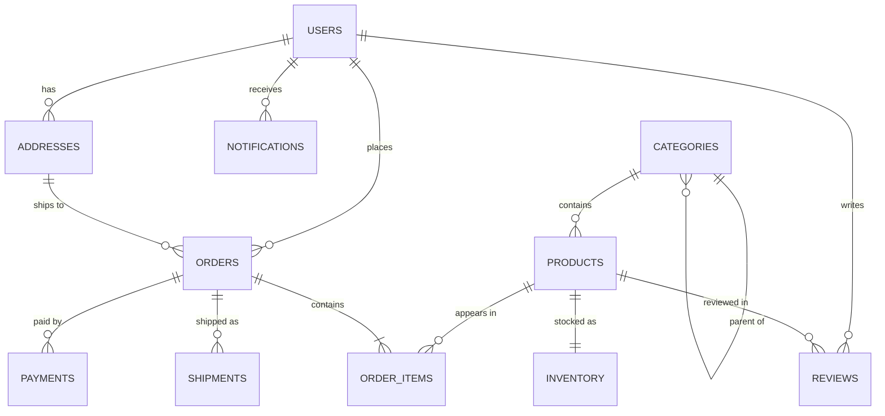

# Part 16 — Databases and the Relational Model

## 16.1 Why databases exist

Most backend developers meet the database as "the place where the ORM puts things". That is like meeting an aircraft engine as "the place where the noise comes from". This part goes underneath. By the end you should be able to look at any table in your system and explain why every column has the type it has, why every constraint is there, and what breaks if it were removed.

We will use one realistic e-commerce schema for the whole of Part 16 and Part 17: users, addresses, products, categories, inventory, orders, order items, payments, shipments, reviews and notifications. It is defined in full in section 16.3, and every later example refers back to it.

### 16.1.1 What a database guarantees that a file or a Map does not

#### Concept

A database is not "a smarter file". It is a piece of software that makes a set of promises about your data and keeps those promises under concurrency, crashes and partial failures. The promises are: durability (once it says "committed", the data survives a power cut), atomicity (a group of changes happens entirely or not at all), isolation (concurrent users do not see each other's half-finished work), consistency (declared rules are never violated, no matter which code path wrote the data), and efficient lookup at scale (find one row among a billion in a few milliseconds).

A JavaScript `Map`, a JSON file on disk, or an in-memory array gives you none of these unless you build them yourself. And building them yourself is roughly the work of writing a database.

#### Why does it exist?

Imagine you write an order service that keeps orders in a `Map<string, Order>`. It works in development. Then:

- The process restarts on deploy. Every order is gone. So you write the map to `orders.json` after each change.
- Two requests arrive at once. Both read the file, both modify it, both write it back. One order silently disappears. So you add a mutex.
- The process is killed halfway through writing the file. The file is now half-written and unparseable. So you write to a temp file and rename atomically.
- The file reaches 4 GB. Reading it to find one order takes 30 seconds. So you build an index: a second file mapping `orderId` to byte offset.
- You add a second server behind the load balancer. The mutex no longer works across machines.
- Finance asks for "total revenue by category last month". You write a script that loads 4 GB into memory and crashes with an out-of-memory error.

Each of these problems has been solved, carefully, in PostgreSQL over thirty years. The write-ahead log solves durability and crash recovery. MVCC (multi-version concurrency control) solves isolation without a global mutex. B-tree indexes solve lookup. The query planner solves "revenue by category" in one declarative statement. That is why databases exist: to stop every team from re-solving these problems badly.

#### Mental model

Imagine a bank vault versus a shoebox under your bed. Both "store money". The vault has a ledger of every deposit and withdrawal (write-ahead log), a rule that a withdrawal either completes or is fully reversed (atomicity), separate counters so two tellers do not overwrite each other's work (isolation), locked drawers with rules like "this drawer can never go negative" (constraints), and a catalog that tells you which drawer holds account 4471 without opening every drawer (indexes). The shoebox is faster to open, right up to the moment you need any of those things.

#### How it works

At the highest level, when your NestJS service runs `INSERT INTO orders ...` and then `COMMIT`, PostgreSQL does the following:

1. Parses the SQL and checks it against the catalog (does the table exist, do the types match).
2. Plans how to execute it (which index to use, which join algorithm).
3. Acquires the necessary locks (a row lock on the row being written, a light table lock that blocks `DROP TABLE` but not other writers).
4. Writes a new row version into a data page in shared memory, marked with the current transaction id.
5. Writes a WAL (write-ahead log) record describing the change.
6. On `COMMIT`, forces the WAL record to disk with `fsync`. Only after the disk confirms does the client get "COMMIT" back. This single step is what makes durability real. On a typical SSD it costs 0.5 to 2 ms, which is why a transaction commit is never "free".
7. The dirty data page is written to disk later, lazily, by the background writer or checkpointer. If the server crashes before that, recovery replays the WAL and rebuilds the page.
8. Constraints (`NOT NULL`, `CHECK`, `UNIQUE`, foreign keys) are checked before the row is accepted. A violation aborts the statement and, by default, the whole transaction.

Part 20 (Database Transactions) and Part 21 (PostgreSQL Internals) go deeper into WAL and MVCC. Here the point is: every one of those steps is a guarantee that a file does not give you.

#### Practical example

A `POST /orders` request in a food-delivery app must (a) create the order, (b) create three order items, (c) reserve stock for each product, and (d) record an initial payment attempt. If step (c) fails for the third product because it just sold out, steps (a) and (b) must vanish as if they never happened. In a database this is one `BEGIN ... COMMIT` block; the failure triggers `ROLLBACK`. In a file-based store you would need to write compensating code for every partial-failure combination.

#### NestJS example

The database-backed version is short because the database does the hard work. The important lines are the transaction boundary and the fact that the stock check is a database constraint, not just an `if` in application code.

```ts
// orders/orders.service.ts
import { Injectable, ConflictException } from '@nestjs/common';
import { InjectDataSource } from '@nestjs/typeorm';
import { DataSource } from 'typeorm';
import { CreateOrderDto } from './dto/create-order.dto';

@Injectable()
export class OrdersService {
  constructor(@InjectDataSource() private readonly dataSource: DataSource) {}

  async placeOrder(userId: string, dto: CreateOrderDto): Promise<{ orderId: string }> {
    // One transaction: all-or-nothing across four tables.
    return this.dataSource.transaction(async (manager) => {
      const [order] = await manager.query(
        `INSERT INTO orders (user_id, status, currency)
         VALUES ($1, 'pending', 'INR') RETURNING id`,
        [userId],
      );

      for (const item of dto.items) {
        // CHECK (quantity_reserved <= quantity_on_hand) in the DB rejects oversell.
        const result = await manager.query(
          `UPDATE inventory
              SET quantity_reserved = quantity_reserved + $2
            WHERE product_id = $1
            RETURNING quantity_on_hand - quantity_reserved AS available`,
          [item.productId, item.quantity],
        );
        if (result.length === 0) {
          throw new ConflictException(`Product ${item.productId} not found`);
        }
        await manager.query(
          `INSERT INTO order_items (order_id, product_id, quantity, unit_price, product_name)
           SELECT $1, p.id, $2, p.price, p.name FROM products p WHERE p.id = $3`,
          [order.id, item.quantity, item.productId],
        );
      }
      return { orderId: order.id };
    });
    // If any statement throws (including a CHECK violation), TypeORM issues ROLLBACK.
  }
}
```

#### PostgreSQL example

This is the guarantee in its rawest form. Run it in `psql`, kill the server between the two statements, and the first insert is gone on restart.

```sql
BEGIN;
INSERT INTO orders (user_id, status) VALUES ('7c9e6679-7425-40de-944b-e07fc1f90ae7', 'pending');
-- crash here: nothing persisted, nobody else ever saw the row
INSERT INTO order_items (order_id, product_id, quantity, unit_price, product_name)
VALUES (currval_of_something, ...);
COMMIT;
-- only now is the WAL fsynced and the data durable
```

#### Production scenario

A mid-size e-commerce backend handles around 300 orders per minute at peak, 5 writes per order, so roughly 25 write transactions per second plus 2,000 to 3,000 reads per second. A single PostgreSQL instance on a 4-vCPU machine with NVMe storage handles this comfortably: commit latency 1 to 3 ms, indexed point reads under 1 ms, 99th percentile API latency dominated by network and application code, not the database. The database becomes the bottleneck far later than most teams expect, and usually because of a missing index or a bad query, not because of raw volume.

#### Failure scenario

At 02:14 the on-call engineer was paged: "orders.json is corrupt". A legacy internal tool had stored purchase-order drafts in a JSON file, guarded by an in-process lock. The night before, the tool had been scaled to two replicas to handle a busy period. Both replicas wrote the file. The last write won, then a pod was OOM-killed mid-write, leaving a truncated file. Twelve hours of drafts were lost. The fix was a one-table PostgreSQL schema with a primary key and a `jsonb` column, done in a morning. The lesson was not "JSON files are bad"; it was that the tool had silently taken on durability, atomicity and isolation responsibilities that it could not meet.

#### Edge cases & failure modes

- Durability is only as good as `fsync`. With `synchronous_commit = off`, a crash can lose the last few hundred milliseconds of "committed" transactions. Know your setting.
- Durability on one machine is not durability across a data-center failure. That needs replication (Part 22 — Replication and High Availability).
- A database guarantees the rules you declared. If you never declare `CHECK (quantity > 0)`, a negative quantity is perfectly valid to the database.
- Connection exhaustion: every guarantee is behind a connection, and PostgreSQL connections are expensive processes. Pooling is mandatory (Part 21).
- A transaction that is left open (application bug, forgotten `await`) holds locks and blocks vacuum. The database keeps its promises, but at a cost to everyone else.

#### How a Senior Backend Engineer thinks about this

The senior question is never "SQL or NoSQL". It is: "Which guarantees does this data need, and which system gives them at the lowest operational cost?" For orders, payments and inventory the answer is almost always a relational database, because money and stock need atomicity and constraints. For a session cache, Redis is right because losing it costs nothing. For an append-only clickstream, a log system is right. Seniors also refuse to reimplement database guarantees in application code: if you find yourself writing a mutex to protect a counter, you have found a place where the database should be doing the work.

#### Common mistakes

- Treating the database as dumb storage and enforcing every rule in the service layer. Application code has bugs, races and multiple entry points (admin tools, migrations, scripts). The database is the only place every write must pass through.
- Using `synchronous_commit = off` globally "for performance" without telling anyone.
- Building a "simple" file-backed store for "just internal use", then scaling it to two replicas.

#### Interview questions

1. What does `COMMIT` actually do in PostgreSQL, and why is it not free? Expected: it fsyncs the WAL; the client only gets an acknowledgement after the disk confirms; typically 0.5 to 2 ms on SSD. Follow-up: what does `synchronous_commit = off` change?
2. Why can a `Map` protected by a mutex not replace a database, even for a small service? Expected: no durability, no crash atomicity, no cross-process isolation, no efficient lookup at scale.
3. Which guarantee would you give up first for a session store, and why?
4. If the application already validates everything, why add database constraints? Expected: multiple write paths, races, future bugs; constraints are the last line of defense.

#### Practical exercise

Build a tiny key-value store on a JSON file in Node.js. Then write a test that spawns two processes writing 1,000 keys each concurrently, and a test that kills the process mid-write. Document exactly which guarantees broke. Acceptance criteria: you can name which of durability, atomicity and isolation failed in each test and which PostgreSQL mechanism would have prevented it.

## 16.2 The relational model

### 16.2.1 Relations, tuples and set semantics

#### Concept

A relation is what we casually call a table. Formally it is a set of tuples (rows) that all share the same attributes (columns). Three properties of the formal model matter in daily work:

1. A relation is a set. Sets have no order and no duplicates. This is why `SELECT * FROM orders` without `ORDER BY` returns rows in whatever order is cheapest for PostgreSQL today, and a different order tomorrow.
2. Every attribute has a domain: a data type plus the constraints on it. `price numeric(12,2) CHECK (price >= 0)` is a domain, not just a type.
3. Operations on relations produce relations. A `JOIN`, a `WHERE`, a `GROUP BY` each take one or more relations and produce a new one. This is why SQL composes: any query result can be treated as a table and queried again.

#### Why does it exist?

Before the relational model (Codd, 1970), databases were hierarchical or network-shaped. To find "all orders for products in category X" you wrote a navigation program that walked pointers. Changing the physical layout broke every program. The relational model separated the logical view (tables, relationships expressed as shared values) from the physical layout (pages, indexes, pointers). You describe what you want; the database decides how to fetch it. That separation is what lets you add an index without changing a single query.

#### Mental model

Imagine a spreadsheet where every sheet has a strict header row, no merged cells, no colors, no "notes" column that sometimes holds a number and sometimes a date. Now imagine a rule that says two sheets can only be related by having a column with the same values (an `order_id` in the items sheet that matches an `id` in the orders sheet), never by a hand-drawn arrow. That is the relational model. The strictness is the point: it is what makes the sheets combinable by a machine.

#### How it works

The relational operators you use every day map to the algebra:

| Algebra operation | SQL | What it produces |
|---|---|---|
| Selection | `WHERE` | Subset of rows |
| Projection | `SELECT a, b` | Subset of columns |
| Cartesian product | `CROSS JOIN` | Every row combined with every row |
| Join | `JOIN ... ON` | Product filtered by a condition |
| Union / intersection / difference | `UNION`, `INTERSECT`, `EXCEPT` | Set combinations |
| Rename | `AS` | Same data, new name |
| Aggregation (extension) | `GROUP BY` | One row per group |

Because the model is set-based, two things surprise people:

- Duplicate rows are legal in SQL tables without a primary key (SQL relaxed the pure model into "bags"). PostgreSQL will happily store two identical rows. Without a key you cannot even delete just one of them cleanly. This is the practical reason every table gets a primary key.
- `DISTINCT` and `UNION` (without `ALL`) are expensive because they must re-impose set semantics by sorting or hashing every row.

#### PostgreSQL example

```sql
-- A relation with no key: legal, and a trap.
CREATE TABLE audit_scratch (event text, at timestamptz);
INSERT INTO audit_scratch VALUES ('login', now()), ('login', now());
-- Two identical rows may now exist. "Delete one of them" is not expressible cleanly.

-- Set semantics: the same query, two runs, potentially different order.
SELECT id, status FROM orders LIMIT 5;
-- Adding ORDER BY is the only way to make order part of the contract.
SELECT id, status FROM orders ORDER BY placed_at DESC, id LIMIT 5;
```

#### How a Senior Backend Engineer thinks about this

Seniors treat "rows have no order" and "results are relations" as tools. Need a report? Build it as a chain of relations: filter, join, aggregate, join again. Need a fast path? Materialize one of those intermediate relations as a table or materialized view. The algebra also explains the planner: since `WHERE` then `JOIN` equals `JOIN` then `WHERE` mathematically, the planner is free to reorder, and does.

#### Interview questions

1. Why can the same `SELECT` return rows in a different order tomorrow? Expected: relations are sets; physical order changes with updates, vacuum, and plan changes.
2. Why is `DISTINCT` expensive? Expected: must sort or hash all rows to remove duplicates.

### 16.2.2 NULL and three-valued logic

#### Concept

`NULL` means "unknown" or "not applicable", not zero and not empty string. Because it is unknown, any comparison with it is also unknown. SQL therefore has three truth values: `TRUE`, `FALSE` and `UNKNOWN`. A `WHERE` clause keeps only rows where the condition is `TRUE`; `UNKNOWN` rows are dropped, silently.

#### Why does it exist?

Real data has holes. An order that has not shipped has no `shipped_at`. A user who never gave a phone number has no phone. The alternative to `NULL` is sentinel values (`0`, `''`, `'1970-01-01'`), which are worse because they look like real data and corrupt aggregates. `NULL` is a deliberate marker that says "do not treat this as a value".

#### Mental model

Imagine a form where one field is blank. If someone asks "is the phone number 555-1234?", the honest answer is not "no", it is "I don't know". If they ask "is the phone number different from 555-1234?", the answer is still "I don't know". Only "is the field blank?" gets a yes. That is `IS NULL`.

#### How it works

The rules, which you must know cold:

| Expression | Result |
|---|---|
| `NULL = NULL` | `UNKNOWN` (not `TRUE`) |
| `NULL <> 5` | `UNKNOWN` |
| `NULL IS NULL` | `TRUE` |
| `NULL IS DISTINCT FROM 5` | `TRUE` (null-safe comparison) |
| `NULL AND FALSE` | `FALSE` |
| `NULL AND TRUE` | `UNKNOWN` |
| `NULL OR TRUE` | `TRUE` |
| `NOT NULL` (the boolean) | `UNKNOWN` |
| `5 + NULL` | `NULL` |
| `'a' \|\| NULL` | `NULL` |
| `COUNT(col)` | counts non-null values only |
| `COUNT(*)` | counts rows |
| `SUM(col)` over all-null | `NULL`, not 0 |
| `AVG(col)` | ignores nulls (divides by non-null count) |
| `x IN (1, NULL)` where x = 2 | `UNKNOWN` |
| `x NOT IN (1, NULL)` | never `TRUE` for any x |
| `UNIQUE` constraint | multiple `NULL`s allowed by default |

The last three are where production bugs live. `NOT IN` against a list or subquery that contains even one `NULL` returns no rows at all, because `x <> NULL` is `UNKNOWN` and `UNKNOWN AND anything` is never `TRUE`. Part 17 returns to this with the safe alternative, `NOT EXISTS`.

#### PostgreSQL example

```sql
-- Which orders are NOT cancelled? Wrong version drops orders with NULL cancelled_reason.
SELECT count(*) FROM orders WHERE cancel_reason <> 'fraud';        -- excludes NULL reasons
SELECT count(*) FROM orders WHERE cancel_reason IS DISTINCT FROM 'fraud';  -- includes them

-- Aggregates and NULL
SELECT count(*), count(shipped_at), sum(discount), avg(discount)
FROM orders;
-- count(*) = 1000, count(shipped_at) = 640 (360 not yet shipped),
-- sum(discount) treats NULL as absent, avg divides by non-null count.

-- Make NULL explicit in output
SELECT id, coalesce(shipped_at::text, 'not shipped') AS shipped FROM orders;

-- Unique with NULLs: both rows are accepted
CREATE TABLE demo_unique (a int UNIQUE);
INSERT INTO demo_unique VALUES (NULL), (NULL);   -- succeeds
-- PostgreSQL 15+: treat nulls as equal
ALTER TABLE demo_unique DROP CONSTRAINT demo_unique_a_key;
ALTER TABLE demo_unique ADD CONSTRAINT demo_unique_a_key UNIQUE NULLS NOT DISTINCT (a);
```

#### TypeORM example

ORMs hide `NULL` semantics and then surprise you. In TypeORM, `{ where: { cancelReason: null } }` generates `IS NULL` correctly, but `Not(null)` generates `<> NULL`, which matches nothing. Use `IsNull()` and `Not(IsNull())`.

```ts
import { IsNull, Not } from 'typeorm';

// Correct
const shipped = await orderRepo.find({ where: { shippedAt: Not(IsNull()) } });

// Silent bug: generates "shipped_at <> NULL" which is UNKNOWN for every row
const wrong = await orderRepo.find({ where: { shippedAt: Not(null as any) } });
```

#### Sequelize example

```ts
import { Op } from 'sequelize';

// Correct null checks
const shipped = await Order.findAll({ where: { shippedAt: { [Op.ne]: null } } });
// Sequelize translates {[Op.ne]: null} to "IS NOT NULL", and {[Op.eq]: null} / null to "IS NULL".
```

#### Edge cases & failure modes

- A `NOT IN (SELECT user_id FROM orders)` where any `user_id` is `NULL` returns zero rows. It looks like "no users without orders" when the truth is "the query is broken".
- `WHERE status <> 'cancelled'` silently excludes rows where `status` is `NULL`. Make status `NOT NULL` with a default so the question cannot arise.
- `ORDER BY shipped_at DESC` puts `NULL`s first in PostgreSQL (nulls are considered larger). Use `NULLS LAST` when that is not what the UI wants.
- Concatenation with `NULL` yields `NULL`: `first_name || ' ' || last_name` is `NULL` when either is missing. Use `concat_ws(' ', first_name, last_name)`, which skips nulls.
- `SUM()` over zero rows or all-null rows is `NULL`; `coalesce(sum(x), 0)` when the report needs a number.
- JSON: `payload->>'phone'` is `NULL` both when the key is missing and when it is JSON `null`. Distinguish with `payload ? 'phone'`.

#### How a Senior Backend Engineer thinks about this

Seniors minimize `NULL` at the schema level. Every column gets `NOT NULL` unless "unknown" is genuinely a business state. Status columns are always `NOT NULL DEFAULT`. Timestamps like `shipped_at` are allowed to be null because "not yet shipped" is a real state, and that nullability is documented. When they review a query with `NOT IN`, `<>`, or `!=` against a nullable column, they ask "what happens to the nulls?" every time.

#### Common mistakes

- Using `= NULL` in hand-written SQL. It is always `UNKNOWN`.
- Storing empty strings to avoid nulls. Now `''` and `NULL` both mean "no value", and `UNIQUE` treats them differently.
- Assuming `COUNT(column)` counts rows.

#### Interview questions

1. What does `WHERE x NOT IN (SELECT y FROM t)` return if any `y` is `NULL`? Expected: no rows. Why: `x <> NULL` is `UNKNOWN`. Follow-up: rewrite it safely (`NOT EXISTS`).
2. Why does `UNIQUE` allow multiple nulls, and how do you change that? Expected: nulls are not equal to each other; `UNIQUE NULLS NOT DISTINCT` in PG15+, or a partial unique index.
3. What is the difference between `<>` and `IS DISTINCT FROM`?

#### Practical exercise

Take the `orders` table from section 16.3. Write five queries, each using a different nullable column with `<>`, `NOT IN`, string concatenation, `SUM`, and `ORDER BY`. Predict the output on paper, then run them. Acceptance criteria: you correctly predicted the null behavior of all five before running.

## 16.3 The reference schema

Everything in Part 16 and Part 17 uses this schema. Read it once carefully; the design decisions are explained in the following sections (types in 16.4, keys in 16.5, constraints in 16.6, normalization in 16.7, relationships in 16.9).



```sql
-- PostgreSQL 15+. gen_random_uuid() is built in since PG13.

CREATE TABLE users (
  id            uuid        PRIMARY KEY DEFAULT gen_random_uuid(),
  email         text        NOT NULL,
  password_hash text        NOT NULL,
  full_name     text        NOT NULL,
  phone         text,
  status        text        NOT NULL DEFAULT 'active'
                            CHECK (status IN ('active', 'suspended', 'deleted')),
  created_at    timestamptz NOT NULL DEFAULT now(),
  updated_at    timestamptz NOT NULL DEFAULT now(),
  deleted_at    timestamptz
);
-- Case-insensitive uniqueness on email, excluding soft-deleted users.
CREATE UNIQUE INDEX users_email_lower_uidx ON users (lower(email)) WHERE deleted_at IS NULL;

CREATE TABLE addresses (
  id           uuid        PRIMARY KEY DEFAULT gen_random_uuid(),
  user_id      uuid        NOT NULL REFERENCES users(id) ON DELETE CASCADE,
  label        text,
  line1        text        NOT NULL,
  line2        text,
  city         text        NOT NULL,
  state        text,
  postal_code  text        NOT NULL,
  country_code char(2)     NOT NULL,
  is_default   boolean     NOT NULL DEFAULT false,
  created_at   timestamptz NOT NULL DEFAULT now()
);
CREATE INDEX addresses_user_id_idx ON addresses (user_id);
-- At most one default address per user.
CREATE UNIQUE INDEX addresses_one_default_uidx ON addresses (user_id) WHERE is_default;

CREATE TABLE categories (
  id         bigint      GENERATED ALWAYS AS IDENTITY PRIMARY KEY,
  parent_id  bigint      REFERENCES categories(id) ON DELETE RESTRICT,
  name       text        NOT NULL,
  slug       text        NOT NULL UNIQUE,
  created_at timestamptz NOT NULL DEFAULT now(),
  CHECK (parent_id IS DISTINCT FROM id)
);
CREATE INDEX categories_parent_id_idx ON categories (parent_id);

CREATE TABLE products (
  id          uuid          PRIMARY KEY DEFAULT gen_random_uuid(),
  sku         text          NOT NULL UNIQUE,
  name        text          NOT NULL,
  description text,
  category_id bigint        NOT NULL REFERENCES categories(id) ON DELETE RESTRICT,
  price       numeric(12,2) NOT NULL CHECK (price >= 0),
  currency    char(3)       NOT NULL DEFAULT 'INR',
  attributes  jsonb         NOT NULL DEFAULT '{}'::jsonb,   -- color, size, material...
  tags        text[]        NOT NULL DEFAULT '{}',
  is_active   boolean       NOT NULL DEFAULT true,
  created_at  timestamptz   NOT NULL DEFAULT now(),
  updated_at  timestamptz   NOT NULL DEFAULT now()
);
CREATE INDEX products_category_id_idx ON products (category_id);
CREATE INDEX products_attributes_gin ON products USING gin (attributes);
CREATE INDEX products_tags_gin ON products USING gin (tags);

CREATE TABLE inventory (
  product_id        uuid        PRIMARY KEY REFERENCES products(id) ON DELETE CASCADE,
  quantity_on_hand  integer     NOT NULL DEFAULT 0 CHECK (quantity_on_hand >= 0),
  quantity_reserved integer     NOT NULL DEFAULT 0 CHECK (quantity_reserved >= 0),
  reorder_level     integer     NOT NULL DEFAULT 10,
  updated_at        timestamptz NOT NULL DEFAULT now(),
  CHECK (quantity_reserved <= quantity_on_hand)
);

CREATE TABLE orders (
  id                  uuid          PRIMARY KEY DEFAULT gen_random_uuid(),
  order_number        bigint        GENERATED ALWAYS AS IDENTITY UNIQUE,
  user_id             uuid          NOT NULL REFERENCES users(id) ON DELETE RESTRICT,
  status              text          NOT NULL DEFAULT 'pending'
                                    CHECK (status IN ('pending','paid','shipped','delivered','cancelled','refunded')),
  shipping_address_id uuid          REFERENCES addresses(id) ON DELETE SET NULL,
  subtotal            numeric(12,2) NOT NULL DEFAULT 0 CHECK (subtotal >= 0),
  discount            numeric(12,2) NOT NULL DEFAULT 0 CHECK (discount >= 0),
  total               numeric(12,2) NOT NULL DEFAULT 0 CHECK (total >= 0),
  currency            char(3)       NOT NULL DEFAULT 'INR',
  placed_at           timestamptz   NOT NULL DEFAULT now(),
  updated_at          timestamptz   NOT NULL DEFAULT now(),
  cancelled_at        timestamptz,
  cancel_reason       text,
  version             integer       NOT NULL DEFAULT 1
);
CREATE INDEX orders_user_id_placed_at_idx ON orders (user_id, placed_at DESC);
CREATE INDEX orders_placed_at_idx ON orders (placed_at);
CREATE INDEX orders_open_status_idx ON orders (status, placed_at) WHERE status IN ('pending', 'paid');
CREATE INDEX orders_shipping_address_id_idx ON orders (shipping_address_id);

CREATE TABLE order_items (
  id           bigint        GENERATED ALWAYS AS IDENTITY PRIMARY KEY,
  order_id     uuid          NOT NULL REFERENCES orders(id) ON DELETE CASCADE,
  product_id   uuid          NOT NULL REFERENCES products(id) ON DELETE RESTRICT,
  quantity     integer       NOT NULL CHECK (quantity > 0),
  unit_price   numeric(12,2) NOT NULL CHECK (unit_price >= 0),  -- price snapshot at order time
  product_name text          NOT NULL,                          -- name snapshot at order time
  UNIQUE (order_id, product_id)
);
CREATE INDEX order_items_product_id_idx ON order_items (product_id);

CREATE TABLE payments (
  id                  uuid          PRIMARY KEY DEFAULT gen_random_uuid(),
  order_id            uuid          NOT NULL REFERENCES orders(id) ON DELETE RESTRICT,
  provider            text          NOT NULL,          -- 'razorpay', 'stripe'
  provider_payment_id text,
  idempotency_key     text          NOT NULL UNIQUE,
  amount              numeric(12,2) NOT NULL CHECK (amount > 0),
  currency            char(3)       NOT NULL DEFAULT 'INR',
  status              text          NOT NULL DEFAULT 'initiated'
                                    CHECK (status IN ('initiated','authorized','captured','failed','refunded')),
  attempt_no          integer       NOT NULL DEFAULT 1,
  created_at          timestamptz   NOT NULL DEFAULT now(),
  updated_at          timestamptz   NOT NULL DEFAULT now()
);
CREATE INDEX payments_order_id_created_at_idx ON payments (order_id, created_at DESC);
CREATE UNIQUE INDEX payments_one_captured_per_order_uidx ON payments (order_id) WHERE status = 'captured';

CREATE TABLE shipments (
  id              uuid        PRIMARY KEY DEFAULT gen_random_uuid(),
  order_id        uuid        NOT NULL REFERENCES orders(id) ON DELETE RESTRICT,
  carrier         text        NOT NULL,
  tracking_number text,
  status          text        NOT NULL DEFAULT 'created'
                              CHECK (status IN ('created','in_transit','delivered','returned')),
  shipped_at      timestamptz,
  delivered_at    timestamptz,
  created_at      timestamptz NOT NULL DEFAULT now(),
  CHECK (delivered_at IS NULL OR shipped_at IS NOT NULL)
);
CREATE INDEX shipments_order_id_idx ON shipments (order_id);

CREATE TABLE reviews (
  id         bigint      GENERATED ALWAYS AS IDENTITY PRIMARY KEY,
  product_id uuid        NOT NULL REFERENCES products(id) ON DELETE CASCADE,
  user_id    uuid        NOT NULL REFERENCES users(id) ON DELETE CASCADE,
  rating     smallint    NOT NULL CHECK (rating BETWEEN 1 AND 5),
  title      text,
  body       text,
  created_at timestamptz NOT NULL DEFAULT now(),
  UNIQUE (product_id, user_id)          -- one review per user per product
);
CREATE INDEX reviews_user_id_idx ON reviews (user_id);

CREATE TYPE notification_channel AS ENUM ('email', 'sms', 'push');

CREATE TABLE notifications (
  id           bigint               GENERATED ALWAYS AS IDENTITY PRIMARY KEY,
  user_id      uuid                 NOT NULL REFERENCES users(id) ON DELETE CASCADE,
  channel      notification_channel NOT NULL,
  template     text                 NOT NULL,
  payload      jsonb                NOT NULL DEFAULT '{}'::jsonb,
  status       text                 NOT NULL DEFAULT 'pending'
                                    CHECK (status IN ('pending','sent','failed')),
  attempts     integer              NOT NULL DEFAULT 0,
  scheduled_at timestamptz          NOT NULL DEFAULT now(),
  sent_at      timestamptz,
  created_at   timestamptz          NOT NULL DEFAULT now()
);
CREATE INDEX notifications_user_id_idx ON notifications (user_id);
-- The job-queue index: only pending rows, ordered by when they are due.
CREATE INDEX notifications_pending_idx ON notifications (scheduled_at) WHERE status = 'pending';
```

A few design decisions to notice now, because they recur throughout:

- `users`, `addresses`, `products`, `orders`, `payments`, `shipments` use `uuid` primary keys because those ids are exposed in URLs and generated by multiple services. `categories`, `order_items`, `reviews`, `notifications` use `bigint` identity because they are internal, high-volume, and benefit from sequential keys. Section 16.4 explains the cost of each.
- Money is `numeric(12,2)`. Never `float`. Section 16.4 explains why with an actual rounding failure.
- Every timestamp is `timestamptz`.
- Status columns are `text` with a `CHECK` constraint, except `notification_channel`, which is a real `ENUM`. Section 16.4 compares them.
- `order_items` snapshots `unit_price` and `product_name` because an invoice must not change when the catalog changes. This is deliberate, controlled denormalization (section 16.8).
- Every foreign key column has an index. PostgreSQL does not create these for you (section 16.5).
- Business rules such as "one default address per user" and "one captured payment per order" are partial unique indexes, not application code (section 16.6).
