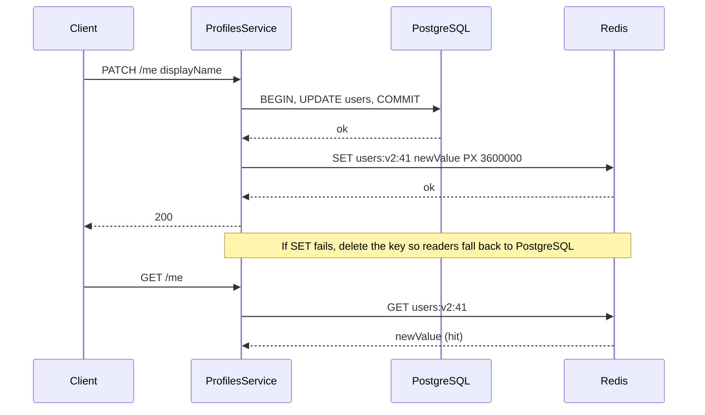

### 16.2.2 Read-through

#### Concept

In read-through, the application talks only to the cache. The cache itself knows how to load a value from the database on a miss. The loader is configured once, and callers never write "if miss then query".

#### How it works

The cache library wraps your loader function. `cache.wrap(key, loader, ttl)` checks the key, calls `loader()` on miss, stores the result, and returns it. Structurally the same as cache-aside; organizationally different, because the loading logic lives next to the cache rather than in every service.

#### NestJS example

`@nestjs/cache-manager` exposes `cache-manager`'s `wrap`, which is a read-through helper.

```ts
// menus/menus.service.ts
import { Inject, Injectable } from '@nestjs/common';
import { CACHE_MANAGER } from '@nestjs/cache-manager';
import { Cache } from 'cache-manager';
import { MenusRepository } from './menus.repository';

@Injectable()
export class MenusService {
  constructor(
    @Inject(CACHE_MANAGER) private readonly cache: Cache,
    private readonly menus: MenusRepository,
  ) {}

  getMenu(restaurantId: string) {
    // wrap(): read-through with the loader colocated with the key.
    // TTL is milliseconds in cache-manager v5+.
    return this.cache.wrap(
      `menus:v1:${restaurantId}`,
      () => this.menus.loadRenderedMenu(restaurantId),
      60_000,
    );
  }
}
```

The advantage is that every read path goes through one place, so adding single-flight or metrics later is one change. The disadvantage is that `wrap` hides what happens when Redis is down; check your cache-manager version's behaviour and test it with Redis stopped.

### 16.2.3 Write-through

#### Concept

In write-through, every write goes to the cache and the database together, synchronously, before the write returns. The cache is always populated for anything recently written, and reads never see a miss for hot data that was just changed.

#### Why does it exist?

Write-through exists for data that is read immediately after being written and where a miss right after a write is expensive or visible. A user updates their profile and the next screen renders it; a write-through cache guarantees the next read is a hit with the new value.

#### How it works



1. Write to PostgreSQL inside a transaction.
2. After commit, `SET` the cache with the new value and a TTL.
3. If the `SET` fails, `DEL` the key (best effort) so the stale value cannot survive.
4. Reads use cache-aside as usual.

#### NestJS example

```ts
// users/profile.service.ts
async updateDisplayName(userId: string, displayName: string): Promise<UserProfile> {
  const updated = await this.dataSource.transaction(async (manager) => {
    await manager.update(User, { id: userId }, { displayName });
    return manager.findOneOrFail(User, { where: { id: userId } });
  });

  const key = `users:v2:${userId}`;
  try {
    await this.redis.set(key, JSON.stringify(updated), 'PX', 3_600_000);
  } catch (err) {
    this.logger.warn(`write-through SET failed, deleting ${key}`);
    await this.redis.del(key).catch(() => undefined);
  }
  return updated;
}
```

#### Edge cases & failure modes

- Two writes to the same key in quick succession can arrive at Redis out of order (request A commits first but its `SET` lands second). The cache now holds A's value while the database holds B's. Fix: include a version or `updated_at` in the value and use a Lua script that only sets if the new version is higher, or fall back to delete-on-write instead of set-on-write.
- Write-through doubles write latency by one Redis round trip. Fine at 0.5 ms; not fine if Redis is cross-region.
- Everything written is cached, including data nobody reads. Memory grows with write volume, not read volume.

#### How a Senior Backend Engineer thinks about this

Write-through is a good fit for user-owned data with read-after-write expectations: profile, cart, settings. It is a poor fit for high-volume writes with low read ratio (event logs, audit rows). When in doubt, use delete-on-write (cache-aside) rather than set-on-write, because deleting cannot leave a wrong value behind; it can only cause a miss.

### 16.2.4 Write-behind (write-back)

#### Concept

In write-behind, writes go to the cache only, and the cache (or a worker) flushes them to the database later, in batches. The application returns as soon as Redis acknowledges. The database is eventually updated.

#### Why does it exist?

Write-behind exists for write volumes the database cannot absorb one row at a time: view counters, "last seen" timestamps, like counts, telemetry. A social feed that increments a post's view counter 5,000 times per second cannot issue 5,000 `UPDATE posts SET views = views + 1` per second without turning that row into a hot row and the WAL into a firehose. Incrementing in Redis and flushing every 10 seconds turns 50,000 updates into one.

#### How it works

1. The write path does `HINCRBY post:views 8812 1` (or `INCR`) in Redis. Sub-millisecond, no database involvement.
2. A scheduled worker runs every N seconds, reads the accumulated counters, and applies them to PostgreSQL in one batched `UPDATE ... FROM (VALUES ...)`.
3. The worker resets or decrements the Redis counters by the amount it flushed, so counts that arrived during the flush are not lost.

#### NestJS example

```ts
// posts/view-counter.service.ts
import { Injectable, Logger } from '@nestjs/common';
import { Cron } from '@nestjs/schedule';
import { InjectDataSource } from '@nestjs/typeorm';
import { DataSource } from 'typeorm';
import Redis from 'ioredis';
import { Inject } from '@nestjs/common';
import { REDIS } from '../redis/redis.module';

const HASH = 'post:views:pending';

@Injectable()
export class ViewCounterService {
  private readonly logger = new Logger(ViewCounterService.name);
  constructor(
    @Inject(REDIS) private readonly redis: Redis,
    @InjectDataSource() private readonly db: DataSource,
  ) {}

  // Hot path: one Redis op, no PostgreSQL.
  recordView(postId: string): Promise<number> {
    return this.redis.hincrby(HASH, postId, 1);
  }

  // Flush every 10 seconds. Only one instance should run this; use a lock (16.9).
  @Cron('*/10 * * * * *')
  async flush(): Promise<void> {
    const pending = await this.redis.hgetall(HASH);
    const entries = Object.entries(pending).filter(([, n]) => Number(n) > 0);
    if (entries.length === 0) return;

    await this.db.transaction(async (manager) => {
      const values = entries.map(([id, n]) => `('${id}'::uuid, ${Number(n)})`).join(',');
      await manager.query(
        `UPDATE posts p SET view_count = p.view_count + v.n
           FROM (VALUES ${values}) AS v(id, n)
          WHERE p.id = v.id`,
      );
    });

    // Decrement by what we flushed, not reset to 0: views arriving during the
    // UPDATE would otherwise be lost.
    const pipeline = this.redis.pipeline();
    for (const [id, n] of entries) pipeline.hincrby(HASH, id, -Number(n));
    await pipeline.exec();
    this.logger.log(`flushed ${entries.length} view counters`);
  }
}
```

In real code, build the `VALUES` list with parameters rather than string interpolation; the inline version above is for readability only.

#### Failure scenario

Redis restarts without AOF persistence at 03:12. Every pending counter since the last flush (up to 10 seconds of views) is gone. For view counts that is acceptable and the team documents it. For "points earned" in a loyalty program it is not, and the team that used write-behind for loyalty points spent a week reconciling from application logs. Write-behind trades durability for throughput. Say so out loud before using it.

#### How a Senior Backend Engineer thinks about this

The question is always "what is the cost of losing the last N seconds of writes?" If the answer is "nobody notices", write-behind is a great tool. If the answer involves money, refunds or legal records, the write goes to PostgreSQL first and the cache is derived from it.

### 16.2.5 Refresh-ahead

#### Concept

Refresh-ahead recomputes a cached value shortly before it expires, in the background, so that readers never experience a miss on hot keys. The key never actually goes cold as long as it is popular.

#### How it works

1. Store the value with a TTL and, inside the value or a side key, the time it was computed.
2. On each read, if the remaining TTL is below a threshold (say the last 20 percent), trigger a background refresh and still return the current value.
3. The refresh writes a fresh value and resets the TTL.
4. Keys nobody reads simply expire; only hot keys stay warm.

This is the mechanism behind "stale-while-revalidate" and probabilistic early expiration, both of which we cover with code in 16.5.2 on stampedes, because refresh-ahead is really a stampede prevention technique.

#### Production scenario

A home page feed computed from 12 queries and taking 300 ms. TTL 60 seconds. With plain cache-aside, once per minute one unlucky user waits 300 ms and, worse, if 50 requests miss in the same 300 ms window, the database runs the 12 queries 50 times. With refresh-ahead triggered at 48 seconds, a single background refresh runs while every user continues to get the cached value. No user ever sees the 300 ms.

### 16.2.6 Choosing a strategy

| Use case | Strategy | Why |
|---|---|---|
| Product catalog, restaurant menus, CMS content | Cache-aside with event-driven invalidation and a 5 to 15 minute safety TTL | Read heavy, changes are known events, staleness of seconds is acceptable |
| User sessions | Redis as the store, not a cache (no PostgreSQL copy); TTL equals session lifetime | Read on every request, written at login, naturally expiring |
| Inventory counts shown on a product page | Cache-aside with a short TTL (5 to 30 seconds); source of truth stays in PostgreSQL and is re-checked at checkout | Display can lag; the reservation cannot |
| Inventory counts used for reservation | Do not cache. PostgreSQL row lock or a Redis Lua script that is the source of truth for that flow | A stale count means overselling |
| Personalized feed | Refresh-ahead or write-behind fan-out into a per-user ZSET | Expensive to compute, tolerant of minutes of staleness, hot for active users |
| View counters, likes, "last seen" | Write-behind with periodic flush | Extreme write volume, loss of seconds of data acceptable |
| User profile, cart, settings | Write-through (set after commit) or delete-on-write | Read-after-write expectations |

## 16.3 What to cache and what not to cache

#### Concept

Cache what is expensive to produce, read far more often than written, and tolerant of being slightly wrong. Do not cache anything where a stale read produces a wrong action.

#### How it works

Good candidates:

- **Immutable data**: a completed order's line items, a published article, a rendered invoice PDF URL. Infinite TTL is fine; version the key if the format changes.
- **Slow-changing data**: product catalog, category tree, country and currency lists, feature flag definitions, configuration.
- **Expensive derived data**: search facets, recommendation lists, aggregated dashboards, "top 10" rankings.
- **Read-heavy per-user data with clear ownership**: profile, preferences, cart. Cache per user, key includes the user id.
- **External API responses**: exchange rates, geocoding results, third-party product data, with a TTL matching the provider's update frequency.

Bad candidates:

- **Money balances**: a wallet balance, available credit, an account ledger total. A stale read here leads to a double spend or a wrongly declined payment. Read from PostgreSQL with the right isolation level; see Part 13 — Database Transactions.
- **Stock counts used for decisions**: the display can be cached; the reservation must hit the source of truth.
- **Anything that is the result of an authorization decision** for longer than a few seconds: a revoked permission that stays cached for an hour is a security bug.
- **Large blobs that change often**: a 2 MB report regenerated every minute burns bandwidth and Redis memory for little gain.
- **Data with unbounded key cardinality**: caching search results keyed by the raw query string creates millions of one-hit keys.

Per-user versus shared is the other axis. A shared key (`products:v3:8812`) is hit by every user, so it has a high hit ratio and a small memory footprint. A per-user key (`cart:v1:{userId}`) is hit by one user; its value is not the hit ratio but the removal of a query from a request that happens on every page. Never let a per-user value leak into a shared key. The classic bug is an interceptor-level cache keyed only by URL on an endpoint whose response depends on the `Authorization` header; see 16.13 on `CacheInterceptor`.

#### How a Senior Backend Engineer thinks about this

The senior question is "what is the blast radius of this being wrong for T seconds?" If the answer is "a user sees an old product description", cache it. If the answer is "we ship an item we do not have" or "we double-charge", do not. A product manager understands this framing immediately: "we can make the page faster, and the price of that is up to 60 seconds where an out-of-stock item still shows as available; checkout will still refuse it. Is that acceptable?" Usually yes. Ask.

## 16.4 Key design and TTL

#### Concept

A cache key is a contract. It must be unique for the thing it identifies, stable across pods and deploys, cheap to build, and safe to change when the value format changes.

#### How it works

**Namespacing.** Use a colon-separated hierarchy: `entity:version:identifier`, for example `orders:v2:7c9e6679`. Redis has no folders, but tools like RedisInsight and `SCAN` with `MATCH orders:v2:*` treat colons as separators, and the namespace tells you what a key is when you are staring at a memory report at 2 a.m.

**Versioned keys.** Put a version in the key that changes whenever the serialized shape changes. Deploying a new `Product` DTO with `v3` in the key means new pods read and write `v3` keys, old pods keep using `v2` keys during the rollout, and nothing ever deserializes the wrong shape. Old keys expire by TTL. This is far safer than a "flush the cache on deploy" step, which causes a stampede.

**Hashing long keys.** A key like `search:v1:{"q":"running shoes","filters":{"size":[42,43],"brand":["nike"]},"page":2}` is 90 bytes of JSON that may vary in property order. Canonicalize (sort keys, trim, lowercase where appropriate) and hash: `search:v1:${sha1(canonical)}`. Redis keys are stored in memory; a million 200-byte keys is 200 MB of pure key overhead.

**Cardinality.** Before adding a dimension to a key, multiply out how many distinct values exist. `products:v3:{id}` has 2 million possible keys. `products:v3:{id}:{currency}` has 2 million times 30. `products:v3:{id}:{currency}:{userId}` has effectively infinite. Each dimension you add divides your hit ratio and multiplies your memory.

**TTL choice.** Start from the business tolerance for staleness, then halve it for safety. Common anchors: sessions match the session lifetime; catalog 5 to 15 minutes with event invalidation; external rate data matches provider refresh; computed rankings 1 to 5 minutes; negative results 30 to 60 seconds.

**TTL jitter.** Never set the same TTL on thousands of keys filled at the same time. Add a random 5 to 20 percent so they expire spread out. This single line prevents the avalanche problem in 16.5.3.

#### NestJS example

A small key builder that enforces the conventions so nobody builds keys by hand.

```ts
// redis/cache-key.ts
import { createHash } from 'node:crypto';

export class CacheKey {
  static entity(ns: string, version: number, id: string): string {
    return `${ns}:v${version}:${id}`;
  }

  // Deterministic key for structured queries: sort keys, then hash.
  static query(ns: string, version: number, params: Record<string, unknown>): string {
    const canonical = JSON.stringify(params, Object.keys(params).sort());
    const digest = createHash('sha1').update(canonical).digest('hex').slice(0, 20);
    return `${ns}:v${version}:q:${digest}`;
  }

  // TTL with jitter: base plus up to `spread` percent.
  static ttlMs(baseMs: number, spreadPct = 15): number {
    return baseMs + Math.floor(Math.random() * baseMs * (spreadPct / 100));
  }
}
```

#### Common mistakes

- Keys with no namespace (`8812`), which collide across entities and cannot be scanned by type.
- Building keys with user input unsanitized, so a `productId` of `*` or one containing spaces creates keys that break tooling and `SCAN` patterns.
- Changing the value shape without changing the version, then debugging `undefined` fields for a day.
- TTL of zero (never expires) on data that is supposed to be a cache. If it never expires it is a store, and it needs backup, capacity planning and a memory budget.

#### Interview questions

1. **Why delete the cache entry after the database commit rather than before?** Expected: a read between the pre-commit delete and the commit re-fills the cache with the old row; deleting after commit closes that path except for a much smaller window. Follow-up: what remains, and how do you close it? (Double delete or versioned keys; see 16.5.1.)
2. **When would you choose write-behind, and what do you give up?** Expected: extreme write rates on counters; you give up durability of the unflushed window and accept that the database lags.
3. **Why put a version in the cache key rather than flushing Redis on deploy?** Expected: flush causes a cold-cache stampede and breaks old pods during a rolling deploy; versioned keys let both versions coexist and expire naturally.
4. **A product page endpoint is 80 percent serialization and downstream HTTP calls and 20 percent database. Does a Redis query cache help?** Expected: barely; cache the rendered response or fix the downstream calls. Shows the candidate measures before caching.
5. **How do you pick a TTL?** Expected: from the business staleness tolerance, with jitter; not from a feeling.

#### Practical exercise

Implement cache-aside for `GET /restaurants/:id/menu` in a NestJS service using `ioredis`. Acceptance criteria: (a) the key is namespaced and versioned; (b) TTL is 60 seconds with 15 percent jitter; (c) `PATCH /menu-items/:id` deletes the menu key after the transaction commits; (d) with Redis stopped, the endpoint still returns 200 within 50 ms of the database latency and logs one warning per failed operation; (e) a Jest test proves that a read between commit and delete does not leave stale data for longer than the TTL.
