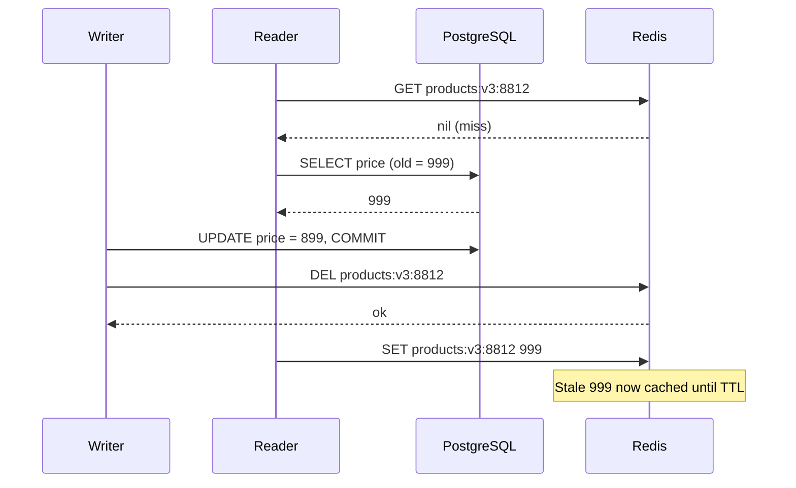
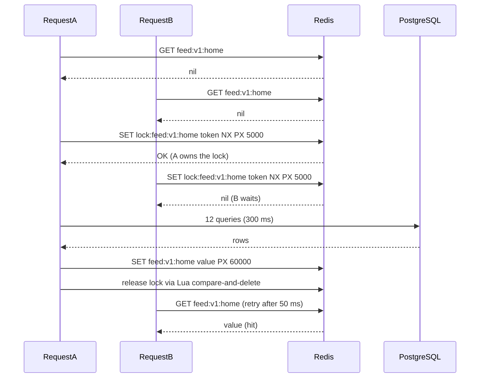
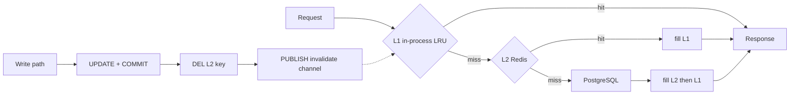

## 16.5 The classic cache problems

Every cache problem in this section has the same shape: a copy of data behaves differently from the original under concurrency, time or load. Each sub-section gives the mechanism, how you detect it in production, and the fix in code.

### 16.5.1 Cache invalidation

#### Concept

Invalidation is the act of making the cache forget a value because the source of truth changed. It is famously "one of the two hard problems in computer science" because the cache and the database are two systems with no shared transaction, so every invalidation is a small distributed-systems problem.

There are two families. **TTL-based** invalidation lets values expire on a timer; simple, bounded staleness, no coordination. **Event-driven** invalidation removes or updates the value when the write happens; fresher, but you now depend on every write path remembering to invalidate, and on the invalidation actually reaching Redis.

#### Why does it exist?

Without invalidation, a cache is a snapshot that drifts from reality forever. With TTL only, staleness is bounded but users see old prices for up to the TTL. With event-driven only, a single missed event means stale forever. Production systems use both: events for freshness, TTL as the safety net.

#### Mental model

Imagine a price board outside a petrol station and the real price in the till system. When head office changes the price, someone must walk out and change the board. If they forget, the board is wrong until someone notices. A TTL is a rule that says "re-check the board every hour whether or not anyone told you to". Event-driven is the phone call from head office. You want both.

#### How it works

The invalidate-on-write sequence has two orderings, and the order matters.

**Delete then write.** Delete the cache key, then update the database. Between the delete and the commit, a reader misses, reads the old row, and re-caches it. The stale value now lives until TTL.

**Write then delete.** Update the database and commit, then delete the key. The remaining race is narrower but real: a reader that missed before the commit and is slow to write its `SET` can land after your delete.



The race needs a reader that is slower than an entire write transaction, which is rare but happens under GC pauses, slow networks or a reader waiting on a lock. Three mitigations:

1. **Double delete.** Delete after commit, then delete again after a short delay (200 to 500 ms) so a late `SET` from a slow reader gets wiped. Cheap and ugly. Works.
2. **Versioned values.** Store `{ version, data }` and only `SET` if the stored version is not newer, using a Lua script. The slow reader's `SET` with `updated_at = 10:00:00` loses to a value with `updated_at = 10:00:01`.
3. **Short TTL as the backstop.** With a 60 second TTL, the worst case of any race is 60 seconds. Many teams accept this and skip 1 and 2.

**Invalidation via Kafka or CDC.** In a system with several services writing to the same tables, or where invalidation must fan out to many pods' local caches, the write path publishes a `ProductUpdated` event (through the outbox pattern; see Part 19 — Transactional Outbox and Inbox) or a CDC tool such as Debezium reads the PostgreSQL WAL and emits change events. A consumer deletes the Redis keys. This decouples invalidation from every code path that writes, at the cost of a delay of 50 to 500 ms between commit and invalidation, which you must state as the consistency window.

#### NestJS example

Double delete plus versioned invalidation in one service. The Lua script sets only if the incoming `updatedAt` is newer than the stored one.

```ts
// products/product-cache.service.ts
import { Injectable, Logger, Inject } from '@nestjs/common';
import Redis from 'ioredis';
import { REDIS } from '../redis/redis.module';

// KEYS[1] = cache key, ARGV[1] = new updatedAt (epoch ms), ARGV[2] = json, ARGV[3] = ttl ms
const SET_IF_NEWER = `
  local cur = redis.call('GET', KEYS[1])
  if cur then
    local curVer = tonumber(cjson.decode(cur).updatedAt)
    if curVer and curVer >= tonumber(ARGV[1]) then return 0 end
  end
  redis.call('SET', KEYS[1], ARGV[2], 'PX', ARGV[3])
  return 1
`;

@Injectable()
export class ProductCacheService {
  private readonly logger = new Logger(ProductCacheService.name);
  constructor(@Inject(REDIS) private readonly redis: Redis) {
    this.redis.defineCommand('setIfNewer', { numberOfKeys: 1, lua: SET_IF_NEWER });
  }

  key(id: string): string {
    return `products:v3:${id}`;
  }

  // Called by readers after a miss. Loses to any newer value already cached.
  async fill(id: string, value: { updatedAt: number } & Record<string, unknown>, ttlMs: number) {
    const client = this.redis as Redis & {
      setIfNewer(key: string, ver: number, json: string, ttl: number): Promise<number>;
    };
    return client.setIfNewer(this.key(id), value.updatedAt, JSON.stringify(value), ttlMs);
  }

  // Called by writers after COMMIT. Second delete catches a late SET from a slow reader.
  async invalidate(id: string): Promise<void> {
    const key = this.key(id);
    await this.redis.del(key);
    setTimeout(() => {
      this.redis.del(key).catch((err) => this.logger.warn(`late DEL failed for ${key}: ${err.message}`));
    }, 300);
  }
}
```

#### PostgreSQL example

The `updated_at` column that powers versioned invalidation must be set by the database, not by application clocks, so two pods with skewed clocks cannot produce out-of-order versions.

```sql
ALTER TABLE products ADD COLUMN updated_at timestamptz NOT NULL DEFAULT now();

CREATE OR REPLACE FUNCTION set_updated_at() RETURNS trigger AS $$
BEGIN
  NEW.updated_at := clock_timestamp();
  RETURN NEW;
END $$ LANGUAGE plpgsql;

CREATE TRIGGER products_updated_at
BEFORE UPDATE ON products
FOR EACH ROW EXECUTE FUNCTION set_updated_at();
```

`clock_timestamp()` rather than `now()` because `now()` is frozen at transaction start; two updates in one long transaction would share a version.

#### Failure scenario

At 02:14 on-call is paged: "prices on the site do not match checkout". A deploy at 01:50 introduced a new bulk price update endpoint that updated PostgreSQL through a raw query and never called `invalidate()`. Every product touched by the nightly price job shows its old price for the remaining TTL of 15 minutes, and the job touched 60,000 products. The temporary fix is `redis-cli --scan --pattern 'products:v3:*' | xargs redis-cli unlink` in batches. The permanent fix is a single `ProductsWriteService` through which every price change must pass, and an integration test that asserts the cache is invalidated for each write endpoint.

#### Edge cases & failure modes

- Invalidation event published but consumer is down: stale until TTL. Monitor consumer lag on the invalidation topic.
- Invalidation for a key that depends on several entities (a rendered menu depends on `menu_items`, `inventory` and `restaurants`): every write to any of them must invalidate the composite key. Track dependencies explicitly or use a short TTL.
- Many keys per entity (`products:v3:8812`, `products:v3:8812:reviews`, `search:v1:*` that included it): use a "tag" set (`tag:product:8812` holding the dependent keys) and delete the members, or accept TTL for the derived keys.
- A transaction that rolls back after `DEL` was already issued: harmless, only a miss.

### 16.5.2 Cache stampede (dogpile)

#### Concept

A stampede happens when a popular key expires or is missing and many concurrent requests all miss at once, all query the database for the same value, and all write it back. One expensive computation becomes hundreds, at the exact moment the database can least afford it.

#### Why does it exist?

The naive cache-aside code has no coordination between concurrent misses. At 1,000 RPS on a key whose recompute takes 200 ms, the moment it expires, 200 requests are in flight before the first `SET` lands. Each runs the full query. This is the mechanism behind "the site went down when the cache expired".

#### Mental model

Imagine a coffee shop where the display case is empty. Twenty customers each walk into the kitchen and each bakes their own croissant, at the same time, in the same oven. What you want is one baker while the other nineteen wait for the tray, or better, a baker who starts a new tray before the case is empty.

#### How it works



Four fixes, from simplest to most refined:

1. **Distributed lock with `SET NX PX`.** The first miss acquires a short lock; others wait and re-read. One database query per expiry across all pods.
2. **In-process single-flight.** A `Map<string, Promise<T>>` per pod. Concurrent callers for the same key inside one pod share one promise. Zero Redis cost; still one query per pod.
3. **Probabilistic early expiration (XFetch).** Each reader recomputes early with a probability that rises as expiry approaches. Statistically one reader refreshes before the key dies, so it never actually expires under load.
4. **Stale-while-revalidate.** Store the value with a logical expiry earlier than the physical TTL. After logical expiry, return the stale value immediately and trigger one background refresh.

#### NestJS example

Single-flight plus lock plus stale-while-revalidate in one reusable helper. Callers pass a loader; the helper handles everything.

```ts
// redis/cached-loader.ts
import { Injectable, Logger, Inject } from '@nestjs/common';
import Redis from 'ioredis';
import { randomUUID } from 'node:crypto';
import { REDIS } from './redis.module';

interface Envelope<T> { data: T; staleAt: number; }

const RELEASE = `if redis.call('GET', KEYS[1]) == ARGV[1] then return redis.call('DEL', KEYS[1]) end return 0`;

@Injectable()
export class CachedLoader {
  private readonly logger = new Logger(CachedLoader.name);
  private readonly inflight = new Map<string, Promise<unknown>>(); // per-pod single-flight

  constructor(@Inject(REDIS) private readonly redis: Redis) {
    this.redis.defineCommand('releaseLock', { numberOfKeys: 1, lua: RELEASE });
  }

  async get<T>(key: string, loader: () => Promise<T>, opts: { freshMs: number; ttlMs: number }): Promise<T> {
    const raw = await this.redis.get(key);
    if (raw) {
      const env = JSON.parse(raw) as Envelope<T>;
      if (Date.now() < env.staleAt) return env.data;            // fresh
      void this.refresh(key, loader, opts);                      // stale: serve now, refresh once
      return env.data;
    }
    return this.refresh(key, loader, opts);                       // miss: compute with coordination
  }

  private refresh<T>(key: string, loader: () => Promise<T>, opts: { freshMs: number; ttlMs: number }): Promise<T> {
    const existing = this.inflight.get(key) as Promise<T> | undefined;
    if (existing) return existing;                                // single-flight inside this pod

    const p = this.withLock(key, loader, opts).finally(() => this.inflight.delete(key));
    this.inflight.set(key, p);
    return p;
  }

  private async withLock<T>(key: string, loader: () => Promise<T>, opts: { freshMs: number; ttlMs: number }): Promise<T> {
    const lockKey = `lock:${key}`;
    const token = randomUUID();
    const got = await this.redis.set(lockKey, token, 'PX', 5000, 'NX');
    if (got !== 'OK') {
      // Another pod is computing. Poll briefly for its result, then fall back to loading ourselves.
      for (let i = 0; i < 20; i++) {
        await new Promise((r) => setTimeout(r, 50));
        const raw = await this.redis.get(key);
        if (raw) return (JSON.parse(raw) as Envelope<T>).data;
      }
      return loader();                                            // lock holder died; do not hang forever
    }
    try {
      const data = await loader();
      const env: Envelope<T> = { data, staleAt: Date.now() + opts.freshMs };
      await this.redis.set(key, JSON.stringify(env), 'PX', opts.ttlMs);
      return data;
    } finally {
      const client = this.redis as Redis & { releaseLock(k: string, t: string): Promise<number> };
      await client.releaseLock(lockKey, token).catch(() => undefined);
    }
  }
}
```

Usage: `this.loader.get('feed:v1:home', () => this.feeds.compute(), { freshMs: 50_000, ttlMs: 120_000 })`. The value is fresh for 50 seconds, served stale for up to 70 more while one refresh runs, and never physically missing under steady traffic.

#### Production scenario

A home feed endpoint at 1,200 RPS, recompute cost 280 ms. Before: every 60 seconds a spike of 300 concurrent recomputes, PostgreSQL CPU to 100 percent for two seconds, p99 to 1.8 s. After the helper above: one recompute per minute per pod at most (usually one total, thanks to the lock), PostgreSQL flat, p99 12 ms. Detection was the sawtooth pattern on the database CPU graph that lined up exactly with the TTL.

#### Edge cases & failure modes

- Lock holder crashes: the lock expires after 5 seconds; waiters fall back to loading themselves. Set the lock TTL above the loader's p99 but not so high that a crash stalls everyone.
- Redis down: `SET NX` throws; catch it and run the loader without coordination. Degraded but alive.
- The in-process map grows unbounded if a loader never resolves: always wrap loaders in a timeout.
- Stale-while-revalidate serves stale data indefinitely if every refresh fails. Log refresh failures and alert on their rate.

### 16.5.3 Cache avalanche

#### Concept

An avalanche is a stampede across many keys at once: thousands of keys expire in the same second because they were filled in the same second (after a deploy, a restart, a bulk warm-up, or a `FLUSHALL`), and the database receives thousands of misses simultaneously.

#### How it works

The mechanism is simply synchronized TTLs. Detection: a database load spike that recurs at an interval exactly equal to your TTL, or a spike shortly after each deploy. Fixes:

1. **TTL jitter.** `ttl = base + random(0, base * 0.2)`. Ten thousand keys filled at 10:00:00 with a 5 minute TTL now expire spread across 10:05:00 to 10:06:00 instead of all at 10:05:00.
2. **Warm-up on deploy.** Before a pod receives traffic, load the top N keys (from yesterday's access log or a Redis `ZSET` of hot keys) so the cold-cache miss storm never happens. Do this in `onApplicationBootstrap` with a bounded concurrency, and make the readiness probe wait for it.
3. **Versioned keys instead of flush.** Never `FLUSHALL` in production. Bump the key version and let old keys expire naturally.
4. **Circuit breaker to the database.** If misses exceed a budget, serve stale from a longer-TTL backup key rather than forwarding everything to PostgreSQL.

```ts
// products/catalog-warmup.service.ts
import { Injectable, Logger, OnApplicationBootstrap } from '@nestjs/common';
import { ProductsService } from './products.service';
import Redis from 'ioredis';
import { Inject } from '@nestjs/common';
import { REDIS } from '../redis/redis.module';

@Injectable()
export class CatalogWarmupService implements OnApplicationBootstrap {
  private readonly logger = new Logger(CatalogWarmupService.name);
  constructor(
    private readonly products: ProductsService,
    @Inject(REDIS) private readonly redis: Redis,
  ) {}

  async onApplicationBootstrap(): Promise<void> {
    // hot:products is a ZSET maintained by an interceptor: ZINCRBY on each read.
    const ids = await this.redis.zrange('hot:products', 0, 999, 'REV');
    let loaded = 0;
    for (let i = 0; i < ids.length; i += 20) {              // bounded concurrency
      await Promise.all(ids.slice(i, i + 20).map((id) => this.products.findOne(id).catch(() => null)));
      loaded += 20;
    }
    this.logger.log(`warmed ${loaded} product keys`);
  }
}
```

### 16.5.4 Cache penetration

#### Concept

Penetration is traffic for keys that do not exist in the database. The cache never gets filled because there is nothing to fill, so every request goes to PostgreSQL. A scraper iterating product ids, a bot guessing user ids, or a bug in a client requesting `undefined` as an id all produce it.

#### How it works

Detection: a high miss ratio combined with a high rate of "not found" from the database, or `SELECT` queries for ids that return zero rows dominating `pg_stat_statements`. Fixes:

1. **Negative caching.** Cache the fact that the key does not exist, with a short TTL (30 to 60 seconds). Store a sentinel value like `"__nil__"` rather than an empty string, so the code can distinguish "cached as missing" from "not cached".
2. **Input validation.** A UUID pipe rejects `undefined`, `null` and `../etc` before they reach the cache or the database.
3. **Bloom filter.** For very large key spaces, keep a Bloom filter of all existing ids (Redis Stack has `BF.ADD` / `BF.EXISTS`; without it, a bitmap of hashed ids works). A Bloom filter says "definitely not present" or "maybe present" with no false negatives. Definitely-not-present requests are rejected without touching Redis strings or PostgreSQL.

```ts
// products/products.service.ts (excerpt)
const NEG = '__nil__';

async findOne(id: string): Promise<Product> {
  const key = this.key(id);
  const cached = await this.safeGet(key);
  if (cached === NEG) throw new NotFoundException();          // negative hit
  if (cached) return JSON.parse(cached);

  const product = await this.repo.findOne({ where: { id } });
  if (!product) {
    await this.safeSet(key, NEG, 45_000);                        // short negative TTL
    throw new NotFoundException();
  }
  await this.safeSet(key, JSON.stringify(product), CacheKey.ttlMs(300_000));
  return product;
}
```

#### Edge cases & failure modes

- A newly created row is hidden by a negative entry created seconds earlier. On `create`, delete the key for the new id (it is cheap and usually a no-op). This is one of the failure modes in 16.15.
- Negative entries with a long TTL turn a scraper into a memory attack: millions of `__nil__` keys. Keep the TTL short and consider rate limiting the caller.

### 16.5.5 Hot keys

#### Concept

A hot key is a single key receiving a disproportionate share of traffic: a viral post, the home page config, a flash-sale product, a global feature flag read on every request. Redis Cluster spreads keys across shards, but one key lives on exactly one shard, so 100,000 RPS on one key is 100,000 RPS on one core.

#### How it works

Detection: `redis-cli --hotkeys` (needs an LFU eviction policy), per-shard CPU imbalance in Cluster, or client-side sampling of key access counts. Fixes:

1. **Local in-process cache** for the hottest keys with a very short TTL (1 to 5 seconds). A global config read on every request becomes one Redis read per pod per second.
2. **Key replication.** Write the value to `N` copies (`flag:v1:checkout:0` to `flag:v1:checkout:7`) that land on different shards; readers pick a random copy. Invalidation must delete all copies.
3. **Request coalescing.** The single-flight map from 16.5.2 also coalesces hot reads inside a pod.

```ts
// config/hot-config.service.ts
import { Injectable, Inject } from '@nestjs/common';
import Redis from 'ioredis';
import { REDIS } from '../redis/redis.module';

@Injectable()
export class HotConfigService {
  private local = new Map<string, { value: string; expiresAt: number }>();
  constructor(@Inject(REDIS) private readonly redis: Redis) {}

  async get(name: string): Promise<string | null> {
    const hit = this.local.get(name);
    if (hit && hit.expiresAt > Date.now()) return hit.value;        // L1: no network
    const replica = Math.floor(Math.random() * 8);                  // L2: spread across shards
    const value = await this.redis.get(`cfg:v1:${name}:${replica}`);
    if (value !== null) this.local.set(name, { value, expiresAt: Date.now() + 2000 });
    return value;
  }
}
```

The cost is staleness of up to 2 seconds per pod plus the replica write fan-out. For a feature flag that is exactly right; for a price it is not.

### 16.5.6 Big keys

#### Concept

A big key is a value so large that single commands on it stall Redis: a 20 MB serialized catalog, a `SET` with 5 million members, a `LIST` used as a queue that nobody consumes. Because Redis executes commands on one thread, a 200 ms `DEL` of a huge set is 200 ms during which every other client waits.

#### How it works

Detection: `redis-cli --bigkeys`, `MEMORY USAGE key`, slowlog entries for `DEL`, `SMEMBERS`, `HGETALL` on the same key. Fixes:

1. **`UNLINK` instead of `DEL`.** `UNLINK` removes the key from the keyspace immediately and frees memory on a background thread. Use it everywhere you would use `DEL` on anything that might be big. Also set `lazyfree-lazy-expire yes` and `lazyfree-lazy-eviction yes` so expiry and eviction of big keys also happen off the main thread.
2. **Split.** A 5 million member set becomes 100 sets of 50,000 (`members:{groupId}:{bucket}`), bucketed by hash of the member. A 20 MB catalog becomes per-category keys.
3. **Never read whole collections.** `SSCAN`, `HSCAN`, `ZSCAN` with a cursor instead of `SMEMBERS`, `HGETALL`, `ZRANGE 0 -1`.
4. **Cap value size at write time.** Refuse to cache a serialized response above, say, 512 KB; log and skip instead. A cache that stores 5 MB responses is cheaper to not have.

### 16.5.7 Stale data and how much staleness the business accepts

#### Concept

Every cached read is potentially stale. The engineering question is not "can it be stale" but "how stale, for what, and what happens when it is". Write this down per data type, get product's agreement, and encode it as the TTL.

| Data | Acceptable staleness | Consequence when stale | Encoded as |
|---|---|---|---|
| Product description, images | Minutes to hours | Cosmetic | TTL 15 min plus event invalidation |
| Product price on listing page | Seconds to a minute | Confusion; checkout re-prices | TTL 60 s plus event invalidation |
| Inventory on product page | 5 to 30 s | Shows available when sold out; checkout rejects | TTL 10 s |
| Inventory for reservation | Zero | Oversell | Not cached |
| User permissions | Under 5 s after revoke | Security exposure | TTL 5 s or event invalidation with sync delete |
| Feature flags | 1 to 10 s | A feature rolls out unevenly across pods | Local TTL 2 s over Redis |
| Wallet balance | Zero for decisions; seconds for display | Double spend | Display cached 5 s; decision from PostgreSQL with `SELECT FOR UPDATE` |

#### How a Senior Backend Engineer thinks about this

A senior treats the staleness table as a product decision they facilitate, not an engineering decision they hide. They also design flows so that stale reads are harmless: display from cache, decide from the database. That pattern, "cache the read, verify at the write", makes most staleness questions disappear.

## 16.6 Multi-level caching

#### Concept

A multi-level cache stacks an in-process memory cache (L1) in front of Redis (L2) in front of PostgreSQL. L1 removes the network round trip for the hottest keys; L2 gives every pod the same view; PostgreSQL is truth.

#### Why does it exist?

Two reasons. First, hot keys (16.5.5): the only cache that can absorb 100,000 reads per second of one key on every pod is one with no network. Second, resilience: if Redis is unavailable for 10 seconds, a 5 second L1 keeps most reads answered without a database storm.

#### Mental model

Imagine your desk (L1), the office filing cabinet (L2), and the archive building across town (PostgreSQL). You keep the three files you are working on right now on your desk, the department's active files in the cabinet, and everything in the archive. When a file is updated, the archive is corrected first, the cabinet copy is replaced, and everyone is told to throw away any desk copies. The desk is fast and slightly untrustworthy; that is the deal.

#### How it works



1. Read L1 (a bounded LRU map in the pod, TTL 1 to 5 seconds). Hit: return.
2. Miss: read L2 (Redis). Hit: fill L1, return.
3. Miss: read PostgreSQL, fill L2 with the long TTL, fill L1 with the short TTL, return.
4. Write: update PostgreSQL, delete the L2 key, `PUBLISH` the key on an invalidation channel. Every pod is subscribed and deletes its L1 entry.
5. Pub/Sub is fire-and-forget (16.8.7). A pod that is disconnected at that moment misses the message, so L1's short TTL is the safety net: staleness is bounded by the L1 TTL even if the invalidation never arrives.

#### NestJS example

```ts
// redis/two-level-cache.service.ts
import { Injectable, Logger, OnModuleDestroy, OnModuleInit, Inject } from '@nestjs/common';
import Redis from 'ioredis';
import { LRUCache } from 'lru-cache';
import { REDIS, REDIS_SUBSCRIBER } from './redis.module';

const CHANNEL = 'cache:invalidate';

@Injectable()
export class TwoLevelCache implements OnModuleInit, OnModuleDestroy {
  private readonly logger = new Logger(TwoLevelCache.name);
  private readonly l1 = new LRUCache<string, string>({ max: 5000, ttl: 3000 });

  constructor(
    @Inject(REDIS) private readonly redis: Redis,
    @Inject(REDIS_SUBSCRIBER) private readonly sub: Redis, // a dedicated connection: subscribers cannot run other commands
  ) {}

  async onModuleInit(): Promise<void> {
    await this.sub.subscribe(CHANNEL);
    this.sub.on('message', (_ch, key) => this.l1.delete(key));
  }

  async onModuleDestroy(): Promise<void> {
    await this.sub.unsubscribe(CHANNEL);
  }

  async get<T>(key: string, loader: () => Promise<T>, l2TtlMs: number): Promise<T> {
    const l1 = this.l1.get(key);
    if (l1) return JSON.parse(l1);
    let l2: string | null = null;
    try {
      l2 = await this.redis.get(key);
    } catch (err) {
      this.logger.warn(`L2 unavailable for ${key}: ${(err as Error).message}`);
    }
    if (l2) {
      this.l1.set(key, l2);
      return JSON.parse(l2);
    }
    const value = await loader();
    const json = JSON.stringify(value);
    this.l1.set(key, json);
    this.redis.set(key, json, 'PX', l2TtlMs).catch(() => undefined);
    return value;
  }

  async invalidate(key: string): Promise<void> {
    this.l1.delete(key);
    await this.redis.unlink(key);
    await this.redis.publish(CHANNEL, key); // other pods drop their L1 copy
  }
}
```

#### Production scenario

An API with 24 pods, each handling 500 RPS, reading a tenant configuration object on every request. Before L1: 12,000 Redis `GET`s per second for the same 300 keys, one Redis shard at 60 percent CPU. After a 2 second L1: Redis sees roughly 24 pods times 300 keys divided by 2 seconds, about 3,600 reads per second in the worst case and far fewer in practice, and the shard sits at 8 percent. Config changes propagate within 2 seconds to every pod via Pub/Sub, or within 2 seconds by TTL if a pod missed the message.

#### Edge cases & failure modes

- Consistency: two pods can serve different values for up to the L1 TTL. Never use L1 for data where two users seeing different values in the same second is a bug.
- Memory: an unbounded L1 is a memory leak. `lru-cache` with `max` and `ttl` is the minimum; also cap the byte size for large values.
- Pub/Sub delivery is not guaranteed; the L1 TTL is the real bound. Say so in the design doc.
- A pod's subscriber connection drops and reconnects: `ioredis` re-subscribes automatically, but messages during the gap are lost. The TTL covers it.

#### How a Senior Backend Engineer thinks about this

L1 is a scalpel, not a default. It is justified by a measured hot-key problem or a resilience requirement, and it always comes with a short TTL and a memory cap. The senior asks: which specific keys, how many per pod, what TTL, and which bug appears if two pods disagree for that long.

#### Common mistakes

- Using an in-process cache without a TTL "because we invalidate via Pub/Sub". Pub/Sub is lossy.
- Subscribing on the same `ioredis` connection used for commands. A subscribed connection can only run subscribe-family commands; every other call throws.
- Storing objects by reference in L1 and mutating them later in request code, so the "cache" changes under other requests. Store serialized strings or deep-frozen objects.

#### Interview questions

1. **Explain the write-then-delete race and two ways to close it.** Expected: slow reader re-caches an old row after the writer's delete; double delete or version-checked `SET`.
2. **How do you prevent a stampede on one hot key across 20 pods?** Expected: `SET NX` lock so one pod recomputes; single-flight inside each pod; stale-while-revalidate so nobody waits. Follow-up: what if the lock holder dies?
3. **What is the difference between avalanche and stampede?** Expected: stampede is many requests on one expired key; avalanche is many keys expiring together. Jitter fixes avalanche; locking fixes stampede.
4. **A scraper is hitting `/products/:id` with random ids and PostgreSQL CPU is high. What do you do?** Expected: validate ids, negative-cache with short TTL, rate-limit the client, Bloom filter if the key space is huge.
5. **Why is `DEL` on a large set dangerous and what replaces it?** Expected: single-threaded Redis blocks all clients during the free; `UNLINK` frees on a background thread.
6. **When is an in-process L1 cache wrong?** Expected: when pods disagreeing for the L1 TTL is a correctness bug, or when memory per pod is tight.

#### Practical exercise

Build a `CachedLoader` for a NestJS feed endpoint and prove it under load. Acceptance criteria: (a) with `autocannon -c 200 -d 30` against a 300 ms loader, the loader runs at most once per `freshMs` window across two app instances, verified by a counter in PostgreSQL; (b) killing the lock holder mid-compute does not stall waiters for more than 5 seconds; (c) stopping Redis mid-test keeps the endpoint returning 200; (d) a `PATCH` that changes the feed source invalidates L2 and every pod's L1 within 3 seconds, verified with a test that polls both instances.
