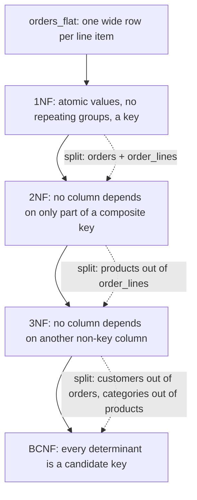

## 16.7 Normalization

### 16.7.1 Why normalize: update anomalies

#### Concept

Normalization is the process of organizing tables so that each fact is stored exactly once. A normal form (1NF, 2NF, 3NF, BCNF) is a checklist of what "exactly once" means at increasing levels of strictness. The practical goal is to eliminate three kinds of anomaly:

- Update anomaly: the same fact lives in many rows, so changing it means changing many rows, and missing one leaves the data contradictory.
- Insert anomaly: you cannot record a fact because it is stuck inside a row that requires other facts you do not have yet.
- Delete anomaly: deleting one fact accidentally deletes another that was stored in the same row.

#### Why does it exist?

Imagine the pre-normalization version of our orders data, the kind that comes out of an exported spreadsheet:

```text
orders_flat
order_id | customer_email | customer_name | customer_city | product_sku | product_name | category | price   | qty
1001     | ravi@x.com     | Ravi Kumar    | Pune          | PHN-001     | Phone X      | Phones   | 49999   | 1
1001     | ravi@x.com     | Ravi Kumar    | Pune          | CBL-77      | USB-C Cable  | Cables   | 499     | 2
1002     | ravi@x.com     | Ravi Kumar    | Pune          | PHN-001     | Phone X      | Phones   | 47999   | 1
1003     | meera@y.com    | Meera Iyer    | Chennai       | CBL-77      | USB-C Cable  | Cables   | 499     | 3
```

Every anomaly is visible:

- Ravi moves to Mumbai. Update anomaly: three rows must change. A bug updates two. Reports now show Ravi in two cities.
- A new product is created but has not sold yet. Insert anomaly: there is nowhere to put it, because every row needs an order.
- Order 1003 is cancelled and deleted. Delete anomaly: Meera's customer record disappears with it.
- "Phone X" costs 49999 in one row and 47999 in another. Is that a price change, a discount, or a typo? The flat table cannot say.

Normalization is the systematic method for splitting this into tables where none of those can happen.

#### Mental model

Imagine a company where every employee keeps their own copy of the phone directory. When someone's number changes, HR emails everyone, and half of them do not update their copy. Normalization is putting one directory on the wall and having everyone refer to it by name. The cost is that looking up a number now takes a walk to the wall (a join). The benefit is that there is exactly one truth.

#### How it works: the normal forms in plain language

The forms build on each other. Each is defined in terms of functional dependencies: "A determines B" (written A -> B) means that whenever two rows have the same A, they have the same B. `sku -> product_name` because a SKU always has one name.



**1NF — First normal form.** Every column holds one atomic value, there are no repeating groups (no `product_1, product_2, product_3` columns and no comma-separated lists in a cell), and every row is identifiable by a key. Our flat table already fails this if someone stored `"PHN-001, CBL-77"` in one cell. Fix: one row per order line, with a key of `(order_id, product_sku)`.

A note on arrays and jsonb: strictly they violate 1NF. Pragmatically, `tags text[]` is fine when the elements are simple labels never referenced elsewhere (section 16.4.6). Purity is a tool, not a religion.

**2NF — Second normal form.** 1NF, plus: no non-key column depends on only part of a composite key. In `orders_flat` with key `(order_id, product_sku)`, `customer_email` depends only on `order_id` (partial dependency), and `product_name` depends only on `product_sku`. Both must move out: `customer_email` to an `orders` table keyed by `order_id`, `product_name` to a `products` table keyed by `sku`. What remains in `order_lines` is only what depends on the whole key: `qty` and the price at the time of that order.

**3NF — Third normal form.** 2NF, plus: no non-key column depends on another non-key column (no transitive dependency). In `orders`, `customer_name` and `customer_city` depend on `customer_email`, not on `order_id`. `order_id -> customer_email -> customer_city` is transitive. Move customer columns to a `users` table. In `products`, `category` is a name that other products share and that could be renamed; `sku -> category_id -> category_name` is transitive, so `categories` becomes its own table.

The one-sentence memory aid: every non-key column depends on the key, the whole key, and nothing but the key.

**BCNF — Boyce-Codd normal form.** 3NF, plus: every determinant (left side of any dependency) is a candidate key. The difference from 3NF only shows up with overlapping candidate keys. Example in our domain: a table `warehouse_stock (warehouse_id, product_sku, product_id, qty)` where both `sku` and `product_id` identify a product. `product_sku -> product_id` holds, but `product_sku` is not a candidate key of this table (it needs `warehouse_id` too). 3NF allows this; BCNF does not. The fix is the same as always: keep exactly one product identifier in the child table, and let `products` own the `sku <-> id` mapping. In practice, if you use surrogate keys consistently and put each natural identifier in its owning table, you land in BCNF without thinking about it.

Higher forms (4NF, 5NF) concern multi-valued and join dependencies. They matter for tables like `(product_id, supplier_id, region_id)` where suppliers and regions are independent facts about a product. The practical rule: if two independent many-to-many facts are in one table, split them into two join tables.

#### Practical example: the normalized result

`orders_flat` becomes the reference schema: `users` (name, city via `addresses`), `products` (name, price, `category_id`), `categories`, `orders` (`user_id`, `placed_at`), `order_items` (`order_id`, `product_id`, `quantity`, `unit_price` snapshot). Each fact once. Ravi's city change is one row. A product can exist before it sells. Cancelling an order does not delete Meera.

The one deliberate exception is `order_items.unit_price` and `product_name`. Those look like a 3NF violation (`product_id -> name`), but they are not: the dependency is `(order_id, product_id) -> unit_price_at_that_time`, which is a different fact from `product_id -> current_price`. An invoice is a historical record. This is the pattern for every "snapshot" column: it is normalized if it records a fact about the row itself (the price this customer was charged), and denormalized if it merely caches a fact owned elsewhere (the product's current price).

#### PostgreSQL example

```sql
-- Migrating a flat table into the normalized schema (idempotent, batched approach shown in Part 26 - Migrations)
INSERT INTO categories (name, slug)
SELECT DISTINCT category, lower(category) FROM orders_flat
ON CONFLICT (slug) DO NOTHING;

INSERT INTO products (sku, name, category_id, price)
SELECT DISTINCT ON (f.product_sku) f.product_sku, f.product_name, c.id, f.price
FROM orders_flat f JOIN categories c ON c.slug = lower(f.category)
ORDER BY f.product_sku, f.order_id DESC          -- latest price seen wins as "current"
ON CONFLICT (sku) DO NOTHING;

INSERT INTO users (email, password_hash, full_name)
SELECT DISTINCT ON (lower(customer_email)) customer_email, 'MIGRATED', customer_name
FROM orders_flat ORDER BY lower(customer_email), order_id DESC
ON CONFLICT (lower(email)) WHERE deleted_at IS NULL DO NOTHING;
-- orders and order_items follow the same pattern, joining back by email and sku.
```

#### Production scenario

A normalized schema at 10 million orders and 30 million order items handles "order detail page" in one query with three joins, roughly 1 to 3 ms with proper indexes. The joins are not the cost people fear: a nested loop over indexed foreign keys touches a handful of 8 KB pages. The cost of the flat alternative shows up differently: a product rename becomes a 30-million-row update, and the analytics team can never trust which of the four spellings of "Phone X" is current.

#### Failure scenario

A team stored `customer_name` directly on `orders` "for faster listing pages". A customer changed her name after marriage. Support updated `users.full_name`. Six months later, a legal request required all documents for that customer; half the orders showed the old name, half the new, and nobody could prove which was correct at which time. The fix was not "never store names on orders". It was to store it deliberately, as a snapshot with a clear name (`recipient_name`, meaning "the name on the shipping label"), and to derive the display name from `users` everywhere else.

#### Edge cases & failure modes

- Over-normalization: a `phone_number_types` table with three rows, joined into every user query. Reference data with fewer than ten stable values is often better as a `CHECK` constraint.
- Under-normalization disguised as "performance": duplicated columns that then drift.
- Historical facts mistaken for denormalization: snapshots on `order_items`, `shipments.address_snapshot jsonb`, and `payments.amount` are correct.
- Normalizing the wrong axis: splitting `users` into `users` and `user_profiles` 1:1 for no reason adds a join to every request and no benefit unless the profile columns are huge or rarely read.

#### How a Senior Backend Engineer thinks about this

They normalize by default to 3NF, think about BCNF only when two natural keys overlap, and then denormalize deliberately, in named places, with a plan for keeping the copy consistent (next section). They separate "cached copy of a current fact" (dangerous) from "recorded historical fact" (correct). When asked "isn't a join slow?", they answer with a number from `EXPLAIN ANALYZE`, not an opinion.

#### Common mistakes

- Comma-separated ids in a text column (`category_ids = '3,7,12'`). Unindexable, unjoinable, unconstrained.
- Storing the current product price on order items without realizing it is the right thing, then "fixing" it to a join, and changing historical invoices when prices change.
- Repeating groups: `address_line_1, address_line_2, second_address_line_1...`.

#### Interview questions

1. Explain 3NF in one sentence and give an example of a transitive dependency in an orders schema. Expected: every non-key column depends on the key, the whole key, nothing but the key; `order_id -> user_id -> user_city`.
2. Is `order_items.unit_price` a normalization violation? Expected: no; it records the price charged, a fact about the order item, not a cache of the product's price.
3. What is an update anomaly, and which normal form removes it? Expected: same fact in many rows; 2NF/3NF splits it into the owning table.
4. When would you stop at 3NF and not bother with BCNF? Expected: when there are no overlapping candidate keys, which is the common case with surrogate keys.

#### Practical exercise

Take the `orders_flat` table above, add 20 realistic rows including two price changes and a customer city change, and write the migration into the reference schema. Then write the query that reconstructs `orders_flat` from the normalized tables. Acceptance criteria: the reconstructed output matches the input except where the input was contradictory, and you can list each contradiction.

## 16.8 Denormalization

### 16.8.1 When and how to denormalize

#### Concept

Denormalization is storing a derived or duplicated value so that reads do not have to compute it. Examples: `orders.total` (derivable from `order_items`), `products.review_count` and `products.avg_rating` (derivable from `reviews`), a `daily_revenue` table (derivable from `orders`), or a materialized view of "top 100 products this week". It trades write complexity and consistency risk for read speed.

#### Why does it exist?

Some reads are too frequent or too heavy to compute on demand. A product listing page that shows average rating for 40 products would need to aggregate potentially millions of reviews per request. A dashboard of revenue per category per day over two years would scan every order. At 3,000 reads per second, computing from source is not an option; caching the answer somewhere is. The question is only where and how fresh.

#### Mental model

Imagine a shop that counts its cash drawer. The normalized way is to add up every receipt each time someone asks "how much is in the drawer". The denormalized way is a running total on a whiteboard, updated with every sale. The whiteboard is fast to read and wrong the moment someone forgets to update it, so the shop reconciles it against the receipts every night.

#### How it works: the four mechanisms

| Mechanism | Freshness | Write cost | Consistency guarantee | Best for |
|---|---|---|---|---|
| Same-transaction update in application code | Immediate | One extra `UPDATE` per write | Only as good as every write path remembering | Totals owned by one service, few write paths |
| Database trigger | Immediate | Trigger executes on every write | Strong: every path is covered, including scripts | Counters, totals, `updated_at`, audit rows |
| Materialized view (`REFRESH`) | Stale until refreshed | Full recompute on refresh | Snapshot-consistent at refresh time | Reports, leaderboards, aggregates over millions of rows |
| Asynchronous read model (queue + worker) | Seconds of lag | Event publish + consumer write | Eventual; needs reconciliation | Cross-service views, search indexes, analytics |

Each has a place. The senior approach is to pick the weakest mechanism that meets the freshness requirement, and to always have a reconciliation job that recomputes from source and alerts on drift.

#### PostgreSQL example

Cached order total, kept correct by a trigger:

```sql
-- orders.total is derived from order_items; keep it correct on every item change.
CREATE OR REPLACE FUNCTION recompute_order_totals() RETURNS trigger AS $$
DECLARE
  target_order uuid := coalesce(NEW.order_id, OLD.order_id);
BEGIN
  UPDATE orders o
     SET subtotal = s.subtotal,
         total    = s.subtotal - o.discount,
         updated_at = now()
    FROM (SELECT coalesce(sum(quantity * unit_price), 0) AS subtotal
            FROM order_items WHERE order_id = target_order) s
   WHERE o.id = target_order;
  RETURN NULL;   -- AFTER trigger: return value ignored
END;
$$ LANGUAGE plpgsql;

CREATE TRIGGER order_items_recompute_totals
AFTER INSERT OR UPDATE OR DELETE ON order_items
FOR EACH ROW EXECUTE FUNCTION recompute_order_totals();
```

Counter cache with a race-safe increment (never read-then-write):

```sql
-- products.review_count and avg_rating maintained incrementally
ALTER TABLE products ADD COLUMN review_count integer NOT NULL DEFAULT 0,
                     ADD COLUMN rating_sum   integer NOT NULL DEFAULT 0;
-- avg_rating is computed at read time as rating_sum::numeric / nullif(review_count, 0)

CREATE OR REPLACE FUNCTION reviews_counter_cache() RETURNS trigger AS $$
BEGIN
  IF TG_OP = 'INSERT' THEN
    UPDATE products SET review_count = review_count + 1, rating_sum = rating_sum + NEW.rating WHERE id = NEW.product_id;
  ELSIF TG_OP = 'DELETE' THEN
    UPDATE products SET review_count = review_count - 1, rating_sum = rating_sum - OLD.rating WHERE id = OLD.product_id;
  ELSIF NEW.rating <> OLD.rating THEN
    UPDATE products SET rating_sum = rating_sum - OLD.rating + NEW.rating WHERE id = NEW.product_id;
  END IF;
  RETURN NULL;
END;
$$ LANGUAGE plpgsql;

CREATE TRIGGER reviews_counter_cache_trg
AFTER INSERT OR UPDATE OF rating OR DELETE ON reviews
FOR EACH ROW EXECUTE FUNCTION reviews_counter_cache();
```

`review_count = review_count + 1` is atomic under row locking: two concurrent inserts both increment correctly, because the second `UPDATE` waits for the first to commit and then reads the new value. A read-then-write in application code (`count = await get(); await set(count + 1)`) loses one of them.

Materialized view for a heavy report:

```sql
CREATE MATERIALIZED VIEW daily_category_revenue AS
SELECT date_trunc('day', o.placed_at AT TIME ZONE 'Asia/Kolkata')::date AS day,
       c.id   AS category_id,
       c.name AS category_name,
       sum(oi.quantity * oi.unit_price) AS revenue,
       count(DISTINCT o.id)            AS orders
FROM orders o
JOIN order_items oi ON oi.order_id = o.id
JOIN products p     ON p.id = oi.product_id
JOIN categories c   ON c.id = p.category_id
WHERE o.status IN ('paid', 'shipped', 'delivered')
GROUP BY 1, 2, 3
WITH DATA;

-- A unique index is required for REFRESH ... CONCURRENTLY
CREATE UNIQUE INDEX daily_category_revenue_uidx ON daily_category_revenue (day, category_id);

-- Refresh without blocking readers (takes a while, but SELECTs keep working on the old data)
REFRESH MATERIALIZED VIEW CONCURRENTLY daily_category_revenue;
```

Reconciliation job that catches drift regardless of mechanism:

```sql
-- Run nightly; alert if any rows return
SELECT o.id, o.total, s.computed
FROM orders o
JOIN LATERAL (
  SELECT coalesce(sum(quantity * unit_price), 0) - o.discount AS computed
  FROM order_items WHERE order_id = o.id
) s ON true
WHERE o.total <> s.computed
LIMIT 100;
```

#### NestJS example

The asynchronous read-model variant, using an event emitter to update a denormalized "customer summary" outside the write transaction:

```ts
// orders/orders.service.ts (excerpt)
import { EventEmitter2 } from '@nestjs/event-emitter';

async markPaid(orderId: string): Promise<void> {
  await this.dataSource.transaction(async (m) => {
    await m.query(`UPDATE orders SET status = 'paid', updated_at = now() WHERE id = $1 AND status = 'pending'`, [orderId]);
    // Outbox row in the same transaction guarantees the event is not lost (see Part 29 - Messaging)
    await m.query(`INSERT INTO outbox (aggregate_id, type, payload) VALUES ($1, 'order.paid', $2)`,
      [orderId, JSON.stringify({ orderId })]);
  });
}

// customers/customer-summary.listener.ts
import { Injectable } from '@nestjs/common';
import { OnEvent } from '@nestjs/event-emitter';

@Injectable()
export class CustomerSummaryListener {
  constructor(private readonly ds: DataSource) {}

  @OnEvent('order.paid')
  async onOrderPaid(evt: { orderId: string }): Promise<void> {
    // Idempotent: recompute from source for this one customer rather than incrementing blindly.
    await this.ds.query(`
      INSERT INTO customer_summary (user_id, lifetime_value, order_count, last_order_at)
      SELECT o.user_id, sum(o.total), count(*), max(o.placed_at)
      FROM orders o WHERE o.user_id = (SELECT user_id FROM orders WHERE id = $1) AND o.status IN ('paid','shipped','delivered')
      GROUP BY o.user_id
      ON CONFLICT (user_id) DO UPDATE
        SET lifetime_value = EXCLUDED.lifetime_value, order_count = EXCLUDED.order_count, last_order_at = EXCLUDED.last_order_at`,
      [evt.orderId]);
  }
}
```

Recomputing per customer rather than incrementing is a deliberate choice: an event delivered twice produces the same result, so duplicate delivery is harmless.

#### Production scenario

A product listing with 40 items per page at 2,000 requests per second: computing `avg(rating)` per product from a 20-million-row `reviews` table would be roughly 40 index scans per request, each touching tens of pages, roughly 15 to 40 ms and 80,000 index scans per second. With the counter cache it is zero extra work: the numbers are on the product row already. The trigger costs about 50 microseconds per review write, and reviews arrive at maybe 5 per second. This is the classic asymmetric trade: reads outnumber writes by 400 to 1, so moving work to the write side wins.

#### Failure scenario

At 02:14 the on-call got paged: "Order totals mismatch: 1,204 orders". The nightly reconciliation had found orders whose `total` did not equal the sum of their items. Root cause: a new "bulk edit line items" admin feature bypassed the service layer and updated `order_items` with a raw multi-row statement, while the total was maintained in application code, not a trigger. Nobody had broken a rule; there simply was a new write path. The fix was the `AFTER` trigger above, which covers every path. The reconciliation job was what turned a silent data corruption into a next-morning fix instead of a next-quarter audit finding.

#### Edge cases & failure modes

- Counter drift from failed transactions: a trigger runs inside the same transaction, so a rollback undoes both. Application-side increments outside the transaction drift.
- Hot row: a counter on a single row (`site_stats.total_orders`) becomes a lock serialization point at high write rates. Shard it (N rows, sum on read) or move it to Redis with periodic flush.
- `REFRESH MATERIALIZED VIEW` without `CONCURRENTLY` takes an `ACCESS EXCLUSIVE` lock; readers block for the whole refresh.
- `REFRESH ... CONCURRENTLY` needs a unique index and does a diff, which is slower than a plain refresh on large changes.
- Async read models lag; the UI must tolerate "your order is not in your history yet" for a few seconds, or read-your-writes must be handled explicitly.
- Denormalized copies across services (a `product_name` in the orders service) go stale when the owning service changes it; decide whether that is a snapshot (fine) or a cache (needs an event).
- Triggers are invisible in application code; document them, test them, and include them in migrations under version control.

#### How a Senior Backend Engineer thinks about this

Before denormalizing, they ask: "What is the read rate, what is the write rate, what is the acceptable staleness, and how will I detect drift?" They prefer triggers for in-database derived values because they are the only mechanism that cannot be bypassed. They prefer materialized views for reports with minute-level staleness. They reach for async read models only when the data crosses a service boundary. Every denormalized value gets a reconciliation query and an alert. They can explain to a product manager: "The product rating you see is exact but updates within one transaction; the revenue dashboard is exact as of the last five-minute refresh."

#### Common mistakes

- Read-modify-write counters in application code (`count + 1` in TypeScript).
- Denormalizing before measuring; adding `orders.item_count` for a page that gets 10 requests per day.
- No reconciliation. Drift is discovered by finance.
- Triggers with business logic sprawling into hundreds of lines; keep triggers to derived-value maintenance.

#### Interview questions

1. How would you show average rating on a product listing at 2,000 RPS? Expected: counter cache (`rating_sum`, `review_count`) maintained by trigger; explain why increment is race-safe in SQL.
2. Trigger vs application code for a cached total: which and why? Expected: trigger covers every write path; application code misses admin tools and scripts.
3. How do you refresh a materialized view without blocking readers? Expected: `REFRESH MATERIALIZED VIEW CONCURRENTLY` with a unique index.
4. How do you detect drift in a denormalized value? Expected: periodic recompute-from-source comparison with alerts.
5. When does a counter become a hot-row problem, and what do you do? Expected: single row updated hundreds of times per second; shard the counter or move to Redis.

#### Practical exercise

Add `products.review_count` and `products.rating_sum` with the trigger above. Write a Jest integration test that inserts 200 reviews concurrently across 10 connections, then asserts the counters match `SELECT count(*), sum(rating) FROM reviews`. Then write the reconciliation query and schedule it with `@nestjs/schedule`. Acceptance criteria: test passes under concurrency; reconciliation query returns zero rows; deleting a review decrements correctly.
