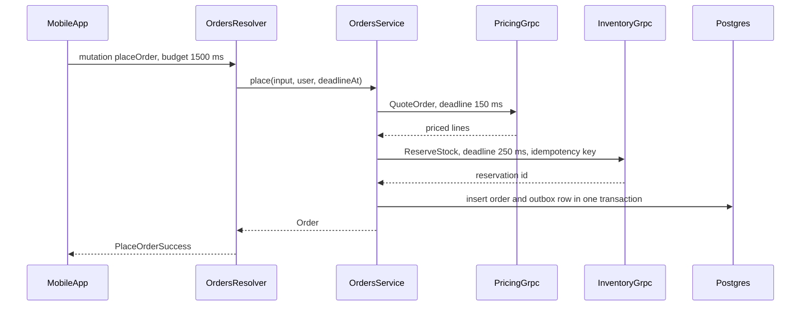

## 16.9 Worked example: one order service, three protocols

#### Concept

This section builds the architecture from 16.3.1 concretely: one NestJS order service that exposes **REST** to partners, **GraphQL** to the mobile app, and **gRPC** to internal services, while calling inventory and pricing over gRPC. The design rule that makes it maintainable: **one domain service, three thin adapters**. Business rules, validation of meaning, authorization and transactions live once; each adapter only translates its protocol's input, output and errors.

#### Practical example — requirements and numbers

| Consumer | Protocol | Traffic | Needs |
|---|---|---|---|
| Partners (marketplaces, ERPs) | REST, OpenAPI, API keys | 1,200 RPS, 80% `GET /v1/orders/{id}` | Stability for years, CDN and ETag caching, docs |
| Mobile app (300,000 daily users) | GraphQL, JWT | 900 RPS peak | Screen-shaped data in one round trip, weekly releases |
| Internal (fulfilment, billing, support) | gRPC, mTLS | 4,000 RPS | Typed contract, low latency, streaming order events |
| Order service as a client | gRPC to inventory and pricing | 6,000 RPS | Deadlines, retries only where idempotent |

```text
src/orders/
  domain/orders.service.ts          one place for rules, authorization, transactions
  domain/order-errors.ts            OrderNotFound, OutOfStock, NotAllowed, InvalidOrder
  rest/orders.controller.ts         /v1/orders  -> DTOs, HTTP status, ETag
  graphql/orders.resolver.ts        Order type, DataLoaders, result unions
  grpc/orders.grpc.controller.ts    orders.v1.OrderService, status codes
proto/orders/v1/orders.proto        published contract, checked by buf in CI
```

#### How it works — one request through the system



The order-created event goes into an outbox table in the same transaction (see Part 30 — Distributed Transactions, 30.10 The transactional outbox), and a relay publishes it; the gRPC `StreamOrderEvents` method and the GraphQL subscription (16.5) both read from that published stream, so neither protocol can announce an order that was never committed.

#### NestJS example — the three adapters

```ts
// domain/orders.service.ts -- the only place that knows the rules
@Injectable()
export class OrdersService {
  async findForViewer(id: string, viewer: Viewer): Promise<Order> {
    const order = await this.repo.findOne({ where: { id }, relations: { items: true } });
    if (!order) throw new OrderNotFound(id);
    if (!this.policy.canView(viewer, order)) throw new OrderNotFound(id);   // do not reveal existence
    return order;
  }
  // place(), cancel() ... call pricing and inventory over gRPC with deadlines (61.7)
}
```

```ts
// rest/orders.controller.ts -- partners: stable DTO, caching headers
@Controller('v1/orders')
@UseGuards(ApiKeyGuard)
export class OrdersController {
  constructor(private readonly orders: OrdersService) {}

  @Get(':id')
  async get(@Param('id', ParseUUIDPipe) id: string, @Req() req: ApiKeyRequest, @Res({ passthrough: true }) res: Response) {
    const order = await this.orders.findForViewer(id, req.viewer);
    res.setHeader('Cache-Control', 'private, max-age=30');
    res.setHeader('ETag', `"${order.version}"`);
    return OrderDto.from(order);                         // explicit, versioned public shape
  }
}
```

```ts
// graphql/orders.resolver.ts -- mobile: same service, screen-shaped graph
@Resolver(() => OrderType)
export class OrdersResolver {
  constructor(private readonly orders: OrdersService) {}

  @Query(() => OrderType, { nullable: true })
  order(@Args('id', { type: () => ID }) id: string, @Context('viewer') viewer: Viewer) {
    return this.orders.findForViewer(id, viewer);
  }

  @ResolveField(() => ProductType, { nullable: true })
  product(@Parent() item: OrderItem, @Context('loaders') loaders: Loaders) {
    return loaders.product.load(item.productId);         // batched catalog call (61.1.2)
  }
}
```

```ts
// grpc/orders.grpc.controller.ts -- internal: typed contract, status codes
@Controller()
export class OrdersGrpcController {
  constructor(private readonly orders: OrdersService) {}

  @GrpcMethod('OrderService', 'GetOrder')
  async getOrder(req: GetOrderRequest, metadata: Metadata) {
    const order = await this.orders.findForViewer(req.id, Viewer.fromServiceMetadata(metadata)); // mTLS identity
    return toProtoOrder(order);
  }
}
```

One domain error, mapped once per adapter (a REST exception filter, the GraphQL `formatError` or result unions, a gRPC exception filter):

| Domain error | REST | GraphQL | gRPC |
|---|---|---|---|
| `OrderNotFound` | 404 | `null` + `NOT_FOUND` code | `NOT_FOUND` |
| `InvalidOrder` | 400 / 422 | `BAD_USER_INPUT` | `INVALID_ARGUMENT` |
| `OutOfStock` | 409 | `OutOfStock` union member | `FAILED_PRECONDITION` |
| `NotAllowed` | 403 | `FORBIDDEN` | `PERMISSION_DENIED` |
| Dependency timeout | 503 + `Retry-After` | `null` field + `DEPENDENCY_UNAVAILABLE` | `UNAVAILABLE` |

Per-edge concerns stay at the edge: API keys, quotas and OpenAPI at the REST edge; persisted-query safelists, complexity limits and DataLoaders at the GraphQL edge; mTLS, deadlines and `buf breaking` at the gRPC edge. Contract tests guard each: an OpenAPI diff, a `schema.gql` diff, and `buf breaking`, all in the same pipeline.

#### Production scenario

After a year: REST serves partners at 1,200 RPS with a 72% CDN and ETag hit ratio, so origin sees about 340 RPS; GraphQL handles 900 RPS at p50 45 ms and p99 210 ms, with an average of 6 SQL queries per operation thanks to DataLoaders; gRPC serves 4,000 RPS at p99 18 ms. One OpenTelemetry trace follows a mobile request from the resolver through `OrdersService` into the pricing and inventory gRPC spans (see Part 43 — Observability), with the operation name and gRPC method as span attributes. The service runs as one deployment of 10 pods, with HTTP on port 3000 and gRPC on 50051.

#### Failure scenario

At 20:10 during a promotion, mobile checkout errors jumped to 14% while REST and gRPC callers were fine. Traces showed `placeOrder` waiting 1.5 seconds on `ReserveStock` and then failing. The GraphQL adapter, written by a different engineer, called `OrdersService.place()` through its own helper that set no gRPC deadline and retried `UNAVAILABLE` three times; the REST and gRPC adapters went through the shared method with the deadline budget. The inventory service was briefly overloaded, and the GraphQL path's retries tripled its load at the worst moment. The fix moved all dependency calls and retry policy into the domain service, deleted the helper, and added an architecture test that fails if an adapter imports a gRPC client directly. The lesson: three protocols are safe only when the adapters are truly thin.

#### Edge cases & failure modes

- **Business logic leaking into an adapter**: rules and dependency calls implemented in one adapter but not the others; enforce "adapters only map" with lint or architecture tests.
- **Different authorization per protocol**: an internal gRPC method that skips the viewer check becomes a hole as soon as a new internal caller misuses it.
- **Contract coupling**: returning the database entity directly from all three adapters means a column rename changes three public contracts.
- **One deployment, three loads**: a GraphQL spike can starve gRPC callers in the same pods; watch per-protocol latency, and split deployments if needed.
- **Port exposure**: the gRPC port must not be routable from the internet; only the HTTP edge sits behind the public gateway.

#### How a Senior Backend Engineer thinks about this

A senior sees the three protocols as delivery mechanisms around one domain model, chosen per consumer (16.3). They keep adapters thin, map errors and auth explicitly per edge, guard every contract in CI, and measure each protocol separately. When a product manager asks "why three APIs?", the answer is: "One order system with three doors: a stable front door for partners, a fast door shaped for our app, and a staff entrance for our own services. The rooms behind them are the same."

#### Interview questions

1. **How do you structure a service that must speak REST, GraphQL and gRPC?** One domain service owning rules, authorization and transactions; thin adapters per protocol; one domain error type mapped per adapter; contract checks per protocol in CI. Follow-up: how do you stop drift? Architecture tests that forbid adapters from importing repositories or downstream clients.
2. **Where do caching and query-cost controls belong in this design?** At the edges where they apply: HTTP caching and ETags at REST, complexity limits and DataLoaders at GraphQL, deadlines at gRPC; the domain service stays protocol-agnostic.
3. **Would you run the three protocols in one deployment or three?** One deployment is simpler to start; split when one protocol's load profile (for example, GraphQL spikes) hurts another's latency, which per-protocol metrics will show.

#### Practical exercise

Build the order service with the folder layout above: a domain service, a REST controller, a GraphQL resolver and a gRPC controller, all calling `findForViewer`, and a placeholder pricing client over gRPC with a deadline. Acceptance criteria: one test suite proves that a missing order gives 404, `null` with `NOT_FOUND`, and gRPC `NOT_FOUND` respectively; a user who cannot view an order gets the not-found response in all three; the pipeline runs an OpenAPI diff, a schema diff and `buf breaking`; an architecture test fails if an adapter imports a repository.

## Senior Checklist — Part 16

- [ ] I understand the concept
- [ ] I can explain it simply
- [ ] I can implement it
- [ ] I understand its failure modes
- [ ] I understand its scaling limitations
- [ ] I understand its security implications
- [ ] I understand its operational implications
- [ ] I can choose between alternatives
- [ ] I can explain the tradeoffs
- [ ] I can answer senior-level interview questions
- [ ] I can build a NestJS GraphQL API code-first and schema-first, with validated mutation inputs
- [ ] I can find and fix N+1 with per-request DataLoaders built in the context factory
- [ ] I can bound a GraphQL endpoint with depth limits, complexity limits and a persisted-query safelist
- [ ] I can implement Relay connections with keyset cursors and verify them with `EXPLAIN`
- [ ] I can model expected outcomes as result unions and monitor errors per operation, not by HTTP status
- [ ] I can deprecate a field, measure its usage per client and remove it safely
- [ ] I can run subscriptions across many pods with a shared pub/sub and per-subscription authorization
- [ ] I can explain federation, build subgraphs and a gateway, and say when it is not worth it
- [ ] I can build a gRPC service and client in NestJS with deadlines, metadata, health checks and reflection
- [ ] I can evolve a protobuf contract safely and enforce it with `buf breaking`
- [ ] I can balance gRPC traffic over HTTP/2 and expose it to browsers through gRPC-Web or a gateway
- [ ] I can design one service with REST, GraphQL and gRPC adapters over one domain layer

## Part 16 — Key Takeaways

- REST, GraphQL and gRPC are three tools for three boundaries: REST for partners and cacheable public reads, GraphQL for clients you ship alongside the server, gRPC for typed, high-volume internal calls.
- GraphQL moves control of server load to the client; a new query can change the load profile with no server deploy, so measure cost and errors per operation.
- Every relation field needs a per-request DataLoader; DataLoader is batching and memoization, not a cache.
- Bound GraphQL with depth and complexity limits and, for first-party apps, a safelist of persisted queries; automatic persisted queries alone are not a security control.
- Paginate every growing list with connections and keyset cursors from day one; turning a list into a connection later is a breaking change.
- GraphQL returns HTTP 200 with partial errors; model expected business outcomes as result unions and keep fields that can fail independently nullable.
- Evolve GraphQL by adding, deprecating, measuring field usage per client and removing at zero; evolve protobuf by never changing or reusing field numbers and letting `buf breaking` enforce it.
- Subscriptions need a shared pub/sub across pods, per-subscription authorization and a re-query on reconnect.
- Federation solves an organisational problem; compose in CI, batch reference resolvers, and do not adopt it before the schema-change queue proves you need it.
- gRPC has no default deadline; set one from the caller's remaining budget at every hop, and retry only idempotent calls at one layer.
- HTTP/2 makes connection-level load balancing sticky; use client-side round robin, a mesh, and a maximum connection age, and check per-pod load after every scale-out.
- One domain service with thin protocol adapters is what keeps a three-protocol service correct.
