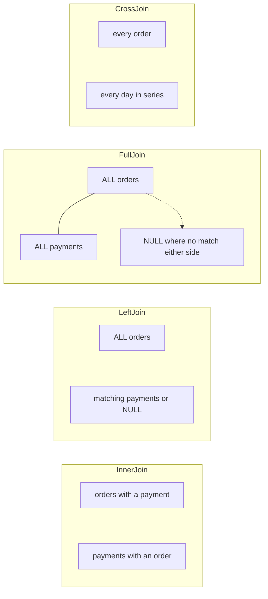
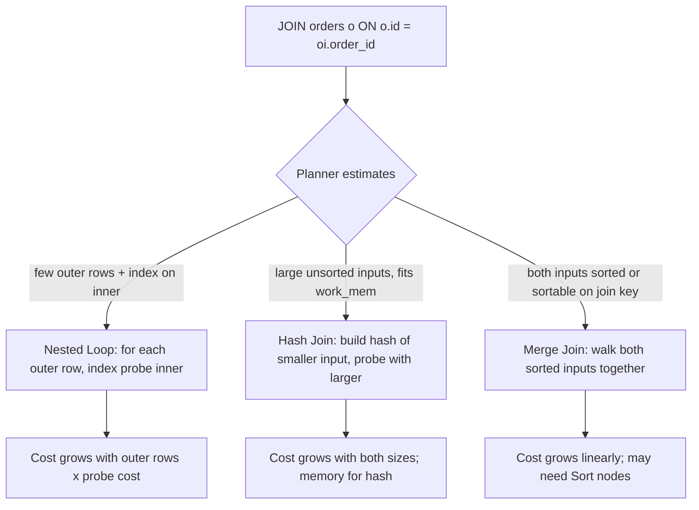

# Part 17 — SQL Mastery for Backend Engineers

SQL is the one language every backend engineer writes that runs on someone else's execution engine, against data they cannot see, with a cost that scales with a table they do not control. Writing it well means knowing what the planner will do with it. This part teaches the SQL a senior engineer uses daily, on the e-commerce schema defined in Part 16 (section 16.3): `users`, `addresses`, `categories`, `products`, `inventory`, `orders`, `order_items`, `payments`, `shipments`, `reviews`, `notifications`. Every query here runs against that schema unchanged.

Query tuning in depth (indexes, `EXPLAIN ANALYZE`, statistics) is Part 19. Here we introduce enough plan reading to know whether a query is sane.

## 17.1 SELECT and WHERE: writing predicates the planner can use

### 17.1.1 Sargable predicates

#### Concept

A predicate is a condition in `WHERE`. A sargable predicate ("search-argument-able") is one the planner can turn into an index range: `col = value`, `col > value`, `col BETWEEN a AND b`, `col IN (...)`, `col LIKE 'prefix%'`, `col IS NULL`. A non-sargable predicate wraps the column in a function or expression, so the index on the raw column is useless: `lower(email) = ...` when the index is on `email`, `placed_at::date = ...`, `price * 1.18 > 1000`, `LIKE '%cable%'`.

#### Why does it exist?

A B-tree index is sorted by the column's value. The planner can find `placed_at >= '2026-03-01'` by descending the tree to that value and scanning right. It cannot find `date(placed_at) = '2026-03-01'` that way, because the tree is sorted by `placed_at`, not by `date(placed_at)`. To satisfy the function form it must read every row, compute the function, and compare. The query is correct both ways; one costs 0.1 ms, the other 4 seconds on 10 million orders.

#### Mental model

Imagine a phone book sorted by surname. "Find everyone whose surname is Sharma" is a page flip (sargable). "Find everyone whose surname, spelled backwards, is Amrahs" requires reading every entry and reversing it (non-sargable), even though it is the same set of people.

#### How it works

1. The planner looks at each predicate and asks: is the left side a bare indexed column (or an indexed expression that matches exactly), and is the operator one the index supports?
2. If yes, it estimates how many rows the range covers using statistics, and considers an index scan.
3. If no, the only options are a sequential scan with a filter, or an index scan on some other predicate followed by filtering.
4. Rewriting the predicate so the column is bare (move the function to the constant side) restores option 2.

| Non-sargable | Sargable rewrite | Notes |
|---|---|---|
| `date(placed_at) = '2026-03-01'` | `placed_at >= '2026-03-01' AND placed_at < '2026-03-02'` | Range on the raw column |
| `lower(email) = 'x'` | Keep, but index `lower(email)` (expression index) | The index must match the expression exactly |
| `price * 1.18 > 1000` | `price > 1000 / 1.18` | Move arithmetic to the constant |
| `sku LIKE '%77'` | Not rewritable; use a trigram index (`pg_trgm`) or reversed column | Suffix and infix search need a different index type |
| `status <> 'cancelled'` | `status IN ('pending','paid',...)` | Inequality rarely uses an index; enumerating does |
| `coalesce(cancelled_at, '9999-01-01') > now()` | `(cancelled_at IS NULL OR cancelled_at > now())` | Splitting removes the function |
| `id::text = '...'` | `id = '...'::uuid` | Cast the parameter, not the column |
| `extract(year FROM placed_at) = 2026` | `placed_at >= '2026-01-01' AND placed_at < '2027-01-01'` | Range |

#### PostgreSQL example

```sql
-- Orders placed on a given day (IST). Non-sargable: index on placed_at is ignored.
EXPLAIN (ANALYZE, BUFFERS)
SELECT id, total FROM orders
WHERE (placed_at AT TIME ZONE 'Asia/Kolkata')::date = '2026-03-01';
-- Seq Scan on orders  (cost=0.00..412876.00 rows=48000 width=24) (actual time=0.031..3812.114 rows=41932 loops=1)
--   Filter: (((placed_at AT TIME ZONE 'Asia/Kolkata'))::date = '2026-03-01'::date)
--   Rows Removed by Filter: 9958068
--   Buffers: shared hit=112000 read=180876
-- Execution Time: 3818.902 ms

-- Sargable: compute the day's boundaries as timestamptz constants.
EXPLAIN (ANALYZE, BUFFERS)
SELECT id, total FROM orders
WHERE placed_at >= '2026-03-01 00:00+05:30' AND placed_at < '2026-03-02 00:00+05:30';
-- Index Scan using orders_placed_at_idx on orders  (cost=0.43..2310.55 rows=41800 width=24) (actual time=0.028..14.302 rows=41932 loops=1)
--   Index Cond: ((placed_at >= '2026-03-01 00:00:00+05:30') AND (placed_at < '2026-03-02 00:00:00+05:30'))
--   Buffers: shared hit=1418
-- Execution Time: 16.011 ms
```

The `Rows Removed by Filter: 9958068` line is the tell: the database read ten million rows to return forty thousand.

`LIKE`:

```sql
-- Prefix: index-usable if the index has text_pattern_ops (or the DB uses C collation)
CREATE INDEX products_sku_prefix_idx ON products (sku text_pattern_ops);
SELECT id FROM products WHERE sku LIKE 'PHN-%';        -- Index Scan (Index Cond: sku ~>=~ 'PHN-' AND sku ~<~ 'PHN.')

-- Infix: needs a trigram GIN index
CREATE EXTENSION IF NOT EXISTS pg_trgm;
CREATE INDEX products_name_trgm_idx ON products USING gin (name gin_trgm_ops);
SELECT id, name FROM products WHERE name ILIKE '%cable%';  -- Bitmap Index Scan on products_name_trgm_idx
```

#### TypeORM example

```ts
// Sargable range from a day in IST
const start = DateTime.fromISO(day, { zone: 'Asia/Kolkata' }).startOf('day');
const rows = await orderRepo
  .createQueryBuilder('o')
  .select(['o.id', 'o.total'])
  .where('o.placedAt >= :start AND o.placedAt < :end', { start: start.toJSDate(), end: start.plus({ days: 1 }).toJSDate() })
  .getMany();

// Repository find(): Between is inclusive on both ends; prefer explicit range for time
import { MoreThanOrEqual, LessThan, Like } from 'typeorm';
await orderRepo.find({ where: { placedAt: MoreThanOrEqual(start.toJSDate()) /* and */ } });
await productRepo.find({ where: { sku: Like('PHN-%') } });  // prefix LIKE
```

#### Sequelize example

```ts
import { Op } from 'sequelize';
const rows = await Order.findAll({
  attributes: ['id', 'total'],
  where: { placedAt: { [Op.gte]: start.toJSDate(), [Op.lt]: start.plus({ days: 1 }).toJSDate() } },
});
await Product.findAll({ where: { sku: { [Op.like]: 'PHN-%' } } });
await Product.findAll({ where: { name: { [Op.iLike]: '%cable%' } } }); // needs the trigram index to be fast
```

#### Edge cases & failure modes

- `WHERE id = $1` with `$1` bound as text against a `uuid` or `bigint` column: node-postgres sends untyped parameters, and PostgreSQL infers the column's type, so this is usually fine. But `WHERE id::text = $1` or `WHERE id = $1::text` forces a cast on the column side and kills the index. Section 17.21 covers implicit casts.
- Parameterized `LIKE`: `sku LIKE $1` where `$1 = 'PHN-%'` is planned generically after five executions and may lose the prefix optimization; `sku LIKE 'PHN-' || '%'` style concatenation in SQL with a plain parameter usually keeps it. Check the plan for prepared statements.
- `OR` across different columns (`email = $1 OR phone = $2`) can use a `BitmapOr` of two indexes; `OR` mixing an indexed and unindexed column forces a sequential scan.
- Functions marked `STABLE` or `VOLATILE` on the constant side (`now()`) are fine; the planner evaluates them once per query.

#### How a Senior Backend Engineer thinks about this

They write the predicate with the column bare, and if the business rule needs a function, they add the matching expression index or reshape the predicate into a range. They know the six lines of an `EXPLAIN` that matter (`Seq Scan` vs `Index Scan`, `Filter` vs `Index Cond`, `Rows Removed by Filter`) and look at them before shipping any query that runs more than once per second.

#### Common mistakes

- `WHERE DATE(created_at) = CURRENT_DATE`. Universal, and always a sequential scan.
- `WHERE LOWER(email) = LOWER($1)` without the expression index.
- `LIKE '%term%'` on a B-tree index and wondering why it is slow.
- `SELECT *` in a hot path: reads every column including TOASTed `jsonb`, breaks when a column is added, and prevents index-only scans. Name your columns.

#### Interview questions

1. Why does `WHERE date(placed_at) = '2026-03-01'` not use the index on `placed_at`? Expected: the index is sorted by `placed_at`, not by `date(placed_at)`; rewrite as a range or add an expression index. Follow-up: what about timezone?
2. How do you make `LIKE '%cable%'` fast? Expected: `pg_trgm` GIN index.
3. What does `Rows Removed by Filter` tell you?

#### Practical exercise

Write the "orders for a customer in a date range, most recent first" query three ways: with `date()` casts, with a range, and with an expression index. Run `EXPLAIN (ANALYZE, BUFFERS)` on a 5-million-row table. Acceptance criteria: you can point to the line in each plan that shows whether the index was used and explain the buffers difference.

## 17.2 JOINs

### 17.2.1 Join types

#### Concept

A join combines rows from two tables based on a condition. The types differ in what happens to rows that have no match:

- `INNER JOIN`: only rows with a match on both sides.
- `LEFT JOIN`: all rows from the left, plus matching rows from the right; unmatched right columns are `NULL`.
- `RIGHT JOIN`: the mirror. Rarely used; rewrite as `LEFT JOIN` with the tables swapped for readability.
- `FULL JOIN`: all rows from both sides; unmatched columns `NULL` on either side.
- `CROSS JOIN`: every row of the left with every row of the right (Cartesian product). Useful for generating grids (every product for every day).
- `LATERAL` join: the right side is a subquery that can reference the left row, evaluated per left row. The SQL way to say "for each order, the latest payment".



#### Why does it exist?

Normalization put customers in `users`, their orders in `orders`, and the items in `order_items`. Any page that shows an order with the customer's name needs both tables. Joins are how the relational model reassembles what normalization separated, on demand, and only for the rows you asked for.

#### Mental model

Imagine two stacks of index cards: orders and payments, each order card labeled with an order id, each payment card labeled with the order id it paid. `INNER JOIN` pairs cards that share an id and discards the rest. `LEFT JOIN` keeps every order card, attaching a payment card where there is one and a blank card otherwise. `FULL JOIN` keeps every card from both stacks. `CROSS JOIN` pairs every order card with every payment card regardless of label.

#### How it works

The logical definition: `CROSS JOIN`, then filter by the `ON` condition, then (for outer joins) add back the unmatched rows with `NULL`s. The planner never actually does the Cartesian product; it picks one of three algorithms (next section) that produce the same result. What you must internalize is the difference between `ON` and `WHERE` for outer joins:

- A condition in `ON` decides which right-side rows match. Unmatched left rows survive with `NULL`s.
- A condition in `WHERE` filters the final result. `WHERE p.status = 'captured'` after a `LEFT JOIN payments p` discards every order with no payment (because `NULL = 'captured'` is unknown), silently turning the `LEFT JOIN` into an `INNER JOIN`.

#### PostgreSQL example

```sql
-- INNER: orders that have at least one captured payment (duplicates if more than one; see 10.3)
SELECT o.id, o.total, p.amount
FROM orders o
JOIN payments p ON p.order_id = o.id AND p.status = 'captured';

-- LEFT: every order, with its captured payment if any. The status filter MUST be in ON.
SELECT o.id, o.total, p.amount
FROM orders o
LEFT JOIN payments p ON p.order_id = o.id AND p.status = 'captured';

-- Same query with the filter in WHERE: silently becomes INNER
SELECT o.id, o.total, p.amount
FROM orders o
LEFT JOIN payments p ON p.order_id = o.id
WHERE p.status = 'captured';       -- drops unpaid orders

-- Orders with NO captured payment (anti-join via LEFT JOIN ... IS NULL; NOT EXISTS is clearer, see 10.5)
SELECT o.id
FROM orders o
LEFT JOIN payments p ON p.order_id = o.id AND p.status = 'captured'
WHERE p.id IS NULL;

-- FULL: reconcile our payments with the provider's settlement file loaded into a temp table
SELECT p.id AS our_id, s.provider_payment_id, p.amount AS ours, s.amount AS theirs
FROM payments p
FULL JOIN settlement_lines s ON s.provider_payment_id = p.provider_payment_id
WHERE p.id IS NULL OR s.provider_payment_id IS NULL OR p.amount <> s.amount;

-- CROSS: a calendar grid, every day x every category, for a report with zeros
SELECT d::date AS day, c.id AS category_id
FROM generate_series('2026-03-01'::date, '2026-03-31'::date, interval '1 day') d
CROSS JOIN categories c;

-- LATERAL: for each order, the latest payment attempt (top-1 per group)
SELECT o.id, o.total, lp.status AS latest_payment_status, lp.created_at
FROM orders o
LEFT JOIN LATERAL (
  SELECT p.status, p.created_at
  FROM payments p
  WHERE p.order_id = o.id
  ORDER BY p.created_at DESC
  LIMIT 1
) lp ON true
WHERE o.user_id = $1
ORDER BY o.placed_at DESC
LIMIT 20;
-- Uses payments_order_id_created_at_idx: one index probe per order, 20 probes total.
```

`LATERAL` deserves attention. It is the right tool whenever you need "the top N related rows per parent" in one query, and it is efficient because the inner subquery uses the parent's key as an index probe. Without `LATERAL` you would need a window function over all payments (fine for reports, wasteful for a 20-order page) or N+1 queries.

#### TypeORM example

```ts
// LEFT JOIN with the condition in ON
const orders = await orderRepo
  .createQueryBuilder('o')
  .leftJoinAndSelect('o.payments', 'p', 'p.status = :status', { status: 'captured' })
  .where('o.userId = :userId', { userId })
  .orderBy('o.placedAt', 'DESC')
  .take(20)
  .getMany();

// LATERAL is not expressible in QueryBuilder relations; use raw SQL:
const rows = await dataSource.query(
  `SELECT o.id, o.total, lp.status AS latest_payment_status
   FROM orders o
   LEFT JOIN LATERAL (SELECT status FROM payments p WHERE p.order_id = o.id ORDER BY created_at DESC LIMIT 1) lp ON true
   WHERE o.user_id = $1 ORDER BY o.placed_at DESC LIMIT 20`,
  [userId],
);
```

`take(20)` with a joined collection makes TypeORM run two queries (ids first, then the join) to keep the limit on orders rather than on joined rows. That is correct and worth knowing when you see two statements in the log.

#### Sequelize example

```ts
const orders = await Order.findAll({
  where: { userId },
  include: [{ model: Payment, as: 'payments', required: false, where: { status: 'captured' } }],
  order: [['placedAt', 'DESC']],
  limit: 20,
});
// required: false keeps the LEFT JOIN. required: true (the default when `where` is present) makes it INNER.
```

#### Edge cases & failure modes

- Filter in `WHERE` after a `LEFT JOIN` becomes `INNER`. Reviewers should look for this in every outer join.
- `LEFT JOIN` on a 1:N relation multiplies the left rows. Summing `o.total` after joining `order_items` overcounts (section 17.3).
- `CROSS JOIN` on two large tables is a row explosion: 10,000 x 10,000 = 100 million rows.
- `FULL JOIN` with a `WHERE` on one side's column also loses rows; use `IS NULL` checks or `coalesce`.
- `USING (order_id)` merges the join column into one output column and is convenient but breaks when the column is ambiguous elsewhere; `ON` is explicit.

#### Interview questions

1. Where does a filter on the right table go in a `LEFT JOIN`, and why? Expected: in `ON`; in `WHERE` it removes unmatched left rows.
2. When would you use `LATERAL`? Expected: top-N per parent, per-row subquery that uses the parent's key.
3. How does TypeORM handle `take()` with a joined collection?

### 17.2.2 Join algorithms and join order

#### Concept

PostgreSQL has three physical join algorithms: nested loop, hash join, and merge join. The planner picks one per join based on estimated row counts, available indexes, sort order, and memory. Knowing which one you are looking at in a plan tells you immediately whether the query is going to scale.



#### How it works

**Nested loop.** For each row of the outer input, scan the inner input for matches. With an index on the inner join column, each "scan" is an index probe of a few pages. Cost is roughly `outer_rows x probe_cost`. This is the winner when the outer side is small (a page of 20 orders) and the inner side has an index (`order_items (order_id)`). It is the loser when the outer side is large and the inner side has no index, where it degrades to `outer_rows x inner_rows` page reads.

**Hash join.** Read the smaller input entirely, build an in-memory hash table on the join key, then stream the larger input and probe the hash. Cost is roughly linear in both sizes. Needs the hash table to fit in `work_mem`; if it does not, the join spills to disk in batches, which is still correct but several times slower. Winner for large joins with no useful index or when most rows on both sides will match (a report joining all orders to all users).

**Merge join.** Both inputs are sorted on the join key (either already, via an index scan, or with an explicit `Sort` node), then walked together like merging two sorted lists. Cost is linear once sorted. Winner when both sides come pre-sorted from indexes or when the outputs must be sorted anyway. Explicit sorts are expensive, so the planner uses merge join mostly when sort order is free.

The planner also chooses join order. For three tables, there are several orders and it evaluates most of them (up to `join_collapse_limit`, default 8 tables; beyond that it uses a genetic algorithm). The general shape it prefers: start from the most selective table (the one where `WHERE` leaves the fewest rows), nested-loop into indexed children, and hash-join when it has to combine large intermediate results.

#### PostgreSQL example

```sql
-- Small outer, indexed inner: nested loop
EXPLAIN (ANALYZE, BUFFERS)
SELECT o.id, oi.product_id, oi.quantity
FROM orders o
JOIN order_items oi ON oi.order_id = o.id
WHERE o.user_id = 'a1b2...' AND o.placed_at > now() - interval '30 days';
-- Nested Loop  (cost=0.99..312.44 rows=38 width=40) (actual time=0.041..0.412 rows=41 loops=1)
--   ->  Index Scan using orders_user_id_placed_at_idx on orders o  (rows=12 loops=1)
--         Index Cond: ((user_id = 'a1b2...') AND (placed_at > (now() - '30 days'::interval)))
--   ->  Index Scan using order_items_order_id_product_id_key on order_items oi  (rows=3 loops=12)
--         Index Cond: (order_id = o.id)
-- Execution Time: 0.480 ms
-- "loops=12": the inner index scan ran once per outer row. 12 probes, 41 rows. Ideal.

-- Large report: hash join
EXPLAIN (ANALYZE, BUFFERS)
SELECT u.id, u.email, count(o.id), sum(o.total)
FROM users u
JOIN orders o ON o.user_id = u.id
WHERE o.placed_at >= '2026-01-01'
GROUP BY u.id, u.email;
-- HashAggregate  (actual time=2210.114..2298.402 rows=412880 loops=1)
--   ->  Hash Join  (actual time=180.221..1710.330 rows=2104411 loops=1)
--         Hash Cond: (o.user_id = u.id)
--         ->  Index Scan using orders_placed_at_idx on orders o  (rows=2104411 loops=1)
--         ->  Hash  (actual time=178.902..178.903 rows=1200000 loops=1)
--               Buckets: 2097152  Batches: 1  Memory Usage: 98304kB
--               ->  Seq Scan on users u  (rows=1200000 loops=1)
-- Execution Time: 2335.120 ms
-- "Batches: 1" means the hash fit in work_mem. "Batches: 8" would mean it spilled to disk.

-- Forcing the issue to see the alternative (never in production code; useful in tuning sessions)
SET enable_hashjoin = off;
-- Re-run: the planner now picks Merge Join with two Sort nodes, or Nested Loop with 2.1 million probes.
RESET enable_hashjoin;
```

#### Joining on unindexed columns

Joining `order_items` to `orders` without `order_items (order_id)` indexed forces the planner into a hash join even for "one order's items", because a nested loop would be a sequential scan of `order_items` per order. For a single order that is a 30-million-row scan for 3 rows. The rule from Part 16 applies with force: every join column that is a foreign key gets an index, and any non-FK column you regularly join on (a `provider_payment_id` reconciliation join) needs one too.

Also watch for type mismatches on join columns. Joining `orders.id uuid` to a text column holding UUID strings makes the planner cast one side, which disables the index on that side and often forces a hash join with a cast per row. Fix the schema.

#### Production scenario

An order-detail endpoint at 400 requests per second joins `orders`, `order_items`, `products`, and the latest `payments` row. With all FK indexes present, the plan is nested loops all the way down: 1 + 3 + 3 + 1 index probes, roughly 25 buffer hits, 0.5 ms. A reporting query for "revenue by product last quarter" joins 2 million order items to 50,000 products: a hash join with the small `products` side hashed, 1.8 seconds, run once a day from a replica. Same tables, different algorithms, both correct choices.

#### Failure scenario

At 02:14 the on-call got paged for database CPU at 100 percent. `pg_stat_statements` showed a query joining `notifications` to `users` with `Nested Loop` and `loops=3400000`. A new "resend failed notifications" job had been deployed. Its query filtered `notifications.status = 'failed'` (no index: the partial index only covered `pending`), so the planner estimated few rows (statistics said failures were rare) and chose a nested loop into `users`. In reality a provider outage had produced 3.4 million failures overnight. Each was a users probe: fine individually, catastrophic in aggregate, and the estimate was wrong because statistics were stale. The fixes: `ANALYZE notifications`, a partial index for `status = 'failed'`, and batching the job by `id` ranges of 10,000. The senior lesson is that the join algorithm the planner chooses is only as good as its row estimates.

#### Edge cases & failure modes

- Nested loop with a huge outer side because of a bad estimate: `loops=` in the millions.
- Hash join spilling: `Batches > 1` in the plan; increase `work_mem` for that session or reduce the input.
- Merge join adding a `Sort` of millions of rows: check whether an index could provide the order.
- Join order forced by `LEFT JOIN` chains: outer joins restrict reordering, so a long chain of `LEFT JOIN`s may be planned in the order written.
- More than 8 tables: `join_collapse_limit` and `from_collapse_limit` cap the search; the genetic optimizer (`geqo`) takes over and may produce a poor plan. Consider CTEs to fix the shape.
- Correlated data (all big orders come from one region) fools the planner's independence assumption; `CREATE STATISTICS` (Part 19) helps.

#### How a Senior Backend Engineer thinks about this

They read the join node names first. `Nested Loop` with small `loops` and index scans underneath is a healthy OLTP plan. `Hash Join` with `Batches: 1` is a healthy report plan. `Nested Loop` with `loops=2000000` or `Hash Join` with `Batches: 16` is a bug in either the index set, the statistics, or the query shape. They ask "what is the outer side, how many rows, and is the inner side indexed on the join key?" for every join in a hot path.

#### Common mistakes

- Joining on a column with no index and blaming "joins are slow".
- Joining columns of different types.
- Writing a ten-table join and expecting the planner to find the best order.
- Treating a hash join as an error. It is the right choice for large inputs.

#### Interview questions

1. Describe the three join algorithms and when the planner picks each. Expected: nested loop for small outer plus indexed inner; hash join for large unsorted inputs; merge join for pre-sorted inputs.
2. What does `loops=12` under an inner index scan mean? Expected: the inner side executed 12 times, once per outer row.
3. What does `Batches: 8` in a Hash node mean, and what do you do about it? Expected: hash spilled to disk; raise `work_mem` or shrink the input.
4. Why does joining `uuid` to `text` hurt? Expected: cast on one side disables its index and adds per-row cost.

#### Practical exercise

Run the order-detail join with and without the `order_items (order_id)` index on a 10-million-row `order_items` table, capture both plans, and compute the difference in buffers and time. Then write the "revenue by product" report and identify the hash build side. Acceptance criteria: for each plan you can name the join algorithm, the outer and inner sides, and the reason the planner chose it.
