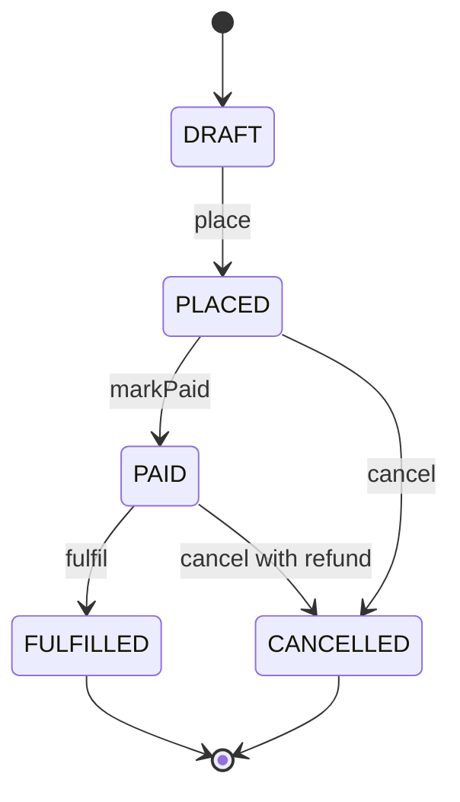
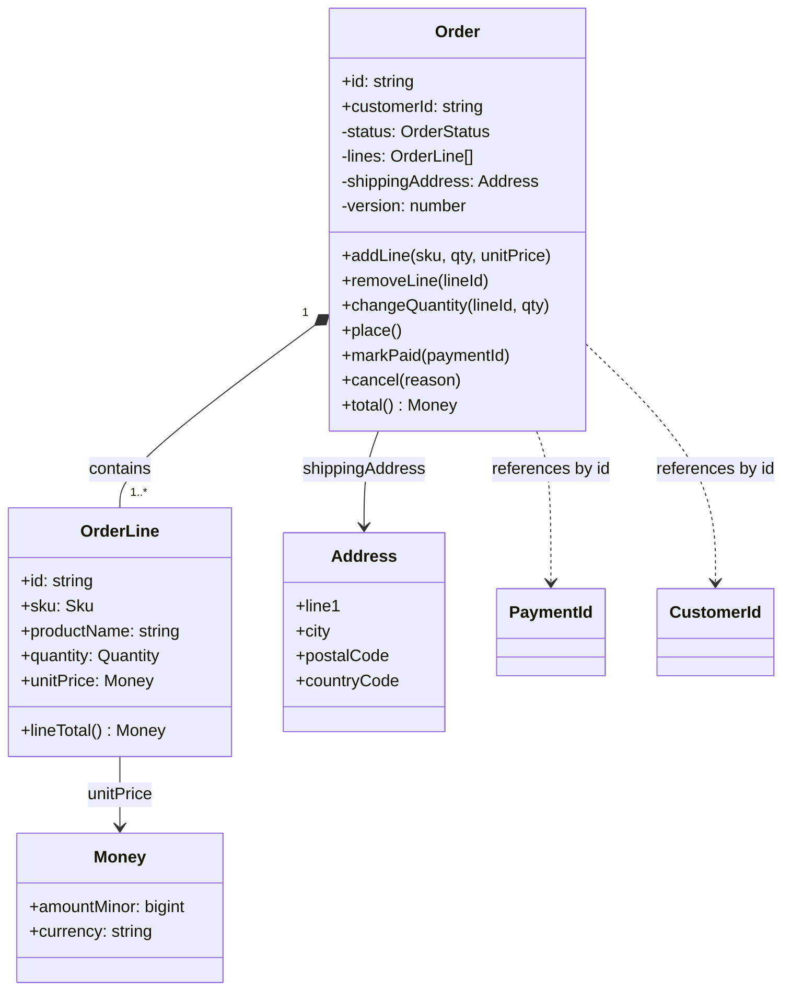

## 17.4 Entities

#### Concept

An **entity** is an object defined by its **identity**, not by its attributes. Two customers with the same name, email and address are still two customers if they have different ids. An entity has a **lifecycle**: it is created, changes over time, and may eventually be archived or deleted, but it stays "the same thing" through all those changes.

In our domain: `Order`, `Customer`, `Shipment`, `PaymentIntent`, `StockItem` are entities.

#### Why does it exist?

Without the idea of identity, you cannot answer "is this the same order I saw five minutes ago?" after its status changed. You also cannot express "this order has changed" as opposed to "this is a different order". Identity is what lets you track, reference and audit something over time.

#### Mental model

Imagine a person. Their hair, weight and address change; their passport number does not. The passport number is identity. Two people can share a name and a birthday and still be two people. An entity is anything you would give a passport number to.

#### How it works

1. **Identity is assigned once**, at creation, and never changes. Prefer generating it in the application (UUID v4, or UUID v7 / ULID for time-ordering) so the domain can create fully-formed entities without a database round trip. Database-generated serial ids force you to insert before you know who you are.
2. **Equality is by id.** `order1.equals(order2)` compares ids, nothing else.
3. **Lifecycle is expressed as state transitions with rules.** An `Order` goes `DRAFT -> PLACED -> PAID -> FULFILLED`, or `-> CANCELLED` from some states but not others. The entity enforces which transitions are legal.
4. **Behaviour lives on the entity.** `order.cancel(reason)` not `orderService.setStatus(order, 'CANCELLED')`.



#### Practical example

A minimal entity base with identity equality, and the `Order` lifecycle rules. Note that the constructor is private and creation goes through a named factory, so an `Order` can never exist in an invalid state.

```ts
// src/shared/domain/entity.ts
export abstract class Entity<TId extends string> {
  protected constructor(public readonly id: TId) {}

  equals(other?: Entity<TId>): boolean {
    if (!other) return false;
    if (this === other) return true;
    return this.id === other.id; // identity, not attributes
  }
}

// src/ordering/domain/order.ts (lifecycle excerpt; lines and totals come in 17.6)
import { randomUUID } from 'node:crypto';
import { Entity } from '../../shared/domain/entity';
import { OrderStateError } from './errors';

export type OrderStatus = 'DRAFT' | 'PLACED' | 'PAID' | 'FULFILLED' | 'CANCELLED';

export class Order extends Entity<string> {
  private status: OrderStatus = 'DRAFT';
  private cancelledReason?: string;

  private constructor(id: string, public readonly customerId: string) {
    super(id);
  }

  static createDraft(customerId: string): Order {
    return new Order(randomUUID(), customerId);
  }

  get currentStatus(): OrderStatus {
    return this.status;
  }

  place(): void {
    this.assertStatus('DRAFT', 'place');
    this.status = 'PLACED';
  }

  markPaid(): void {
    this.assertStatus('PLACED', 'markPaid');
    this.status = 'PAID';
  }

  cancel(reason: string): void {
    if (this.status !== 'PLACED' && this.status !== 'PAID') {
      throw new OrderStateError(`Cannot cancel an order in status ${this.status}`);
    }
    this.status = 'CANCELLED';
    this.cancelledReason = reason;
  }

  private assertStatus(expected: OrderStatus, action: string): void {
    if (this.status !== expected) {
      throw new OrderStateError(`Cannot ${action} an order in status ${this.status}`);
    }
  }
}
```

#### PostgreSQL example

Identity in the database is a primary key that never changes. Use `uuid` and let the application generate it. A `CHECK` on status transitions is hard to express in SQL, but you can at least constrain the set of values and record lifecycle timestamps.

```sql
CREATE TABLE ordering.orders (
  id            uuid PRIMARY KEY,                 -- generated by the application
  customer_id   uuid NOT NULL,
  status        text NOT NULL CHECK (status IN ('DRAFT','PLACED','PAID','FULFILLED','CANCELLED')),
  placed_at     timestamptz,
  paid_at       timestamptz,
  cancelled_at  timestamptz,
  cancelled_reason text,
  created_at    timestamptz NOT NULL DEFAULT now(),
  updated_at    timestamptz NOT NULL DEFAULT now(),
  -- lifecycle sanity: a cancelled order must have a reason and a timestamp
  CONSTRAINT chk_cancel_fields CHECK (
    (status <> 'CANCELLED') OR (cancelled_at IS NOT NULL AND cancelled_reason IS NOT NULL)
  )
);
```

#### Edge cases & failure modes

- **Database-generated ids** force `INSERT` before the entity can be referenced, which pushes persistence concerns into the domain. Generate in the app.
- **Natural keys as identity** (email as customer id). Emails change. Use a surrogate id and make email a unique attribute.
- **Mutable id fields** on ORM entities. Mark them `readonly` in the domain class.
- **Equality by reference** in tests: two `Order` instances loaded from the same row are equal by id but not by `===`. Always use `.equals()`.

#### How a Senior Backend Engineer thinks about this

They ask "does this thing have a lifecycle and need to be tracked?" If yes, entity. If it is just a description (an amount, an address) it is probably a value object (next section). They keep entity ids opaque strings at the boundary and never expose numeric ids that leak row counts or allow enumeration (see Part 18 — API Design on id choice).

#### Common mistakes

- Public setters on everything, so any code can put an entity in an invalid state.
- Entities that are just bags of fields with all logic in services (the anemic model, section 17.13).
- Comparing entities by all fields, so a status change makes it "a different order".

#### Interview questions

1. *What distinguishes an entity from a value object?* Expected: identity and lifecycle versus value equality and immutability.
2. *Why generate ids in the application rather than with `SERIAL`?* Expected: create valid entities before persistence, batch inserts, idempotency, no round trip, works across services.
3. *How do you stop an entity from being put into an invalid state?* Expected: private constructor, factory, behaviour methods that check transitions, no public setters.

#### Practical exercise

Implement a `Shipment` entity with states `PENDING -> PACKED -> DISPATCHED -> DELIVERED` and a `LOST` state reachable only from `DISPATCHED`. Write Jest tests proving every illegal transition throws. Acceptance criteria: no public setters; all transitions are methods named with domain verbs; 100% branch coverage of the transition rules.

## 17.5 Value objects

#### Concept

A **value object** is an object defined entirely by its **attributes**. It has no identity. Two `Money(1999, 'INR')` values are the same value, full stop. Value objects are **immutable**: you never change one, you create a new one. They carry **validation** in the constructor so an invalid value object cannot exist.

Classic value objects in e-commerce: `Money`, `Address`, `Email`, `Quantity`, `Sku`, `DateRange`, `Percentage`.

#### Why does it exist?

Primitive obsession is the disease. When money is a `number`, the following bugs are all compile-time legal:

- Adding 10 USD to 10 EUR.
- `0.1 + 0.2 === 0.30000000000000004`, so an invoice for three items at 0.1 each becomes 0.30000000000000004 and the payment provider rejects it.
- Passing `quantity` where `unitPrice` was expected because both are `number`.
- Validating an email in 14 controllers, differently in each.

Value objects put the rules in one place, make invalid states unrepresentable, and give the type system a chance to catch mistakes.

#### Mental model

Imagine a banknote. You do not care *which* 500-rupee note you hold; any 500-rupee note is as good as another. If someone swaps yours for a different 500-rupee note, nothing has changed. You cannot "modify" a note into a 1000-rupee note; you exchange it for a different note. That is a value object: interchangeable, immutable, defined by its value.

#### How it works

1. **Constructor validates and freezes.** Throw a domain error on bad input. Use `Object.freeze` or `readonly` fields.
2. **Equality compares all attributes.** Implement `equals()`.
3. **Operations return new instances.** `money.add(other)` returns a new `Money`.
4. **Never use floating point for money.** Store integer minor units (paise, cents) as `bigint` or `number` within safe integer range, plus a currency code. In PostgreSQL use `bigint` minor units or `numeric(19,4)`; never `float`/`double precision`.
5. **Persist as columns of the owning entity** (embedded), not as a separate table with its own id.

#### Practical example

`Money` with currency, integer minor units and safe arithmetic:

```ts
// src/shared/domain/money.ts
import { DomainError } from './domain-error';

const MINOR_UNITS: Record<string, number> = { INR: 100, USD: 100, EUR: 100, JPY: 1, KWD: 1000 };

export class Money {
  private constructor(
    public readonly amountMinor: bigint,   // integer minor units, e.g. paise
    public readonly currency: string,      // ISO 4217
  ) {
    if (!(currency in MINOR_UNITS)) throw new DomainError(`Unsupported currency ${currency}`);
    Object.freeze(this);
  }

  static ofMinor(amountMinor: bigint | number, currency: string): Money {
    return new Money(BigInt(amountMinor), currency);
  }

  /** Parse "19.99" style decimal strings exactly, without ever touching a float. */
  static parse(decimal: string, currency: string): Money {
    const scale = MINOR_UNITS[currency];
    const m = /^(-)?(\d+)(?:\.(\d+))?$/.exec(decimal);
    if (!m) throw new DomainError(`Invalid amount ${decimal}`);
    const [, sign, whole, frac = ''] = m;
    const digits = Math.log10(scale);
    if (frac.length > digits) throw new DomainError(`Too many decimals for ${currency}`);
    const minor = BigInt(whole) * BigInt(scale) + BigInt(frac.padEnd(digits, '0') || '0');
    return new Money(sign ? -minor : minor, currency);
  }

  static zero(currency: string): Money {
    return new Money(0n, currency);
  }

  add(other: Money): Money {
    this.assertSameCurrency(other);
    return new Money(this.amountMinor + other.amountMinor, this.currency);
  }

  subtract(other: Money): Money {
    this.assertSameCurrency(other);
    return new Money(this.amountMinor - other.amountMinor, this.currency);
  }

  multiply(qty: number): Money {
    if (!Number.isInteger(qty) || qty < 0) throw new DomainError('Quantity must be a non-negative integer');
    return new Money(this.amountMinor * BigInt(qty), this.currency);
  }

  /** Percentage with banker's-free rounding to nearest minor unit, half up. */
  percent(basisPoints: number): Money {
    const scaled = this.amountMinor * BigInt(basisPoints);
    const rounded = (scaled + 5000n) / 10000n; // half-up on 10_000 basis points
    return new Money(rounded, this.currency);
  }

  isNegative(): boolean { return this.amountMinor < 0n; }
  isZero(): boolean { return this.amountMinor === 0n; }

  equals(other: Money): boolean {
    return this.currency === other.currency && this.amountMinor === other.amountMinor;
  }

  toString(): string {
    const scale = BigInt(MINOR_UNITS[this.currency]);
    const abs = this.amountMinor < 0n ? -this.amountMinor : this.amountMinor;
    const digits = Math.log10(Number(scale));
    const whole = abs / scale;
    const frac = (abs % scale).toString().padStart(digits, '0');
    return `${this.amountMinor < 0n ? '-' : ''}${whole}${digits ? '.' + frac : ''} ${this.currency}`;
  }

  private assertSameCurrency(other: Money): void {
    if (other.currency !== this.currency) {
      throw new DomainError(`Currency mismatch: ${this.currency} vs ${other.currency}`);
    }
  }
}
```

`Email` and `Address`:

```ts
// src/shared/domain/email.ts
export class Email {
  private static readonly RE = /^[^\s@]{1,64}@[^\s@]{1,255}\.[^\s@]{2,}$/;
  private constructor(public readonly value: string) { Object.freeze(this); }

  static of(raw: string): Email {
    const normalized = raw.trim().toLowerCase();
    if (normalized.length > 320 || !Email.RE.test(normalized)) {
      throw new DomainError('Invalid email address');
    }
    return new Email(normalized);
  }
  equals(other: Email): boolean { return this.value === other.value; }
}

// src/customer/domain/address.ts
export class Address {
  private constructor(
    public readonly line1: string,
    public readonly line2: string | null,
    public readonly city: string,
    public readonly postalCode: string,
    public readonly countryCode: string, // ISO 3166-1 alpha-2
  ) { Object.freeze(this); }

  static of(p: { line1: string; line2?: string; city: string; postalCode: string; countryCode: string }): Address {
    if (!p.line1?.trim()) throw new DomainError('line1 is required');
    if (!/^[A-Z]{2}$/.test(p.countryCode)) throw new DomainError('countryCode must be ISO alpha-2');
    if (p.countryCode === 'IN' && !/^\d{6}$/.test(p.postalCode)) throw new DomainError('Indian PIN must be 6 digits');
    return new Address(p.line1.trim(), p.line2?.trim() ?? null, p.city.trim(), p.postalCode.trim(), p.countryCode);
  }

  /** A new address with a changed line; the original is untouched. */
  withLine2(line2: string): Address {
    return new Address(this.line1, line2, this.city, this.postalCode, this.countryCode);
  }

  equals(o: Address): boolean {
    return this.line1 === o.line1 && this.line2 === o.line2 && this.city === o.city
      && this.postalCode === o.postalCode && this.countryCode === o.countryCode;
  }
}
```

#### NestJS example

Value objects are created at the boundary from validated DTOs. The DTO validates *shape* (is it a string, is it present); the value object validates *meaning* (is it a legal email, is the currency supported).

```ts
// src/ordering/api/dto/add-line.dto.ts
import { IsInt, IsString, Length, Matches, Min } from 'class-validator';

export class AddLineDto {
  @IsString() @Length(3, 64) sku: string;
  @IsInt() @Min(1) quantity: number;
  @Matches(/^\d+(\.\d{1,2})?$/) unitPrice: string;  // decimal string, never a JSON number
  @IsString() @Length(3, 3) currency: string;
}

// src/ordering/application/add-line.service.ts (excerpt)
const unitPrice = Money.parse(dto.unitPrice, dto.currency); // meaning-level validation here
order.addLine(new Sku(dto.sku), Quantity.of(dto.quantity), unitPrice);
```

Notice `unitPrice: string`. JSON numbers are IEEE doubles. If a client sends `19.99` as a JSON number, some serialisers will already have turned it into `19.989999999`. Accept money as a string on the wire and parse it exactly.

#### PostgreSQL example

Money as two columns of the owning row. `bigint` minor units is the safest choice; `numeric(19,4)` is acceptable when you must store fractional minor units (interest, FX rates).

```sql
CREATE TABLE ordering.order_lines (
  id                uuid PRIMARY KEY,
  order_id          uuid NOT NULL REFERENCES ordering.orders(id) ON DELETE CASCADE,
  sku               text NOT NULL,
  product_name      text NOT NULL,                     -- snapshot
  quantity          integer NOT NULL CHECK (quantity > 0),
  unit_price_minor  bigint NOT NULL CHECK (unit_price_minor >= 0),
  currency          char(3) NOT NULL,
  line_total_minor  bigint NOT NULL CHECK (line_total_minor >= 0),
  CONSTRAINT chk_line_total CHECK (line_total_minor = quantity * unit_price_minor)
);

-- Never this:
-- unit_price double precision   -- 0.1 + 0.2 problem, rounding drift over millions of rows
```

Why not `money` type? PostgreSQL's `money` type is locale-dependent and has fixed two-decimal precision; it breaks the moment you need JPY (0 decimals) or KWD (3 decimals). Use `bigint` plus currency.

#### TypeORM example

Embed the value object's fields into the entity with `@Column(() => ...)` embedded entities, or map manually in a mapper (section 17.7). The embedded approach is convenient but couples the ORM to the domain class shape.

```ts
// src/ordering/infrastructure/money.embedded.ts
import { Column } from 'typeorm';

export class MoneyColumns {
  @Column('bigint', { name: 'amount_minor' }) amountMinor: string; // TypeORM returns bigint as string
  @Column('char', { length: 3 }) currency: string;
}

// src/ordering/infrastructure/order-line.orm-entity.ts
@Entity({ schema: 'ordering', name: 'order_lines' })
export class OrderLineOrmEntity {
  @PrimaryColumn('uuid') id: string;
  @Column('uuid', { name: 'order_id' }) orderId: string;
  @Column() sku: string;
  @Column('int') quantity: number;
  @Column(() => MoneyColumns, { prefix: 'unit_price_' }) unitPrice: MoneyColumns; // unit_price_amount_minor, unit_price_currency
}
```

TypeORM returns `bigint` columns as strings to avoid precision loss. Convert with `BigInt(row.amountMinor)` in the mapper.

#### Sequelize example

Sequelize has no embedded objects, so a mapper (or a getter/setter pair) converts between columns and the value object.

```ts
// src/ordering/infrastructure/order-line.model.ts
@Table({ schema: 'ordering', tableName: 'order_lines', timestamps: false })
export class OrderLineModel extends Model {
  @Column({ type: DataType.UUID, primaryKey: true }) declare id: string;
  @Column(DataType.UUID) declare orderId: string;
  @Column(DataType.STRING) declare sku: string;
  @Column(DataType.INTEGER) declare quantity: number;
  @Column({ type: DataType.BIGINT, field: 'unit_price_minor' }) declare unitPriceMinor: string;
  @Column(DataType.CHAR(3)) declare currency: string;

  get unitPrice(): Money {
    return Money.ofMinor(BigInt(this.unitPriceMinor), this.currency);
  }
}
```

#### Production scenario

A marketplace handled 12 currencies. Before value objects, there were 23 separate places that formatted or rounded prices, and quarterly reconciliation with the payment provider was off by a few hundred rupees every time (float drift across ~2 million line items). After `Money` was introduced with integer minor units and one rounding rule (half-up at the line level, documented), reconciliation matched to the paisa. The change touched 60 files and took one engineer two weeks; the cost of the bug had been a finance analyst's day every quarter, forever.

#### Failure scenario

At 11:20 a promotion "15% off" went live. Discount was computed as `price * 0.85` in JavaScript floats and then `Math.round()`ed. For a price of 1005 paise, `1005 * 0.85 = 854.2499999999999`, which rounded to 854 instead of the 854.25 -> 854 the finance team expected (fine here) but for 1015 paise, `862.75` came out as `862.7499999999999` and rounded to 862 instead of 863. Thousands of orders were one paisa short. The payment provider's amount validation compared against a server-side recalculation and rejected 4% of checkouts with "amount mismatch". Money as a value object with `percent(basisPoints)` on integers made this impossible.

#### Edge cases & failure modes

- **Currency mismatch** in arithmetic. Throw; never silently convert.
- **JSON numbers for money** on the wire. Use strings.
- **`bigint` in JSON.** `JSON.stringify` throws on bigint. Serialise `Money` explicitly (`toJSON()` returning `{ amount: '19.99', currency: 'INR' }`).
- **Rounding rules** differ by jurisdiction and by step (per line vs per order). Pick one, document it, test it.
- **Value objects with too much validation** (address validation against a postal service API) belong in a domain service, not the constructor. Constructors must be pure and fast.
- **Mutable arrays inside "immutable" objects.** Freeze deeply or expose `ReadonlyArray`.

#### How a Senior Backend Engineer thinks about this

They see a `number` typed as `price` or a `string` typed as `email` in a function signature and ask "who validated this?" If the answer is "the controller, probably", they introduce a value object. They treat `Money` as non-negotiable in any system that touches payments and will block a PR that adds a `float` money column.

#### Common mistakes

- `price: number` everywhere, then `toFixed(2)` in random places.
- Value objects with ids and their own tables ("addresses" table with `address_id`, then updating an address in place and changing history on old orders).
- Validating in the DTO only, so internal code paths (imports, jobs) can create invalid values.
- Sharing one `Address` object between two orders and mutating it.

#### Interview questions

1. *Why never use floating point for money? Show a concrete failing example.* Expected: binary fractions, `0.1 + 0.2`, rounding drift; use integer minor units plus currency.
2. *How do you represent money in PostgreSQL and why not the `money` type?* Expected: `bigint` minor units plus `char(3)`, or `numeric`; the `money` type is locale-bound with fixed two decimals.
3. *An address is stored on the customer. An order ships to that address. The customer later edits the address. What should the old order show?* Expected: the order holds a snapshot value object; value objects are copied, not referenced.
4. *Where does validation of an email belong: DTO, value object, or database?* Expected: shape in the DTO, meaning in the value object, uniqueness in the database; all three.

#### Practical exercise

Implement `Money` (as above), `Quantity` (positive integer, max 10,000) and `Percentage` (0 to 10000 basis points). Write property-based or table-driven Jest tests showing that `sum of line totals` equals `order total` for 10,000 random carts with two-decimal prices, and that the same carts computed with JavaScript floats disagree in at least some cases. Acceptance criteria: zero float arithmetic in the implementation; `JSON.stringify` of a `Money` produces `{ amount: string, currency: string }`.

## 17.6 Aggregates and aggregate roots

#### Concept

An **aggregate** is a cluster of entities and value objects that are changed together and must stay consistent together. The **aggregate root** is the one entity through which all changes to the cluster go. Outside code holds a reference only to the root and calls its methods; it never reaches in and modifies a child directly.

`Order` is an aggregate root. `OrderLine` is a child entity inside the aggregate. `Money`, `Sku`, `Quantity`, `ShippingAddress` are value objects inside it. To add a line, you call `order.addLine(...)`, never `new OrderLine(...)` followed by `orderLines.push(...)` from a service.

An aggregate is also the **unit of consistency and the unit of transaction**: one aggregate is loaded, changed and saved in one database transaction, and the invariants (rules that must always be true) inside it are guaranteed at the end of every transaction.

#### Why does it exist?

Consider the invariant "order total equals the sum of line totals". If any code anywhere can insert an `order_lines` row, the invariant is a hope, not a guarantee. Every code path must remember to recompute the total. One forgets, and now Finance sees totals that do not match lines.

Aggregates give invariants a home. The root is the only door in, and every method on the root re-establishes the invariants before returning. Combined with one-transaction-per-aggregate, you get: *after every commit, every aggregate is in a valid state.* That is a much stronger and simpler promise than "every service is careful".

#### Mental model

Imagine a sealed shipping container. Inside there are boxes (lines), labels (value objects) and a manifest (total). You cannot open the container and swap a box; you hand the container to the port authority (the root) with an instruction, and they open it, make the change, update the manifest, and reseal. The manifest is always right because only one party ever touches the contents, and they always update it.

#### How it works



Rules that define the boundary of an aggregate:

1. **Invariants decide membership.** If a rule must be checked atomically across two objects, they are in the same aggregate. "Line totals sum to order total" spans `Order` and `OrderLine`, so they are one aggregate. "Customer's lifetime spend" spans `Customer` and all their orders; that is not an invariant that needs atomic enforcement, so `Customer` and `Order` are separate aggregates.
2. **One transaction modifies one aggregate.** If a use case must modify two aggregates, do it in two transactions and use a domain event (or a saga) to connect them, accepting eventual consistency between them.
3. **Reference other aggregates by id.** `Order` holds `customerId: string`, not `customer: Customer`. Loading an order does not load the customer, their addresses and their 400 previous orders.
4. **Keep aggregates small.** A good aggregate loads in one query with a small number of child rows (tens, not thousands). If an aggregate needs pagination to display, it is too big.
5. **Optimistic concurrency on the root.** A version column on the root row detects two transactions modifying the same aggregate at the same time.
6. **The root raises domain events** describing what happened; they are dispatched after commit (section 17.10).

#### Practical example

The `Order` aggregate with lines, totals and the key invariants. Read the comments; each one names an invariant.

```ts
// src/ordering/domain/order.ts
import { randomUUID } from 'node:crypto';
import { AggregateRoot } from '../../shared/domain/aggregate-root';
import { Money } from '../../shared/domain/money';
import { Address } from '../../customer/domain/address'; // shared kernel value object, see 7.12
import { OrderLine } from './order-line';
import { OrderPlaced, OrderCancelled, OrderPaid } from './events';
import { OrderStateError, OrderInvariantError } from './errors';

export type OrderStatus = 'DRAFT' | 'PLACED' | 'PAID' | 'FULFILLED' | 'CANCELLED';
const MAX_LINES = 100;

export class Order extends AggregateRoot<string> {
  private constructor(
    id: string,
    public readonly customerId: string,
    private readonly currency: string,
    private status: OrderStatus,
    private lines: OrderLine[],
    private shippingAddress: Address | null,
    public readonly version: number,
    private placedAt: Date | null,
  ) {
    super(id);
  }

  // ----- factories -----
  static createDraft(customerId: string, currency: string): Order {
    return new Order(randomUUID(), customerId, currency, 'DRAFT', [], null, 0, null);
  }

  /** Used only by the repository to rebuild from persistence. Does not validate; the DB did. */
  static rehydrate(p: {
    id: string; customerId: string; currency: string; status: OrderStatus;
    lines: OrderLine[]; shippingAddress: Address | null; version: number; placedAt: Date | null;
  }): Order {
    return new Order(p.id, p.customerId, p.currency, p.status, p.lines, p.shippingAddress, p.version, p.placedAt);
  }

  // ----- queries -----
  get currentStatus(): OrderStatus { return this.status; }
  get orderLines(): ReadonlyArray<OrderLine> { return this.lines; }
  get address(): Address | null { return this.shippingAddress; }

  /** Invariant: total is always the sum of line totals. Computed, never stored separately in memory. */
  total(): Money {
    return this.lines.reduce((sum, l) => sum.add(l.lineTotal()), Money.zero(this.currency));
  }

  // ----- commands -----
  addLine(sku: string, productName: string, quantity: number, unitPrice: Money): void {
    this.assertMutable('add a line');                                  // invariant: only DRAFT is editable
    if (unitPrice.currency !== this.currency) throw new OrderInvariantError('Line currency must match order currency');
    if (this.lines.length >= MAX_LINES) throw new OrderInvariantError(`Order cannot exceed ${MAX_LINES} lines`);
    const existing = this.lines.find((l) => l.sku === sku);
    if (existing) {
      existing.increaseQuantity(quantity);                             // invariant: one line per SKU
      return;
    }
    this.lines.push(OrderLine.create(sku, productName, quantity, unitPrice));
  }

  changeQuantity(lineId: string, quantity: number): void {
    this.assertMutable('change quantity');
    const line = this.lines.find((l) => l.id === lineId);
    if (!line) throw new OrderInvariantError(`Line ${lineId} not on order`);
    line.setQuantity(quantity);
  }

  removeLine(lineId: string): void {
    this.assertMutable('remove a line');
    this.lines = this.lines.filter((l) => l.id !== lineId);
  }

  setShippingAddress(address: Address): void {
    this.assertMutable('change the address');
    this.shippingAddress = address;
  }

  place(now: Date = new Date()): void {
    this.assertStatus('DRAFT', 'place');
    if (this.lines.length === 0) throw new OrderInvariantError('Cannot place an empty order');   // invariant
    if (!this.shippingAddress) throw new OrderInvariantError('Shipping address is required');    // invariant
    if (this.total().isZero()) throw new OrderInvariantError('Order total must be positive');    // invariant
    this.status = 'PLACED';
    this.placedAt = now;
    this.raise(new OrderPlaced(this.id, this.customerId, this.lines.map((l) => l.snapshot()), this.total(), now));
  }

  markPaid(paymentId: string, now: Date = new Date()): void {
    this.assertStatus('PLACED', 'mark paid');
    this.status = 'PAID';
    this.raise(new OrderPaid(this.id, paymentId, now));
  }

  cancel(reason: string, now: Date = new Date()): void {
    if (this.status === 'FULFILLED') throw new OrderStateError('Cannot cancel a fulfilled order');  // invariant
    if (this.status === 'CANCELLED') return;                                                       // idempotent
    const wasPaid = this.status === 'PAID';
    this.status = 'CANCELLED';
    this.raise(new OrderCancelled(this.id, reason, wasPaid, now));
  }

  private assertMutable(action: string): void {
    if (this.status !== 'DRAFT') throw new OrderStateError(`Cannot ${action}: order is ${this.status}`);
  }
  private assertStatus(expected: OrderStatus, action: string): void {
    if (this.status !== expected) throw new OrderStateError(`Cannot ${action}: order is ${this.status}`);
  }
}
```

The `OrderLine` child entity has an id (so it can be addressed for quantity changes) but is only reachable through the root:

```ts
// src/ordering/domain/order-line.ts
import { randomUUID } from 'node:crypto';
import { Money } from '../../shared/domain/money';
import { OrderInvariantError } from './errors';

export class OrderLine {
  private constructor(
    public readonly id: string,
    public readonly sku: string,
    public readonly productName: string,
    private quantity: number,
    public readonly unitPrice: Money,
  ) {}

  static create(sku: string, productName: string, quantity: number, unitPrice: Money): OrderLine {
    const line = new OrderLine(randomUUID(), sku, productName, 0, unitPrice);
    line.setQuantity(quantity);
    return line;
  }
  static rehydrate(p: { id: string; sku: string; productName: string; quantity: number; unitPrice: Money }): OrderLine {
    return new OrderLine(p.id, p.sku, p.productName, p.quantity, p.unitPrice);
  }

  get qty(): number { return this.quantity; }
  lineTotal(): Money { return this.unitPrice.multiply(this.quantity); }

  /** Package-private in spirit: only Order calls these. */
  setQuantity(q: number): void {
    if (!Number.isInteger(q) || q < 1 || q > 10_000) throw new OrderInvariantError('Quantity must be 1..10000');
    this.quantity = q;
  }
  increaseQuantity(by: number): void { this.setQuantity(this.quantity + by); }

  snapshot() {
    return { lineId: this.id, sku: this.sku, quantity: this.quantity, unitPrice: this.unitPrice.toString() };
  }
}
```

And the tiny base class that collects events:

```ts
// src/shared/domain/aggregate-root.ts
import { Entity } from './entity';

export interface DomainEvent { readonly occurredAt: Date; readonly name: string; }

export abstract class AggregateRoot<TId extends string> extends Entity<TId> {
  private pendingEvents: DomainEvent[] = [];

  protected raise(event: DomainEvent): void { this.pendingEvents.push(event); }

  /** Called by the unit of work after commit. Returns and clears. */
  pullEvents(): DomainEvent[] {
    const events = this.pendingEvents;
    this.pendingEvents = [];
    return events;
  }
}
```

#### PostgreSQL example

The schema backs the invariants with constraints, so even a bug that bypasses the aggregate cannot persist an invalid state. The total is stored on the order for querying and is verified against the lines by a deferred trigger.

```sql
CREATE TABLE ordering.orders (
  id                 uuid PRIMARY KEY,
  customer_id        uuid NOT NULL,
  currency           char(3) NOT NULL,
  status             text NOT NULL CHECK (status IN ('DRAFT','PLACED','PAID','FULFILLED','CANCELLED')),
  total_minor        bigint NOT NULL DEFAULT 0 CHECK (total_minor >= 0),
  ship_line1         text, ship_line2 text, ship_city text, ship_postal_code text, ship_country char(2),
  version            integer NOT NULL DEFAULT 0,        -- optimistic locking
  placed_at          timestamptz,
  created_at         timestamptz NOT NULL DEFAULT now(),
  updated_at         timestamptz NOT NULL DEFAULT now(),
  -- a placed order must have an address and a positive total
  CONSTRAINT chk_placed_requires_address CHECK (status = 'DRAFT' OR ship_line1 IS NOT NULL),
  CONSTRAINT chk_placed_positive_total   CHECK (status = 'DRAFT' OR total_minor > 0)
);

CREATE TABLE ordering.order_lines (
  id                 uuid PRIMARY KEY,
  order_id           uuid NOT NULL REFERENCES ordering.orders(id) ON DELETE CASCADE,
  sku                text NOT NULL,
  product_name       text NOT NULL,
  quantity           integer NOT NULL CHECK (quantity BETWEEN 1 AND 10000),
  unit_price_minor   bigint NOT NULL CHECK (unit_price_minor >= 0),
  line_total_minor   bigint NOT NULL CHECK (line_total_minor = quantity * unit_price_minor),
  CONSTRAINT ux_order_sku UNIQUE (order_id, sku)                       -- one line per SKU
);
CREATE INDEX ix_order_lines_order ON ordering.order_lines(order_id);

-- Deferred check: total equals sum of lines at commit time.
CREATE OR REPLACE FUNCTION ordering.check_order_total() RETURNS trigger AS $$
DECLARE computed bigint;
BEGIN
  SELECT COALESCE(SUM(line_total_minor), 0) INTO computed
  FROM ordering.order_lines WHERE order_id = COALESCE(NEW.order_id, NEW.id, OLD.order_id, OLD.id);
  IF EXISTS (SELECT 1 FROM ordering.orders o
             WHERE o.id = COALESCE(NEW.order_id, NEW.id, OLD.order_id, OLD.id)
               AND o.total_minor <> computed) THEN
    RAISE EXCEPTION 'order total does not match sum of lines';
  END IF;
  RETURN NULL;
END $$ LANGUAGE plpgsql;

CREATE CONSTRAINT TRIGGER trg_order_total_lines
  AFTER INSERT OR UPDATE OR DELETE ON ordering.order_lines
  DEFERRABLE INITIALLY DEFERRED FOR EACH ROW EXECUTE FUNCTION ordering.check_order_total();
CREATE CONSTRAINT TRIGGER trg_order_total_orders
  AFTER INSERT OR UPDATE OF total_minor ON ordering.orders
  DEFERRABLE INITIALLY DEFERRED FOR EACH ROW EXECUTE FUNCTION ordering.check_order_total();
```

`DEFERRABLE INITIALLY DEFERRED` matters: within a transaction the lines and the total are updated in separate statements, so the check must run at commit, not after each statement.

#### TypeORM example

Loading the whole aggregate in one query and locking the root row for the duration of a write. The `version` column is used by TypeORM's optimistic locking on `save()` (it throws `OptimisticLockVersionMismatchError` when the stored version differs from the loaded one).

```ts
// src/ordering/infrastructure/order.orm-entity.ts
import { Entity, PrimaryColumn, Column, OneToMany, VersionColumn, Index } from 'typeorm';
import { OrderLineOrmEntity } from './order-line.orm-entity';

@Entity({ schema: 'ordering', name: 'orders' })
export class OrderOrmEntity {
  @PrimaryColumn('uuid') id: string;
  @Index() @Column('uuid', { name: 'customer_id' }) customerId: string;
  @Column('char', { length: 3 }) currency: string;
  @Column() status: string;
  @Column('bigint', { name: 'total_minor' }) totalMinor: string;
  @Column({ name: 'ship_line1', nullable: true, type: 'text' }) shipLine1: string | null;
  @Column({ name: 'ship_line2', nullable: true, type: 'text' }) shipLine2: string | null;
  @Column({ name: 'ship_city', nullable: true, type: 'text' }) shipCity: string | null;
  @Column({ name: 'ship_postal_code', nullable: true, type: 'text' }) shipPostalCode: string | null;
  @Column({ name: 'ship_country', nullable: true, type: 'char', length: 2 }) shipCountry: string | null;
  @VersionColumn() version: number;
  @Column({ name: 'placed_at', type: 'timestamptz', nullable: true }) placedAt: Date | null;
  @OneToMany(() => OrderLineOrmEntity, (l) => l.order, { cascade: true, eager: false })
  lines: OrderLineOrmEntity[];
}

// Loading the aggregate: one query, root plus children, pessimistic lock on the root only.
const row = await manager.getRepository(OrderOrmEntity).createQueryBuilder('o')
  .leftJoinAndSelect('o.lines', 'l')
  .where('o.id = :id', { id })
  .setLock('pessimistic_write', undefined, ['o'])   // FOR UPDATE OF o
  .getOne();
```

#### Sequelize example

```ts
const row = await OrderModel.findByPk(id, {
  include: [{ model: OrderLineModel, as: 'lines' }],
  lock: { level: t.LOCK.UPDATE, of: OrderModel },  // FOR UPDATE OF orders
  transaction: t,
});
```

Sequelize's `version: true` on the model adds a `version` column and raises `OptimisticLockError` on stale saves.

#### Production scenario

An order aggregate averages 3.2 lines, max 100 by rule. Loading is a single `SELECT ... LEFT JOIN order_lines` returning at most 100 rows, roughly 1.5 ms on a warm database. The place-order transaction holds the root row lock for about 6 ms. At 15 orders/s peak that is nothing; even at 500 orders/s the lock hold time per distinct order is what matters, and orders are distinct rows, so there is no contention. Contrast with a hypothetical `Customer` aggregate that contained the customer's orders: loading it would pull thousands of rows, and two devices placing orders for the same customer would contend on the customer row.

#### Failure scenario

At 14:05 a "quick fix" script was run to correct a product name on historical orders. It did `UPDATE order_lines SET quantity = 0 WHERE sku = 'X'` by mistake (wrong column in the script). The `CHECK (quantity BETWEEN 1 AND 10000)` rejected every row. Without the constraint, thousands of orders would have had zero-quantity lines and totals that no longer matched, and the deferred trigger would not have been consulted because the script never touched `orders`. Both layers of defence (aggregate in code, constraints in the database) are needed; the code protects normal paths, the database protects against scripts, migrations and bugs.

#### Edge cases & failure modes

- **Aggregate too big.** A `Customer` aggregate that holds all orders, or a `Warehouse` aggregate that holds all stock items, loads megabytes per request and serialises all writes on one row. Split: make `Order` its own aggregate referencing `customerId`; make `StockItem` its own aggregate keyed by `(sku, warehouseId)`.
- **Concurrent modification.** Two admins edit the same draft order. Optimistic locking makes the second save fail with a version mismatch; the application returns 409 and the client reloads. Pessimistic `FOR UPDATE` serialises them instead; use it when conflicts are frequent and short.
- **Cross-aggregate invariants.** "Total reserved stock across warehouses must not exceed total on hand" spans many `StockItem` aggregates. You cannot enforce it atomically without one giant lock. Options: enforce per-warehouse (each `StockItem` is its own aggregate and its own invariant), accept eventual consistency with a reconciliation job, or use a saga that reserves per warehouse and compensates.
- **Child modified without root.** A repository method `updateLineQuantity(lineId, qty)` bypasses `Order` and breaks the total invariant. Repositories operate on roots only.
- **Events raised, then transaction rolled back.** If events are dispatched before commit, downstream contexts react to something that never happened. Dispatch after commit (section 17.10).
- **Loading the aggregate without its children** and then saving, which deletes the children via cascade. Always load the full aggregate or use a repository that knows how.

#### How a Senior Backend Engineer thinks about this

- "What must be true at the end of every transaction?" Those are the invariants; they decide the aggregate boundary.
- "What is the smallest thing I can lock?" Small aggregates mean less contention.
- "If two of these are modified together, do they *have* to be atomic, or is a few hundred milliseconds of inconsistency fine?" Usually fine; use events.
- They design for the 99% case (small aggregate, one transaction) and handle the 1% (cross-aggregate rules) with explicit eventual consistency and reconciliation rather than giant transactions.
- To a product manager: "An order is a sealed box; only the order itself can change what is inside, so totals are always right. Inventory is a different box. Between boxes we pass notes, and once in a while a checker walks around comparing notes to boxes."

#### Common mistakes

- Modelling the whole database as one aggregate graph with `@OneToMany` everywhere, eager loading, and `cascade: true` on all relations.
- Exposing `lines` as a mutable array from the root.
- Storing `total` as a plain column and hoping every code path updates it, with no constraint and no computed check.
- Two aggregates in one transaction "because it is easier", then discovering deadlocks under load because different code paths lock them in different orders.
- Making `Customer` the root of everything the customer has ever done.

#### Interview questions

1. *What is an aggregate and what decides its boundary?* Expected: cluster of objects changed together; boundary decided by invariants that must be transactionally consistent; small; one transaction per aggregate.
2. *Order and Customer: same aggregate or different? Why?* Expected: different; no invariant needs atomicity across them; reference by id; size and contention.
3. *How do you handle two users editing the same order at the same time?* Expected: optimistic locking with a version column and 409 on mismatch, or pessimistic `FOR UPDATE` with short transactions; when to prefer which.
4. *Stock must not go negative across five warehouses. How do you enforce it?* Expected: per-warehouse `StockItem` aggregate with per-row invariant; cross-warehouse rules via saga or reconciliation; not one global lock.
5. *Why keep database constraints if the aggregate already enforces invariants?* Expected: defence in depth against scripts, migrations, other services, bugs.

#### Practical exercise

Extend the `Order` aggregate with a `applyPromotion(code, percentBasisPoints)` command with invariants: at most one promotion per order, promotion cannot make total negative, promotion cannot be applied after placement. Add a `discount_minor` column and update the deferred trigger so `total_minor = sum(line_total_minor) - discount_minor`. Write Jest unit tests for the aggregate and one integration test proving the trigger rejects a mismatched total. Acceptance criteria: all invariants are enforced both in code and in the database; the aggregate never exposes a public setter; the transaction touches only the `orders` and `order_lines` tables.
